# FullTopoModel 拓扑模型抽象

<cite>
**本文引用的文件**   
- [FullTopoModel.hpp](file://meshmodel/FullTopoModel.hpp)
- [FullTopoModel.cpp](file://meshmodel/FullTopoModel.cpp)
- [mesh_slice.hpp](file://LibHsBaSlicer/Slice/mesh_slice.hpp)
- [mesh_slice.cpp](file://LibHsBaSlicer/Slice/mesh_slice.cpp)
- [full_topo_model_test.cpp](file://tests/Models/full_topo_model_test.cpp)
</cite>

## 目录
1. [引言](#引言)
2. [项目结构定位](#项目结构定位)
3. [核心概念与数据模型](#核心概念与数据模型)
4. [架构总览](#架构总览)
5. [详细组件分析](#详细组件分析)
6. [依赖关系分析](#依赖关系分析)
7. [性能与复杂度分析](#性能与复杂度分析)
8. [Lua 脚本集成参考](#lua-脚本集成参考)
9. [API 参考](#api-参考)
10. [故障排除指南](#故障排除指南)
11. [结论](#结论)

## 引言
FullTopoModel 是 HsBaSlicer 中面向切片场景的“全拓扑重建网格模型”抽象。它从三角形面片出发，在构造阶段重建顶点、边、面之间的完整拓扑关系，并提供 Z 轴切片接口：SafeSlice（仅闭合轮廓）、UnSafeSlice（允许开放折线）、SliceFast（基于已重建拓扑的快速切片），以及通过 Lua 脚本自定义切片逻辑的能力。该类不对外暴露修改接口，只读访问其内部拓扑，适合在多层面切片流水线中被复用。

## 项目结构定位
FullTopoModel 位于 meshmodel 模块，作为底层几何拓扑实现；LibHsBaSlicer 的 Slice 层提供对外 C API，将 IModel 转换为 FullTopoModel 并调用其切片方法；测试用例覆盖典型金字塔模型的截面面积与闭合性验证。

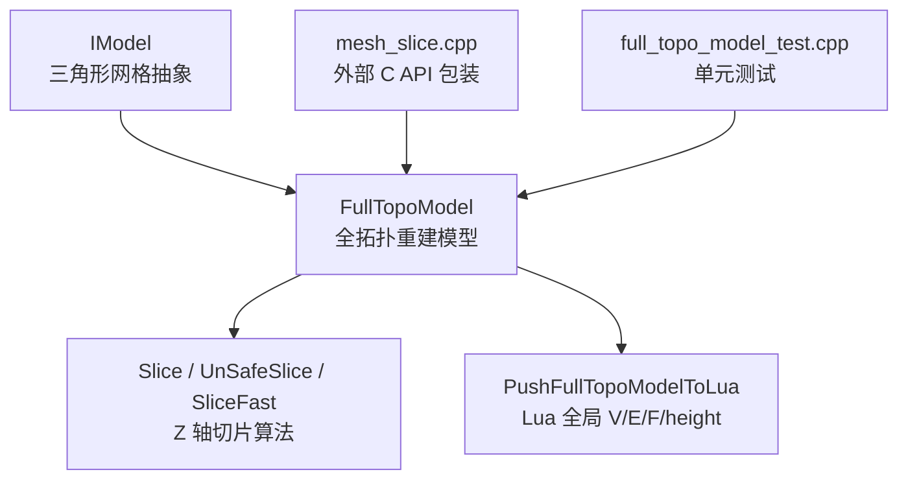

**图表来源**
- [FullTopoModel.hpp:53-142](file://meshmodel/FullTopoModel.hpp#L53-L142)
- [FullTopoModel.cpp:27-48](file://meshmodel/FullTopoModel.cpp#L27-L48)
- [mesh_slice.cpp:46-115](file://LibHsBaSlicer/Slice/mesh_slice.cpp#L46-L115)
- [full_topo_model_test.cpp:144-158](file://tests/Models/full_topo_model_test.cpp#L144-L158)

**章节来源**
- [FullTopoModel.hpp:18-52](file://meshmodel/FullTopoModel.hpp#L18-L52)
- [mesh_slice.cpp:1-44](file://LibHsBaSlicer/Slice/mesh_slice.cpp#L1-L44)

## 核心概念与数据模型
FullTopoModel 的核心由三类实体构成：Vertex、Edge、Face。它们在构造时通过三角形面片重建邻接关系，形成可遍历的拓扑图。

| 实体 | 主要字段 | 语义说明 |
|---|---|---|
| Vertex | vertex、faces、edges | 三维顶点坐标，以及关联的面索引和边索引 |
| Edge | vertices、faces | 两个端点顶点索引，以及两侧面的索引 |
| Face | triangle、edges、normal | 三个顶点索引、三条边索引，可选法向量 |

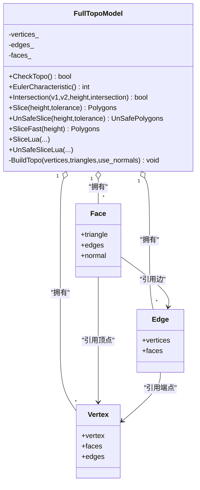

**图表来源**
- [FullTopoModel.hpp:56-72](file://meshmodel/FullTopoModel.hpp#L56-L72)
- [FullTopoModel.hpp:74-142](file://meshmodel/FullTopoModel.hpp#L74-L142)

**章节来源**
- [FullTopoModel.hpp:56-72](file://meshmodel/FullTopoModel.hpp#L56-L72)

## 架构总览
FullTopoModel 的构建流程如下：

1. 从 IModel 或顶点/三角形数组提取顶点与三角形列表。
2. BuildTopo 建立顶点、边、面三者的拓扑映射。
3. 可选计算每个面的法向量。
4. 切片算法基于已重建拓扑进行 Z 轴平面求交、邻接合并、环路追踪。

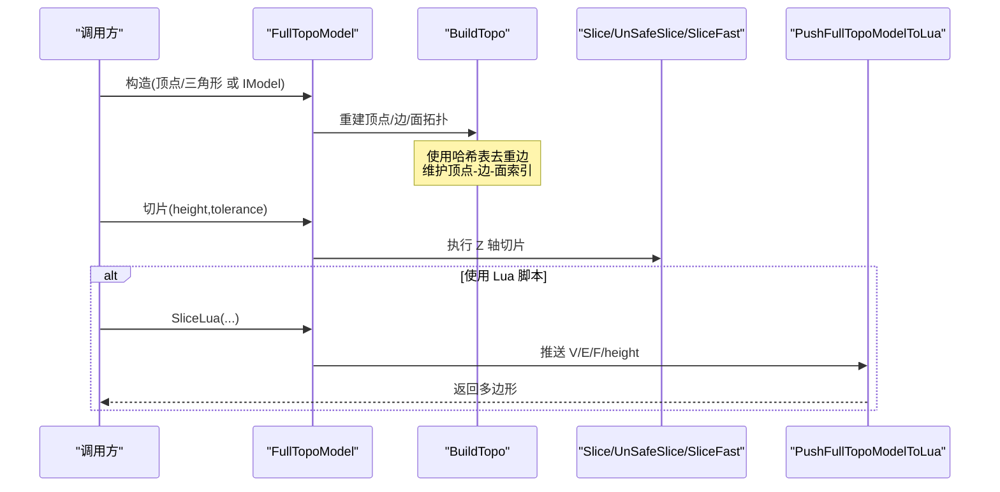

**图表来源**
- [FullTopoModel.cpp:27-48](file://meshmodel/FullTopoModel.cpp#L27-L48)
- [FullTopoModel.cpp:50-158](file://meshmodel/FullTopoModel.cpp#L50-L158)
- [FullTopoModel.cpp:274-324](file://meshmodel/FullTopoModel.cpp#L274-L324)

**章节来源**
- [FullTopoModel.cpp:27-48](file://meshmodel/FullTopoModel.cpp#L27-L48)
- [FullTopoModel.cpp:50-158](file://meshmodel/FullTopoModel.cpp#L50-L158)

## 详细组件分析

### 拓扑完整性检查：CheckTopo
CheckTopo 用于验证拓扑完整性：所有面的顶点和边索引有效且覆盖全部顶点与边集合，所有边的顶点和面索引有效且覆盖全部顶点与面集合。若拓扑不完整，通常意味着模型不是拓扑流形，某些算法可能产生错误结果。

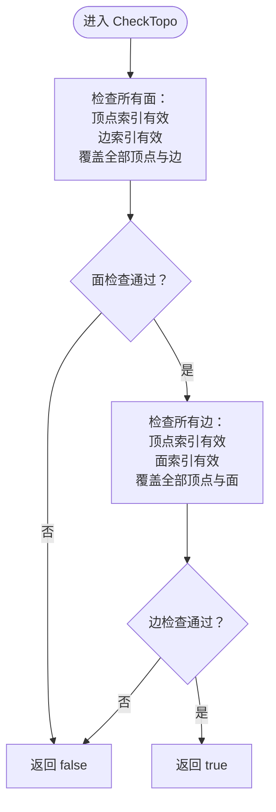

**图表来源**
- [FullTopoModel.cpp:160-218](file://meshmodel/FullTopoModel.cpp#L160-L218)

**章节来源**
- [FullTopoModel.cpp:160-218](file://meshmodel/FullTopoModel.cpp#L160-L218)

### 欧拉特征值：EulerCharacteristic
欧拉特征值定义为顶点数减边数加面数。奇数或大于 2 的值通常表示模型可能不是拓扑流形，可用于检测空洞或拓扑异常。该函数不进行拓扑完整性检查。

**章节来源**
- [FullTopoModel.hpp:96-98](file://meshmodel/FullTopoModel.hpp#L96-L98)
- [FullTopoModel.cpp:241-244](file://meshmodel/FullTopoModel.cpp#L241-L244)

### Z 轴切片算法：Intersection、Slice、UnSafeSlice、SliceFast

#### Intersection：线段与水平面求交
Intersection 判断线段两端点相对于目标高度的位置关系，处理平行、重合、相交等边界情况，返回交点坐标。

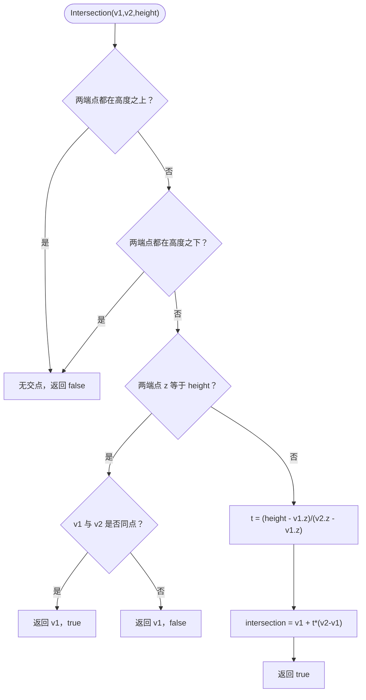

**图表来源**
- [FullTopoModel.cpp:246-272](file://meshmodel/FullTopoModel.cpp#L246-L272)

**章节来源**
- [FullTopoModel.hpp:100-102](file://meshmodel/FullTopoModel.hpp#L100-L102)
- [FullTopoModel.cpp:246-272](file://meshmodel/FullTopoModel.cpp#L246-L272)

#### SafeSlice：仅闭合轮廓
SafeSlice 的流程包括：
1. 对每个三角形三条边执行 Intersection，收集交点。
2. 将交点量化为整数 Key，构建原始邻接表。
3. 使用网格哈希与并查集合并相近节点。
4. 构建合并后的邻接表，按角度选择下一个邻居以追踪环路。
5. 输出闭合多边形，丢弃开放折线。

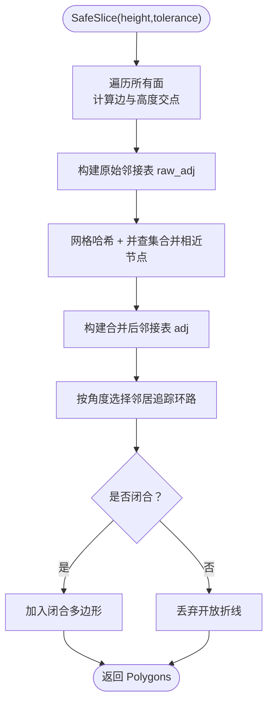

**图表来源**
- [FullTopoModel.cpp:328-600](file://meshmodel/FullTopoModel.cpp#L328-L600)

**章节来源**
- [FullTopoModel.hpp:107-108](file://meshmodel/FullTopoModel.hpp#L107-L108)
- [FullTopoModel.cpp:328-600](file://meshmodel/FullTopoModel.cpp#L328-L600)

#### UnSafeSlice：允许开放折线
UnSafeSlice 与 SafeSlice 共享大部分步骤，但保留开放折线，并以 closed 标志区分闭合与开放路径。

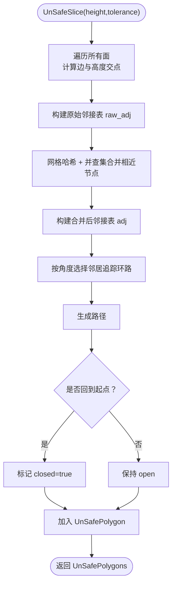

**图表来源**
- [FullTopoModel.cpp:604-873](file://meshmodel/FullTopoModel.cpp#L604-L873)

**章节来源**
- [FullTopoModel.hpp:109-110](file://meshmodel/FullTopoModel.hpp#L109-L110)
- [FullTopoModel.cpp:604-873](file://meshmodel/FullTopoModel.cpp#L604-L873)

#### SliceFast：基于拓扑的快速切片
SliceFast 先检查拓扑完整性，然后直接利用 Edge 的顶点索引与 faces 的边槽信息快速构建邻接表，避免重复求交与大量中间结构。

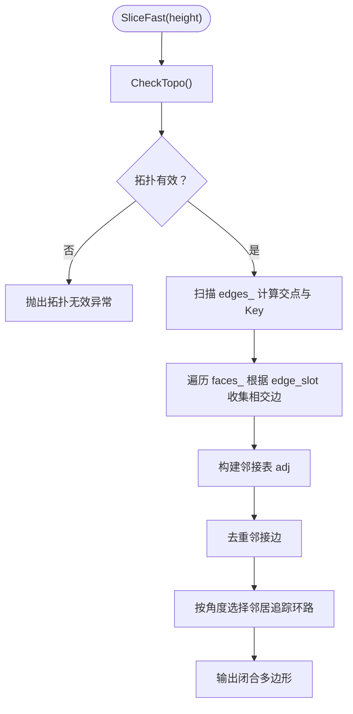

**图表来源**
- [FullTopoModel.cpp:875-1025](file://meshmodel/FullTopoModel.cpp#L875-L1025)

**章节来源**
- [FullTopoModel.hpp:112-114](file://meshmodel/FullTopoModel.hpp#L112-L114)
- [FullTopoModel.cpp:875-1025](file://meshmodel/FullTopoModel.cpp#L875-L1025)

### 与 Lua 脚本系统的集成：PushFullTopoModelToLua 与 SliceLua
PushFullTopoModelToLua 将 FullTopoModel 的顶点、边、面数据推入 Lua 全局变量：
- V：1-based 数组，元素为包含 x/y/z 的对象。
- E：1-based 数组，元素为包含两个顶点索引的对象。
- F：1-based 数组，元素为三个顶点索引的对象。
- height：当前切片高度。

SliceLua 系列接口创建独立 Lua 状态，加载脚本或函数，执行后解析返回的多边形表。

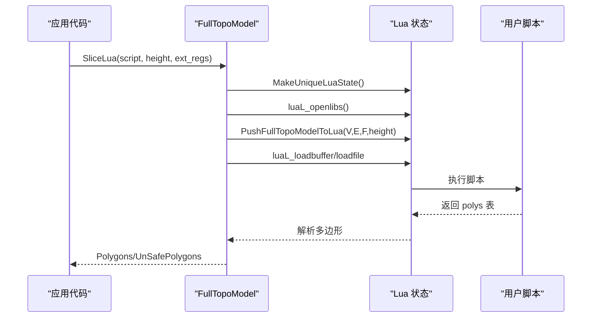

**图表来源**
- [FullTopoModel.cpp:274-324](file://meshmodel/FullTopoModel.cpp#L274-L324)
- [FullTopoModel.cpp:1027-1241](file://meshmodel/FullTopoModel.cpp#L1027-L1241)

**章节来源**
- [FullTopoModel.hpp:116-132](file://meshmodel/FullTopoModel.hpp#L116-L132)
- [FullTopoModel.cpp:274-324](file://meshmodel/FullTopoModel.cpp#L274-L324)
- [FullTopoModel.cpp:1027-1241](file://meshmodel/FullTopoModel.cpp#L1027-L1241)

## 依赖关系分析
FullTopoModel 依赖以下关键类型与库：
- Eigen：三维向量与矩阵运算。
- igl：可选的法向量计算。
- boost::hash：键值哈希。
- Lua：脚本环境交互。
- 2D 多边形类型：Polygon、PolygonD、IntPolygon、FloatPolygons。
- base 模块：IModel、ModelFormat、error。

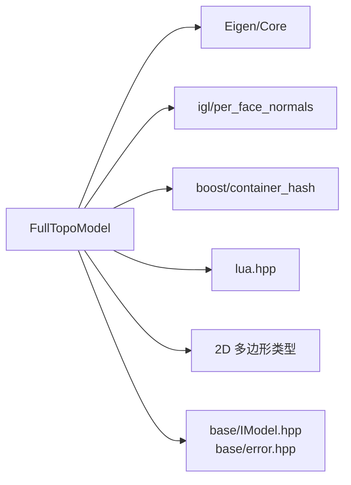

**图表来源**
- [FullTopoModel.hpp:5-16](file://meshmodel/FullTopoModel.hpp#L5-L16)
- [FullTopoModel.cpp:8-23](file://meshmodel/FullTopoModel.cpp#L8-L23)

**章节来源**
- [FullTopoModel.hpp:5-16](file://meshmodel/FullTopoModel.hpp#L5-L16)
- [FullTopoModel.cpp:8-23](file://meshmodel/FullTopoModel.cpp#L8-L23)

## 性能与复杂度分析

### 时间复杂度
- 拓扑重建 BuildTopo：O(F + E)，其中 F 为三角形面数量，E 为边数量；使用哈希表进行边去重与索引映射。
- CheckTopo：O(V + E + F)，遍历面与边集合并校验索引有效性。
- EulerCharacteristic：O(1)。
- Intersection：O(1)。
- SafeSlice/UnSafeSlice：
  - 原始邻接构建：O(F)。
  - 网格哈希与并查集合并：近似 O(N log N) 或 O(N)，N 为交点数量。
  - 环路追踪：O(N)。
- SliceFast：
  - 拓扑检查：O(V + E + F)。
  - 边扫描与邻接构建：O(E + F)。
  - 环路追踪：O(N)。

### 空间复杂度
- 存储：O(V + E + F)。
- 切片中间结构：raw_adj、grid、UnionFind、adj、visited 等，总体与交点数量 N 线性相关。

### 内存使用模式
- 构造阶段预分配顶点、边、面容器。
- 切片阶段按需构建哈希表与并查集，避免不必要的拷贝。
- Lua 集成阶段为每个脚本创建独立 Lua 状态，避免状态污染。

[本节为通用性能讨论，不直接分析具体文件]

## Lua 脚本集成参考

### 全局变量约定
- V：1-based 数组，元素为对象，包含 x/y/z 字段。
- E：1-based 数组，元素为对象，包含两个顶点索引字段。
- F：1-based 数组，元素为对象，包含三个顶点索引字段。
- height：当前切片高度。

### 返回值约定
- 脚本应返回一个多边形表：polys = { { {x=..,y=..}, ... }, ... }。
- SliceLua 返回 Polygons（仅闭合）。
- UnSafeSliceLua 返回 UnSafePolygons（允许开放折线，带 closed 标志）。

### 扩展注册
SliceLua 支持 ext_regs，允许在 Lua 环境中注册额外的 3D 函数，供脚本调用。

**章节来源**
- [FullTopoModel.hpp:116-132](file://meshmodel/FullTopoModel.hpp#L116-L132)
- [FullTopoModel.cpp:274-324](file://meshmodel/FullTopoModel.cpp#L274-L324)
- [FullTopoModel.cpp:1027-1241](file://meshmodel/FullTopoModel.cpp#L1027-L1241)

## API 参考

### 构造函数
- FullTopoModel(const IModel& model, bool use_normals = false)
  - 从 IModel 提取三角形网格并重建拓扑。
- FullTopoModel(const std::vector<Eigen::Vector3f>& vertices, const std::vector<std::array<int, 3>>& triangles, bool use_normals = false)
  - 直接从顶点与三角形数组重建拓扑。

**章节来源**
- [FullTopoModel.hpp:74-78](file://meshmodel/FullTopoModel.hpp#L74-L78)
- [FullTopoModel.cpp:27-48](file://meshmodel/FullTopoModel.cpp#L27-L48)

### 拓扑检查与查询
- bool CheckTopo() const
  - 检查拓扑完整性。
- int EulerCharacteristic() const
  - 计算欧拉特征值。
- std::pair<Eigen::MatrixXf, Eigen::MatrixXi> TriangleMesh() const
  - 导出顶点矩阵与面索引矩阵。

**章节来源**
- [FullTopoModel.hpp:84-98](file://meshmodel/FullTopoModel.hpp#L84-L98)
- [FullTopoModel.cpp:160-244](file://meshmodel/FullTopoModel.cpp#L160-L244)

### 切片接口
- Polygons Slice(const float height, double tolerance = 0.001) const
  - 安全切片，仅返回闭合多边形。
- UnSafePolygons UnSafeSlice(const float height, double tolerance = 0.001) const
  - 不安全切片，返回可能开放的折线。
- Polygons SliceFast(const float height) const
  - 快速切片，要求拓扑有效。

**章节来源**
- [FullTopoModel.hpp:107-114](file://meshmodel/FullTopoModel.hpp#L107-L114)
- [FullTopoModel.cpp:328-1025](file://meshmodel/FullTopoModel.cpp#L328-L1025)

### Lua 脚本接口
- Polygons SliceLua(const std::string& script, const float height, const std::vector<std::function<void(lua_State*)>>& ext_regs = {}) const
- Polygons SliceLua(const std::string& script, const std::string& funcName, const float height, const std::vector<std::function<void(lua_State*)>>& ext_regs = {}) const
- Polygons SliceLua(const std::filesystem::path& script_file, const std::string& funcName, const float height, const std::vector<std::function<void(lua_State*)>>& ext_regs = {}) const
- UnSafePolygons UnSafeSliceLua(const std::string& script, const float height, const std::vector<std::function<void(lua_State*)>>& ext_regs = {}) const

**章节来源**
- [FullTopoModel.hpp:116-132](file://meshmodel/FullTopoModel.hpp#L116-L132)
- [FullTopoModel.cpp:1027-1241](file://meshmodel/FullTopoModel.cpp#L1027-L1241)

### 外部 C API（LibHsBaSlicer）
- HSBA_SLICER_LIB_API Polygons Slice(const IModel& model, const float height, double tolerance)
- HSBA_SLICER_LIB_API UnSafePolygons UnSafeSlice(const IModel& model, const float height, double tolerance)
- HSBA_SLICER_LIB_API Polygons SliceLua(const IModel& model, const std::string& script, const float height)
- HSBA_SLICER_LIB_API UnSafePolygons UnSafeSliceLua(const IModel& model, const std::string& script, const float height)
- HSBA_SLICER_LIB_API PolygonsD NormalizeUnSafePolygons(const UnSafePolygons& unsafe_polys)
- HSBA_SLICER_LIB_API std::shared_ptr<FullTopoModel> BuildSliceTopology(const IModel& model)
- HSBA_SLICER_LIB_API PolygonsD SliceLayer(const FullTopoModel& topo, float z, double tolerance = 0.001)

**章节来源**
- [mesh_slice.hpp:40-103](file://LibHsBaSlicer/Slice/mesh_slice.hpp#L40-L103)
- [mesh_slice.cpp:46-115](file://LibHsBaSlicer/Slice/mesh_slice.cpp#L46-L115)

## 故障排除指南

### 常见错误与处理
- 拓扑无效：SliceFast 在 CheckTopo 失败时抛出 RuntimeError。
- Lua 初始化失败：SliceLua 系列在 MakeUniqueLuaState 失败时抛出 RuntimeError。
- Lua 加载或运行错误：loadbuffer/loadfile 或 pcall 失败时抛出 RuntimeError，附带错误消息。
- 外部异常封装：mesh_slice.cpp 中的 GuardSlice 将非项目异常转换为 IOError，确保 C API 边界稳定。

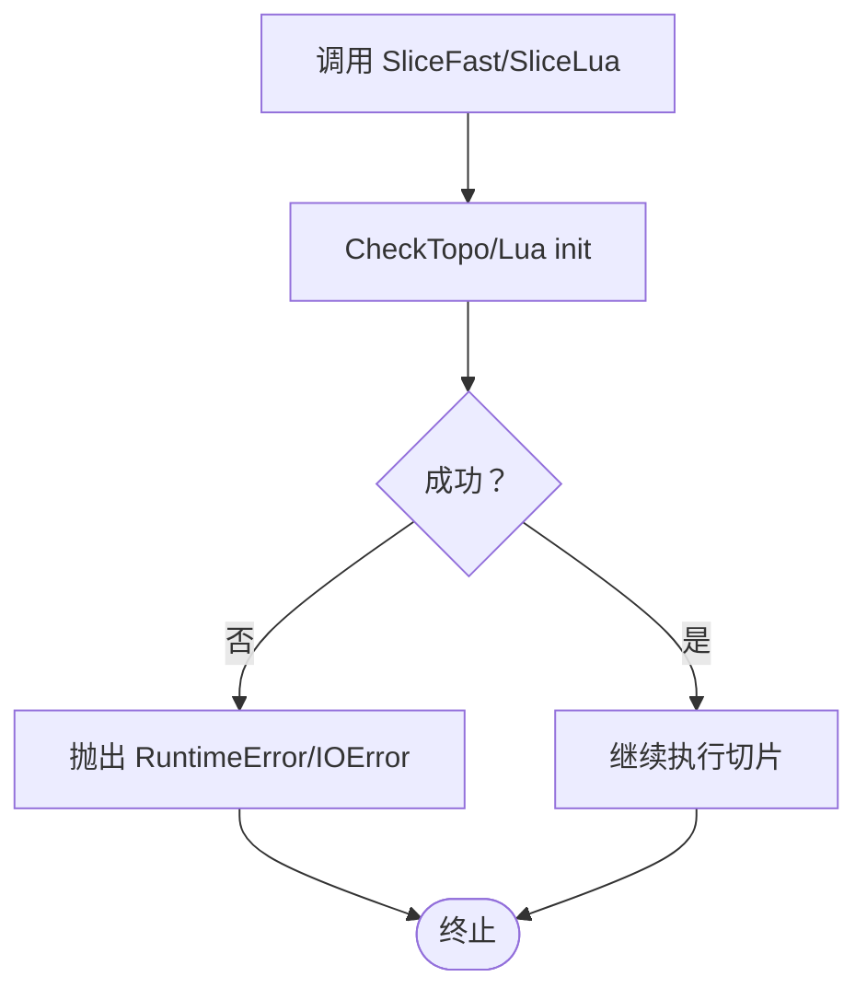

**图表来源**
- [FullTopoModel.cpp:875-880](file://meshmodel/FullTopoModel.cpp#L875-L880)
- [FullTopoModel.cpp:1027-1055](file://meshmodel/FullTopoModel.cpp#L1027-L1055)
- [mesh_slice.cpp:28-43](file://LibHsBaSlicer/Slice/mesh_slice.cpp#L28-L43)

**章节来源**
- [FullTopoModel.cpp:875-880](file://meshmodel/FullTopoModel.cpp#L875-L880)
- [FullTopoModel.cpp:1027-1055](file://meshmodel/FullTopoModel.cpp#L1027-L1055)
- [mesh_slice.cpp:28-43](file://LibHsBaSlicer/Slice/mesh_slice.cpp#L28-L43)

## 结论
FullTopoModel 提供了面向切片的完整拓扑重建能力，通过顶点、边、面的显式索引关系支撑多种 Z 轴切片算法。SafeSlice 与 UnSafeSlice 在精度控制与拓扑合并上采用网格哈希与并查集策略，SliceFast 则依赖已重建拓扑提升性能。Lua 集成使得用户可通过脚本灵活定制切片逻辑，同时保持 C API 的稳定封装。对于多层面切片场景，建议优先使用 BuildSliceTopology 复用拓扑，以降低重复重建开销。

[本节为总结性内容，不直接分析具体文件]