# IglModel libigl 网格处理

<cite>
**本文引用的文件**   
- [IglModel.hpp](file://meshmodel/IglModel.hpp)
- [IglModel.cpp](file://meshmodel/IglModel.cpp)
- [IModel.hpp](file://base/IModel.hpp)
- [CMakeLists.txt](file://meshmodel/CMakeLists.txt)
- [vcpkg.json](file://vcpkg.json)
- [OcctModel.cpp](file://cadmodel/OcctModel.cpp)
- [CgalModel.cpp](file://meshmodel/CgalModel.cpp)
</cite>

## 目录
1. [项目概述与快速开始](#项目概述与快速开始)
2. [架构总览](#架构总览)
3. [核心概念](#核心概念)
4. [核心模块详解](#核心模块详解)
5. [高级主题](#高级主题)
6. [API 参考文档](#api-参考文档)
7. [集成指南](#集成指南)
8. [开发测试与贡献](#开发测试与贡献)
9. [扩展开发指南](#扩展开发指南)
10. [示例与教程](#示例与教程)
11. [部署故障排除与FAQ](#部署故障排除与faq)
12. [附录](#附录)

## 项目概述与快速开始
IglModel 是 HsBaSlicer 中基于 libigl 的三角形网格模型实现，它实现了统一的 IModel 接口，提供网格加载、保存、几何变换、包围盒与体积计算、法线计算、布尔运算以及基础几何体创建和二维多边形拉伸等功能。该实现以 Eigen 矩阵存储顶点、面片和可选的法向量，并通过 libigl 提供的读写、法线和体积工具完成底层几何操作。

快速开始要点：
- 使用 IglModel 构造时传入顶点矩阵与三角面片索引矩阵，可选择是否立即计算面法线。
- 通过 Load/Save 支持 STL、OBJ、OFF、PLY 等常见网格格式。
- 通过 Translate/Rotate/Scale/Transform 对网格进行平移、旋转、缩放和仿射变换。
- 通过 BoundingBox/Volume/TriangleMesh 获取包围盒、体积和 libigl 风格的网格数据。
- 通过 CreateBox/CreateSphere/CreateCylinder/CreateCone/CreateTorus 创建基础几何体。
- 通过 CreatePrime 将二维闭合多边形或带孔多边形集合沿方向拉伸为三维实体。
- 在启用 CGAL 特性后，可使用 Union/Intersection/Difference/Xor 执行网格布尔运算。

本节不直接分析具体源码文件，因此不提供“章节来源”。

## 架构总览
IglModel 位于 meshmodel 模块，继承自 base 模块中的 IModel 抽象接口；其构建、链接与可选 CGAL 能力由 meshmodel/CMakeLists.txt 管理，依赖 vcpkg.json 中的 libigl 与可选 CGAL 特性。

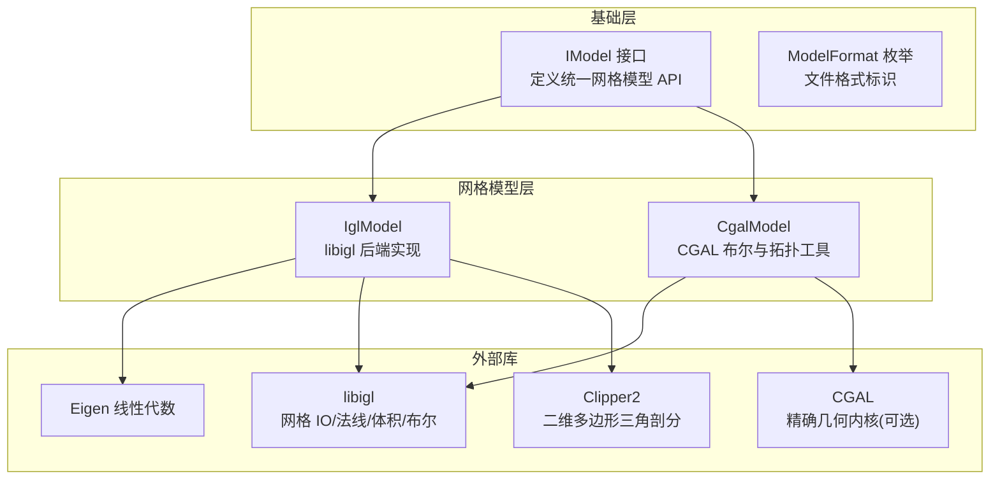

**图表来源**
- [IModel.hpp:110-139](file://base/IModel.hpp#L110-L139)
- [IglModel.hpp:16-121](file://meshmodel/IglModel.hpp#L16-L121)
- [CMakeLists.txt:1-42](file://meshmodel/CMakeLists.txt#L1-L42)
- [vcpkg.json:50-104](file://vcpkg.json#L50-L104)

**章节来源**
- [IModel.hpp:110-139](file://base/IModel.hpp#L110-L139)
- [IglModel.hpp:16-121](file://meshmodel/IglModel.hpp#L16-L121)
- [CMakeLists.txt:1-42](file://meshmodel/CMakeLists.txt#L1-L42)
- [vcpkg.json:50-104](file://vcpkg.json#L50-L104)

## 核心概念
- IModel 接口：定义统一的 3D 模型抽象，包括加载/保存、几何变换、包围盒/体积查询、三角网格导出等。
- IglModel 实现：以 libigl 为核心，提供高效、简洁的网格 IO、法线计算、体积计算、布尔运算（可选）和基础几何体工厂。
- 数据布局：顶点矩阵按行存储（N×3），面片索引矩阵为 M×3，法向量矩阵与面片数量对齐。
- 坐标与朝向：基础几何体与拉伸算法保证外法向一致，以便后续布尔运算与可视化正确显示。
- 布尔运算策略：优先使用 libigl 的 CGAL 后端；若失败则回退到 CgalModel 的 Nef 多面体布尔。

本节不直接分析具体源码文件，因此不提供“章节来源”。

## 核心模块详解

### IModel 接口设计
IModel 定义了所有网格模型必须实现的统一 API，包括：
- 文件 IO：Load、Save。
- 几何变换：Translate、Rotate、Scale、Transform（Isometry、Matrix4、Affine）。
- 几何查询：BoundingBox、Volume、TriangleMesh。

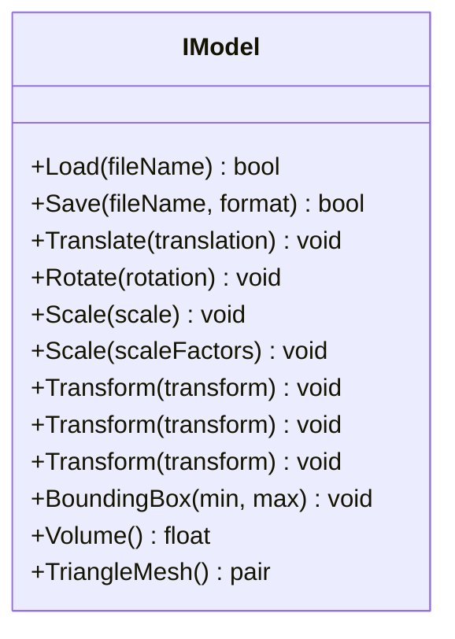

**图表来源**
- [IModel.hpp:110-139](file://base/IModel.hpp#L110-L139)

**章节来源**
- [IModel.hpp:110-139](file://base/IModel.hpp#L110-L139)

### IglModel 类结构与职责
IglModel 继承 IModel，内部维护顶点、面片、法向量和文件名，并提供：
- 多种构造函数（拷贝/移动，可选自动计算法线）。
- 网格 IO（STL/OBJ/OFF/PLY）。
- 几何变换（平移、旋转、缩放、齐次/仿射变换）。
- 几何查询（包围盒、体积、三角网格导出）。
- 法线计算（面法线、顶点法线）。
- 布尔运算（Union/Intersection/Difference/Xor，需 CGAL）。
- 基础几何体工厂（Box/Sphere/Cylinder/Cone/Torus）。
- 二维多边形拉伸（单多边形或多多边形集合）。

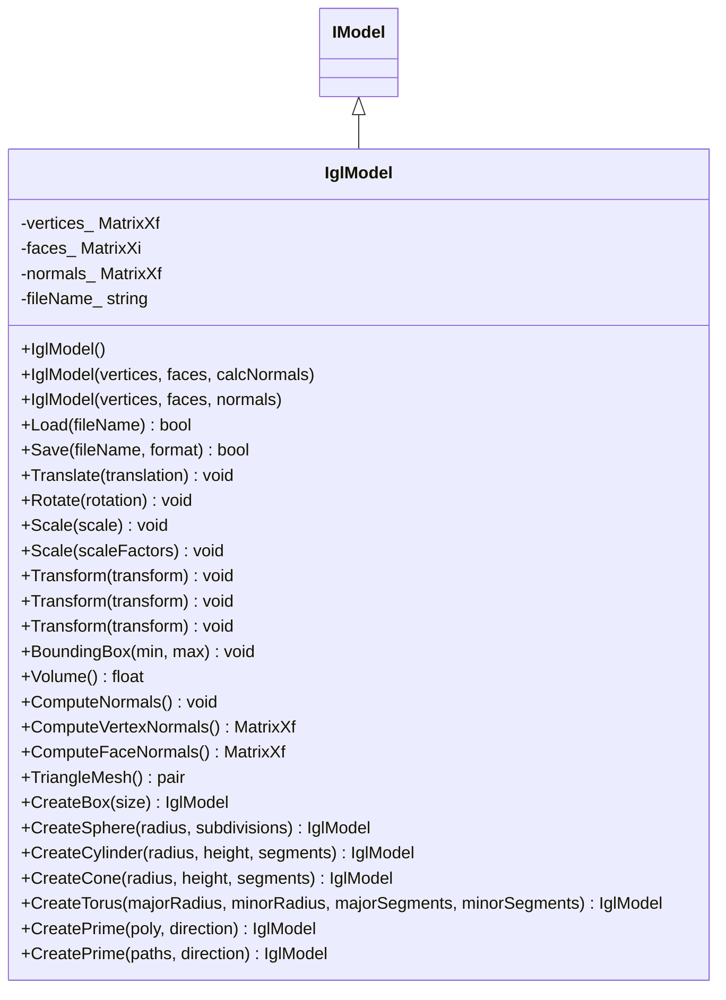

**图表来源**
- [IglModel.hpp:16-121](file://meshmodel/IglModel.hpp#L16-L121)

**章节来源**
- [IglModel.hpp:16-121](file://meshmodel/IglModel.hpp#L16-L121)

### 网格 IO 与格式支持
IglModel::Load 调用 libigl 读取三角网格；IglModel::Save 根据 ModelFormat 选择对应写入函数，支持二进制/ASCII STL、OBJ、OFF、ASCII/Binary PLY。

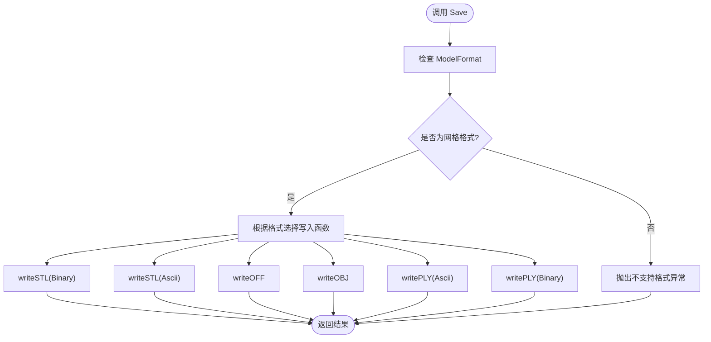

**图表来源**
- [IglModel.cpp:72-99](file://meshmodel/IglModel.cpp#L72-L99)

**章节来源**
- [IglModel.cpp:64-99](file://meshmodel/IglModel.cpp#L64-L99)

### 几何变换与法线更新
IglModel 对顶点矩阵采用行存储（N×3），旋转与齐次变换通过右乘转置矩阵实现；法向量仅在维度匹配时同步更新。

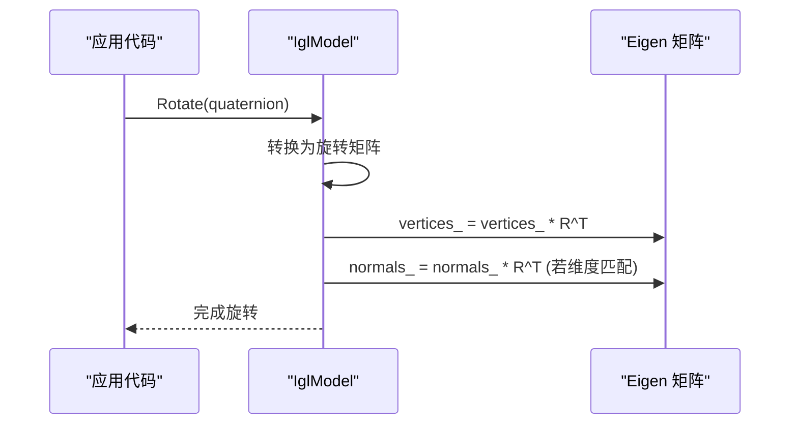

**图表来源**
- [IglModel.cpp:107-117](file://meshmodel/IglModel.cpp#L107-L117)

**章节来源**
- [IglModel.cpp:101-150](file://meshmodel/IglModel.cpp#L101-L150)

### 体积与包围盒
- 包围盒：对顶点矩阵列取最小/最大值。
- 体积：通过 igl::volume 计算有符号体积并取绝对值。

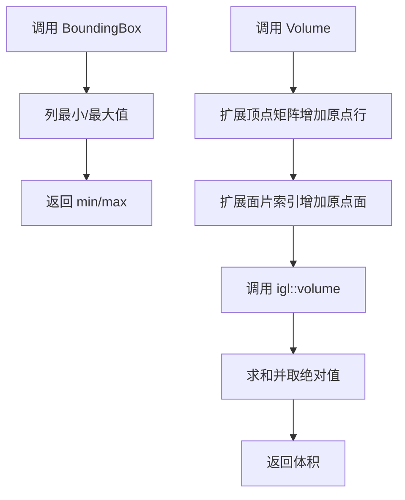

**图表来源**
- [IglModel.cpp:152-168](file://meshmodel/IglModel.cpp#L152-L168)

**章节来源**
- [IglModel.cpp:152-168](file://meshmodel/IglModel.cpp#L152-L168)

### 法线计算
- ComputeNormals：计算面法线并存储。
- ComputeVertexNormals：返回逐顶点法线。
- ComputeFaceNormals：返回逐面面法线。

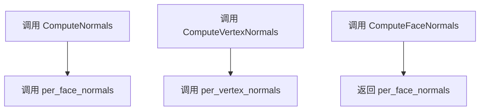

**图表来源**
- [IglModel.cpp:170-185](file://meshmodel/IglModel.cpp#L170-L185)

**章节来源**
- [IglModel.cpp:170-185](file://meshmodel/IglModel.cpp#L170-L185)

### 布尔运算与 CGAL 回退
当启用 USE_CGAL 时，IglModel 使用 libigl 的 CGAL 后端进行布尔运算；若浮点精度导致失败，则回退到 CgalModel 的 Nef 多面体布尔。未启用 CGAL 时，布尔运算抛出“不支持”异常。

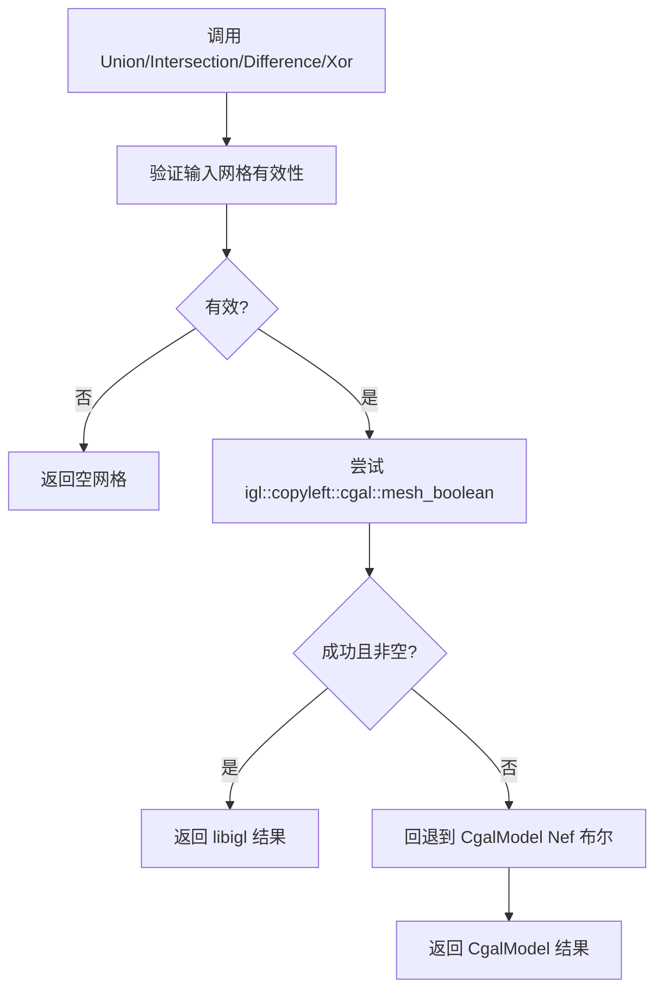

**图表来源**
- [IglModel.cpp:195-245](file://meshmodel/IglModel.cpp#L195-L245)
- [IglModel.cpp:248-391](file://meshmodel/IglModel.cpp#L248-L391)
- [IglModel.cpp:392-409](file://meshmodel/IglModel.cpp#L392-L409)

**章节来源**
- [IglModel.cpp:195-409](file://meshmodel/IglModel.cpp#L195-L409)

### 基础几何体工厂
IglModel 提供 Box/Sphere/Cylinder/Cone/Torus 静态工厂方法，生成具有外法向一致的三角网格，便于后续布尔运算与可视化。

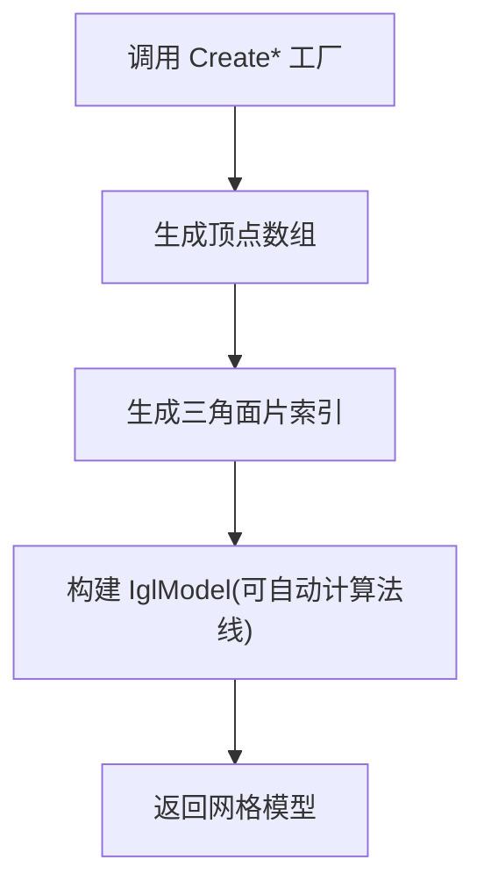

**图表来源**
- [IglModel.cpp:411-596](file://meshmodel/IglModel.cpp#L411-L596)

**章节来源**
- [IglModel.cpp:411-596](file://meshmodel/IglModel.cpp#L411-L596)

### 二维多边形拉伸
CreatePrime 将二维闭合多边形（含孔）沿方向拉伸为三维实体：
- 单多边形：使用 Clipper2 三角剖分，确保底面与侧面法向一致。
- 多多边形集合：通过嵌套深度判定内外轮廓，校正绕序，再三角剖分并构建侧墙。

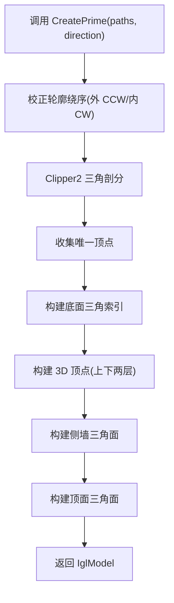

**图表来源**
- [IglModel.cpp:598-713](file://meshmodel/IglModel.cpp#L598-L713)
- [IglModel.cpp:715-930](file://meshmodel/IglModel.cpp#L715-L930)

**章节来源**
- [IglModel.cpp:598-930](file://meshmodel/IglModel.cpp#L598-L930)

## 高级主题

### libigl 后端特性优势
- 简洁 API：IO、法线、体积、布尔等常用功能均有高层封装。
- 与 Eigen 无缝集成：直接使用 Eigen 矩阵作为输入输出。
- 可选 CGAL 内核：启用 copyleft 特性后可获得更稳健的布尔运算。
- 跨平台：通过 vcpkg 管理依赖，支持 Windows/Linux/macOS/Android。

本节不直接分析具体源码文件，因此不提供“章节来源”。

### 与标准 IModel 接口的兼容层
IglModel 完全实现 IModel 接口，使上层系统可以以统一方式访问不同后端（如 OcctModel、CgalModel）。这种设计允许在不修改上层逻辑的情况下替换网格后端。

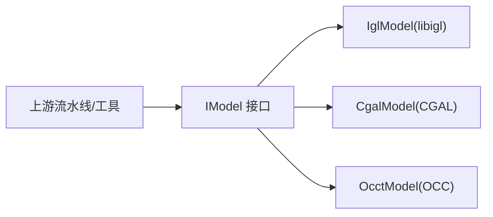

**图表来源**
- [IModel.hpp:110-139](file://base/IModel.hpp#L110-L139)
- [OcctModel.cpp:58-60](file://cadmodel/OcctModel.cpp#L58-L60)

**章节来源**
- [IModel.hpp:110-139](file://base/IModel.hpp#L110-L139)
- [OcctModel.cpp:58-60](file://cadmodel/OcctModel.cpp#L58-L60)

### 性能优化策略
- 行存储矩阵：顶点按行存储，避免广播错误并提升内存局部性。
- 批量变换：通过矩阵乘法一次性更新所有顶点与法线。
- 条件更新：仅在法线维度匹配时更新法线，减少无效计算。
- 布尔回退：在 libigl 布尔失败时回退到更可靠的 CGAL Nef 布尔，提高鲁棒性。

本节不直接分析具体源码文件，因此不提供“章节来源”。

## API 参考文档

### IModel 接口摘要
- Load(fileName): 从文件加载网格。
- Save(fileName, format): 保存网格到指定格式。
- Translate(translation): 平移。
- Rotate(rotation): 旋转。
- Scale(scale): 均匀缩放。
- Scale(scaleFactors): 各轴缩放。
- Transform(transform): 刚体/齐次/仿射变换。
- BoundingBox(min, max): 包围盒。
- Volume(): 体积。
- TriangleMesh(): 返回顶点与面片。

**章节来源**
- [IModel.hpp:110-139](file://base/IModel.hpp#L110-L139)

### IglModel 主要 API
- 构造：默认、拷贝、移动、带法线构造。
- IO：Load、Save。
- 变换：Translate、Rotate、Scale、Transform。
- 查询：BoundingBox、Volume、TriangleMesh。
- 法线：ComputeNormals、ComputeVertexNormals、ComputeFaceNormals。
- 布尔：Union、Intersection、Difference、Xor（需 CGAL）。
- 工厂：CreateBox、CreateSphere、CreateCylinder、CreateCone、CreateTorus。
- 拉伸：CreatePrime(PolygonD)、CreatePrime(PolygonsD)。

**章节来源**
- [IglModel.hpp:26-121](file://meshmodel/IglModel.hpp#L26-L121)

### 文件格式枚举
ModelFormat 包含 PLY、OBJ、STL、OFF、VRML、STEP、IGES、BREP、XYZ、VDB 等枚举值，用于 Save 指定输出格式。

**章节来源**
- [IModel.hpp:65-109](file://base/IModel.hpp#L65-L109)

## 集成指南

### 构建与依赖
- meshmodel 模块链接 igl::igl_core，并在启用 HSBA_COPL 时链接 CGAL 与 libigl copyleft 组件。
- vcpkg.json 声明 libigl 依赖，并在 copyleft 特性下启用 cgal 特性。

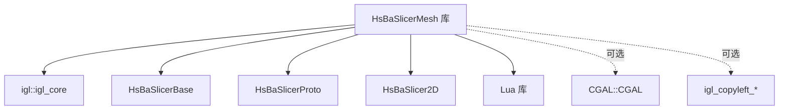

**图表来源**
- [CMakeLists.txt:1-42](file://meshmodel/CMakeLists.txt#L1-L42)
- [vcpkg.json:50-104](file://vcpkg.json#L50-L104)

**章节来源**
- [CMakeLists.txt:1-42](file://meshmodel/CMakeLists.txt#L1-L42)
- [vcpkg.json:50-104](file://vcpkg.json#L50-L104)

### 与其他模型的互操作
- OcctModel 可将 OCC 几何转换为 IglModel 网格，便于后续切片与路径生成。
- CgalModel 可与 IglModel 互相转换，利用 CGAL 进行布尔与拓扑分析。

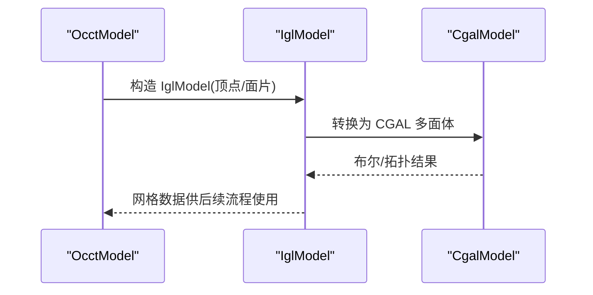

**图表来源**
- [OcctModel.cpp:58-60](file://cadmodel/OcctModel.cpp#L58-L60)
- [CgalModel.cpp:50-50](file://meshmodel/CgalModel.cpp#L50-L50)
- [CgalModel.cpp:235-235](file://meshmodel/CgalModel.cpp#L235-L235)

**章节来源**
- [OcctModel.cpp:58-60](file://cadmodel/OcctModel.cpp#L58-L60)
- [CgalModel.cpp:50-50](file://meshmodel/CgalModel.cpp#L50-L50)
- [CgalModel.cpp:235-235](file://meshmodel/CgalModel.cpp#L235-L235)

## 开发测试与贡献
- 单元测试：建议覆盖 IglModel 的 IO、变换、法线、体积、布尔与拉伸等关键路径。
- 边界用例：空网格、非法索引、非有限顶点、孔洞多边形、退化三角面。
- 性能基准：大规模网格的布尔与拉伸耗时评估。

本节不直接分析具体源码文件，因此不提供“章节来源”。

## 扩展开发指南
- 新增网格简化/平滑/重网格化算法：可在 IglModel 上扩展新的成员函数，复用 libigl 的简化与平滑工具，并保持与 IModel 接口的一致性。
- 自定义布尔策略：可替换 IglMeshBooleanImpl 的实现，适配特定几何后端。
- 新增几何体工厂：遵循现有 Create* 模式，确保法向一致性与索引有效性。

本节不直接分析具体源码文件，因此不提供“章节来源”。

## 示例与教程

### 网格预处理流程
典型流程：
1. 从文件加载网格（Load）。
2. 计算法线（ComputeNormals）。
3. 应用变换（Translate/Rotate/Scale/Transform）。
4. 计算包围盒与体积（BoundingBox/Volume）。
5. 导出网格（Save）。

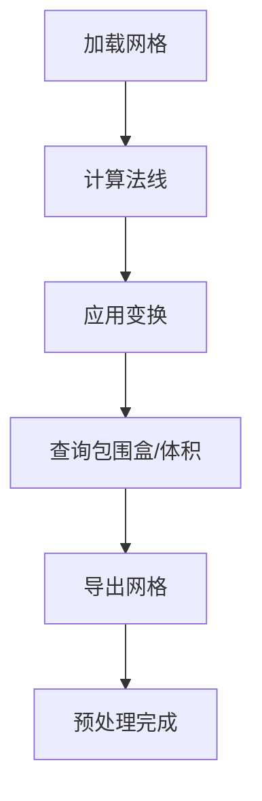

本节不直接分析具体源码文件，因此不提供“章节来源”。

### 几何分析与可视化集成
- 几何分析：使用 Volume 与 BoundingBox 进行初步质量检查；使用 ComputeVertexNormals 辅助光照渲染。
- 可视化集成：通过 TriangleMesh 获取顶点与面片，传递给渲染管线。

本节不直接分析具体源码文件，因此不提供“章节来源”。

## 部署故障排除与FAQ

### 常见问题
- 布尔运算失败：检查输入网格是否有效（顶点有限、索引越界、面片为空）；启用 CGAL 以提升稳定性。
- 法线方向异常：确认基础几何体与拉伸算法的绕序是否正确；必要时重新计算法线。
- 文件格式不支持：确认 ModelFormat 是否在 Save 分支中处理。

**章节来源**
- [IglModel.cpp:248-391](file://meshmodel/IglModel.cpp#L248-L391)
- [IglModel.cpp:72-99](file://meshmodel/IglModel.cpp#L72-L99)

### 版本与依赖要求
- libigl：通过 vcpkg 安装，建议在 copyleft 特性下启用 cgal 以获得布尔能力。
- CGAL：仅在启用 copyleft 特性时可用，影响布尔运算与部分拓扑工具。
- Eigen：线性代数基础，IglModel 广泛使用 Eigen 矩阵。

**章节来源**
- [vcpkg.json:50-104](file://vcpkg.json#L50-L104)

## 附录

### 关键实现位置索引
- 网格 IO：[IglModel.cpp:64-99](file://meshmodel/IglModel.cpp#L64-L99)
- 几何变换：[IglModel.cpp:101-150](file://meshmodel/IglModel.cpp#L101-L150)
- 体积与包围盒：[IglModel.cpp:152-168](file://meshmodel/IglModel.cpp#L152-L168)
- 法线计算：[IglModel.cpp:170-185](file://meshmodel/IglModel.cpp#L170-L185)
- 布尔运算与回退：[IglModel.cpp:195-409](file://meshmodel/IglModel.cpp#L195-L409)
- 基础几何体工厂：[IglModel.cpp:411-596](file://meshmodel/IglModel.cpp#L411-L596)
- 多边形拉伸：[IglModel.cpp:598-930](file://meshmodel/IglModel.cpp#L598-L930)

本节不直接分析具体源码文件，因此不提供“章节来源”。