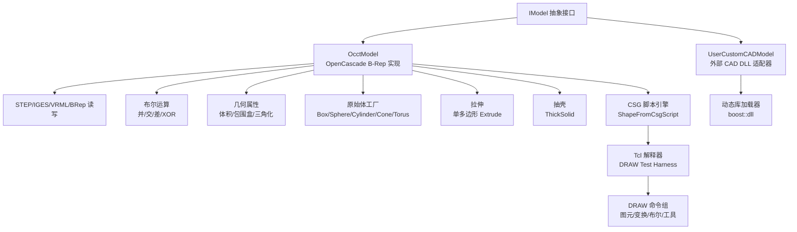
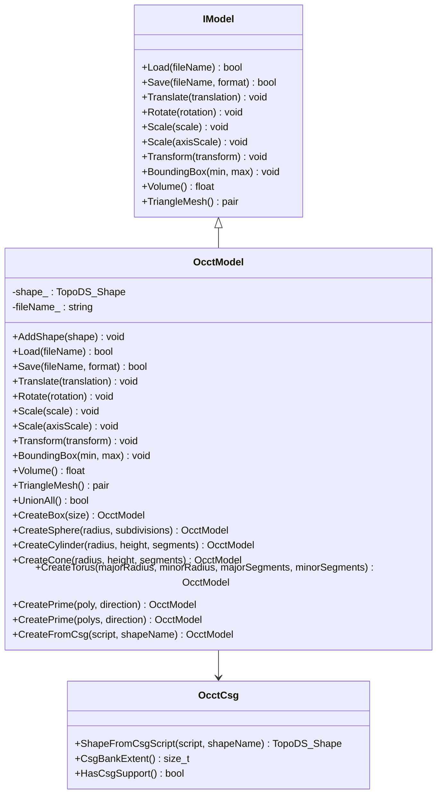
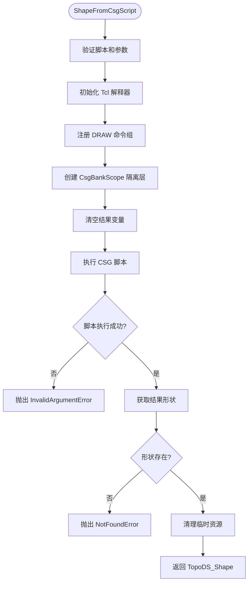
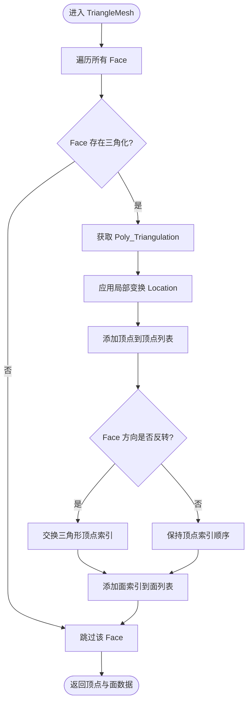
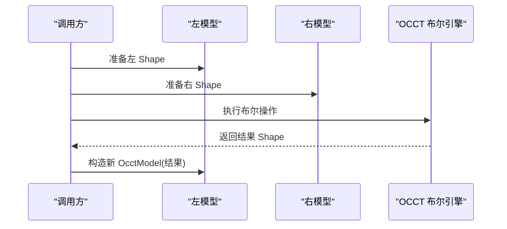
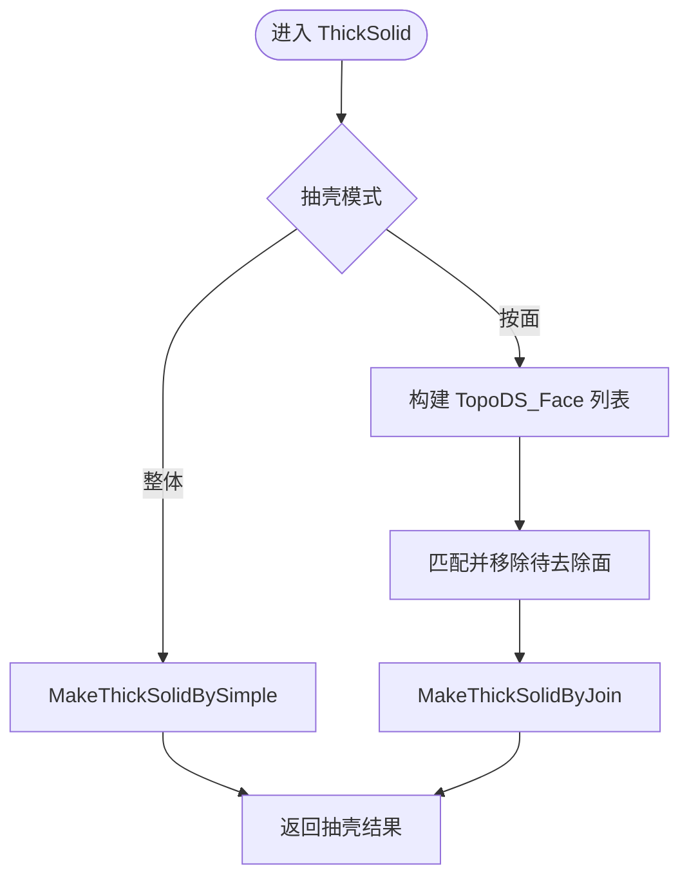
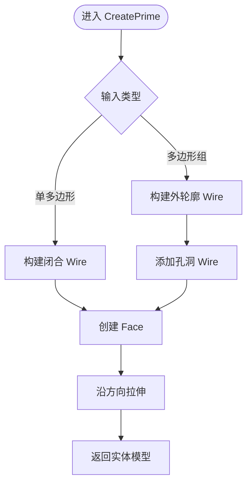
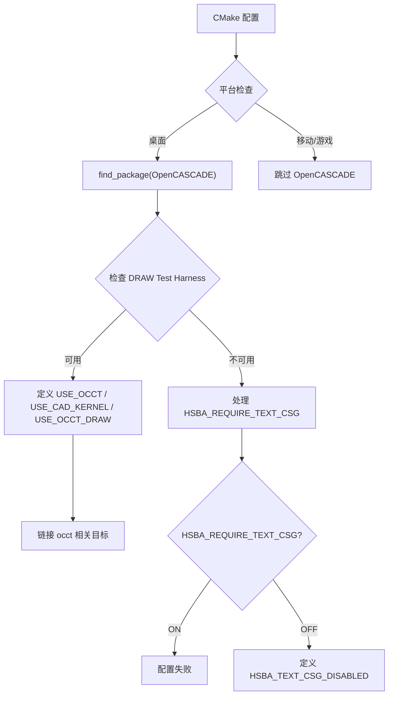

# OcctModel OpenCascade B-Rep建模

<cite>
**本文引用的文件**   
- [OcctModel.hpp](file://cadmodel/OcctModel.hpp)
- [OcctModel.cpp](file://cadmodel/OcctModel.cpp)
- [OcctCsg.hpp](file://cadmodel/OcctCsg.hpp)
- [OcctCsg.cpp](file://cadmodel/OcctCsg.cpp)
- [OcctTypeAliases.hpp](file://cadmodel/OcctTypeAliases.hpp)
- [UserCustomCADModel.hpp](file://cadmodel/UserCustomCADModel.hpp)
- [UserCustomCADModel.cpp](file://cadmodel/UserCustomCADModel.cpp)
- [IModel.hpp](file://base/IModel.hpp)
- [ModelFormat.hpp](file://base/ModelFormat.hpp)
- [occt_model_test.cpp](file://tests/Models/occt_model_test.cpp)
- [csg_cabi_test.cpp](file://tests/GuiApi/csg_cabi_test.cpp)
- [main.cpp](file://samples/CsgModel/main.cpp)
- [my_csg_pipeline.lua](file://samples/Custom/scripts/my_csg_pipeline.lua)
- [CMakeLists.txt](file://CMakeLists.txt)
- [README.md](file://README.md)
- [vcpkg-dependencies.md](file://docs/zh/vcpkg-dependencies.md)
</cite>

## 更新摘要
**所做更改**   
- 新增基于文本的 CSG 建模系统章节，详细介绍 OcctCsg.cpp/.hpp 实现
- 更新核心模块详解，添加 CSG 脚本执行引擎说明
- 新增 Tcl 解释器和 DRAW Test Harness 集成指南
- 更新示例与教程，包含完整的 CSG 脚本使用案例
- 扩展 API 参考文档，涵盖新的 CSG 相关接口
- 更新配置选项，说明 HSBA_REQUIRE_TEXT_CSG 和 USE_OCCT_DRAW 宏

## 目录
1. [项目概述与快速开始](#项目概述与快速开始)
2. [架构总览](#架构总览)
3. [核心概念](#核心概念)
4. [核心模块详解](#核心模块详解)
5. [高级主题](#高级主题)
6. [API 参考文档](#api-参考文档)
7. [集成指南](#集成指南)
8. [开发测试与贡献](#开发测试与贡献)
9. [扩展开发指南](#扩展开发指南)
10. [示例与教程](#示例与教程)
11. [部署故障排除与FAQ](#部署故障排除与faq)
12. [附录](#附录)

## 项目概述与快速开始
本技术文档聚焦于 HsBaSlicer 中的 OcctModel 实现，说明如何基于 OpenCascade 的边界表示进行实体建模、曲面操作、布尔运算、抽壳、拉伸以及 B-Rep 到三角网格的转换。**新增功能**：通过 OcctCsg.cpp/.hpp 实现的基于文本的 CSG 建模系统，支持使用 OCCT DRAW Test Harness 脚本语言直接构建几何体，包括原始体形状、变换操作、布尔运算和 Tcl 参数代入。同时给出 OpenCascade 后端在 CMake 中的启用方式、平台兼容性、精度控制与性能调优建议，并提供加载 CAD 模型、执行几何操作和导出网格数据的使用路径。

- 目标读者：需要理解或扩展 HsBaSlicer 中 CAD/B-Rep 建模能力的开发者。
- 前置依赖：OpenCascade（可选，受 HSBA_COPL 控制）、Eigen、Boost（用于动态库加载）。
- 关键入口：`HsBa::Slicer::OcctModel` 实现 `IModel` 接口，封装 TopoDS_Shape 并提供文件读写、变换、体积、包围盒、布尔运算、抽壳、原始体创建与拉伸等能力；新增 `ShapeFromCsgScript` 函数支持从文本 CSG 脚本构建几何。

**章节来源**
- [OcctModel.hpp:22-29](file://cadmodel/OcctModel.hpp#L22-L29)
- [OcctCsg.hpp:19-56](file://cadmodel/OcctCsg.hpp#L19-L56)
- [README.md:41-94](file://README.md#L41-L94)

## 架构总览
OcctModel 位于 cadmodel 模块，作为 IModel 的一种具体实现，内部持有 OCCT 的 `TopoDS_Shape`，并通过 OCCT 提供的 IO、布尔运算、几何属性计算、三角剖分等 API 完成功能。**新增 CSG 子系统**：OcctCsg.cpp/.hpp 提供独立的文本 CSG 解析和执行引擎，通过 Tcl 解释器调用 OCCT 的 DRAW Test Harness 命令组。用户自定义 CAD 后端通过 UserCustomCADModel 以动态库形式接入，遵循统一的 IModel 契约。



**图表来源**
- [OcctModel.hpp:22-124](file://cadmodel/OcctModel.hpp#L22-L124)
- [OcctCsg.hpp:19-56](file://cadmodel/OcctCsg.hpp#L19-L56)
- [OcctCsg.cpp:140-153](file://cadmodel/OcctCsg.cpp#L140-L153)
- [OcctModel.cpp:76-190](file://cadmodel/OcctModel.cpp#L76-L190)
- [UserCustomCADModel.hpp:27-121](file://cadmodel/UserCustomCADModel.hpp#L27-L121)

**章节来源**
- [OcctModel.hpp:22-124](file://cadmodel/OcctModel.hpp#L22-L124)
- [OcctCsg.hpp:19-56](file://cadmodel/OcctCsg.hpp#L19-L56)
- [UserCustomCADModel.hpp:27-121](file://cadmodel/UserCustomCADModel.hpp#L27-L121)

## 核心概念
- B-Rep 数据模型：OcctModel 内部使用 `TopoDS_Shape` 表达拓扑结构，支持复合形状、面、边、顶点等层次结构。
- **文本 CSG 建模**：通过 OCCT DRAW Test Harness 脚本语言定义几何体，支持原始体（box、wedge、pcylinder、pcone、psphere、ptorus）、变换操作（ttranslate、trotate、tscale、tmirror、tcopy、reset）、布尔运算（bcut、bfuse、bcommon、bsection）和仓库工具（compound、explode、orientation、nbshapes、checkshape、vprops）。
- 文件格式：支持 STEP、IGES、VRML、BRep 的读取与保存；对网格格式（如 STL/OBJ）则先转换为三角网格再交由 mesh 模型处理。
- 布尔运算：提供 Union、Intersection、Difference、Xor 四种布尔操作，底层调用 OCCT 的 BRepAlgoAPI。
- 抽壳与拉伸：支持整体抽壳与按指定面集合抽壳；支持从二维多边形（含孔洞）沿方向拉伸为实体。
- 三角网格转换：遍历所有 Face，获取 Poly_Triangulation，应用局部变换后输出 libigl 风格的顶点与面索引。
- Tcl 解释器集成：每个 CSG 脚本在独立的 Tcl 解释器上下文中执行，支持 set/expr 参数代入，但脚本不受沙箱限制，可访问完整 Tcl 功能。
- 类型别名：OcctTypes 根据 OCCT 版本（8.0+ 或更早）映射标准 C++ 类型，保证跨版本兼容。

**章节来源**
- [OcctModel.cpp:76-190](file://cadmodel/OcctModel.cpp#L76-L190)
- [OcctCsg.hpp:22-36](file://cadmodel/OcctCsg.hpp#L22-L36)
- [OcctCsg.cpp:140-153](file://cadmodel/OcctCsg.cpp#L140-L153)
- [OcctModel.cpp:353-407](file://cadmodel/OcctModel.cpp#L353-L407)
- [OcctModel.cpp:451-539](file://cadmodel/OcctModel.cpp#L451-L539)
- [OcctModel.cpp:542-663](file://cadmodel/OcctModel.cpp#L542-L663)
- [OcctTypeAliases.hpp:14-41](file://cadmodel/OcctTypeAliases.hpp#L14-L41)

## 核心模块详解

### OcctModel：OpenCascade B-Rep 建模核心
- 文件读写：Load/Save 根据扩展名选择对应 Reader/Writer；对网格格式走 TriangleMesh 后再由 IglModel 保存。
- 变换：Translate/Rotate/Scale/Transform 将 Eigen 变换矩阵映射到 OCCT 的 gp_Trsf 并重建 Shape。
- 几何查询：BoundingBox 遍历顶点计算 AABB；Volume 使用 GProp 计算有符号体积。
- 布尔运算：UnionAll 合并复合体中所有 Solid；全局函数 Union/Intersection/Difference/Xor 封装 BRepAlgoAPI。
- 抽壳：ThickSolid(model, thickness) 与 ThickSolid(model, faces, thickness) 分别支持整体抽壳与按面集抽壳。
- 原始体与拉伸：CreateBox/Sphere/Cylinder/Cone/Torus 创建基本体；CreatePrime 支持单多边形与多边形组（外轮廓+孔）拉伸。
- **CSG 脚本构建**：CreateFromCsg 静态方法封装 ShapeFromCsgScript，从 DRAW 脚本构建模型。



**图表来源**
- [IModel.hpp:110-139](file://base/IModel.hpp#L110-L139)
- [OcctModel.hpp:22-124](file://cadmodel/OcctModel.hpp#L22-L124)
- [OcctCsg.hpp:56-81](file://cadmodel/OcctCsg.hpp#L56-L81)

**章节来源**
- [OcctModel.cpp:213-271](file://cadmodel/OcctModel.cpp#L213-L271)
- [OcctModel.cpp:272-329](file://cadmodel/OcctModel.cpp#L272-L329)
- [OcctModel.cpp:331-407](file://cadmodel/OcctModel.cpp#L331-L407)
- [OcctModel.cpp:409-469](file://cadmodel/OcctModel.cpp#L409-L469)
- [OcctModel.cpp:471-539](file://cadmodel/OcctModel.cpp#L471-L539)
- [OcctModel.cpp:422-449](file://cadmodel/OcctModel.cpp#L422-L449)
- [OcctModel.cpp:542-663](file://cadmodel/OcctModel.cpp#L542-L663)
- [OcctModel.cpp:472](file://cadmodel/OcctModel.cpp#L472)

### CSG 脚本执行引擎
**新增功能**：OcctCsg.cpp/.hpp 实现了完整的文本 CSG 解析和执行引擎，通过 OCCT 的 DRAW Test Harness 提供强大的几何构建能力。

- **Tcl 解释器管理**：使用全局互斥锁保护线程安全，确保串行执行避免 Tcl 解释器重入问题。
- **命令组注册**：仅注册必要的几何命令组（DBRep::BasicCommands、BRepTest::PrimitiveCommands、BRepTest::BasicCommands、BRepTest::GPropCommands、BRepTest::CheckCommands、BOPTest::BOPCommands），限制几何词汇表但不限制 Tcl 语言本身。
- **内存隔离**：通过 CsgBankScope 类确保每次脚本执行后清理中间形状，防止内存泄漏和状态污染。
- **错误处理**：详细的错误信息返回机制，包括脚本语法错误、变量缺失、不支持的操作等。
- **安全检查**：虽然只限制了几何命令集，但 Tcl 解释器本身是完整的，可访问 exec/open/source/file 等危险命令，因此只能执行可信来源的脚本。



**图表来源**
- [OcctCsg.cpp:238-290](file://cadmodel/OcctCsg.cpp#L238-L290)

**章节来源**
- [OcctCsg.cpp:14-65](file://cadmodel/OcctCsg.cpp#L14-L65)
- [OcctCsg.cpp:79-126](file://cadmodel/OcctCsg.cpp#L79-L126)
- [OcctCsg.cpp:140-153](file://cadmodel/OcctCsg.cpp#L140-L153)
- [OcctCsg.cpp:194-235](file://cadmodel/OcctCsg.cpp#L194-L235)
- [OcctCsg.cpp:238-290](file://cadmodel/OcctCsg.cpp#L238-L290)

### B-Rep 到三角网格的转换机制
- 遍历所有 Face，获取 Poly_Triangulation。
- 若 Face 无三角化则跳过。
- 应用 Face 的局部变换（Location），将节点坐标转换到全局坐标系。
- 根据 Face 方向调整三角形顶点顺序，确保法向一致。
- 累积顶点和面索引，返回 libigl 风格的数据结构。



**图表来源**
- [OcctModel.cpp:353-399](file://cadmodel/OcctModel.cpp#L353-L399)

**章节来源**
- [OcctModel.cpp:353-399](file://cadmodel/OcctModel.cpp#L353-L399)

### 布尔运算与复杂拓扑关系处理
- 并集：BRepAlgoAPI_Fuse 合并两个 Shape。
- 交集：BRepAlgoAPI_Common 计算公共部分。
- 差集：BRepAlgoAPI_Cut 从左侧减去右侧。
- XOR：通过并集与交集组合得到对称差。
- 复合体合并：UnionAll 遍历所有 Solid 逐步 Fuse。



**图表来源**
- [OcctModel.cpp:451-469](file://cadmodel/OcctModel.cpp#L451-L469)

**章节来源**
- [OcctModel.cpp:409-469](file://cadmodel/OcctModel.cpp#L409-L469)

### 抽壳与拉伸
- 整体抽壳：ThickSolid(model, thickness) 直接对整体 Shape 抽壳。
- 按面抽壳：ThickSolid(model, faces, thickness) 将输入面集转为 TopoDS_Face，匹配原模型面并移除，再执行 MakeThickSolidByJoin。
- 拉伸：CreatePrime 支持单多边形和多边形组（外轮廓+孔）沿方向拉伸为实体。



**图表来源**
- [OcctModel.cpp:471-539](file://cadmodel/OcctModel.cpp#L471-L539)

**章节来源**
- [OcctModel.cpp:471-539](file://cadmodel/OcctModel.cpp#L471-L539)

### 原始体工厂与拉伸
- 原始体：CreateBox/CreateSphere/CreateCylinder/CreateCone/CreateTorus 直接调用 BRepPrimAPI 生成 Shape。
- 拉伸：CreatePrime 将 PolygonD 或 PolygonsD 转换为 Wire/Face，再用 MakePrism 拉伸。



**图表来源**
- [OcctModel.cpp:542-663](file://cadmodel/OcctModel.cpp#L542-L663)

**章节来源**
- [OcctModel.cpp:422-449](file://cadmodel/OcctModel.cpp#L422-L449)
- [OcctModel.cpp:542-663](file://cadmodel/OcctModel.cpp#L542-L663)

## 高级主题

### OpenCascade 后端配置与编译选项
- CMake 条件启用：当非 Android/iOS/游戏主机且启用 HSBA_COPL 时，查找 OpenCASCADE 并定义 USE_OCCT 与 USE_CAD_KERNEL。
- **CSG 功能配置**：HSBA_REQUIRE_TEXT_CSG 选项控制是否需要文本 CSG 功能，默认 ON；USE_OCCT_DRAW 宏标识 DRAW Test Harness 可用性。
- 模型对象池大小：HSBA_MODEL_POOL_SIZE 在可用 copyleft 内核时为 10，否则为 1，影响布尔运算时的中间模型数量。
- 调试模式警告：Debug 模式下布尔运算可能缓慢且内存占用高。



**图表来源**
- [CMakeLists.txt:308-318](file://CMakeLists.txt#L308-L318)
- [cadmodel/CMakeLists.txt:30-70](file://cadmodel/CMakeLists.txt#L30-L70)

**章节来源**
- [CMakeLists.txt:297-318](file://CMakeLists.txt#L297-L318)
- [cadmodel/CMakeLists.txt:26-70](file://cadmodel/CMakeLists.txt#L26-L70)

### 精度控制与性能调优
- 精度控制：
  - 抽壳容差：ThickSolid 使用固定 tolerance=1e-6 判断面距离与变换迹线差异。
  - 体积计算：GProp_GProps 基于几何属性计算，精度取决于底层 OCCT 实现。
- 性能调优：
  - 避免 Debug 模式下的复杂布尔运算。
  - 合理设置模型对象池大小（HSBA_MODEL_POOL_SIZE）。
  - 仅在必要时进行三角化；优先使用 Volume/BoundingBox 验证几何正确性。
  - **CSG 脚本优化**：复用变量名避免内存增长，合理使用 explode 减少复合体复杂度。

**章节来源**
- [OcctModel.cpp:479-539](file://cadmodel/OcctModel.cpp#L479-L539)
- [OcctModel.cpp:402-407](file://cadmodel/OcctModel.cpp#L402-L407)
- [CMakeLists.txt:297-306](file://CMakeLists.txt#L297-L306)
- [OcctCsg.hpp:42-45](file://cadmodel/OcctCsg.hpp#L42-L45)

### 平台兼容性指南
- 桌面平台（Windows/Linux/macOS）：OpenCASCADE 可正常安装与链接。
- Android/iOS：OpenCASCADE 被排除，因过于复杂不适合移动平台。
- 许可证：包含 CGAL/OpenCascade 时使用 GPL-3.0-or-later；不包含时使用 MIT。
- **CSG 平台支持**：仅在桌面平台可用，Android/iOS 和游戏主机不构建 CSG 功能。

**章节来源**
- [README.md:187-203](file://README.md#L187-L203)
- [vcpkg-dependencies.md:23-42](file://docs/zh/vcpkg-dependencies.md#L23-L42)
- [samples/CsgModel/main.cpp:30](file://samples/CsgModel/main.cpp#L30)

## API 参考文档

### IModel 接口
- Load/Save：模型文件读写。
- Translate/Rotate/Scale/Transform：几何变换。
- BoundingBox/Volume：几何查询。
- TriangleMesh：三角网格导出。

**章节来源**
- [IModel.hpp:110-139](file://base/IModel.hpp#L110-L139)

### OcctModel 主要方法
- 文件读写：Load/Save（支持 STEP/IGES/VRML/BREP，网格格式转 IglModel）。
- 变换：Translate/Rotate/Scale/Transform（多种重载）。
- 几何查询：BoundingBox/Volume。
- 布尔运算：UnionAll；全局函数 Union/Intersection/Difference/Xor。
- 抽壳：ThickSolid（整体/按面）。
- 原始体：CreateBox/CreateSphere/CreateCylinder/CreateCone/CreateTorus。
- 拉伸：CreatePrime（单多边形/多边形组）。
- **CSG 构建**：CreateFromCsg（从 DRAW 脚本构建模型）。

**章节来源**
- [OcctModel.hpp:54-110](file://cadmodel/OcctModel.hpp#L54-L110)
- [OcctModel.hpp:110-119](file://cadmodel/OcctModel.hpp#L110-L119)
- [OcctModel.cpp:213-271](file://cadmodel/OcctModel.cpp#L213-L271)
- [OcctModel.cpp:272-329](file://cadmodel/OcctModel.cpp#L272-L329)
- [OcctModel.cpp:331-407](file://cadmodel/OcctModel.cpp#L331-L407)
- [OcctModel.cpp:409-469](file://cadmodel/OcctModel.cpp#L409-L469)
- [OcctModel.cpp:471-539](file://cadmodel/OcctModel.cpp#L471-L539)
- [OcctModel.cpp:422-449](file://cadmodel/OcctModel.cpp#L422-L449)
- [OcctModel.cpp:542-663](file://cadmodel/OcctModel.cpp#L542-L663)
- [OcctModel.cpp:472](file://cadmodel/OcctModel.cpp#L472)

### OcctCsg CSG 脚本引擎 API
- **ShapeFromCsgScript**：执行 DRAW 脚本并返回生成的 TopoDS_Shape。
- **CsgBankExtent**：查询当前 DRAW 银行中的形状数量（诊断用途）。
- **HasCsgSupport**：检查当前构建是否支持 CSG 脚本功能。

**章节来源**
- [OcctCsg.hpp:56-81](file://cadmodel/OcctCsg.hpp#L56-L81)
- [OcctCsg.cpp:238-296](file://cadmodel/OcctCsg.cpp#L238-L296)

### UserCustomCADModel 动态库适配
- 加载动态库：LoadDll/UnloadDll。
- 委托 IModel 操作：Load/Save/Translate/Rotate/Scale/Transform/BoundingBox/Volume/TriangleMesh。
- 布尔操作：BooleanOperation（需 DLL 暴露相应函数）。

**章节来源**
- [UserCustomCADModel.hpp:79-121](file://cadmodel/UserCustomCADModel.hpp#L79-L121)
- [UserCustomCADModel.cpp:134-173](file://cadmodel/UserCustomCADModel.cpp#L134-L173)
- [UserCustomCADModel.cpp:175-325](file://cadmodel/UserCustomCADModel.cpp#L175-L325)

## 集成指南

### 在项目中启用 OpenCascade
- 确保 HSBA_COPL 开启（默认 AUTO，可通过环境变量或 -DHSBA_COPL=ON/OFF 控制）。
- 在桌面平台，CMake 会自动 find_package(OpenCASCADE) 并定义 USE_OCCT/USE_CAD_KERNEL。
- 移动平台（Android/iOS）不启用 OpenCASCADE。

**章节来源**
- [CMakeLists.txt:308-318](file://CMakeLists.txt#L308-L318)
- [vcpkg-dependencies.md:15-21](file://docs/zh/vcpkg-dependencies.md#L15-L21)

### 启用文本 CSG 功能
- **必需配置**：确保 OpenCASCADE 使用 vcpkg 的 opencascade[tcl] 特性构建，包含 Draw Test Harness。
- **CMake 选项**：HSBA_REQUIRE_TEXT_CSG 默认为 ON，如果缺少 DRAW 模块会导致配置失败；设为 OFF 可禁用 CSG 功能。
- **运行时检查**：使用 HsBaTextCsgAvailable() 或 HasCsgSupport() 检查功能可用性。
- **平台限制**：仅在桌面平台（Windows/Linux/macOS）可用，移动端和游戏主机不支持。

**章节来源**
- [cadmodel/CMakeLists.txt:26-70](file://cadmodel/CMakeLists.txt#L26-L70)
- [samples/CsgModel/main.cpp:308-313](file://samples/CsgModel/main.cpp#L308-L313)

### 使用示例流程
- 加载 CAD 模型：调用 OcctModel::Load，传入 STEP/IGES/VRML/BREP 文件路径。
- **CSG 脚本构建**：使用 OcctModel::CreateFromCsg 或 ShapeFromCsgScript 从 DRAW 脚本构建几何。
- 执行几何操作：使用 Union/Intersection/Difference/Xor 进行布尔运算；使用 CreatePrime 进行拉伸；使用 ThickSolid 进行抽壳。
- 导出网格数据：调用 TriangleMesh 获取顶点与面索引，或使用 Save 导出为网格格式（STL/OBJ 等）。

**章节来源**
- [OcctModel.cpp:213-271](file://cadmodel/OcctModel.cpp#L213-L271)
- [OcctModel.cpp:451-469](file://cadmodel/OcctModel.cpp#L451-L469)
- [OcctModel.cpp:542-663](file://cadmodel/OcctModel.cpp#L542-L663)
- [OcctModel.cpp:353-399](file://cadmodel/OcctModel.cpp#L353-L399)
- [OcctModel.cpp:472](file://cadmodel/OcctModel.cpp#L472)

## 开发测试与贡献

### 单元测试覆盖
- 基础实体与属性：CreateBox 体积与包围盒验证。
- 球体体积：CreateSphere 体积与理论值对比。
- 布尔运算：Union/Intersection/Difference/Xor 体积验证。
- 拉伸：单多边形与多边形组（含孔）拉伸体积与包围盒验证。
- 非平面方向拉伸：斜拉伸体积与包围盒验证。
- **CSG 功能测试**：文本 CSG 脚本执行、Tcl 参数代入、布尔运算、错误处理、内存隔离等全面测试。

**章节来源**
- [occt_model_test.cpp:8-48](file://tests/Models/occt_model_test.cpp#L8-L48)
- [occt_model_test.cpp:50-134](file://tests/Models/occt_model_test.cpp#L50-L134)
- [csg_cabi_test.cpp:92-273](file://tests/GuiApi/csg_cabi_test.cpp#L92-L273)

## 扩展开发指南

### 自定义 CAD 动态库接口
- 必须暴露的函数：create_model/destroy_model、boolean_operation、create_box/create_sphere/create_cylinder、set_thickness、create_prism/create_prism_ex。
- 命名约定：函数名以 addedFunName 前缀加后缀组成，例如 `{addedFunName}_create_model`。
- 生命周期管理：UserCustomCADModel 负责 DLL 加载与模型销毁。

**章节来源**
- [UserCustomCADModel.hpp:27-48](file://cadmodel/UserCustomCADModel.hpp#L27-L48)
- [UserCustomCADModel.cpp:35-115](file://cadmodel/UserCustomCADModel.cpp#L35-L115)

### 扩展 CSG 脚本功能
- **命令组扩展**：可在 g_commandGroups 数组中添加新的 DRAW 命令组，但需注意安全风险。
- **安全考虑**：由于 Tcl 解释器是完整的，任何新命令都可能带来安全风险，应谨慎评估。
- **内存管理**：遵循 CsgBankScope 的设计模式，确保脚本执行后的资源清理。

**章节来源**
- [OcctCsg.cpp:140-153](file://cadmodel/OcctCsg.cpp#L140-L153)
- [OcctCsg.cpp:79-126](file://cadmodel/OcctCsg.cpp#L79-L126)

## 示例与教程

### 加载 CAD 模型
- 步骤：
  1. 创建 OcctModel 实例。
  2. 调用 Load 传入文件路径。
  3. 检查返回值确认加载成功。

**章节来源**
- [OcctModel.cpp:213-237](file://cadmodel/OcctModel.cpp#L213-L237)

### 使用文本 CSG 构建几何
**新增功能**：通过 DRAW Test Harness 脚本语言直接构建复杂的几何体。

- **基本图元**：box、wedge、pcylinder、pcone、psphere、ptorus
- **变换操作**：ttranslate、trotate、tscale、tmirror、tcopy、reset
- **布尔运算**：bcut（差集）、bfuse（并集）、bcommon（交集）、bsection（截面）
- **仓库工具**：compound（复合体）、explode（分解）、orientation（方向）、nbshapes（计数）、checkshape（检查）、vprops（体积属性）
- **Tcl 参数**：使用 set 和 expr 进行参数代入

```lua
-- 简单的支架模型示例
set t 3
box base 60 40 $t
pcylinder boss 8 12
ttranslate boss 30 20 $t
bfuse result base boss
```

**章节来源**
- [samples/CsgModel/main.cpp:104-176](file://samples/CsgModel/main.cpp#L104-L176)
- [samples/Custom/scripts/my_csg_pipeline.lua:22-26](file://samples/Custom/scripts/my_csg_pipeline.lua#L22-L26)

### 执行几何操作
- 布尔运算：
  - 并集：Union(left, right)
  - 交集：Intersection(left, right)
  - 差集：Difference(left, right)
  - 异或：Xor(left, right)
- 拉伸：
  - 单多边形：CreatePrime(poly, direction)
  - 多边形组：CreatePrime(polys, direction)
- 抽壳：
  - 整体：ThickSolid(model, thickness)
  - 按面：ThickSolid(model, faces, thickness)

**章节来源**
- [OcctModel.cpp:451-469](file://cadmodel/OcctModel.cpp#L451-L469)
- [OcctModel.cpp:542-663](file://cadmodel/OcctModel.cpp#L542-L663)
- [OcctModel.cpp:471-539](file://cadmodel/OcctModel.cpp#L471-L539)

### 导出网格数据
- 步骤：
  1. 调用 TriangleMesh 获取顶点与面索引。
  2. 使用 IglModel 或直接写入网格文件（STL/OBJ 等）。

**章节来源**
- [OcctModel.cpp:353-399](file://cadmodel/OcctModel.cpp#L353-L399)
- [OcctModel.cpp:257-269](file://cadmodel/OcctModel.cpp#L257-L269)

## 部署故障排除与FAQ

### 常见问题
- 布尔运算失败：
  - 检查输入模型是否为有效 B-Rep。
  - 避免在 Debug 模式下执行复杂布尔运算。
  - 调整抽壳容差或简化模型拓扑。
- 三角网格为空：
  - CAD 原始体未自动三角化，需显式调用 TriangleMesh 或导出网格格式。
- 动态库找不到函数：
  - 确认 DLL 暴露的函数名符合 `{addedFunName}_xxx` 命名约定。
  - 检查 DLL 是否与主程序使用相同 ABI。
- **CSG 脚本错误**：
  - 脚本语法错误：检查 DRAW 命令参数是否正确。
  - 变量缺失：确保脚本结束时指定的变量存在。
  - 功能不可用：检查 HSBA_REQUIRE_TEXT_CSG 配置和 OpenCASCADE 构建选项。
  - 内存泄漏：确保脚本结束后清理中间形状，复用变量名。

**章节来源**
- [OcctModel.cpp:451-469](file://cadmodel/OcctModel.cpp#L451-L469)
- [OcctModel.cpp:353-399](file://cadmodel/OcctModel.cpp#L353-L399)
- [UserCustomCADModel.cpp:108-115](file://cadmodel/UserCustomCADModel.cpp#L108-L115)
- [OcctCsg.cpp:238-290](file://cadmodel/OcctCsg.cpp#L238-L290)
- [csg_cabi_test.cpp:138-172](file://tests/GuiApi/csg_cabi_test.cpp#L138-L172)

### 性能优化建议
- 减少不必要的三角化：优先使用 Volume/BoundingBox 验证。
- 合理设置 HSBA_MODEL_POOL_SIZE：布尔运算较多时增大池大小。
- 避免 Debug 模式：Release 模式显著提升布尔运算性能。
- **CSG 脚本优化**：
  - 复用变量名避免 Tcl 变量积累。
  - 合理使用 explode 减少复合体复杂度。
  - 避免在脚本中进行大量重复计算。

**章节来源**
- [CMakeLists.txt:297-306](file://CMakeLists.txt#L297-L306)
- [OcctCsg.hpp:42-45](file://cadmodel/OcctCsg.hpp#L42-L45)

## 附录

### 数据类型与版本兼容
- OcctTypes 根据 OCCT 版本（8.0+ 或更早）映射 Integer/Boolean/Real/Byte/Character/ExtCharacter 为标准 C++ 类型或 Standard_XX 类型。

**章节来源**
- [OcctTypeAliases.hpp:14-41](file://cadmodel/OcctTypeAliases.hpp#L14-L41)

### 文件格式枚举
- ModelFormat 枚举包含 PLY/OBJ/STL/OFF/VRML/STEP/IGES/BREP/SLDPRT/CATPART/XYZ/VDB 等格式标识。

**章节来源**
- [IModel.hpp:65-109](file://base/IModel.hpp#L65-L109)
- [ModelFormat.hpp:19-59](file://base/ModelFormat.hpp#L19-L59)

### CSG 脚本语法参考
- **原始体命令**：box name x y z、wedge name p1 p2 p3 p4 p5 p6、pcylinder name radius height、pcone name radius1 radius2 height、psphere name radius、ptorus name major_radius minor_radius
- **变换命令**：ttranslate name dx dy dz、trotate name angle axis、tscale name sx sy sz、tmirror name plane、tcopy name new_name、reset name
- **布尔命令**：bcut result object1 object2、bfuse result object1 object2、bcommon result object1 object2、bsection result object1 object2
- **仓库命令**：compound name objects...、explode compound、orientation mode、nbshapes type、checkshape name、vprops name

**章节来源**
- [OcctCsg.cpp:140-153](file://cadmodel/OcctCsg.cpp#L140-L153)
- [samples/CsgModel/main.cpp:14-20](file://samples/CsgModel/main.cpp#L14-L20)