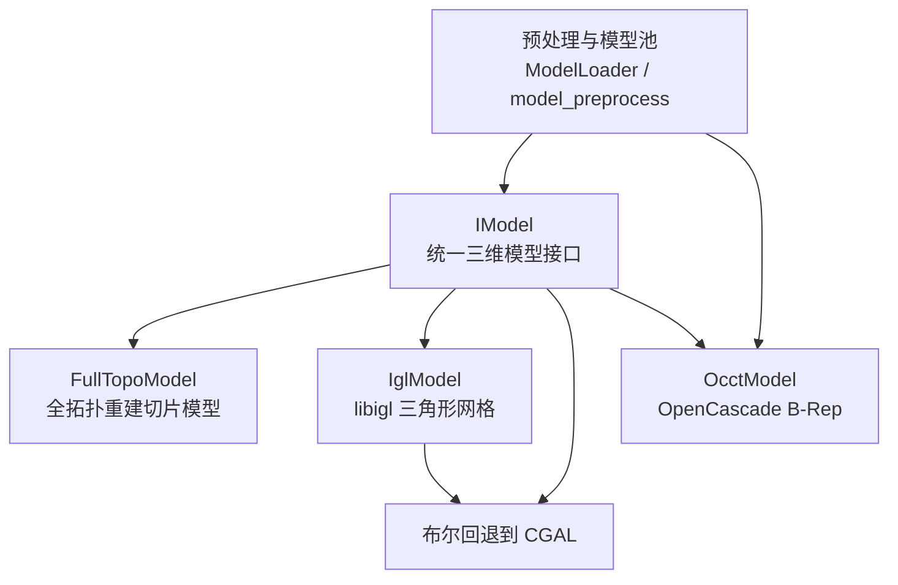
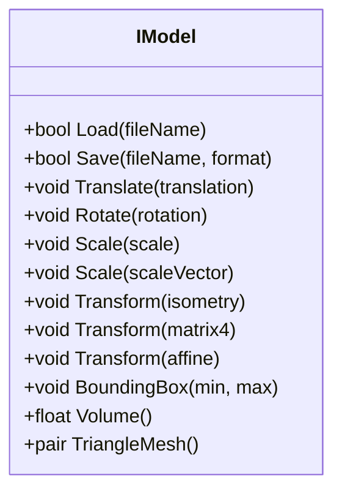
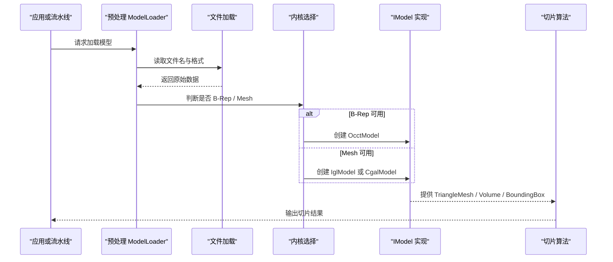
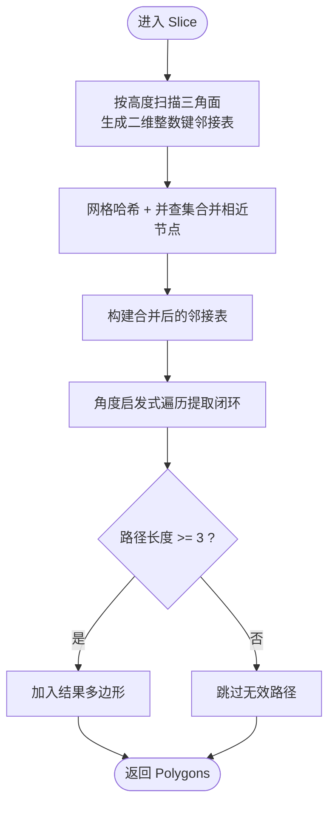
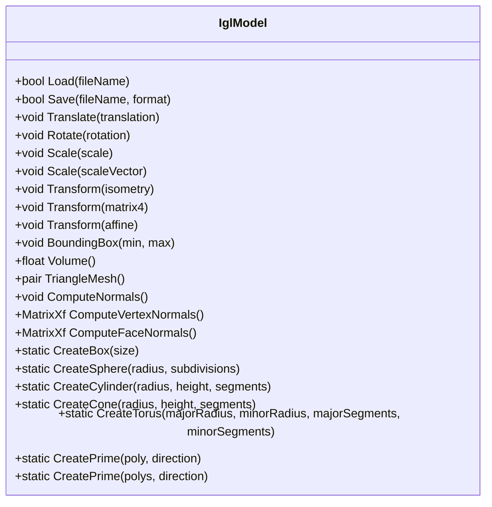
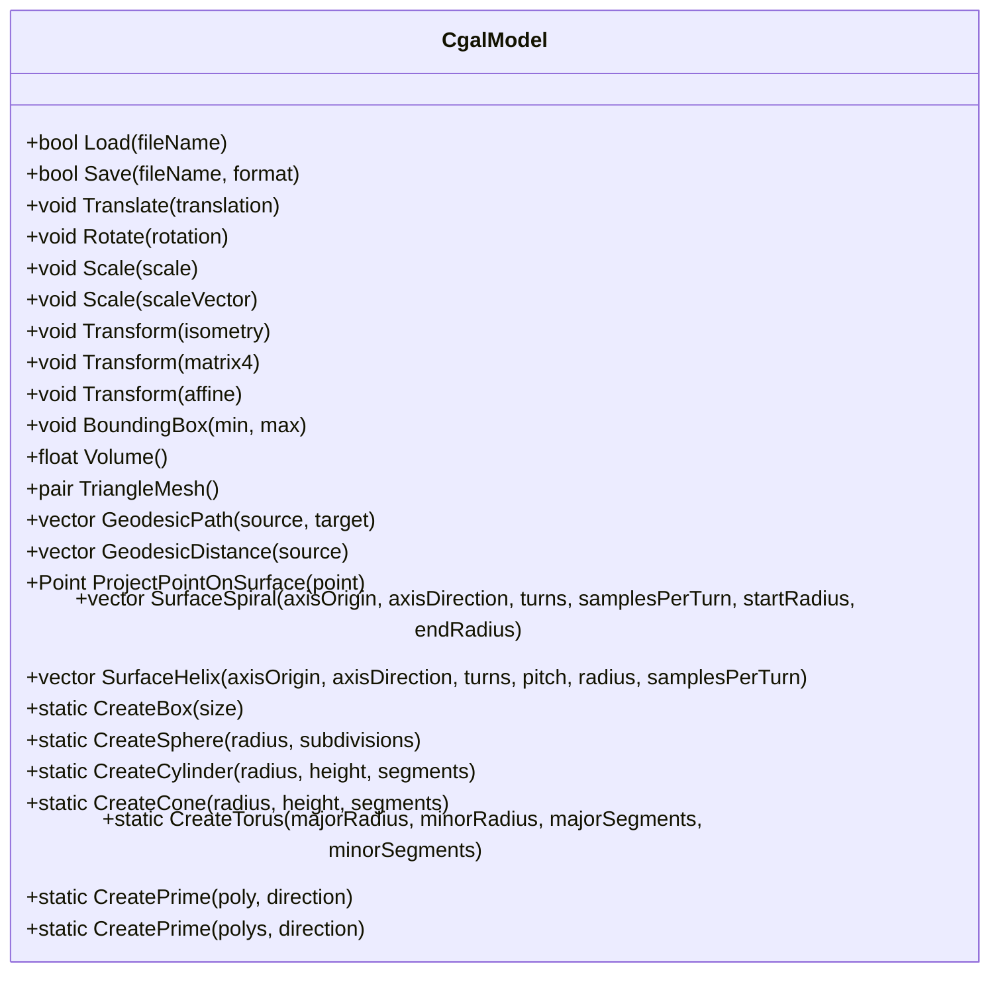
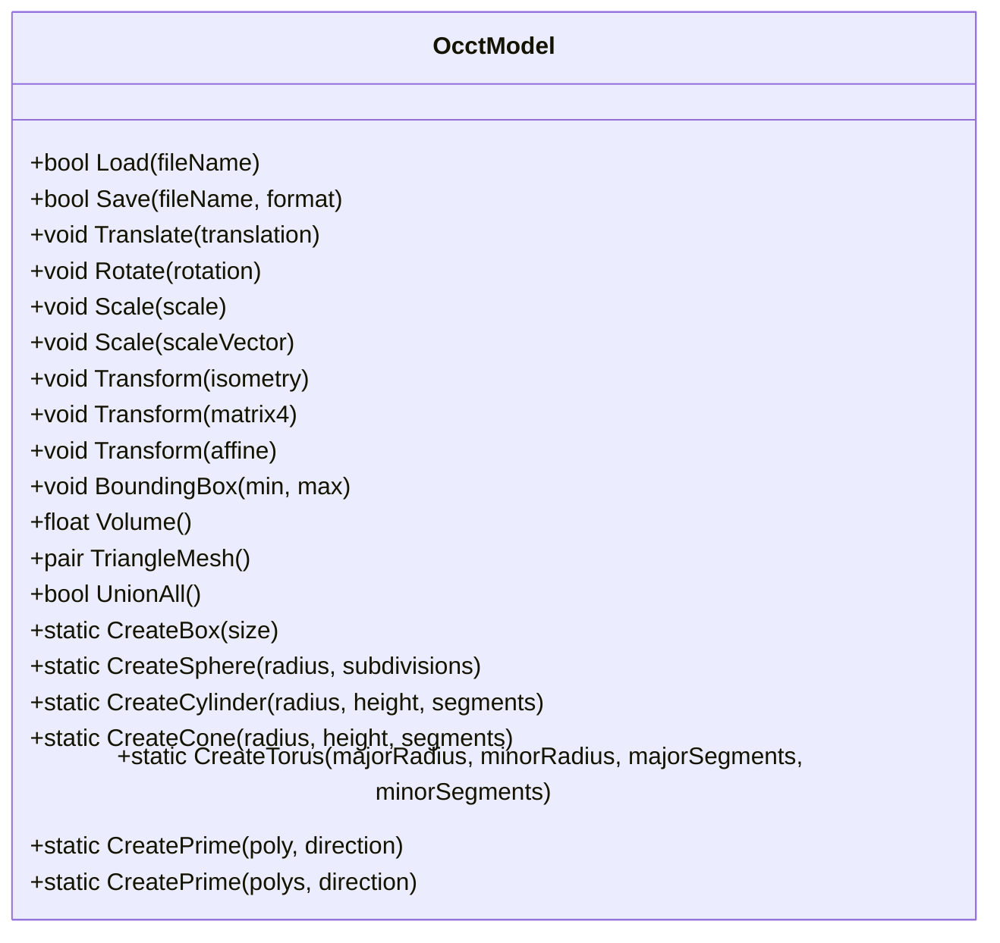
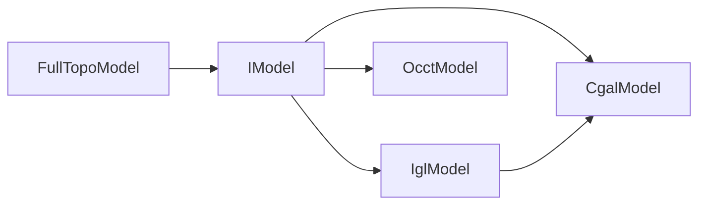
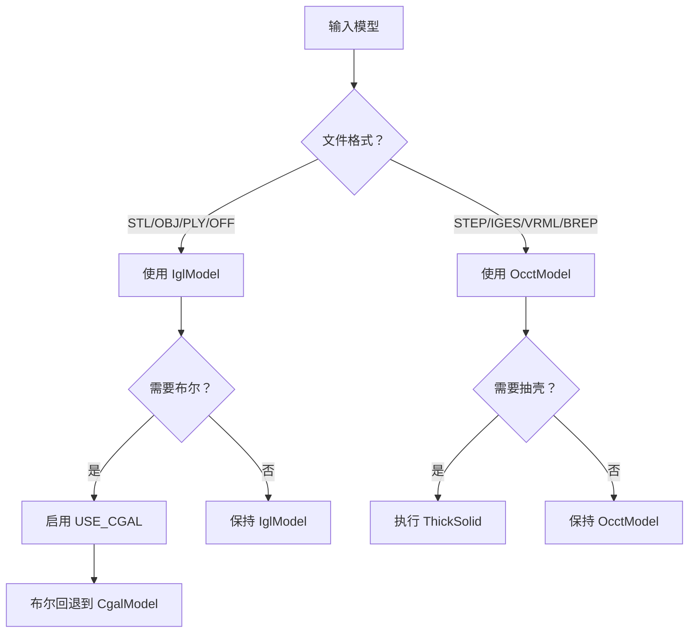

# 网格模型处理 (Mesh Model Processing)

<cite>
**本文引用的文件**   
- [base/IModel.hpp](file://base/IModel.hpp)
- [meshmodel/FullTopoModel.hpp](file://meshmodel/FullTopoModel.hpp)
- [meshmodel/FullTopoModel.cpp](file://meshmodel/FullTopoModel.cpp)
- [meshmodel/CgalModel.hpp](file://meshmodel/CgalModel.hpp)
- [meshmodel/CgalModel.cpp](file://meshmodel/CgalModel.cpp)
- [meshmodel/IglModel.hpp](file://meshmodel/IglModel.hpp)
- [meshmodel/IglModel.cpp](file://meshmodel/IglModel.cpp)
- [cadmodel/OcctModel.hpp](file://cadmodel/OcctModel.hpp)
- [cadmodel/OcctModel.cpp](file://cadmodel/OcctModel.cpp)
- [preprocess/ModelLoader.cpp](file://preprocess/ModelLoader.cpp)
- [LibHsBaSlicer/Preprocess/model_preprocess.hpp](file://LibHsBaSlicer/Preprocess/model_preprocess.hpp)
</cite>

## 目录
1. [引言](#引言)
2. [项目结构](#项目结构)
3. [核心概念与统一接口](#核心概念与统一接口)
4. [架构总览](#架构总览)
5. [核心组件详解](#核心组件详解)
6. [依赖关系分析](#依赖关系分析)
7. [性能与精度优化建议](#性能与精度优化建议)
8. [API 参考](#api-参考)
9. [使用示例与内核切换指南](#使用示例与内核切换指南)
10. [故障排除](#故障排除)
11. [结论](#结论)

## 引言
本技术文档聚焦 HsBaSlicer 的网格模型处理模块，系统说明 meshmodel 提供的几何建模能力。该模块围绕一个统一的 IModel 抽象，提供四类实现：

- FullTopoModel：面向切片的全拓扑重建网格模型，适合需要顶点、边、面完整拓扑关系的算法。
- CgalModel：基于 CGAL 的多面体网格模型，支持布尔运算、体积、包围盒、几何原语和表面测地线等高级几何操作。
- IglModel：基于 libigl 的三角形网格模型，提供轻量高效的网格加载、变换、法线计算、布尔回退和几何原语。
- OcctModel：基于 OpenCascade 的 B-Rep CAD 模型，支持 STEP/IGES/VRML/BRep 等格式、布尔运算、抽壳和实体原语。

本文从接口设计、几何操作、数据流、错误处理和性能特征五个维度展开，并给出 API 参考、内核切换策略以及精度控制建议。

## 项目结构
meshmodel 模块位于仓库根目录下的 `meshmodel` 子目录，包含三个核心模型实现；OcctModel 位于 `cadmodel` 子目录，作为 B-Rep 扩展；IModel 定义在 `base` 中，是所有模型的统一抽象。

**图示来源**
- [base/IModel.hpp:110-139](file://base/IModel.hpp#L110-L139)
- [meshmodel/FullTopoModel.hpp:53-142](file://meshmodel/FullTopoModel.hpp#L53-L142)
- [meshmodel/IglModel.hpp:26-121](file://meshmodel/IglModel.hpp#L26-L121)
- [meshmodel/CgalModel.hpp:34-155](file://meshmodel/CgalModel.hpp#L34-L155)
- [cadmodel/OcctModel.hpp:30-108](file://cadmodel/OcctModel.hpp#L30-L108)
- [preprocess/ModelLoader.cpp:136-164](file://preprocess/ModelLoader.cpp#L136-L164)

**章节来源**
- [base/IModel.hpp:110-139](file://base/IModel.hpp#L110-L139)
- [meshmodel/FullTopoModel.hpp:53-142](file://meshmodel/FullTopoModel.hpp#L53-L142)
- [meshmodel/IglModel.hpp:26-121](file://meshmodel/IglModel.hpp#L26-L121)
- [meshmodel/CgalModel.hpp:34-155](file://meshmodel/CgalModel.hpp#L34-L155)
- [cadmodel/OcctModel.hpp:30-108](file://cadmodel/OcctModel.hpp#L30-L108)

## 核心概念与统一接口
IModel 是 HsBaSlicer 的三维模型抽象基类，定义了所有模型必须实现的通用能力：

- 文件 I/O：Load(fileName)、Save(fileName, format)
- 几何变换：Translate、Rotate、Scale（均匀与非均匀）、Transform（Isometry/Matrix4/Affine）
- 查询：BoundingBox(min,max)、Volume()
- 网格导出：TriangleMesh() 返回 Eigen 风格的顶点矩阵与三角面片索引矩阵

**图示来源**
- [base/IModel.hpp:110-139](file://base/IModel.hpp#L110-L139)

**章节来源**
- [base/IModel.hpp:110-139](file://base/IModel.hpp#L110-L139)

## 架构总览
HsBaSlicer 的模型处理采用“统一接口 + 多内核实现”的架构：

- 上层流水线通过 IModel 调用模型能力，不关心具体内核。
- 预处理层根据文件格式和可用宏选择内核：B-Rep 优先 OCCT，网格优先 IGL/CGAL。
- 布尔运算路由：OCCT 用于 BRep-BRep，IGL/CGAL 用于 Mesh-Mesh。
- FullTopoModel 不参与 IModel 体系，而是为切片算法提供完整的拓扑视图。

**图示来源**
- [preprocess/ModelLoader.cpp:136-164](file://preprocess/ModelLoader.cpp#L136-L164)
- [LibHsBaSlicer/Preprocess/model_preprocess.hpp:124-154](file://LibHsBaSlicer/Preprocess/model_preprocess.hpp#L124-L154)

**章节来源**
- [preprocess/ModelLoader.cpp:136-164](file://preprocess/ModelLoader.cpp#L136-L164)
- [LibHsBaSlicer/Preprocess/model_preprocess.hpp:124-154](file://LibHsBaSlicer/Preprocess/model_preprocess.hpp#L124-L154)

## 核心组件详解

### FullTopoModel：面向切片的全拓扑重建模型
FullTopoModel 不是 IModel 的实现，而是一个专为切片设计的拓扑重建模型。它从任意 IModel 或顶点/三角面片数据构建顶点、边、面的完整拓扑关系，并提供安全切片、不安全切片、快速切片和 Lua 脚本切片。

关键数据结构：
- Vertex：位置、关联的面与边
- Edge：两个顶点、两个相邻面
- Face：三角面、三条边、法向量

主要能力：
- CheckTopo：检查拓扑完整性
- EulerCharacteristic：欧拉示性数，辅助检测孔洞或非流形
- Intersection：线段与水平平面的交点计算
- Slice / UnSafeSlice / SliceFast：Z 向切片，分别返回闭合轮廓、可能开放轮廓、快速拓扑切片
- SliceLua / UnSafeSliceLua：通过 Lua 脚本自定义切片逻辑

**图示来源**
- [meshmodel/FullTopoModel.cpp:328-599](file://meshmodel/FullTopoModel.cpp#L328-L599)

**章节来源**
- [meshmodel/FullTopoModel.hpp:53-142](file://meshmodel/FullTopoModel.hpp#L53-L142)
- [meshmodel/FullTopoModel.cpp:50-158](file://meshmodel/FullTopoModel.cpp#L50-L158)
- [meshmodel/FullTopoModel.cpp:160-244](file://meshmodel/FullTopoModel.cpp#L160-L244)
- [meshmodel/FullTopoModel.cpp:246-324](file://meshmodel/FullTopoModel.cpp#L246-L324)
- [meshmodel/FullTopoModel.cpp:328-599](file://meshmodel/FullTopoModel.cpp#L328-L599)

### IglModel：libigl 三角形网格模型
IglModel 实现 IModel，存储顶点、三角面片和可选法向量，提供文件加载保存、几何变换、包围盒、体积、法线计算、布尔运算和几何原语构造。

特点：
- 轻量高效，适合大规模网格处理
- 布尔运算默认使用 igl::copyleft::cgal::mesh_boolean，失败时回退到 CgalModel 的 Nef 布尔
- 当未启用 USE_CGAL 编译宏时，布尔运算抛出 NotSupportedError

**图示来源**
- [meshmodel/IglModel.hpp:26-121](file://meshmodel/IglModel.hpp#L26-L121)

**章节来源**
- [meshmodel/IglModel.hpp:26-121](file://meshmodel/IglModel.hpp#L26-L121)
- [meshmodel/IglModel.cpp:37-193](file://meshmodel/IglModel.cpp#L37-L193)
- [meshmodel/IglModel.cpp:195-409](file://meshmodel/IglModel.cpp#L195-L409)
- [meshmodel/IglModel.cpp:411-596](file://meshmodel/IglModel.cpp#L411-L596)
- [meshmodel/IglModel.cpp:598-800](file://meshmodel/IglModel.cpp#L598-L800)

### CgalModel：CGAL 多面体网格模型
CgalModel 也实现 IModel，内部维护 CGAL::Polyhedron_3，提供布尔运算、几何原语、表面测地线、螺旋线和螺旋路径等高级几何功能。

特点：
- 使用 Exact_predicates_inexact_constructions_kernel，兼顾判定精确性与构造效率
- 布尔运算通过 Nef_polyhedron_3 实现 Union/Intersection/Difference/Xor
- 支持 CreateBox/Sphere/Cylinder/Cone/Torus 和 CreatePrime（单多边形或多多边形拉伸）
- 提供 GeodesicPath、GeodesicDistance、ProjectPointOnSurface、SurfaceSpiral、SurfaceHelix

**图示来源**
- [meshmodel/CgalModel.hpp:34-155](file://meshmodel/CgalModel.hpp#L34-L155)

**章节来源**
- [meshmodel/CgalModel.hpp:34-155](file://meshmodel/CgalModel.hpp#L34-L155)
- [meshmodel/CgalModel.cpp:42-119](file://meshmodel/CgalModel.cpp#L42-L119)
- [meshmodel/CgalModel.cpp:121-237](file://meshmodel/CgalModel.cpp#L121-L237)
- [meshmodel/CgalModel.cpp:238-276](file://meshmodel/CgalModel.cpp#L238-L276)
- [meshmodel/CgalModel.cpp:278-445](file://meshmodel/CgalModel.cpp#L278-L445)
- [meshmodel/CgalModel.cpp:625-733](file://meshmodel/CgalModel.cpp#L625-L733)
- [meshmodel/CgalModel.cpp:735-955](file://meshmodel/CgalModel.cpp#L735-L955)
- [meshmodel/CgalModel.cpp:957-992](file://meshmodel/CgalModel.cpp#L957-L992)

### OcctModel：OpenCascade B-Rep 建模
OcctModel 实现 IModel，封装 TopoDS_Shape，提供 STEP/IGES/VRML/BRep 加载保存、布尔运算、抽壳、几何原语和实体拉伸。

特点：
- 适合 CAD 流程中的 B-Rep 建模与布尔运算
- 支持 ThickSolid（抽壳），可指定开口面
- 提供 CreateBox/Sphere/Cylinder/Cone/Torus 和 CreatePrime

**图示来源**
- [cadmodel/OcctModel.hpp:30-108](file://cadmodel/OcctModel.hpp#L30-L108)

**章节来源**
- [cadmodel/OcctModel.hpp:30-108](file://cadmodel/OcctModel.hpp#L30-L108)
- [cadmodel/OcctModel.cpp:405-444](file://cadmodel/OcctModel.cpp#L405-L444)
- [preprocess/ModelLoader.cpp:193-212](file://preprocess/ModelLoader.cpp#L193-L212)

## 依赖关系分析
各模型之间的依赖与协作如下：

- IModel 是所有模型的基础接口。
- IglModel 在启用 USE_CGAL 时依赖 CgalModel 进行布尔回退。
- CgalModel 依赖 CGAL 库进行布尔、体积、AABB 树、测地线等计算。
- OcctModel 依赖 OpenCascade 进行 B-Rep 布尔、抽壳和实体建模。
- FullTopoModel 依赖 IModel 以获取三角网格数据，并依赖 libigl 计算面法线。

**图示来源**
- [base/IModel.hpp:110-139](file://base/IModel.hpp#L110-L139)
- [meshmodel/IglModel.cpp:195-409](file://meshmodel/IglModel.cpp#L195-L409)
- [meshmodel/CgalModel.cpp:238-276](file://meshmodel/CgalModel.cpp#L238-L276)
- [cadmodel/OcctModel.cpp:405-444](file://cadmodel/OcctModel.cpp#L405-L444)
- [meshmodel/FullTopoModel.cpp:32-48](file://meshmodel/FullTopoModel.cpp#L32-L48)

**章节来源**
- [meshmodel/IglModel.cpp:195-409](file://meshmodel/IglModel.cpp#L195-L409)
- [meshmodel/CgalModel.cpp:238-276](file://meshmodel/CgalModel.cpp#L238-L276)
- [cadmodel/OcctModel.cpp:405-444](file://cadmodel/OcctModel.cpp#L405-L444)
- [meshmodel/FullTopoModel.cpp:32-48](file://meshmodel/FullTopoModel.cpp#L32-L48)

## 性能与精度优化建议
- 网格规模与内存：
  - IglModel 使用 Eigen 矩阵存储顶点与面片，适合大规模网格；避免频繁复制，尽量使用移动语义。
  - CgalModel 内部维护 Polyhedron_3，布尔运算会创建 Nef 对象，注意内存峰值。
  - OcctModel 的 B-Rep 布尔和抽壳可能产生复杂拓扑，建议在布尔前简化模型。

- 布尔运算稳定性：
  - IglModel 的布尔先尝试 igl::copyleft::cgal::mesh_boolean，失败后回退到 CgalModel 的 Nef 布尔。
  - CgalModel 的布尔基于 Nef_polyhedron_3，对浮点坐标敏感，建议输入网格具有外法线一致性和良好定向。
  - OcctModel 的布尔适合 B-Rep 输入，若输入为网格，应先 tessellation 再布尔。

- 精度控制：
  - FullTopoModel 的切片使用整数化坐标与容差 tolerance 控制点合并；tolerance 越大，越容易合并近似点，但可能丢失细节。
  - CgalModel 使用 EpicKernel，判定精确而构造近似；对于极端小尺寸或大尺度模型，建议归一化单位。
  - IglModel 的体积计算使用绝对值，确保正体积；布尔失败时返回空网格，应检查输入有效性。

- 法线与方向：
  - IglModel 和 CgalModel 都强调外法线一致性；CreatePrime 和 Create* 系列均保证外法线朝外。
  - CgalModel 在拉伸后检查体积符号并翻转面方向，确保体积为正。

- 性能优化：
  - 批量操作时复用模型实例，避免重复构造。
  - 对大型网格，优先使用 IglModel 进行快速变换与查询，仅在需要布尔或高级几何时使用 CgalModel。
  - 对 CAD 流程，优先使用 OcctModel 进行布尔与抽壳，减少网格化误差。

[本节为通用指导，不直接分析具体文件]

## API 参考

### IModel 统一接口
- Load(fileName): 从文件加载模型
- Save(fileName, format): 保存模型到指定格式
- Translate(translation): 平移
- Rotate(rotation): 旋转
- Scale(scale): 均匀缩放
- Scale(scaleVector): 非均匀缩放
- Transform(isometry/matrix4/affine): 仿射变换
- BoundingBox(min, max): 轴对齐包围盒
- Volume(): 有符号体积
- TriangleMesh(): 返回顶点矩阵与三角面片索引矩阵

**章节来源**
- [base/IModel.hpp:110-139](file://base/IModel.hpp#L110-L139)

### FullTopoModel
- 构造函数：从 IModel 或顶点/三角面片构建
- CheckTopo(): 检查拓扑完整性
- EulerCharacteristic(): 欧拉示性数
- Intersection(v1, v2, height, intersection): 线段与水平面交点
- Slice(height, tolerance): 安全切片，仅闭合轮廓
- UnSafeSlice(height, tolerance): 不安全切片，含开放轮廓
- SliceFast(height): 快速拓扑切片
- SliceLua(script/funcName/file, height, ext_regs): Lua 脚本切片
- UnSafeSliceLua(...): Lua 脚本不安全切片

**章节来源**
- [meshmodel/FullTopoModel.hpp:74-142](file://meshmodel/FullTopoModel.hpp#L74-L142)
- [meshmodel/FullTopoModel.cpp:27-48](file://meshmodel/FullTopoModel.cpp#L27-L48)
- [meshmodel/FullTopoModel.cpp:160-244](file://meshmodel/FullTopoModel.cpp#L160-L244)
- [meshmodel/FullTopoModel.cpp:328-599](file://meshmodel/FullTopoModel.cpp#L328-L599)
- [meshmodel/FullTopoModel.cpp:604-800](file://meshmodel/FullTopoModel.cpp#L604-L800)

### IglModel
- 构造函数：从顶点/面片/法线构建，支持移动语义
- Load/Save: STL/OBJ/PLY/OFF 等网格格式
- 变换：Translate/Rotate/Scale/Transform
- BoundingBox/Volume/TriangleMesh
- ComputeNormals/ComputeVertexNormals/ComputeFaceNormals
- 布尔：Union/Intersection/Difference/Xor（需 USE_CGAL）
- 几何原语：CreateBox/Sphere/Cylinder/Cone/Torus/CreatePrime

**章节来源**
- [meshmodel/IglModel.hpp:29-121](file://meshmodel/IglModel.hpp#L29-L121)
- [meshmodel/IglModel.cpp:37-193](file://meshmodel/IglModel.cpp#L37-L193)
- [meshmodel/IglModel.cpp:195-409](file://meshmodel/IglModel.cpp#L195-L409)
- [meshmodel/IglModel.cpp:411-596](file://meshmodel/IglModel.cpp#L411-L596)
- [meshmodel/IglModel.cpp:598-800](file://meshmodel/IglModel.cpp#L598-L800)

### CgalModel
- 构造函数：从 Polyhedron_3 或顶点/面片构建
- Load/Save: STL/PLY/OBJ/OFF 等网格格式
- 变换：Translate/Rotate/Scale/Transform
- BoundingBox/Volume/TriangleMesh
- 布尔：Union/Intersection/Difference/Xor（Nef 布尔）
- 几何原语：CreateBox/Sphere/Cylinder/Cone/Torus/CreatePrime
- 表面几何：GeodesicPath/GeodesicDistance/ProjectPointOnSurface/SurfaceSpiral/SurfaceHelix

**章节来源**
- [meshmodel/CgalModel.hpp:37-155](file://meshmodel/CgalModel.hpp#L37-L155)
- [meshmodel/CgalModel.cpp:42-119](file://meshmodel/CgalModel.cpp#L42-L119)
- [meshmodel/CgalModel.cpp:121-237](file://meshmodel/CgalModel.cpp#L121-L237)
- [meshmodel/CgalModel.cpp:238-276](file://meshmodel/CgalModel.cpp#L238-L276)
- [meshmodel/CgalModel.cpp:278-445](file://meshmodel/CgalModel.cpp#L278-L445)
- [meshmodel/CgalModel.cpp:625-733](file://meshmodel/CgalModel.cpp#L625-L733)
- [meshmodel/CgalModel.cpp:735-955](file://meshmodel/CgalModel.cpp#L735-L955)
- [meshmodel/CgalModel.cpp:957-992](file://meshmodel/CgalModel.cpp#L957-L992)

### OcctModel
- 构造函数：从 TopoDS_Shape 构建
- Load/Save: STEP/IGES/VRML/BREP 等 B-Rep 格式
- 变换：Translate/Rotate/Scale/Transform
- BoundingBox/Volume/TriangleMesh
- 布尔：Union/Intersection/Difference/Xor（B-Rep 布尔）
- 抽壳：ThickSolid（厚度与开口面）
- 几何原语：CreateBox/Sphere/Cylinder/Cone/Torus/CreatePrime

**章节来源**
- [cadmodel/OcctModel.hpp:33-108](file://cadmodel/OcctModel.hpp#L33-L108)
- [cadmodel/OcctModel.cpp:405-444](file://cadmodel/OcctModel.cpp#L405-L444)
- [preprocess/ModelLoader.cpp:193-212](file://preprocess/ModelLoader.cpp#L193-L212)

## 使用示例与内核切换指南

### 如何在不同几何内核之间切换
- 如果输入是 STEP/IGES/VRML/BREP，且启用 USE_OCCT，则优先使用 OcctModel。
- 如果输入是 STL/OBJ/PLY/OFF，则优先使用 IglModel；如需布尔运算，启用 USE_CGAL 以获得稳定结果。
- 如果需要表面测地线、螺旋线等高级几何，使用 CgalModel。
- 如果需要完整拓扑关系进行切片，使用 FullTopoModel。

**图示来源**
- [preprocess/ModelLoader.cpp:136-164](file://preprocess/ModelLoader.cpp#L136-L164)
- [LibHsBaSlicer/Preprocess/model_preprocess.hpp:124-154](file://LibHsBaSlicer/Preprocess/model_preprocess.hpp#L124-L154)

**章节来源**
- [preprocess/ModelLoader.cpp:136-164](file://preprocess/ModelLoader.cpp#L136-L164)
- [LibHsBaSlicer/Preprocess/model_preprocess.hpp:124-154](file://LibHsBaSlicer/Preprocess/model_preprocess.hpp#L124-L154)

### 典型使用场景
- 切片流水线：
  - 加载模型为 IModel。
  - 转换为 FullTopoModel 以进行拓扑切片。
  - 使用 Slice/SliceFast 输出 Polygons。

- 布尔流水线：
  - 若两端均为 OcctModel，直接使用 OCCT 布尔。
  - 若两端为 IglModel，启用 USE_CGAL 并使用 IglModel 的布尔函数。
  - 若布尔失败，回退到 CgalModel 的 Nef 布尔。

- 几何原语与拉伸：
  - 使用 CreateBox/Sphere/Cylinder/Cone/Torus 创建基础实体。
  - 使用 CreatePrime 将 2D 多边形沿方向拉伸为 3D 实体。

[本节为概念性指导，不直接分析具体文件]

## 故障排除
- 空网格构造异常：
  - CgalModel 构造函数在输入为空时会抛出 RuntimeError。
  - IglModel 构造函数允许空网格，但布尔运算会返回空模型。

- 布尔运算失败：
  - IglModel 在未启用 USE_CGAL 时抛出 NotSupportedError。
  - IglModel 的布尔先尝试 igl::copyleft::cgal::mesh_boolean，失败后回退到 CgalModel 的 Nef 布尔。
  - CgalModel 的布尔基于 Nef_polyhedron_3，对输入网格质量敏感。

- 抽壳不支持：
  - 如果源模型不是 OcctModel，ThickSolidModel 会抛出 RuntimeError。
  - 如果未启用 USE_OCCT，ThickSolidModel 会抛出 NotSupportedError。

- 文件格式不支持：
  - IglModel.Save 和 CgalModel.Save 对不支持的格式抛出 NotSupportedError。

**章节来源**
- [meshmodel/CgalModel.cpp:42-47](file://meshmodel/CgalModel.cpp#L42-L47)
- [meshmodel/IglModel.cpp:393-409](file://meshmodel/IglModel.cpp#L393-L409)
- [meshmodel/IglModel.cpp:195-246](file://meshmodel/IglModel.cpp#L195-L246)
- [preprocess/ModelLoader.cpp:193-212](file://preprocess/ModelLoader.cpp#L193-L212)
- [meshmodel/IglModel.cpp:72-99](file://meshmodel/IglModel.cpp#L72-L99)
- [meshmodel/CgalModel.cpp:133-157](file://meshmodel/CgalModel.cpp#L133-L157)

## 结论
HsBaSlicer 的网格模型处理模块通过 IModel 统一接口，将 libigl、CGAL 和 OpenCascade 三种几何内核整合到一个一致的 API 中。FullTopoModel 为切片算法提供完整拓扑视图，IglModel 提供轻量高效的网格处理能力，CgalModel 提供高级几何与布尔运算，OcctModel 提供 CAD 级别的 B-Rep 建模与布尔。在实际工程中，应根据文件格式、几何需求和性能约束选择合适的内核，并通过预处理层自动路由。对于精度敏感的场景，建议使用 CgalModel 或 OcctModel；对于大规模网格处理，建议使用 IglModel；对于切片拓扑分析，建议使用 FullTopoModel。

[本节为总结性内容，不直接分析具体文件]