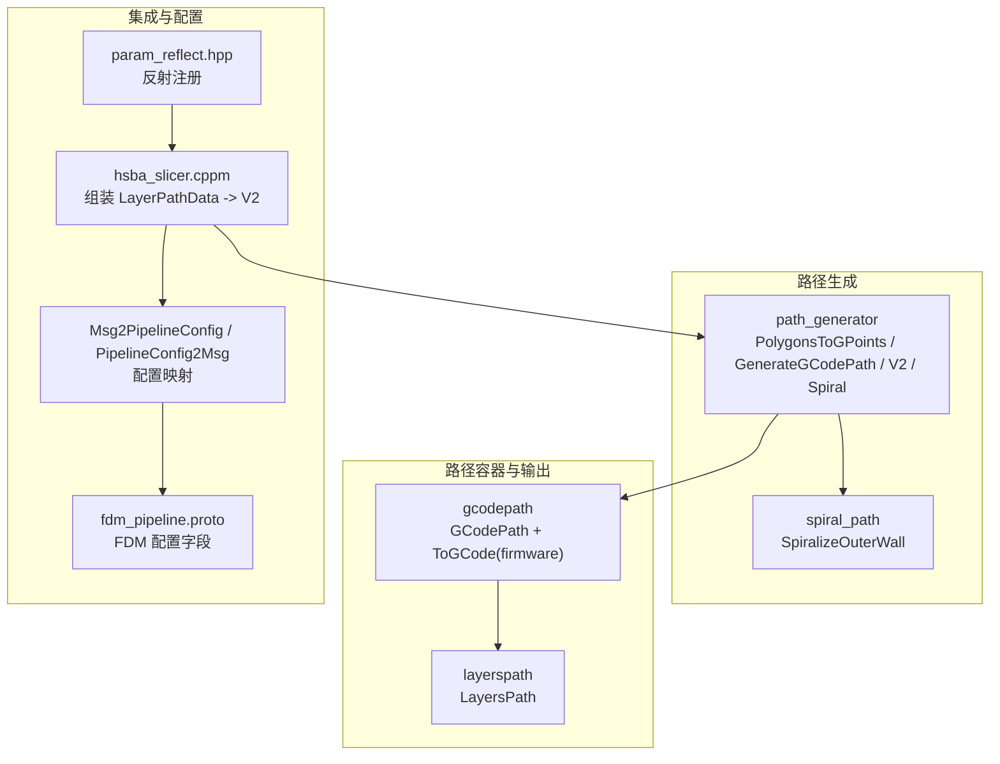
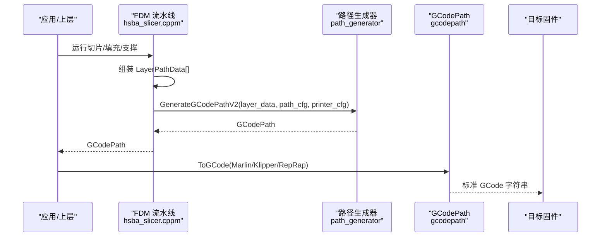
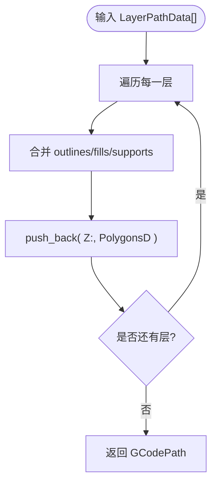
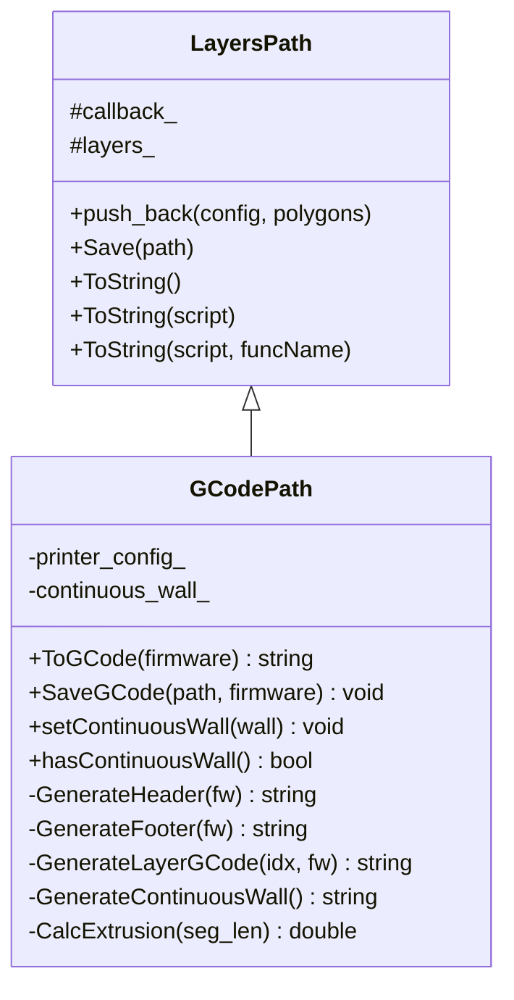
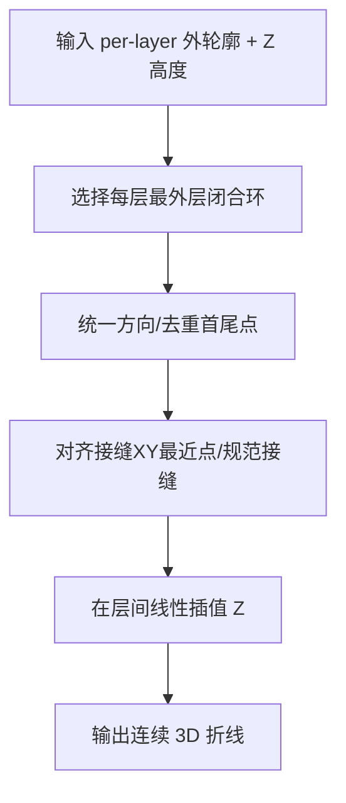
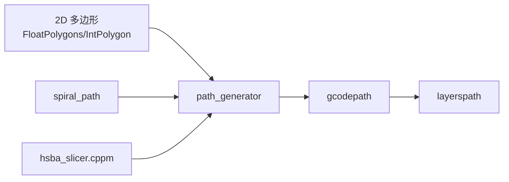

# GCode路径生成

<cite>
**本文引用的文件**   
- [path_generator.hpp](file://LibHsBaSlicer/Path/path_generator.hpp)
- [path_generator.cpp](file://LibHsBaSlicer/Path/path_generator.cpp)
- [gcodepath.hpp](file://paths/gcodepath.hpp)
- [gcodepath.cpp](file://paths/gcodepath.cpp)
- [layerspath.hpp](file://paths/layerspath.hpp)
- [layerspath.cpp](file://paths/layerspath.cpp)
- [spiral_path.hpp](file://LibHsBaSlicer/Path/spiral_path.hpp)
- [spiral_path.cpp](file://LibHsBaSlicer/Path/spiral_path.cpp)
- [hsba_slicer.cppm](file://ModuleHsBaSlicer/hsba_slicer.cppm)
- [fdm_pipeline.proto](file://proto/fdm_pipeline.proto)
- [Msg2PipelineConfig.cpp](file://convert/Msg2PipelineConfig.cpp)
- [PipelineConfig2Msg.cpp](file://convert/PipelineConfig2Msg.cpp)
- [param_reflect.hpp](file://fileoperator/param_reflect.hpp)
- [README.md](file://docs/en/LibHsBaSlicer/README.md)
- [path_generator_test.cpp](file://tests/PathsOut/path_generator_test.cpp)
- [gcode_path_test.cpp](file://tests/PathsOut/gcode_path_test.cpp)
</cite>

## 目录
1. [简介](#简介)
2. [项目结构](#项目结构)
3. [核心组件](#核心组件)
4. [架构总览](#架构总览)
5. [详细组件分析](#详细组件分析)
6. [依赖关系分析](#依赖关系分析)
7. [性能与优化建议](#性能与优化建议)
8. [故障排查指南](#故障排查指南)
9. [结论](#结论)
10. [附录：API与参数速查](#附录api与参数速查)

## 简介
本文面向 FDM 切片后“路径到 GCode”的生成链路，系统性梳理 HsBaSlicer 中轮廓、填充、支撑路径的转换逻辑，解释 FdmPathConfig 配置参数的作用机制，并给出 GenerateGCodePath 与 GenerateGCodePathV2 的使用示例。同时说明多固件（Marlin、RepRap、Klipper）输出差异、连续螺旋墙（花瓶模式）的实现原理，以及从 LayerPathData 到 GCodePath 的数据流与错误处理要点，帮助 3D 打印软件开发者与嵌入式工程师高效集成与调优。

## 项目结构
围绕 GCode 路径生成的关键代码分布在以下模块：
- LibHsBaSlicer/Path：FDM 路径生成 API（PolygonsToGPoints、GenerateGCodePath、GenerateGCodePathV2、GenerateGCodePathSpiral）
- paths：通用层路径容器 LayersPath 与多固件 GCode 输出类 GCodePath
- spiral_path：连续螺旋外壁算法（花瓶模式）
- ModuleHsBaSlicer：流水线集成，将切片/填充/支撑结果组装为 LayerPathData 并调用 V2 接口
- proto/convert/fileoperator：FDM 管线配置与序列化映射（含线宽、速度、挤出等）

图表来源
- [path_generator.hpp:20-91](file://LibHsBaSlicer/Path/path_generator.hpp#L20-L91)
- [gcodepath.hpp:24-107](file://paths/gcodepath.hpp#L24-L107)
- [layerspath.hpp:17-60](file://paths/layerspath.hpp#L17-L60)
- [spiral_path.hpp:16-58](file://LibHsBaSlicer/Path/spiral_path.hpp#L16-L58)
- [hsba_slicer.cppm:695-702](file://ModuleHsBaSlicer/hsba_slicer.cppm#L695-L702)
- [fdm_pipeline.proto:39-72](file://proto/fdm_pipeline.proto#L39-L72)
- [Msg2PipelineConfig.cpp:43-65](file://convert/Msg2PipelineConfig.cpp#L43-L65)
- [PipelineConfig2Msg.cpp:31-48](file://convert/PipelineConfig2Msg.cpp#L31-L48)
- [param_reflect.hpp:80-99](file://fileoperator/param_reflect.hpp#L80-L99)

章节来源
- [README.md:380-413](file://docs/en/LibHsBaSlicer/README.md#L380-L413)

## 核心组件
- FdmPathConfig：FDM 路径生成配置（层高、线宽、打印速度、移动速度、挤出倍率、单位）。用于 PolygonsToGPoints 计算每段挤出量与速度。
- LayerPathData：单层路径数据，包含轮廓 outlines、填充 fills、支撑 supports 与层高 z_height。
- PointsPath：点序列路径（旧版），GenerateGCodePath 返回该类型。
- GCodePath：继承 LayersPath，支持多固件 GCode 输出、连续螺旋墙、Lua 后处理。
- GCodePrinterConfig：打印机/固件相关配置（喷嘴直径、丝径、温度、回抽、速度、相对/绝对挤出等）。
- SpiralizeOuterWall：将每层外轮廓合并为一条连续的上升螺旋线（花瓶模式）。

章节来源
- [path_generator.hpp:20-91](file://LibHsBaSlicer/Path/path_generator.hpp#L20-L91)
- [gcodepath.hpp:24-107](file://paths/gcodepath.hpp#L24-L107)
- [spiral_path.hpp:16-58](file://LibHsBaSlicer/Path/spiral_path.hpp#L16-L58)

## 架构总览
下图展示从切片/填充/支撑结果到最终 GCode 的端到端流程。

图表来源
- [hsba_slicer.cppm:695-702](file://ModuleHsBaSlicer/hsba_slicer.cppm#L695-L702)
- [path_generator.cpp:95-116](file://LibHsBaSlicer/Path/path_generator.cpp#L95-L116)
- [gcodepath.cpp:310-327](file://paths/gcodepath.cpp#L310-L327)

## 详细组件分析

### FDM 路径生成 API（path_generator）
- PolygonsToGPoints：将 PolygonsD 转换为 GPoint 序列。对每个多边形：
  - 首点为快速移动（G0）到起点；后续点为挤出移动（G1），速度根据 is_extrude 选择 print_speed 或 travel_speed。
  - 挤出量按 line_width * layer_height * segment_length * extrusion_multiplier 计算。
- GenerateGCodePath：逐层将 outlines、fills、supports 转为 PointsPath（点序列）。
- GenerateGCodePathV2：逐层将 outlines+fills+supports 合并为 PolygonsD，并以层配置字符串（Z:<z>）写入 GCodePath，供多固件输出。
- GenerateGCodePathSpiral：基于 SpiralizeOuterWall 生成连续螺旋外壁，设置 continuous_wall_，ToGCode 优先输出该墙。

图表来源
- [path_generator.cpp:61-116](file://LibHsBaSlicer/Path/path_generator.cpp#L61-L116)

章节来源
- [path_generator.cpp:14-59](file://LibHsBaSlicer/Path/path_generator.cpp#L14-L59)
- [path_generator.cpp:61-116](file://LibHsBaSlicer/Path/path_generator.cpp#L61-L116)
- [path_generator.cpp:118-136](file://LibHsBaSlicer/Path/path_generator.cpp#L118-L136)

### 多层路径容器（LayersPath）
- 存储每层的自由格式配置字符串与双精度多边形集合。
- 提供 Save/ToString 系列接口，支持原生 SQLite 保存与 Lua 脚本后处理。
- GCodePath 继承该类，复用层数据存储能力。

章节来源
- [layerspath.hpp:17-60](file://paths/layerspath.hpp#L17-L60)
- [layerspath.cpp:25-59](file://paths/layerspath.cpp#L25-L59)
- [layerspath.cpp:61-159](file://paths/layerspath.cpp#L61-L159)
- [layerspath.cpp:271-478](file://paths/layerspath.cpp#L271-L478)

### 多固件 GCode 输出（GCodePath）
- 固件枚举：Marlin、RepRap、Klipper。
- 头部/尾部：针对不同固件输出温度等待、归位、风扇控制、压力前馈、速度/流量百分比、回抽等指令。
- 层路径生成：解析层配置中的 Z，首层使用 first_layer_speed，其余使用 print_speed；支持相对/绝对挤出与回抽开关。
- 连续螺旋墙：当 setContinuousWall 被设置时，先输出一条无回抽的连续上升外壁，再输出各层多边形。
- Lua 后处理：可注入脚本，访问 gcode、firmware、printer_config 等全局变量，返回修改后的 GCode。

图表来源
- [layerspath.hpp:17-60](file://paths/layerspath.hpp#L17-L60)
- [gcodepath.hpp:24-107](file://paths/gcodepath.hpp#L24-L107)

章节来源
- [gcodepath.cpp:53-63](file://paths/gcodepath.cpp#L53-L63)
- [gcodepath.cpp:65-142](file://paths/gcodepath.cpp#L65-L142)
- [gcodepath.cpp:144-193](file://paths/gcodepath.cpp#L144-L193)
- [gcodepath.cpp:195-269](file://paths/gcodepath.cpp#L195-L269)
- [gcodepath.cpp:271-308](file://paths/gcodepath.cpp#L271-L308)
- [gcodepath.cpp:310-327](file://paths/gcodepath.cpp#L310-L327)
- [gcodepath.cpp:329-338](file://paths/gcodepath.cpp#L329-L338)
- [gcodepath.cpp:340-422](file://paths/gcodepath.cpp#L340-L422)

### 连续螺旋墙（花瓶模式）
- SpiralizeOuterWall：对每层选取最外层闭合环（最大有符号面积），统一方向（CCW），对齐接缝（最近 XY 点/规范接缝），在相邻层之间线性插值 Z，形成一条不间断的 3D 折线。
- GenerateGCodePathSpiral：调用 SpiralizeOuterWall 并将结果作为 continuous_wall_ 写入 GCodePath，ToGCode 优先输出该墙。

图表来源
- [spiral_path.cpp:16-85](file://LibHsBaSlicer/Path/spiral_path.cpp#L16-L85)
- [spiral_path.cpp:88-98](file://LibHsBaSlicer/Path/spiral_path.cpp#L88-L98)
- [path_generator.cpp:118-136](file://LibHsBaSlicer/Path/path_generator.cpp#L118-L136)

章节来源
- [spiral_path.hpp:16-58](file://LibHsBaSlicer/Path/spiral_path.hpp#L16-L58)
- [spiral_path.cpp:16-98](file://LibHsBaSlicer/Path/spiral_path.cpp#L16-L98)
- [path_generator.cpp:118-136](file://LibHsBaSlicer/Path/path_generator.cpp#L118-L136)

### 流水线集成与配置映射
- hsba_slicer.cppm：将切片/填充/支撑结果组装为 LayerPathData，构建 GCodePrinterConfig，并调用 GenerateGCodePathV2。
- fdm_pipeline.proto：定义 FDM 管线配置字段（线宽、速度、挤出倍率、固件类型、喷嘴/丝径、温度、回抽、首层层高、螺旋模式等）。
- Msg2PipelineConfig / PipelineConfig2Msg：在消息与内部配置之间双向映射。
- param_reflect.hpp：反射注册 FDM 配置字段，便于 UI/配置系统自动发现。

章节来源
- [hsba_slicer.cppm:695-734](file://ModuleHsBaSlicer/hsba_slicer.cppm#L695-L734)
- [fdm_pipeline.proto:39-72](file://proto/fdm_pipeline.proto#L39-L72)
- [Msg2PipelineConfig.cpp:43-65](file://convert/Msg2PipelineConfig.cpp#L43-L65)
- [PipelineConfig2Msg.cpp:31-48](file://convert/PipelineConfig2Msg.cpp#L31-L48)
- [param_reflect.hpp:80-99](file://fileoperator/param_reflect.hpp#L80-L99)

## 依赖关系分析
- path_generator 依赖 2D 多边形类型（FloatPolygons/IntPolygon）、路径类型（PointsPath/GCodePath）与螺旋算法（spiral_path）。
- GCodePath 依赖 LayersPath 进行层数据存储，并通过 Lua 扩展实现脚本化后处理。
- 上层流水线通过 hsba_slicer.cppm 将切片/填充/支撑结果组合为 LayerPathData，并传入 GenerateGCodePathV2。

图表来源
- [path_generator.hpp:9-17](file://LibHsBaSlicer/Path/path_generator.hpp#L9-L17)
- [path_generator.cpp:10-11](file://LibHsBaSlicer/Path/path_generator.cpp#L10-L11)
- [gcodepath.hpp:16-17](file://paths/gcodepath.hpp#L16-L17)
- [layerspath.hpp:12-13](file://paths/layerspath.hpp#L12-L13)
- [hsba_slicer.cppm:695-702](file://ModuleHsBaSlicer/hsba_slicer.cppm#L695-L702)

## 性能与优化建议
- 挤出量计算：CalcExtrusion 基于 line_width * layer_height * segment_length / (π*(filament_diameter/2)^2) * extrusion_multiplier，确保体积守恒。合理设置 line_width 与 layer_height 可减少过挤/欠挤。
- 速度策略：首层使用 first_layer_speed，其他层使用 print_speed；travel_speed 仅用于非挤出移动。避免频繁回抽（enable_retraction=false）可减少空移时间但可能拉丝。
- 内存与 I/O：LayersPath.Save 支持 SQLite 原生存储；ToString/Save 支持 Lua 脚本回调，适合大数据集的分块处理。
- 螺旋模式：连续螺旋墙避免层间断层与回抽，提升表面质量与强度；适用于等截面模型。
- 并行与批处理：上层流水线可批量构造 LayerPathData，减少重复分配；GCodePath.ToGCode 内部顺序拼接字符串，建议在应用层缓存常用固件模板。

[本节为通用指导，不直接分析具体文件]

## 故障排查指南
- 文件打开失败：SaveGCode 在无法打开输出文件时抛出 RuntimeError。检查路径权限与磁盘空间。
- Lua 脚本错误：ToGCode(firmware, script) 在加载或执行 Lua 脚本时抛出 RuntimeError，需检查脚本语法与全局变量名（gcode、firmware、printer_config）。
- 层索引越界：GenerateLayerGCode 对非法 layer_idx 返回空串，应确保层索引有效。
- 连续墙为空：hasContinuousWall 为 false 时不会输出螺旋墙；确认是否调用 setContinuousWall 且点数≥2。
- 挤出异常：relative_extrusion 模式下 E 值为增量；absolute 模式下累积 E 值。注意固件兼容性。

章节来源
- [gcodepath.cpp:329-338](file://paths/gcodepath.cpp#L329-L338)
- [gcodepath.cpp:340-422](file://paths/gcodepath.cpp#L340-L422)
- [gcodepath.cpp:195-203](file://paths/gcodepath.cpp#L195-L203)

## 结论
HsBaSlicer 的 GCode 路径生成模块以清晰的层次划分实现了从几何路径到多固件 GCode 的完整链路：path_generator 负责将轮廓/填充/支撑转换为点序列或层多边形；GCodePath 负责按固件差异输出标准 GCode，并支持连续螺旋墙与 Lua 后处理；上层流水线将切片/填充/支撑结果装配为 LayerPathData 并调用 V2 接口。通过合理配置 FdmPathConfig 与 GCodePrinterConfig，可在不同硬件与固件环境下获得稳定、高质量的打印路径。

[本节为总结性内容，不直接分析具体文件]

## 附录：API与参数速查

### 函数与用法示例
- PolygonsToGPoints(polys, z, config, is_extrude)：将多边形转为 GPoint 序列，is_extrude=true 时为挤出移动，否则为快速移动。
- GenerateGCodePath(layer_data, config)：返回 PointsPath，逐层追加 outlines/fills/supports。
- GenerateGCodePathV2(layer_data, config, printer_config)：返回 GCodePath，支持多固件输出与连续螺旋墙。
- GenerateGCodePathSpiral(layer_outlines, layer_zs, printer_config)：生成连续螺旋外壁，设置 continuous_wall_。

章节来源
- [path_generator.hpp:20-91](file://LibHsBaSlicer/Path/path_generator.hpp#L20-L91)
- [path_generator.cpp:14-59](file://LibHsBaSlicer/Path/path_generator.cpp#L14-L59)
- [path_generator.cpp:61-136](file://LibHsBaSlicer/Path/path_generator.cpp#L61-L136)

### FdmPathConfig 参数说明
- layer_height：层高（mm），影响挤出体积与层间过渡。
- line_width：线宽（mm），决定挤出宽度。
- print_speed：打印速度（mm/s）。
- travel_speed：移动速度（mm/s）。
- extrusion_multiplier：挤出倍率，补偿材料收缩/膨胀。
- units：单位（mm/inch 等）。

章节来源
- [path_generator.hpp:20-31](file://LibHsBaSlicer/Path/path_generator.hpp#L20-L31)

### GCodePrinterConfig 参数说明
- nozzle_diameter：喷嘴直径（mm）。
- filament_diameter：耗材直径（mm）。
- nozzle_temp/bed_temp：喷嘴/热床温度（°C）。
- retract_length/retract_speed：回抽长度/速度。
- print_speed/travel_speed/first_layer_speed：打印/移动/首层速度（mm/s）。
- layer_height/line_width/extrusion_multiplier：同 FdmPathConfig，用于挤出计算。
- relative_extrusion：相对挤出（M83）或绝对挤出（M82）。
- enable_retraction：是否在移动时启用回抽。

章节来源
- [gcodepath.hpp:32-49](file://paths/gcodepath.hpp#L32-L49)

### 多固件输出差异
- Marlin：温度等待、归位、M82/M83 切换、风扇默认关闭。
- RepRap/RRF：额外 M106 全速风扇控制。
- Klipper：SET_PRESSURE_ADVANCE、M220/M221 速度/流量百分比、SET_FAN_SPEED。

章节来源
- [gcodepath.cpp:65-142](file://paths/gcodepath.cpp#L65-L142)
- [gcodepath.cpp:144-193](file://paths/gcodepath.cpp#L144-L193)
- [README.md:380-413](file://docs/en/LibHsBaSlicer/README.md#L380-L413)

### 测试用例参考
- path_generator_test：验证 PolygonsToGPoints、GenerateGCodePath、GenerateGCodePathV2、GenerateGCodePathSpiral 的基本行为。
- gcode_path_test：验证连续螺旋墙输出与相对/绝对挤出分支。

章节来源
- [path_generator_test.cpp:72-121](file://tests/PathsOut/path_generator_test.cpp#L72-L121)
- [gcode_path_test.cpp:133-163](file://tests/PathsOut/gcode_path_test.cpp#L133-L163)