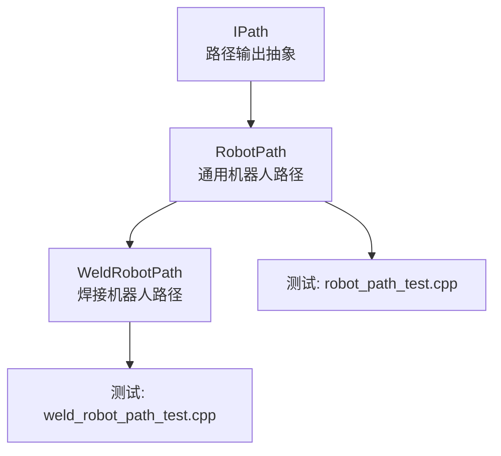
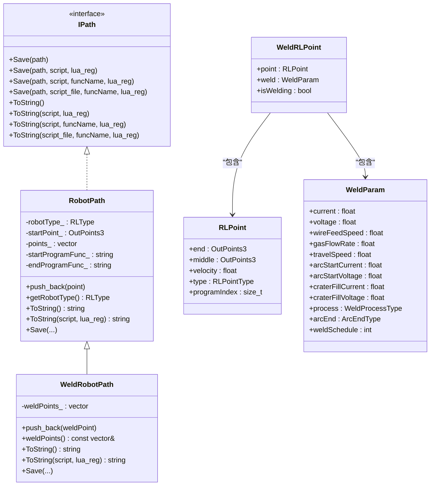
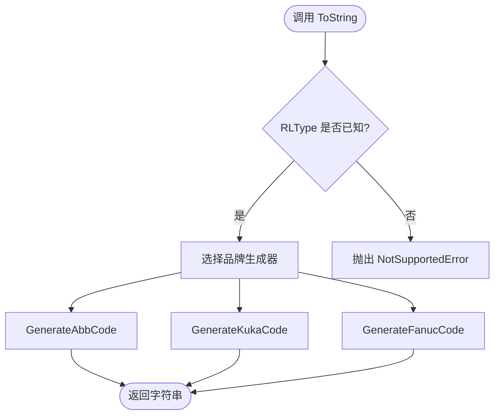
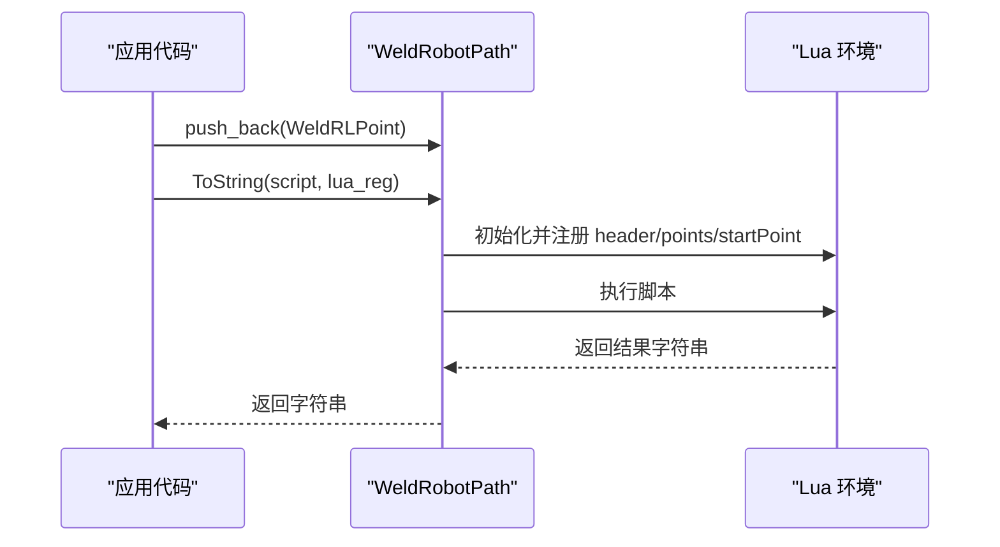
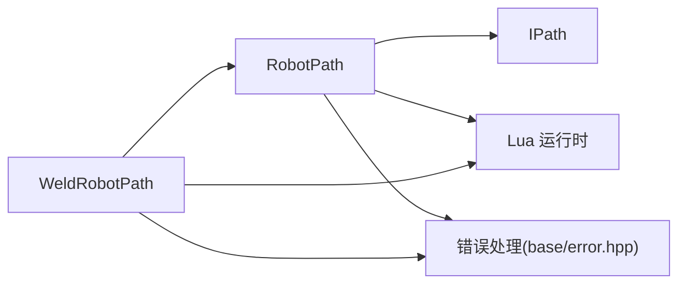
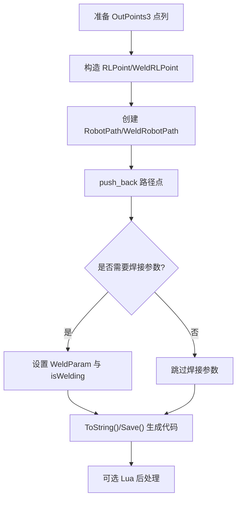

# 机器人路径规划

<cite>
**本文引用的文件**   
- [paths/IPath.hpp](file://paths/IPath.hpp)
- [paths/robotpath.hpp](file://paths/robotpath.hpp)
- [paths/robotpath.cpp](file://paths/robotpath.cpp)
- [paths/weldrobotpath.hpp](file://paths/weldrobotpath.hpp)
- [paths/weldrobotpath.cpp](file://paths/weldrobotpath.cpp)
- [tests/PathsOut/robot_path_test.cpp](file://tests/PathsOut/robot_path_test.cpp)
- [tests/PathsOut/weld_robot_path_test.cpp](file://tests/PathsOut/weld_robot_path_test.cpp)
- [docs/zh/LibHsBaSlicer/README.md](file://docs/zh/LibHsBaSlicer/README.md)
</cite>

## 目录
1. [引言](#引言)
2. [项目结构](#项目结构)
3. [核心组件](#核心组件)
4. [架构总览](#架构总览)
5. [详细组件分析](#详细组件分析)
6. [依赖关系分析](#依赖关系分析)
7. [性能与连续性保障](#性能与连续性保障)
8. [使用示例：从标准路径到机器人指令](#使用示例从标准路径到机器人指令)
9. [故障排查指南](#故障排查指南)
10. [结论](#结论)

## 引言
本技术文档聚焦 HsBaSlicer 的机器人路径规划能力，围绕 RobotPath 与 WeldRobotPath 两类路径输出器展开。文档解释其面向 ABB、KUKA、FANUC 的品牌代码生成机制，说明焊接路径在电弧启停、焊丝送丝、保护气流量、熔池收弧等工艺维度的扩展方式，并给出从“标准路径数据”转换为“机器人可执行轨迹指令”的完整流程。同时，结合仓库中的路径优化模块，补充路径连续性、速度规划与加速度限制的工程实践建议。

## 项目结构
与机器人路径相关的核心代码位于 paths 目录，提供统一的 IPath 抽象接口，以及具体实现：
- IPath：统一的路径输出抽象（保存为文件或字符串，支持 Lua 后处理）
- RobotPath：通用工业机器人路径输出（ABB/KUKA/FANUC）
- WeldRobotPath：带焊接参数的机器人路径输出（在 RobotPath 基础上扩展电弧控制与工艺参数）

图表来源
- [paths/IPath.hpp:20-57](file://paths/IPath.hpp#L20-L57)
- [paths/robotpath.hpp:54-104](file://paths/robotpath.hpp#L54-L104)
- [paths/weldrobotpath.hpp:59-96](file://paths/weldrobotpath.hpp#L59-L96)

章节来源
- [paths/IPath.hpp:1-68](file://paths/IPath.hpp#L1-L68)
- [paths/robotpath.hpp:1-108](file://paths/robotpath.hpp#L1-L108)
- [paths/weldrobotpath.hpp:1-100](file://paths/weldrobotpath.hpp#L1-L100)

## 核心组件
- IPath：定义 Save/ToString 系列接口，支持内联脚本或脚本文件 + 函数名的 Lua 后处理；对外暴露 OutPoints3 三维点类型。
- RobotPath：维护起点 startPoint_、RLPoint 序列 points_、目标品牌 RLType，以及程序块头尾函数名 startProgramFunc_/endProgramFunc_；按品牌生成 ABB/KUKA/FANUC 代码，并提供 Lua 脚本导出通道。
- WeldRobotPath：继承 RobotPath，新增 WeldRLPoint 序列 weldPoints_，每个点包含基础 RLPoint 与 WeldParam 工艺参数，并在 ToString/Save 中优先走焊接代码生成逻辑。

关键数据结构与职责
- OutPoints3：X/Y/Z 坐标，Z 表示构建高度。
- RLPoint：包含 end/middle 位置、velocity、type（MoveJ/MoveL/MoveC 及 Program* 分段标记）、programIndex。
- RLType：Unknown/Abb/Kuka/Fanuc/Undefine。
- RLPointType：MoveJ/MoveL/MoveC 与 ProgramStart/ProgramLStart/ProgramCStart/ProgramL/ProgramC/ProgramLEnd/ProgramCEnd。
- WeldParam：电流、电压、送丝速度、气体流量、行走速度、起弧参数、收弧参数、工艺类型、收弧策略、焊缝号。
- WeldRLPoint：封装 RLPoint 与 WeldParam，并标记 isWelding。

章节来源
- [paths/IPath.hpp:59-65](file://paths/IPath.hpp#L59-L65)
- [paths/robotpath.hpp:15-52](file://paths/robotpath.hpp#L15-L52)
- [paths/weldrobotpath.hpp:16-57](file://paths/weldrobotpath.hpp#L16-L57)

## 架构总览
RobotPath/WeldRobotPath 作为 IPath 的具体实现，承担“路径数据 → 品牌机器人代码”的转换职责。Lua 脚本可作为后处理器，注入 header、points、startPoint、startProgramFunc/endProgramFunc 等变量，供用户自定义输出格式。

图表来源
- [paths/IPath.hpp:20-57](file://paths/IPath.hpp#L20-L57)
- [paths/robotpath.hpp:54-104](file://paths/robotpath.hpp#L54-L104)
- [paths/weldrobotpath.hpp:59-96](file://paths/weldrobotpath.hpp#L59-L96)
- [paths/robotpath.hpp:44-52](file://paths/robotpath.hpp#L44-L52)
- [paths/weldrobotpath.hpp:34-57](file://paths/weldrobotpath.hpp#L34-L57)

## 详细组件分析

### RobotPath 设计与实现
- 构造与存储
  - 构造函数接收 RLType、OutPoints3 起点、程序块头尾函数名；内部维护 points_ 向量。
  - push_back 追加 RLPoint；operator[] 提供索引访问。
- 品牌代码生成
  - ToString 根据 RLType 分派到 GenerateAbbCode/GenerateKukaCode/GenerateFanucCode。
  - 对 MoveJ/MoveL/MoveC 分别映射到各品牌的关节/直线/圆弧指令；Program* 类型用于插入程序段起止标记与调用 startProgramFunc_/endProgramFunc_。
- Lua 脚本导出
  - ToString(script, lua_reg) 将 header、startProgramFunc/endProgramFunc、points、startPoint 推入 Lua 全局表，执行脚本并返回结果字符串。
  - 支持通过 lua_reg 注册额外 Lua 函数。
- 错误处理
  - 未知 RLType 抛出 NotSupportedError。
  - Lua 初始化失败或脚本加载/运行失败抛出 RuntimeError。

图表来源
- [paths/robotpath.cpp:90-112](file://paths/robotpath.cpp#L90-L112)
- [paths/robotpath.cpp:222-301](file://paths/robotpath.cpp#L222-L301)
- [paths/robotpath.cpp:304-352](file://paths/robotpath.cpp#L304-L352)
- [paths/robotpath.cpp:355-401](file://paths/robotpath.cpp#L355-L401)

章节来源
- [paths/robotpath.hpp:54-104](file://paths/robotpath.hpp#L54-L104)
- [paths/robotpath.cpp:59-112](file://paths/robotpath.cpp#L59-L112)
- [paths/robotpath.cpp:222-401](file://paths/robotpath.cpp#L222-L401)

### WeldRobotPath 设计与实现
- 继承与扩展
  - 继承 RobotPath，新增 weldPoints_ 序列；push_back(WeldRLPoint) 会同时写入 base 类的 points_ 以保持兼容。
  - 重写 ToString/Save，优先走焊接代码生成分支。
- 焊接参数与电弧控制
  - WeldParam 描述电流、电压、送丝速度、气体流量、行走速度、起弧/收弧参数、工艺类型、收弧策略、焊缝号。
  - 针对 ABB/KUKA/FANUC 分别生成 ArcLStart/ArcLEnd、ARC_On/ARC_Off、ARC START/ARC END 等指令，并根据 isWelding 状态机切换非焊接移动与焊接移动。
- Lua 脚本导出
  - 将 WeldRLPoint 序列以 table 形式传入 Lua，字段包括 end/middle/velocity/type/isWelding/weld.*；type 固定为 "WeldPoint"。
  - PushWeldParamToLua 将 WeldParam 所有字段推入 Lua 表。

图表来源
- [paths/weldrobotpath.cpp:60-65](file://paths/weldrobotpath.cpp#L60-L65)
- [paths/weldrobotpath.cpp:79-101](file://paths/weldrobotpath.cpp#L79-L101)
- [paths/weldrobotpath.cpp:103-190](file://paths/weldrobotpath.cpp#L103-L190)
- [paths/weldrobotpath.cpp:192-219](file://paths/weldrobotpath.cpp#L192-L219)

章节来源
- [paths/weldrobotpath.hpp:59-96](file://paths/weldrobotpath.hpp#L59-L96)
- [paths/weldrobotpath.cpp:54-101](file://paths/weldrobotpath.cpp#L54-L101)
- [paths/weldrobotpath.cpp:103-219](file://paths/weldrobotpath.cpp#L103-L219)

### 品牌代码生成要点
- ABB
  - 使用 MOVEJ/MOVEL/MOVEC；Program* 类型对应 MOVEL/MOVEC 配合 fine/z10 与工具/工件坐标系；ArcLStart/ArcLEnd 用于焊接。
- KUKA
  - 使用 LIN/CIRC；Program* 类型同样映射为线性/圆弧；焊接使用 ARC_Init/ARC_SetWeldParam/ARC_On/ARC_Off 等。
- FANUC
  - 使用 J/L/C 指令；焊接使用 ARC START/ARC END 与 L 指令配合 travelSpeed；支持 weldSchedule。

章节来源
- [paths/robotpath.cpp:222-401](file://paths/robotpath.cpp#L222-L401)
- [paths/weldrobotpath.cpp:221-477](file://paths/weldrobotpath.cpp#L221-L477)

## 依赖关系分析
- 外部依赖
  - Lua：用于脚本执行与数据绑定（utils/LuaNewObject.hpp、lua.hpp）。
  - 错误处理：base/error.hpp 提供 NotSupportedError/RuntimeError。
- 内部依赖
  - IPath：抽象接口。
  - OutPoints3：三维点类型。
  - 测试用例：验证基本行为与品牌覆盖。

图表来源
- [paths/robotpath.cpp:13-16](file://paths/robotpath.cpp#L13-L16)
- [paths/weldrobotpath.cpp:12-15](file://paths/weldrobotpath.cpp#L12-L15)
- [paths/IPath.hpp:20-57](file://paths/IPath.hpp#L20-L57)

章节来源
- [paths/robotpath.cpp:1-16](file://paths/robotpath.cpp#L1-L16)
- [paths/weldrobotpath.cpp:1-15](file://paths/weldrobotpath.cpp#L1-L15)
- [paths/IPath.hpp:1-68](file://paths/IPath.hpp#L1-L68)

## 性能与连续性保障
- 路径连续性
  - RLPoint.middle 用于圆弧插补（MoveC/ProgramC），确保曲线连续；对于直线段（MoveL/ProgramL），end 直接作为目标点。
  - Program* 类型可用于划分程序段，便于在段首/段尾插入工艺动作（如起弧/收弧、夹具动作）。
- 速度规划
  - RLPoint.velocity 控制移动速度；默认 DEFAULT_ROBOT_VELOCITY=100.0f。
  - ABB 生成时附带速度区间常量（最小/最大/高速），便于控制器限速。
- 加速度限制
  - 当前实现未显式设置加速度/加加速度约束；建议在路径生成前进行速度平滑与加速度限幅（例如 S 型速度曲线），再填充 velocity。
- 区域级路径优化
  - LibHsBaSlicer 提供 RegionPathOptimizer，可在填充前（多边形模式）或填充后（填充结果模式）优化区域访问顺序，减少空走距离。
  - 该优化与 RobotPath/WeldRobotPath 的输出阶段解耦，适合在路径生成前提升整体效率。

章节来源
- [paths/robotpath.hpp:15-17](file://paths/robotpath.hpp#L15-L17)
- [paths/robotpath.cpp:20-23](file://paths/robotpath.cpp#L20-L23)
- [docs/zh/LibHsBaSlicer/README.md:234-313](file://docs/zh/LibHsBaSlicer/README.md#L234-L313)

## 使用示例：从标准路径到机器人指令
以下示例展示如何从“标准路径数据”（OutPoints3 点列）转换为机器人可执行的轨迹指令，并附加焊接参数。

步骤概览
1. 准备路径点
   - 使用 OutPoints3 表示端点与中间点（圆弧用 middle）。
   - 设置 RLPoint.type（MoveJ/MoveL/MoveC 或 Program* 分段标记）。
   - 设置 RLPoint.velocity（速度）与 programIndex（程序段编号）。
2. 构建 RobotPath 或 WeldRobotPath
   - 指定 RLType（Abb/Kuka/Fanuc）。
   - 可选设置 startProgramFunc/endProgramFunc（用于程序段头尾调用）。
3. 添加点
   - 普通路径：push_back(RLPoint)。
   - 焊接路径：push_back(WeldRLPoint)，其中 point 为 RLPoint，weld 为 WeldParam，isWelding 标记是否为焊缝段。
4. 生成代码
   - 直接 ToString() 获取品牌代码。
   - 或使用 ToString(script, lua_reg)/Save(...) 进行 Lua 后处理。
5. 校验与调试
   - 参考测试用例检查品牌覆盖与基本行为。

示例流程（概念性）

参考测试用例
- RobotPath 基本用法与品牌覆盖：[tests/PathsOut/robot_path_test.cpp:53-82](file://tests/PathsOut/robot_path_test.cpp#L53-L82)
- WeldRobotPath 基本用法与品牌覆盖：[tests/PathsOut/weld_robot_path_test.cpp:44-79](file://tests/PathsOut/weld_robot_path_test.cpp#L44-L79)

章节来源
- [tests/PathsOut/robot_path_test.cpp:53-82](file://tests/PathsOut/robot_path_test.cpp#L53-L82)
- [tests/PathsOut/weld_robot_path_test.cpp:44-79](file://tests/PathsOut/weld_robot_path_test.cpp#L44-L79)

## 故障排查指南
常见问题与定位方法
- 未知机器人品牌导致无法原生输出
  - 现象：调用 ToString() 抛出 NotSupportedError。
  - 原因：RLType 为 Unknown/Undefine。
  - 解决：设置 RLType 为 Abb/Kuka/Fanuc，或使用 Lua 脚本后处理。
- Lua 脚本加载或运行失败
  - 现象：RuntimeError 提示 Lua load/runtime error。
  - 原因：脚本语法错误或运行时异常。
  - 解决：检查脚本内容，确认已正确注入 header/points/startPoint 等变量。
- 焊接电弧状态异常
  - 现象：焊接段未正确启停或收弧策略未生效。
  - 原因：isWelding 标志或 WeldParam 参数配置不当。
  - 解决：核对 WeldRLPoint.isWelding 与 WeldParam.process/arcEnd 等字段。

章节来源
- [paths/robotpath.cpp:90-112](file://paths/robotpath.cpp#L90-L112)
- [paths/robotpath.cpp:114-220](file://paths/robotpath.cpp#L114-L220)
- [paths/weldrobotpath.cpp:79-101](file://paths/weldrobotpath.cpp#L79-L101)
- [paths/weldrobotpath.cpp:103-190](file://paths/weldrobotpath.cpp#L103-L190)

## 结论
HsBaSlicer 的 RobotPath 与 WeldRobotPath 提供了从“标准路径数据”到“品牌机器人代码”的稳定转换能力。RobotPath 负责通用运动学指令（MoveJ/MoveL/MoveC）与程序段组织，WeldRobotPath 在此基础上扩展了焊接工艺参数与电弧控制。结合 LibHsBaSlicer 的路径优化模块，可以在路径生成前显著降低空走距离，提高整体效率。对于六轴机器人运动学约束、碰撞检测与更精细的速度/加速度规划，建议在路径生成前引入专用算法层，并将结果以 RLPoint/WeldRLPoint 的形式注入 RobotPath/WeldRobotPath，从而保持输出层的简洁与可扩展性。