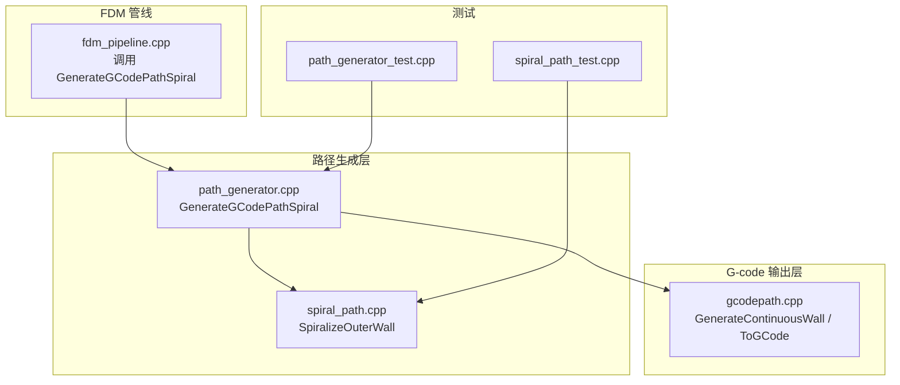
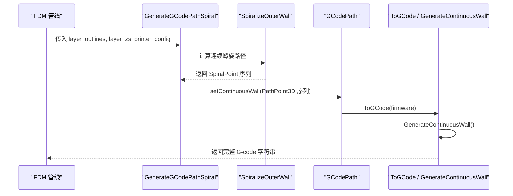
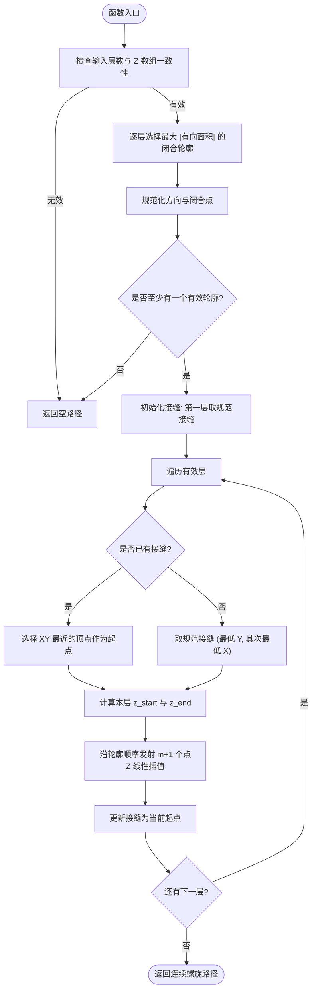
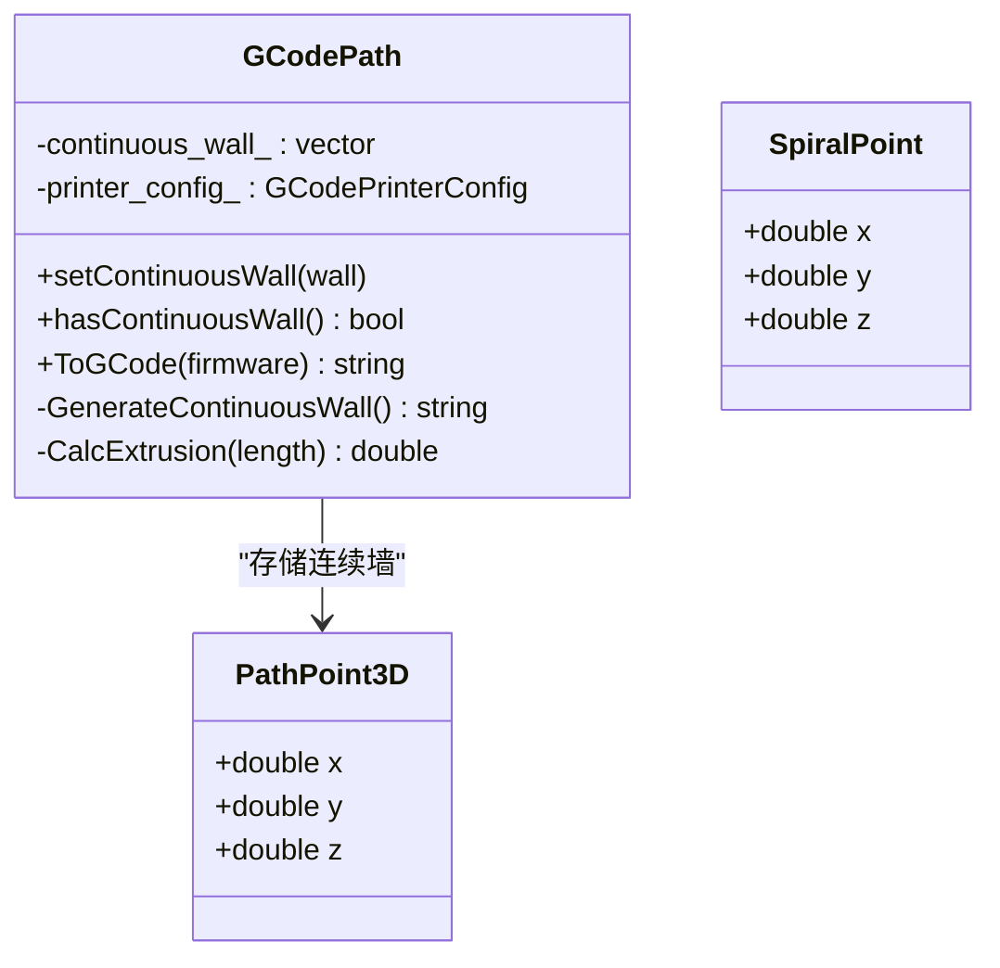
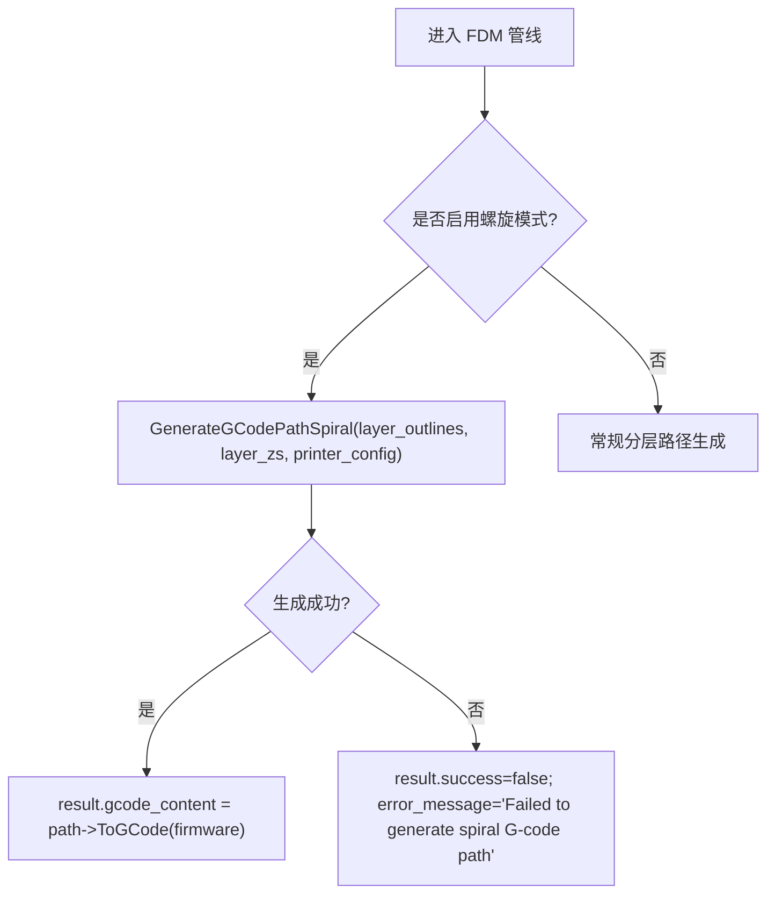
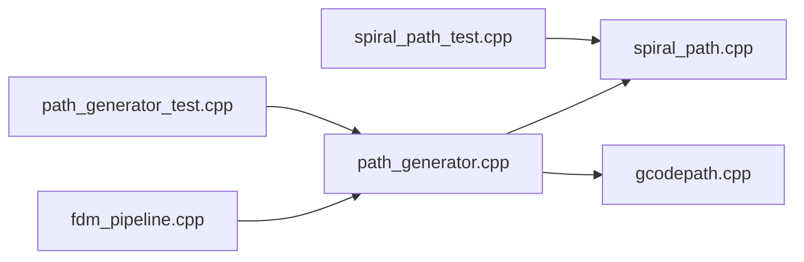

# 螺旋花瓶模式

<cite>
**本文引用的文件**   
- [spiral_path.hpp](file://LibHsBaSlicer/Path/spiral_path.hpp)
- [spiral_path.cpp](file://LibHsBaSlicer/Path/spiral_path.cpp)
- [path_generator.hpp](file://LibHsBaSlicer/Path/path_generator.hpp)
- [path_generator.cpp](file://LibHsBaSlicer/Path/path_generator.cpp)
- [gcodepath.hpp](file://paths/gcodepath.hpp)
- [gcodepath.cpp](file://paths/gcodepath.cpp)
- [fdm_pipeline.cpp](file://DllHsBaSlicer/fdm_pipeline.cpp)
- [spiral_path_test.cpp](file://tests/SpiralPath/spiral_path_test.cpp)
- [path_generator_test.cpp](file://tests/PathsOut/path_generator_test.cpp)
</cite>

## 目录
1. [简介](#简介)
2. [项目结构定位](#项目结构定位)
3. [核心组件](#核心组件)
4. [架构总览](#架构总览)
5. [详细组件分析](#详细组件分析)
6. [依赖关系分析](#依赖关系分析)
7. [性能与参数调优](#性能与参数调优)
8. [常见问题与排错](#常见问题与排错)
9. [结论](#结论)
10. [附录：使用示例与几何适配](#附录使用示例与几何适配)

## 简介
本文面向需要实现“螺旋花瓶模式”（Spiral/Vase Mode）的开发者，系统性解析 HsBaSlicer 中 GenerateGCodePathSpiral 的实现原理。该模式将每层外轮廓合并为一条连续、Z 轴平滑上升的挤出路径，避免层间抬刀和回抽，从而获得更光滑的侧壁和更高的结构强度。文档重点包括：
- 螺旋化算法的核心逻辑：轮廓选择、接缝对齐、Z 轴线性插值、连续路径保证
- 数据流与调用链：从切片多边形到 G-code 连续墙
- 适用模型类型与限制：均匀横截面（棱柱形）模型的几何假设
- 参数影响与优化建议
- 测试用例与故障排查要点

## 项目结构定位
螺旋花瓶模式相关代码主要分布在以下模块：
- LibHsBaSlicer/Path：螺旋路径生成与 FDM 路径生成 API
- paths：G-code 路径对象与固件输出
- DllHsBaSlicer：FDM 管线集成入口
- tests：螺旋路径与路径生成的单元测试

**图表来源**
- [path_generator.cpp:118-135](file://LibHsBaSlicer/Path/path_generator.cpp#L118-L135)
- [spiral_path.cpp:88-163](file://LibHsBaSlicer/Path/spiral_path.cpp#L88-L163)
- [gcodepath.cpp:271-327](file://paths/gcodepath.cpp#L271-L327)
- [fdm_pipeline.cpp:385-413](file://DllHsBaSlicer/fdm_pipeline.cpp#L385-L413)

**章节来源**
- [path_generator.cpp:1-139](file://LibHsBaSlicer/Path/path_generator.cpp#L1-L139)
- [spiral_path.cpp:1-167](file://LibHsBaSlicer/Path/spiral_path.cpp#L1-L167)
- [gcodepath.cpp:1-425](file://paths/gcodepath.cpp#L1-L425)
- [fdm_pipeline.cpp:385-429](file://DllHsBaSlicer/fdm_pipeline.cpp#L385-L429)

## 核心组件
- SpiralizeOuterWall：从每层多边形集合中选择最外层闭合轮廓，确定接缝位置，按层高度进行 Z 线性插值，输出一条连续的 3D 点列。
- GenerateGCodePathSpiral：封装 SpiralizeOuterWall，将结果转换为 PathPoint3D 序列并写入 GCodePath 的连续墙字段。
- GCodePath::GenerateContinuousWall：将连续墙以无回抽、无抬刀的 G1 指令逐段输出，同时计算挤出量 E。
- FDM 管线：在启用螺旋模式时直接调用 GenerateGCodePathSpiral，跳过常规分层路径生成。

关键数据结构：
- SpiralPoint：包含 x/y/z 的三维点，用于表示螺旋路径上的每个点。
- PathPoint3D：G-code 输出层使用的三维点。
- PolygonsD/PolygonD：二维多边形容器与单条多边形环。

**章节来源**
- [spiral_path.hpp:16-58](file://LibHsBaSlicer/Path/spiral_path.hpp#L16-L58)
- [path_generator.hpp:64-80](file://LibHsBaSlicer/Path/path_generator.hpp#L64-L80)
- [gcodepath.hpp:51-106](file://paths/gcodepath.hpp#L51-L106)

## 架构总览
下图展示从切片多边形到最终 G-code 的完整流程，突出螺旋模式的特殊分支。

**图表来源**
- [fdm_pipeline.cpp:385-413](file://DllHsBaSlicer/fdm_pipeline.cpp#L385-L413)
- [path_generator.cpp:118-135](file://LibHsBaSlicer/Path/path_generator.cpp#L118-L135)
- [spiral_path.cpp:88-163](file://LibHsBaSlicer/Path/spiral_path.cpp#L88-L163)
- [gcodepath.cpp:271-327](file://paths/gcodepath.cpp#L271-L327)

## 详细组件分析

### 螺旋路径生成：SpiralizeOuterWall
SpiralizeOuterWall 是螺旋花瓶模式的核心算法，负责：
- 每层选择最外层闭合轮廓（最大绝对有向面积）
- 规范化多边形方向（统一逆时针），去除重复闭合点
- 确定接缝顶点（第一层采用规范接缝，后续层选择 XY 最近点）
- 对每一圈轮廓进行 Z 线性插值，使 Z 随层数单调递增
- 保证相邻层的接缝处 XY/Z 完全一致，形成连续路径

**图表来源**
- [spiral_path.cpp:16-85](file://LibHsBaSlicer/Path/spiral_path.cpp#L16-L85)
- [spiral_path.cpp:88-163](file://LibHsBaSlicer/Path/spiral_path.cpp#L88-L163)

关键点说明：
- 有向面积符号用于判断多边形方向；负面积则反转顶点顺序，确保统一逆时针。
- 最近点选择保证接缝在 XY 平面上尽量稳定，避免螺旋接缝跳跃。
- 最后一层没有上层连接，因此整圈保持其自身 Z 高度，不继续上升。

**章节来源**
- [spiral_path.cpp:16-85](file://LibHsBaSlicer/Path/spiral_path.cpp#L16-L85)
- [spiral_path.cpp:88-163](file://LibHsBaSlicer/Path/spiral_path.cpp#L88-L163)

### 路径封装与 G-code 输出：GenerateGCodePathSpiral 与 GCodePath
GenerateGCodePathSpiral 的职责是将 SpiralizeOuterWall 的结果转换为 G-code 可输出的连续墙：
- 调用 SpiralizeOuterWall 获取 SpiralPoint 序列
- 转换为 PathPoint3D 序列
- 通过 setContinuousWall 写入 GCodePath
- GCodePath::ToGCode 优先输出连续墙，再输出分层多边形（纯花瓶模式下分层为空）

GCodePath::GenerateContinuousWall 负责：
- 首点移动至螺旋起点
- 逐段 G1 指令输出，X/Y/Z 同步变化
- 根据线段长度计算挤出量 E，支持相对/绝对挤出模式
- 不使用回抽或抬刀，确保路径连续

**图表来源**
- [gcodepath.hpp:51-106](file://paths/gcodepath.hpp#L51-L106)
- [gcodepath.cpp:53-63](file://paths/gcodepath.cpp#L53-L63)
- [gcodepath.cpp:271-327](file://paths/gcodepath.cpp#L271-L327)

**章节来源**
- [path_generator.cpp:118-135](file://LibHsBaSlicer/Path/path_generator.cpp#L118-L135)
- [gcodepath.cpp:53-63](file://paths/gcodepath.cpp#L53-L63)
- [gcodepath.cpp:271-327](file://paths/gcodepath.cpp#L271-L327)

### FDM 管线集成
FDM 管线在检测到螺旋模式时，直接调用 GenerateGCodePathSpiral，跳过常规分层路径生成，并将结果转换为 G-code 字符串。若失败，设置错误消息。

**图表来源**
- [fdm_pipeline.cpp:385-413](file://DllHsBaSlicer/fdm_pipeline.cpp#L385-L413)

**章节来源**
- [fdm_pipeline.cpp:385-429](file://DllHsBaSlicer/fdm_pipeline.cpp#L385-L429)

## 依赖关系分析
- path_generator.cpp 依赖 spiral_path.hpp 提供的 SpiralizeOuterWall
- gcodepath.cpp 提供 GCodePath 类及其连续墙输出逻辑
- fdm_pipeline.cpp 作为上层管线调用 GenerateGCodePathSpiral
- 测试文件验证螺旋路径的连续性、接缝稳定性与 G-code 输出有效性

**图表来源**
- [path_generator.cpp:1-139](file://LibHsBaSlicer/Path/path_generator.cpp#L1-L139)
- [spiral_path.cpp:1-167](file://LibHsBaSlicer/Path/spiral_path.cpp#L1-L167)
- [gcodepath.cpp:1-425](file://paths/gcodepath.cpp#L1-L425)
- [fdm_pipeline.cpp:385-429](file://DllHsBaSlicer/fdm_pipeline.cpp#L385-L429)
- [spiral_path_test.cpp:1-166](file://tests/SpiralPath/spiral_path_test.cpp#L1-L166)
- [path_generator_test.cpp:1-122](file://tests/PathsOut/path_generator_test.cpp#L1-L122)

**章节来源**
- [path_generator.cpp:1-139](file://LibHsBaSlicer/Path/path_generator.cpp#L1-L139)
- [spiral_path.cpp:1-167](file://LibHsBaSlicer/Path/spiral_path.cpp#L1-L167)
- [gcodepath.cpp:1-425](file://paths/gcodepath.cpp#L1-L425)
- [fdm_pipeline.cpp:385-429](file://DllHsBaSlicer/fdm_pipeline.cpp#L385-L429)
- [spiral_path_test.cpp:1-166](file://tests/SpiralPath/spiral_path_test.cpp#L1-L166)
- [path_generator_test.cpp:1-122](file://tests/PathsOut/path_generator_test.cpp#L1-L122)

## 性能与参数调优
- 挤出量计算：基于线宽、层高与线段长度，结合耗材直径与挤出倍率，确保体积守恒。
- 速度设置：打印速度与移动速度分别控制挤出段与非挤出段，影响整体打印时间与表面质量。
- 层高与线宽：层高越大，螺旋上升越快；线宽越大，挤出量越大，需匹配喷嘴直径。
- 相对/绝对挤出：相对挤出可减少累计误差，但要求固件正确支持 M83。
- 回抽设置：螺旋模式不触发回抽，避免层间断层；若开启回抽，应确保不影响连续墙输出。

优化建议：
- 对于大尺寸模型，适当提高打印速度，但需关注热积累与冷却效果。
- 调整挤出倍率以补偿材料收缩或填充不足。
- 使用较细层高以获得更平滑的螺旋过渡，但会增加打印时间。

[本节为通用指导，不直接分析具体文件]

## 常见问题与排错
- 输入层数与 Z 数组不一致：SpiralizeOuterWall 会返回空路径。请确保两者大小一致。
- 单层或多层无有效闭合轮廓：算法会跳过无效层；若全部无效，结果为空。
- 接缝跳跃：检查多边形方向与顶点顺序；算法已统一逆时针，但若输入异常可能导致接缝不稳定。
- G-code 输出为空：确认 hasContinuousWall 为真且 ToGCode 被调用；纯花瓶模式下分层为空是正常的。
- 挤出异常：检查 line_width、layer_height、filament_diameter 与 extrusion_multiplier 的设置。

**章节来源**
- [spiral_path.cpp:91-96](file://LibHsBaSlicer/Path/spiral_path.cpp#L91-L96)
- [spiral_path.cpp:120-134](file://LibHsBaSlicer/Path/spiral_path.cpp#L120-L134)
- [gcodepath.cpp:271-327](file://paths/gcodepath.cpp#L271-L327)
- [path_generator_test.cpp:108-119](file://tests/PathsOut/path_generator_test.cpp#L108-L119)

## 结论
HsBaSlicer 的螺旋花瓶模式通过 SpiralizeOuterWall 将每层外轮廓合并为一条连续、Z 平滑上升的挤出路径，避免了层间断层与回抽，提升了侧壁质量与结构强度。GenerateGCodePathSpiral 将该路径封装为 GCodePath 的连续墙，并由 ToGCode 输出标准 G-code。该模式最适合均匀横截面的棱柱形模型；对于变截面模型，接缝对齐仍可保证路径连通性，但几何保真度受限于轮廓选择策略。开发者可通过调整层高、线宽、挤出倍率等参数优化打印效果。

[本节为总结性内容，不直接分析具体文件]

## 附录：使用示例与几何适配
- 正方形棱柱：每层相同的外轮廓，螺旋路径在每个顶点处上升一层高度，接缝稳定。
- 带内孔的多边形：算法选择最大面积的外轮廓，忽略内孔，确保螺旋沿外壁行进。
- 缺失层处理：无闭合轮廓的层会被跳过，Z 取自对应层的高度，保持螺旋连续性。
- 不同几何形状：对于圆柱、锥体等，只要每层外轮廓稳定，螺旋模式仍可有效工作；但需注意接缝对齐与 Z 插值的合理性。

测试用例覆盖：
- 空输入与单层情况
- 棱柱形壁的连续性与接缝一致性
- 方向无关性与外轮廓选择
- 缺失层的跳过行为
- G-code 输出有效性

**章节来源**
- [spiral_path_test.cpp:43-166](file://tests/SpiralPath/spiral_path_test.cpp#L43-L166)
- [path_generator_test.cpp:108-119](file://tests/PathsOut/path_generator_test.cpp#L108-L119)