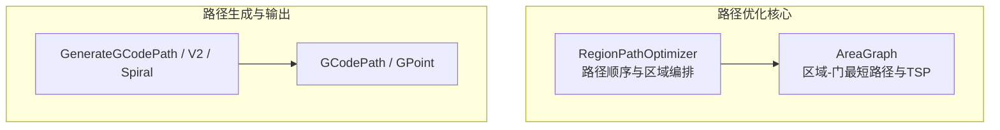
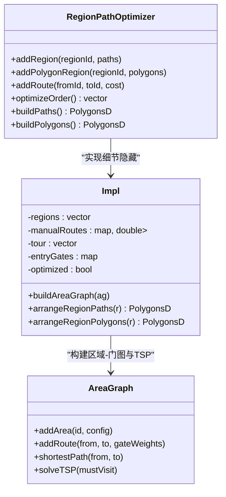
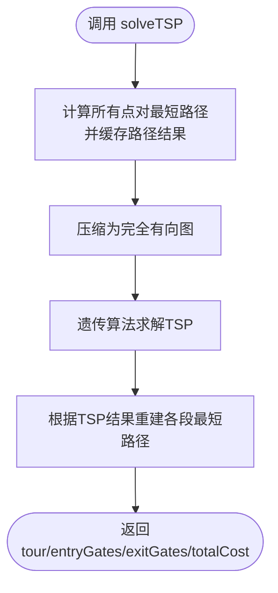
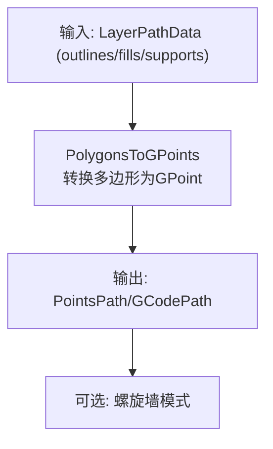
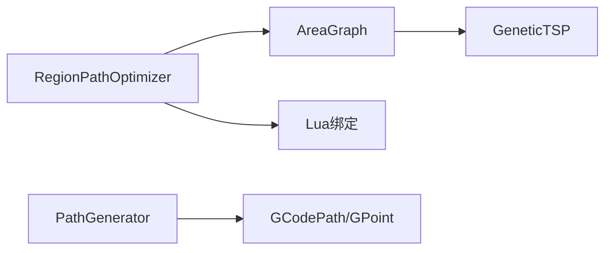

# 路径优化策略

<cite>
**本文引用的文件**   
- [path_optimizer.hpp](file://LibHsBaSlicer/Path/path_optimizer.hpp)
- [path_optimizer.cpp](file://LibHsBaSlicer/Path/path_optimizer.cpp)
- [AreaGraph.hpp](file://utils/AreaGraph.hpp)
- [path_generator.hpp](file://LibHsBaSlicer/Path/path_generator.hpp)
- [path_generator.cpp](file://LibHsBaSlicer/Path/path_generator.cpp)
- [gcodepath.hpp](file://paths/gcodepath.hpp)
- [README.md（英文文档）](file://docs/en/LibHsBaSlicer/README.md)
</cite>

## 目录
1. [引言](#引言)
2. [项目结构中的路径优化位置](#项目结构中的路径优化位置)
3. [核心组件总览](#核心组件总览)
4. [架构总览](#架构总览)
5. [详细组件分析](#详细组件分析)
6. [依赖关系分析](#依赖关系分析)
7. [性能与复杂度分析](#性能与复杂度分析)
8. [参数配置与使用示例](#参数配置与使用示例)
9. [适用场景与权衡](#适用场景与权衡)
10. [调试与诊断方法](#调试与诊断方法)
11. [结论](#结论)

## 引言
本文面向追求极致性能的 3D 打印应用开发者，系统性梳理 HsBaSlicer 的路径优化策略。重点覆盖：
- 路径顺序优化：将独立区域建模为图顶点，通过遗传算法 TSP 求解访问顺序，最小化空移成本。
- 转角平滑处理：在填充结果模式下对多段折线进行方向与端点选择，减少区域内跳转；在多边形模式下旋转起点以对齐入口门。
- 空移路径最小化：通过“门”抽象、内部成本与区间距离计算，以及可选手动路线权重，降低层内与层间空移。
- 路径连续性保证：入口门选择、最近邻贪心排列、闭合轮廓回退到起点等机制，确保输出路径可连续执行。
- 参数与示例：给出 C++ API 与 Lua 脚本两种调用方式，说明如何调整以获得更好的打印质量与效率。
- 性能与权衡：分析内存占用、计算时间、路径质量的平衡点，并提供调试与性能分析方法。

## 项目结构中的路径优化位置
路径优化相关代码主要位于以下模块：
- LibHsBaSlicer/Path：路径生成与优化接口实现。
- utils：通用图结构与 AreaGraph 两阶段“区域-门”最短路径与 TSP 求解。
- paths：GCode 路径数据结构与打印机配置。
- docs：官方文档中对路径优化的使用说明。



**图表来源**
- [path_optimizer.hpp:23-95](file://LibHsBaSlicer/Path/path_optimizer.hpp#L23-L95)
- [AreaGraph.hpp:95-113](file://utils/AreaGraph.hpp#L95-L113)
- [path_generator.hpp:50-80](file://LibHsBaSlicer/Path/path_generator.hpp#L50-L80)
- [gcodepath.hpp:51-73](file://paths/gcodepath.hpp#L51-L73)

**章节来源**
- [path_optimizer.hpp:23-95](file://LibHsBaSlicer/Path/path_optimizer.hpp#L23-L95)
- [AreaGraph.hpp:95-113](file://utils/AreaGraph.hpp#L95-L113)
- [path_generator.hpp:50-80](file://LibHsBaSlicer/Path/path_generator.hpp#L50-L80)
- [gcodepath.hpp:51-73](file://paths/gcodepath.hpp#L51-L73)

## 核心组件总览
- RegionPathOptimizer：区域级路径预优化器，支持两种模式：
  - 多边形模式（填充前）：输入是轮廓多边形，所有顶点作为候选“门”，输出按优化顺序的多边形集合。
  - 填充结果模式（填充后）：输入是多段折线路径，每段首尾端点作为“门”，输出完整填充路径序列。
- AreaGraph：两阶段“区域-门”图模型，提供：
  - 带门的最短路径（考虑区域内内部成本与区域间连线）。
  - 基于遗传算法的 TSP 求解，返回最优区域访问顺序及每个区域的入口门。
- Path Generator：将优化后的多边形或路径转换为 GCode 点序列，并支持螺旋花瓶模式。

**章节来源**
- [path_optimizer.hpp:23-95](file://LibHsBaSlicer/Path/path_optimizer.hpp#L23-L95)
- [AreaGraph.hpp:95-113](file://utils/AreaGraph.hpp#L95-L113)
- [path_generator.hpp:20-80](file://LibHsBaSlicer/Path/path_generator.hpp#L20-L80)

## 架构总览
路径优化在切片流程中处于“路径输出前”的阶段，先对独立区域进行顺序优化，再进入具体路径生成与 GCode 输出。

```mermaid
sequenceDiagram
participant User as "用户/上层管线"
participant Opt as "RegionPathOptimizer"
participant Graph as "AreaGraph"
participant Gen as "PathGenerator"
participant Out as "GCodePath/GPoint"
User->>Opt : 添加区域(多边形或填充路径)
Opt->>Graph : 构建区域-门图
Graph-->>Opt : 最短路径/遗传TSP结果
Opt->>Opt : 区域内路径/多边形排序(最近邻贪心)
Opt-->>User : 返回优化后的路径/多边形
User->>Gen : 生成GCode路径
Gen-->>Out : 输出GPoint序列或连续螺旋墙
```

**图表来源**
- [path_optimizer.cpp:118-165](file://LibHsBaSlicer/Path/path_optimizer.cpp#L118-L165)
- [AreaGraph.hpp:197-345](file://utils/AreaGraph.hpp#L197-L345)
- [path_generator.cpp:61-135](file://LibHsBaSlicer/Path/path_generator.cpp#L61-L135)

## 详细组件分析

### 区域路径优化器 RegionPathOptimizer
- 设计要点：
  - 将每个独立区域视为一个“区域顶点”，区域内的候选入口/出口点称为“门”。
  - 区域内门到门的成本为直线距离（代表区域内移动成本），区域间的连线成本为所有门对的直线距离（代表空移成本）。
  - 支持手动指定对称的区间成本，用于覆盖自动计算的最近端点距离。
  - 两种模式不可混用：多边形模式与填充结果模式分别对应不同的“门”定义与输出构造逻辑。
- 关键行为：
  - optimizeOrder：当区域数小于 2 时直接返回插入顺序；等于 2 时比较两个方向的最短路；大于等于 3 时使用遗传 TSP。
  - buildPaths/buildPolygons：根据已求解的入口门，对区域内路径或多边形进行贪心排列，减少跳跃和空移。



**图表来源**
- [path_optimizer.hpp:44-99](file://LibHsBaSlicer/Path/path_optimizer.hpp#L44-L99)
- [path_optimizer.cpp:43-116](file://LibHsBaSlicer/Path/path_optimizer.cpp#L43-L116)
- [AreaGraph.hpp:95-113](file://utils/AreaGraph.hpp#L95-L113)

**章节来源**
- [path_optimizer.hpp:23-95](file://LibHsBaSlicer/Path/path_optimizer.hpp#L23-L95)
- [path_optimizer.cpp:43-165](file://LibHsBaSlicer/Path/path_optimizer.cpp#L43-L165)

### 区域-门图 AreaGraph
- 设计要点：
  - 将每个区域展开为“入口门”和“出口门”两类顶点，内部边表示从入口到出口的移动成本。
  - 区域间边由 addRoute 提供的门对权重构成，默认使用最近端点距离。
  - shortestPath 从源区域的每个可出口门出发，目标为任意可入口门，返回区域序列与每段的入口/出口门。
  - solveTSP 先缓存所有点对最短路径，压缩成完全有向图，再用遗传算法求解 TSP。
- 关键行为：
  - ensureExpanded 惰性构建展开图，避免重复计算。
  - dijkstraOnExpanded 在展开图上运行 Dijkstra，回溯得到区域路径。
  - TSP 结果包含 tour、entryGates、exitGates 与 totalCost，便于后续编排。



**图表来源**
- [AreaGraph.hpp:267-345](file://utils/AreaGraph.hpp#L267-L345)
- [AreaGraph.hpp:407-468](file://utils/AreaGraph.hpp#L407-L468)
- [AreaGraph.hpp:490-592](file://utils/AreaGraph.hpp#L490-L592)

**章节来源**
- [AreaGraph.hpp:95-113](file://utils/AreaGraph.hpp#L95-L113)
- [AreaGraph.hpp:197-345](file://utils/AreaGraph.hpp#L197-L345)
- [AreaGraph.hpp:407-592](file://utils/AreaGraph.hpp#L407-L592)

### 路径生成与输出 PathGenerator
- 设计要点：
  - PolygonsToGPoints 将多边形序列转换为 GPoint 序列，首点为快速移动到起点（G0），后续为挤出或非挤出移动（G1）。
  - GenerateGCodePath 逐层输出轮廓、填充、支撑路径。
  - GenerateGCodePathV2 支持多固件输出，将每层多边形组合为带 Z 高度的层配置。
  - GenerateGCodePathSpiral 将多层外轮廓合并为连续上升的螺旋墙，适合均匀截面模型的花瓶模式。
- 关键行为：
  - 挤出体积计算基于线宽、层高、线段长度与挤出倍率。
  - 速度设置区分打印速度与空移速度，影响整体打印时间与表面质量。



**图表来源**
- [path_generator.cpp:14-58](file://LibHsBaSlicer/Path/path_generator.cpp#L14-L58)
- [path_generator.cpp:61-135](file://LibHsBaSlicer/Path/path_generator.cpp#L61-L135)

**章节来源**
- [path_generator.hpp:20-91](file://LibHsBaSlicer/Path/path_generator.hpp#L20-L91)
- [path_generator.cpp:14-135](file://LibHsBaSlicer/Path/path_generator.cpp#L14-L135)

## 依赖关系分析
- RegionPathOptimizer 依赖 AreaGraph 完成区域访问顺序与入口门选择。
- AreaGraph 依赖底层 DirectedGraph 与遗传算法 TSP 求解器。
- PathGenerator 依赖 GCodePath 与 GPoint 数据结构进行最终输出。
- Lua 绑定提供脚本化优化能力，允许用户在脚本环境中调用路径优化函数。



**图表来源**
- [path_optimizer.cpp:413-559](file://LibHsBaSlicer/Path/path_optimizer.cpp#L413-L559)
- [AreaGraph.hpp:267-345](file://utils/AreaGraph.hpp#L267-L345)
- [path_generator.cpp:95-135](file://LibHsBaSlicer/Path/path_generator.cpp#L95-L135)

**章节来源**
- [path_optimizer.cpp:413-559](file://LibHsBaSlicer/Path/path_optimizer.cpp#L413-L559)
- [AreaGraph.hpp:267-345](file://utils/AreaGraph.hpp#L267-L345)
- [path_generator.cpp:95-135](file://LibHsBaSlicer/Path/path_generator.cpp#L95-L135)

## 性能与复杂度分析
- 区域数量 n：
  - TSP 求解复杂度受遗传算法参数控制（种群大小、最大代数、变异率、交叉率）。
  - 当 n=2 时直接比较两个方向，避免无意义的遗传搜索。
- 门数量 m：
  - 区域内门到门内部成本矩阵大小为 O(m^2)。
  - 区域间连线成本计算为 O(m_a * m_b)，其中 m_a、m_b 为两端区域的门数量。
- 内存占用：
  - AreaGraph 的展开图顶点数为 2*m（入口/出口），边数包括内部边与区域间边。
  - TSP 缓存所有点对最短路径，空间复杂度 O(n^2)。
- 时间开销：
  - 构建展开图与 Dijkstra 单次最短路径为 O(E log V) 级别。
  - 遗传 TSP 的时间取决于迭代次数与适应度评估成本。
- 优化收益：
  - 合理设置区域顺序与入口门可减少空移距离，提升打印效率。
  - 区域内最近邻贪心排列减少路径跳转，提高连续性。

[本节为一般性讨论，不直接分析具体文件]

## 参数配置与使用示例

### C++ API 使用示例
- 多边形模式（填充前）：
  - 创建 RegionPathOptimizer。
  - 调用 addPolygonRegion 添加多个区域的多边形。
  - 调用 optimizeOrder 求解区域顺序。
  - 调用 buildPolygons 获取优化后的多边形集合。
- 填充结果模式（填充后）：
  - 调用 addRegion 添加多个区域的填充路径（支持多段折线）。
  - 可选调用 addRoute 手动指定区域间成本。
  - 调用 optimizeOrder 与 buildPaths 获取完整填充路径。

参考文档说明：
- 官方文档提供了 C++ API 的使用示例，包括 addPolygonRegion、addRegion、addRoute、optimizeOrder、buildPolygons、buildPaths 等方法。

**章节来源**
- [README.md（英文文档）:234-266](file://docs/en/LibHsBaSlicer/README.md#L234-L266)

### Lua 脚本优化示例
- 全局表 PathOptimize 提供：
  - new()：创建优化器对象。
  - optimizeRegions(regions)：一次性填充结果模式优化，返回完整填充路径。
  - optimizePolygons(regions)：一次性多边形模式优化，返回优化顺序的多边形集合。
- 脚本环境已注册多边形操作、填充函数与路径优化函数。
- 可通过 LuaOptimizeRegionPathsString 或 LuaOptimizeRegionPolygonsString 直接传入脚本代码。

**章节来源**
- [path_optimizer.hpp:102-186](file://LibHsBaSlicer/Path/path_optimizer.hpp#L102-L186)
- [path_optimizer.cpp:413-559](file://LibHsBaSlicer/Path/path_optimizer.cpp#L413-L559)

## 适用场景与权衡

### 多边形模式（填充前）
- 适用场景：
  - 需要预先决定轮廓多边形的访问顺序，以便后续填充算法获得更优的入口点。
  - 模型具有多个独立区域，希望减少层内空移。
- 优点：
  - 可在填充前优化，减少后续填充路径的跳跃。
  - 保持多边形方向不变，仅旋转起点以对齐入口门。
- 权衡：
  - 若区域过多，TSP 计算时间增加。
  - 多边形顶点作为门，门数量可能较大，内部成本矩阵规模增大。

### 填充结果模式（填充后）
- 适用场景：
  - 已有填充路径（可能为多段折线），需要优化路径顺序与方向以减少空移。
  - 对打印质量和效率有较高要求，需精细调整区域间成本。
- 优点：
  - 支持多段折线路径，灵活表达复杂填充结构。
  - 可通过 addRoute 手动干预区域间成本，适配特定几何或工艺约束。
- 权衡：
  - 路径端点作为门，门数量与路径段数成正比。
  - 最近邻贪心排列虽快，但可能陷入局部最优。

### 螺旋花瓶模式
- 适用场景：
  - 均匀截面的柱状模型，希望生成连续上升的螺旋墙，避免层间停顿。
- 优点：
  - 单条连续路径，减少层间移动与停顿，提升表面质量。
- 权衡：
  - 不适用于非均匀截面或复杂拓扑模型。
  - 对路径精度与速度控制要求更高。

**章节来源**
- [path_generator.hpp:64-80](file://LibHsBaSlicer/Path/path_generator.hpp#L64-L80)
- [path_generator.cpp:118-135](file://LibHsBaSlicer/Path/path_generator.cpp#L118-L135)

## 调试与诊断方法

### 路径顺序与入口门调试
- 检查 optimizeOrder 返回值是否为预期区域顺序。
- 查看 entryGates 映射，确认每个区域的入口门是否合理。
- 对于小样本（n=2），可直接比较两个方向的总成本。

### 区域内路径编排调试
- 在填充结果模式下，检查 arrangeRegionPaths 的输出是否减少了路径跳转。
- 在多边形模式下，检查 arrangeRegionPolygons 的输出是否保持了多边形方向且起点已对齐入口门。

### 区域间成本调试
- 使用 addRoute 手动指定区域间成本，观察对 TSP 结果的影响。
- 对比自动计算的最近端点距离与手动设置的成本，验证合理性。

### 性能分析建议
- 记录 optimizeOrder 的执行时间，评估遗传 TSP 的参数（种群大小、最大代数、变异率、交叉率）对性能的影响。
- 统计门数量与内部成本矩阵规模，评估内存占用。
- 对比优化前后的空移距离与总路径长度，量化优化收益。

**章节来源**
- [path_optimizer.cpp:118-165](file://LibHsBaSlicer/Path/path_optimizer.cpp#L118-L165)
- [path_optimizer.cpp:268-375](file://LibHsBaSlicer/Path/path_optimizer.cpp#L268-L375)
- [AreaGraph.hpp:267-345](file://utils/AreaGraph.hpp#L267-L345)

## 结论
HsBaSlicer 的路径优化策略通过“区域-门”图模型与遗传 TSP 求解，实现了高效的区域访问顺序优化与路径连续性保证。其核心优势在于：
- 灵活的两种模式（多边形模式与填充结果模式）适配不同阶段的优化需求。
- 支持手动干预区域间成本，增强对特殊几何与工艺约束的适应性。
- 结合 PathGenerator 与 GCodePath，可将优化结果高效转换为打印指令。

在实际应用中，开发者应根据模型特征与打印目标选择合适的优化模式与参数，并通过调试与性能分析工具持续优化路径质量与效率。

[本节为总结性内容，不直接分析具体文件]