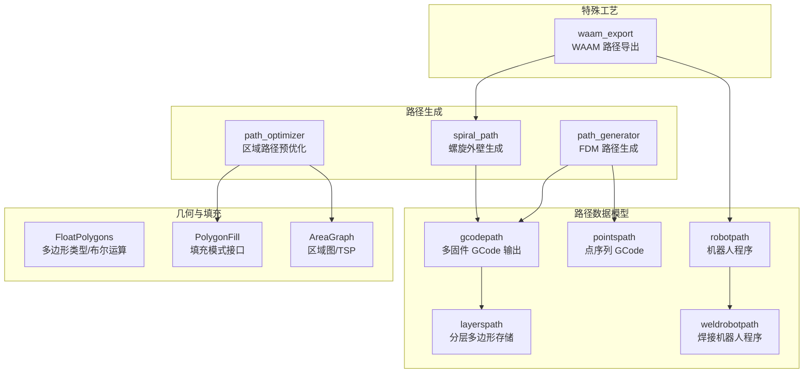
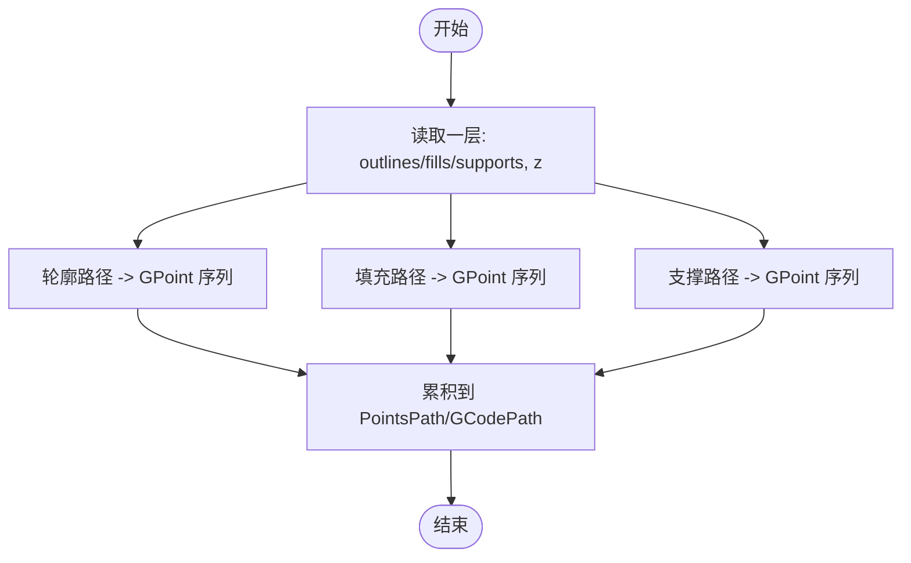
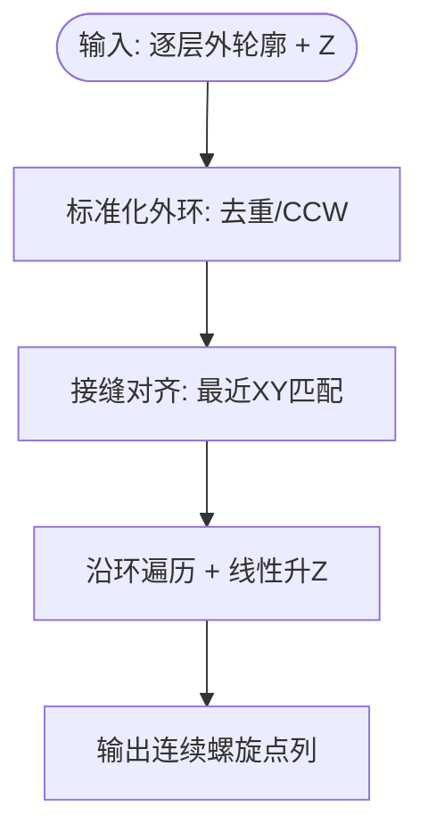
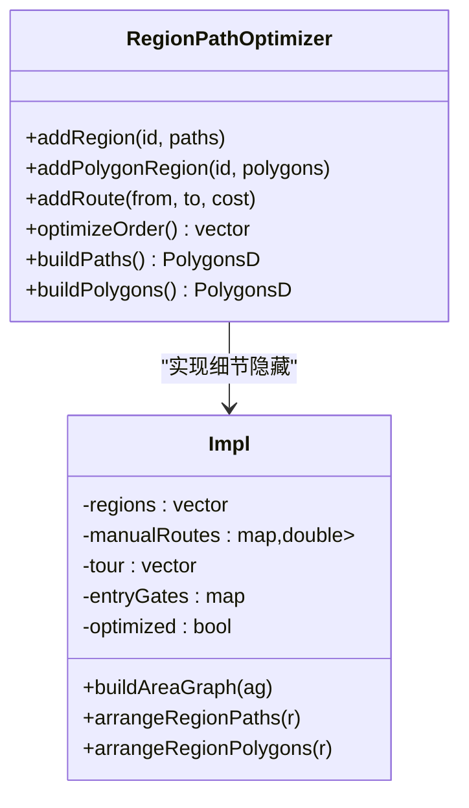
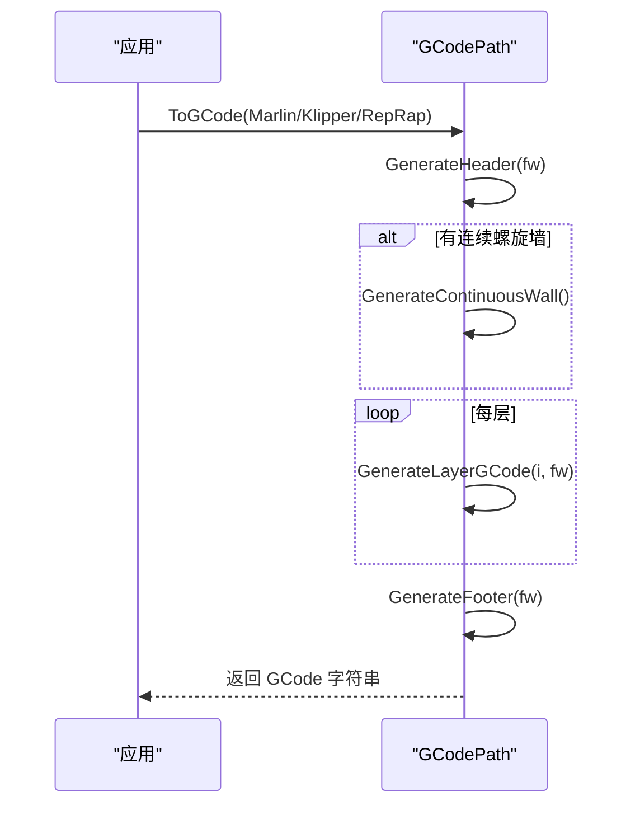
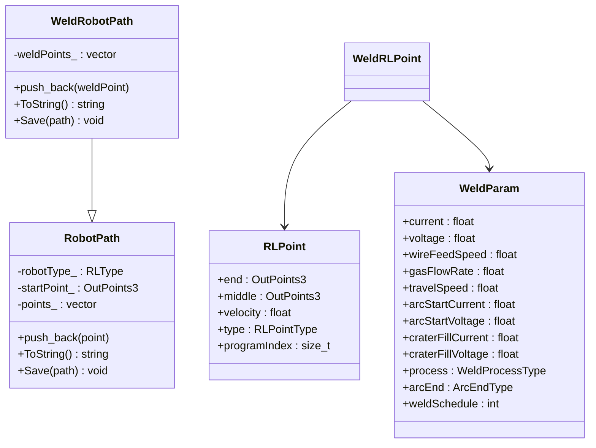
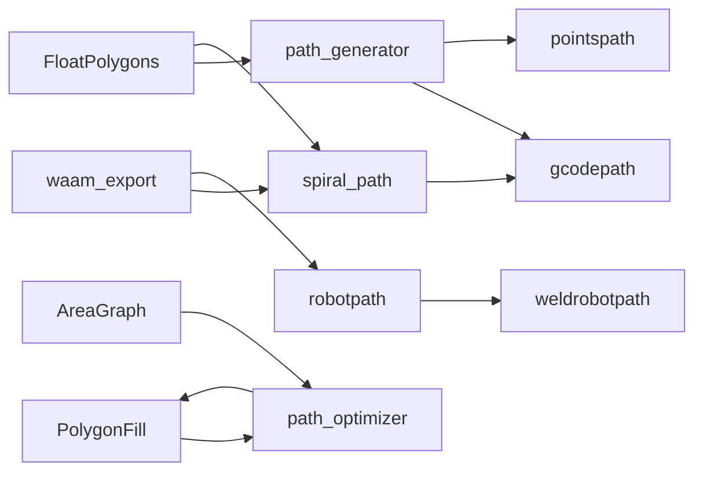

# 路径规划

<cite>
**本文引用的文件**   
- [path_generator.hpp](file://LibHsBaSlicer/Path/path_generator.hpp)
- [path_generator.cpp](file://LibHsBaSlicer/Path/path_generator.cpp)
- [spiral_path.hpp](file://LibHsBaSlicer/Path/spiral_path.hpp)
- [spiral_path.cpp](file://LibHsBaSlicer/Path/spiral_path.cpp)
- [gcodepath.hpp](file://paths/gcodepath.hpp)
- [gcodepath.cpp](file://paths/gcodepath.cpp)
- [layerspath.hpp](file://paths/layerspath.hpp)
- [pointspath.hpp](file://paths/pointspath.hpp)
- [robotpath.hpp](file://paths/robotpath.hpp)
- [weldrobotpath.hpp](file://paths/weldrobotpath.hpp)
- [FloatPolygons.hpp](file://2D/FloatPolygons.hpp)
- [PolygonFill.hpp](file://2D/PolygonFill.hpp)
- [AreaGraph.hpp](file://utils/AreaGraph.hpp)
- [waam_export.cpp](file://LibHsBaSlicer/Path/waam_export.cpp)
</cite>

## 目录
1. [简介](#简介)
2. [项目结构](#项目结构)
3. [核心组件](#核心组件)
4. [架构总览](#架构总览)
5. [详细组件分析](#详细组件分析)
6. [依赖关系分析](#依赖关系分析)
7. [性能与优化](#性能与优化)
8. [故障排查指南](#故障排查指南)
9. [结论](#结论)
10. [附录：使用示例与最佳实践](#附录使用示例与最佳实践)

## 简介
本技术文档聚焦 HsBaSlicer 的路径规划模块，系统性阐述轮廓路径、填充路径、支撑路径的生成逻辑；说明 GCode 输出格式与多固件支持（Marlin、Klipper、RepRap）；覆盖机器人路径规划与焊接路径等特殊应用场景；并给出路径连续性保证、转角优化、速度规划等关键技术要点，以及数据结构与内存管理建议。面向路径规划开发者与机器人控制工程师提供深入的技术洞察。

## 项目结构
路径规划相关代码主要分布在以下模块：
- LibHsBaSlicer/Path：FDM 路径生成、螺旋墙生成、区域路径预优化、WAAM 导出等
- paths：GCode/Robot/WeldRobot/Layers/Points 等路径数据模型与序列化
- 2D：双精度多边形类型与布尔运算、填充算法接口
- utils：区域图 AreaGraph（TSP/最短路径）



图表来源
- [path_generator.hpp:20-91](file://LibHsBaSlicer/Path/path_generator.hpp#L20-L91)
- [gcodepath.hpp:24-107](file://paths/gcodepath.hpp#L24-L107)
- [layerspath.hpp:17-60](file://paths/layerspath.hpp#L17-L60)
- [pointspath.hpp:16-94](file://paths/pointspath.hpp#L16-L94)
- [robotpath.hpp:15-104](file://paths/robotpath.hpp#L15-L104)
- [weldrobotpath.hpp:16-96](file://paths/weldrobotpath.hpp#L16-L96)
- [FloatPolygons.hpp:18-26](file://2D/FloatPolygons.hpp#L18-L26)
- [PolygonFill.hpp:20-136](file://2D/PolygonFill.hpp#L20-L136)
- [AreaGraph.hpp:95-318](file://utils/AreaGraph.hpp#L95-L318)
- [waam_export.cpp:83-109](file://LibHsBaSlicer/Path/waam_export.cpp#L83-L109)

章节来源
- [path_generator.hpp:20-91](file://LibHsBaSlicer/Path/path_generator.hpp#L20-L91)
- [gcodepath.hpp:24-107](file://paths/gcodepath.hpp#L24-L107)
- [layerspath.hpp:17-60](file://paths/layerspath.hpp#L17-L60)
- [pointspath.hpp:16-94](file://paths/pointspath.hpp#L16-L94)
- [robotpath.hpp:15-104](file://paths/robotpath.hpp#L15-L104)
- [weldrobotpath.hpp:16-96](file://paths/weldrobotpath.hpp#L16-L96)
- [FloatPolygons.hpp:18-26](file://2D/FloatPolygons.hpp#L18-L26)
- [PolygonFill.hpp:20-136](file://2D/PolygonFill.hpp#L20-L136)
- [AreaGraph.hpp:95-318](file://utils/AreaGraph.hpp#L95-L318)
- [waam_export.cpp:83-109](file://LibHsBaSlicer/Path/waam_export.cpp#L83-L109)

## 核心组件
- FDM 路径生成器：将每层轮廓、填充、支撑转换为 GPoint 序列或分层多边形，支持基础 PointsPath 与多固件 GCodePath 两种输出。
- 螺旋外壁生成：从逐层外轮廓构建连续上升的三维螺旋线，用于花瓶模式/无回抽连续挤出。
- 区域路径预优化：基于 AreaGraph 的区域访问顺序优化（遗传 TSP），支持“填充前”和“填充后”两种模式，减少空走距离。
- GCode 多固件输出：统一封装 Marlin/Klipper/RepRap 的头尾指令、温度/风扇/压力推进设置、相对/绝对挤出、回抽等。
- 机器人路径：抽象 RLPoint/RLType，支持 ABB/KUKA/FANUC 程序生成；焊接扩展 WeldRLPoint/WeldParam。
- 几何与填充：双精度多边形类型、布尔运算、多种填充模式（直线、锯齿、复合、混合、Lua 自定义）。

章节来源
- [path_generator.cpp:14-136](file://LibHsBaSlicer/Path/path_generator.cpp#L14-L136)
- [spiral_path.hpp:16-58](file://LibHsBaSlicer/Path/spiral_path.hpp#L16-L58)
- [path_optimizer.hpp:23-100](file://LibHsBaSlicer/Path/path_optimizer.hpp#L23-L100)
- [gcodepath.cpp:65-193](file://paths/gcodepath.cpp#L65-L193)
- [robotpath.hpp:15-104](file://paths/robotpath.hpp#L15-L104)
- [weldrobotpath.hpp:16-96](file://paths/weldrobotpath.hpp#L16-L96)
- [FloatPolygons.hpp:18-26](file://2D/FloatPolygons.hpp#L18-L26)
- [PolygonFill.hpp:20-136](file://2D/PolygonFill.hpp#L20-L136)

## 架构总览
路径规划整体流程如下：
- 输入：逐层 PolygonsD（轮廓/填充/支撑）、层高 Z、打印配置
- 处理：可选区域预优化 → 填充生成 → 路径转点序列/分层多边形 → 螺旋外壁（可选）→ GCode/机器人程序
- 输出：多固件 GCode 字符串或文件、机器人语言程序、焊接程序

```mermaid
sequenceDiagram
participant API as "调用方"
participant PG as "路径生成器"
participant OPT as "区域优化器"
participant FIL as "填充器"
participant SPI as "螺旋外壁"
participant G as "GCodePath"
participant R as "RobotPath/WeldRobotPath"
API->>PG : 传入 LayerPathData + FdmPathConfig
PG->>OPT : 可选：optimizeOrder/buildPaths
OPT-->>PG : 优化后的 PolygonsD
PG->>FIL : 可选：Line/Zigzag/Composite/Hybrid/Lua
FIL-->>PG : 填充结果 PolygonsD
PG->>SPI : 可选：SpiralizeOuterWall(仅外轮廓+Z)
SPI-->>PG : 连续螺旋点列
PG->>G : push_back(分层多边形) / setContinuousWall
G-->>API : ToGCode(firmware)/SaveGCode
API->>R : 构造 RobotPath/WeldRobotPath
R-->>API : ToString/Save(品牌程序)
```

图表来源
- [path_generator.cpp:61-136](file://LibHsBaSlicer/Path/path_generator.cpp#L61-L136)
- [path_optimizer.cpp:118-165](file://LibHsBaSlicer/Path/path_optimizer.cpp#L118-L165)
- [PolygonFill.hpp:20-136](file://2D/PolygonFill.hpp#L20-L136)
- [spiral_path.cpp:1-54](file://LibHsBaSlicer/Path/spiral_path.cpp#L1-L54)
- [gcodepath.cpp:310-327](file://paths/gcodepath.cpp#L310-L327)
- [robotpath.hpp:61-104](file://paths/robotpath.hpp#L61-L104)
- [weldrobotpath.hpp:65-96](file://paths/weldrobotpath.hpp#L65-L96)

## 详细组件分析

### FDM 路径生成器（轮廓/填充/支撑）
- 功能：将每层的 outlines/fills/supports 转为 GPoint 序列或直接写入 GCodePath 的分层多边形。
- 关键点：
  - 首点为快速移动（G0），后续顶点为线性挤出（G1），按段长计算 E 值。
  - 支持相对/绝对挤出、速度与回抽参数。
  - V2 接口直接累积分层多边形，便于后续多固件输出。
  - 螺旋模式通过 SpiralizeOuterWall 生成连续上升外壁，再注入 GCodePath。



图表来源
- [path_generator.cpp:14-59](file://LibHsBaSlicer/Path/path_generator.cpp#L14-L59)
- [path_generator.cpp:61-93](file://LibHsBaSlicer/Path/path_generator.cpp#L61-L93)

章节来源
- [path_generator.cpp:14-136](file://LibHsBaSlicer/Path/path_generator.cpp#L14-L136)
- [path_generator.hpp:20-91](file://LibHsBaSlicer/Path/path_generator.hpp#L20-L91)

### 螺旋外壁（花瓶模式）
- 功能：从逐层外轮廓选择最外层闭合环，对齐接缝，沿 XY 遍历同时线性提升 Z，形成连续挤出螺旋线。
- 关键点：
  - 去除重复闭合点，确保 CCW 方向。
  - 以最近 XY 点对齐接缝，保持单条固定接缝线。
  - 最后一层平走不升 Z。
  - 在 GCodePath 中以连续 Wall 输出，避免回抽与层间跳跃。



图表来源
- [spiral_path.cpp:16-52](file://LibHsBaSlicer/Path/spiral_path.cpp#L16-L52)
- [spiral_path.hpp:31-58](file://LibHsBaSlicer/Path/spiral_path.hpp#L31-L58)
- [path_generator.cpp:118-136](file://LibHsBaSlicer/Path/path_generator.cpp#L118-L136)
- [gcodepath.cpp:271-308](file://paths/gcodepath.cpp#L271-L308)

章节来源
- [spiral_path.cpp:1-54](file://LibHsBaSlicer/Path/spiral_path.cpp#L1-L54)
- [spiral_path.hpp:16-58](file://LibHsBaSlicer/Path/spiral_path.hpp#L16-L58)
- [path_generator.cpp:118-136](file://LibHsBaSlicer/Path/path_generator.cpp#L118-L136)
- [gcodepath.cpp:271-308](file://paths/gcodepath.cpp#L271-L308)

### 区域路径预优化（RegionPathOptimizer）
- 目标：对独立区域进行访问顺序优化，最小化空走距离。
- 模式：
  - 填充前（polygon mode）：所有顶点作为门控点，输出优化后的多边形集合。
  - 填充后（fill-result mode）：每条折线的端点作为门控点，输出完整填充路径。
- 算法：
  - 构建 AreaGraph，内部成本为门点到门点的直线距离，区间路由为门对门直线距离。
  - 使用遗传 TSP 求解区域访问顺序；区域内路径/多边形采用最近邻贪心安排。
  - 支持手动指定对称路由代价。



图表来源
- [path_optimizer.hpp:23-100](file://LibHsBaSlicer/Path/path_optimizer.hpp#L23-L100)
- [path_optimizer.cpp:43-215](file://LibHsBaSlicer/Path/path_optimizer.cpp#L43-L215)
- [AreaGraph.hpp:95-318](file://utils/AreaGraph.hpp#L95-L318)

章节来源
- [path_optimizer.hpp:23-100](file://LibHsBaSlicer/Path/path_optimizer.hpp#L23-L100)
- [path_optimizer.cpp:118-165](file://LibHsBaSlicer/Path/path_optimizer.cpp#L118-L165)
- [AreaGraph.hpp:253-318](file://utils/AreaGraph.hpp#L253-L318)

### GCode 多固件输出（Marlin/Klipper/RepRap）
- 功能：根据固件类型生成标准 GCode 头/层/尾，支持相对/绝对挤出、回抽、风扇、压力推进等。
- 关键点：
  - 头：温度设定、归零、等待温度、挤出模式、抬针。
  - 层：首层低速、逐段计算 E 值、回抽/退抽、速度 F。
  - 尾：关闭加热、回抽、抬针、回零、断电。
  - 螺旋墙：先输出连续上升外壁，再输出分层多边形（花瓶模式为空）。



图表来源
- [gcodepath.cpp:65-193](file://paths/gcodepath.cpp#L65-L193)
- [gcodepath.cpp:195-269](file://paths/gcodepath.cpp#L195-L269)
- [gcodepath.cpp:271-327](file://paths/gcodepath.cpp#L271-L327)

章节来源
- [gcodepath.hpp:24-107](file://paths/gcodepath.hpp#L24-L107)
- [gcodepath.cpp:65-327](file://paths/gcodepath.cpp#L65-L327)

### 机器人路径与焊接路径
- 机器人路径：抽象 RLPoint/RLType，支持 MoveJ/MoveL/MoveC 及程序块，可生成 ABB/KUKA/FANUC 程序。
- 焊接路径：在机器人路径基础上增加 WeldParam（电流、电压、送丝速度、气体流量、起弧/收弧策略等），按品牌生成带焊参的程序。
- 典型用法：WAAM 中结合螺旋外壁生成连续焊缝轨迹。



图表来源
- [robotpath.hpp:15-104](file://paths/robotpath.hpp#L15-L104)
- [weldrobotpath.hpp:16-96](file://paths/weldrobotpath.hpp#L16-L96)

章节来源
- [robotpath.hpp:15-104](file://paths/robotpath.hpp#L15-L104)
- [weldrobotpath.hpp:16-96](file://paths/weldrobotpath.hpp#L16-L96)
- [waam_export.cpp:83-109](file://LibHsBaSlicer/Path/waam_export.cpp#L83-L109)

### 几何与填充
- 几何：双精度多边形 Point2D/PolygonD/PolygonsD，提供简化、布尔运算、面积、形状生成、整数化/反整数化等。
- 填充：Offset/Line/SimpleZigzag/Zigzag/Composite/Hybrid，以及 Lua 自定义填充函数注册。

章节来源
- [FloatPolygons.hpp:18-26](file://2D/FloatPolygons.hpp#L18-L26)
- [FloatPolygons.hpp:28-221](file://2D/FloatPolygons.hpp#L28-L221)
- [PolygonFill.hpp:20-136](file://2D/PolygonFill.hpp#L20-L136)

## 依赖关系分析
- path_generator 依赖 FloatPolygons（多边形类型）与 Paths（PointsPath/GCodePath）。
- spiral_path 依赖 FloatPolygons，被 path_generator 与 waam_export 调用。
- path_optimizer 依赖 PolygonFill 与 AreaGraph，提供区域级 TSP 优化。
- gcodepath 继承 LayersPath，封装多固件输出。
- robotpath/weldrobotpath 提供机器人程序输出，WAAM 场景下与螺旋外壁结合。



图表来源
- [path_generator.cpp:14-136](file://LibHsBaSlicer/Path/path_generator.cpp#L14-L136)
- [spiral_path.cpp:1-54](file://LibHsBaSlicer/Path/spiral_path.cpp#L1-L54)
- [path_optimizer.cpp:118-165](file://LibHsBaSlicer/Path/path_optimizer.cpp#L118-L165)
- [gcodepath.cpp:310-327](file://paths/gcodepath.cpp#L310-L327)
- [waam_export.cpp:83-109](file://LibHsBaSlicer/Path/waam_export.cpp#L83-L109)

章节来源
- [path_generator.cpp:14-136](file://LibHsBaSlicer/Path/path_generator.cpp#L14-L136)
- [spiral_path.cpp:1-54](file://LibHsBaSlicer/Path/spiral_path.cpp#L1-L54)
- [path_optimizer.cpp:118-165](file://LibHsBaSlicer/Path/path_optimizer.cpp#L118-L165)
- [gcodepath.cpp:310-327](file://paths/gcodepath.cpp#L310-L327)
- [waam_export.cpp:83-109](file://LibHsBaSlicer/Path/waam_export.cpp#L83-L109)

## 性能与优化
- 路径连续性保证：
  - 螺旋外壁避免层间回抽与跳跃，降低表面缺陷与强度损失。
  - GCodePath 在连续 Wall 模式下不插入回抽，保持挤出连续。
- 转角优化：
  - 区域优化器通过 TSP 与最近邻贪心减少跨区空走与区内跳转。
  - 多边形模式下旋转起点至入口门点，保持环绕方向不变。
- 速度规划：
  - 首层使用较低速度，其他层使用默认打印速度；移动与挤出分别设置 F。
  - Klipper 支持压力推进与速度/流量因子设置。
- 内存管理：
  - 路径点序列使用 std::vector 预分配（reserve）以减少扩容开销。
  - 分层多边形与螺旋点列按需 reserve，避免频繁重分配。
  - 区域优化器缓存门点与路由代价，避免重复计算。

[本节为通用指导，不直接分析具体文件]

## 故障排查指南
- 区域优化失败：
  - 当 TSP 无法得到完整回路时，会回退到插入顺序；检查区域连通性与门点定义。
  - 确认未在同一优化器实例中混用“填充后”与“填充前”模式。
- GCode 异常：
  - 检查相对/绝对挤出模式是否与固件期望一致。
  - 回抽长度/速度需与打印机配置匹配。
  - 螺旋墙仅在至少两个有效点时输出，否则跳过。
- 机器人/焊接程序：
  - 确认机器人品牌与运动类型（MoveJ/MoveL/MoveC）正确。
  - 焊接参数需与工艺匹配，起弧/收弧策略合理。

章节来源
- [path_optimizer.cpp:118-165](file://LibHsBaSlicer/Path/path_optimizer.cpp#L118-L165)
- [gcodepath.cpp:271-308](file://paths/gcodepath.cpp#L271-L308)
- [robotpath.hpp:15-104](file://paths/robotpath.hpp#L15-L104)
- [weldrobotpath.hpp:16-96](file://paths/weldrobotpath.hpp#L16-L96)

## 结论
HsBaSlicer 路径规划模块提供了从几何到路径再到多固件输出的完整链路：
- 支持 FDM 轮廓/填充/支撑路径生成与优化
- 提供螺旋外壁连续挤出能力
- 统一的多固件 GCode 输出（Marlin/Klipper/RepRap）
- 机器人路径与焊接路径扩展，适配工业制造场景
- 基于 AreaGraph 的区域级 TSP 优化，显著减少空走距离
建议在复杂模型上启用区域优化与螺旋外壁，并根据固件特性调整挤出与速度参数以获得稳定高质量的打印效果。

[本节为总结性内容，不直接分析具体文件]

## 附录：使用示例与最佳实践
- FDM 路径生成
  - 使用 GenerateGCodePathV2 将每层 outlines/fills/supports 合并为分层多边形，再通过 GCodePath.ToGCode 输出多固件 GCode。
  - 参考路径：[path_generator.cpp:95-116](file://LibHsBaSlicer/Path/path_generator.cpp#L95-L116)、[gcodepath.cpp:310-327](file://paths/gcodepath.cpp#L310-L327)
- 花瓶模式（螺旋外壁）
  - 使用 GenerateGCodePathSpiral 生成连续上升外壁，无需填充与支撑。
  - 参考路径：[path_generator.cpp:118-136](file://LibHsBaSlicer/Path/path_generator.cpp#L118-L136)、[spiral_path.cpp:1-54](file://LibHsBaSlicer/Path/spiral_path.cpp#L1-L54)
- 区域路径优化
  - 在填充前使用 addPolygonRegion + optimizeOrder + buildPolygons，或在填充后使用 addRegion + optimizeOrder + buildPaths。
  - 参考路径：[path_optimizer.cpp:118-165](file://LibHsBaSlicer/Path/path_optimizer.cpp#L118-L165)
- 机器人/焊接路径
  - 构造 RobotPath/WeldRobotPath，设置运动类型与速度，必要时附加 WeldParam。
  - 参考路径：[robotpath.hpp:61-104](file://paths/robotpath.hpp#L61-L104)、[weldrobotpath.hpp:65-96](file://paths/weldrobotpath.hpp#L65-L96)、[waam_export.cpp:83-109](file://LibHsBaSlicer/Path/waam_export.cpp#L83-L109)
- 填充模式选择
  - 简单模型可用 LineFill/ZigzagFill；复杂模型建议使用 CompositeOffsetFill/HybridFill 或 Lua 自定义填充。
  - 参考路径：[PolygonFill.hpp:20-136](file://2D/PolygonFill.hpp#L20-L136)

[本节为使用示例，不直接分析具体文件]