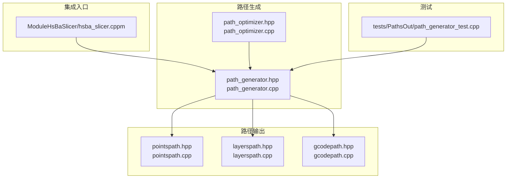
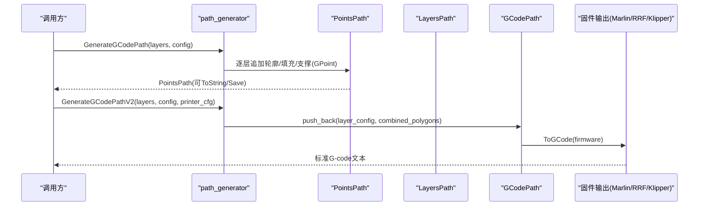
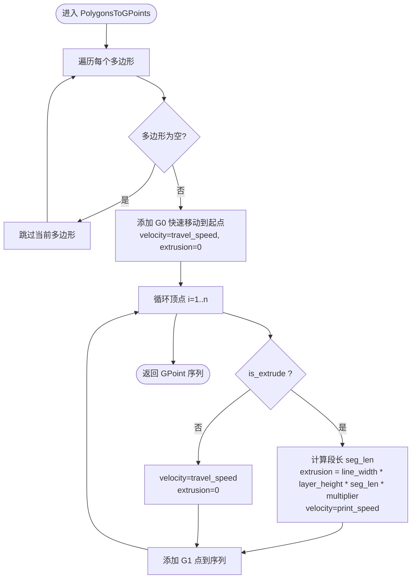
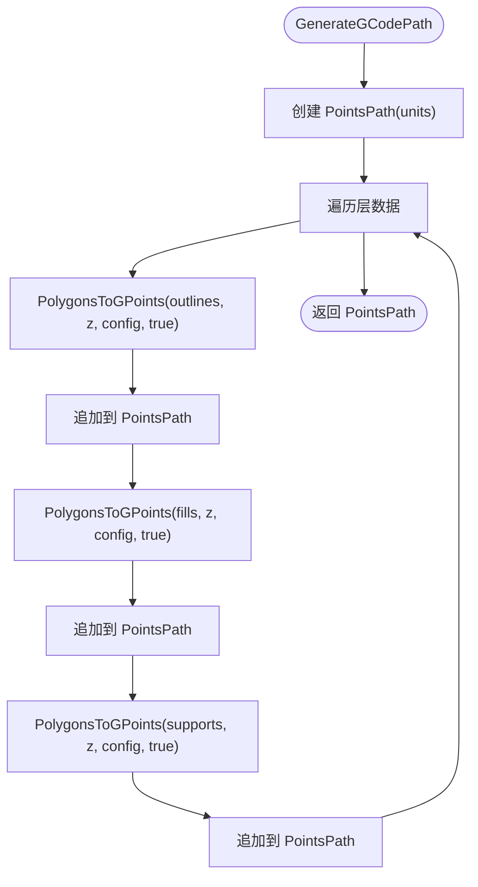
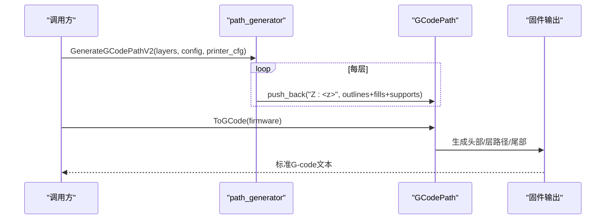
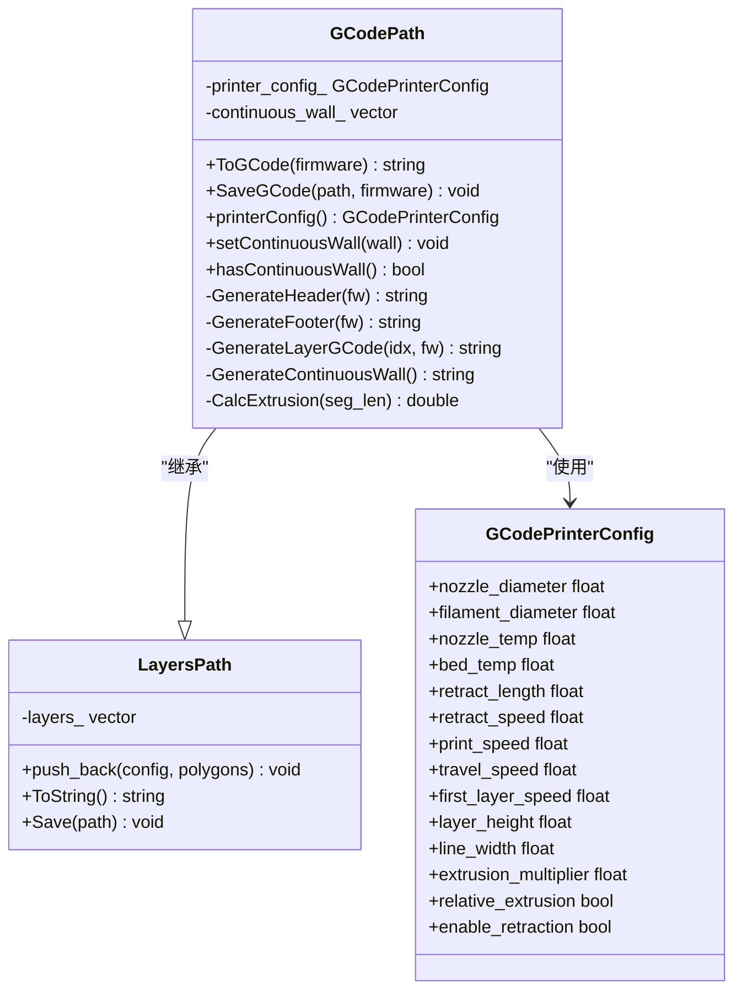
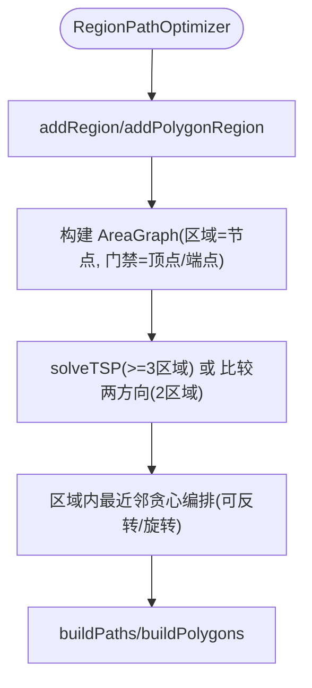
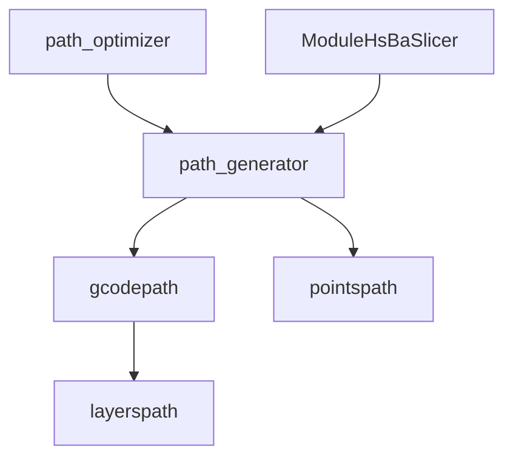

# G-code 路径生成

<cite>
**本文引用的文件**   
- [path_generator.hpp](file://LibHsBaSlicer/Path/path_generator.hpp)
- [path_generator.cpp](file://LibHsBaSlicer/Path/path_generator.cpp)
- [gcodepath.hpp](file://paths/gcodepath.hpp)
- [gcodepath.cpp](file://paths/gcodepath.cpp)
- [layerspath.hpp](file://paths/layerspath.hpp)
- [layerspath.cpp](file://paths/layerspath.cpp)
- [pointspath.hpp](file://paths/pointspath.hpp)
- [pointspath.cpp](file://paths/pointspath.cpp)
- [path_optimizer.hpp](file://LibHsBaSlicer/Path/path_optimizer.hpp)
- [path_optimizer.cpp](file://LibHsBaSlicer/Path/path_optimizer.cpp)
- [hsba_slicer.cppm](file://ModuleHsBaSlicer/hsba_slicer.cppm)
- [path_generator_test.cpp](file://tests/PathsOut/path_generator_test.cpp)
</cite>

## 目录
1. [简介](#简介)
2. [项目结构](#项目结构)
3. [核心组件](#核心组件)
4. [架构总览](#架构总览)
5. [详细组件分析](#详细组件分析)
6. [依赖关系分析](#依赖关系分析)
7. [性能与优化](#性能与优化)
8. [故障排除指南](#故障排除指南)
9. [结论](#结论)
10. [附录：API 参考与示例](#附录api-参考与示例)

## 简介
本文面向 HsBaSlicer 的 FDM G-code 路径生成能力，重点解释以下目标：
- GenerateGCodePath 与 GenerateGCodePathV2 的核心算法差异。
- FdmPathConfig 配置参数的作用与影响。
- LayerPathData 数据结构的使用方式与层数据组织。
- PolygonsToGPoints 辅助函数如何将多边形转换为 G-point 序列，并区分挤出与非挤出模式。
- GCodePrinterConfig 的作用、不同固件（Marlin/RepRap/Klipper）的输出适配。
- 路径优化策略、速度规划、回抽控制等高级特性实现原理与调优建议。
- 为初学者提供清晰的 G-code 生成流程说明，并为高级开发者提供技术细节与性能优化方案。

## 项目结构
围绕 G-code 路径生成的关键代码分布在以下模块：
- LibHsBaSlicer/Path：路径生成 API（GenerateGCodePath、GenerateGCodePathV2、PolygonsToGPoints）。
- paths：路径输出类型（PointsPath、LayersPath、GCodePath），以及多固件 G-code 生成。
- ModuleHsBaSlicer：FDM 管线中组装层数据并调用 GenerateGCodePathV2。
- tests：路径生成相关测试用例，验证行为与接口契约。

图表来源
- [path_generator.hpp:1-96](file://LibHsBaSlicer/Path/path_generator.hpp#L1-L96)
- [path_generator.cpp:1-143](file://LibHsBaSlicer/Path/path_generator.cpp#L1-L143)
- [gcodepath.hpp:1-112](file://paths/gcodepath.hpp#L1-L112)
- [gcodepath.cpp:1-459](file://paths/gcodepath.cpp#L1-L459)
- [layerspath.hpp:1-64](file://paths/layerspath.hpp#L1-L64)
- [layerspath.cpp:1-496](file://paths/layerspath.cpp#L1-L496)
- [pointspath.hpp:1-99](file://paths/pointspath.hpp#L1-L99)
- [pointspath.cpp:1-379](file://paths/pointspath.cpp#L1-L379)
- [path_optimizer.hpp:1-191](file://LibHsBaSlicer/Path/path_optimizer.hpp#L1-L191)
- [path_optimizer.cpp:1-741](file://LibHsBaSlicer/Path/path_optimizer.cpp#L1-L741)
- [hsba_slicer.cppm:695-734](file://ModuleHsBaSlicer/hsba_slicer.cppm#L695-L734)
- [path_generator_test.cpp:72-108](file://tests/PathsOut/path_generator_test.cpp#L72-L108)

章节来源
- [path_generator.hpp:1-96](file://LibHsBaSlicer/Path/path_generator.hpp#L1-L96)
- [path_generator.cpp:1-143](file://LibHsBaSlicer/Path/path_generator.cpp#L1-L143)
- [gcodepath.hpp:1-112](file://paths/gcodepath.hpp#L1-L112)
- [gcodepath.cpp:1-459](file://paths/gcodepath.cpp#L1-L459)
- [layerspath.hpp:1-64](file://paths/layerspath.hpp#L1-L64)
- [layerspath.cpp:1-496](file://paths/layerspath.cpp#L1-L496)
- [pointspath.hpp:1-99](file://paths/pointspath.hpp#L1-L99)
- [pointspath.cpp:1-379](file://paths/pointspath.cpp#L1-L379)
- [path_optimizer.hpp:1-191](file://LibHsBaSlicer/Path/path_optimizer.hpp#L1-L191)
- [path_optimizer.cpp:1-741](file://LibHsBaSlicer/Path/path_optimizer.cpp#L1-L741)
- [hsba_slicer.cppm:695-734](file://ModuleHsBaSlicer/hsba_slicer.cppm#L695-L734)
- [path_generator_test.cpp:72-108](file://tests/PathsOut/path_generator_test.cpp#L72-L108)

## 核心组件
- FdmPathConfig：FDM 路径生成配置，包含层高、线宽、打印速度、移动速度、挤出倍率、单位等。
- LayerPathData：单层路径数据，包含轮廓（outlines）、填充（fills）、支撑（supports）和 Z 高度。
- PolygonsToGPoints：将多边形集合转换为 GPoint 序列，支持挤出与非挤出两种模式。
- GenerateGCodePath：基于 PointsPath 的标准路径生成，逐层追加轮廓、填充、支撑点。
- GenerateGCodePathV2：基于 GCodePath 的多固件输出路径生成，按层聚合多边形并交由 GCodePath 序列化。
- GCodePrinterConfig：打印机参数配置，用于 G-code 头尾、回抽、速度、温度、相对/绝对挤出等。
- GCodePath：继承 LayersPath，支持 ToGCode(firmware)、SaveGCode、Lua 后处理、连续螺旋墙（花瓶模式）。
- PointsPath：基于 GPoint 序列的 G-code 序列化器。
- LayersPath：按层存储多边形与配置字符串，支持 Lua 导出。
- RegionPathOptimizer：路径输出前置优化器，减少空走距离，支持多边形模式与填充结果模式。

章节来源
- [path_generator.hpp:20-91](file://LibHsBaSlicer/Path/path_generator.hpp#L20-L91)
- [path_generator.cpp:14-118](file://LibHsBaSlicer/Path/path_generator.cpp#L14-L118)
- [gcodepath.hpp:24-107](file://paths/gcodepath.hpp#L24-L107)
- [gcodepath.cpp:51-350](file://paths/gcodepath.cpp#L51-L350)
- [pointspath.hpp:16-99](file://paths/pointspath.hpp#L16-L99)
- [layerspath.hpp:17-60](file://paths/layerspath.hpp#L17-L60)
- [path_optimizer.hpp:23-115](file://LibHsBaSlicer/Path/path_optimizer.hpp#L23-L115)

## 架构总览
下图展示从层数据到 G-code 输出的整体流程，包括 V1（PointsPath）与 V2（GCodePath）两条路径，以及花瓶模式的连续螺旋墙。

图表来源
- [path_generator.cpp:63-118](file://LibHsBaSlicer/Path/path_generator.cpp#L63-L118)
- [gcodepath.cpp:332-350](file://paths/gcodepath.cpp#L332-L350)

## 详细组件分析

### PolygonsToGPoints：多边形到 G-point 序列转换
该函数遍历输入多边形集合，对每个多边形：
- 首点以 G0 快速移动到起点（非挤出）。
- 后续顶点以 G1 线性移动，根据 is_extrude 决定速度与挤出量：
  - 挤出模式：velocity=print_speed，extrusion=line_width*layer_height*segment_length*extrusion_multiplier。
  - 非挤出模式：velocity=travel_speed，extrusion=0。

图表来源
- [path_generator.cpp:14-61](file://LibHsBaSlicer/Path/path_generator.cpp#L14-L61)

章节来源
- [path_generator.cpp:14-61](file://LibHsBaSlicer/Path/path_generator.cpp#L14-L61)

### GenerateGCodePath：基于 PointsPath 的路径生成
- 为每层分别调用 PolygonsToGPoints 生成轮廓、填充、支撑的 GPoint 序列。
- 将所有 GPoint 追加到 PointsPath，最终可 ToString/Save。
- 适用于需要逐点控制的场景，但不会直接输出多固件 G-code。

图表来源
- [path_generator.cpp:63-95](file://LibHsBaSlicer/Path/path_generator.cpp#L63-L95)

章节来源
- [path_generator.cpp:63-95](file://LibHsBaSlicer/Path/path_generator.cpp#L63-L95)

### GenerateGCodePathV2：基于 GCodePath 的多固件输出
- 为每层构造组合多边形（outlines + fills + supports）。
- 使用层配置字符串“Z:<z_height>”记录层高。
- 通过 GCodePath::push_back(layer_config, combined_polygons) 存储层数据。
- 最终由 GCodePath::ToGCode(firmware) 输出标准 G-code，支持 Marlin/RepRap/Klipper。

图表来源
- [path_generator.cpp:97-118](file://LibHsBaSlicer/Path/path_generator.cpp#L97-L118)
- [gcodepath.cpp:332-350](file://paths/gcodepath.cpp#L332-L350)

章节来源
- [path_generator.cpp:97-118](file://LibHsBaSlicer/Path/path_generator.cpp#L97-L118)
- [gcodepath.cpp:332-350](file://paths/gcodepath.cpp#L332-L350)

### GCodePath：多固件 G-code 生成与花瓶模式
- 构造函数接收 GCodePrinterConfig，保存喷嘴直径、耗材直径、温度、速度、回抽、相对/绝对挤出等。
- CalcExtrusion 根据线段长度计算挤出量：E = (line_width * layer_height * segment_length) / (π*(filament_diameter/2)^2) * extrusion_multiplier。
- GenerateHeader/GenerateFooter 针对不同固件输出 M/G 指令（温度、归位、回抽、风扇、压力前馈等）。
- GenerateLayerGCode 解析层配置中的 Z 高度，按层索引选择 first_layer_speed 或 print_speed，并在移动间插入回抽/恢复逻辑。
- GenerateContinuousWall 输出连续螺旋墙（花瓶模式），无回抽，Z 连续上升。
- ToGCode 顺序：头部 → 连续墙（如有）→ 各层路径 → 尾部。

图表来源
- [gcodepath.hpp:32-107](file://paths/gcodepath.hpp#L32-L107)
- [gcodepath.cpp:51-350](file://paths/gcodepath.cpp#L51-L350)
- [layerspath.hpp:17-60](file://paths/layerspath.hpp#L17-L60)

章节来源
- [gcodepath.hpp:32-107](file://paths/gcodepath.hpp#L32-L107)
- [gcodepath.cpp:51-350](file://paths/gcodepath.cpp#L51-L350)
- [layerspath.hpp:17-60](file://paths/layerspath.hpp#L17-L60)

### LayersPath 与 PointsPath：路径存储与序列化
- LayersPath：按层存储配置字符串与多边形集合，支持原生序列化与 Lua 脚本导出。
- PointsPath：维护 GPoint 序列，支持 G0/G1/G2/G3 等运动命令序列化，并提供 Lua 后处理接口。

章节来源
- [layerspath.hpp:17-60](file://paths/layerspath.hpp#L17-L60)
- [layerspath.cpp:25-301](file://paths/layerspath.cpp#L25-L301)
- [pointspath.hpp:16-99](file://paths/pointspath.hpp#L16-L99)
- [pointspath.cpp:66-122](file://paths/pointspath.cpp#L66-L122)

### 路径优化：RegionPathOptimizer
- 将独立区域建模为 AreaGraph 节点，求解访问顺序以减少空走。
- 两种模式：
  - 多边形模式（填充前）：所有顶点作为门禁，输出优化顺序的多边形集合。
  - 填充结果模式（填充后）：每条折线的首尾端点作为门禁，输出完整填充路径。
- 内部采用遗传 TSP 求解区域访问顺序，区域内采用最近邻贪心编排。

图表来源
- [path_optimizer.cpp:129-235](file://LibHsBaSlicer/Path/path_optimizer.cpp#L129-L235)
- [path_optimizer.cpp:314-438](file://LibHsBaSlicer/Path/path_optimizer.cpp#L314-L438)

章节来源
- [path_optimizer.hpp:23-115](file://LibHsBaSlicer/Path/path_optimizer.hpp#L23-L115)
- [path_optimizer.cpp:129-235](file://LibHsBaSlicer/Path/path_optimizer.cpp#L129-L235)
- [path_optimizer.cpp:314-438](file://LibHsBaSlicer/Path/path_optimizer.cpp#L314-L438)

### 集成入口：FDM 管线组装层数据并调用 V2
- hsba_slicer.cppm 中将切片、支撑、填充结果组装为 LayerPathData。
- 设置 GCodePrinterConfig 并调用 GenerateGCodePathV2。

章节来源
- [hsba_slicer.cppm:695-734](file://ModuleHsBaSlicer/hsba_slicer.cppm#L695-L734)

## 依赖关系分析
- path_generator 依赖 2D 几何类型（FloatPolygons/IntPolygon）与路径输出类型（GCodePath/PointsPath）。
- gcodepath 继承 layerspath，扩展固件输出与连续墙功能。
- pointspath 提供基础 G-point 序列化。
- path_optimizer 与 AreaGraph/TSP 结合，提供路径前置优化。
- ModuleHsBaSlicer 将上层 FDM 流程与路径生成 API 对接。

图表来源
- [path_generator.hpp:1-96](file://LibHsBaSlicer/Path/path_generator.hpp#L1-L96)
- [gcodepath.hpp:1-112](file://paths/gcodepath.hpp#L1-L112)
- [layerspath.hpp:1-64](file://paths/layerspath.hpp#L1-L64)
- [pointspath.hpp:1-99](file://paths/pointspath.hpp#L1-L99)
- [path_optimizer.hpp:1-191](file://LibHsBaSlicer/Path/path_optimizer.hpp#L1-L191)
- [hsba_slicer.cppm:695-734](file://ModuleHsBaSlicer/hsba_slicer.cppm#L695-L734)

章节来源
- [path_generator.hpp:1-96](file://LibHsBaSlicer/Path/path_generator.hpp#L1-L96)
- [gcodepath.hpp:1-112](file://paths/gcodepath.hpp#L1-L112)
- [layerspath.hpp:1-64](file://paths/layerspath.hpp#L1-L64)
- [pointspath.hpp:1-99](file://paths/pointspath.hpp#L1-L99)
- [path_optimizer.hpp:1-191](file://LibHsBaSlicer/Path/path_optimizer.hpp#L1-L191)
- [hsba_slicer.cppm:695-734](file://ModuleHsBaSlicer/hsba_slicer.cppm#L695-L734)

## 性能与优化
- 挤出计算：GCodePath::CalcExtrusion 使用体积守恒公式，避免过度/不足挤出；调整 line_width、layer_height、filament_diameter、extrusion_multiplier 可精细控制 E 值。
- 速度规划：
  - 首层使用 first_layer_speed，其他层使用 print_speed。
  - 移动速度 travel_speed 用于 G0 与回抽/恢复。
- 回抽控制：
  - enable_retraction 控制是否在跨多边形移动时执行回抽/恢复。
  - relative_extrusion 决定 E 值为增量或绝对累计。
- 路径优化：
  - 在填充前使用多边形模式优化区域访问顺序，减少空走。
  - 在填充后使用填充结果模式优化折线访问顺序，减少跳变。
- 花瓶模式：
  - 连续螺旋墙避免层间回抽，提升表面质量与打印效率。

章节来源
- [gcodepath.cpp:57-67](file://paths/gcodepath.cpp#L57-L67)
- [gcodepath.cpp:211-289](file://paths/gcodepath.cpp#L211-L289)
- [gcodepath.cpp:291-330](file://paths/gcodepath.cpp#L291-L330)
- [path_optimizer.cpp:129-235](file://LibHsBaSlicer/Path/path_optimizer.cpp#L129-L235)
- [path_optimizer.cpp:314-438](file://LibHsBaSlicer/Path/path_optimizer.cpp#L314-L438)

## 故障排除指南
- 层数据为空：PolygonsToGPoints 会跳过空多边形；检查 LayerPathData 是否填充了 outlines/fills/supports。
- G-code 输出为空：确认 GenerateGCodePathV2 已 push_back 层数据，且 ToGCode 被调用。
- 固件输出异常：检查 GCodeFirmware 枚举与 GenerateHeader/GenerateFooter 对应指令是否正确。
- 回抽问题：确认 enable_retraction 与 relative_extrusion 配置是否符合预期。
- 路径优化失败：当区域数 < 2 时不执行 TSP；当 TSP 失败时保持插入顺序。

章节来源
- [path_generator.cpp:14-61](file://LibHsBaSlicer/Path/path_generator.cpp#L14-L61)
- [path_generator.cpp:97-118](file://LibHsBaSlicer/Path/path_generator.cpp#L97-L118)
- [gcodepath.cpp:69-158](file://paths/gcodepath.cpp#L69-L158)
- [gcodepath.cpp:160-209](file://paths/gcodepath.cpp#L160-L209)
- [path_optimizer.cpp:129-185](file://LibHsBaSlicer/Path/path_optimizer.cpp#L129-L185)

## 结论
HsBaSlicer 的 G-code 路径生成功能提供了从层数据到多固件 G-code 的完整链路：
- GenerateGCodePath 适合需要逐点控制的场景。
- GenerateGCodePathV2 提供更强的固件适配与花瓶模式支持。
- PolygonsToGPoints 清晰区分挤出与非挤出模式，便于理解与调试。
- GCodePrinterConfig 与 GCodePath 共同实现速度、回抽、温度、压力前馈等高级特性。
- RegionPathOptimizer 在前置阶段显著减少空走，提高打印效率。
通过合理配置与优化，可在保证打印质量的同时提升路径生成与打印性能。

## 附录：API 参考与示例

### FdmPathConfig 字段说明
- layer_height：层高（mm）。
- line_width：线宽（mm）。
- print_speed：打印速度（mm/s）。
- travel_speed：移动速度（mm/s）。
- extrusion_multiplier：挤出倍率。
- units：单位（mm/inch）。

章节来源
- [path_generator.hpp:20-31](file://LibHsBaSlicer/Path/path_generator.hpp#L20-L31)

### LayerPathData 字段说明
- outlines：轮廓多边形。
- fills：填充多边形。
- supports：支撑多边形。
- z_height：层 Z 高度。

章节来源
- [path_generator.hpp:33-42](file://LibHsBaSlicer/Path/path_generator.hpp#L33-L42)

### GCodePrinterConfig 字段说明
- nozzle_diameter：喷嘴直径（mm）。
- filament_diameter：耗材直径（mm）。
- nozzle_temp：喷嘴温度（°C）。
- bed_temp：热床温度（°C）。
- retract_length/retract_speed：回抽长度/速度。
- print_speed/travel_speed/first_layer_speed：打印/移动/首层速度。
- layer_height/line_width/extrusion_multiplier：层高/线宽/挤出倍率。
- relative_extrusion：相对挤出开关。
- enable_retraction：回抽开关。

章节来源
- [gcodepath.hpp:32-49](file://paths/gcodepath.hpp#L32-L49)

### 示例：配置打印参数与生成标准 G-code
- 步骤：
  1) 准备 LayerPathData 数组（含 outlines/fills/supports/z_height）。
  2) 配置 FdmPathConfig（层高、线宽、速度等）。
  3) 配置 GCodePrinterConfig（喷嘴/耗材/温度/速度/回抽等）。
  4) 调用 GenerateGCodePathV2 获取 GCodePath。
  5) 调用 ToGCode(GCodeFirmware::Marlin/Klipper/RepRap) 输出标准 G-code。
  6) 可选：SaveGCode 保存到文件。

章节来源
- [path_generator_test.cpp:72-108](file://tests/PathsOut/path_generator_test.cpp#L72-L108)
- [gcodepath.cpp:332-362](file://paths/gcodepath.cpp#L332-L362)