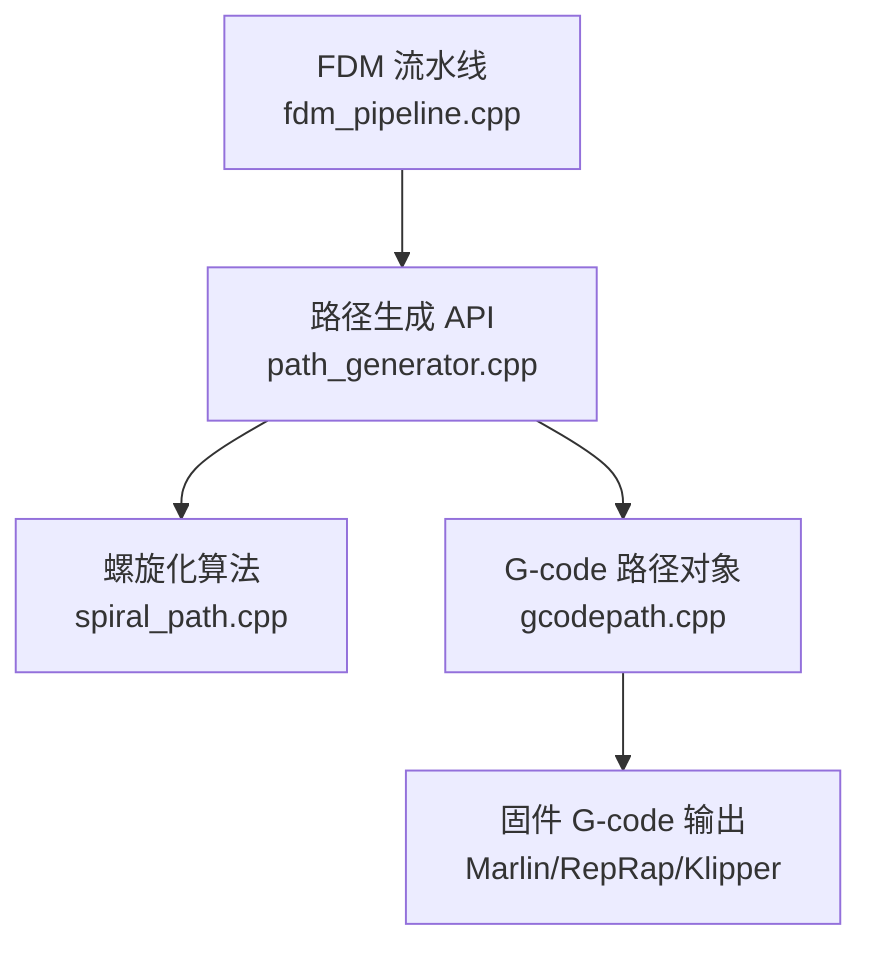
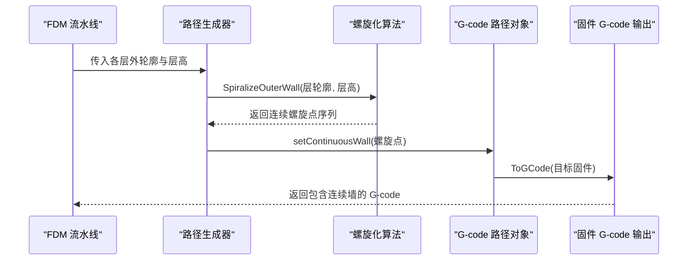
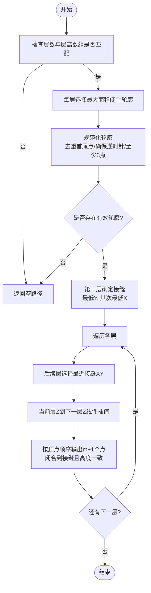
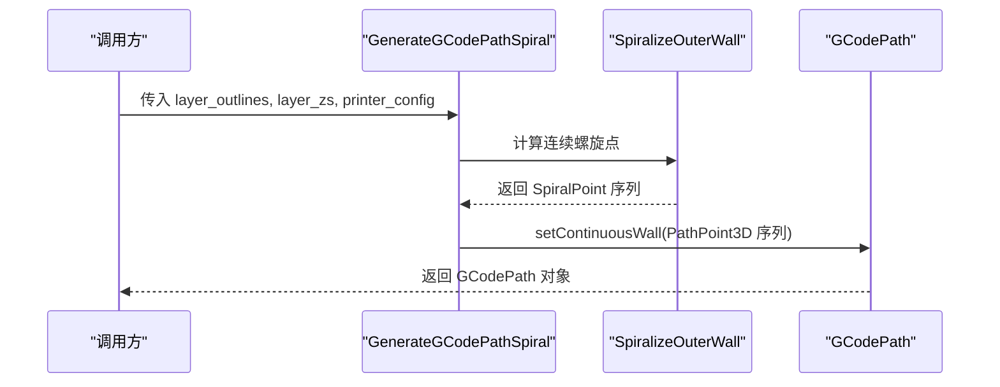
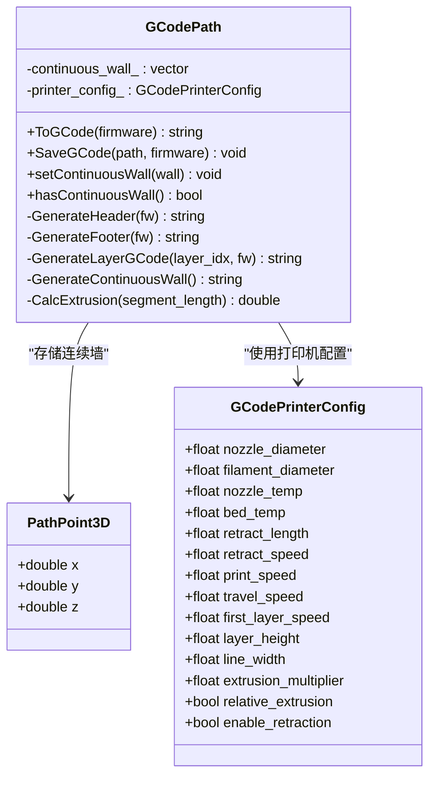
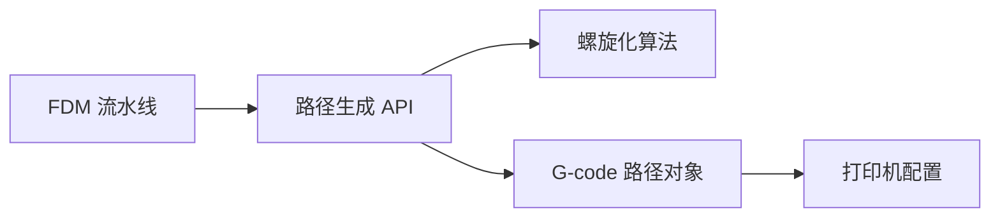
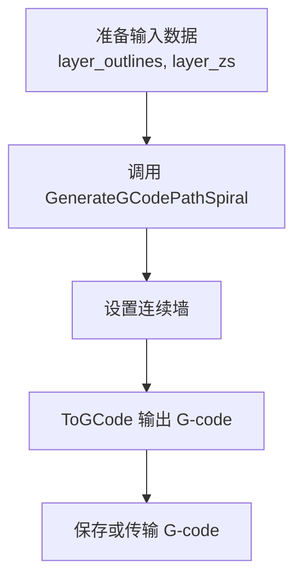

# 螺旋路径规划

<cite>
**本文引用的文件**   
- [spiral_path.hpp](file://LibHsBaSlicer/Path/spiral_path.hpp)
- [spiral_path.cpp](file://LibHsBaSlicer/Path/spiral_path.cpp)
- [path_generator.hpp](file://LibHsBaSlicer/Path/path_generator.hpp)
- [path_generator.cpp](file://LibHsBaSlicer/Path/path_generator.cpp)
- [gcodepath.hpp](file://paths/gcodepath.hpp)
- [gcodepath.cpp](file://paths/gcodepath.cpp)
- [fdm_pipeline.cpp](file://DllHsBaSlicer/fdm_pipeline.cpp)
- [main.cpp](file://samples/FDM/main.cpp)
- [path_generator_test.cpp](file://tests/PathsOut/path_generator_test.cpp)
</cite>

## 目录
1. [引言](#引言)
2. [项目结构](#项目结构)
3. [核心组件](#核心组件)
4. [架构总览](#架构总览)
5. [详细组件分析](#详细组件分析)
6. [依赖关系分析](#依赖关系分析)
7. [性能与优化建议](#性能与优化建议)
8. [常见问题与排错](#常见问题与排错)
9. [结论](#结论)
10. [附录：使用示例与配置说明](#附录使用示例与配置说明)

## 引言
本文面向 HsBaSlicer 的螺旋路径规划功能，重点解释 `GenerateGCodePathSpiral` 函数如何把多层外轮廓合并为一条连续上升的挤出路径，并深入剖析 `SpiralizeOuterWall` 的核心算法。文档同时说明花瓶模式（vase-mode）的工作机制：为什么不需要填充和支撑、如何处理 Z 轴提升、以及如何避免每层的移动路径。文末提供从输入数据准备到输出处理的完整使用流程，并给出数学原理、连续性保证机制、在不同几何上的表现特点、性能优化建议以及与标准路径生成的对比分析。

## 项目结构
螺旋路径相关代码主要分布在以下模块：
- 螺旋化算法实现：`LibHsBaSlicer/Path/spiral_path.{hpp,cpp}`
- G-code 路径生成 API：`LibHsBaSlicer/Path/path_generator.{hpp,cpp}`
- G-code 输出与连续墙支持：`paths/gcodepath.{hpp,cpp}`
- FDM 流水线调用入口：`DllHsBaSlicer/fdm_pipeline.cpp`
- 示例与测试：`samples/FDM/main.cpp`、`tests/PathsOut/path_generator_test.cpp`

**图表来源**
- [fdm_pipeline.cpp:392-425](file://DllHsBaSlicer/fdm_pipeline.cpp#L392-L425)
- [path_generator.cpp:120-140](file://LibHsBaSlicer/Path/path_generator.cpp#L120-L140)
- [spiral_path.cpp:88-164](file://LibHsBaSlicer/Path/spiral_path.cpp#L88-L164)
- [gcodepath.cpp:291-350](file://paths/gcodepath.cpp#L291-L350)

**章节来源**
- [spiral_path.hpp:1-63](file://LibHsBaSlicer/Path/spiral_path.hpp#L1-L63)
- [spiral_path.cpp:1-167](file://LibHsBaSlicer/Path/spiral_path.cpp#L1-L167)
- [path_generator.hpp:1-96](file://LibHsBaSlicer/Path/path_generator.hpp#L1-L96)
- [path_generator.cpp:1-143](file://LibHsBaSlicer/Path/path_generator.cpp#L1-L143)
- [gcodepath.hpp:1-112](file://paths/gcodepath.hpp#L1-L112)
- [gcodepath.cpp:1-459](file://paths/gcodepath.cpp#L1-L459)
- [fdm_pipeline.cpp:392-425](file://DllHsBaSlicer/fdm_pipeline.cpp#L392-L425)

## 核心组件
- `SpiralPoint`：表示连续三维沉积路径上的一个点，X/Y 为平面坐标，Z 为绝对构建高度。与逐层恒定 Z 的路径不同，螺旋路径每个点都有独立 Z，从而实现连续爬升。
- `SpiralizeOuterWall`：核心算法，按层选择最外层闭合轮廓，对齐接缝，并在每圈中线性插值 Z，将多层外轮廓合并为单条连续路径。
- `GenerateGCodePathSpiral`：对外 API，调用 `SpiralizeOuterWall` 得到螺旋点序列，再将其转换为 `GCodePath` 中的“连续墙”，用于花瓶模式输出。
- `GCodePath`：多固件 G-code 输出对象，支持设置连续墙；在 `ToGCode` 中优先输出连续墙，然后输出逐层多边形数据（花瓶模式下为空）。

**章节来源**
- [spiral_path.hpp:16-58](file://LibHsBaSlicer/Path/spiral_path.hpp#L16-L58)
- [spiral_path.cpp:88-164](file://LibHsBaSlicer/Path/spiral_path.cpp#L88-L164)
- [path_generator.hpp:64-80](file://LibHsBaSlicer/Path/path_generator.hpp#L64-L80)
- [path_generator.cpp:120-140](file://LibHsBaSlicer/Path/path_generator.cpp#L120-L140)
- [gcodepath.hpp:51-106](file://paths/gcodepath.hpp#L51-L106)

## 架构总览
下图展示了从 FDM 流水线到最终 G-code 输出的整体流程，以及螺旋路径在其中的位置。

**图表来源**
- [fdm_pipeline.cpp:392-425](file://DllHsBaSlicer/fdm_pipeline.cpp#L392-L425)
- [path_generator.cpp:120-140](file://LibHsBaSlicer/Path/path_generator.cpp#L120-L140)
- [spiral_path.cpp:88-164](file://LibHsBaSlicer/Path/spiral_path.cpp#L88-L164)
- [gcodepath.cpp:332-350](file://paths/gcodepath.cpp#L332-L350)

## 详细组件分析

### 螺旋化算法 `SpiralizeOuterWall`
该函数负责将每层的外轮廓合并为一条连续的三维路径。其关键步骤如下：
1. 输入校验：若层数为 0 或层高数组长度不匹配，直接返回空路径。
2. 每层选择最外层闭合轮廓：通过计算有符号面积（鞋带公式），取绝对值最大的多边形作为该层外轮廓。
3. 规范化轮廓：去除首尾重复点，确保至少 3 个顶点；若方向为顺时针则反转以保证逆时针。
4. 接缝对齐：第一层采用确定性接缝（最低 Y，其次最低 X）；后续层选择距离上一层接缝 XY 最近的顶点作为接缝，保持固定接缝线。
5. 连续 Z 提升：对每一层的多边形顶点顺序遍历，在当前层 Z 与下一层 Z 之间线性插值；最后一层没有上层连接，因此在该层高度上平走一圈。
6. 输出连续路径：每层输出 m+1 个点，使回路闭合到同一接缝且高度等于下一层起点高度，从而保证路径连续。

**图表来源**
- [spiral_path.cpp:18-52](file://LibHsBaSlicer/Path/spiral_path.cpp#L18-L52)
- [spiral_path.cpp:54-85](file://LibHsBaSlicer/Path/spiral_path.cpp#L54-L85)
- [spiral_path.cpp:88-164](file://LibHsBaSlicer/Path/spiral_path.cpp#L88-L164)

**章节来源**
- [spiral_path.cpp:18-52](file://LibHsBaSlicer/Path/spiral_path.cpp#L18-L52)
- [spiral_path.cpp:54-85](file://LibHsBaSlicer/Path/spiral_path.cpp#L54-L85)
- [spiral_path.cpp:88-164](file://LibHsBaSlicer/Path/spiral_path.cpp#L88-L164)

#### 数学原理与连续性保证
- 有符号面积（鞋带公式）用于判断多边形方向与面积大小，确保选取的是最外层闭合轮廓。
- 接缝对齐策略保证相邻层在同一 XY 位置衔接，避免路径跳跃。
- 线性 Z 插值保证每圈路径的 Z 单调递增，形成螺旋上升；最后一层平走以闭合顶部。
- 对于等截面柱体（如圆柱/棱柱），该算法产生几何精确的螺旋；对于变截面模型，接缝对齐仍保证路径连通性。

**章节来源**
- [spiral_path.cpp:18-27](file://LibHsBaSlicer/Path/spiral_path.cpp#L18-L27)
- [spiral_path.cpp:136-162](file://LibHsBaSlicer/Path/spiral_path.cpp#L136-L162)

### G-code 路径生成 `GenerateGCodePathSpiral`
该函数是花瓶模式的对外接口：
- 接收每层外轮廓与层高数组。
- 调用 `SpiralizeOuterWall` 得到连续螺旋点序列。
- 将螺旋点转换为 `PathPoint3D` 序列，并通过 `setContinuousWall` 注入到 `GCodePath`。
- 返回的 `GCodePath` 在 `ToGCode` 中会先输出连续墙，再输出逐层多边形（花瓶模式下为空）。

**图表来源**
- [path_generator.cpp:120-140](file://LibHsBaSlicer/Path/path_generator.cpp#L120-L140)
- [spiral_path.cpp:88-164](file://LibHsBaSlicer/Path/spiral_path.cpp#L88-L164)
- [gcodepath.hpp:87-96](file://paths/gcodepath.hpp#L87-L96)

**章节来源**
- [path_generator.hpp:64-80](file://LibHsBaSlicer/Path/path_generator.hpp#L64-L80)
- [path_generator.cpp:120-140](file://LibHsBaSlicer/Path/path_generator.cpp#L120-L140)

### G-code 输出与连续墙
`GCodePath` 负责将连续墙转换为固件兼容的 G-code：
- `GenerateContinuousWall`：从第一个点移动到起始位置，然后沿连续墙逐段生成 G1 指令，计算每段的挤出量，并保持挤出连续（无回抽）。
- `ToGCode`：先输出固件头信息，再输出连续墙（如果存在），最后输出逐层多边形数据（花瓶模式下为空），最后输出固件尾部。

**图表来源**
- [gcodepath.hpp:32-106](file://paths/gcodepath.hpp#L32-L106)
- [gcodepath.cpp:57-67](file://paths/gcodepath.cpp#L57-L67)
- [gcodepath.cpp:291-350](file://paths/gcodepath.cpp#L291-L350)

**章节来源**
- [gcodepath.hpp:32-106](file://paths/gcodepath.hpp#L32-L106)
- [gcodepath.cpp:57-67](file://paths/gcodepath.cpp#L57-L67)
- [gcodepath.cpp:291-350](file://paths/gcodepath.cpp#L291-L350)

### 花瓶模式工作机制
- 为什么不需要填充和支撑：花瓶模式只关注外壁，内部填充和支撑不参与打印，因此跳过这些路径可减少不必要的移动与挤出。
- Z 轴提升处理：螺旋路径在每个点都携带独立 Z，通过线性插值实现连续爬升；顶层平走一圈以闭合。
- 避免每层移动路径：连续墙输出时不进行回抽或层间跳转，仅在整条路径结束后执行一次回抽与抬升。

**章节来源**
- [path_generator.cpp:136-139](file://LibHsBaSlicer/Path/path_generator.cpp#L136-L139)
- [gcodepath.cpp:291-330](file://paths/gcodepath.cpp#L291-L330)
- [gcodepath.cpp:332-350](file://paths/gcodepath.cpp#L332-L350)

## 依赖关系分析
- `GenerateGCodePathSpiral` 依赖 `SpiralizeOuterWall` 进行几何处理。
- `SpiralizeOuterWall` 依赖几何工具函数（有符号面积、最近点查找、接缝选择）。
- `GCodePath` 依赖 `GCodePrinterConfig` 进行挤出量计算与固件特定 G-code 生成。
- FDM 流水线在启用螺旋模式时调用 `GenerateGCodePathSpiral`，否则走标准路径生成。

**图表来源**
- [fdm_pipeline.cpp:392-425](file://DllHsBaSlicer/fdm_pipeline.cpp#L392-L425)
- [path_generator.cpp:120-140](file://LibHsBaSlicer/Path/path_generator.cpp#L120-L140)
- [gcodepath.hpp:32-106](file://paths/gcodepath.hpp#L32-L106)

**章节来源**
- [fdm_pipeline.cpp:392-425](file://DllHsBaSlicer/fdm_pipeline.cpp#L392-L425)
- [path_generator.cpp:120-140](file://LibHsBaSlicer/Path/path_generator.cpp#L120-L140)
- [gcodepath.hpp:32-106](file://paths/gcodepath.hpp#L32-L106)

## 性能与优化建议
- 减少无效层：跳过没有有效闭合轮廓的层，避免无意义计算。
- 预分配内存：螺旋路径输出前预留容量，减少动态扩容开销。
- 简化几何：对复杂轮廓可考虑简化顶点数量，但需权衡精度与表面质量。
- 挤出计算优化：线段长度与挤出量计算已在连续墙生成中完成，避免重复计算。
- 固件输出优化：根据目标固件选择合适的头部/尾部指令，减少多余命令。

[本节为通用指导，不直接分析具体文件]

## 常见问题与排错
- 输入层数与层高数组不匹配：函数会返回空路径，需检查调用方传入参数一致性。
- 层内无有效闭合轮廓：该层会被跳过，可能导致螺旋路径不完整，需检查切片结果。
- 接缝错位：若相邻层接缝 XY 差异过大，可能影响外观，可通过调整模型或后处理修正。
- 挤出异常：检查 `GCodePrinterConfig` 中的线宽、层高、耗材直径与挤出倍率是否合理。
- 固件兼容性：确认目标固件类型与生成的 G-code 指令匹配。

**章节来源**
- [spiral_path.cpp:91-96](file://LibHsBaSlicer/Path/spiral_path.cpp#L91-L96)
- [gcodepath.cpp:57-67](file://paths/gcodepath.cpp#L57-L67)

## 结论
HsBaSlicer 的螺旋路径规划通过 `SpiralizeOuterWall` 将多层外轮廓合并为一条连续上升的挤出路径，结合 `GenerateGCodePathSpiral` 与 `GCodePath` 的连续墙输出机制，实现了高效的花瓶模式。该方案避免了填充与支撑，减少了层间移动与回抽，提升了表面质量与打印效率。对于等截面模型效果最佳，对变截面模型也能保持路径连通性。

[本节为总结性内容，不直接分析具体文件]

## 附录：使用示例与配置说明

### 使用流程概览
1. 准备每层外轮廓与层高数组。
2. 调用 `GenerateGCodePathSpiral` 生成 `GCodePath`。
3. 调用 `ToGCode` 输出目标固件的 G-code。
4. 保存或传输 G-code 到打印机。

**图表来源**
- [path_generator.cpp:120-140](file://LibHsBaSlicer/Path/path_generator.cpp#L120-L140)
- [gcodepath.cpp:332-350](file://paths/gcodepath.cpp#L332-L350)

**章节来源**
- [path_generator.hpp:64-80](file://LibHsBaSlicer/Path/path_generator.hpp#L64-L80)
- [path_generator.cpp:120-140](file://LibHsBaSlicer/Path/path_generator.cpp#L120-L140)
- [gcodepath.cpp:332-350](file://paths/gcodepath.cpp#L332-L350)

### 配置参数说明
- `GCodePrinterConfig`：定义喷嘴直径、耗材直径、温度、速度、回抽、层高、线宽、挤出倍率等。
- `spiral_mode`：在 FDM 流水线配置中启用螺旋模式，跳过填充与支撑，仅输出连续外壁。

**章节来源**
- [gcodepath.hpp:32-49](file://paths/gcodepath.hpp#L32-L49)
- [docs/zh/DllHsBaSlicer/README.md:174-186](file://docs/zh/DllHsBaSlicer/README.md#L174-L186)

### 代码示例路径
- FDM 流水线示例：`samples/FDM/main.cpp` 展示如何启用螺旋模式并运行流水线。
- 单元测试示例：`tests/PathsOut/path_generator_test.cpp` 验证螺旋路径的连续墙生成与 G-code 输出。

**章节来源**
- [main.cpp:271-305](file://samples/FDM/main.cpp#L271-L305)
- [path_generator_test.cpp:108-119](file://tests/PathsOut/path_generator_test.cpp#L108-L119)