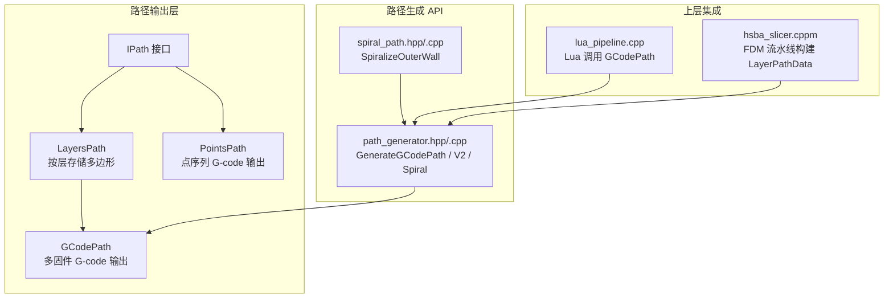
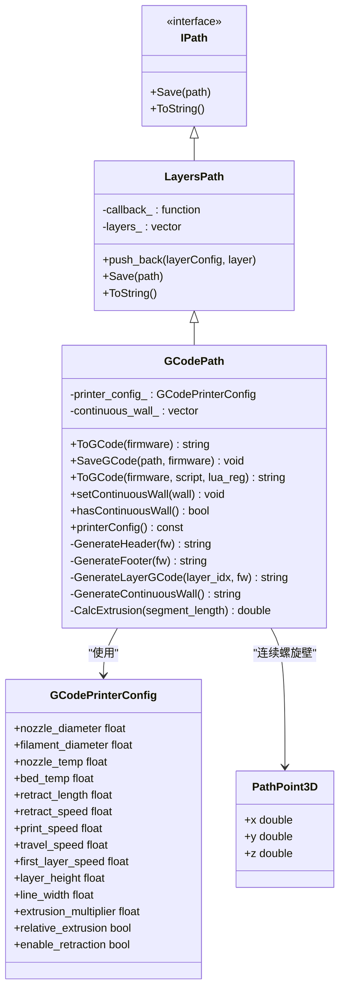
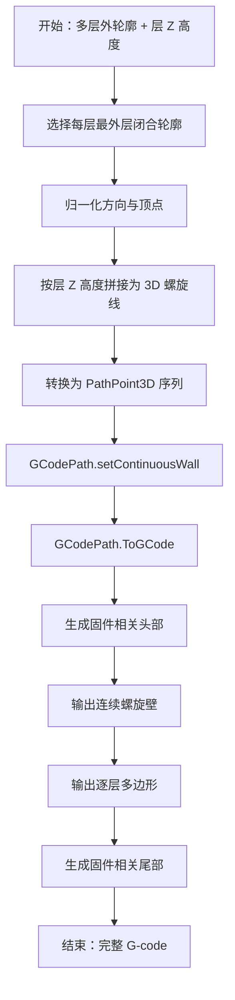
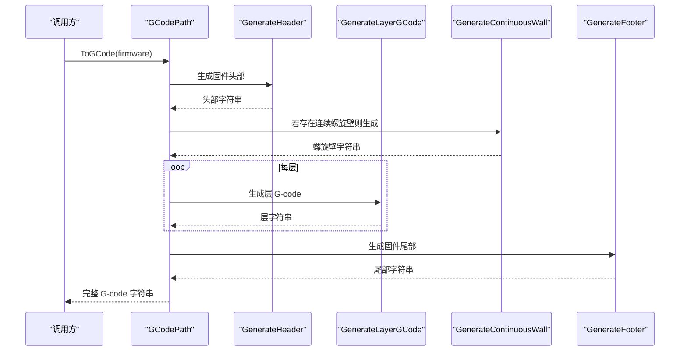
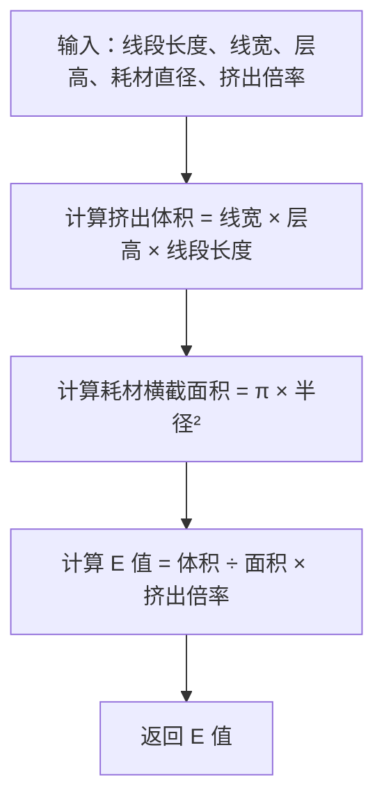
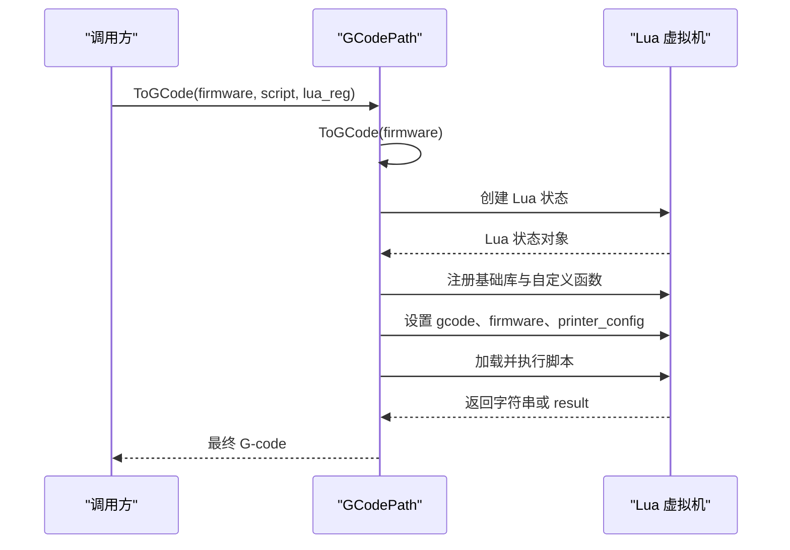
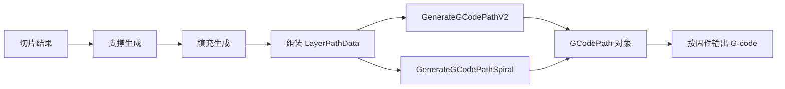

# GCodePath 路径类型

<cite>
**本文引用的文件**   
- [gcodepath.hpp](file://paths/gcodepath.hpp)
- [gcodepath.cpp](file://paths/gcodepath.cpp)
- [layerspath.hpp](file://paths/layerspath.hpp)
- [layerspath.cpp](file://paths/layerspath.cpp)
- [path_generator.hpp](file://LibHsBaSlicer/Path/path_generator.hpp)
- [path_generator.cpp](file://LibHsBaSlicer/Path/path_generator.cpp)
- [spiral_path.hpp](file://LibHsBaSlicer/Path/spiral_path.hpp)
- [spiral_path.cpp](file://LibHsBaSlicer/Path/spiral_path.cpp)
- [pointspath.hpp](file://paths/pointspath.hpp)
- [pointspath.cpp](file://paths/pointspath.cpp)
- [lua_pipeline.cpp](file://LibHsBaSlicer/Extends/lua_pipeline.cpp)
- [hsba_slicer.cppm](file://ModuleHsBaSlicer/hsba_slicer.cppm)
- [gcode_path_test.cpp](file://tests/PathsOut/gcode_path_test.cpp)
- [path_generator_test.cpp](file://tests/PathsOut/path_generator_test.cpp)
</cite>

## 目录
1. [简介](#简介)
2. [项目结构定位](#项目结构定位)
3. [核心概念](#核心概念)
4. [架构总览](#架构总览)
5. [GCodePrinterConfig 配置详解](#gcodeprinterconfig-配置详解)
6. [连续螺旋壁与 PathPoint3D](#连续螺旋壁与-pathpoint3d)
7. [多固件 G-code 生成机制](#多固件-g-code-生成机制)
8. [挤出量计算与坐标系统](#挤出量计算与坐标系统)
9. [Lua 后处理集成](#lua-后处理集成)
10. [使用示例：创建、配置、输出与保存](#使用示例创建配置输出与保存)
11. [错误处理与健壮性](#错误处理与健壮性)
12. [性能特性与优化建议](#性能特性与优化建议)
13. [与切片引擎的集成方式](#与切片引擎的集成方式)
14. [常见问题排查](#常见问题排查)
15. [结论](#结论)

## 简介
GCodePath 是 HsBaSlicer 中面向 FDM 增材制造的 G-code 路径输出器。它继承自 LayersPath，负责把每层的多边形路径转换为标准 3D 打印机 G-code，并支持 Marlin、RepRap/RRF、Klipper 三种主流固件格式。同时，GCodePath 提供连续螺旋壁（花瓶模式）能力，将多层外轮廓合并为一条 Z 轴连续上升、无回抽断点的螺旋挤出线。

从用户视角看，GCodePath 的核心价值有三点：
- 统一封装不同固件的 G-code 头尾指令差异；
- 基于喷嘴直径、耗材直径、层高、线宽等参数精确计算挤出量；
- 在标准逐层路径之外，支持连续螺旋外壁这一特殊打印模式。

## 项目结构定位
GCodePath 位于 `paths` 模块，属于路径输出层；其上层由 LibHsBaSlicer 的 `path_generator` API 暴露给切片管线，并由 DllHsBaSlicer 和 ModuleHsBaSlicer 接入具体 FDM 流水线。

**图示来源**  
- [gcodepath.hpp:62-107](file://paths/gcodepath.hpp#L62-L107)  
- [layerspath.hpp:17-60](file://paths/layerspath.hpp#L17-L60)  
- [path_generator.hpp:20-80](file://LibHsBaSlicer/Path/path_generator.hpp#L20-L80)  
- [spiral_path.hpp:16-40](file://LibHsBaSlicer/Path/spiral_path.hpp#L16-L40)  
- [lua_pipeline.cpp:666-689](file://LibHsBaSlicer/Extends/lua_pipeline.cpp#L666-L689)  
- [hsba_slicer.cppm:695-701](file://ModuleHsBaSlicer/hsba_slicer.cppm#L695-L701)

**章节来源**  
- [gcodepath.hpp:1-112](file://paths/gcodepath.hpp#L1-L112)  
- [layerspath.hpp:1-64](file://paths/layerspath.hpp#L1-L64)  
- [path_generator.hpp:1-96](file://LibHsBaSlicer/Path/path_generator.hpp#L1-L96)

## 核心概念
- **LayersPath**：按层组织路径数据的基础抽象，每层包含一个自由格式的层配置字符串和一个双精度多边形集合。它还提供原生序列化、SQLite 存储以及 Lua 脚本扩展能力。
- **GCodePath**：在 LayersPath 之上增加 G-code 生成逻辑，包括固件相关头尾、逐层移动、回抽控制、连续螺旋壁输出。
- **PathPoint3D**：表示连续螺旋壁上的单个三维点，X/Y 为平面坐标，Z 为该点在构建高度上的绝对位置。
- **GCodeFirmware**：目标固件枚举，当前支持 Marlin、RepRap、Klipper。
- **FdmPathConfig**：路径生成阶段的几何与速度配置，例如层高、线宽、打印速度、行程速度、挤出倍率、单位。
- **LayerPathData**：单层路径数据，包含外轮廓、填充、支撑和多边形对应的 Z 高度。

这些概念共同构成“切片结果 → 路径数据 → G-code 文本”的完整链路。

**章节来源**  
- [layerspath.hpp:17-60](file://paths/layerspath.hpp#L17-L60)  
- [gcodepath.hpp:24-60](file://paths/gcodepath.hpp#L24-L60)  
- [path_generator.hpp:20-42](file://LibHsBaSlicer/Path/path_generator.hpp#L20-L42)

## 架构总览
GCodePath 的类关系如下：

**图示来源**  
- [gcodepath.hpp:32-107](file://paths/gcodepath.hpp#L32-L107)  
- [layerspath.hpp:17-60](file://paths/layerspath.hpp#L17-L60)

**章节来源**  
- [gcodepath.hpp:62-107](file://paths/gcodepath.hpp#L62-L107)  
- [layerspath.hpp:17-60](file://paths/layerspath.hpp#L17-L60)

## GCodePrinterConfig 配置详解
GCodePrinterConfig 是 G-code 生成阶段使用的打印机物理与运动参数集合。所有字段均有默认值，便于快速生成合理 G-code，也允许上层根据切片配置覆盖。

| 字段 | 默认值 | 含义 | 对 G-code 的影响 |
|---|---:|---|---|
| `nozzle_diameter` | `0.4f` | 喷嘴直径，单位毫米 | 用于注释信息，不直接参与挤出量计算 |
| `filament_diameter` | `1.75f` | 耗材直径，单位毫米 | 用于计算耗材横截面积，从而得到 E 值 |
| `nozzle_temp` | `200.0f` | 喷嘴温度，单位摄氏度 | 写入 M104/M109 等温度设置 |
| `bed_temp` | `60.0f` | 热床温度，单位摄氏度 | 写入 M140/M190 等热床设置 |
| `retract_length` | `1.0f` | 回抽长度，单位毫米 | 用于非挤出移动前的回抽和重新开始挤出时的恢复 |
| `retract_speed` | `40.0f` | 回抽速度，单位毫米每秒 | 转换为 mm/min 后写入 F 参数 |
| `print_speed` | `50.0f` | 正常打印速度，单位毫米每秒 | 挤出移动时使用 |
| `travel_speed` | `100.0f` | 空移速度，单位毫米每秒 | 移动到起点、抬刀、回退等移动时使用 |
| `first_layer_speed` | `20.0f` | 首层打印速度，单位毫米每秒 | 第 0 层挤出移动时使用 |
| `layer_height` | `0.2f` | 层高，单位毫米 | 与线宽一起决定挤出体积 |
| `line_width` | `0.4f` | 挤出线宽，单位毫米 | 与层高一起决定截面面积 |
| `extrusion_multiplier` | `1.0f` | 挤出倍率 | 最终 E 值乘以该系数 |
| `relative_extrusion` | `false` | 是否使用相对挤出 | 控制 M82/M83 及 E 值是累计还是增量 |
| `enable_retraction` | `true` | 是否在空移时启用回抽 | 控制多段路径之间的回抽/恢复逻辑 |

需要注意：
- 速度在 G-code 中通常以 mm/min 为单位，因此内部使用 `kSpeedFactor = 60.0f` 将 mm/s 转换为 mm/min。
- 挤出量计算依赖 `line_width`、`layer_height`、`filament_diameter` 和 `extrusion_multiplier`。
- `relative_extrusion` 不仅影响 M82/M83，还影响逐段 E 值的累加方式。

**章节来源**  
- [gcodepath.hpp:32-49](file://paths/gcodepath.hpp#L32-L49)  
- [gcodepath.cpp:23-26](file://paths/gcodepath.cpp#L23-L26)  
- [gcodepath.cpp:57-67](file://paths/gcodepath.cpp#L57-L67)

## 连续螺旋壁与 PathPoint3D
连续螺旋壁是花瓶模式或螺旋外壁模式的核心数据结构。与普通逐层路径不同，普通层的 Z 是常数，而连续螺旋壁的每个点都有独立的 Z 值，使挤出轨迹在层与层之间平滑上升。

### PathPoint3D 设计
PathPoint3D 是一个简单的三维点结构：
- `x`、`y`：平面坐标，单位与切片多边形一致；
- `z`：绝对构建高度，对应某一层或两层之间的中间高度。

它不是 G-code 命令点，而是“待输出的连续 3D 沉积路径点”。实际 G-code 生成时，会将其转换为 G0/G1 移动指令，并根据相邻点距离计算挤出量。

### 连续螺旋壁工作原理
1. 切片阶段产生每层的外轮廓多边形；
2. `SpiralizeOuterWall` 选择每层最外层闭合轮廓，并按层 Z 高度拼接成一条连续的 3D 螺旋线；
3. `GenerateGCodePathSpiral` 将该螺旋线转换为 `vector<PathPoint3D>`，并通过 `setContinuousWall` 设置到 GCodePath；
4. `ToGCode` 优先输出连续螺旋壁，再输出逐层多边形；
5. 螺旋壁输出过程中不插入回抽或层间跳跃，保证挤出连续性。

**图示来源**  
- [path_generator.cpp:120-139](file://LibHsBaSlicer/Path/path_generator.cpp#L120-L139)  
- [gcodepath.cpp:291-330](file://paths/gcodepath.cpp#L291-L330)  
- [spiral_path.hpp:16-40](file://LibHsBaSlicer/Path/spiral_path.hpp#L16-L40)

**章节来源**  
- [gcodepath.hpp:51-60](file://paths/gcodepath.hpp#L51-L60)  
- [gcodepath.hpp:87-96](file://paths/gcodepath.hpp#L87-L96)  
- [path_generator.cpp:120-139](file://LibHsBaSlicer/Path/path_generator.cpp#L120-L139)  
- [gcodepath.cpp:291-330](file://paths/gcodepath.cpp#L291-L330)  
- [spiral_path.hpp:16-40](file://LibHsBaSlicer/Path/spiral_path.hpp#L16-L40)

## 多固件 G-code 生成机制
GCodePath 通过 `GCodeFirmware` 枚举区分目标固件，并在头部、尾部、风扇控制、压力前馈、速度因子等指令上做出差异化处理。

### 支持的固件类型
| 固件 | 枚举值 | 主要差异 |
|---|---|---|
| Marlin | `GCodeFirmware::Marlin` | 基础温度等待、绝对/相对挤出、回抽、抬刀、归位、关闭电机 |
| RepRap/RRF | `GCodeFirmware::RepRap` | 额外风扇全开指令，其余与 Marlin 类似 |
| Klipper | `GCodeFirmware::Klipper` | 使用 `SET_PRESSURE_ADVANCE`、`M220`、`M221`、`SET_FAN_SPEED` 等 Klipper 特有指令 |

### 头部与尾部行为
- 头部：设置喷嘴温度、热床温度、归零、等待温度、重置挤出机、设置挤出模式、抬起喷嘴。
- 尾部：关闭加热器、风扇、执行回抽、抬 Z、回到 XY 原点、关闭步进电机。
- Klipper 头部还会设置压力前馈、速度和流量百分比，并使用 `SET_FAN_SPEED` 控制风扇。

**图示来源**  
- [gcodepath.cpp:69-158](file://paths/gcodepath.cpp#L69-L158)  
- [gcodepath.cpp:160-209](file://paths/gcodepath.cpp#L160-L209)  
- [gcodepath.cpp:211-289](file://paths/gcodepath.cpp#L211-L289)  
- [gcodepath.cpp:291-330](file://paths/gcodepath.cpp#L291-L330)  
- [gcodepath.cpp:332-351](file://paths/gcodepath.cpp#L332-L351)

**章节来源**  
- [gcodepath.hpp:24-30](file://paths/gcodepath.hpp#L24-L30)  
- [gcodepath.cpp:69-158](file://paths/gcodepath.cpp#L69-L158)  
- [gcodepath.cpp:160-209](file://paths/gcodepath.cpp#L160-L209)  
- [gcodepath.cpp:332-351](file://paths/gcodepath.cpp#L332-L351)

## 挤出量计算与坐标系统
### 挤出量算法
GCodePath 的挤出量计算集中在 `CalcExtrusion` 中，核心思想是“体积守恒”：
1. 挤出体积 = 线宽 × 层高 × 线段长度；
2. 耗材横截面积 = π × (耗材半径)²；
3. 挤出长度 = 挤出体积 ÷ 横截面积 × 挤出倍率。

该算法适用于标准 FDM 挤出模型，且与 `FdmPathConfig` 中的挤出逻辑保持一致。

**图示来源**  
- [gcodepath.cpp:57-67](file://paths/gcodepath.cpp#L57-L67)

### 坐标系统与移动指令
- X/Y 来自切片多边形顶点；
- Z 来自层配置中的高度解析；
- 空移使用 G0，挤出移动使用 G1；
- 速度 F 参数单位为 mm/min；
- 绝对坐标系下使用 G90，相对坐标系下使用 G91；
- 回抽发生在多段路径切换时，且受 `enable_retraction` 控制；
- 相对挤出模式下，E 值为增量；绝对挤出模式下，E 值为累计值。

**章节来源**  
- [gcodepath.cpp:57-67](file://paths/gcodepath.cpp#L57-L67)  
- [gcodepath.cpp:211-289](file://paths/gcodepath.cpp#L211-L289)  
- [pointspath.hpp:44-52](file://paths/pointspath.hpp#L44-L52)

## Lua 后处理集成
GCodePath 支持两种 Lua 相关能力：
1. 继承自 LayersPath 的通用 Lua 序列化与保存能力；
2. GCodePath 自身的 `ToGCode(firmware, script, lua_reg)`，用于对已生成的 G-code 进行后处理。

### GCodePath Lua 后处理流程
- 先生成基础 G-code；
- 创建独立 Lua 状态；
- 将基础 G-code 注入全局变量 `gcode`；
- 将固件名称注入全局变量 `firmware`；
- 将常用打印机参数注入全局表 `printer_config`；
- 加载并执行 Lua 脚本；
- 如果脚本返回字符串，则使用该字符串作为最终 G-code；
- 否则尝试读取全局变量 `result`；
- 最后回退到基础 G-code。

**图示来源**  
- [gcodepath.cpp:364-456](file://paths/gcodepath.cpp#L364-L456)

### LayersPath Lua 保存能力
LayersPath 还支持更通用的 Lua 保存流程，包括：
- 向 Lua 暴露 SQLiteAdapter；
- 将 layers 数据以嵌套 table 形式传入；
- 允许脚本直接写文件或数据库；
- 支持指定函数名执行。

这部分能力被 GCodePath 复用，因为 GCodePath 继承自 LayersPath。

**章节来源**  
- [gcodepath.cpp:364-456](file://paths/gcodepath.cpp#L364-L456)  
- [layerspath.cpp:61-163](file://paths/layerspath.cpp#L61-L163)  
- [layerspath.cpp:165-277](file://paths/layerspath.cpp#L165-L277)  
- [layerspath.cpp:279-493](file://paths/layerspath.cpp#L279-L493)

## 使用示例：创建、配置、输出与保存
以下示例描述如何从零开始使用 GCodePath，但不直接粘贴源码内容，仅给出步骤和关键路径。

### 步骤一：准备切片层数据
构造 `LayerPathData`，包含：
- `outlines`：每层外轮廓；
- `fills`：填充路径；
- `supports`：支撑路径；
- `z_height`：层 Z 高度。

参考路径：
- [path_generator.hpp:33-42](file://LibHsBaSlicer/Path/path_generator.hpp#L33-L42)

### 步骤二：配置路径生成参数
构造 `FdmPathConfig`，设置层高、线宽、打印速度、行程速度、挤出倍率和单位。

参考路径：
- [path_generator.hpp:20-31](file://LibHsBaSlicer/Path/path_generator.hpp#L20-L31)

### 步骤三：配置打印机参数
构造 `GCodePrinterConfig`，设置喷嘴直径、耗材直径、温度、回抽、速度、层高、线宽、挤出倍率、挤出模式和回抽开关。

参考路径：
- [gcodepath.hpp:32-49](file://paths/gcodepath.hpp#L32-L49)

### 步骤四：生成 GCodePath
- 标准逐层路径：调用 `GenerateGCodePathV2`；
- 连续螺旋壁路径：调用 `GenerateGCodePathSpiral`。

参考路径：
- [path_generator.cpp:97-118](file://LibHsBaSlicer/Path/path_generator.cpp#L97-L118)  
- [path_generator.cpp:120-139](file://LibHsBaSlicer/Path/path_generator.cpp#L120-L139)

### 步骤五：生成 G-code 字符串
调用 `ToGCode(GCodeFirmware::Marlin/Klipper/RepRap)`。

参考路径：
- [gcodepath.cpp:332-351](file://paths/gcodepath.cpp#L332-L351)

### 步骤六：保存到文件
调用 `SaveGCode(path, firmware)`。

参考路径：
- [gcodepath.cpp:353-362](file://paths/gcodepath.cpp#L353-L362)

### 步骤七：使用 Lua 脚本后处理
调用 `ToGCode(firmware, script, lua_reg)`，在脚本中可访问 `gcode`、`firmware`、`printer_config`。

参考路径：
- [gcodepath.cpp:364-456](file://paths/gcodepath.cpp#L364-L456)

**章节来源**  
- [path_generator.hpp:20-80](file://LibHsBaSlicer/Path/path_generator.hpp#L20-L80)  
- [path_generator.cpp:97-139](file://LibHsBaSlicer/Path/path_generator.cpp#L97-L139)  
- [gcodepath.cpp:332-456](file://paths/gcodepath.cpp#L332-L456)

## 错误处理与健壮性
GCodePath 的错误处理主要集中在文件操作、Lua 初始化、脚本加载和执行阶段。

| 场景 | 处理方式 |
|---|---|
| 打开输出文件失败 | 抛出运行时错误，包含文件路径信息 |
| Lua 初始化失败 | 抛出运行时错误 |
| Lua 脚本加载失败 | 抛出运行时错误，附带 Lua 错误消息 |
| Lua 脚本运行失败 | 抛出运行时错误，附带 Lua 错误消息 |
| 层索引越界 | 返回空字符串，避免崩溃 |
| 层配置 Z 解析失败 | 回退到默认 Z 高度 |

这种设计保证了：
- 普通 G-code 生成不会因 Lua 问题中断；
- Lua 错误会被捕获并转换为清晰的 C++ 异常；
- 层数据异常不会导致整个切片流程崩溃。

**章节来源**  
- [gcodepath.cpp:353-362](file://paths/gcodepath.cpp#L353-L362)  
- [gcodepath.cpp:364-456](file://paths/gcodepath.cpp#L364-L456)  
- [gcodepath.cpp:211-220](file://paths/gcodepath.cpp#L211-L220)  
- [gcodepath.cpp:28-47](file://paths/gcodepath.cpp#L28-L47)

## 性能特性与优化建议
### 现有性能特征
- G-code 生成使用 `std::ostringstream` 累积字符串，适合中等规模模型；
- 挤出量计算为 O(n)，n 为路径点数；
- 连续螺旋壁避免层间回抽，减少无效移动；
- LayersPath 的 Lua 保存会构建较深的嵌套 table，对大型层数据有一定内存开销。

### 优化建议
1. **大模型 G-code 生成**：考虑分块写入文件，避免单次生成超大字符串；
2. **Lua 后处理**：仅在需要时启用，避免每次切片都启动 Lua 虚拟机；
3. **路径合并**：对同层相邻多边形进行路径优化，减少空移次数；
4. **挤出缓存**：对相同线段长度重复计算可引入轻量缓存；
5. **I/O 优化**：二进制或缓冲写入可减少系统调用次数；
6. **并行生成**：对独立层或独立路径段进行并行处理，但需注意 G-code 顺序约束。

[本节为通用性能讨论，不直接分析具体代码片段]

## 与切片引擎的集成方式
GCodePath 并非孤立存在，而是嵌入 HsBaSlicer 的 FDM 流水线中。

### 上层构建 LayerPathData
ModuleHsBaSlicer 的 FDM 流水线负责：
- 切片网格；
- 生成支撑；
- 填充；
- 组装 `LayerPathData`；
- 调用 `GenerateGCodePathV2` 或 `GenerateGCodePathSpiral`。

参考路径：
- [hsba_slicer.cppm:704-734](file://ModuleHsBaSlicer/hsba_slicer.cppm#L704-L734)  
- [hsba_slicer.cppm:695-701](file://ModuleHsBaSlicer/hsba_slicer.cppm#L695-L701)

### Lua 管线调用
LibHsBaSlicer 的 Lua 管线会从 Lua 侧读取打印机配置，构造 `GCodePrinterConfig`，然后调用 `GenerateGCodePathV2` 并生成 G-code。

参考路径：
- [lua_pipeline.cpp:666-689](file://LibHsBaSlicer/Extends/lua_pipeline.cpp#L666-L689)

### 测试验证
测试用例覆盖了：
- 标准 GCodePath 创建；
- 连续螺旋壁设置；
- Marlin G-code 输出；
- 相对挤出分支；
- GenerateGCodePathV2 与 GenerateGCodePathSpiral 的行为。

参考路径：
- [gcode_path_test.cpp:133-163](file://tests/PathsOut/gcode_path_test.cpp#L133-L163)  
- [path_generator_test.cpp:93-106](file://tests/PathsOut/path_generator_test.cpp#L93-L106)

**图示来源**  
- [hsba_slicer.cppm:704-734](file://ModuleHsBaSlicer/hsba_slicer.cppm#L704-L734)  
- [path_generator.cpp:97-139](file://LibHsBaSlicer/Path/path_generator.cpp#L97-L139)

**章节来源**  
- [hsba_slicer.cppm:695-734](file://ModuleHsBaSlicer/hsba_slicer.cppm#L695-L734)  
- [lua_pipeline.cpp:666-689](file://LibHsBaSlicer/Extends/lua_pipeline.cpp#L666-L689)  
- [gcode_path_test.cpp:133-163](file://tests/PathsOut/gcode_path_test.cpp#L133-L163)  
- [path_generator_test.cpp:93-106](file://tests/PathsOut/path_generator_test.cpp#L93-L106)

## 常见问题排查
### 问题一：生成的 G-code 没有温度设置
检查是否调用了 `ToGCode` 或 `SaveGCode`，并确保传入有效的 `GCodeFirmware`。头部生成依赖于固件类型。

参考路径：
- [gcodepath.cpp:69-158](file://paths/gcodepath.cpp#L69-L158)

### 问题二：回抽未生效
检查 `enable_retraction` 是否为 true，并确认路径中存在多个多边形段。首段移动前不会触发回抽。

参考路径：
- [gcodepath.cpp:240-261](file://paths/gcodepath.cpp#L240-L261)

### 问题三：连续螺旋壁出现断点
连续螺旋壁内部不应插入回抽。如果出现回抽，可能是设置了逐层多边形数据，或者误用了普通层输出逻辑。

参考路径：
- [gcodepath.cpp:291-330](file://paths/gcodepath.cpp#L291-L330)  
- [gcode_path_test.cpp:144-155](file://tests/PathsOut/gcode_path_test.cpp#L144-L155)

### 问题四：Lua 后处理报错
检查 Lua 脚本语法、全局变量 `gcode`、`firmware`、`printer_config` 是否被正确访问，以及脚本是否返回字符串或设置 `result`。

参考路径：
- [gcodepath.cpp:364-456](file://paths/gcodepath.cpp#L364-L456)

### 问题五：挤出量偏小或偏大
检查 `line_width`、`layer_height`、`filament_diameter`、`extrusion_multiplier` 是否与切片配置一致。

参考路径：
- [gcodepath.cpp:57-67](file://paths/gcodepath.cpp#L57-L67)

**章节来源**  
- [gcodepath.cpp:69-158](file://paths/gcodepath.cpp#L69-L158)  
- [gcodepath.cpp:240-261](file://paths/gcodepath.cpp#L240-L261)  
- [gcodepath.cpp:291-330](file://paths/gcodepath.cpp#L291-L330)  
- [gcodepath.cpp:364-456](file://paths/gcodepath.cpp#L364-L456)  
- [gcodepath.cpp:57-67](file://paths/gcodepath.cpp#L57-L67)  
- [gcode_path_test.cpp:144-155](file://tests/PathsOut/gcode_path_test.cpp#L144-L155)

## 结论
GCodePath 是 HsBaSlicer 中连接切片几何与真实 3D 打印机指令的关键组件。它通过继承 LayersPath 复用层数据与 Lua 扩展能力，通过 GCodeFirmware 抽象不同固件的 G-code 差异，通过 CalcExtrusion 实现稳定的挤出量计算，并通过连续螺旋壁支持花瓶模式等高级打印需求。

对于初学者，可以把它理解为“把每层多边形变成 G-code 的工具”；对于高级开发者，则需要关注：
- GCodePrinterConfig 各字段对 G-code 的具体影响；
- 相对挤出与绝对挤出的区别；
- 连续螺旋壁与逐层路径的输出顺序；
- Lua 后处理的变量契约；
- 与上层切片流水线的集成点。

这套设计既保持了易用性，又为固件适配、后处理和扩展开发提供了清晰边界。

[本节为总结性内容，不直接分析具体代码片段]