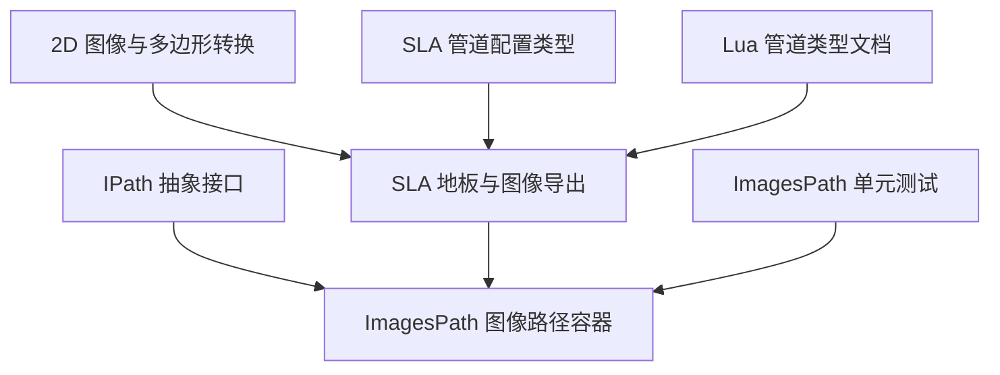
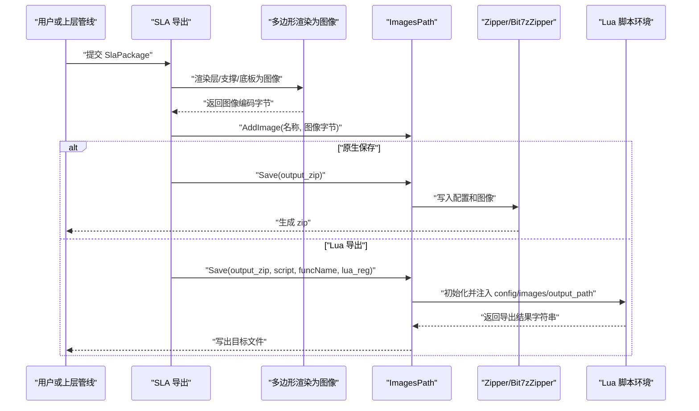
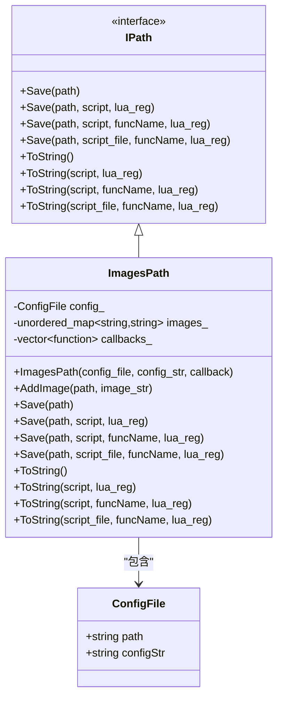
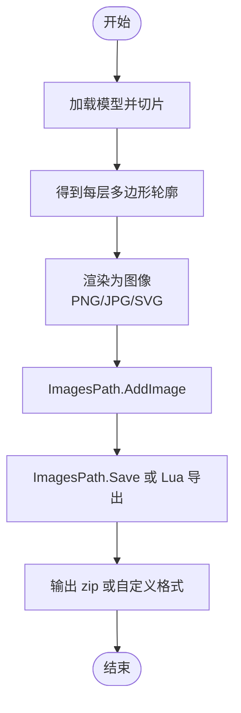
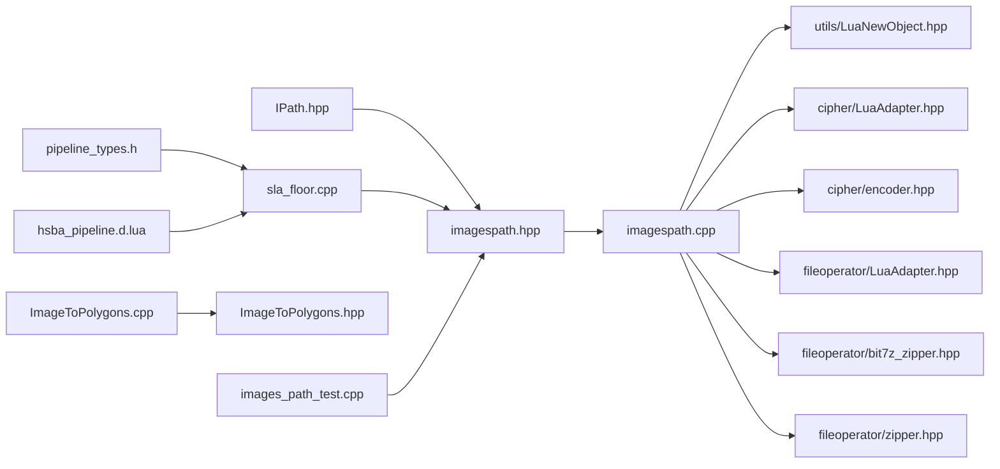

# ImagesPath 路径类型

<cite>
**本文引用的文件**   
- [imagespath.hpp](file://paths/imagespath.hpp)
- [imagespath.cpp](file://paths/imagespath.cpp)
- [IPath.hpp](file://paths/IPath.hpp)
- [sla_floor.hpp](file://LibHsBaSlicer/Floor/sla_floor.hpp)
- [sla_floor.cpp](file://LibHsBaSlicer/Floor/sla_floor.cpp)
- [ImageToPolygons.hpp](file://2D/ImageToPolygons.hpp)
- [ImageToPolygons.cpp](file://2D/ImageToPolygons.cpp)
- [pipeline_types.h](file://pipelinetypes/pipeline_types.h)
- [hsba_pipeline.d.lua](file://types/hsba_pipeline.d.lua)
- [images_path_test.cpp](file://tests/PathsOut/images_path_test.cpp)
</cite>

## 目录
1. [引言](#引言)
2. [项目结构定位](#项目结构定位)
3. [核心概念](#核心概念)
4. [架构总览](#架构总览)
5. [ImagesPath 详细实现分析](#imagespath-详细实现分析)
6. [图像数据格式与坐标系统](#图像数据格式与坐标系统)
7. [从图像到路径的转换流程](#从图像到路径的转换流程)
8. [Lua 脚本集成与扩展点](#lua-脚本集成与扩展点)
9. [依赖关系分析](#依赖关系分析)
10. [性能与内存特性](#性能与内存特性)
11. [质量评估、边缘检测与路径优化](#质量评估边缘检测与路径优化)
12. [使用示例与最佳实践](#使用示例与最佳实践)
13. [故障排除](#故障排除)
14. [结论](#结论)

## 引言
ImagesPath 是 HsBaSlicer 中专门用于“图像型路径输出”的数据容器。它并不直接存储像素矩阵，而是以“配置侧车文件 + 命名图像二进制字符串”的形式组织数据，并通过 IPath 接口统一提供 Save 和 ToString 能力。该设计特别适合光固化打印（SLA/SLS）中的层图像、纹理映射、以及“图像转路径”等场景：上层切片或填充算法生成多边形后，渲染为 PNG/JPG/SVG 图像；这些图像再被 ImagesPath 打包成 zip 或通过 Lua 脚本自定义导出。

需要特别区分的是：
- ImagesPath 负责“图像包”的封装、序列化、Lua 导出。
- 图像像素加载、灰度化、阈值分割、多边形提取由 2D 图像处理模块完成。
- 多边形渲染回图像由 SLA 地板/图像模块完成。
- 最终路径生成（如 GCode、机器人路径、层路径）由其他 Path 类型承担。

因此，ImagesPath 的核心价值是“把图像产物与配置一起持久化”，并允许通过 Lua 在导出阶段做二次加工。

**章节来源**
- [imagespath.hpp:16-22](file://paths/imagespath.hpp#L16-L22)
- [imagespath.cpp:1-5](file://paths/imagespath.cpp#L1-L5)

## 项目结构定位
ImagesPath 位于 paths 模块，继承自抽象 IPath 接口，并与 LibHsBaSlicer 的 SLA 导出、2D 图像转换、Lua 注册机制紧密耦合。

**图表来源**
- [IPath.hpp:20-57](file://paths/IPath.hpp#L20-L57)
- [imagespath.hpp:23-61](file://paths/imagespath.hpp#L23-L61)
- [sla_floor.hpp:157-195](file://LibHsBaSlicer/Floor/sla_floor.hpp#L157-L195)
- [ImageToPolygons.hpp:23-62](file://2D/ImageToPolygons.hpp#L23-L62)
- [pipeline_types.h:215-248](file://pipelinetypes/pipeline_types.h#L215-L248)
- [hsba_pipeline.d.lua:582-591](file://types/hsba_pipeline.d.lua#L582-L591)
- [images_path_test.cpp:23-54](file://tests/PathsOut/images_path_test.cpp#L23-L54)

**章节来源**
- [IPath.hpp:20-57](file://paths/IPath.hpp#L20-L57)
- [imagespath.hpp:16-61](file://paths/imagespath.hpp#L16-L61)
- [sla_floor.hpp:157-195](file://LibHsBaSlicer/Floor/sla_floor.hpp#L157-L195)

## 核心概念
ImagesPath 的核心概念可以概括为以下四点：

| 概念 | 含义 | 在 HsBaSlicer 中的作用 |
|---|---|---|
| 配置侧车 | 每个 ImagesPath 携带一个配置文件名和配置内容字符串 | 通常作为 config.json 或其他元数据，随图像一起保存 |
| 命名图像负载 | 以 path/name 为键、以二进制字符串为值的映射 | 表示层图像、支撑图像、底板图像等 |
| 原生打包 | 将配置和图像写入 zip 压缩包 | 默认 SLA/SLS 层图像导出方式 |
| Lua 导出 | 通过 inline 脚本或脚本文件执行自定义导出逻辑 | 支持扩展导出格式、加密、压缩策略、调试输出等 |

ImagesPath 不关心图像内部像素布局，只关心“某个名称对应一段二进制图像数据”。真正的像素处理发生在调用方：例如 SLA 导出会把每层轮廓渲染为 PNG/JPG/SVG，再把编码后的字节传给 AddImage。

**章节来源**
- [imagespath.hpp:16-22](file://paths/imagespath.hpp#L16-L22)
- [imagespath.hpp:49-60](file://paths/imagespath.hpp#L49-L60)
- [imagespath.cpp:23-32](file://paths/imagespath.cpp#L23-L32)

## 架构总览
ImagesPath 在整体系统中的位置如下：

**图表来源**
- [sla_floor.cpp:468-529](file://LibHsBaSlicer/Floor/sla_floor.cpp#L468-L529)
- [sla_floor.cpp:531-600](file://LibHsBaSlicer/Floor/sla_floor.cpp#L531-L600)
- [imagespath.cpp:34-47](file://paths/imagespath.cpp#L34-L47)
- [imagespath.cpp:49-127](file://paths/imagespath.cpp#L49-L127)

**章节来源**
- [sla_floor.cpp:468-600](file://LibHsBaSlicer/Floor/sla_floor.cpp#L468-L600)
- [imagespath.cpp:34-127](file://paths/imagespath.cpp#L34-L127)

## ImagesPath 详细实现分析

### 类结构与职责
ImagesPath 继承 IPath，主要维护三个私有成员：

| 成员 | 类型 | 职责 |
|---|---|---|
| config_ | ConfigFile | 保存配置文件名和配置内容 |
| images_ | unordered_map<string,string> | 保存命名图像的二进制负载 |
| callbacks_ | vector<function<void(double,string_view)>> | 进度回调，用于原生保存时的进度上报 |

**图表来源**
- [IPath.hpp:20-57](file://paths/IPath.hpp#L20-L57)
- [imagespath.hpp:23-61](file://paths/imagespath.hpp#L23-L61)

**章节来源**
- [imagespath.hpp:23-61](file://paths/imagespath.hpp#L23-L61)

### 构造与图像添加
构造函数接收：
- 配置文件名
- 配置内容字符串
- 可选进度回调向量

AddImage 接受路径名和图像二进制字符串，将其插入 images_ 映射。注意：这里的路径名不是磁盘路径，而是压缩包内的虚拟路径，例如 `layers/layer_0.png`。

**章节来源**
- [imagespath.hpp:32-33](file://paths/imagespath.hpp#L32-L33)
- [imagespath.hpp:49-50](file://paths/imagespath.hpp#L49-L50)
- [imagespath.cpp:23-32](file://paths/imagespath.cpp#L23-L32)

### 原生 Save：zip 打包
原生 Save 不使用 Lua，直接将配置和所有图像写入 zip。它会：
1. 创建 Zipper
2. 附加进度回调
3. 写入配置文件
4. 遍历 images_ 写入每个图像
5. 保存到目标路径

这是 SLA 默认导出路径中最常用的方式。

**章节来源**
- [imagespath.cpp:34-47](file://paths/imagespath.cpp#L34-L47)

### Lua Save：inline 脚本
当传入 inline Lua 脚本时，ImagesPath 会：
1. 创建独立 Lua 状态
2. 打开标准库
3. 注册 Zipper、Cipher、可选 Bit7zZipper
4. 调用外部 lua_reg 回调注册额外函数
5. 注入全局变量：
   - `config.path`
   - `config.configStr`
   - `images` 表数组，每项含 `path` 和 `data`
   - `output_path`
6. 加载并运行脚本
7. 如果脚本返回字符串，则写入 output_path

**章节来源**
- [imagespath.cpp:49-127](file://paths/imagespath.cpp#L49-L127)

### Lua Save：带函数名的重载
带 funcName 的重载会在 Lua 环境中额外注入 `funcName` 全局变量，便于脚本根据入口函数名选择不同导出逻辑。这与 ToString 的对应重载保持一致。

**章节来源**
- [imagespath.cpp:129-203](file://paths/imagespath.cpp#L129-L203)

### Lua Save：脚本文件
脚本文件重载会先读取脚本文件内容，再调用带 inline 脚本的 Save 重载。若脚本文件不存在，抛出 RuntimeError。

**章节来源**
- [imagespath.cpp:205-217](file://paths/imagespath.cpp#L205-L217)

### ToString：Lua 序列化
ToString 系列方法用于将 ImagesPath 序列化为字符串。Lua 版本会：
1. 创建 Lua 环境
2. 注册 Cipher
3. 注入 config 和 images
4. 运行脚本
5. 返回脚本输出的字符串

空脚本会回退到原生 ToString。

**章节来源**
- [imagespath.cpp:219-282](file://paths/imagespath.cpp#L219-L282)
- [imagespath.cpp:284-350](file://paths/imagespath.cpp#L284-L350)
- [imagespath.cpp:352-364](file://paths/imagespath.cpp#L352-L364)

### 原生 ToString：文本描述
原生 ToString 会：
1. 触发所有进度回调
2. 输出配置文件名和内容
3. 对每个图像进行 base64 解码后输出

这种格式适合调试或轻量级文本序列化，但不适合直接作为生产输出。

**章节来源**
- [imagespath.cpp:366-381](file://paths/imagespath.cpp#L366-L381)

## 图像数据格式与坐标系统

### ImagesPath 中的图像数据
ImagesPath 本身不解析图像像素，它只存储：
- 图像名称：用于标识层图像、支撑图像、底板图像等
- 图像二进制字符串：通常是 PNG/JPG/SVG 编码后的字节

因此，“图像数据格式”在 ImagesPath 层面是“任意二进制负载”，具体格式由上游渲染器决定。

**章节来源**
- [imagespath.hpp:49-60](file://paths/imagespath.hpp#L49-L60)
- [imagespath.cpp:29-32](file://paths/imagespath.cpp#L29-L32)

### 像素坐标系统
图像渲染部分使用多边形坐标到像素坐标的映射：
- 计算多边形边界框
- 根据 width、height、pixelSize 确定像素尺寸
- 原点 min_x、min_y 作为图像左上角参考
- 像素 (x,y) 对应物理坐标 origin_x + (x+0.5)*pixelSize

这意味着图像坐标系与模型坐标系通过 pixelSize 和 origin 关联，而不是直接共享同一数值范围。

**章节来源**
- [ImageToPolygons.cpp:394-413](file://2D/ImageToPolygons.cpp#L394-L413)
- [ImageToPolygons.cpp:426-496](file://2D/ImageToPolygons.cpp#L426-L496)

### 颜色通道处理
图像渲染主要面向二值或灰度图像：
- 前景色 foreground 默认 255
- 背景色 background 默认 0
- OpenCV 可用时，彩色图像会被转换为灰度图
- 不支持复杂色彩通道的逐通道路径生成；图像主要用于“是否曝光”的掩码

**章节来源**
- [ImageToPolygons.hpp:18-20](file://2D/ImageToPolygons.hpp#L18-L20)
- [ImageToPolygons.hpp:42-62](file://2D/ImageToPolygons.hpp#L42-L62)
- [ImageToPolygons.cpp:37-55](file://2D/ImageToPolygons.cpp#L37-L55)

### 支持的图像格式
SLA 导出支持：
- .png
- .jpg / .jpeg
- .svg

格式由 SlaPackage.image_extension 或输出路径扩展名决定。

**章节来源**
- [sla_floor.hpp:166-168](file://LibHsBaSlicer/Floor/sla_floor.hpp#L166-L168)
- [ImageToPolygons.cpp:445-496](file://2D/ImageToPolygons.cpp#L445-L496)

## 从图像到路径的转换流程
虽然 ImagesPath 不负责路径生成，但它在“图像转路径”工作流中扮演关键角色：

**图表来源**
- [sla_floor.cpp:468-529](file://LibHsBaSlicer/Floor/sla_floor.cpp#L468-L529)
- [ImageToPolygons.cpp:426-496](file://2D/ImageToPolygons.cpp#L426-L496)
- [imagespath.cpp:34-47](file://paths/imagespath.cpp#L34-L47)

**章节来源**
- [sla_floor.cpp:468-600](file://LibHsBaSlicer/Floor/sla_floor.cpp#L468-L600)
- [ImageToPolygons.cpp:416-496](file://2D/ImageToPolygons.cpp#L416-L496)
- [imagespath.cpp:34-47](file://paths/imagespath.cpp#L34-L47)

## Lua 脚本集成与扩展点

### Lua 环境注入
ImagesPath 的 Lua 导出模式会向脚本暴露以下全局对象：

| 全局名 | 类型 | 说明 |
|---|---|---|
| config | table | 包含 path 和 configStr |
| images | table[] | 数组形式，每项含 path 和 data |
| output_path | string | 目标输出路径 |
| funcName | string | 仅在使用 funcName 重载时存在 |
| Zipper | table | 压缩工具，可写入字节文件 |
| Cipher | table | 编解码工具，支持 base64、hex 等 |

**章节来源**
- [imagespath.cpp:70-96](file://paths/imagespath.cpp#L70-L96)
- [imagespath.cpp:150-176](file://paths/imagespath.cpp#L150-L176)
- [imagespath.cpp:239-260](file://paths/imagespath.cpp#L239-L260)
- [imagespath.cpp:304-327](file://paths/imagespath.cpp#L304-L327)

### 自定义 Lua 注册回调
通过 lua_reg 参数，调用方可向 Lua 环境注入额外函数。SLA 导出中使用该机制注册 2D 几何函数和文件操作函数，使导出脚本能访问更丰富的图像处理能力。

**章节来源**
- [sla_floor.cpp:586-597](file://LibHsBaSlicer/Floor/sla_floor.cpp#L586-L597)
- [imagespath.cpp:64-68](file://paths/imagespath.cpp#L64-L68)
- [imagespath.cpp:145-148](file://paths/imagespath.cpp#L145-L148)
- [imagespath.cpp:234-237](file://paths/imagespath.cpp#L234-L237)
- [imagespath.cpp:300-303](file://paths/imagespath.cpp#L300-L303)

### SLA 导出脚本约定
根据 Lua 管道类型文档，SLA 导出阶段的内置环境包括 config、images、output_path、Zipper、Cipher 等，入口函数通常为 export_sla。

**章节来源**
- [hsba_pipeline.d.lua:582-591](file://types/hsba_pipeline.d.lua#L582-L591)

## 依赖关系分析

**图表来源**
- [imagespath.cpp:5-19](file://paths/imagespath.cpp#L5-L19)
- [sla_floor.cpp:26](file://LibHsBaSlicer/Floor/sla_floor.cpp#L26)
- [ImageToPolygons.cpp:1-29](file://2D/ImageToPolygons.cpp#L1-L29)
- [pipeline_types.h:215-248](file://pipelinetypes/pipeline_types.h#L215-L248)
- [hsba_pipeline.d.lua:582-591](file://types/hsba_pipeline.d.lua#L582-L591)
- [images_path_test.cpp:4-9](file://tests/PathsOut/images_path_test.cpp#L4-L9)

**章节来源**
- [imagespath.cpp:5-19](file://paths/imagespath.cpp#L5-L19)
- [sla_floor.cpp:26](file://LibHsBaSlicer/Floor/sla_floor.cpp#L26)
- [ImageToPolygons.cpp:1-29](file://2D/ImageToPolygons.cpp#L1-L29)

## 性能与内存特性

### 内存模型
- images_ 使用 unordered_map<string,string>，按名称索引图像二进制字符串
- 图像数据以 std::string 存储，意味着二进制数据可能包含任意字节
- 原生 Save 会遍历 images_ 逐个写入 zip
- ToString 原生模式会对每个图像执行 base64 解码，增加 CPU 开销

### 并行渲染
SLA 导出在生成层图像时使用 ForLayersParallel，将多边形渲染任务分配到线程池，提高批量图像生成效率。

### 压缩后端
原生 Save 使用 Zipper；Lua 环境可选择启用 Bit7zZipper（编译期宏控制），以便在脚本中使用更高性能的压缩后端。

**章节来源**
- [imagespath.hpp:58-60](file://paths/imagespath.hpp#L58-L60)
- [imagespath.cpp:34-47](file://paths/imagespath.cpp#L34-L47)
- [imagespath.cpp:366-381](file://paths/imagespath.cpp#L366-L381)
- [sla_floor.cpp:450-465](file://LibHsBaSlicer/Floor/sla_floor.cpp#L450-L465)
- [imagespath.cpp:61-63](file://paths/imagespath.cpp#L61-L63)

## 质量评估、边缘检测与路径优化

### 质量评估
ImagesPath 本身不提供图像质量评分。图像质量主要由上游渲染器和阈值参数决定：
- 多边形边界精度影响图像边缘清晰度
- 像素尺寸 pixelSize 影响分辨率
- 阈值 threshold 影响二值化效果

### 边缘检测
边缘检测属于 2D 图像处理范畴，不在 ImagesPath 内实现。典型流程是：
1. 加载图像并转为灰度
2. 应用阈值或边缘算子
3. 提取轮廓多边形
4. 将多边形再次渲染为图像或直接用于路径生成

**章节来源**
- [ImageToPolygons.cpp:37-55](file://2D/ImageToPolygons.cpp#L37-L55)
- [ImageToPolygons.cpp:416-424](file://2D/ImageToPolygons.cpp#L416-L424)
- [ImageToPolygons.cpp:516-530](file://2D/ImageToPolygons.cpp#L516-L530)

### 路径优化
路径优化通常发生在多边形阶段或路径生成阶段，而不是 ImagesPath 阶段。ImagesPath 只负责把已经生成的图像产物打包或导出。

**章节来源**
- [IPath.hpp:20-28](file://paths/IPath.hpp#L20-L28)

## 使用示例与最佳实践

### 创建图像路径
推荐做法：
1. 准备配置文件内容，例如 SLA 配置 JSON
2. 创建 ImagesPath 实例
3. 将每层图像以命名路径添加到 ImagesPath
4. 调用 Save 或 ToString 完成导出

**章节来源**
- [imagespath.hpp:32-33](file://paths/imagespath.hpp#L32-L33)
- [imagespath.hpp:49-50](file://paths/imagespath.hpp#L49-L50)
- [images_path_test.cpp:30-36](file://tests/PathsOut/images_path_test.cpp#L30-L36)

### 加载图像文件
图像加载应由 2D 图像处理模块完成，例如 FromImage 或 LoadImageGray。ImagesPath 不直接读取磁盘图像文件。

**章节来源**
- [ImageToPolygons.hpp:23-30](file://2D/ImageToPolygons.hpp#L23-L30)
- [ImageToPolygons.cpp:37-55](file://2D/ImageToPolygons.cpp#L37-L55)

### 执行图像处理操作
常见操作包括：
- 灰度化
- 阈值分割
- 多边形提取
- 多边形渲染为图像
- 图像编码为 PNG/JPG/SVG

这些操作由 2D 模块提供，ImagesPath 只消费最终编码结果。

**章节来源**
- [ImageToPolygons.hpp:23-62](file://2D/ImageToPolygons.hpp#L23-L62)
- [ImageToPolygons.cpp:416-496](file://2D/ImageToPolygons.cpp#L416-L496)

### 生成路径数据
ImagesPath 的输出通常是图像包，而不是 GCode 或机器人路径。如果需要路径数据，应使用 PointsPath、LayersPath、GCodePath 等其他 IPath 实现。

**章节来源**
- [IPath.hpp:20-28](file://paths/IPath.hpp#L20-L28)

### 批处理功能
SLA 导出中对层图像的渲染采用 ForLayersParallel 进行批处理，避免串行渲染瓶颈。

**章节来源**
- [sla_floor.cpp:450-465](file://LibHsBaSlicer/Floor/sla_floor.cpp#L450-L465)
- [sla_floor.cpp:478-487](file://LibHsBaSlicer/Floor/sla_floor.cpp#L478-L487)
- [sla_floor.cpp:504-519](file://LibHsBaSlicer/Floor/sla_floor.cpp#L504-L519)

### 内存管理优化
建议：
- 避免在 Lua 脚本中重复复制大图像数据
- 使用二进制 data 字段直接传递编码字节
- 原生 Save 优先于 ToString 进行大规模图像打包
- 合理使用 progress callback 监控长时间任务

**章节来源**
- [imagespath.cpp:34-47](file://paths/imagespath.cpp#L34-L47)
- [imagespath.cpp:366-381](file://paths/imagespath.cpp#L366-L381)
- [images_path_test.cpp:56-60](file://tests/PathsOut/images_path_test.cpp#L56-L60)

## 故障排除

### Lua 初始化失败
如果 MakeUniqueLuaState 返回空状态，会抛出 RuntimeError。通常由 Lua 环境未正确初始化导致。

**章节来源**
- [imagespath.cpp:52-56](file://paths/imagespath.cpp#L52-L56)
- [imagespath.cpp:134-138](file://paths/imagespath.cpp#L134-L138)
- [imagespath.cpp:226-230](file://paths/imagespath.cpp#L226-L230)
- [imagespath.cpp:293-297](file://paths/imagespath.cpp#L293-L297)

### Lua 脚本加载错误
luaL_loadbuffer 失败时会抛出 RuntimeError，包含 Lua 编译错误信息。

**章节来源**
- [imagespath.cpp:102-107](file://paths/imagespath.cpp#L102-L107)
- [imagespath.cpp:178-184](file://paths/imagespath.cpp#L178-L184)
- [imagespath.cpp:262-267](file://paths/imagespath.cpp#L262-L267)
- [imagespath.cpp:329-335](file://paths/imagespath.cpp#L329-L335)

### Lua 运行时错误
lua_pcall 失败时会抛出 RuntimeError，包含 Lua 运行时异常信息。

**章节来源**
- [imagespath.cpp:108-113](file://paths/imagespath.cpp#L108-L113)
- [imagespath.cpp:185-190](file://paths/imagespath.cpp#L185-L190)
- [imagespath.cpp:268-273](file://paths/imagespath.cpp#L268-L273)
- [imagespath.cpp:336-341](file://paths/imagespath.cpp#L336-L341)

### 脚本文件不存在
读取脚本文件失败时抛出 RuntimeError。

**章节来源**
- [imagespath.cpp:208-212](file://paths/imagespath.cpp#L208-L212)
- [imagespath.cpp:355-359](file://paths/imagespath.cpp#L355-L359)

### 输出文件写入失败
当尝试打开输出文件失败时抛出 RuntimeError。

**章节来源**
- [imagespath.cpp:120-126](file://paths/imagespath.cpp#L120-L126)
- [imagespath.cpp:196-202](file://paths/imagespath.cpp#L196-L202)

### 测试覆盖的关键行为
单元测试覆盖了：
- base64 编解码
- 原生 Save 生成 zip
- 原生 ToString 触发回调
- funcName 注入
- 空脚本回退
- Lua 注册回调
- 脚本文件读取
- 缺失脚本文件异常
- Lua 编译和运行时异常

**章节来源**
- [images_path_test.cpp:26-54](file://tests/PathsOut/images_path_test.cpp#L26-L54)
- [images_path_test.cpp:56-81](file://tests/PathsOut/images_path_test.cpp#L56-L81)
- [images_path_test.cpp:83-98](file://tests/PathsOut/images_path_test.cpp#L83-L98)
- [images_path_test.cpp:100-112](file://tests/PathsOut/images_path_test.cpp#L100-L112)
- [images_path_test.cpp:114-139](file://tests/PathsOut/images_path_test.cpp#L114-L139)
- [images_path_test.cpp:141-175](file://tests/PathsOut/images_path_test.cpp#L141-L175)
- [images_path_test.cpp:177-235](file://tests/PathsOut/images_path_test.cpp#L177-L235)

## 结论
ImagesPath 是 HsBaSlicer 中面向图像型输出的通用容器。它的设计重点不是像素处理，而是：
- 统一管理配置与图像负载
- 提供原生 zip 打包能力
- 提供可扩展的 Lua 导出能力
- 与 SLA/SLS 流水线、2D 图像处理、压缩和加密模块解耦

对于初学者，理解 ImagesPath 的关键是记住：“它是图像包的包装器，不是图像处理器”。对于专家，它的价值在于提供了稳定的 IPath 接口、清晰的 Lua 注入契约、以及可插拔的导出扩展点。在实际工程中，应把图像加载、阈值分割、边缘检测、路径生成放在合适的模块中，而让 ImagesPath 专注于“如何把图像产物可靠地写出去”。