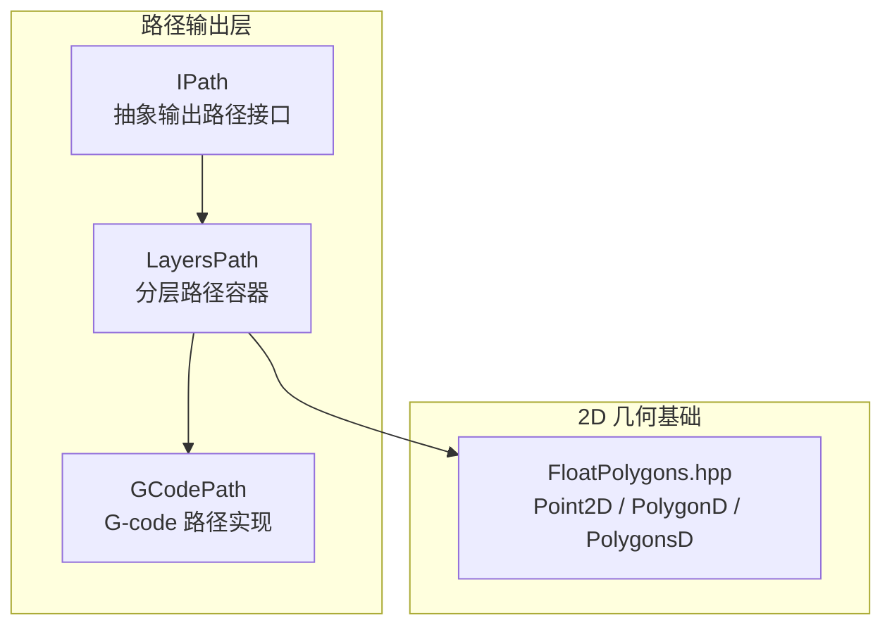
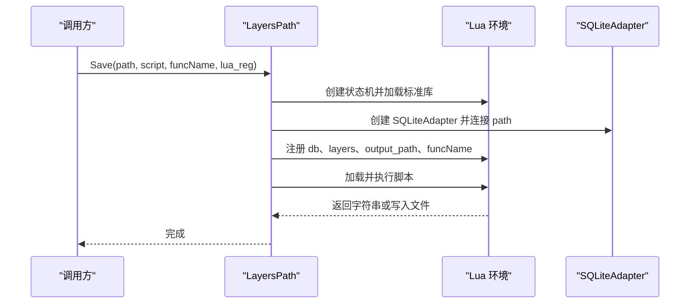
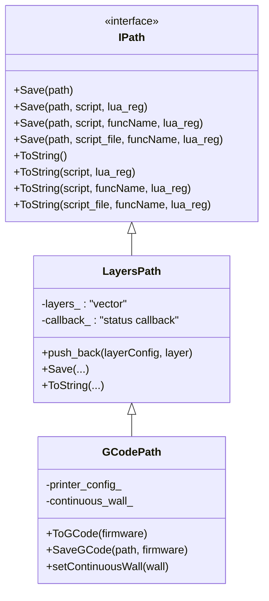
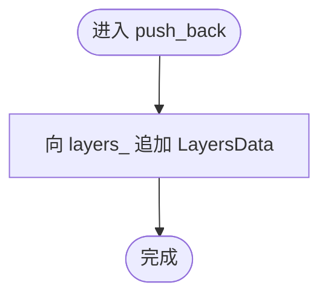
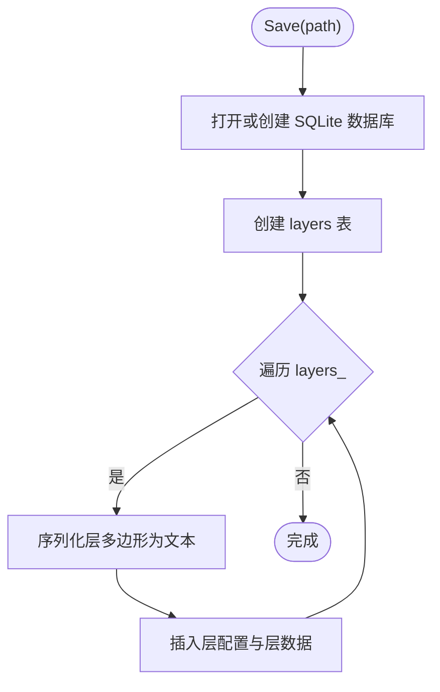
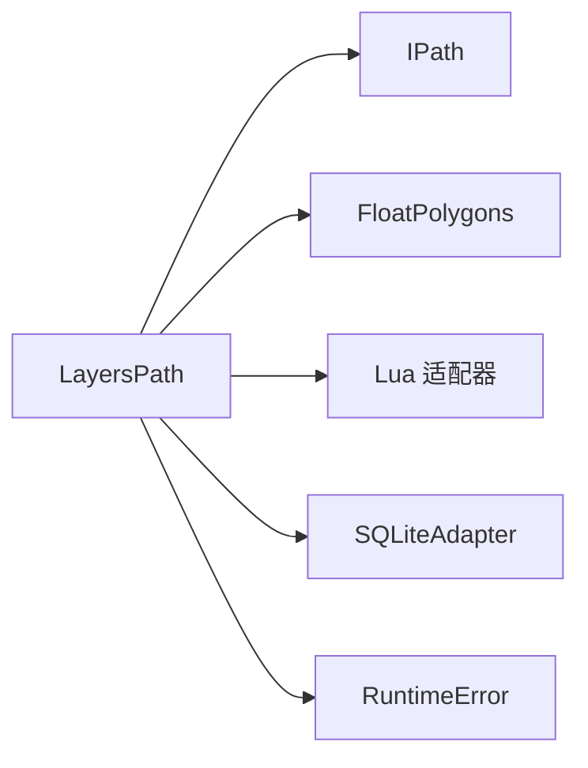
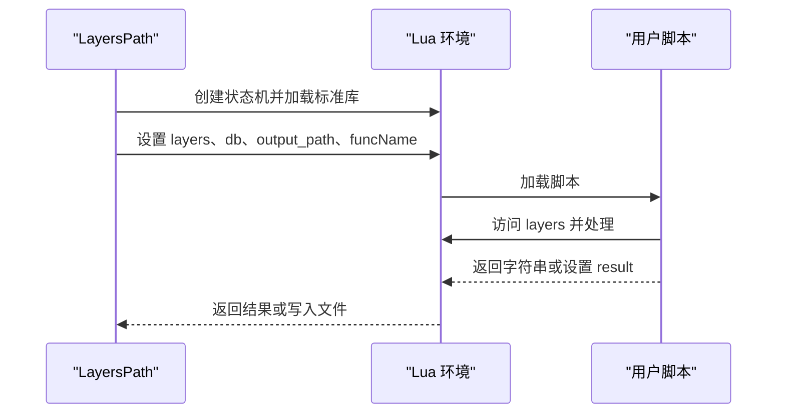
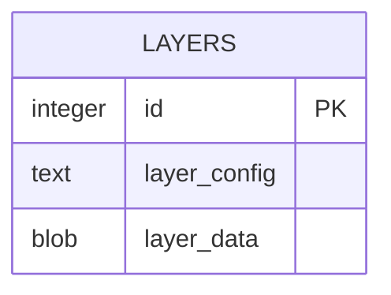
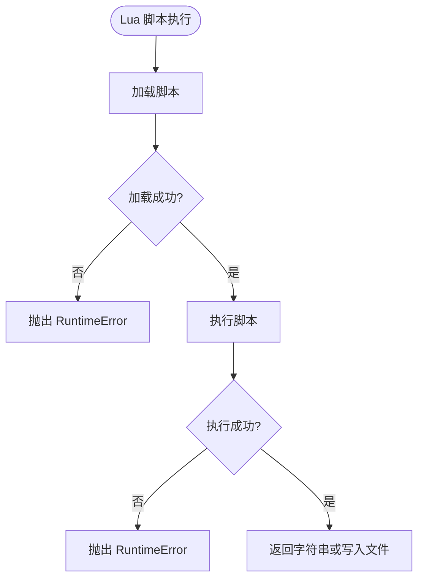

# LayersPath 路径类型

<cite>
**本文引用的文件**   
- [layerspath.hpp](file://paths/layerspath.hpp)
- [layerspath.cpp](file://paths/layerspath.cpp)
- [IPath.hpp](file://paths/IPath.hpp)
- [FloatPolygons.hpp](file://2D/FloatPolygons.hpp)
- [gcodepath.hpp](file://paths/gcodepath.hpp)
- [layers_path_test.cpp](file://tests/PathsOut/layers_path_test.cpp)
</cite>

## 目录
1. [引言](#引言)
2. [项目结构中的定位](#项目结构中的定位)
3. [核心概念与数据模型](#核心概念与数据模型)
4. [架构总览](#架构总览)
5. [详细组件分析](#详细组件分析)
6. [依赖关系分析](#依赖关系分析)
7. [性能与内存管理](#性能与内存管理)
8. [Lua 扩展机制](#lua-扩展机制)
9. [序列化与导出格式](#序列化与导出格式)
10. [使用示例与操作指南](#使用示例与操作指南)
11. [验证、完整性检查与错误恢复](#验证完整性检查与错误恢复)
12. [与切片引擎的数据交换接口](#与切片引擎的数据交换接口)
13. [调试与可视化建议](#调试与可视化建议)
14. [常见问题与故障排除](#常见问题与故障排除)
15. [结论](#结论)

## 引言
LayersPath 是 HsBaSlicer 中用于表达“分层路径”的核心数据结构。它继承自抽象输出路径接口 IPath，以“层索引 + 层配置字符串 + 双精度多边形集合”的形式组织切片结果，并提供原生 SQLite 存储、Lua 脚本后处理、以及 ToString 序列化能力。GCodePath 等更具体的路径类型又基于 LayersPath 扩展出 G-code 生成逻辑，因此 LayersPath 既是通用分层数据容器，也是上层路径类型的基座。

该文档面向两类读者：
- 初学者：理解“什么是层”“层如何组织”“如何添加和访问层数据”。
- 算法开发者：掌握内存布局、序列化协议、Lua 扩展点、以及与切片/填充/路径生成模块的集成方式。

## 项目结构中的定位
在仓库中，LayersPath 位于 `paths` 目录，属于“路径输出层”，与 PointsPath、ImagesPath、RobotPath、WeldRobotPath、GCodePath 等同属 IPath 家族。其几何基础来自 `2D/FloatPolygons.hpp` 提供的双精度多边形类型；其具体实现由 `paths/layerspath.cpp` 提供；测试用例位于 `tests/PathsOut/layers_path_test.cpp`。



**图表来源**
- [IPath.hpp:29-57](file://paths/IPath.hpp#L29-L57)
- [layerspath.hpp:25-60](file://paths/layerspath.hpp#L25-L60)
- [gcodepath.hpp:66-107](file://paths/gcodepath.hpp#L66-L107)
- [FloatPolygons.hpp:18-25](file://2D/FloatPolygons.hpp#L18-L25)

**章节来源**
- [layerspath.hpp:1-64](file://paths/layerspath.hpp#L1-L64)
- [IPath.hpp:1-68](file://paths/IPath.hpp#L1-L68)

## 核心概念与数据模型
### 层的定义
一个“层”表示构建空间中某一 Z 高度上的二维轮廓集合。在 LayersPath 中，每个层包含：
- 层配置字符串：自由文本，可描述层高、材料、打印模式、支撑策略等元信息。
- 层多边形集合：双精度坐标的多边形数组，表示该层的轮廓、填充、支撑等区域。

### 内部数据结构
LayersPath 内部维护一个有序向量，元素类型为内部结构 LayersData：
- layerConfig：层配置字符串。
- layer：PolygonsD，即 Clipper2 的双精度多边形集合。

层索引即为该向量下标，从 0 开始递增。当前实现未显式暴露独立的 Z 轴字段；Z 通常由调用方通过层配置或外部上下文管理，或在后续路径生成阶段（如 GCodePath）结合层高参数推导。

```mermaid
classDiagram
class LayersPath {
-callback_ : "状态回调"
-layers_ : "LayerData[]"
+push_back(layerConfig, layer)
+Save(path)
+ToString()
}
class LayersData {
+layerConfig : "string"
+layer : "PolygonsD"
}
class PolygonsD {
<<type alias>>
"Clipper2 PathsD"
}
LayersPath --> LayersData : "包含"
LayersData --> PolygonsD : "包含"
```

**图表来源**
- [layerspath.hpp:52-60](file://paths/layerspath.hpp#L52-L60)
- [FloatPolygons.hpp:21-25](file://2D/FloatPolygons.hpp#L21-L25)

**章节来源**
- [layerspath.hpp:17-24](file://paths/layerspath.hpp#L17-L24)
- [layerspath.hpp:52-60](file://paths/layerspath.hpp#L52-L60)
- [FloatPolygons.hpp:18-25](file://2D/FloatPolygons.hpp#L18-L25)

## 架构总览
LayersPath 作为 IPath 的具体实现，统一了“保存为文件”和“序列化为字符串”两种输出方式，并支持 Lua 脚本后处理。其关键职责包括：
- 存储层数据：按顺序追加层。
- 原生导出：将层写入 SQLite 数据库。
- Lua 导出：创建 Lua 环境，注入 layers、db、output_path、funcName 等全局变量，执行用户脚本。
- 字符串序列化：返回紧凑的 JSON-like 文本，或通过 Lua 自定义格式化。



**图表来源**
- [layerspath.cpp:61-163](file://paths/layerspath.cpp#L61-L163)
- [layerspath.cpp:165-263](file://paths/layerspath.cpp#L165-L263)

**章节来源**
- [layerspath.cpp:61-163](file://paths/layerspath.cpp#L61-L163)
- [layerspath.cpp:165-263](file://paths/layerspath.cpp#L165-L263)

## 详细组件分析
### 类层次与继承关系
LayersPath 继承自 IPath，GCodePath 再继承自 LayersPath。这种设计让 GCodePath 复用分层数据组织和 Lua 导出机制，同时增加打印机配置、连续外壁（花瓶模式）等特性。



**图表来源**
- [IPath.hpp:29-57](file://paths/IPath.hpp#L29-L57)
- [layerspath.hpp:25-60](file://paths/layerspath.hpp#L25-L60)
- [gcodepath.hpp:66-107](file://paths/gcodepath.hpp#L66-L107)

**章节来源**
- [layerspath.hpp:25-60](file://paths/layerspath.hpp#L25-L60)
- [gcodepath.hpp:66-107](file://paths/gcodepath.hpp#L66-L107)

### 层数据的增删改查
- 新增层：push_back(layerConfig, layer)。
- 读取层：可通过遍历 internal vector 或使用 Lua 脚本访问 layers 表。
- 修改层：当前未提供直接修改 API；可在构造完成后重新赋值 layers_（受保护成员），或通过 Lua 脚本转换后再导出。
- 删除层：同样需直接操作 protected members；对外推荐通过 Lua 过滤层。



**图表来源**
- [layerspath.cpp:25-28](file://paths/layerspath.cpp#L25-L28)

**章节来源**
- [layerspath.cpp:25-28](file://paths/layerspath.cpp#L25-L28)

### 批量处理方法
- 原生批量写入 SQLite：Save(path) 会创建 layers 表，逐层插入 layer_config 与 layer_data。
- Lua 批量处理：Save/ToString 的 Lua 变体将 layers 整体推入 Lua 表，供脚本循环处理。



**图表来源**
- [layerspath.cpp:30-59](file://paths/layerspath.cpp#L30-L59)

**章节来源**
- [layerspath.cpp:30-59](file://paths/layerspath.cpp#L30-L59)

### 与其他路径类型的继承关系
GCodePath 继承 LayersPath，复用其层数据组织与 Lua 导出机制，并在此基础上实现 G-code 生成、固件适配、连续外壁等能力。这意味着：
- 所有 G-code 路径都具备分层数据。
- 可通过统一的 Save/ToString 接口进行 Lua 后处理。
- 分层数据可作为 G-code 生成的输入。

**章节来源**
- [gcodepath.hpp:66-107](file://paths/gcodepath.hpp#L66-L107)

## 依赖关系分析
LayersPath 的主要依赖：
- IPath：抽象接口，定义 Save/ToString 族方法。
- FloatPolygons：双精度多边形类型 Point2D、PolygonD、PolygonsD。
- Lua 适配器：MakeUniqueLuaState、RegisterLuaSQLiteAdapter、NewLuaObject。
- SQL 适配器：SQLiteAdapter，用于原生 SQLite 导出。
- 错误处理：RuntimeError，用于抛出异常。



**图表来源**
- [layerspath.hpp:9-13](file://paths/layerspath.hpp#L9-L13)
- [layerspath.cpp:7-17](file://paths/layerspath.cpp#L7-L17)

**章节来源**
- [layerspath.hpp:9-13](file://paths/layerspath.hpp#L9-L13)
- [layerspath.cpp:7-17](file://paths/layerspath.cpp#L7-L17)

## 性能与内存管理
### 时间复杂度
- push_back：均摊 O(1)，底层 std::vector 扩容时可能触发 O(n) 重分配。
- Save(path)：O(L + P)，其中 L 为层数，P 为所有多边形的顶点总数。
- ToString()：O(L + P)，逐层序列化。
- Lua 导出：额外开销包括 Lua 栈操作、对象创建与脚本执行。

### 空间复杂度
- 内存占用主要由 layers_ 向量与 PolygonsD 顶点数组决定。
- 大模型场景下，建议控制每层多边形数量与顶点密度，避免一次性加载过大数据集。

### 优化建议
- 预分配：若已知层数与每层多边形规模，可在应用层预先估算容量以减少重分配。
- 流式处理：对超大模型，优先使用 Lua 脚本逐层处理，避免一次性生成完整字符串。
- 压缩存储：原生 SQLite 导出已使用 BLOB 存储层数据；如需进一步压缩，可在 Lua 层引入压缩函数。

[本节为通用性能讨论，不直接分析具体文件]

## Lua 扩展机制
LayersPath 的 Lua 扩展机制允许用户在导出前对层数据进行任意变换。主要约定如下：
- 全局变量 layers：数组，每个元素包含 config 与 data 字段。data 是多边形数组，每个多边形是点数组，点包含 x、y。
- 全局变量 db：SQLiteAdapter 实例，已连接到 output_path，可用于脚本内写库。
- 全局变量 output_path：目标输出路径。
- 可选全局变量 funcName：当使用带函数名的 Save/ToString 重载时可用。
- 返回值：如果脚本返回字符串，则将其写入文件或作为 ToString 的结果；否则尝试读取全局 result。



**图表来源**
- [layerspath.cpp:61-163](file://paths/layerspath.cpp#L61-L163)
- [layerspath.cpp:303-392](file://paths/layerspath.cpp#L303-L392)
- [layerspath.cpp:394-478](file://paths/layerspath.cpp#L394-L478)

**章节来源**
- [layerspath.cpp:61-163](file://paths/layerspath.cpp#L61-L163)
- [layerspath.cpp:303-392](file://paths/layerspath.cpp#L303-L392)
- [layerspath.cpp:394-478](file://paths/layerspath.cpp#L394-L478)

## 序列化与导出格式
### 原生 SQLite 格式
Save(path) 会创建名为 layers 的表，包含以下列：
- id：自增主键。
- layer_config：TEXT，层配置字符串。
- layer_data：BLOB，层多边形序列化的文本表示。

层数据序列化采用类似 JSON 的结构：外层为对象，包含多个多边形数组；每个多边形为点数组，点为 (x,y) 形式。



**图表来源**
- [layerspath.cpp:39-41](file://paths/layerspath.cpp#L39-L41)
- [layerspath.cpp:42-58](file://paths/layerspath.cpp#L42-L58)

**章节来源**
- [layerspath.cpp:30-59](file://paths/layerspath.cpp#L30-L59)

### 字符串序列化
ToString() 返回紧凑的嵌套结构，包含每个层的 config 与 data。Lua 变体支持返回自定义字符串或设置全局 result。

**章节来源**
- [layerspath.cpp:279-301](file://paths/layerspath.cpp#L279-L301)
- [layerspath.cpp:303-392](file://paths/layerspath.cpp#L303-L392)
- [layerspath.cpp:394-478](file://paths/layerspath.cpp#L394-L478)

## 使用示例与操作指南
### 创建分层路径
- 构造 LayersPath，可选择传入状态回调。
- 使用 push_back 添加层，每层包含配置字符串与多边形集合。

参考测试用例中的构造与添加层流程。

**章节来源**
- [layers_path_test.cpp:18-29](file://tests/PathsOut/layers_path_test.cpp#L18-L29)

### 添加与访问层数据
- 添加层：lp.push_back("cfg", poly)。
- 访问层：通过 Lua 脚本遍历 layers 表，或使用原生 SQLite 查询。

**章节来源**
- [layers_path_test.cpp:103-140](file://tests/PathsOut/layers_path_test.cpp#L103-L140)

### 执行层操作
- 合并层：在 Lua 脚本中合并不同层的 polygons。
- 分割层：根据条件拆分某一层的多边形。
- 排序层：按配置或面积排序层。

这些操作均在 Lua 层实现，LayersPath 本身不提供专用 API。

**章节来源**
- [layerspath.cpp:61-163](file://paths/layerspath.cpp#L61-L163)

### 转换为其他路径格式
- 原生 SQLite：lp.Save(db_path)。
- Lua 格式化：lp.Save(out_path, script) 或 lp.ToString(script)。
- G-code：通过 GCodePath 继承 LayersPath，使用 ToGCode 系列方法。

**章节来源**
- [layerspath.cpp:30-59](file://paths/layerspath.cpp#L30-L59)
- [layerspath.cpp:61-163](file://paths/layerspath.cpp#L61-L163)
- [gcodepath.hpp:66-107](file://paths/gcodepath.hpp#L66-L107)

## 验证、完整性检查与错误恢复
### 验证机制
- 层数据完整性：Lua 脚本可校验 layers 表的长度、config 字段、data 多边形非空性。
- 几何有效性：可使用 FloatPolygons 提供的 Area、Union、Difference 等工具检测多边形合法性。

### 完整性检查
- 层索引连续性：确保无缺失层。
- 坐标范围：检查 x、y 是否在合理范围内。
- 多边形闭合：确保多边形首尾点一致或经简化后仍有效。

### 错误恢复策略
- Lua 脚本错误：Load 或 pcall 失败时抛出 RuntimeError。
- 文件 IO 错误：打开输出文件或脚本文件失败时抛出 RuntimeError。
- 数据库连接失败：SQLiteAdapter 连接失败时抛出 RuntimeError。



**图表来源**
- [layerspath.cpp:132-144](file://paths/layerspath.cpp#L132-L144)
- [layerspath.cpp:233-244](file://paths/layerspath.cpp#L233-L244)
- [layerspath.cpp:354-366](file://paths/layerspath.cpp#L354-L366)
- [layerspath.cpp:442-453](file://paths/layerspath.cpp#L442-L453)

**章节来源**
- [layerspath.cpp:132-144](file://paths/layerspath.cpp#L132-L144)
- [layerspath.cpp:233-244](file://paths/layerspath.cpp#L233-L244)
- [layerspath.cpp:354-366](file://paths/layerspath.cpp#L354-L366)
- [layerspath.cpp:442-453](file://paths/layerspath.cpp#L442-L453)

## 与切片引擎的数据交换接口
切片引擎通常生成每层的轮廓与填充，然后交由 LayersPath 组织。常见流程：
- 切片模块输出 LayerPathData 或类似结构。
- 填充模块生成 PolygonsD。
- 路径生成模块将多层数据聚合为 LayersPath。
- 最终通过 Save/ToString 导出到 G-code、图像或其他格式。

虽然本仓库中未见直接的 Slice 到 LayersPath 绑定代码，但 LibHsBaSlicer 的路径生成模块明确使用 per-layer 数据生成 G-code，说明 LayersPath 是中间数据载体。

**章节来源**
- [LibHsBaSlicer/Path/path_generator.hpp:46-70](file://LibHsBaSlicer/Path/path_generator.hpp#L46-L70)

## 调试与可视化建议
- 使用 FloatPolygons 的 DumpPolygon/DumpPolygons（启用 HSBA_POLYGON_DUMP）导出 SVG 进行可视化。
- 在 Lua 脚本中输出层统计信息，如层数、多边形数、总面积。
- 使用 SQLite 查询层配置与层数据，辅助排查层顺序与内容问题。

**章节来源**
- [FloatPolygons.hpp:223-239](file://2D/FloatPolygons.hpp#L223-L239)

## 常见问题与故障排除
- Lua 初始化失败：检查 MakeUniqueLuaState 返回值与环境变量。
- 脚本加载失败：确认脚本语法正确，必要时使用最小化脚本复现。
- 输出文件无法写入：检查路径权限与磁盘空间。
- SQLite 连接失败：确认路径有效且无锁竞争。

**章节来源**
- [layerspath.cpp:64-69](file://paths/layerspath.cpp#L64-L69)
- [layerspath.cpp:132-144](file://paths/layerspath.cpp#L132-L144)
- [layerspath.cpp:268-277](file://paths/layerspath.cpp#L268-L277)

## 结论
LayersPath 提供了简洁而强大的分层路径数据容器，既适合快速原型开发，也能为高性能算法提供稳定基础。其核心价值在于：
- 清晰的分层数据模型：层索引 + 配置 + 多边形集合。
- 灵活的导出机制：原生 SQLite 与 Lua 脚本后处理。
- 可扩展的继承体系：GCodePath 等类型复用其能力。

对于初学者，建议从 push_back 与 ToString 入手，逐步掌握 Lua 脚本定制；对于算法开发者，应关注内存布局、序列化协议与大数据集处理策略，并结合 FloatPolygons 工具链进行几何验证与可视化。