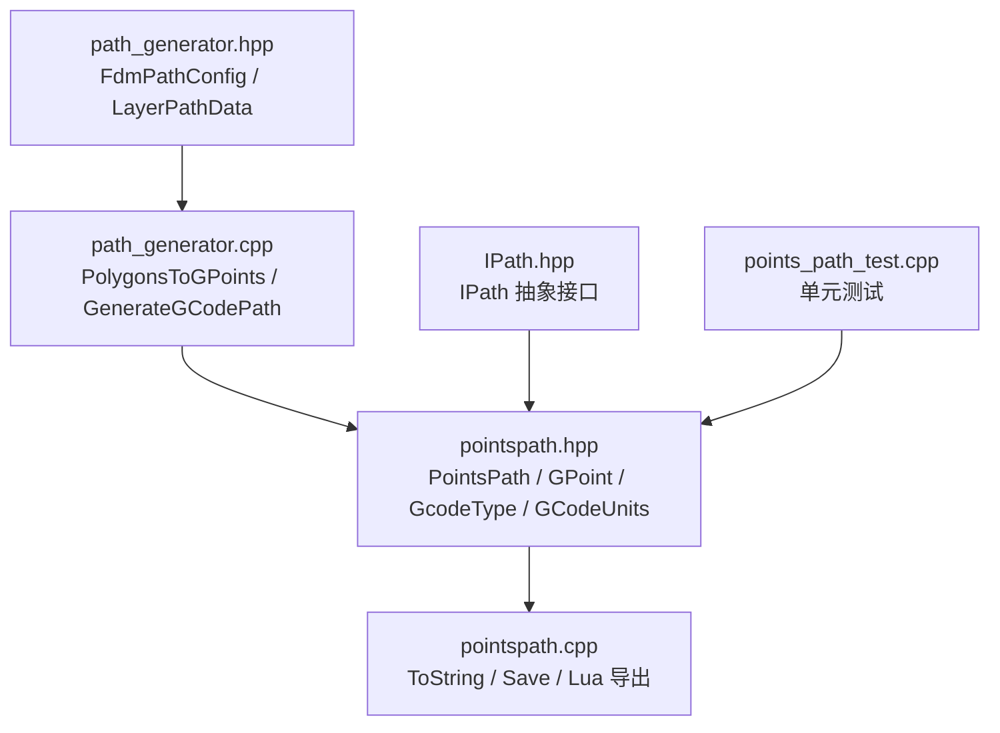
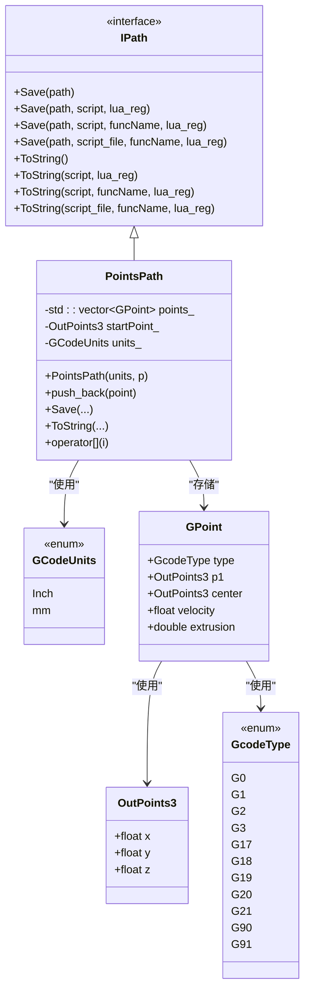
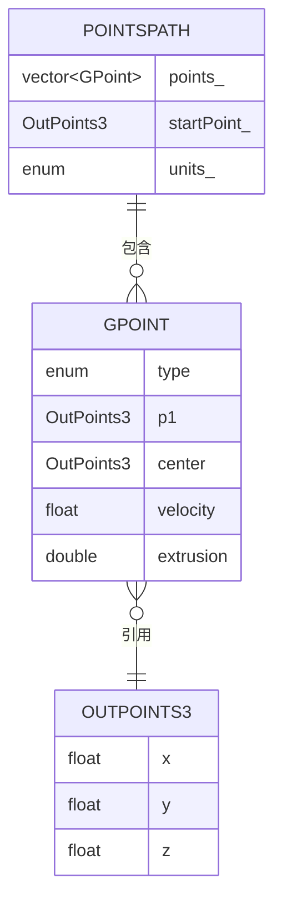
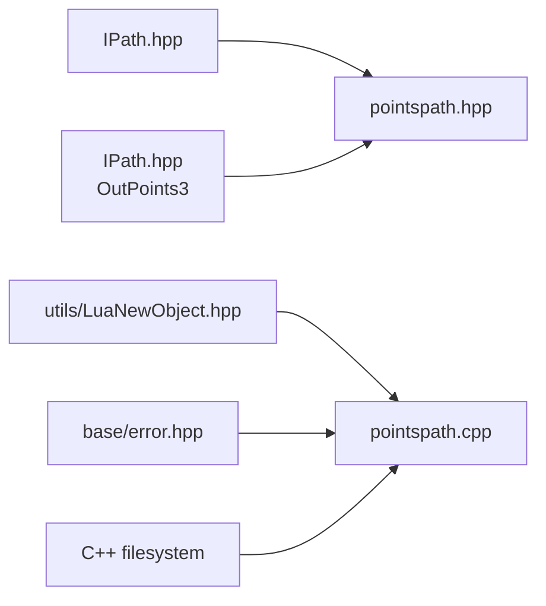

# PointsPath 路径类型

<cite>
**本文引用的文件**   
- [paths/pointspath.hpp](file://paths/pointspath.hpp)
- [paths/pointspath.cpp](file://paths/pointspath.cpp)
- [paths/IPath.hpp](file://paths/IPath.hpp)
- [LibHsBaSlicer/Path/path_generator.hpp](file://LibHsBaSlicer/Path/path_generator.hpp)
- [LibHsBaSlicer/Path/path_generator.cpp](file://LibHsBaSlicer/Path/path_generator.cpp)
- [tests/PathsOut/points_path_test.cpp](file://tests/PathsOut/points_path_test.cpp)
</cite>

## 目录
1. [简介](#简介)
2. [项目结构定位](#项目结构定位)
3. [核心概念](#核心概念)
4. [架构总览](#架构总览)
5. [详细组件分析](#详细组件分析)
6. [依赖关系分析](#依赖关系分析)
7. [性能与复杂度](#性能与复杂度)
8. [使用示例与最佳实践](#使用示例与最佳实践)
9. [故障排除](#故障排除)
10. [结论](#结论)
11. [附录：API 速查表](#附录api-速查表)

## 简介
PointsPath 是 HsBaSlicer 中基于“点序列”的 G-code 路径实现，用于把离散的 GPoint 运动指令按顺序保存为 G-code 文本。它继承自通用路径抽象 IPath，既支持原生 G-code 序列化，也支持通过 Lua 脚本进行后处理导出。该类型适合需要显式控制每个移动点、进给速度、挤出量以及圆弧插值的场景，例如 FDM 切片后的轮廓/填充/支撑路径生成、激光切割轨迹、3D 扫描路径回放等。

## 项目结构定位
PointsPath 位于 `paths` 模块，作为输出路径的一种具体实现；FDM 路径生成器会构造 GPoint 序列并写入 PointsPath，最终由 PointsPath 输出 G-code。

**图示来源**
- [LibHsBaSlicer/Path/path_generator.hpp:23-42](file://LibHsBaSlicer/Path/path_generator.hpp#L23-L42)
- [LibHsBaSlicer/Path/path_generator.cpp:14-94](file://LibHsBaSlicer/Path/path_generator.cpp#L14-L94)
- [paths/pointspath.hpp:22-93](file://paths/pointspath.hpp#L22-L93)
- [paths/pointspath.cpp:56-122](file://paths/pointspath.cpp#L56-L122)
- [paths/IPath.hpp:20-65](file://paths/IPath.hpp#L20-L65)
- [tests/PathsOut/points_path_test.cpp:14-42](file://tests/PathsOut/points_path_test.cpp#L14-L42)

**章节来源**
- [paths/pointspath.hpp:54-93](file://paths/pointspath.hpp#L54-L93)
- [paths/pointspath.cpp:56-122](file://paths/pointspath.cpp#L56-L122)
- [LibHsBaSlicer/Path/path_generator.hpp:23-42](file://LibHsBaSlicer/Path/path_generator.hpp#L23-L42)
- [LibHsBaSlicer/Path/path_generator.cpp:14-94](file://LibHsBaSlicer/Path/path_generator.cpp#L14-L94)

## 核心概念
- 点序列路径：PointsPath 内部维护一个 GPoint 向量，表示按时间顺序执行的移动指令集合。
- 坐标系统：使用 OutPoints3（x、y、z）表示目标位置；Z 通常表示构建高度。
- 单位：GCodeUnits 支持毫米和英寸；输出时会在 G-code 头部写入 G21/G20。
- 运动类型：GcodeType 支持快速移动 G0、直线 G1、顺时针圆弧 G2、逆时针圆弧 G3，以及平面选择 G17/G18/G19、单位设置 G20/G21、绝对/相对定位 G90/G91。
- 点属性：GPoint 包含运动类型、目标点 p1、圆弧中心 center、进给速度 velocity、挤出长度 extrusion。
- 起点：PointsPath 维护 startPoint_，在 ToString 中先输出一次快速移动到起点。
- 导出方式：原生 ToString 直接生成 G-code；带 Lua 参数的版本将 points、startPoint、units 暴露给脚本，脚本可返回字符串或设置全局 result。

**章节来源**
- [paths/pointspath.hpp:22-52](file://paths/pointspath.hpp#L22-L52)
- [paths/IPath.hpp:59-65](file://paths/IPath.hpp#L59-L65)
- [paths/pointspath.cpp:66-122](file://paths/pointspath.cpp#L66-L122)

## 架构总览
PointsPath 作为 IPath 的具体实现，承担“点序列到 G-code 文本”的转换职责；上层路径生成器负责从几何多边形生成 GPoint 序列，再写入 PointsPath。

**图示来源**
- [paths/IPath.hpp:20-65](file://paths/IPath.hpp#L20-L65)
- [paths/pointspath.hpp:22-93](file://paths/pointspath.hpp#L22-L93)

## 详细组件分析

### 数据结构与存储格式
- OutPoints3：三维输出点，x/y 为平面坐标，z 为构建高度。
- GPoint：单条 G-code 指令的数据载体，包含运动类型、目标点、圆弧中心、速度和挤出量。
- PointsPath：内部以 std::vector<GPoint> 存储点序列，同时记录起点和单位。

**图示来源**
- [paths/IPath.hpp:59-65](file://paths/IPath.hpp#L59-L65)
- [paths/pointspath.hpp:44-93](file://paths/pointspath.hpp#L44-L93)

**章节来源**
- [paths/IPath.hpp:59-65](file://paths/IPath.hpp#L59-L65)
- [paths/pointspath.hpp:44-93](file://paths/pointspath.hpp#L44-L93)

### 坐标系统与单位
- 坐标系统：OutPoints3 的 x/y/z 分别对应机器坐标系中的 X、Y、Z 轴；Z 常用于层高。
- 单位：GCodeUnits 决定输出 G-code 的单位头（mm 或 inch），默认单位为毫米。
- 定位模式：原生输出固定使用绝对定位 G90。

**章节来源**
- [paths/pointspath.hpp:37-42](file://paths/pointspath.hpp#L37-L42)
- [paths/pointspath.cpp:71-82](file://paths/pointspath.cpp#L71-L82)

### 点的属性定义
- 位置：p1 为目标点；center 用于圆弧运动的圆心/过渡点。
- 速度：velocity 为进给速度；当 velocity > 0 时才输出 F 字段。
- 挤出：extrusion 为挤出长度；非挤出移动通常为 0。
- 运动类型：G0/G1/G2/G3 等；其他设置码（如 G90）在原生输出中被跳过。

**章节来源**
- [paths/pointspath.hpp:22-52](file://paths/pointspath.hpp#L22-L52)
- [paths/pointspath.cpp:84-119](file://paths/pointspath.cpp#L84-L119)

### 路径插值与平滑
- 插值：G2/G3 支持圆弧插值，通过 center 指定圆弧中心；原生输出会写入 I/J/K 字段。
- 平滑：PointsPath 本身不做轨迹平滑或曲率优化；平滑应在上游几何阶段完成，或通过 Lua 脚本对 points 进行重采样与角度限制。

**章节来源**
- [paths/pointspath.cpp:100-114](file://paths/pointspath.cpp#L100-L114)

### 与其他路径类型的转换关系
- 与 GCodePath：GenerateGCodePathV2 和 GenerateGCodePathSpiral 返回 GCodePath，而 GenerateGCodePath 返回 PointsPath。两者都可用于 G-code 输出，但 PointsPath 更偏向“点序列”，GCodePath 更偏向“固件适配”。
- 与 RobotPath/WeldRobotPath：测试用例展示了机器人路径类型，但与 PointsPath 无直接继承关系；它们各自实现 IPath。

**章节来源**
- [LibHsBaSlicer/Path/path_generator.cpp:63-140](file://LibHsBaSlicer/Path/path_generator.cpp#L63-L140)
- [tests/PathsOut/points_path_test.cpp:85-129](file://tests/PathsOut/points_path_test.cpp#L85-L129)

### 路径质量评估指标
- 路径长度：可通过遍历 points_ 计算相邻点距离之和。
- 速度变化：检查 velocity 的突变，避免频繁加减速。
- 挤出连续性：检查 extrusion 是否单调递增且合理。
- 圆弧质量：检查 G2/G3 的 center 是否合理，避免过小半径或奇异圆弧。

[本节为通用指导，不直接分析具体文件]

### 碰撞检测机制
- PointsPath 不包含碰撞检测逻辑；碰撞检测应结合 CAD/网格模型在上游阶段完成，或在 Lua 脚本中根据外部几何信息进行校验。

[本节为通用指导，不直接分析具体文件]

### 实时路径更新策略
- PointsPath 提供 push_back 追加点；若需实时更新，可在运行时动态追加点，并在导出前执行必要的校验与优化。
- 对于高频更新场景，建议批量追加后再统一 ToString/Save，以减少重复序列化开销。

**章节来源**
- [paths/pointspath.hpp:70-71](file://paths/pointspath.hpp#L70-L71)
- [paths/pointspath.cpp:60-63](file://paths/pointspath.cpp#L60-L63)

### 与机器人控制系统的接口规范
- PointsPath 输出标准 G-code，适用于大多数 CNC/Laser/FDM 设备；如需特定机器人协议（如 ABB/KUKA/FANUC），可使用 RobotPath/WeldRobotPath 或自定义 Lua 脚本转换。
- 通信协议：本仓库未内置通信层；实际设备通信应由上层应用或驱动模块负责。

**章节来源**
- [tests/PathsOut/points_path_test.cpp:85-129](file://tests/PathsOut/points_path_test.cpp#L85-L129)

### 路径优化的最佳实践
- 在上游几何阶段完成路径简化、圆角过渡、拐角减速区规划。
- 使用 Lua 脚本对 points 进行重采样、速度曲线优化、挤出补偿。
- 对 G2/G3 圆弧进行半径下限检查，避免过小的圆弧导致机械抖动。

[本节为通用指导，不直接分析具体文件]

## 依赖关系分析
PointsPath 依赖 IPath 抽象、OutPoints3 坐标类型、Lua 环境（用于脚本导出）、文件系统（用于 Save）。

**图示来源**
- [paths/IPath.hpp:20-65](file://paths/IPath.hpp#L20-L65)
- [paths/pointspath.hpp:9-12](file://paths/pointspath.hpp#L9-L12)
- [paths/pointspath.cpp:7-18](file://paths/pointspath.cpp#L7-L18)

**章节来源**
- [paths/pointspath.cpp:7-18](file://paths/pointspath.cpp#L7-L18)

## 性能与复杂度
- 存储复杂度：O(n)，n 为点数。
- 序列化复杂度：O(n)，原生 ToString 线性遍历 points_。
- Lua 导出：每次调用都会创建新的 Lua 状态并注入 points/startPoint/units，存在额外开销；应避免在热路径中频繁调用。
- 内存分配：push_back 可能触发向量扩容；建议在已知规模时使用 reserve（由上层生成器负责）。

**章节来源**
- [paths/pointspath.cpp:66-122](file://paths/pointspath.cpp#L66-L122)
- [paths/pointspath.cpp:124-230](file://paths/pointspath.cpp#L124-L230)

## 使用示例与最佳实践

### 创建点序列并添加路径点
- 构造 PointsPath，指定单位和起点。
- 构造 GPoint，设置 type/p1/center/velocity/extrusion。
- 调用 push_back 追加点。

参考测试用例路径：
- [tests/PathsOut/points_path_test.cpp:14-42](file://tests/PathsOut/points_path_test.cpp#L14-L42)

### 执行路径操作（缩放、旋转、平移）
- PointsPath 不提供几何变换 API；应在上游几何阶段对 PolygonsD 进行变换，再生成 GPoint。
- 也可通过 Lua 脚本读取 points 并修改 p1/center 实现变换。

参考 Lua 导出流程：
- [paths/pointspath.cpp:124-230](file://paths/pointspath.cpp#L124-L230)

### 导出为标准格式
- 原生导出：ToString/Save 输出 G-code。
- Lua 脚本导出：传入脚本字符串或脚本文件，并可注册函数供脚本调用。

参考测试用例路径：
- [tests/PathsOut/points_path_test.cpp:259-337](file://tests/PathsOut/points_path_test.cpp#L259-L337)

### 与路径生成的集成
- 使用 PolygonsToGPoints 将多边形转换为 GPoint 序列。
- 使用 GenerateGCodePath 将多层数据合并为 PointsPath。

参考路径生成器：
- [LibHsBaSlicer/Path/path_generator.cpp:14-94](file://LibHsBaSlicer/Path/path_generator.cpp#L14-L94)

**章节来源**
- [tests/PathsOut/points_path_test.cpp:14-42](file://tests/PathsOut/points_path_test.cpp#L14-L42)
- [tests/PathsOut/points_path_test.cpp:259-337](file://tests/PathsOut/points_path_test.cpp#L259-L337)
- [LibHsBaSlicer/Path/path_generator.cpp:14-94](file://LibHsBaSlicer/Path/path_generator.cpp#L14-L94)

## 故障排除
- Lua 初始化失败：ToString(script, ...) 在 Lua 初始化失败时会抛出 RuntimeError。
- Lua 加载错误：脚本语法错误会返回“Lua load error”诊断字符串。
- Lua 运行错误：脚本运行时异常会返回“Lua runtime error”诊断字符串。
- 函数名不存在：使用 funcName 重载时，若未注册对应函数会抛出 RuntimeError。
- 脚本文件打开失败：读取脚本文件失败会抛出 RuntimeError。

**章节来源**
- [paths/pointspath.cpp:124-230](file://paths/pointspath.cpp#L124-L230)
- [paths/pointspath.cpp:247-346](file://paths/pointspath.cpp#L247-L346)
- [paths/pointspath.cpp:356-368](file://paths/pointspath.cpp#L356-L368)

## 结论
PointsPath 提供了轻量、可控的点序列路径能力，适合需要精细控制移动指令的场景。它与 IPath 抽象解耦，支持原生 G-code 与 Lua 脚本导出，便于扩展与定制。在实际工程中，建议在上游几何阶段完成路径优化与变换，再通过 PointsPath 输出稳定可靠的 G-code。

[本节为总结性内容，不直接分析具体文件]

## 附录：API 速查表

### 枚举与结构体
- GcodeType：G0/G1/G2/G3/G17/G18/G19/G20/G21/G90/G91
- GCodeUnits：Inch/mm
- GPoint：type/p1/center/velocity/extrusion
- OutPoints3：x/y/z

**章节来源**
- [paths/pointspath.hpp:22-52](file://paths/pointspath.hpp#L22-L52)
- [paths/IPath.hpp:59-65](file://paths/IPath.hpp#L59-L65)

### PointsPath 主要方法
- 构造函数：PointsPath(units, p)
- 追加点：push_back(GPoint)
- 访问点：operator
- 序列化：ToString() / ToString(script, lua_reg) / ToString(script, funcName, lua_reg) / ToString(script_file, funcName, lua_reg)
- 保存：Save(path) / Save(path, script, lua_reg) / Save(path, script, funcName, lua_reg) / Save(path, script_file, funcName, lua_reg)

**章节来源**
- [paths/pointspath.hpp:69-88](file://paths/pointspath.hpp#L69-L88)
- [paths/pointspath.cpp:56-122](file://paths/pointspath.cpp#L56-L122)
- [paths/pointspath.cpp:232-376](file://paths/pointspath.cpp#L232-L376)

### 路径生成相关
- PolygonsToGPoints(polys, z, config, is_extrude)：将多边形转为 GPoint 序列
- GenerateGCodePath(layer_data, config)：生成 PointsPath
- FdmPathConfig：layer_height/line_width/print_speed/travel_speed/extrusion_multiplier/units
- LayerPathData：outlines/fills/supports/z_height

**章节来源**
- [LibHsBaSlicer/Path/path_generator.hpp:23-42](file://LibHsBaSlicer/Path/path_generator.hpp#L23-L42)
- [LibHsBaSlicer/Path/path_generator.hpp:50-91](file://LibHsBaSlicer/Path/path_generator.hpp#L50-L91)
- [LibHsBaSlicer/Path/path_generator.cpp:14-94](file://LibHsBaSlicer/Path/path_generator.cpp#L14-L94)