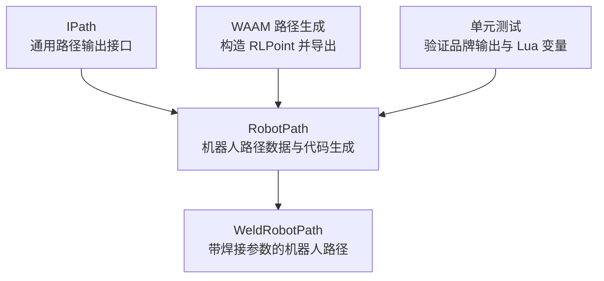
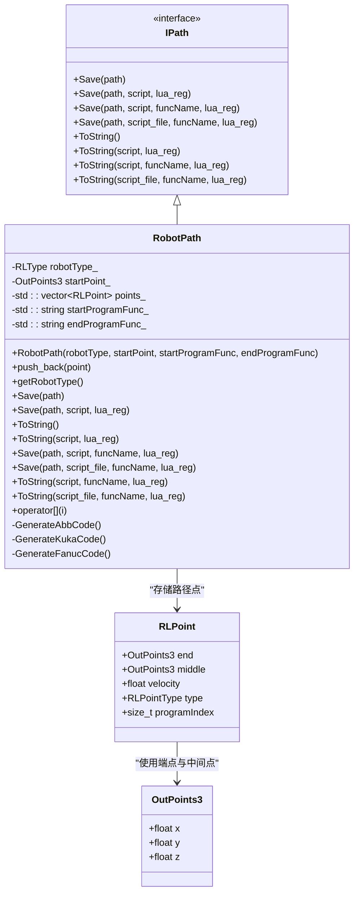
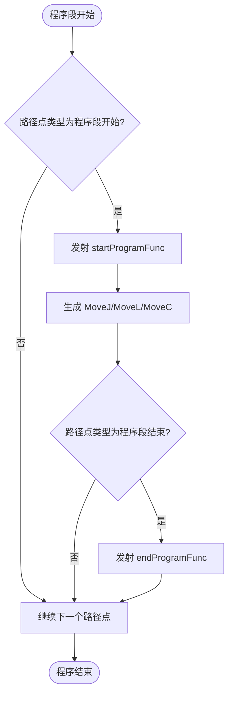
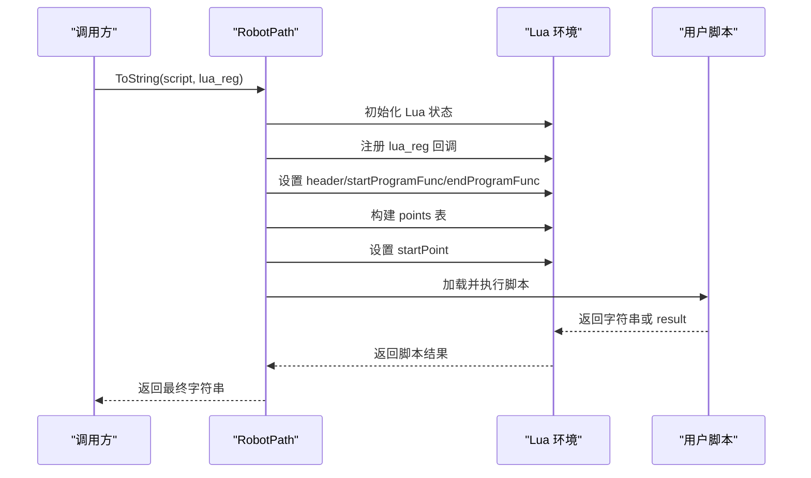

# RobotPath 基础类

<cite>
**本文引用的文件**   
- [paths/robotpath.hpp](file://paths/robotpath.hpp)
- [paths/robotpath.cpp](file://paths/robotpath.cpp)
- [paths/IPath.hpp](file://paths/IPath.hpp)
- [paths/weldrobotpath.hpp](file://paths/weldrobotpath.hpp)
- [paths/weldrobotpath.cpp](file://paths/weldrobotpath.cpp)
- [LibHsBaSlicer/Path/waam_export.cpp](file://LibHsBaSlicer/Path/waam_export.cpp)
- [tests/PathsOut/robot_path_test.cpp](file://tests/PathsOut/robot_path_test.cpp)
- [tests/PathsOut/points_path_test.cpp](file://tests/PathsOut/points_path_test.cpp)
</cite>

## 目录
1. [项目概述与快速开始](#项目概述与快速开始)
2. [架构总览](#架构总览)
3. [核心概念](#核心概念)
4. [核心模块详解](#核心模块详解)
5. [高级主题](#高级主题)
6. [Lua 脚本系统](#lua-脚本系统)
7. [API 参考文档](#api-参考文档)
8. [集成指南](#集成指南)
9. [开发·测试与贡献](#开发·测试与贡献)
10. [扩展开发指南](#扩展开发指南)
11. [示例与教程](#示例与教程)
12. [部署·故障排除与FAQ](#部署·故障排除与faq)
13. [附录](#附录)

## 项目概述与快速开始
RobotPath 是 HsBaSlicer 中面向工业机器人路径输出的基础数据结构。它继承自通用路径抽象接口 IPath，负责把一组机器人路径点序列转换成 ABB RAPID、KUKA KRL 或 FANUC TP 等品牌可执行的机器人程序文本；同时支持通过 Lua 脚本进行后处理，从而统一不同品牌的代码生成策略。

对于初学者，可以把 RobotPath 理解为“机器人路径清单”：你只需要准备起点、终点、中间点、速度和运动类型，然后选择目标机器人品牌，最终就能得到对应控制器的程序文本。对于工业工程师，RobotPath 提供了可扩展的代码生成入口、程序块头尾函数注入、以及基于 Lua 的自定义转换能力，适合用于增材制造、焊接、喷涂等需要多品牌机器人代码输出的场景。

快速开始要点：
- 创建 RobotPath 时指定目标机器人品牌、初始位置和程序头尾函数名。
- 使用 push_back 添加 RLPoint 路径点。
- 调用 Save 或 ToString 导出为字符串或文件。
- 如需自定义输出格式，传入 Lua 脚本和可选的注册回调。

**章节来源**
- [paths/robotpath.hpp:13-104](file://paths/robotpath.hpp#L13-L104)
- [paths/robotpath.cpp:60-113](file://paths/robotpath.cpp#L60-L113)

## 架构总览
RobotPath 处于路径输出层的核心位置。IPath 定义统一的保存与序列化接口；RobotPath 实现具体品牌代码生成；WeldRobotPath 在 RobotPath 基础上增加焊接参数；上层流程（例如 WAAM 路径生成）负责构造 RLPoint 并调用 RobotPath 导出。

**图表来源**
- [paths/IPath.hpp:20-57](file://paths/IPath.hpp#L20-L57)
- [paths/robotpath.hpp:61-104](file://paths/robotpath.hpp#L61-L104)
- [paths/weldrobotpath.hpp:65-96](file://paths/weldrobotpath.hpp#L65-L96)
- [LibHsBaSlicer/Path/waam_export.cpp:145-178](file://LibHsBaSlicer/Path/waam_export.cpp#L145-L178)
- [tests/PathsOut/robot_path_test.cpp:121-149](file://tests/PathsOut/robot_path_test.cpp#L121-L149)

**章节来源**
- [paths/IPath.hpp:20-57](file://paths/IPath.hpp#L20-L57)
- [paths/robotpath.hpp:61-104](file://paths/robotpath.hpp#L61-L104)
- [paths/weldrobotpath.hpp:65-96](file://paths/weldrobotpath.hpp#L65-L96)
- [LibHsBaSlicer/Path/waam_export.cpp:145-178](file://LibHsBaSlicer/Path/waam_export.cpp#L145-L178)

## 核心概念
### IPath 接口与 RobotPath 的关系
IPath 定义了所有路径输出类型的统一行为：保存到文件、序列化到字符串，以及可选的 Lua 后处理。RobotPath 继承该接口，因此可以像其他路径类型一样被上层流水线调用，同时内部根据 RLType 选择 ABB、KUKA 或 FANUC 的代码生成逻辑。

关键点：
- IPath 提供 Save 与 ToString 两套 API，均支持 Lua 脚本与函数名。
- RobotPath 将机器人路径点集合转换为品牌特定文本。
- 当未指定受支持的品牌时，默认导出会抛出异常，提示使用 Lua 脚本。

**章节来源**
- [paths/IPath.hpp:20-57](file://paths/IPath.hpp#L20-L57)
- [paths/robotpath.cpp:91-113](file://paths/robotpath.cpp#L91-L113)

### RLPoint 结构体设计
RLPoint 表示一个机器人路径点，包含以下字段：
- end：移动终点坐标。
- middle：中间点或过路点，主要用于圆弧 MoveC。
- velocity：移动速度，默认值为 DEFAULT_ROBOT_VELOCITY。
- type：运动或程序命令类型，由 RLPointType 枚举决定。
- programIndex：程序块索引，用于标记线性或圆弧程序段的起止配对。

RLPoint 的设计目标是兼顾简单性与扩展性：既可以直接表达直线、关节、圆弧运动，也可以通过 ProgramStart/ProgramLEnd/ProgramCEnd 等类型嵌入程序段边界，便于上层工具对路径进行分段管理。

**章节来源**
- [paths/robotpath.hpp:44-52](file://paths/robotpath.hpp#L44-L52)
- [paths/robotpath.hpp:19-32](file://paths/robotpath.hpp#L19-L32)

### RLType 与品牌代码生成策略
RLType 枚举当前支持三种主流机器人语言品牌：
- Abb：ABB RAPID 风格代码。
- Kuka：KUKA KRL 风格代码。
- Fanuc：FANUC TP 风格代码。
- Unknown/Undefine：未指定或显式未定义，默认导出会抛出异常。

每种品牌都有独立的 GenerateAbbCode、GenerateKukaCode、GenerateFanucCode 方法，分别处理：
- 起点初始化。
- 直线 MoveL、关节 MoveJ、圆弧 MoveC。
- 程序段 Start/End 标记。
- 速度与姿态参数映射。

**章节来源**
- [paths/robotpath.hpp:34-42](file://paths/robotpath.hpp#L34-L42)
- [paths/robotpath.cpp:227-305](file://paths/robotpath.cpp#L227-L305)
- [paths/robotpath.cpp:308-355](file://paths/robotpath.cpp#L308-L355)
- [paths/robotpath.cpp:358-403](file://paths/robotpath.cpp#L358-L403)

## 核心模块详解
### RobotPath 类结构与职责
RobotPath 维护以下私有状态：
- robotType_：目标机器人品牌。
- startPoint_：初始位置。
- points_：RLPoint 路径点序列。
- startProgramFunc_ / endProgramFunc_：程序头尾函数名。

公共接口包括：
- 构造函数：设置品牌、起点、程序头尾函数。
- push_back：追加路径点。
- getRobotType：获取目标品牌。
- Save/ToString：导出文件或字符串，支持 Lua 后处理。
- operator[]：按索引访问路径点。

**图表来源**
- [paths/IPath.hpp:20-57](file://paths/IPath.hpp#L20-L57)
- [paths/robotpath.hpp:44-104](file://paths/robotpath.hpp#L44-L104)

**章节来源**
- [paths/robotpath.hpp:61-104](file://paths/robotpath.hpp#L61-L104)
- [paths/robotpath.cpp:60-74](file://paths/robotpath.cpp#L60-L74)

### 路径点运动学约束检查
当前 RobotPath 的实现没有内置的运动学约束检查器。路径点的类型、速度和几何关系主要由上层生成器（如 WAAM 路径生成）负责构造；RobotPath 主要负责把这些点翻译成品牌代码。

这意味着：
- 如果 MoveC 的 middle 与 end 不合法，底层控制器可能报错。
- 速度值超出机器人范围时，品牌代码仍会生成，但实际运行需由控制器校验。
- 安全限制验证应放在上层路径规划或离线仿真阶段。

建议实践：
- 在上层生成 RLPoint 前进行几何合法性检查。
- 对 velocity 做范围裁剪，避免生成不可执行的速度指令。
- 对 ProgramStart/ProgramLEnd/ProgramCEnd 等程序块标记进行配对校验。

**章节来源**
- [paths/robotpath.cpp:227-305](file://paths/robotpath.cpp#L227-L305)
- [paths/robotpath.cpp:308-355](file://paths/robotpath.cpp#L308-L355)
- [paths/robotpath.cpp:358-403](file://paths/robotpath.cpp#L358-L403)

### 碰撞检测机制
RobotPath 本身不包含碰撞检测功能。碰撞检测通常由 CAD/几何模型层或离线仿真工具完成。RobotPath 的职责是输出机器人程序文本，而不是判断路径是否发生干涉。

若需要在 HsBaSlicer 中集成碰撞检测，推荐方式：
- 在路径生成阶段调用几何库检测轨迹与工件、夹具的干涉。
- 将检测结果反馈给上层路径优化器，调整 RLPoint 的位置或类型。
- 在 Lua 后处理阶段加入注释或警告，帮助调试人员定位问题。

**章节来源**
- [paths/robotpath.hpp:54-60](file://paths/robotpath.hpp#L54-L60)
- [paths/robotpath.cpp:91-113](file://paths/robotpath.cpp#L91-L113)

### 安全限制验证
RobotPath 的默认导出会根据品牌生成速度、姿态和程序段标记，但没有主动验证这些值是否符合具体机器人型号的安全限制。例如：
- ABB 代码中会使用最小、最大和高速度常量，但 velocity 仍由 RLPoint 提供。
- KUKA 与 FANUC 代码中也会直接写入速度或进给参数。

因此，安全限制验证应由上层配置或控制器侧完成。RobotPath 更适合承担“统一抽象 + 品牌翻译”的角色。

**章节来源**
- [paths/robotpath.cpp:21-24](file://paths/robotpath.cpp#L21-L24)
- [paths/robotpath.cpp:257-299](file://paths/robotpath.cpp#L257-L299)

## 高级主题
### 多品牌机器人代码生成的统一抽象
RobotPath 通过 RLType 分支选择品牌生成器，对外暴露统一的 Save/ToString 接口。这样上层代码不需要关心 ABB、KUKA、FANUC 的具体语法差异，只需操作 RLPoint 序列即可。

统一抽象的优势：
- 减少重复代码。
- 便于新增第四种机器人品牌。
- 便于用 Lua 脚本覆盖默认生成逻辑。

潜在风险：
- 品牌生成器过于简单时，可能无法覆盖复杂工艺。
- 程序块标记与品牌语法之间的映射需要谨慎维护。

**章节来源**
- [paths/robotpath.cpp:91-113](file://paths/robotpath.cpp#L91-L113)
- [paths/robotpath.cpp:227-305](file://paths/robotpath.cpp#L227-L305)
- [paths/robotpath.cpp:308-355](file://paths/robotpath.cpp#L308-L355)
- [paths/robotpath.cpp:358-403](file://paths/robotpath.cpp#L358-L403)

### 程序块头尾函数注入
RobotPath 支持 startProgramFunc_ 和 endProgramFunc_，用于在程序段开始和结束时插入用户自定义函数调用。这在焊接、喷涂、检测等场景中非常有用：
- 程序段开始时开启焊枪、激光或传感器。
- 程序段结束时关闭设备或记录结果。

**图表来源**
- [paths/robotpath.cpp:242-301](file://paths/robotpath.cpp#L242-L301)
- [paths/robotpath.cpp:315-352](file://paths/robotpath.cpp#L315-L352)
- [paths/robotpath.cpp:363-401](file://paths/robotpath.cpp#L363-L401)

**章节来源**
- [paths/robotpath.cpp:242-301](file://paths/robotpath.cpp#L242-L301)
- [paths/robotpath.cpp:315-352](file://paths/robotpath.cpp#L315-L352)
- [paths/robotpath.cpp:363-401](file://paths/robotpath.cpp#L363-L401)

### 与 WeldRobotPath 的关系
WeldRobotPath 继承 RobotPath，并在每个路径点上附加焊接参数。它复用 RobotPath 的品牌代码生成框架，同时增加焊接电流、电压、送丝速度、气体流量等参数。

这种设计让非焊接路径与焊接路径共享同一套 RLPoint 基础结构，同时允许上层工具按需扩展。

**章节来源**
- [paths/weldrobotpath.hpp:51-96](file://paths/weldrobotpath.hpp#L51-L96)
- [paths/weldrobotpath.cpp:56-104](file://paths/weldrobotpath.cpp#L56-L104)

## Lua 脚本系统
### Lua 后处理的作用
当调用带有 Lua 脚本的 Save 或 ToString 时，RobotPath 会创建一个 Lua 环境，并把路径数据注入全局变量，供脚本读取和转换。这种方式适合：
- 生成 CSV、JSON、XML 等非机器人语言格式。
- 对默认品牌代码进行二次加工。
- 动态选择品牌、速度、程序段标记。
- 输出调试信息或可视化数据。

### Lua 全局变量
RobotPath 向 Lua 脚本暴露以下全局变量：
- header：用户脚本标识头，用于提醒这是用户提供的脚本。
- startProgramFunc：程序段起始函数名。
- endProgramFunc：程序段结束函数名。
- points：路径点数组，每个元素包含 end、middle、velocity、type。
- startPoint：初始位置。
- funcName：当使用带函数名的 ToString 重载时可用。

注意：end 是 Lua 关键字，因此在脚本中访问时应使用表语法 `pt["end"]`。

**图表来源**
- [paths/robotpath.cpp:115-224](file://paths/robotpath.cpp#L115-L224)
- [paths/robotpath.cpp:406-493](file://paths/robotpath.cpp#L406-L493)

**章节来源**
- [paths/robotpath.cpp:115-224](file://paths/robotpath.cpp#L115-L224)
- [paths/robotpath.cpp:406-493](file://paths/robotpath.cpp#L406-L493)
- [tests/PathsOut/robot_path_test.cpp:132-149](file://tests/PathsOut/robot_path_test.cpp#L132-L149)
- [tests/PathsOut/points_path_test.cpp:131-162](file://tests/PathsOut/points_path_test.cpp#L131-L162)

### 自定义代码转换函数的实现方法
实现自定义转换函数时，建议遵循以下模式：
- 遍历 points 表，读取 pt["end"].x/y/z、pt.middle、pt.velocity、pt.type。
- 根据业务逻辑生成目标格式文本。
- 将结果赋值给 result 或直接返回字符串。
- 如需保留 header，可在脚本开头拼接 header。

示例思路（不展示具体代码内容）：
- 输入：points、startPoint、header。
- 处理：将 RLPoint 转换为 CSV 行或 JSON 对象。
- 输出：result 或 return 字符串。

**章节来源**
- [paths/robotpath.cpp:115-224](file://paths/robotpath.cpp#L115-L224)
- [tests/PathsOut/points_path_test.cpp:131-162](file://tests/PathsOut/points_path_test.cpp#L131-L162)

### 调试和验证工具
调试建议：
- 先用默认 ToString() 输出品牌代码，确认路径点和程序段标记是否正确。
- 再用 Lua 脚本输出 points 摘要，检查 end、middle、velocity、type 是否合理。
- 对未知品牌使用 Lua 脚本绕过默认导出，避免 NotSupportedError。
- 在单元测试中验证品牌输出关键字，例如 ABB 的 MOVEJ/MOVEL/MOVEC、KUKA 的 LIN/CIRC、FANUC 的 J/ARC。

**章节来源**
- [tests/PathsOut/robot_path_test.cpp:114-149](file://tests/PathsOut/robot_path_test.cpp#L114-L149)
- [tests/PathsOut/points_path_test.cpp:131-162](file://tests/PathsOut/points_path_test.cpp#L131-L162)

## API 参考文档
### RLType 品牌枚举
- Unknown：未指定品牌。
- Abb：ABB RAPID。
- Kuka：KUKA KRL。
- Fanuc：FANUC TP。
- Undefine：显式未定义。

默认导出时，Unknown 和 Undefine 会抛出异常，提示使用 Lua 脚本。

**章节来源**
- [paths/robotpath.hpp:34-42](file://paths/robotpath.hpp#L34-L42)
- [paths/robotpath.cpp:91-113](file://paths/robotpath.cpp#L91-L113)
- [tests/PathsOut/robot_path_test.cpp:121-130](file://tests/PathsOut/robot_path_test.cpp#L121-L130)

### RLPointType 运动与程序类型
- MoveJ：关节移动。
- MoveL：直线移动。
- MoveC：圆弧移动。
- ProgramStart：程序段开始。
- ProgramLStart：线性程序段开始。
- ProgramCStart：圆弧程序段开始。
- ProgramL：线性程序移动。
- ProgramC：圆弧程序移动。
- ProgramLEnd：线性程序段结束。
- ProgramCEnd：圆弧程序段结束。

**章节来源**
- [paths/robotpath.hpp:19-32](file://paths/robotpath.hpp#L19-L32)
- [paths/robotpath.cpp:27-54](file://paths/robotpath.cpp#L27-L54)

### RobotPath 主要 API
- 构造函数：设置机器人品牌、初始位置、程序头尾函数。
- push_back：添加 RLPoint。
- getRobotType：获取目标品牌。
- Save：保存到文件，支持 Lua 脚本与函数名。
- ToString：序列化字符串，支持 Lua 脚本与函数名。
- operator[]：按索引访问路径点。

**章节来源**
- [paths/robotpath.hpp:61-94](file://paths/robotpath.hpp#L61-L94)
- [paths/robotpath.cpp:60-89](file://paths/robotpath.cpp#L60-L89)

### IPath 通用接口
IPath 是所有路径输出类型的抽象基类，定义 Save 与 ToString 系列方法，支持：
- 原生格式保存。
- Lua 内联脚本后处理。
- Lua 脚本文件 + 函数名后处理。
- 自定义 Lua 注册回调。

**章节来源**
- [paths/IPath.hpp:20-57](file://paths/IPath.hpp#L20-L57)

## 集成指南
### 创建 RobotPath 对象
典型步骤：
1. 选择 RLType，例如 Abb、Kuka 或 Fanuc。
2. 设置 OutPoints3 作为初始位置。
3. 设置 startProgramFunc 和 endProgramFunc，用于程序段头尾。
4. 调用 push_back 添加 RLPoint。
5. 调用 Save 或 ToString 导出。

**章节来源**
- [paths/robotpath.hpp:64-72](file://paths/robotpath.hpp#L64-L72)
- [paths/robotpath.cpp:60-69](file://paths/robotpath.cpp#L60-L69)

### 添加机器人路径点
RLPoint 的基本用法：
- 设置 end 为移动终点。
- 如果是 MoveC，设置 middle 为圆弧过路点。
- 设置 velocity 为移动速度。
- 设置 type 为 MoveJ、MoveL 或 MoveC。
- 如果需要程序段标记，设置 programIndex 并使用 ProgramStart/ProgramLEnd/ProgramCEnd。

**章节来源**
- [paths/robotpath.hpp:44-52](file://paths/robotpath.hpp#L44-L52)
- [LibHsBaSlicer/Path/waam_export.cpp:145-166](file://LibHsBaSlicer/Path/waam_export.cpp#L145-L166)

### 配置初始位置和程序头尾函数
- startPoint_ 用于品牌代码中的初始位置。
- startProgramFunc_ 和 endProgramFunc_ 会在程序段开始和结束时插入函数调用。
- 这些值会传递给 Lua 脚本的全局变量，方便脚本动态处理。

**章节来源**
- [paths/robotpath.hpp:71-72](file://paths/robotpath.hpp#L71-L72)
- [paths/robotpath.cpp:136-140](file://paths/robotpath.cpp#L136-L140)

### 导出为不同品牌机器人的可执行代码
- 选择 RLType 为 Abb/Kuka/Fanuc。
- 调用 ToString() 获取品牌代码字符串。
- 调用 Save() 将字符串写入文件。
- 如需自定义格式，传入 Lua 脚本和可选的 lua_reg。

**章节来源**
- [paths/robotpath.cpp:91-113](file://paths/robotpath.cpp#L91-L113)
- [paths/robotpath.cpp:76-89](file://paths/robotpath.cpp#L76-L89)

## 开发·测试与贡献
### 单元测试覆盖
现有测试覆盖了：
- 品牌输出关键字：ABB、KUKA、FANUC。
- 未知品牌抛出 NotSupportedError。
- Lua 脚本能访问 points、startPoint、header。
- 使用 Lua 脚本输出路径点摘要。

**章节来源**
- [tests/PathsOut/robot_path_test.cpp:114-149](file://tests/PathsOut/robot_path_test.cpp#L114-L149)
- [tests/PathsOut/points_path_test.cpp:131-162](file://tests/PathsOut/points_path_test.cpp#L131-L162)

### 测试建议
- 新增品牌时，补充对应品牌的关键字断言。
- 对 Lua 脚本变量完整性进行测试，确保 end/middle/velocity/type/startPoint 存在。
- 对程序段标记进行配对测试，确保 ProgramStart 与 ProgramLEnd/ProgramCEnd 成对出现。

## 扩展开发指南
### 新增机器人品牌
要新增第四种机器人品牌，建议：
1. 在 RLType 中添加新枚举值。
2. 在 RobotPath 中实现新的 GenerateXxxCode 方法。
3. 在 ToString() 分支中处理新品牌。
4. 编写单元测试，验证输出关键字。
5. 如需 Lua 支持，确保新品牌不影响 Lua 全局变量注入。

**章节来源**
- [paths/robotpath.hpp:34-42](file://paths/robotpath.hpp#L34-L42)
- [paths/robotpath.cpp:91-113](file://paths/robotpath.cpp#L91-L113)

### 扩展 RLPoint 语义
如果需要在路径点中增加更多语义，例如：
- 姿态四元数或欧拉角。
- 工具坐标系编号。
- 工作坐标系编号。
- 工艺状态标志。

建议：
- 保持 RLPoint 向后兼容，新增字段带默认值。
- 在 Lua 注入逻辑中同步暴露新字段。
- 更新各品牌生成器以正确使用新字段。

**章节来源**
- [paths/robotpath.hpp:44-52](file://paths/robotpath.hpp#L44-L52)
- [paths/robotpath.cpp:142-175](file://paths/robotpath.cpp#L142-L175)

## 示例与教程
### 示例一：创建 RobotPath 并导出 ABR RAPID 代码
步骤：
1. 创建 RobotPath，RLType 设为 Abb。
2. 设置 startPoint 为初始位置。
3. 添加 MoveL 或 MoveJ 路径点。
4. 调用 ToString() 查看 ABB 代码。
5. 调用 Save() 写入文件。

**章节来源**
- [paths/robotpath.cpp:227-305](file://paths/robotpath.cpp#L227-L305)
- [tests/PathsOut/points_path_test.cpp:131-162](file://tests/PathsOut/points_path_test.cpp#L131-L162)

### 示例二：使用 Lua 脚本输出路径点摘要
步骤：
1. 创建 RobotPath 并添加若干 RLPoint。
2. 编写 Lua 脚本，遍历 points 表。
3. 读取 pt["end"].x/y/z、pt.velocity、pt.type。
4. 将结果赋给 result 或直接返回字符串。
5. 调用 ToString(script) 获取输出。

**章节来源**
- [paths/robotpath.cpp:115-224](file://paths/robotpath.cpp#L115-L224)
- [tests/PathsOut/points_path_test.cpp:131-162](file://tests/PathsOut/points_path_test.cpp#L131-L162)

### 示例三：结合 WAAM 路径生成
WAAM 路径生成器会构造 travel_point 和 weld point，设置 RLPointType 为 MoveJ 或 MoveL，然后调用 path.Save 导出。这展示了上层流程如何与 RobotPath 集成。

**章节来源**
- [LibHsBaSlicer/Path/waam_export.cpp:145-178](file://LibHsBaSlicer/Path/waam_export.cpp#L145-L178)

## 部署·故障排除与FAQ
### 常见问题
- 为什么默认 ToString() 抛出异常？  
  因为 RLType 为 Unknown 或 Undefine，默认导出不支持。解决方案：设置有效品牌或使用 Lua 脚本。

- 为什么 Lua 脚本中访问 end 字段报错？  
  end 是 Lua 关键字。请使用 `pt["end"]` 访问。

- 如何调试路径点数据？  
  使用 Lua 脚本输出 points 摘要，检查 end、middle、velocity、type 是否符合预期。

- 如何支持不在默认列表中的机器人品牌？  
  使用 Lua 脚本自定义输出，或在 RobotPath 中新增品牌生成器。

**章节来源**
- [paths/robotpath.cpp:91-113](file://paths/robotpath.cpp#L91-L113)
- [tests/PathsOut/robot_path_test.cpp:121-149](file://tests/PathsOut/robot_path_test.cpp#L121-L149)
- [tests/PathsOut/points_path_test.cpp:131-162](file://tests/PathsOut/points_path_test.cpp#L131-L162)

### 性能考虑
- RobotPath 的默认导出是顺序扫描 points_ 并拼接字符串，时间复杂度约为 O(n)。
- Lua 后处理会增加解释执行开销，适合离线生成而非实时循环。
- 大量路径点时，建议使用流式生成或分块导出。

[本节为通用指导，不直接分析具体文件]

### 实时路径更新策略
RobotPath 不是为高频实时路径更新设计的。它更适合作为离线路径规划结果的载体。若需要实时更新：
- 在上层维护路径缓冲区，批量更新 RLPoint。
- 使用 Lua 脚本增量生成差异代码。
- 将最终程序缓存并按需刷新。

[本节为通用指导，不直接分析具体文件]

## 附录
### 品牌代码生成差异概览
- ABB：使用 MOVEJ、MOVEL、MOVEC，配合速度区间和工作坐标系。
- KUKA：使用 LIN 与 CIRC，附带姿态参数。
- FANUC：使用 J 与 ARC，附带进给百分比和精度标记。

这些差异由 RobotPath 的内部生成器处理，上层只需关注 RLPoint 语义。

**章节来源**
- [paths/robotpath.cpp:227-305](file://paths/robotpath.cpp#L227-L305)
- [paths/robotpath.cpp:308-355](file://paths/robotpath.cpp#L308-L355)
- [paths/robotpath.cpp:358-403](file://paths/robotpath.cpp#L358-L403)

### 与主流控制系统接口规范
- ABB RAPID：模块、过程、移动指令、工具与工作坐标系。
- KUKA KRL：主程序、LIN/CIRC 指令、姿态坐标。
- FANUC TP：程序号、J/ARC 指令、进给与精度。

RobotPath 的输出是文本级接口，实际控制器兼容性还需结合具体机型和工艺参数。

**章节来源**
- [paths/robotpath.cpp:227-305](file://paths/robotpath.cpp#L227-L305)
- [paths/robotpath.cpp:308-355](file://paths/robotpath.cpp#L308-L355)
- [paths/robotpath.cpp:358-403](file://paths/robotpath.cpp#L358-L403)