# RobotPath 路径类型

<cite>
**本文引用的文件**   
- [IPath.hpp](file://paths/IPath.hpp)
- [robotpath.hpp](file://paths/robotpath.hpp)
- [robotpath.cpp](file://paths/robotpath.cpp)
- [weldrobotpath.hpp](file://paths/weldrobotpath.hpp)
- [weldrobotpath.cpp](file://paths/weldrobotpath.cpp)
- [waam_export.hpp](file://LibHsBaSlicer/Path/waam_export.hpp)
- [waam_export.cpp](file://LibHsBaSlicer/Path/waam_export.cpp)
- [waam_pipeline.h](file://DllHsBaSlicer/waam_pipeline.h)
- [waam_pipeline.cpp](file://DllHsBaSlicer/waam_pipeline.cpp)
- [hsba_slicer.cppm](file://ModuleHsBaSlicer/hsba_slicer.cppm)
- [hsba_pipeline.d.lua](file://types/hsba_pipeline.d.lua)
- [robot_path_test.cpp](file://tests/PathsOut/robot_path_test.cpp)
- [weld_robot_path_test.cpp](file://tests/PathsOut/weld_robot_path_test.cpp)
</cite>

## 目录
1. [项目概述与快速开始](#项目概述与快速开始)
2. [架构总览](#架构总览)
3. [核心概念](#核心概念)
4. [核心模块详解](#核心模块详解)
5. [高级主题](#高级主题)
6. [Lua 脚本系统](#lua-脚本系统)
7. [API 参考文档](#api-参考文档)
8. [集成指南](#集成指南)
9. [开发·测试与贡献](#开发·测试与贡献)
10. [扩展开发指南](#扩展开发指南)
11. [示例与教程](#示例与教程)
12. [部署·故障排除与FAQ](#部署·故障排除与faq)
13. [附录](#附录)

## 项目概述与快速开始

RobotPath 是 HsBaSlicer 中面向工业机器人路径输出的核心数据结构。它继承自通用路径抽象接口 IPath，负责把切片或工艺生成的几何轨迹转换为 ABB、KUKA、FANUC 等主流机器人控制器的可执行程序文本；WeldRobotPath 在其基础上增加焊接参数、起弧/收弧控制和焊缝段管理，用于 WAAM（丝弧增材制造）等需要热输入控制的工业场景。

对于初学者，可以把 RobotPath 理解为“带速度和运动类型的三维点序列”，而 WeldRobotPath 则是“带电流、电压、送丝速度、保护气体和起弧策略的焊接点序列”。对于工程师，它是连接几何路径与真实机器人控制器之间的格式转换层：上层提供路径点和工艺参数，底层生成品牌专用代码，并通过 Lua 脚本支持自定义导出逻辑。

快速理解要点：
- 基础路径类型：RLPoint，包含终点、中间点、速度、运动类型和程序块索引。
- 机器人品牌：RLType，当前内置支持 ABB、KUKA、FANUC，未知品牌需使用 Lua 脚本。
- 焊接路径类型：WeldRLPoint，在 RLPoint 基础上增加 WeldParam 和 isWelding 标志。
- 输出方式：Save 写入文件，ToString 返回字符串；两者都支持内联 Lua 脚本或外部脚本文件。
- 典型流程：模型切片 → 轮廓提取 → 构建 RobotPath/WeldRobotPath → 导出为机器人程序。

本节不直接分析具体源码实现，因此不提供章节来源。

## 架构总览

RobotPath 体系位于 `paths` 目录，向上通过 IPath 抽象接口暴露统一保存和序列化能力，向下由 RobotPath 和 WeldRobotPath 分别承担通用机器人路径和焊接机器人路径的实现。WAAM 流水线则作为上层调用方，将切片结果和焊接参数组合成 WaamRobotPackage，并最终调用 SaveWaamRobotPath 生成机器人程序。

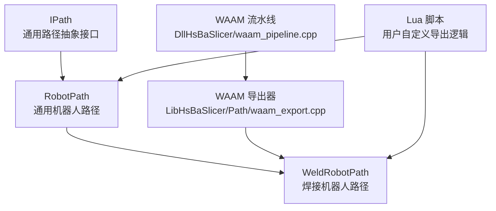

**图表来源**
- [IPath.hpp:20-57](file://paths/IPath.hpp#L20-L57)
- [robotpath.hpp:54-104](file://paths/robotpath.hpp#L54-L104)
- [weldrobotpath.hpp:59-96](file://paths/weldrobotpath.hpp#L59-L96)
- [waam_pipeline.cpp:232-258](file://DllHsBaSlicer/waam_pipeline.cpp#L232-L258)
- [waam_export.cpp:1-14](file://LibHsBaSlicer/Path/waam_export.cpp#L1-L14)

**章节来源**
- [IPath.hpp:20-57](file://paths/IPath.hpp#L20-L57)
- [robotpath.hpp:54-104](file://paths/robotpath.hpp#L54-L104)
- [weldrobotpath.hpp:59-96](file://paths/weldrobotpath.hpp#L59-L96)
- [waam_pipeline.cpp:232-258](file://DllHsBaSlicer/waam_pipeline.cpp#L232-L258)
- [waam_export.cpp:1-14](file://LibHsBaSlicer/Path/waam_export.cpp#L1-L14)

## 核心概念

### 通用路径抽象接口 IPath

IPath 是所有路径输出类型的共同基类，定义了统一的 Save 和 ToString 系列方法。其设计目标是让 PointsPath、LayersPath、ImagesPath、RobotPath、WeldRobotPath、GCodePath 等不同类型的路径产品都能以相同的方式被保存或序列化，并支持可选的 Lua 后处理步骤。

关键特性：
- Save 支持原生格式、内联脚本、带函数名的脚本、以及外部脚本文件。
- ToString 对应字符串序列化版本。
- Lua 注册回调允许向脚本环境注入额外函数。
- OutPoints3 是跨路径类型使用的三维输出点结构，包含 X、Y、Z。

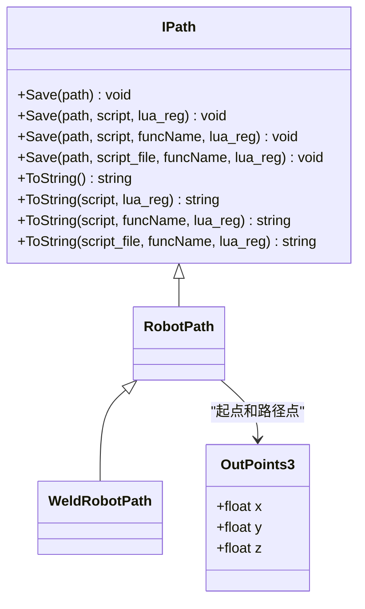

**图表来源**
- [IPath.hpp:20-65](file://paths/IPath.hpp#L20-L65)
- [robotpath.hpp:54-104](file://paths/robotpath.hpp#L54-L104)
- [weldrobotpath.hpp:59-96](file://paths/weldrobotpath.hpp#L59-L96)

**章节来源**
- [IPath.hpp:20-65](file://paths/IPath.hpp#L20-L65)

### 机器人路径数据模型

RobotPath 的数据模型围绕 RLPoint 展开。每个 RLPoint 表示一次机器人移动或程序块标记，包含：
- end：移动终点坐标。
- middle：中间点或过渡点，主要用于圆弧 MoveC。
- velocity：移动速度，默认值为 DEFAULT_ROBOT_VELOCITY。
- type：运动或程序命令类型。
- programIndex：用于程序块配对，例如线性程序段或圆形程序段的起止标记。

RLPointType 区分关节插补 MoveJ、直线插补 MoveL、圆弧插补 MoveC，以及程序块 ProgramStart、ProgramLStart、ProgramCStart、ProgramL、ProgramC、ProgramLEnd、ProgramCEnd。这种设计允许路径不仅描述几何轨迹，还能表达程序结构边界，便于在导出时插入起始/结束函数调用。

RLType 表示目标机器人语言品牌，包括 Unknown、Abb、Kuka、Fanuc、Undefine。Unknown 和 Undefine 不能直接生成原生代码，必须走 Lua 脚本路径。

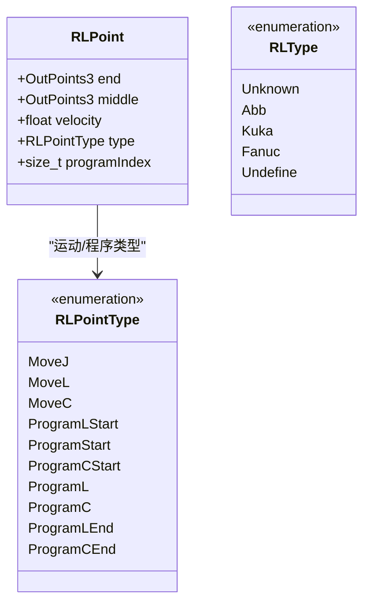

**图表来源**
- [robotpath.hpp:15-52](file://paths/robotpath.hpp#L15-L52)

**章节来源**
- [robotpath.hpp:15-52](file://paths/robotpath.hpp#L15-L52)

### 焊接路径数据模型

WeldRobotPath 在 RobotPath 之上增加焊接语义。WeldRLPoint 包含一个 RLPoint 和一个 WeldParam，并有一个 isWelding 布尔标志，表示该点是否处于焊缝段中。WeldParam 包含电流、电压、送丝速度、保护气体流量、行走速度、起弧电流、起弧电压、填坑电流、填坑电压、焊接工艺类型、收弧方式和焊道编号。

WeldProcessType 支持 MIG/MAG、TIG、Plasma、Laser；ArcEndType 支持 Normal、CraterFill、SlowRetract。这些字段使 WeldRobotPath 能够表达更真实的焊接过程，而不是单纯的几何轨迹。

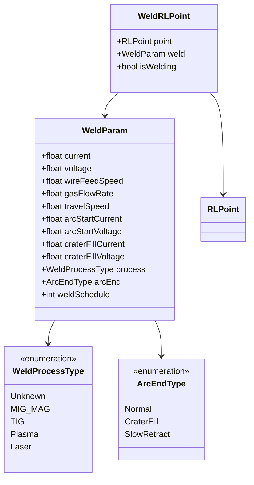

**图表来源**
- [weldrobotpath.hpp:16-57](file://paths/weldrobotpath.hpp#L16-L57)

**章节来源**
- [weldrobotpath.hpp:16-57](file://paths/weldrobotpath.hpp#L16-L57)

## 核心模块详解

### RobotPath 类设计与职责

RobotPath 是 IPath 的具体实现之一，主要职责包括：
- 维护目标机器人品牌 robotType_。
- 维护初始位置 startPoint_。
- 存储路径点序列 points_。
- 支持程序块起始和结束函数名 startProgramFunc_、endProgramFunc_。
- 根据 robotType_ 生成 ABB、KUKA 或 FANUC 程序文本。
- 支持 Lua 脚本导出，将路径点、起点、程序函数名注入 Lua 环境。

构造函数接受机器人类型、起点、起始程序函数名和结束程序函数名。push_back 追加 RLPoint。getRobotType 返回目标品牌。Save 和 ToString 系列方法覆盖 IPath 接口，内部委托到具体的 GenerateAbbCode、GenerateKukaCode、GenerateFanucCode。

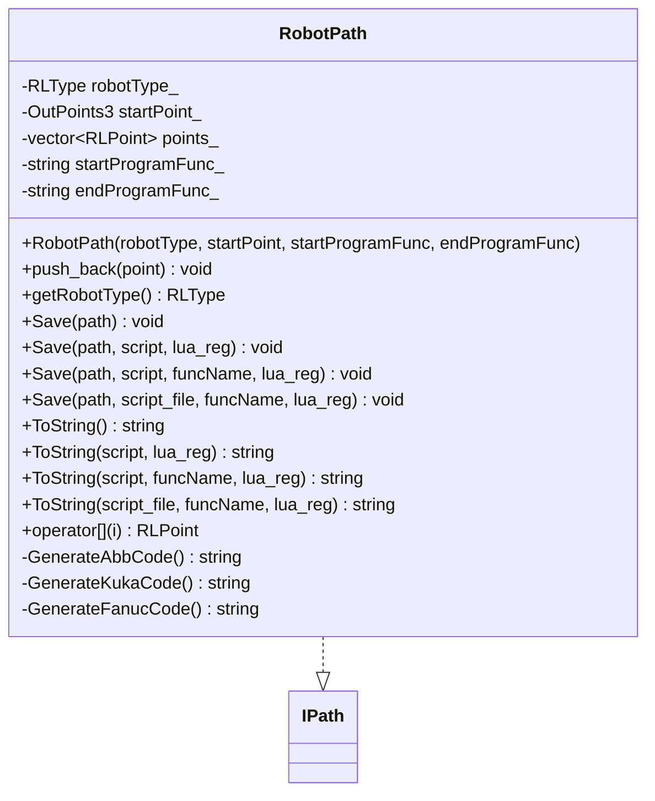

**图表来源**
- [robotpath.hpp:54-104](file://paths/robotpath.hpp#L54-L104)

**章节来源**
- [robotpath.hpp:54-104](file://paths/robotpath.hpp#L54-L104)
- [robotpath.cpp:60-113](file://paths/robotpath.cpp#L60-L113)

### WeldRobotPath 类设计与职责

WeldRobotPath 继承 RobotPath，新增 weldPoints_ 向量，专门记录带焊接参数的路径点。push_back(WeldRLPoint) 会同时把 WeldRLPoint.point 追加到底层 RobotPath.points_，以保持与通用 API 兼容。weldPoints() 暴露完整的焊接点列表。

ToString 根据 getRobotType() 选择 GenerateWeldAbbCode、GenerateWeldKukaCode 或 GenerateWeldFanucCode。Lua 导出时，points 表中的每个元素除了 end、middle、velocity、type 外，还包含 isWelding 和嵌套的 weld 参数表。

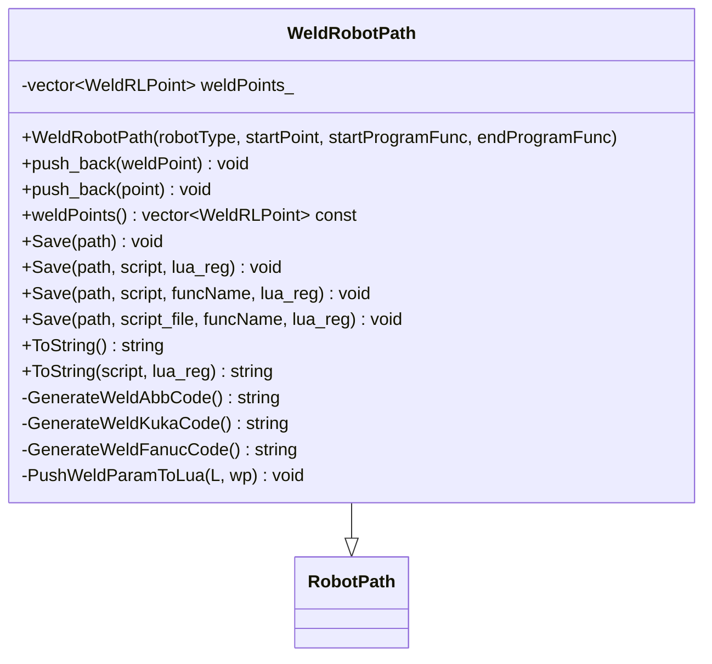

**图表来源**
- [weldrobotpath.hpp:59-96](file://paths/weldrobotpath.hpp#L59-L96)

**章节来源**
- [weldrobotpath.hpp:59-96](file://paths/weldrobotpath.hpp#L59-L96)
- [weldrobotpath.cpp:54-101](file://paths/weldrobotpath.cpp#L54-L101)

### 品牌代码生成流程

RobotPath 的 ToString 会根据 robotType_ 分支到不同品牌生成器。ABB 生成器输出 MODULE/PROC 结构和 MOVEJ/MOVEL/MOVEC 指令，并为程序块插入注释和自定义函数调用；KUKA 生成器输出 DEF main 和 LIN/CIRC 指令；FANUC 生成器输出 PR 定义、J/ARC 指令。

WeldRobotPath 的焊接生成器会在 isWelding 状态机下插入起弧、连续焊接、收弧逻辑，并根据 ArcEndType 决定是否填充焊坑。非焊接点仍按 RLPointType 生成 MoveJ/MoveL/MoveC。

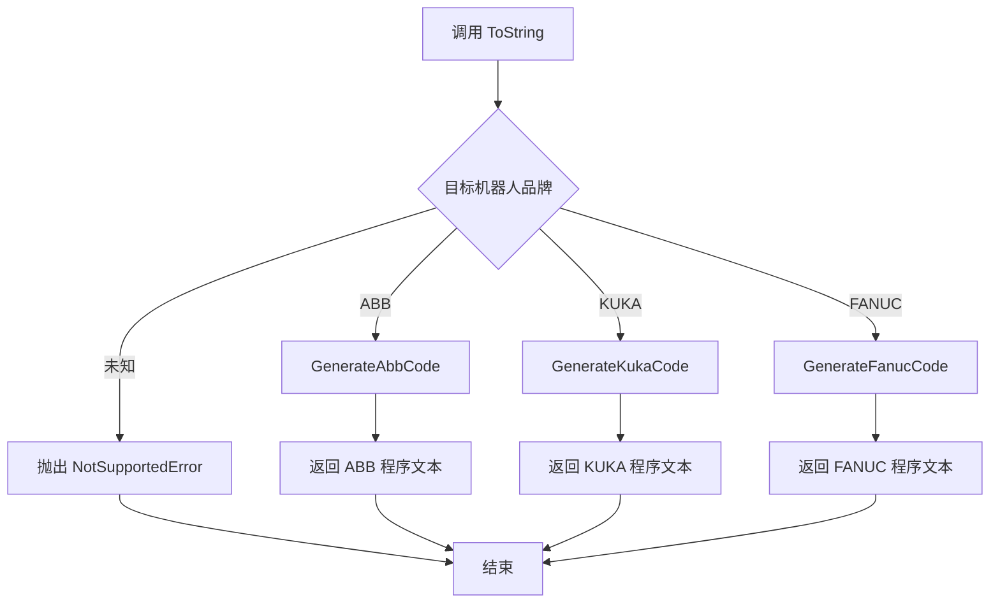

**图表来源**
- [robotpath.cpp:91-113](file://paths/robotpath.cpp#L91-L113)
- [robotpath.cpp:227-404](file://paths/robotpath.cpp#L227-L404)

**章节来源**
- [robotpath.cpp:91-113](file://paths/robotpath.cpp#L91-L113)
- [robotpath.cpp:227-404](file://paths/robotpath.cpp#L227-L404)

### 焊接状态机与程序块控制

WeldRobotPath 在生成 ABB/KUKA/FANUC 焊接程序时，维护 arcActive 状态，判断当前点是否为焊接点，以及下一个点是否继续焊接。若从非焊接进入焊接，则插入起弧指令；若从焊接进入非焊接或最后一个焊接点，则插入收弧指令；否则输出连续焊接移动。

程序块控制方面，RLPointType 中的 ProgramStart、ProgramLStart、ProgramCStart、ProgramLEnd、ProgramCEnd 用于在路径中插入 startProgramFunc_ 和 endProgramFunc_，从而支持分段程序结构。

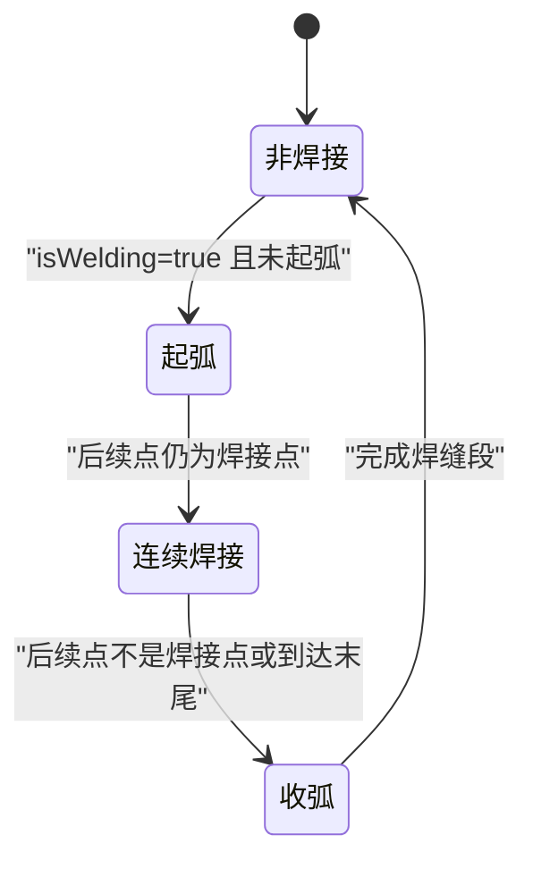

**图表来源**
- [weldrobotpath.cpp:236-304](file://paths/weldrobotpath.cpp#L236-L304)
- [weldrobotpath.cpp:319-393](file://paths/weldrobotpath.cpp#L319-L393)
- [weldrobotpath.cpp:423-479](file://paths/weldrobotpath.cpp#L423-L479)

**章节来源**
- [weldrobotpath.cpp:236-304](file://paths/weldrobotpath.cpp#L236-L304)
- [weldrobotpath.cpp:319-393](file://paths/weldrobotpath.cpp#L319-L393)
- [weldrobotpath.cpp:423-479](file://paths/weldrobotpath.cpp#L423-L479)

## 高级主题

### 坐标系系统与姿态表示

当前 RobotPath 使用 OutPoints3 表示位置，包含 X、Y、Z。在 ABB 生成器中，位置被写成 `[x,y,z,0.0,0.0,0.0]`，即欧拉角或姿态分量固定为零；KUKA 生成器使用 `{X,Y,Z,A,B,C}`，姿态同样固定为零；FANUC 生成器使用 P[索引] 引用示教点位，姿态由控制器点位数据决定。

这意味着 RobotPath 本身并不维护完整六自由度姿态，而是依赖下游控制器点位数据或用户脚本补充姿态信息。对于需要精确姿态控制的焊接应用，通常应在 CAD 或离线编程阶段确定姿态，或在 Lua 脚本中根据工艺需求动态调整。

本节为概念性说明，不直接分析具体源码实现，因此不提供章节来源。

### 运动学约束与路径平滑

RobotPath 的 RLPointType 提供 MoveJ、MoveL、MoveC，分别对应关节插补、直线插补和圆弧插补。这反映了机器人运动学的基本分类，但 RobotPath 本身不做逆解、关节限位检查、奇异点检测或路径平滑优化。路径平滑和插值更多属于上游路径规划器或离线编程工具的职责。

在实际工程中，建议：
- 使用 MoveL 保证焊缝直线段精度。
- 使用 MoveC 配合 middle 点生成圆弧过渡。
- 使用 MoveJ 进行快速空行程移动。
- 对复杂曲面路径，先在 CAD 或专用路径规划器中生成满足机器人运动学约束的点列，再导入 HsBaSlicer 导出。

本节为概念性说明，不直接分析具体源码实现，因此不提供章节来源。

### 碰撞检测与安全约束

当前 RobotPath 和 WeldRobotPath 没有内置碰撞检测、工作空间限制检查或安全区域验证。它们专注于路径数据结构和程序文本生成。碰撞检测和安全约束应由以下层面处理：
- 离线仿真软件：在导入机器人程序前进行碰撞和可达性检查。
- 控制器侧：启用防碰撞、软限位、工具偏移、工件坐标系校验。
- 用户脚本：在 Lua 导出阶段对路径点进行过滤、重排序或添加安全点。

本节为概念性说明，不直接分析具体源码实现，因此不提供章节来源。

### 实时路径更新策略

RobotPath 和 WeldRobotPath 是批处理数据结构，不是实时控制器通信协议栈。实时路径更新通常由机器人控制器的在线示教、远程程序编辑、或上位机与控制器之间的通信协议完成。HsBaSlicer 的 RobotPath 更适合“离线生成程序文本，再传输到控制器”的流程。

如果需要实时路径更新，应结合：
- 控制器提供的 API 或通信协议。
- 上层应用的路径缓存和增量更新机制。
- 路径验证和回滚策略，防止错误路径下发。

本节为概念性说明，不直接分析具体源码实现，因此不提供章节来源。

## Lua 脚本系统

RobotPath 和 WeldRobotPath 都支持通过 Lua 脚本自定义导出逻辑。当提供脚本时，系统会创建独立的 Lua 虚拟机，加载标准库，可选注册自定义函数，然后注入 header、points、startPoint、funcName、startProgramFunc、endProgramFunc 等全局变量。

### RobotPath Lua 环境

RobotPath 的 Lua 导出提供：
- header：标识脚本模式的全局字符串。
- startPoint：起点 OutPoints3 对应的 Lua table。
- points：RLPoint 数组，每个元素包含 end、middle、velocity、type。
- funcName：当使用带函数名的 ToString/Save 重载时可用。
- startProgramFunc、endProgramFunc：程序块起始和结束函数名。

脚本可以返回字符串，也可以设置全局 result。如果既没有返回值也没有 result，则返回空字符串。

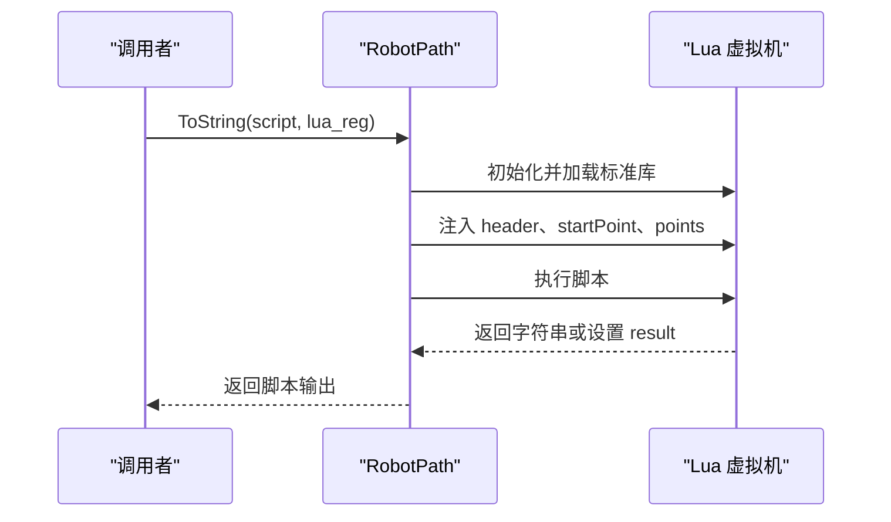

**图表来源**
- [robotpath.cpp:115-225](file://paths/robotpath.cpp#L115-L225)
- [robotpath.cpp:406-493](file://paths/robotpath.cpp#L406-L493)

**章节来源**
- [robotpath.cpp:115-225](file://paths/robotpath.cpp#L115-L225)
- [robotpath.cpp:406-493](file://paths/robotpath.cpp#L406-L493)

### WeldRobotPath Lua 环境

WeldRobotPath 的 Lua 导出提供：
- header：标识焊接脚本模式的全局字符串。
- points：WeldRLPoint 数组，每个元素包含 end、middle、velocity、type、isWelding、weld。
- weld 表包含 current、voltage、wireFeedSpeed、gasFlowRate、travelSpeed、arcStartCurrent、arcStartVoltage、craterFillCurrent、craterFillVoltage、process、arcEnd、weldSchedule。

注意：由于 Lua 关键字限制，访问点的终点字段需要使用 `points[i]["end"]`，而不是 `points[i].end`。

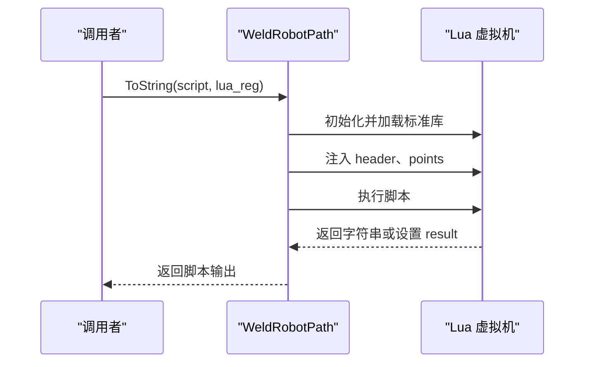

**图表来源**
- [weldrobotpath.cpp:103-194](file://paths/weldrobotpath.cpp#L103-L194)

**章节来源**
- [weldrobotpath.cpp:103-194](file://paths/weldrobotpath.cpp#L103-L194)

### Lua 脚本错误处理

Lua 脚本加载失败或运行时错误会被包装为 RuntimeError。常见错误包括语法错误、运行时 error 调用、脚本文件无法打开等。测试用例覆盖了 load error、runtime error、result 全局变量、空返回值、funcName 注入和 lua_reg 回调。

**章节来源**
- [robotpath.cpp:187-200](file://paths/robotpath.cpp#L187-L200)
- [robotpath.cpp:457-468](file://paths/robotpath.cpp#L457-L468)
- [robotpath.cpp:498-506](file://paths/robotpath.cpp#L498-L506)
- [robot_path_test.cpp:183-191](file://tests/PathsOut/robot_path_test.cpp#L183-L191)
- [weld_robot_path_test.cpp:110-113](file://tests/PathsOut/weld_robot_path_test.cpp#L110-L113)

## API 参考文档

### RobotPath API

| 成员 | 类型 | 说明 |
| --- | --- | --- |
| 构造函数 | `RobotPath(RLType robotType = RLType::Unknown, OutPoints3 startPoint = {}, std::string startProgramFunc = "", std::string endProgramFunc = "")` | 创建机器人路径，指定目标品牌、起点和程序块函数名 |
| push_back | `void push_back(const RLPoint& point)` | 追加通用机器人路径点 |
| getRobotType | `RLType getRobotType() const` | 获取目标机器人品牌 |
| Save | `void Save(const std::filesystem::path&) const` | 保存为原生品牌程序文本 |
| Save | `void Save(const std::filesystem::path&, std::string_view script, const std::function<void(lua_State*)>& lua_reg = {}) const` | 使用内联 Lua 脚本保存 |
| Save | `void Save(const std::filesystem::path& path, std::string_view script, std::string_view funcName, const std::function<void(lua_State*)>& lua_reg = {}) const` | 使用内联脚本和函数名保存 |
| Save | `void Save(const std::filesystem::path& path, const std::filesystem::path& script_file, std::string_view funcName, const std::function<void(lua_State*)>& lua_reg = {}) const` | 使用外部脚本文件保存 |
| ToString | `std::string ToString() const` | 返回原生品牌程序文本 |
| ToString | `std::string ToString(std::string_view script, const std::function<void(lua_State*)>& lua_reg = {}) const` | 使用内联 Lua 脚本序列化 |
| ToString | `std::string ToString(std::string_view script, const std::string_view funcName, const std::function<void(lua_State*)>& lua_reg = {}) const` | 使用内联脚本和函数名序列化 |
| ToString | `std::string ToString(const std::filesystem::path& script_file, const std::string_view funcName, const std::function<void(lua_State*)>& lua_reg = {}) const` | 使用外部脚本文件序列化 |
| operator[] | `inline virtual RLPoint operator` | 按索引访问路径点 |

**章节来源**
- [robotpath.hpp:61-104](file://paths/robotpath.hpp#L61-L104)

### WeldRobotPath API

| 成员 | 类型 | 说明 |
| --- | --- | --- |
| 构造函数 | `WeldRobotPath(RLType robotType = RLType::Unknown, OutPoints3 startPoint = {}, std::string startProgramFunc = "", std::string endProgramFunc = "")` | 创建焊接机器人路径 |
| push_back | `void push_back(const WeldRLPoint& weldPoint)` | 追加带焊接参数的路径点 |
| push_back | `void push_back(const RLPoint& point)` | 继承的通用路径点追加 |
| weldPoints | `const std::vector<WeldRLPoint>& weldPoints() const` | 获取所有焊接点 |
| Save | `void Save(const std::filesystem::path&) const` | 保存焊接程序文本 |
| Save | `void Save(const std::filesystem::path&, std::string_view script, const std::function<void(lua_State*)>& lua_reg = {}) const` | 使用内联 Lua 脚本保存 |
| Save | `void Save(const std::filesystem::path& path, std::string_view script, std::string_view funcName, const std::function<void(lua_State*)>& lua_reg = {}) const` | 使用内联脚本和函数名保存 |
| Save | `void Save(const std::filesystem::path& path, const std::filesystem::path& script_file, std::string_view funcName, const std::function<void(lua_State*)>& lua_reg = {}) const` | 使用外部脚本文件保存 |
| ToString | `std::string ToString() const` | 返回焊接程序文本 |
| ToString | `std::string ToString(std::string_view script, const std::function<void(lua_State*)>& lua_reg = {}) const` | 使用内联 Lua 脚本序列化 |

**章节来源**
- [weldrobotpath.hpp:65-96](file://paths/weldrobotpath.hpp#L65-L96)

### 数据类型参考

| 类型 | 字段 | 单位或含义 |
| --- | --- | --- |
| OutPoints3 | x、y、z | 三维坐标 |
| RLPoint | end、middle | 终点和中间点坐标 |
| RLPoint | velocity | 移动速度，默认 100.0f |
| RLPoint | type | 运动或程序块类型 |
| RLPoint | programIndex | 程序块索引 |
| WeldParam | current | 焊接电流，单位安培 |
| WeldParam | voltage | 电弧电压，单位伏特 |
| WeldParam | wireFeedSpeed | 送丝速度，单位米每分钟 |
| WeldParam | gasFlowRate | 保护气体流量，单位升每分钟 |
| WeldParam | travelSpeed | 焊枪行走速度，单位毫米每秒 |
| WeldParam | arcStartCurrent | 起弧电流 |
| WeldParam | arcStartVoltage | 起弧电压 |
| WeldParam | craterFillCurrent | 填坑电流 |
| WeldParam | craterFillVoltage | 填坑电压 |
| WeldParam | process | 焊接工艺类型 |
| WeldParam | arcEnd | 收弧方式 |
| WeldParam | weldSchedule | 焊道编号 |

**章节来源**
- [IPath.hpp:59-65](file://paths/IPath.hpp#L59-L65)
- [robotpath.hpp:15-52](file://paths/robotpath.hpp#L15-L52)
- [weldrobotpath.hpp:34-57](file://paths/weldrobotpath.hpp#L34-L57)

## 集成指南

### 与 WAAM 流水线的集成

WAAM 流水线是 RobotPath 的典型上层消费者。它先执行预处理、切片，再进入机器人路径导出阶段。导出阶段将层轮廓、层高、焊道宽度、机器人类型、焊接参数、螺旋模式和输出路径组装成 WaamRobotPackage，然后调用 SaveWaamRobotPath。

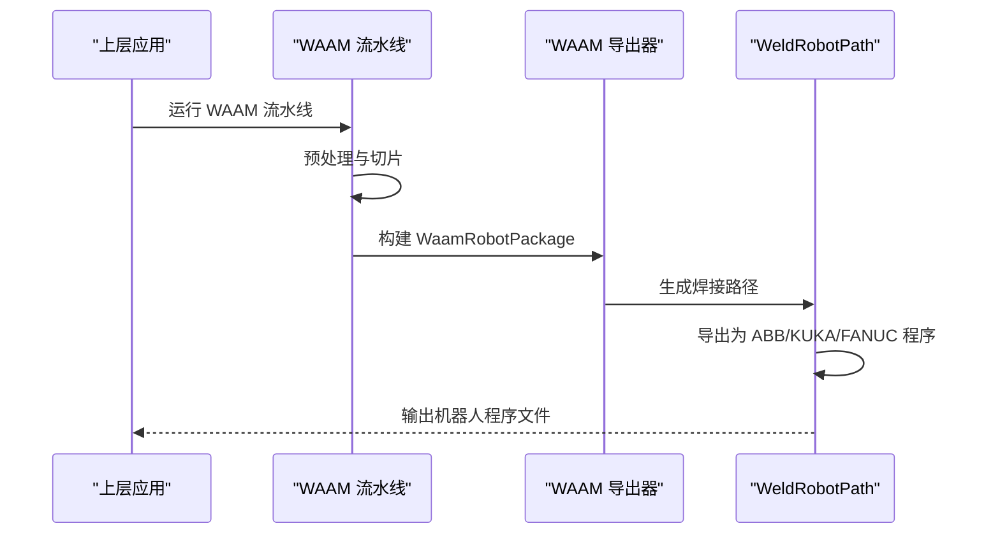

**图表来源**
- [waam_pipeline.cpp:232-258](file://DllHsBaSlicer/waam_pipeline.cpp#L232-L258)
- [waam_export.cpp:1-14](file://LibHsBaSlicer/Path/waam_export.cpp#L1-L14)

**章节来源**
- [waam_pipeline.cpp:232-258](file://DllHsBaSlicer/waam_pipeline.cpp#L232-L258)
- [waam_export.cpp:1-14](file://LibHsBaSlicer/Path/waam_export.cpp#L1-L14)

### 与主流机器人控制系统的接口规范

当前内置支持：
- ABB：RAPID 风格程序，包含 MODULE、PROC、MOVEJ、MOVEL、MOVEC，以及 WeldData、SeamData、WeaveData 常量占位。
- KUKA：KRL 风格程序，包含 DEF main、LIN、CIRC，以及 ARC_Init、ARC_On、ARC_Off 等焊接技术包调用。
- FANUC：TP 风格程序，包含 /PROG、/MN、J/L/ARC 指令，以及 Schedule 编号。

需要注意：
- 内置代码是简化模板，实际控制器型号、工具坐标系、工件坐标系、焊枪配置可能不同。
- 未知机器人品牌必须使用 Lua 脚本自定义导出。
- 焊接程序中的常量、寄存器、程序号、点位编号通常需要结合实际设备调整。

**章节来源**
- [robotpath.cpp:227-404](file://paths/robotpath.cpp#L227-L404)
- [weldrobotpath.cpp:225-481](file://paths/weldrobotpath.cpp#L225-L481)

### 通信协议支持

RobotPath 本身不实现 ABB、KUKA、FANUC 的实时通信协议。它生成的是控制器可识别的程序文本，而非在线通信消息。若需要与控制器通信，应使用控制器厂商提供的 SDK、API 或通信协议，例如：
- ABB：RobotStudio、RAPID 程序上传、LiveLink。
- KUKA：KRC 程序传输、KSS API。
- FANUC：TP 程序编辑、PC Loader、FOCAS。

HsBaSlicer 的 RobotPath 适合离线生成程序，再由其他工具或上层应用传输到控制器。

本节为概念性说明，不直接分析具体源码实现，因此不提供章节来源。

## 开发·测试与贡献

### 单元测试覆盖

RobotPath 的测试覆盖：
- 获取机器人品牌和索引访问。
- 原生 ABB 代码覆盖所有 RLPointType。
- 原生 KUKA 代码覆盖 LIN 和 CIRC。
- 原生 FANUC 代码覆盖 J 和 ARC。
- 未知品牌抛出 NotSupportedError。
- Lua 脚本可见 points、startPoint、header、funcName。
- Lua result 全局变量和空返回值。
- Save 所有变体：原生、内联脚本、函数名、外部脚本文件。
- 脚本文件读取和缺失文件异常。

WeldRobotPath 的测试覆盖：
- 焊接点存储和转发。
- 每品牌 ToString 输出。
- Save 写入生成程序。
- Lua 脚本可见焊接点、isWelding、weld 参数。
- Lua 加载和运行时错误包装为 RuntimeError。

**章节来源**
- [robot_path_test.cpp:53-130](file://tests/PathsOut/robot_path_test.cpp#L53-L130)
- [robot_path_test.cpp:132-253](file://tests/PathsOut/robot_path_test.cpp#L132-L253)
- [weld_robot_path_test.cpp:36-75](file://tests/PathsOut/weld_robot_path_test.cpp#L36-L75)
- [weld_robot_path_test.cpp:77-113](file://tests/PathsOut/weld_robot_path_test.cpp#L77-L113)

### 构建与运行建议

- 使用 CMake 构建 HsBaSlicer 工程。
- 运行 PathsOut 相关测试验证 RobotPath 和 WeldRobotPath。
- 如需调试 Lua 导出，可在测试中临时打印 header、points、result。
- 修改品牌代码生成器时，优先更新对应测试断言。

本节为通用开发建议，不直接分析具体源码实现，因此不提供章节来源。

## 扩展开发指南

### 自定义机器人品牌导出

要支持新机器人品牌，推荐两种方式：
1. 扩展 RobotPath 的品牌枚举和生成器，新增 GenerateXXXCode 方法。
2. 保持 RLType::Unknown，通过 Lua 脚本完全自定义导出逻辑。

第二种方式更灵活，适合尚未内置的品牌或特殊控制器方言。Lua 脚本可以访问 points、startPoint、header、funcName、startProgramFunc、endProgramFunc，并通过 lua_reg 注入自定义函数。

### 自定义焊接工艺

WeldParam 已覆盖常见焊接参数，但若需要新增工艺字段，应同步修改：
- WeldParam 结构。
- PushWeldParamToLua。
- 各品牌焊接代码生成器。
- 上层 WAAM 导出器和协议映射。

**章节来源**
- [weldrobotpath.cpp:196-223](file://paths/weldrobotpath.cpp#L196-L223)
- [waam_export.cpp:38-54](file://LibHsBaSlicer/Path/waam_export.cpp#L38-L54)

## 示例与教程

### 创建通用机器人路径

典型步骤：
1. 创建 RobotPath，指定 RLType 和起点。
2. 构造 RLPoint，设置 end、middle、velocity、type、programIndex。
3. 多次 push_back 加入路径点。
4. 调用 ToString 查看程序文本，或调用 Save 写入文件。
5. 如需自定义导出，传入 Lua 脚本或脚本文件。

参考测试用例：
- [robot_path_test.cpp:53-66](file://tests/PathsOut/robot_path_test.cpp#L53-L66)
- [robot_path_test.cpp:68-89](file://tests/PathsOut/robot_path_test.cpp#L68-L89)

**章节来源**
- [robot_path_test.cpp:53-89](file://tests/PathsOut/robot_path_test.cpp#L53-L89)

### 创建焊接机器人路径

典型步骤：
1. 创建 WeldRobotPath，指定 RLType 和起点。
2. 构造 WeldRLPoint，设置 point、weld、isWelding。
3. 对焊缝段设置 isWelding=true，对空行程设置 isWelding=false。
4. 调用 ToString 或 Save 生成焊接程序。
5. 使用 Lua 脚本访问 points[i].weld.current、points[i].weld.voltage 等字段。

参考测试用例：
- [weld_robot_path_test.cpp:15-26](file://tests/PathsOut/weld_robot_path_test.cpp#L15-L26)
- [weld_robot_path_test.cpp:36-50](file://tests/PathsOut/weld_robot_path_test.cpp#L36-L50)
- [weld_robot_path_test.cpp:94-113](file://tests/PathsOut/weld_robot_path_test.cpp#L94-L113)

**章节来源**
- [weld_robot_path_test.cpp:15-26](file://tests/PathsOut/weld_robot_path_test.cpp#L15-L26)
- [weld_robot_path_test.cpp:36-50](file://tests/PathsOut/weld_robot_path_test.cpp#L36-L50)
- [weld_robot_path_test.cpp:94-113](file://tests/PathsOut/weld_robot_path_test.cpp#L94-L113)

### 使用 Lua 脚本自定义导出

Lua 脚本示例思路：
- 遍历 points 表，根据 type 和 isWelding 生成不同指令。
- 使用 header 标识脚本模式。
- 使用 funcName 区分不同导出入口。
- 使用 startProgramFunc 和 endProgramFunc 插入程序块函数。
- 返回字符串或设置 result。

参考测试用例：
- [robot_path_test.cpp:132-181](file://tests/PathsOut/robot_path_test.cpp#L132-L181)
- [weld_robot_path_test.cpp:94-113](file://tests/PathsOut/weld_robot_path_test.cpp#L94-L113)

**章节来源**
- [robot_path_test.cpp:132-181](file://tests/PathsOut/robot_path_test.cpp#L132-L181)
- [weld_robot_path_test.cpp:94-113](file://tests/PathsOut/weld_robot_path_test.cpp#L94-L113)

## 部署·故障排除与FAQ

### 常见问题

| 问题 | 原因 | 解决方法 |
| --- | --- | --- |
| 调用 ToString 抛出 NotSupportedError | 机器人类型为 Unknown 或 Undefine | 设置 RLType 为 Abb、Kuka 或 Fanuc，或使用 Lua 脚本 |
| Lua 脚本报错 | 脚本语法错误或运行时 error | 检查脚本语法，捕获 RuntimeError，逐步打印 header、points |
| 文件保存为空 | Lua 脚本既没有返回值也没有设置 result | 让脚本 return 字符串或设置全局 result |
| 找不到脚本文件 | 脚本路径不存在 | 检查脚本文件路径，确保文件存在 |
| 生成的机器人程序无法运行 | 控制器型号、坐标系、焊枪配置与模板不一致 | 根据实际控制器调整程序中的常量、寄存器、点位编号 |

**章节来源**
- [robotpath.cpp:91-113](file://paths/robotpath.cpp#L91-L113)
- [robotpath.cpp:187-200](file://paths/robotpath.cpp#L187-L200)
- [robotpath.cpp:457-468](file://paths/robotpath.cpp#L457-L468)
- [robotpath.cpp:498-506](file://paths/robotpath.cpp#L498-L506)
- [robot_path_test.cpp:121-130](file://tests/PathsOut/robot_path_test.cpp#L121-L130)
- [weld_robot_path_test.cpp:71-75](file://tests/PathsOut/weld_robot_path_test.cpp#L71-L75)

### 性能考虑

- RobotPath 和 WeldRobotPath 主要进行点序列累积和字符串拼接，时间复杂度近似 O(n)。
- Lua 脚本每次导出都会创建新的 Lua 虚拟机，频繁调用时应避免在极短周期内重复创建。
- 大型路径导出时，建议使用 Save 直接写文件，减少中间字符串内存占用。
- 焊接路径的状态机逻辑简单，但品牌代码生成涉及大量格式化输出，应避免在热点路径中重复构造大字符串。

本节为通用性能建议，不直接分析具体源码实现，因此不提供章节来源。

## 结论

RobotPath 和 WeldRobotPath 构成了 HsBaSlicer 中机器人路径输出的核心层。前者提供通用机器人路径数据和 ABB/KUKA/FANUC 程序文本生成，后者在此基础上增加焊接参数、起弧收弧控制和焊缝段管理。二者都通过 IPath 统一接口暴露 Save 和 ToString，并支持 Lua 脚本扩展，从而兼顾开箱即用和高度定制。

对于初学者，掌握 RLPoint、WeldRLPoint、RLType、WeldProcessType、ArcEndType 即可开始构建基本路径；对于工程师，应重点关注品牌代码生成差异、Lua 脚本导出、WAAM 流水线集成、以及控制器侧的实际适配。当前实现不包含碰撞检测、运动学求解和实时通信协议，这些应由上层规划器、仿真工具和控制器 SDK 补充。