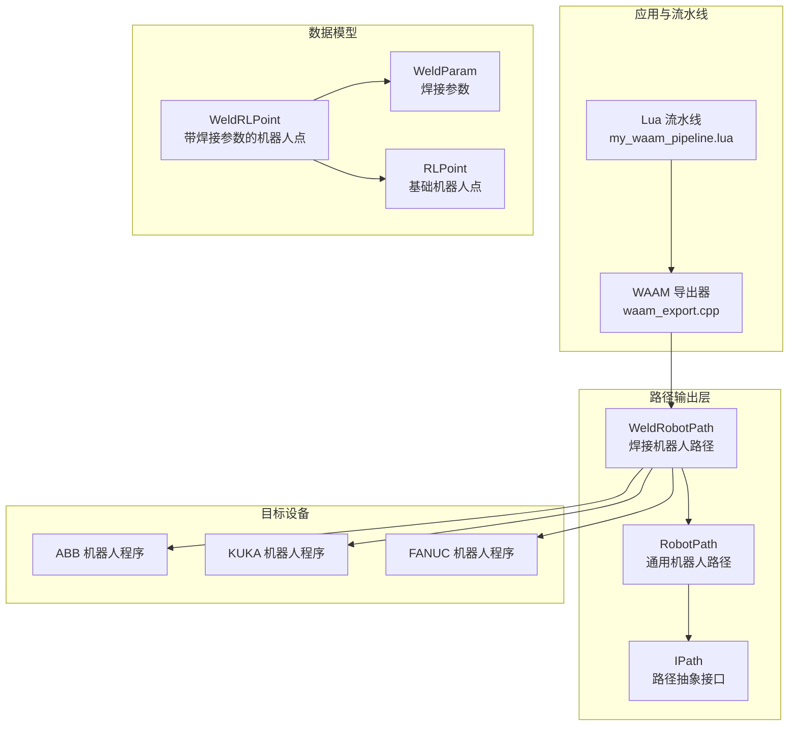
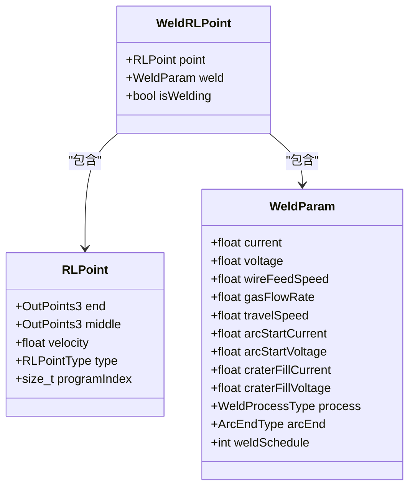
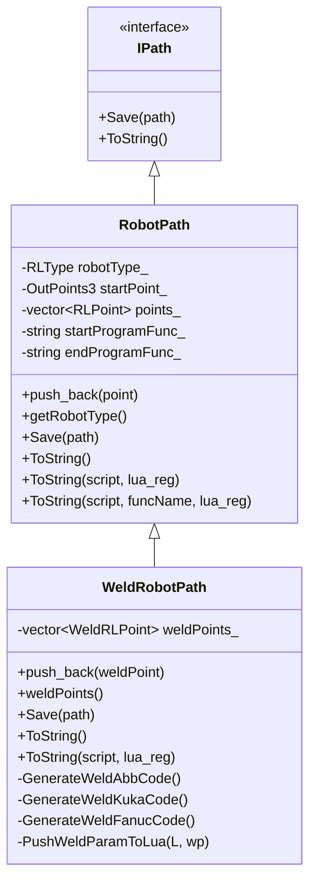
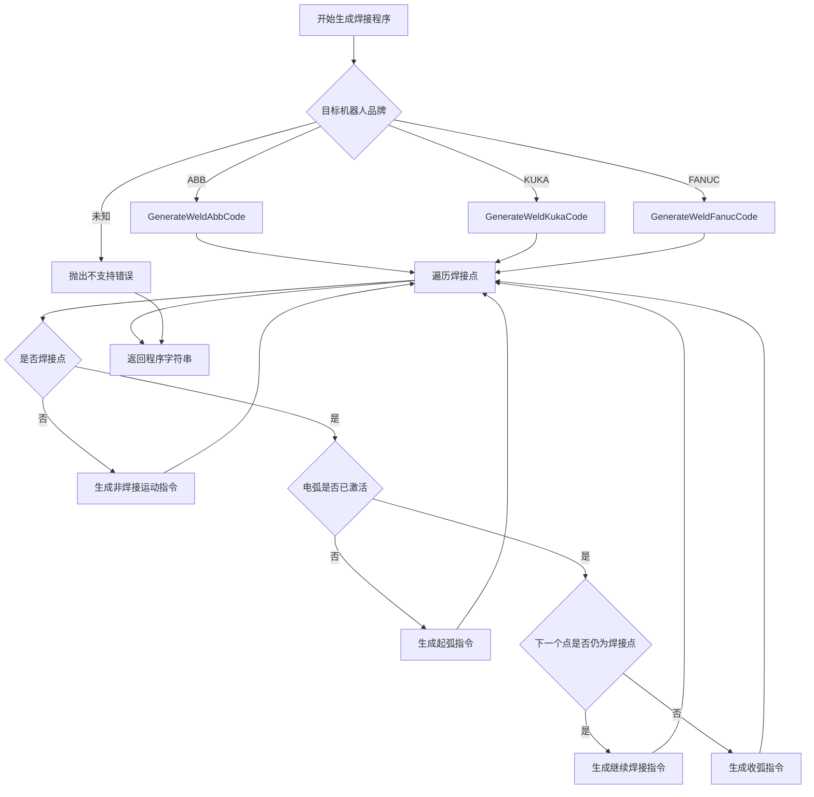
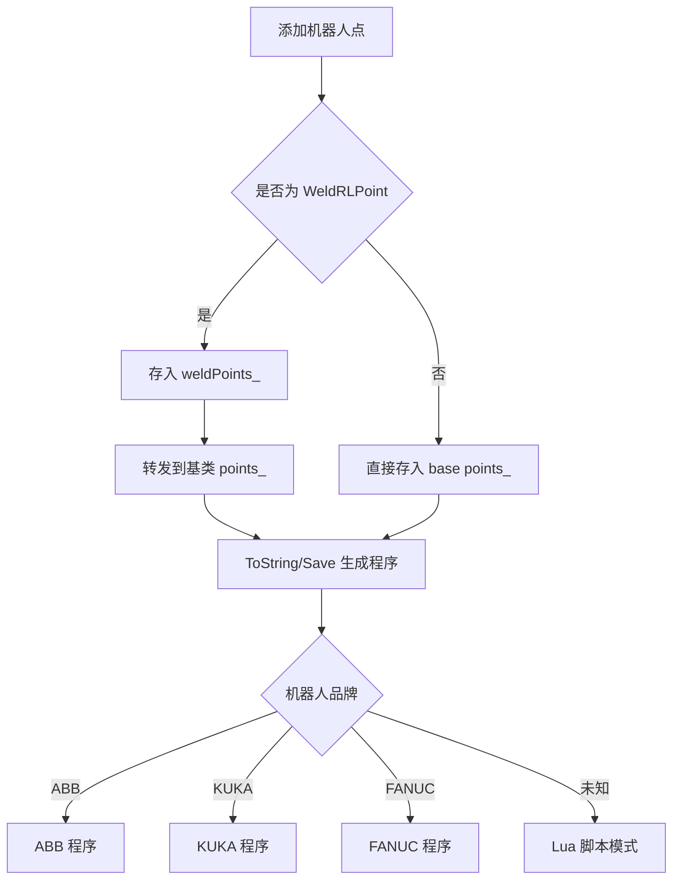
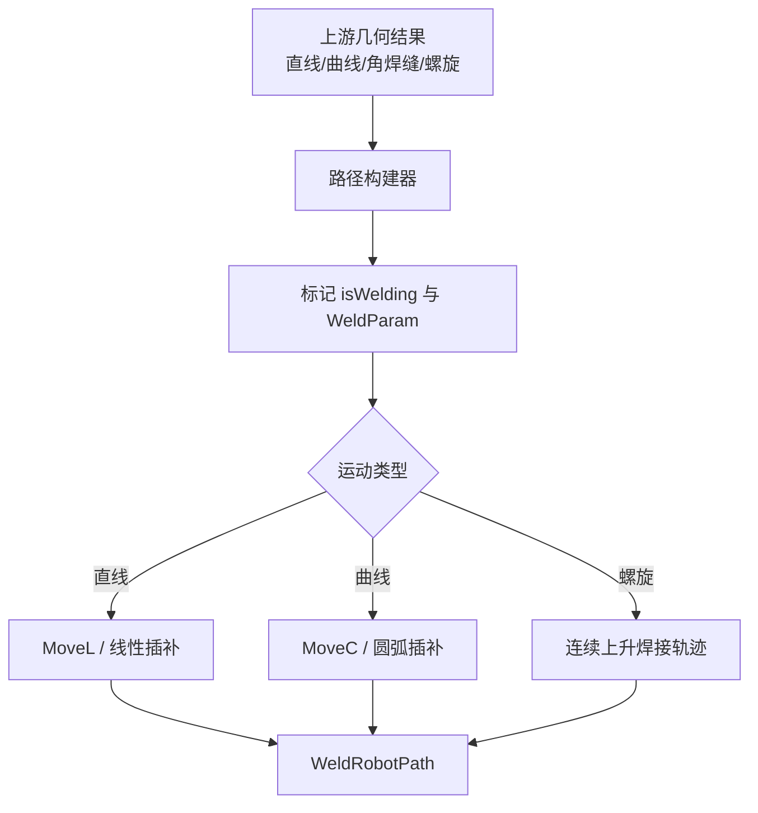
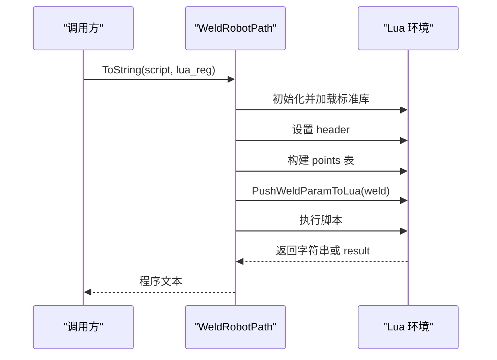
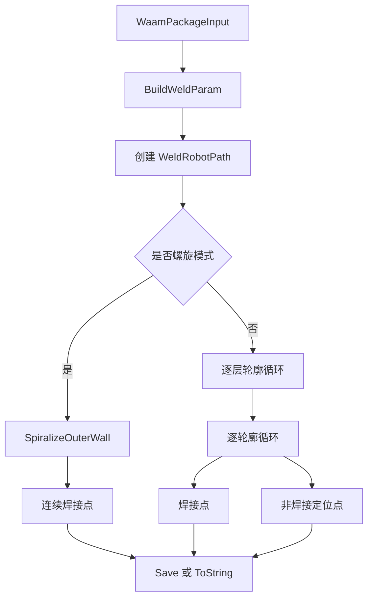
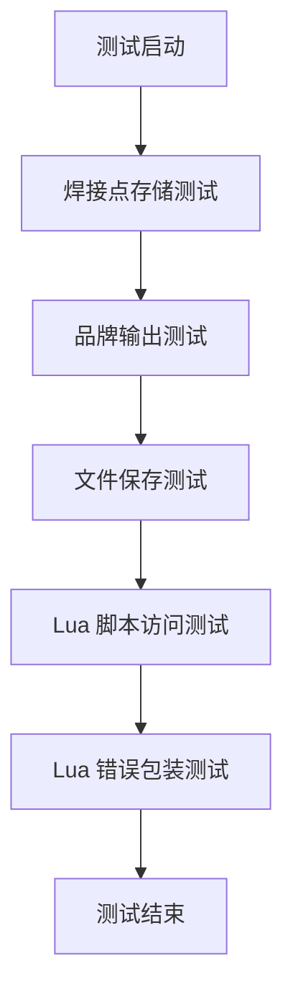
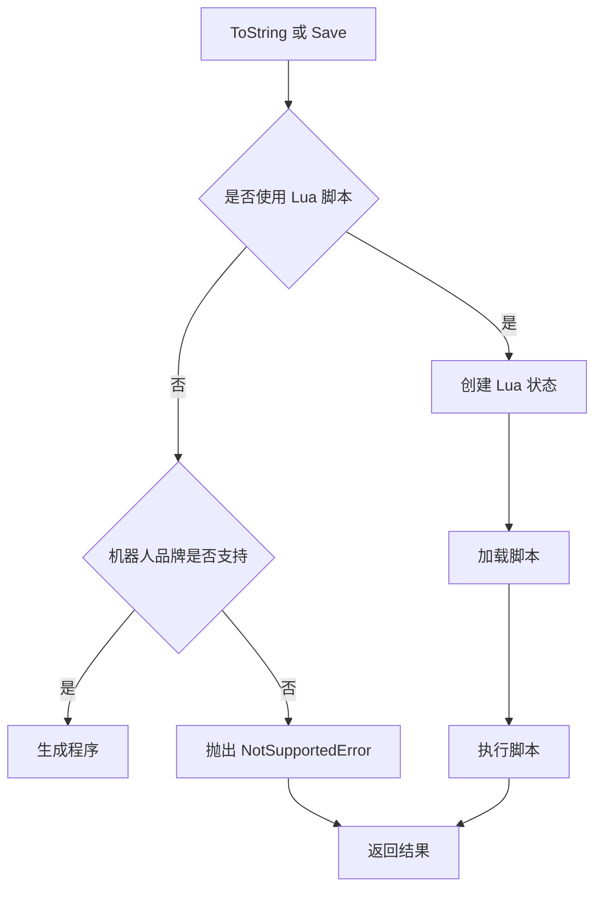

# WeldRobotPath 焊接机器人路径

<cite>
**本文引用的文件**   
- [weldrobotpath.hpp](file://paths/weldrobotpath.hpp)
- [weldrobotpath.cpp](file://paths/weldrobotpath.cpp)
- [robotpath.hpp](file://paths/robotpath.hpp)
- [robotpath.cpp](file://paths/robotpath.cpp)
- [waam_export.cpp](file://LibHsBaSlicer/Path/waam_export.cpp)
- [my_waam_pipeline.lua](file://samples/Custom/scripts/my_waam_pipeline.lua)
- [hsba_pipeline.d.lua](file://types/hsba_pipeline.d.lua)
- [weld_robot_path_test.cpp](file://tests/PathsOut/weld_robot_path_test.cpp)
</cite>

## 目录
1. [项目概述与快速开始](#项目概述与快速开始)
2. [架构总览](#架构总览)
3. [核心概念](#核心概念)
4. [核心模块详解](#核心模块详解)
5. [高级主题](#高级主题)
6. [Lua 脚本系统](#lua-脚本系统)
7. [API 参考文档](#api-参考文档)
8. [集成指南](#集成指南)
9. [开发·测试与贡献](#开发·测试与贡献)
10. [扩展开发指南](#扩展开发指南)
11. [示例与教程](#示例与教程)
12. [部署·故障排除与FAQ](#部署·故障排除与faq)
13. [附录](#附录)

## 项目概述与快速开始

WeldRobotPath 是 HsBaSlicer 中面向焊接机器人路径输出的专用类。它在通用工业机器人路径类 RobotPath 的基础上，增加了焊接工艺参数、电弧起停控制、熔池收尾处理以及 ABB/KUKA/FANUC 三种主流机器人语言的焊接程序生成能力。

典型使用流程如下：

1. 创建 WeldRobotPath 实例，并指定目标机器人品牌。
2. 构造 WeldRLPoint，设置焊点坐标、运动类型、速度、是否处于焊接状态，以及 WeldParam 中的电流、电压、送丝速度、气体流量、行走速度、起弧参数、收弧参数和焊接工艺类型。
3. 将 WeldRLPoint 加入路径；非焊接移动点可直接使用继承自 RobotPath 的 RLPoint。
4. 调用 ToString 或 Save 生成机器人程序；若机器人品牌未知，则通过 Lua 脚本模式输出自定义程序。
5. 在 WAAM 流水线中，可通过 HsBa.saveWaamPackage 自动构建 WeldRobotPath，并将逐层轮廓转换为连续焊接路径。

该设计既满足焊接工程师对焊接工艺参数的直观管理需求，也为自动化焊接系统开发者提供了可扩展的机器人程序生成接口。

**章节来源**
- [weldrobotpath.hpp:16-57](file://paths/weldrobotpath.hpp#L16-L57)
- [weldrobotpath.cpp:54-100](file://paths/weldrobotpath.cpp#L54-L100)
- [waam_export.cpp:45-80](file://LibHsBaSlicer/Path/waam_export.cpp#L45-L80)
- [my_waam_pipeline.lua:56-81](file://samples/Custom/scripts/my_waam_pipeline.lua#L56-L81)

## 架构总览

WeldRobotPath 位于路径输出层，向上承接 WAAM 导出逻辑与 Lua 流水线，向下依赖基础机器人路径抽象与通用错误处理。其核心关系如下：

**图表来源**
- [weldrobotpath.hpp:65-96](file://paths/weldrobotpath.hpp#L65-L96)
- [robotpath.hpp:61-104](file://paths/robotpath.hpp#L61-L104)
- [waam_export.cpp:61-80](file://LibHsBaSlicer/Path/waam_export.cpp#L61-L80)

**章节来源**
- [weldrobotpath.hpp:1-12](file://paths/weldrobotpath.hpp#L1-L12)
- [robotpath.hpp:1-12](file://paths/robotpath.hpp#L1-L12)
- [waam_export.cpp:1-14](file://LibHsBaSlicer/Path/waam_export.cpp#L1-L14)

## 核心概念

### 焊接工艺类型与收弧方式

WeldProcessType 表示焊接工艺类型，包括 MIG/MAG、TIG、等离子焊和激光焊。ArcEndType 表示电弧结束时的熔坑处理方式，包括正常熄弧、填坑收弧和慢速回退。这些枚举用于控制不同焊接阶段的参数切换，例如起弧时使用热起弧电流和电压，收弧时切换到填坑电流和电压。

| 类别 | 名称 | 含义 | 默认值或取值 |
|---|---|---|---|
| 焊接工艺 | WeldProcessType::MIG_MAG | 熔化极气体保护焊 | 常用于 WAAM 与常规电弧焊 |
| 焊接工艺 | WeldProcessType::TIG | 钨极惰性气体保护焊 | 常用于精密焊接 |
| 焊接工艺 | WeldProcessType::Plasma | 等离子焊 | 高能量密度电弧 |
| 焊接工艺 | WeldProcessType::Laser | 激光焊 | 高精度、低热输入 |
| 收弧方式 | ArcEndType::Normal | 正常熄弧 | 直接关闭电弧 |
| 收弧方式 | ArcEndType::CraterFill | 填坑收弧 | 降低电流电压填充熔坑 |
| 收弧方式 | ArcEndType::SlowRetract | 慢速回退 | 避免裂纹和缩孔 |

**章节来源**
- [weldrobotpath.hpp:16-32](file://paths/weldrobotpath.hpp#L16-L32)
- [weldrobotpath.cpp:21-51](file://paths/weldrobotpath.cpp#L21-L51)

### 焊接参数结构

WeldParam 是单段焊缝的工艺参数载体，包含稳态焊接参数、起弧参数、收弧参数、工艺类型、收弧方式和焊接日程号。它被嵌入到每个 WeldRLPoint 中，使路径上的每个点都可以携带独立的焊接信息。

| 字段 | 类型 | 单位 | 默认值 | 说明 |
|---|---|---|---:|---|
| current | float | A | 200.0 | 稳态焊接电流 |
| voltage | float | V | 22.0 | 稳态电弧电压 |
| wireFeedSpeed | float | m/min | 10.0 | 送丝速度 |
| gasFlowRate | float | L/min | 15.0 | 保护气体流量 |
| travelSpeed | float | mm/s | 5.0 | 焊枪行走速度 |
| arcStartCurrent | float | A | 150.0 | 起弧电流 |
| arcStartVoltage | float | V | 20.0 | 起弧电压 |
| craterFillCurrent | float | A | 120.0 | 填坑电流 |
| craterFillVoltage | float | V | 18.0 | 填坑电压 |
| process | WeldProcessType | 枚举 | MIG_MAG | 焊接工艺类型 |
| arcEnd | ArcEndType | 枚举 | Normal | 收弧方式 |
| weldSchedule | int | 无 | 1 | FANUC 风格焊接日程号 |

**章节来源**
- [weldrobotpath.hpp:34-49](file://paths/weldrobotpath.hpp#L34-L49)

### 带焊接参数的机器人点

WeldRLPoint 在基础 RLPoint 之上增加 isWelding 标志和 WeldParam。isWelding 用于区分“纯移动点”和“焊缝点”，从而决定是否生成起弧、继续焊接和收弧指令。这种设计允许同一路径中混合非焊接定位点和焊接轨迹点。

**图表来源**
- [robotpath.hpp:44-52](file://paths/robotpath.hpp#L44-L52)
- [weldrobotpath.hpp:34-57](file://paths/weldrobotpath.hpp#L34-L57)

**章节来源**
- [robotpath.hpp:44-52](file://paths/robotpath.hpp#L44-L52)
- [weldrobotpath.hpp:51-57](file://paths/weldrobotpath.hpp#L51-L57)

## 核心模块详解

### WeldRobotPath 类职责

WeldRobotPath 继承 RobotPath，主要职责包括：

1. 维护 WeldRLPoint 序列，同时保持与基类 RLPoint 序列兼容。
2. 根据目标机器人品牌生成 ABB、KUKA 或 FANUC 的焊接程序。
3. 在焊接区间内插入起弧、继续焊接和收弧指令。
4. 在非焊接区间生成 MoveJ、MoveL、MoveC 等运动指令。
5. 提供 Lua 脚本执行环境，将焊接点及其参数暴露给外部脚本。
6. 支持 Save 和 ToString 两种输出方式。

**图表来源**
- [robotpath.hpp:61-104](file://paths/robotpath.hpp#L61-L104)
- [weldrobotpath.hpp:65-96](file://paths/weldrobotpath.hpp#L65-L96)

**章节来源**
- [weldrobotpath.hpp:59-96](file://paths/weldrobotpath.hpp#L59-L96)
- [weldrobotpath.cpp:54-100](file://paths/weldrobotpath.cpp#L54-L100)

### 焊接路径生成流程

WeldRobotPath 的 ToString 会根据机器人品牌选择对应生成函数。每个生成函数都会遍历 weldPoints_，并根据 isWelding 和 arcActive 状态机判断当前应生成起弧、继续焊接还是收弧指令。

**图表来源**
- [weldrobotpath.cpp:79-100](file://paths/weldrobotpath.cpp#L79-L100)
- [weldrobotpath.cpp:225-305](file://paths/weldrobotpath.cpp#L225-L305)
- [weldrobotpath.cpp:307-394](file://paths/weldrobotpath.cpp#L307-L394)
- [weldrobotpath.cpp:396-481](file://paths/weldrobotpath.cpp#L396-L481)

**章节来源**
- [weldrobotpath.cpp:79-100](file://paths/weldrobotpath.cpp#L79-L100)
- [weldrobotpath.cpp:225-481](file://paths/weldrobotpath.cpp#L225-L481)

### 基础 RobotPath 增强点

RobotPath 负责通用机器人路径点的存储和品牌无关的运动指令映射。WeldRobotPath 在此基础上增加焊接语义，但保留了以下关键行为：

- push_back 可接受 RLPoint，用于非焊接定位。
- getRobotType 返回目标机器人品牌。
- ToString 和 Save 支持内置代码生成与 Lua 脚本后处理。
- 运动类型 RLPointType 包括 MoveJ、MoveL、MoveC 以及程序块标记。

**图表来源**
- [weldrobotpath.cpp:60-65](file://paths/weldrobotpath.cpp#L60-L65)
- [robotpath.cpp:66-81](file://paths/robotpath.cpp#L66-L81)
- [robotpath.cpp:91-113](file://paths/robotpath.cpp#L91-L113)

**章节来源**
- [weldrobotpath.cpp:60-70](file://paths/weldrobotpath.cpp#L60-L70)
- [robotpath.hpp:61-104](file://paths/robotpath.hpp#L61-L104)
- [robotpath.cpp:66-113](file://paths/robotpath.cpp#L66-L113)

## 高级主题

### 焊接相关额外属性的管理

WeldParam 将焊接电流、电压、送丝速度、气体流量、行走速度、起弧参数、收弧参数、工艺类型、收弧方式和焊接日程号集中管理。这样做的优点是：

- 每段焊缝可以独立配置工艺参数。
- 起弧和收弧阶段可以使用不同于稳态的参数。
- 不同机器人品牌可以通过 weldSchedule 或 ARC_SetWeldParam 等方式映射到设备侧参数。
- Lua 脚本可以直接读取 weld 表进行动态调整。

**章节来源**
- [weldrobotpath.hpp:34-49](file://paths/weldrobotpath.hpp#L34-L49)
- [weldrobotpath.cpp:196-223](file://paths/weldrobotpath.cpp#L196-L223)

### 焊缝几何特征识别与处理策略

当前源码中，WeldRobotPath 本身不实现焊缝几何识别算法。几何识别通常由上游切片、轮廓提取或螺旋化模块完成，WeldRobotPath 的职责是将已经得到的几何点转换为带焊接语义的机器人路径。

在现有实现中，焊缝类型主要通过以下方式体现：

- 直线焊缝：使用 MoveL 或线性插补指令。
- 曲线焊缝：使用 MoveC 或圆弧插补指令。
- 角焊缝：由上游路径规划决定轨迹形状，WeldRobotPath 仅负责将轨迹点标记为焊接点并生成相应运动指令。
- 螺旋焊缝：WAAM 导出器支持螺旋模式，将多层外轮廓合并为连续上升的焊接轨迹。

**图表来源**
- [waam_export.cpp:82-127](file://LibHsBaSlicer/Path/waam_export.cpp#L82-L127)
- [weldrobotpath.cpp:282-298](file://paths/weldrobotpath.cpp#L282-L298)
- [weldrobotpath.cpp:372-388](file://paths/weldrobotpath.cpp#L372-L388)

**章节来源**
- [waam_export.cpp:82-127](file://LibHsBaSlicer/Path/waam_export.cpp#L82-L127)
- [weldrobotpath.cpp:282-298](file://paths/weldrobotpath.cpp#L282-L298)
- [weldrobotpath.cpp:372-388](file://paths/weldrobotpath.cpp#L372-L388)

### 动态参数调整机制

WeldRobotPath 的动态参数调整主要通过两种方式实现：

1. 每点独立 WeldParam：每个 WeldRLPoint 可携带不同的电流、电压、送丝速度和行走速度，从而实现分段变参焊接。
2. Lua 脚本后处理：ToString 的脚本模式会将 points 表和 header 注入 Lua 环境，用户脚本可在运行时修改参数或重写程序体。

需要注意的是，当前 WeldRobotPath 的内置生成器不会根据实时传感器反馈在线调整参数；动态调整更多体现在离线编程和脚本后处理阶段。

**章节来源**
- [weldrobotpath.cpp:103-194](file://paths/weldrobotpath.cpp#L103-L194)
- [weldrobotpath.cpp:196-223](file://paths/weldrobotpath.cpp#L196-L223)

### 热变形补偿与质量监控

在当前源码中，WeldRobotPath 没有直接实现热变形补偿算法或焊接质量监控功能。热变形补偿通常需要结合工件热模型、温度场测量或视觉跟踪结果对路径点进行偏移修正；质量监控则需要熔池视觉、电弧传感、声发射或无损检测数据。

这些功能更适合放在上游路径优化模块或下游设备控制系统中，而 WeldRobotPath 主要负责把最终确定的路径和参数输出为机器人程序。

[本节为概念性说明，不直接分析具体源码]

### 多焊枪协调控制

WeldRobotPath 当前按单条路径顺序生成程序，不包含多焊枪协调调度逻辑。多焊枪协调通常需要在更高层的路径规划器中安排焊枪分配、碰撞检测和时序同步，再将各焊枪的路径分别交给 WeldRobotPath 或类似路径生成器。

[本节为概念性说明，不直接分析具体源码]

## Lua 脚本系统

WeldRobotPath 的 Lua 脚本模式允许用户在不修改 C++ 的情况下定制焊接程序输出。当传入脚本时，系统会：

1. 初始化 Lua 环境。
2. 注册可选的自定义函数。
3. 将 header 全局变量设置为 WeldRobotPath 脚本头注释。
4. 将 weldPoints_ 转换为 Lua 表 points。
5. 每个点包含 end、middle、velocity、type、isWelding 和 weld 子表。
6. 执行脚本并返回字符串结果或 result 全局变量。

**图表来源**
- [weldrobotpath.cpp:103-194](file://paths/weldrobotpath.cpp#L103-L194)
- [weldrobotpath.cpp:196-223](file://paths/weldrobotpath.cpp#L196-L223)

**章节来源**
- [weldrobotpath.cpp:103-194](file://paths/weldrobotpath.cpp#L103-L194)
- [weld_robot_path_test.cpp:94-113](file://tests/PathsOut/weld_robot_path_test.cpp#L94-L113)

## API 参考文档

### WeldProcessType

| 成员 | 含义 |
|---|---|
| Unknown | 未指定或未知工艺 |
| MIG_MAG | 熔化极气体保护焊 |
| TIG | 钨极惰性气体保护焊 |
| Plasma | 等离子焊 |
| Laser | 激光焊 |

**章节来源**
- [weldrobotpath.hpp:16-24](file://paths/weldrobotpath.hpp#L16-L24)

### ArcEndType

| 成员 | 含义 |
|---|---|
| Normal | 正常熄弧 |
| CraterFill | 填坑收弧 |
| SlowRetract | 慢速回退 |

**章节来源**
- [weldrobotpath.hpp:26-32](file://paths/weldrobotpath.hpp#L26-L32)

### WeldParam

| 字段 | 类型 | 默认值 | 说明 |
|---|---|---:|---|
| current | float | 200.0 | 稳态焊接电流 |
| voltage | float | 22.0 | 稳态电弧电压 |
| wireFeedSpeed | float | 10.0 | 送丝速度 |
| gasFlowRate | float | 15.0 | 保护气体流量 |
| travelSpeed | float | 5.0 | 焊枪行走速度 |
| arcStartCurrent | float | 150.0 | 起弧电流 |
| arcStartVoltage | float | 20.0 | 起弧电压 |
| craterFillCurrent | float | 120.0 | 填坑电流 |
| craterFillVoltage | float | 18.0 | 填坑电压 |
| process | WeldProcessType | MIG_MAG | 焊接工艺类型 |
| arcEnd | ArcEndType | Normal | 收弧方式 |
| weldSchedule | int | 1 | FANUC 风格焊接日程号 |

**章节来源**
- [weldrobotpath.hpp:34-49](file://paths/weldrobotpath.hpp#L34-L49)

### WeldRLPoint

| 字段 | 类型 | 说明 |
|---|---|---|
| point | RLPoint | 基础机器人路径点 |
| weld | WeldParam | 该点关联的焊接参数 |
| isWelding | bool | 是否属于焊缝段 |

**章节来源**
- [weldrobotpath.hpp:51-57](file://paths/weldrobotpath.hpp#L51-L57)

### WeldRobotPath 公共接口

| 方法 | 参数 | 返回值 | 说明 |
|---|---|---|---|
| 构造函数 | robotType、startPoint、startProgramFunc、endProgramFunc | 无 | 创建焊接机器人路径 |
| push_back | const WeldRLPoint& | 无 | 添加带焊接参数的点 |
| weldPoints | 无 | const vector<WeldRLPoint>& | 获取所有焊接点 |
| Save | const filesystem::path& | 无 | 保存为机器人程序文件 |
| ToString | 无 | std::string | 生成内置品牌程序 |
| ToString | string_view script, function<void(lua_State*)> lua_reg | std::string | 使用 Lua 脚本生成程序 |

**章节来源**
- [weldrobotpath.hpp:65-96](file://paths/weldrobotpath.hpp#L65-L96)
- [weldrobotpath.cpp:54-100](file://paths/weldrobotpath.cpp#L54-L100)

### 基础 RLPoint 与 RLPointType

| 字段/成员 | 类型 | 说明 |
|---|---|---|
| end | OutPoints3 | 终点坐标 |
| middle | OutPoints3 | 中间点坐标，用于圆弧 |
| velocity | float | 运动速度 |
| type | RLPointType | 运动或程序块类型 |
| programIndex | size_t | 程序块索引 |

| RLPointType | 含义 |
|---|---|
| MoveJ | 关节移动 |
| MoveL | 直线移动 |
| MoveC | 圆弧移动 |
| ProgramLStart | 线性程序块开始 |
| ProgramStart | 程序块开始 |
| ProgramCStart | 圆弧程序块开始 |
| ProgramL | 线性程序点 |
| ProgramC | 圆弧程序点 |
| ProgramLEnd | 线性程序块结束 |
| ProgramCEnd | 圆弧程序块结束 |

**章节来源**
- [robotpath.hpp:19-52](file://paths/robotpath.hpp#L19-L52)

## 集成指南

### 与 WAAM 流水线集成

WAAM 导出器 waam_export.cpp 是 WeldRobotPath 的主要使用者之一。它将 WaamWeldParams 转换为 WeldParam，并根据 spiral_mode 决定是生成连续螺旋焊缝还是逐层轮廓焊缝。

集成要点：

1. 从 WaamWeldParams 构建 WeldParam。
2. 根据 robot_type 映射到 RLType。
3. 创建 WeldRobotPath。
4. 螺旋模式下生成连续上升的焊接点。
5. 非螺旋模式下为每层轮廓生成起点定位点和轮廓焊接点。
6. 可选择使用 Lua 脚本或内置代码生成机器人程序。

**图表来源**
- [waam_export.cpp:45-80](file://LibHsBaSlicer/Path/waam_export.cpp#L45-L80)
- [waam_export.cpp:82-178](file://LibHsBaSlicer/Path/waam_export.cpp#L82-L178)

**章节来源**
- [waam_export.cpp:45-80](file://LibHsBaSlicer/Path/waam_export.cpp#L45-L80)
- [waam_export.cpp:82-178](file://LibHsBaSlicer/Path/waam_export.cpp#L82-L178)

### 与 Lua 流水线集成

my_waam_pipeline.lua 展示了如何在 Lua 中驱动 WAAM 流水线，并通过 HsBa.saveWaamPackage 间接使用 WeldRobotPath。用户可以在 machine 表中配置电流、电压、送丝速度、气体流量、行走速度、焊接工艺和机器人品牌。

关键点：

- layer_height 和 first_layer_height 控制层厚。
- outlines 和 zHeights 提供逐层轮廓和高度。
- weld 表映射到 WaamWeldParams。
- robotType 0=ABB、1=KUKA、2=FANUC。
- output 指定生成的机器人程序路径。

**章节来源**
- [my_waam_pipeline.lua:15-93](file://samples/Custom/scripts/my_waam_pipeline.lua#L15-L93)
- [hsba_pipeline.d.lua:261-278](file://types/hsba_pipeline.d.lua#L261-L278)

### 与设备控制系统集成

WeldRobotPath 输出的是机器人语言程序文本，而不是直接控制焊接电源或送丝机。因此，与设备控制系统的集成通常发生在机器人控制器侧：

- ABB：使用 ArcLStart、ArcL、ArcLEnd 及 seamdata/weavedata。
- KUKA：使用 ARC_Init、ARC_SetWeldParam、ARC_On、ARC_Off、ARC_CraterFill。
- FANUC：使用 ARC START、L 指令、ARC END 和焊接日程号。

如果需要实时参数调节，应在机器人程序中加入条件分支、寄存器读写或外部 I/O 触发逻辑，而不是依赖 WeldRobotPath 内部逻辑。

**章节来源**
- [weldrobotpath.cpp:225-305](file://paths/weldrobotpath.cpp#L225-L305)
- [weldrobotpath.cpp:307-394](file://paths/weldrobotpath.cpp#L307-L394)
- [weldrobotpath.cpp:396-481](file://paths/weldrobotpath.cpp#L396-L481)

## 开发·测试与贡献

### 单元测试覆盖

weld_robot_path_test.cpp 覆盖了以下场景：

- 焊接点存储与转发。
- 不同机器人品牌的 ToString 输出。
- Save 写入文件并与 ToString 内容一致。
- Lua 脚本模式访问 header、points、isWelding 和 weld.current。
- Lua 语法错误和运行时错误被包装为 RuntimeError。

**图表来源**
- [weld_robot_path_test.cpp:36-50](file://tests/PathsOut/weld_robot_path_test.cpp#L36-L50)
- [weld_robot_path_test.cpp:52-75](file://tests/PathsOut/weld_robot_path_test.cpp#L52-L75)
- [weld_robot_path_test.cpp:77-92](file://tests/PathsOut/weld_robot_path_test.cpp#L77-L92)
- [weld_robot_path_test.cpp:94-113](file://tests/PathsOut/weld_robot_path_test.cpp#L94-L113)

**章节来源**
- [weld_robot_path_test.cpp:36-113](file://tests/PathsOut/weld_robot_path_test.cpp#L36-L113)

### 错误处理策略

WeldRobotPath 的错误处理主要包括：

- 未知机器人品牌：ToString 抛出 NotSupportedError，提示使用 Lua 脚本。
- Lua 初始化失败：抛出 RuntimeError。
- Lua 加载失败：抛出 RuntimeError，包含脚本解析错误信息。
- Lua 运行失败：抛出 RuntimeError，包含脚本运行时错误信息。

**图表来源**
- [weldrobotpath.cpp:79-100](file://paths/weldrobotpath.cpp#L79-L100)
- [weldrobotpath.cpp:103-194](file://paths/weldrobotpath.cpp#L103-L194)

**章节来源**
- [weldrobotpath.cpp:79-100](file://paths/weldrobotpath.cpp#L79-L100)
- [weldrobotpath.cpp:103-194](file://paths/weldrobotpath.cpp#L103-L194)

## 扩展开发指南

### 新增机器人品牌支持

若要新增第四种机器人品牌，需要：

1. 在 RLType 中新增枚举值。
2. 在 WeldRobotPath::ToString 中添加对应分支。
3. 实现新的 GenerateWeldXXXCode 函数。
4. 更新 Lua 脚本模板以适配新品牌语法。
5. 补充单元测试验证新品牌输出。

### 扩展焊接参数

若需增加热输入控制、摆动参数或自适应参数，建议：

1. 在 WeldParam 中新增字段。
2. 在 PushWeldParamToLua 中将新字段暴露给 Lua。
3. 在各品牌生成函数中输出对应指令。
4. 更新 WAAM 导出器和 Lua 类型定义。
5. 补充测试用例验证默认值和边界行为。

### 实现焊缝跟踪接口

焊缝跟踪通常涉及视觉或电弧传感反馈。推荐扩展方式：

1. 在 WeldRLPoint 中增加跟踪偏移量或跟踪模式字段。
2. 在上游路径生成器中根据跟踪结果修正 end/middle。
3. 在 Lua 脚本中支持动态偏移计算。
4. 在机器人程序中输出跟踪启停、偏移补偿和报警逻辑。

[本节为扩展指导，不直接分析具体源码]

## 示例与教程

### 创建焊接机器人路径

推荐步骤：

1. 创建 WeldRobotPath，并指定 RLType::Abb、RLType::Kuka 或 RLType::Fanuc。
2. 构造 WeldRLPoint，设置 end 坐标、velocity、type、isWelding。
3. 设置 weld.current、weld.voltage、weld.wireFeedSpeed、weld.gasFlowRate、weld.travelSpeed。
4. 设置 weld.process 和 weld.arcEnd。
5. 调用 path.push_back。
6. 调用 path.ToString 或 path.Save。

参考测试用例中的 MakeWeldPoint 构造方式，可以快速生成用于测试的焊接点。

**章节来源**
- [weld_robot_path_test.cpp:15-26](file://tests/PathsOut/weld_robot_path_test.cpp#L15-L26)
- [weld_robot_path_test.cpp:36-50](file://tests/PathsOut/weld_robot_path_test.cpp#L36-L50)

### 配置焊接工艺参数

推荐实践：

- 稳态参数使用 current、voltage、wireFeedSpeed、gasFlowRate、travelSpeed。
- 起弧参数使用 arcStartCurrent、arcStartVoltage。
- 收弧参数使用 craterFillCurrent、craterFillVoltage、arcEnd。
- FANUC 用户可设置 weldSchedule 以匹配控制器中的焊接日程。
- 不同材料或板厚可分段设置不同 WeldParam。

**章节来源**
- [weldrobotpath.hpp:34-49](file://paths/weldrobotpath.hpp#L34-L49)
- [weldrobotpath.cpp:196-223](file://paths/weldrobotpath.cpp#L196-L223)

### 设置焊缝跟踪模式

当前 WeldRobotPath 没有专门的跟踪模式字段。若要在现有框架中使用跟踪，建议：

- 在 Lua 脚本中根据 isWelding 和 weld.process 判断是否启用跟踪逻辑。
- 在路径生成前根据跟踪结果修正 WeldRLPoint.point.end 或 middle。
- 在机器人程序中输出跟踪启停命令和偏移补偿指令。

**章节来源**
- [weldrobotpath.cpp:103-194](file://paths/weldrobotpath.cpp#L103-L194)

### 生成符合焊接规范的机器人程序

ABB、KUKA、FANUC 的内置生成器均遵循各自品牌的基本焊接语法：

- ABB：使用 ArcLStart、ArcL、ArcLEnd，并附带 seamdata 和 weavedata。
- KUKA：使用 ARC_Init、ARC_SetWeldParam、ARC_On、ARC_Off、ARC_CraterFill。
- FANUC：使用 ARC START、L 指令、ARC END 和 welding schedule。

若实际设备需要额外参数，应优先通过 Lua 脚本生成程序，再下载到机器人控制器调试。

**章节来源**
- [weldrobotpath.cpp:225-305](file://paths/weldrobotpath.cpp#L225-L305)
- [weldrobotpath.cpp:307-394](file://paths/weldrobotpath.cpp#L307-L394)
- [weldrobotpath.cpp:396-481](file://paths/weldrobotpath.cpp#L396-L481)

## 部署·故障排除与FAQ

### 常见问题

| 问题 | 可能原因 | 解决方法 |
|---|---|---|
| 调用 ToString 抛出 NotSupportedError | 机器人品牌为 Unknown | 使用 RLType::Abb、RLType::Kuka 或 RLType::Fanuc，或使用 Lua 脚本模式 |
| Lua 脚本报错 | 脚本语法错误或运行时异常 | 检查 Lua 脚本语法，确认 points 和 weld 字段访问正确 |
| 生成的程序缺少焊接指令 | isWelding 为 false 或焊接区间不连续 | 检查 WeldRLPoint.isWelding 和相邻点顺序 |
| 收弧不符合预期 | arcEnd 不是 CraterFill | 将 weld.arcEnd 设置为 ArcEndType::CraterFill |
| FANUC 程序参数不生效 | 未配置焊接日程或控制器参数 | 设置 weldSchedule 并在控制器中配置对应日程 |

**章节来源**
- [weldrobotpath.cpp:79-100](file://paths/weldrobotpath.cpp#L79-L100)
- [weldrobotpath.cpp:103-194](file://paths/weldrobotpath.cpp#L103-L194)
- [weldrobotpath.cpp:307-394](file://paths/weldrobotpath.cpp#L307-L394)
- [weldrobotpath.cpp:396-481](file://paths/weldrobotpath.cpp#L396-L481)

### 性能考虑

WeldRobotPath 的 ToString 和 Save 主要进行字符串拼接和 Lua 脚本执行，时间复杂度与焊接点数近似线性相关。对于大规模路径，建议：

- 避免在 Lua 脚本中进行昂贵计算。
- 尽量使用内置品牌生成器，减少脚本开销。
- 将重复工艺参数复用，减少 WeldParam 差异。
- 对超长路径分块生成程序，便于调试和传输。

[本节为一般性指导，不直接分析具体源码]

### 安全与质量建议

- 起弧和收弧参数必须与设备和材料匹配，避免引弧困难或熔坑缺陷。
- 收弧方式应根据焊缝末端位置选择 Normal、CraterFill 或 SlowRetract。
- 行走速度与送丝速度、电流电压应保持合理匹配，避免咬边或未熔合。
- 首次运行前应空走机器人程序，确认轨迹和焊接区间。
- 对关键焊缝应保留离线仿真和首件检验记录。

[本节为一般性指导，不直接分析具体源码]

## 附录

### 与基础 RobotPath 的关系总结

| 维度 | RobotPath | WeldRobotPath |
|---|---|---|
| 数据单元 | RLPoint | WeldRLPoint |
| 主要用途 | 通用机器人路径输出 | 焊接机器人路径输出 |
| 焊接语义 | 无 | isWelding、WeldParam |
| 品牌支持 | ABB、KUKA、FANUC | ABB、KUKA、FANUC |
| 脚本模式 | 支持 | 支持，且暴露 weld 参数 |
| 典型入口 | 通用路径生成 | WAAM 导出、自定义焊接路径 |

**章节来源**
- [robotpath.hpp:61-104](file://paths/robotpath.hpp#L61-L104)
- [weldrobotpath.hpp:65-96](file://paths/weldrobotpath.hpp#L65-L96)

### 焊接路径优化与顺序规划

当前 WeldRobotPath 不负责路径优化和焊接顺序规划。优化工作通常由上游路径规划器完成，例如：

- 减少提枪次数。
- 合并短焊缝。
- 优化焊接方向以减少变形。
- 安排多道焊顺序。
- 避免碰撞和奇异位姿。

WeldRobotPath 的职责是忠实输出已规划好的路径，并附加焊接参数。

[本节为概念性说明，不直接分析具体源码]

### 焊接仿真与离线编程工具集成

WeldRobotPath 生成的程序文本可与离线编程软件、机器人仿真器或数字孪生系统集成。集成方式包括：

- 将 ToString 输出保存到 .mod/.krl/.tp 文件。
- 通过 Lua 脚本生成仿真器可读格式。
- 在仿真环境中校验轨迹、可达性和焊接区间。
- 将仿真结果反馈到上游路径规划器进行迭代优化。

[本节为概念性说明，不直接分析具体源码]