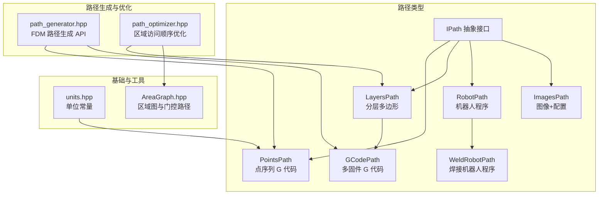
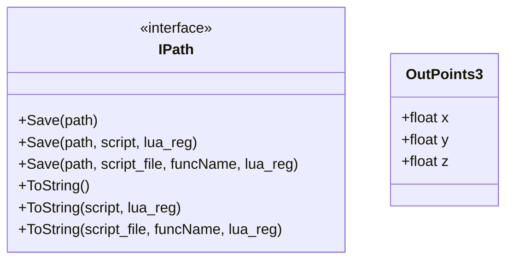
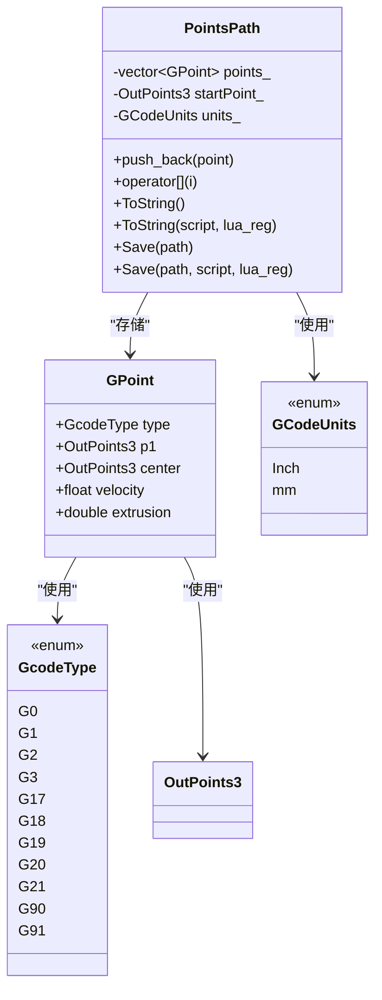
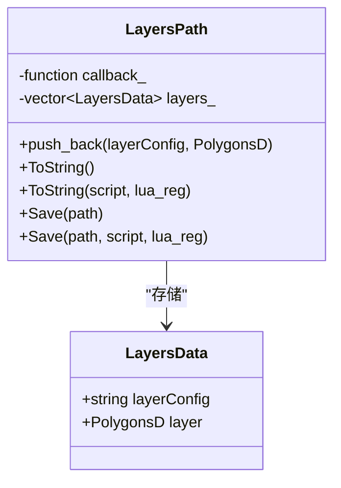
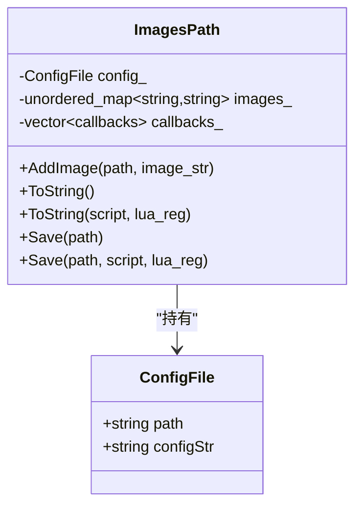
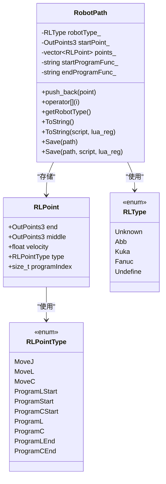
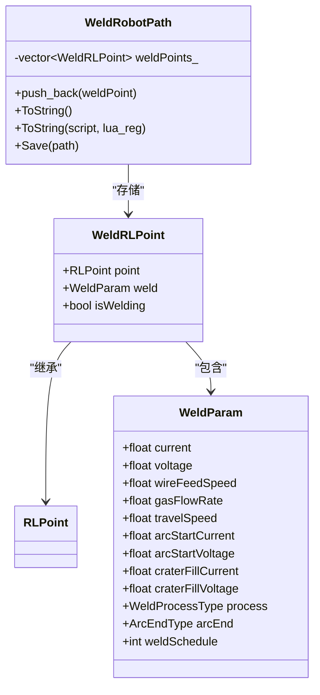
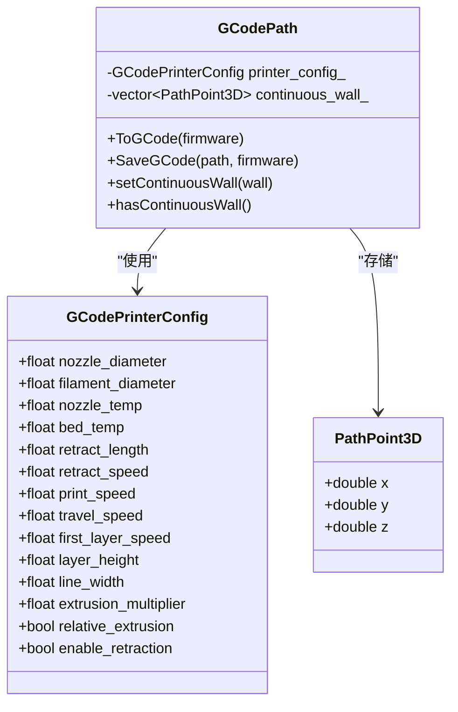
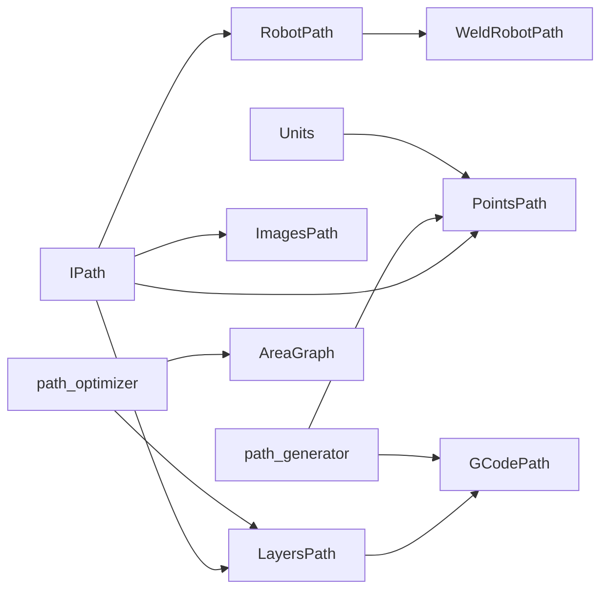
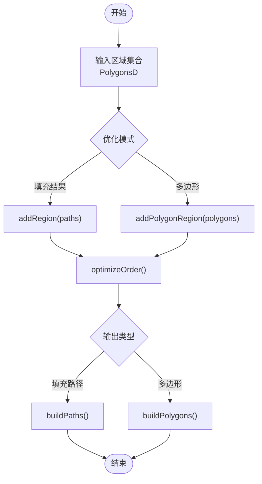

# 路径数据类型

<cite>
**本文引用的文件**   
- [IPath.hpp](file://paths/IPath.hpp)
- [pointspath.hpp](file://paths/pointspath.hpp)
- [layerspath.hpp](file://paths/layerspath.hpp)
- [imagespath.hpp](file://paths/imagespath.hpp)
- [robotpath.hpp](file://paths/robotpath.hpp)
- [weldrobotpath.hpp](file://paths/weldrobotpath.hpp)
- [gcodepath.hpp](file://paths/gcodepath.hpp)
- [path_generator.hpp](file://LibHsBaSlicer/Path/path_generator.hpp)
- [path_optimizer.hpp](file://LibHsBaSlicer/Path/path_optimizer.hpp)
- [units.hpp](file://base/units.hpp)
- [AreaGraph.hpp](file://utils/AreaGraph.hpp)
- [pointspath.cpp](file://paths/pointspath.cpp)
- [path_generator_test.cpp](file://tests/PathsOut/path_generator_test.cpp)
</cite>

## 目录
1. [引言](#引言)
2. [项目结构](#项目结构)
3. [核心概念](#核心概念)
4. [架构总览](#架构总览)
5. [核心组件详解](#核心组件详解)
6. [依赖关系分析](#依赖关系分析)
7. [性能与内存管理](#性能与内存管理)
8. [质量评估与优化](#质量评估与优化)
9. [扩展开发指南](#扩展开发指南)
10. [故障排除](#故障排除)
11. [结论](#结论)
12. [附录：API 参考速查](#附录api-参考速查)

## 引言
本文件聚焦 HsBaSlicer 的路径数据类型系统，系统性说明从抽象接口到具体输出类型的完整设计。路径数据贯穿切片、填充、路径生成、后处理与设备导出等阶段，是连接几何模型与物理制造设备的桥梁。文档将解释以下要点：
- 路径类型体系：GCodePath、PointsPath、LayersPath、ImagesPath、RobotPath、WeldRobotPath 的职责与关系。
- 数据结构与坐标系统：OutPoints3、GPoint、RLPoint、WeldRLPoint、PathPoint3D 等。
- 单位与转换：毫米/英寸、绝对/相对定位、挤出量计算。
- 序列化与 Lua 扩展：Save/ToString 的统一接口与脚本后处理机制。
- 路径生成与优化：FDM 路径生成 API、螺旋壁模式、区域访问顺序优化。
- 错误处理、性能考量与扩展方法。

## 项目结构
路径相关代码主要位于 paths 目录，并由 LibHsBaSlicer/Path 提供上层生成与优化 API；基础单位定义在 base/units.hpp，区域图算法在 utils/AreaGraph.hpp。



图表来源
- [IPath.hpp:29-57](file://paths/IPath.hpp#L29-L57)
- [pointspath.hpp:61-94](file://paths/pointspath.hpp#L61-L94)
- [layerspath.hpp:25-60](file://paths/layerspath.hpp#L25-L60)
- [gcodepath.hpp:66-107](file://paths/gcodepath.hpp#L66-L107)
- [robotpath.hpp:61-104](file://paths/robotpath.hpp#L61-L104)
- [weldrobotpath.hpp:65-96](file://paths/weldrobotpath.hpp#L65-L96)
- [imagespath.hpp:23-61](file://paths/imagespath.hpp#L23-L61)
- [path_generator.hpp:23-91](file://LibHsBaSlicer/Path/path_generator.hpp#L23-L91)
- [path_optimizer.hpp:44-100](file://LibHsBaSlicer/Path/path_optimizer.hpp#L44-L100)
- [units.hpp:19-44](file://base/units.hpp#L19-L44)
- [AreaGraph.hpp:43-71](file://utils/AreaGraph.hpp#L43-L71)

章节来源
- [IPath.hpp:29-57](file://paths/IPath.hpp#L29-L57)
- [path_generator.hpp:23-91](file://LibHsBaSlicer/Path/path_generator.hpp#L23-L91)
- [path_optimizer.hpp:44-100](file://LibHsBaSlicer/Path/path_optimizer.hpp#L44-L100)

## 核心概念
- IPath 是所有路径输出的统一抽象，定义了 Save/ToString 系列接口，支持原生序列化与可选的 Lua 脚本后处理。
- OutPoints3 是跨路径类型的三维输出点（X/Y/Z），Z 表示构建高度。
- 路径类型按“数据形态”划分：
  - PointsPath：以 G 代码点序列表达的运动轨迹。
  - LayersPath：以分层多边形表达的结构化切片数据。
  - ImagesPath：以配置侧车文件加命名图像二进制表达的设备输入。
  - RobotPath/WeldRobotPath：面向工业机器人的程序语言输出。
  - GCodePath：基于 LayersPath 的多固件 G 代码输出，并支持连续螺旋外壁。

章节来源
- [IPath.hpp:29-65](file://paths/IPath.hpp#L29-L65)
- [pointspath.hpp:44-94](file://paths/pointspath.hpp#L44-L94)
- [layerspath.hpp:25-60](file://paths/layerspath.hpp#L25-L60)
- [imagespath.hpp:23-61](file://paths/imagespath.hpp#L23-L61)
- [robotpath.hpp:44-104](file://paths/robotpath.hpp#L44-L104)
- [weldrobotpath.hpp:34-96](file://paths/weldrobotpath.hpp#L34-L96)
- [gcodepath.hpp:51-107](file://paths/gcodepath.hpp#L51-L107)

## 架构总览
路径系统的整体流程如下：
- 上游模块（切片、填充）产生 PolygonsD 或 LayerPathData。
- path_generator 将分层数据转换为 PointsPath 或 GCodePath。
- 路径可经 RegionPathOptimizer 进行区域访问顺序优化，减少空移成本。
- 最终通过 IPath 的 Save/ToString 输出到文件或字符串，并可嵌入 Lua 脚本进行后处理。

```mermaid
sequenceDiagram
participant Up as "上游模块<br/>切片/填充"
participant Gen as "path_generator.hpp"
participant Opt as "RegionPathOptimizer"
participant Path as "IPath 实现"
participant Dev as "设备/文件"
Up->>Gen : "LayerPathData / PolygonsD"
Gen-->>Path : "PointsPath / GCodePath"
Up->>Opt : "PolygonsD 区域集合"
Opt-->>Up : "优化后的区域顺序"
Path->>Dev : "Save/ToString + Lua 后处理"
```

图表来源
- [path_generator.hpp:50-91](file://LibHsBaSlicer/Path/path_generator.hpp#L50-L91)
- [path_optimizer.hpp:44-100](file://LibHsBaSlicer/Path/path_optimizer.hpp#L44-L100)
- [IPath.hpp:34-56](file://paths/IPath.hpp#L34-L56)

## 核心组件详解

### IPath 抽象接口
- 职责：为所有路径输出提供统一的保存与序列化接口，支持内联脚本、脚本文件和回调注册。
- 关键能力：
  - Save(path)、Save(path, script)、Save(path, script_file, funcName)。
  - ToString()、ToString(script)、ToString(script_file, funcName)。
  - 支持 lua_State 回调注册，便于在脚本中暴露额外函数。
- 通用数据：OutPoints3 用于描述三维输出点。



图表来源
- [IPath.hpp:29-65](file://paths/IPath.hpp#L29-L65)

章节来源
- [IPath.hpp:29-65](file://paths/IPath.hpp#L29-L65)

### PointsPath：点序列 G 代码路径
- 数据结构：
  - GPoint：包含运动类型（G0/G1/G2/G3）、目标点 p1、弧中心 center、速度 velocity、挤出 extrusion。
  - startPoint_：路径起点。
  - units_：长度单位（mm/inch）。
- 行为：
  - push_back(GPoint) 追加点。
  - operator[] 随机访问点。
  - ToString/Save 输出 G 代码文本，包含单位头、绝对定位、起点移动和逐点指令。
- 适用场景：需要直接控制机器运动指令的场景，如 FDM 打印、激光切割、通用 CNC。



图表来源
- [pointspath.hpp:44-94](file://paths/pointspath.hpp#L44-L94)

章节来源
- [pointspath.hpp:44-94](file://paths/pointspath.hpp#L44-L94)
- [pointspath.cpp:56-105](file://paths/pointspath.cpp#L56-L105)

### LayersPath：分层多边形路径
- 数据结构：
  - layers_：每层包含 layerConfig（自由格式配置字符串）和 PolygonsD（双精度多边形组）。
- 行为：
  - push_back(layerConfig, PolygonsD) 添加一层。
  - ToString/Save 支持原生序列化与 Lua 后处理。
- 适用场景：SLA/SLS 层图像、FDM 分层轮廓/填充/支撑的数据载体。



图表来源
- [layerspath.hpp:25-60](file://paths/layerspath.hpp#L25-L60)

章节来源
- [layerspath.hpp:25-60](file://paths/layerspath.hpp#L25-L60)

### ImagesPath：图像+配置路径
- 数据结构：
  - config_：配置文件名与内容。
  - images_：命名图像的二进制字符串映射。
- 行为：
  - AddImage(path, image_str) 添加或替换图像。
  - ToString/Save 支持原生序列化与 Lua 后处理。
- 适用场景：光固化设备层图像输出、需要附带配置文件的批量图像打包。



图表来源
- [imagespath.hpp:23-61](file://paths/imagespath.hpp#L23-L61)

章节来源
- [imagespath.hpp:23-61](file://paths/imagespath.hpp#L23-L61)

### RobotPath：工业机器人程序路径
- 数据结构：
  - RLPoint：包含终点 end、中间点 middle、速度 velocity、命令类型 RLPointType、程序块索引 programIndex。
  - robotType_：目标机器人品牌（ABB/KUKA/FANUC）。
  - startProgramFunc_/endProgramFunc_：程序头尾函数名。
- 行为：
  - push_back(RLPoint) 追加点。
  - operator[] 随机访问点。
  - ToString/Save 根据 robotType_ 生成对应品牌程序代码。
- 适用场景：工业焊接、搬运、喷涂等机器人应用。



图表来源
- [robotpath.hpp:44-104](file://paths/robotpath.hpp#L44-L104)

章节来源
- [robotpath.hpp:44-104](file://paths/robotpath.hpp#L44-L104)

### WeldRobotPath：带焊接参数的机器人路径
- 扩展点：
  - WeldParam：电流、电压、送丝速度、气体流量、行走速度、起弧参数、填坑参数、工艺类型、熄弧方式、焊道号。
  - WeldRLPoint：继承 RLPoint，附加 WeldParam 与 isWelding 标记。
- 行为：
  - push_back(WeldRLPoint) 追加焊接点。
  - ToString/Save 生成带起弧/熄弧与焊接参数的机器人程序。
- 适用场景：MIG/MAG、TIG、等离子、激光焊接等工艺。



图表来源
- [weldrobotpath.hpp:34-96](file://paths/weldrobotpath.hpp#L34-L96)

章节来源
- [weldrobotpath.hpp:34-96](file://paths/weldrobotpath.hpp#L34-L96)

### GCodePath：多固件 G 代码路径
- 继承自 LayersPath，增加：
  - GCodePrinterConfig：喷嘴直径、线材直径、温度、回抽、速度、层高、线宽、挤出倍率、相对/绝对挤出等。
  - PathPoint3D：连续螺旋外壁的三维点。
  - continuous_wall_：螺旋壁点集。
- 行为：
  - ToGCode(firmware) 生成 Marlin/RepRap/Klipper 等固件的 G 代码。
  - SaveGCode(path, firmware) 直接保存。
  - setContinuousWall(vector<PathPoint3D>) 设置螺旋壁。
  - hasContinuousWall() 判断是否启用。
- 适用场景：FDM 打印，尤其是花瓶模式（无填充/支撑，连续外壁）。



图表来源
- [gcodepath.hpp:51-107](file://paths/gcodepath.hpp#L51-L107)

章节来源
- [gcodepath.hpp:51-107](file://paths/gcodepath.hpp#L51-L107)

## 依赖关系分析
- 路径类型均依赖 IPath 抽象接口，保证统一的 Save/ToString 语义。
- GCodePath 依赖 LayersPath，复用分层数据与 Lua 扩展机制。
- WeldRobotPath 依赖 RobotPath，复用机器人程序框架并叠加焊接参数。
- path_generator 依赖 PathsPath 与 GCodePath，提供 FDM 路径生成 API。
- path_optimizer 依赖 AreaGraph 与 PolygonsD，对独立区域进行访问顺序优化。
- units.hpp 提供单位常量，供路径输出时选择 mm/inch。



图表来源
- [IPath.hpp:29-57](file://paths/IPath.hpp#L29-L57)
- [pointspath.hpp:61-94](file://paths/pointspath.hpp#L61-L94)
- [layerspath.hpp:25-60](file://paths/layerspath.hpp#L25-L60)
- [robotpath.hpp:61-104](file://paths/robotpath.hpp#L61-L104)
- [gcodepath.hpp:66-107](file://paths/gcodepath.hpp#L66-L107)
- [weldrobotpath.hpp:65-96](file://paths/weldrobotpath.hpp#L65-L96)
- [path_generator.hpp:50-91](file://LibHsBaSlicer/Path/path_generator.hpp#L50-L91)
- [path_optimizer.hpp:44-100](file://LibHsBaSlicer/Path/path_optimizer.hpp#L44-L100)
- [units.hpp:19-44](file://base/units.hpp#L19-L44)

章节来源
- [IPath.hpp:29-57](file://paths/IPath.hpp#L29-L57)
- [path_generator.hpp:50-91](file://LibHsBaSlicer/Path/path_generator.hpp#L50-L91)
- [path_optimizer.hpp:44-100](file://LibHsBaSlicer/Path/path_optimizer.hpp#L44-L100)

## 性能与内存管理
- 路径容器：
  - PointsPath/RobotPath 使用 vector 存储点序列，适合顺序遍历与随机访问。
  - LayersPath 使用 vector 存储分层数据，适合逐层序列化。
  - ImagesPath 使用 unordered_map 存储图像名称到二进制字符串的映射，适合快速查找与替换。
- 序列化开销：
  - ToString/Save 会构造字符串流，注意大模型时的内存峰值。
  - Lua 后处理会增加脚本执行开销，建议仅在必要时启用。
- 优化建议：
  - 对大型路径使用分段序列化或流式写入。
  - 避免重复创建临时对象，尽量复用配置结构体。
  - 合理使用 reserve 预分配容量以减少重分配。

[本节为通用指导，不直接分析具体文件]

## 质量评估与优化
- 路径质量指标：
  - 空移距离（air-move）：越少越好，可通过区域访问顺序优化降低。
  - 挤出连续性：螺旋壁模式可减少层间停顿，提升表面质量。
  - 速度与加速度：合理设置 print_speed/travel_speed 以提升效率。
- 区域访问顺序优化：
  - RegionPathOptimizer 将每个独立区域建模为图顶点，求解 TSP 最小化总空移成本。
  - 支持两种模式：
    - 填充结果模式：对已填充路径进行优化，支持多点折线。
    - 多边形模式：在填充前对轮廓进行优化，所有顶点作为门控点。
- 螺旋壁模式：
  - GenerateGCodePathSpiral 将各层外轮廓合并为连续上升的三维路径，适用于均匀截面模型。



图表来源
- [path_optimizer.hpp:44-100](file://LibHsBaSlicer/Path/path_optimizer.hpp#L44-L100)

章节来源
- [path_optimizer.hpp:44-100](file://LibHsBaSlicer/Path/path_optimizer.hpp#L44-L100)
- [path_generator.hpp:64-80](file://LibHsBaSlicer/Path/path_generator.hpp#L64-L80)

## 扩展开发指南
- 自定义路径类型：
  - 继承 IPath，实现 Save/ToString 系列接口。
  - 如需分层数据，可继承 LayersPath；如需机器人程序，可继承 RobotPath。
  - 在 Lua 注册回调中暴露自定义函数，供脚本后处理调用。
- 与输出设备集成：
  - 使用 Save(path) 直接输出到文件。
  - 使用 ToString() 获取字符串，再交由上层 UI 或网络传输模块。
  - 对于图像类输出，使用 ImagesPath.AddImage 添加二进制负载。
- 路径验证与错误处理：
  - 检查 OutPoints3 坐标范围与单位一致性。
  - 校验 GPoint 的速度与挤出值非负。
  - 对 Lua 脚本执行失败进行异常捕获与日志记录。

[本节为通用指导，不直接分析具体文件]

## 故障排除
- 常见问题：
  - 单位不一致：确保 GCodeUnits 与设备期望一致（mm/inch）。
  - 挤出量为零：检查 IsExtrude 标志与 ExtrusionMultiplier。
  - 螺旋壁无效：确认 hasContinuousWall 为真且 continuous_wall_ 非空。
  - Lua 脚本未生效：检查脚本路径与函数名是否正确，回调注册是否成功。
- 调试建议：
  - 使用 ToString() 输出中间结果，对比预期 G 代码。
  - 在 path_generator_test.cpp 中参考测试用例，验证 PolygonsToGPoints 的行为。

章节来源
- [pointspath.cpp:56-105](file://paths/pointspath.cpp#L56-L105)
- [path_generator_test.cpp:14-39](file://tests/PathsOut/path_generator_test.cpp#L14-L39)

## 结论
HsBaSlicer 的路径数据类型系统以 IPath 为核心抽象，向下覆盖点序列、分层多边形、图像负载、机器人程序与多固件 G 代码等多种输出形态。通过 path_generator 与 RegionPathOptimizer，系统实现了从几何数据到设备指令的高效转换与优化。Lua 扩展机制为路径后处理提供了灵活空间，适用于不同设备与工艺需求。开发者可基于现有类型快速扩展新的路径类型，满足多样化制造场景。

[本节为总结性内容，不直接分析具体文件]

## 附录：API 参考速查
- IPath：
  - Save(path)、Save(path, script)、Save(path, script_file, funcName)
  - ToString()、ToString(script)、ToString(script_file, funcName)
- PointsPath：
  - push_back(GPoint)、operator[](i)、ToString()/Save()
- LayersPath：
  - push_back(layerConfig, PolygonsD)、ToString()/Save()
- ImagesPath：
  - AddImage(path, image_str)、ToString()/Save()
- RobotPath：
  - push_back(RLPoint)、operator[](i)、getRobotType()、ToString()/Save()
- WeldRobotPath：
  - push_back(WeldRLPoint)、ToString()/Save()
- GCodePath：
  - ToGCode(firmware)、SaveGCode(path, firmware)、setContinuousWall(vector<PathPoint3D>)、hasContinuousWall()
- path_generator.hpp：
  - GenerateGCodePath(LayerPathData[], FdmPathConfig)
  - GenerateGCodePathV2(LayerPathData[], FdmPathConfig, GCodePrinterConfig)
  - GenerateGCodePathSpiral(PolygonsD[], double[], GCodePrinterConfig)
  - PolygonsToGPoints(PolygonsD, float, FdmPathConfig, bool)
- path_optimizer.hpp：
  - addRegion/addPolygonRegion/addRoute/optimizeOrder/buildPaths/buildPolygons
  - LuaOptimizeRegionPaths/LuaOptimizeRegionPolygons 系列函数

章节来源
- [IPath.hpp:34-56](file://paths/IPath.hpp#L34-L56)
- [pointspath.hpp:69-94](file://paths/pointspath.hpp#L69-L94)
- [layerspath.hpp:35-50](file://paths/layerspath.hpp#L35-L50)
- [imagespath.hpp:35-50](file://paths/imagespath.hpp#L35-L50)
- [robotpath.hpp:71-93](file://paths/robotpath.hpp#L71-L93)
- [weldrobotpath.hpp:68-85](file://paths/weldrobotpath.hpp#L68-L85)
- [gcodepath.hpp:74-96](file://paths/gcodepath.hpp#L74-L96)
- [path_generator.hpp:50-91](file://LibHsBaSlicer/Path/path_generator.hpp#L50-L91)
- [path_optimizer.hpp:52-95](file://LibHsBaSlicer/Path/path_optimizer.hpp#L52-L95)