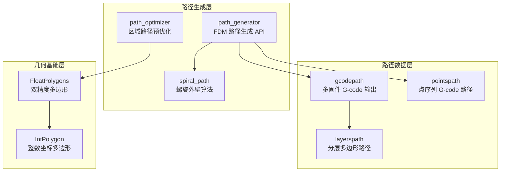
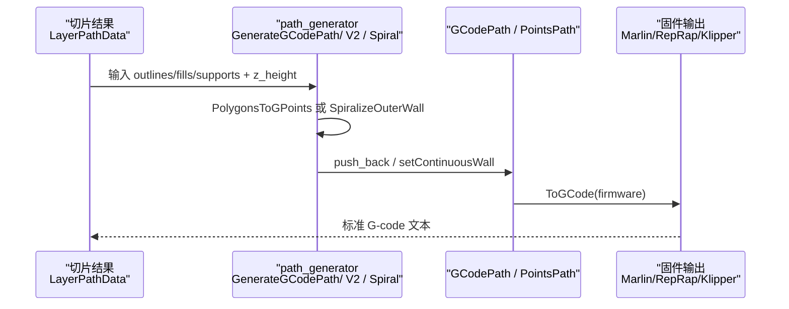
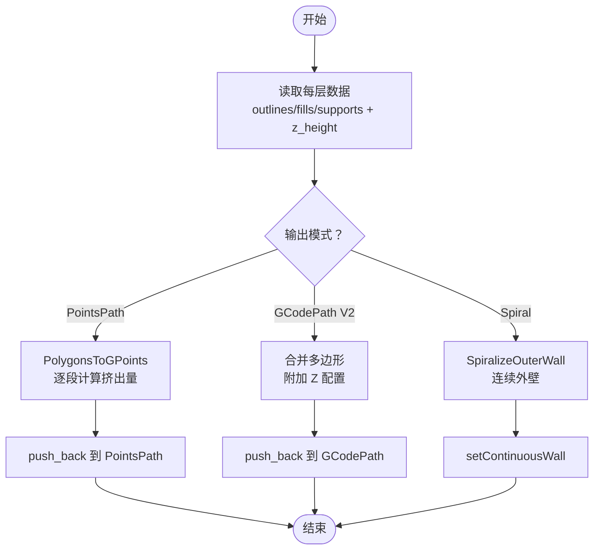
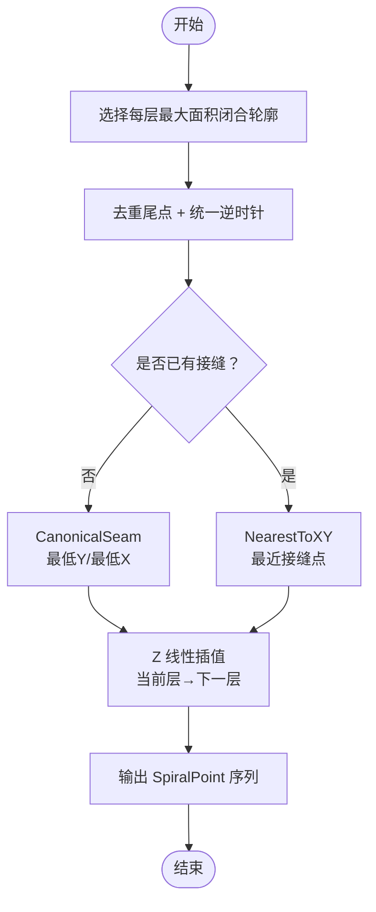
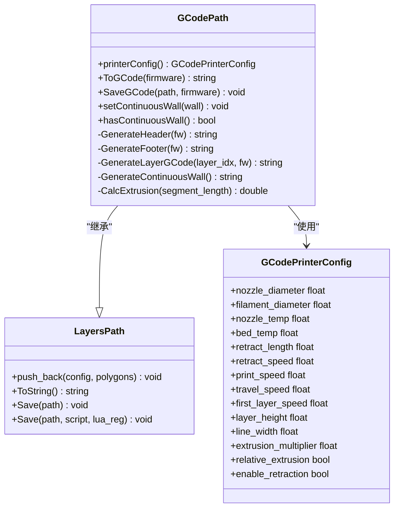
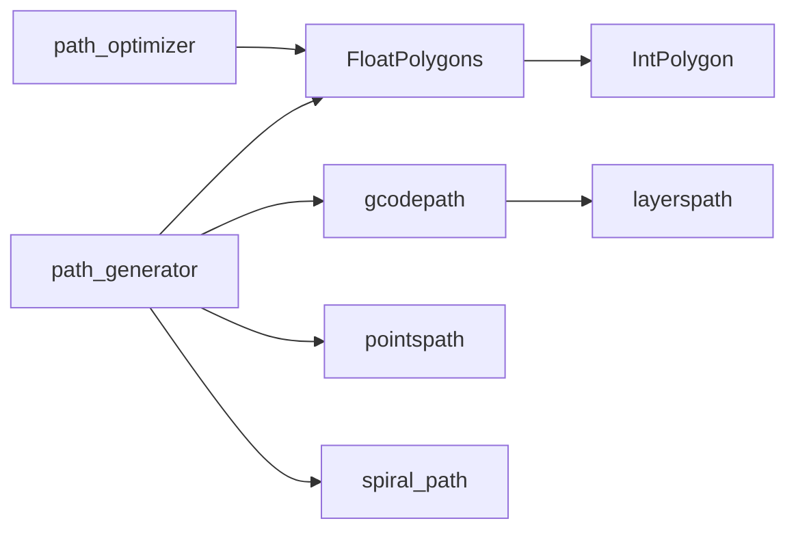

# 路径规划模块

<cite>
**本文引用的文件**   
- [path_generator.hpp](file://LibHsBaSlicer/Path/path_generator.hpp)
- [path_generator.cpp](file://LibHsBaSlicer/Path/path_generator.cpp)
- [spiral_path.hpp](file://LibHsBaSlicer/Path/spiral_path.hpp)
- [spiral_path.cpp](file://LibHsBaSlicer/Path/spiral_path.cpp)
- [gcodepath.hpp](file://paths/gcodepath.hpp)
- [gcodepath.cpp](file://paths/gcodepath.cpp)
- [layerspath.hpp](file://paths/layerspath.hpp)
- [layerspath.cpp](file://paths/layerspath.cpp)
- [pointspath.hpp](file://paths/pointspath.hpp)
- [pointspath.cpp](file://paths/pointspath.cpp)
- [FloatPolygons.hpp](file://2D/FloatPolygons.hpp)
- [IntPolygon.hpp](file://2D/IntPolygon.hpp)
- [path_optimizer.hpp](file://LibHsBaSlicer/Path/path_optimizer.hpp)
- [path_optimizer.cpp](file://LibHsBaSlicer/Path/path_optimizer.cpp)
- [optimize_paths.lua](file://tests/PolygonFill/optimize_paths.lua)
- [path_generator_test.cpp](file://tests/PathsOut/path_generator_test.cpp)
- [gcode_path_test.cpp](file://tests/PathsOut/gcode_path_test.cpp)
</cite>

## 目录
1. [引言](#引言)
2. [项目结构](#项目结构)
3. [核心组件](#核心组件)
4. [架构总览](#架构总览)
5. [详细组件分析](#详细组件分析)
6. [依赖关系分析](#依赖关系分析)
7. [性能与优化](#性能与优化)
8. [故障排除指南](#故障排除指南)
9. [结论](#结论)
10. [附录](#附录)

## 引言
本文件面向 HsBaSlicer 的路径规划模块，重点解释 path_generator 的核心路径生成算法、G-code 路径输出、螺旋路径规划以及多层路径优化等关键技术。文档同时覆盖 gcodepath、spiral_path、layerspath、pointspath 等路径类型的数据结构与操作方法，并说明路径优化策略、速度规划、挤出控制等高级特性。内容既适合初学者理解 FDM 路径规划的基本概念，也为高级开发者提供路径算法扩展与性能调优的实操指导。

## 项目结构
路径规划相关代码主要分布在以下位置：
- LibHsBaSlicer/Path：路径生成器与螺旋路径算法
- paths：路径数据结构与 G-code 输出实现
- 2D：多边形几何基础类型与布尔运算
- tests：路径生成与输出的单元测试与 Lua 脚本示例

图表来源
- [path_generator.hpp:18-91](file://LibHsBaSlicer/Path/path_generator.hpp#L18-L91)
- [gcodepath.hpp:24-107](file://paths/gcodepath.hpp#L24-L107)
- [layerspath.hpp:17-60](file://paths/layerspath.hpp#L17-L60)
- [pointspath.hpp:16-94](file://paths/pointspath.hpp#L16-L94)
- [FloatPolygons.hpp:18-26](file://2D/FloatPolygons.hpp#L18-L26)
- [IntPolygon.hpp:16-26](file://2D/IntPolygon.hpp#L16-L26)

章节来源
- [path_generator.hpp:18-91](file://LibHsBaSlicer/Path/path_generator.hpp#L18-L91)
- [gcodepath.hpp:24-107](file://paths/gcodepath.hpp#L24-L107)
- [layerspath.hpp:17-60](file://paths/layerspath.hpp#L17-L60)
- [pointspath.hpp:16-94](file://paths/pointspath.hpp#L16-L94)
- [FloatPolygons.hpp:18-26](file://2D/FloatPolygons.hpp#L18-L26)
- [IntPolygon.hpp:16-26](file://2D/IntPolygon.hpp#L16-L26)

## 核心组件
- FdmPathConfig：FDM 路径生成配置，包含层高、线宽、打印速度、移动速度、挤出倍率与单位。
- LayerPathData：单层路径数据，包含轮廓、填充、支撑多边形集合与 Z 高度。
- PolygonsToGPoints：将多边形转换为 GPoint 序列，支持挤出与非挤出（移动）模式。
- GenerateGCodePath：基于 PointsPath 的多层路径生成。
- GenerateGCodePathV2：基于 GCodePath 的多固件输出，按层聚合多边形并携带 Z 配置。
- GenerateGCodePathSpiral：螺旋/花瓶模式，合并每层外轮廓为连续上升外壁。
- SpiralizeOuterWall：螺旋路径核心算法，选择每层最大面积闭合轮廓，对齐接缝并按层线性插值 Z。
- GCodePath：继承 LayersPath，支持 Marlin/RepRap/Klipper 固件输出、相对/绝对挤出、回抽控制与连续外壁。
- LayersPath：分层路径存储与 Lua 序列化接口。
- PointsPath：点序列路径，直接序列化 G0/G1/G2/G3 指令。

章节来源
- [path_generator.hpp:23-91](file://LibHsBaSlicer/Path/path_generator.hpp#L23-L91)
- [path_generator.cpp:14-140](file://LibHsBaSlicer/Path/path_generator.cpp#L14-L140)
- [spiral_path.hpp:24-58](file://LibHsBaSlicer/Path/spiral_path.hpp#L24-L58)
- [gcodepath.hpp:32-107](file://paths/gcodepath.hpp#L32-L107)
- [layerspath.hpp:17-60](file://paths/layerspath.hpp#L17-L60)
- [pointspath.hpp:16-94](file://paths/pointspath.hpp#L16-L94)

## 架构总览
路径生成流程从切片后的多边形数据出发，经过路径生成器转换为 G-code 路径对象，再根据目标固件输出标准 G-code。螺旋模式通过 SpiralizeOuterWall 将各层外轮廓合并为一条连续的三维路径，避免层间回抽与跳跃。

图表来源
- [path_generator.cpp:63-140](file://LibHsBaSlicer/Path/path_generator.cpp#L63-L140)
- [gcodepath.cpp:332-350](file://paths/gcodepath.cpp#L332-L350)

## 详细组件分析

### path_generator：FDM 路径生成器
- 配置项：层高、线宽、打印速度、移动速度、挤出倍率、单位。
- 单点挤出计算：线段长度 × 线宽 × 层高 × 挤出倍率。
- 三层路径顺序：轮廓 → 填充 → 支撑。
- V2 输出：将每层多边形合并为一个图层，附带 Z 配置字符串，供 GCodePath 解析。
- 螺旋模式：调用 SpiralizeOuterWall 生成连续外壁，设置到 GCodePath 中。

图表来源
- [path_generator.cpp:14-140](file://LibHsBaSlicer/Path/path_generator.cpp#L14-L140)

章节来源
- [path_generator.hpp:23-91](file://LibHsBaSlicer/Path/path_generator.hpp#L23-L91)
- [path_generator.cpp:14-140](file://LibHsBaSlicer/Path/path_generator.cpp#L14-L140)

### spiral_path：螺旋路径规划
- 外轮廓选择：每层取最大绝对面积的闭合轮廓。
- 方向归一化：去除重复尾点，确保逆时针方向。
- 接缝对齐：首层使用“最低 Y，其次最低 X”的固定接缝；后续层选择距离上一接缝最近的顶点作为起点。
- Z 插值：在当前层与下一层之间线性插值 Z，最后一层保持平走。
- 输出：返回 SpiralPoint 序列，X/Y 来自平面轮廓，Z 随层递增。

图表来源
- [spiral_path.cpp:18-85](file://LibHsBaSlicer/Path/spiral_path.cpp#L18-L85)
- [spiral_path.cpp:88-163](file://LibHsBaSlicer/Path/spiral_path.cpp#L88-L163)

章节来源
- [spiral_path.hpp:24-58](file://LibHsBaSlicer/Path/spiral_path.hpp#L24-L58)
- [spiral_path.cpp:18-163](file://LibHsBaSlicer/Path/spiral_path.cpp#L18-L163)

### gcodepath：多固件 G-code 输出
- 固件支持：Marlin、RepRap、Klipper，分别生成不同头尾指令。
- 挤出计算：体积 = 线宽 × 层高 × 线段长度；E 值 = 体积 / 丝材截面积 × 挤出倍率。
- 速度规划：打印速度与移动速度分别乘以 60 转为 mm/min；首层使用 first_layer_speed。
- 回抽控制：在跨多边形移动时插入回抽/释放，支持相对/绝对挤出。
- 连续外壁：先输出连续上升外壁，再输出分层多边形；外壁内部无回抽。
- Lua 后处理：可注入脚本修改最终 G-code，支持全局变量 printer_config、firmware、gcode。

图表来源
- [gcodepath.hpp:32-107](file://paths/gcodepath.hpp#L32-L107)
- [gcodepath.cpp:57-67](file://paths/gcodepath.cpp#L57-L67)
- [gcodepath.cpp:69-158](file://paths/gcodepath.cpp#L69-L158)
- [gcodepath.cpp:211-289](file://paths/gcodepath.cpp#L211-L289)
- [gcodepath.cpp:291-350](file://paths/gcodepath.cpp#L291-L350)
- [gcodepath.cpp:364-455](file://paths/gcodepath.cpp#L364-L455)

章节来源
- [gcodepath.hpp:32-107](file://paths/gcodepath.hpp#L32-L107)
- [gcodepath.cpp:57-67](file://paths/gcodepath.cpp#L57-L67)
- [gcodepath.cpp:69-158](file://paths/gcodepath.cpp#L69-L158)
- [gcodepath.cpp:211-289](file://paths/gcodepath.cpp#L211-L289)
- [gcodepath.cpp:291-350](file://paths/gcodepath.cpp#L291-L350)
- [gcodepath.cpp:364-455](file://paths/gcodepath.cpp#L364-L455)

### layerspath：分层路径存储与序列化
- 数据结构：每个图层包含自由格式配置字符串与多边形集合。
- 原生保存：写入 SQLite 数据库，表结构包含 layer_config 与 layer_data。
- Lua 保存/序列化：暴露 layers 全局表与 db 适配器，支持函数名回调与返回值处理。
- ToString：返回 JSON-like 字符串表示，便于调试与脚本处理。

章节来源
- [layerspath.hpp:17-60](file://paths/layerspath.hpp#L17-L60)
- [layerspath.cpp:25-59](file://paths/layerspath.cpp#L25-L59)
- [layerspath.cpp:61-163](file://paths/layerspath.cpp#L61-L163)
- [layerspath.cpp:165-277](file://paths/layerspath.cpp#L165-L277)
- [layerspath.cpp:279-496](file://paths/layerspath.cpp#L279-L496)

### pointspath：点序列路径
- 数据结构：GPoint 包含运动类型、目标点、弧中心、速度与挤出量。
- 指令输出：支持 G0/G1/G2/G3，自动输出单位与定位模式。
- Lua 集成：将 points、startPoint、units 推入 Lua 环境，支持脚本返回新 G-code。

章节来源
- [pointspath.hpp:16-94](file://paths/pointspath.hpp#L16-L94)
- [pointspath.cpp:66-122](file://paths/pointspath.cpp#L66-L122)
- [pointspath.cpp:124-230](file://paths/pointspath.cpp#L124-L230)
- [pointspath.cpp:232-379](file://paths/pointspath.cpp#L232-L379)

### path_optimizer：区域路径预优化
- 两种模式：
  - 多边形模式（填充前）：以多边形顶点为门控点，输出优化顺序的多边形集合。
  - 填充结果模式（填充后）：以折线首尾端点为门控点，输出完整填充路径。
- 图建模：区域作为 AreaGraph 顶点，门控点间代价为直线距离。
- 求解策略：≥3 个区域时使用遗传 TSP 求解访问顺序；区域内采用最近邻贪心编排。
- Lua 绑定：提供 optimizeRegions 与 optimizePolygons 一键优化接口。

章节来源
- [path_optimizer.hpp:23-69](file://LibHsBaSlicer/Path/path_optimizer.hpp#L23-L69)
- [path_optimizer.cpp:45-103](file://LibHsBaSlicer/Path/path_optimizer.cpp#L45-L103)
- [path_optimizer.cpp:559-596](file://LibHsBaSlicer/Path/path_optimizer.cpp#L559-L596)
- [optimize_paths.lua:1-33](file://tests/PolygonFill/optimize_paths.lua#L1-L33)

## 依赖关系分析
路径生成模块依赖 2D 几何库进行多边形操作，并通过 Lua 脚本系统扩展输出与优化逻辑。

图表来源
- [path_generator.cpp:5-11](file://LibHsBaSlicer/Path/path_generator.cpp#L5-L11)
- [gcodepath.cpp:5-18](file://paths/gcodepath.cpp#L5-L18)
- [layerspath.cpp:5-16](file://paths/layerspath.cpp#L5-L16)
- [path_optimizer.cpp:1-22](file://LibHsBaSlicer/Path/path_optimizer.cpp#L1-L22)

章节来源
- [path_generator.cpp:5-11](file://LibHsBaSlicer/Path/path_generator.cpp#L5-L11)
- [gcodepath.cpp:5-18](file://paths/gcodepath.cpp#L5-L18)
- [layerspath.cpp:5-16](file://paths/layerspath.cpp#L5-L16)
- [path_optimizer.cpp:1-22](file://LibHsBaSlicer/Path/path_optimizer.cpp#L1-L22)

## 性能与优化
- 挤出计算优化：使用恒定的 π 常量与预计算的丝材截面积减少重复计算。
- 速度规划：打印速度与移动速度统一换算为 mm/min，首层单独限速保证附着质量。
- 回抽策略：仅在跨多边形移动时触发回抽，避免不必要的挤出中断。
- 螺旋模式：连续外壁消除层间回抽，提升表面质量与强度。
- 路径优化：通过遗传 TSP 与最近邻贪心减少空走距离，降低总路径长度。
- Lua 后处理：允许用户自定义 G-code 优化逻辑，如速度曲线、温度控制、压力推进等。

[本节为通用性能讨论，不直接分析具体源码文件]

## 故障排除指南
- Lua 初始化失败：检查 MakeUniqueLuaState 与 luaL_openlibs 调用是否正确。
- Lua 脚本加载错误：确认脚本语法正确，全局变量名称匹配（如 gcode、firmware、printer_config）。
- 文件打开失败：检查输出路径权限与磁盘空间。
- 路径为空：确认输入多边形非空且有效（至少 3 个顶点）。
- 螺旋路径异常：检查每层是否有有效闭合轮廓，接缝对齐是否合理。

章节来源
- [gcodepath.cpp:364-455](file://paths/gcodepath.cpp#L364-L455)
- [layerspath.cpp:61-163](file://paths/layerspath.cpp#L61-L163)
- [pointspath.cpp:124-230](file://paths/pointspath.cpp#L124-L230)

## 结论
HsBaSlicer 的路径规划模块提供了从切片多边形到 G-code 输出的完整链路，支持多种固件格式与螺旋模式，具备灵活的路径优化与 Lua 扩展能力。通过清晰的层次结构与模块化设计，开发者可以方便地扩展自定义路径算法、优化策略与输出格式，满足不同 3D 打印工艺的需求。

[本节为总结性内容，不直接分析具体源码文件]

## 附录

### 路径数据格式
- LayerPathData：包含 outlines、fills、supports 与 z_height。
- GPoint：包含 type、p1、center、velocity、extrusion。
- SpiralPoint：包含 x、y、z。
- PathPoint3D：包含 x、y、z。

章节来源
- [path_generator.hpp:36-42](file://LibHsBaSlicer/Path/path_generator.hpp#L36-L42)
- [pointspath.hpp:44-52](file://paths/pointspath.hpp#L44-L52)
- [spiral_path.hpp:24-29](file://LibHsBaSlicer/Path/spiral_path.hpp#L24-L29)
- [gcodepath.hpp:51-60](file://paths/gcodepath.hpp#L51-L60)

### 与输出设备的集成方式
- 固件适配：Marlin、RepRap、Klipper 分别生成对应头尾指令。
- 参数映射：打印机配置字段映射到 G-code 指令（如 M104、M140、G28、M82/M83）。
- Lua 后处理：允许用户脚本动态修改 G-code，实现设备特定优化。

章节来源
- [gcodepath.cpp:69-158](file://paths/gcodepath.cpp#L69-L158)
- [gcodepath.cpp:364-455](file://paths/gcodepath.cpp#L364-L455)

### 路径质量评估标准
- 连续性：螺旋外壁应无回抽与跳跃。
- 挤出一致性：E 值计算应与线宽、层高、线段长度匹配。
- 速度合理性：打印速度与移动速度符合设备限制。
- 空走最小化：路径优化应显著减少跨区域移动距离。

章节来源
- [gcode_path_test.cpp:133-163](file://tests/PathsOut/gcode_path_test.cpp#L133-L163)
- [path_generator_test.cpp:77-108](file://tests/PathsOut/path_generator_test.cpp#L77-L108)