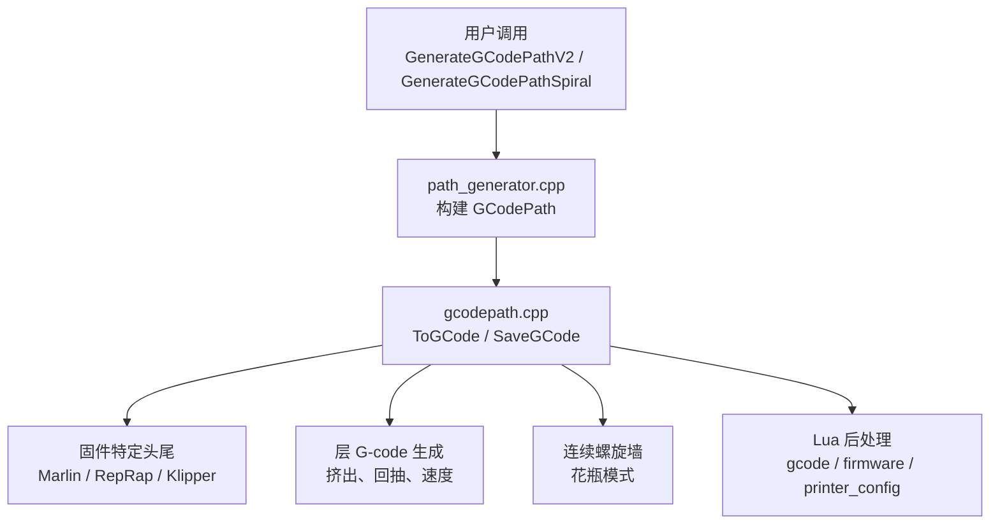
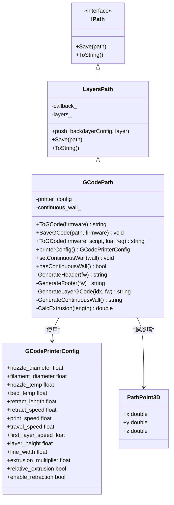
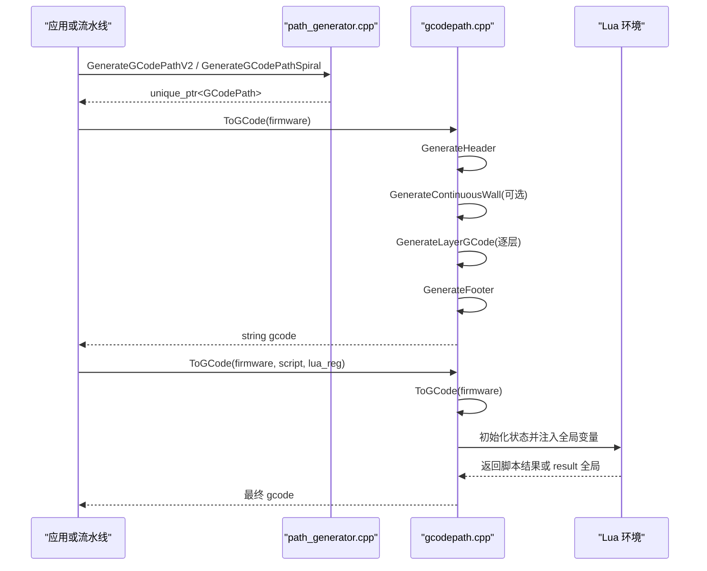
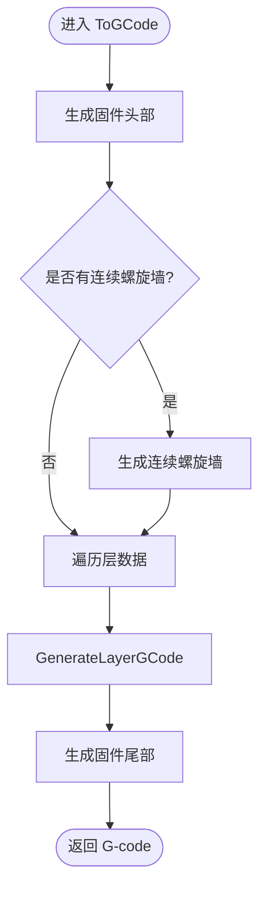
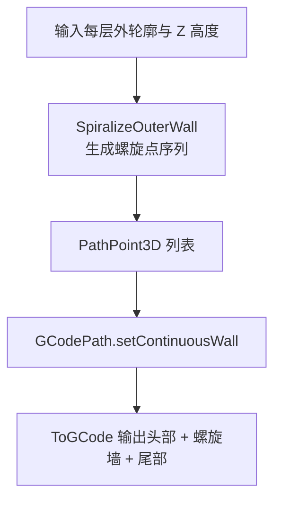
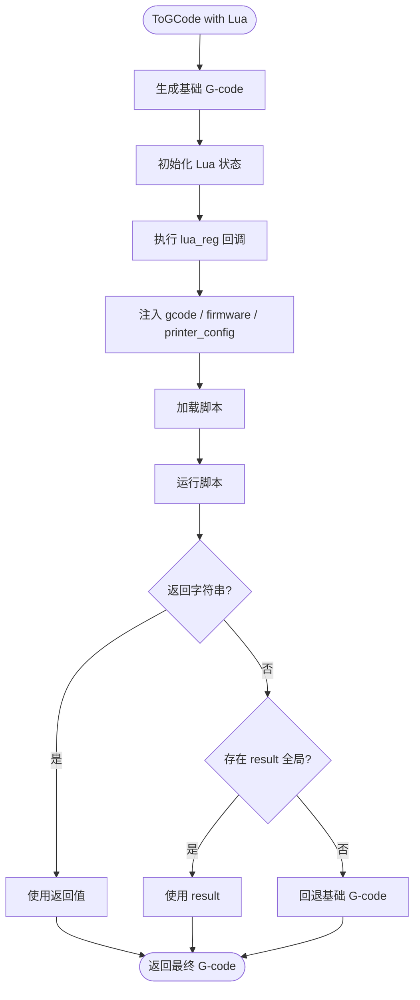

# GCode 路径输出

<cite>
**本文引用的文件**   
- [gcodepath.hpp](file://paths/gcodepath.hpp)
- [gcodepath.cpp](file://paths/gcodepath.cpp)
- [layerspath.hpp](file://paths/layerspath.hpp)
- [path_generator.hpp](file://LibHsBaSlicer/Path/path_generator.hpp)
- [path_generator.cpp](file://LibHsBaSlicer/Path/path_generator.cpp)
- [hsba_slicer.cppm](file://ModuleHsBaSlicer/hsba_slicer.cppm)
- [lua_pipeline.cpp](file://LibHsBaSlicer/Extends/lua_pipeline.cpp)
- [gcode_path_test.cpp](file://tests/PathsOut/gcode_path_test.cpp)
- [path_generator_test.cpp](file://tests/PathsOut/path_generator_test.cpp)
</cite>

## 目录
1. [简介](#简介)
2. [项目结构定位](#项目结构定位)
3. [核心概念](#核心概念)
4. [架构总览](#架构总览)
5. [GCodePath 类详解](#gcodepath-类详解)
6. [GCodePrinterConfig 配置参考](#gcodeprinterconfig-配置参考)
7. [连续螺旋墙与花瓶模式](#连续螺旋墙与花瓶模式)
8. [固件格式差异对比](#固件格式差异对比)
9. [Lua 后处理脚本集成](#lua-后处理脚本集成)
10. [API 参考](#api-参考)
11. [性能与质量优化建议](#性能与质量优化建议)
12. [故障排除](#故障排除)
13. [结论](#结论)

## 简介
GCodePath 是 HsBaSlicer 中面向 FDM 3D 打印机的多层路径输出器。它继承自 LayersPath，在层多边形数据基础上生成标准 G-code，并支持 Marlin、RepRap/RRF、Klipper 三种主流固件格式。其关键能力包括：
- 按固件类型生成带温度、回抽、挤出模式、风扇和速度因子的完整 G-code 头尾。
- 通过 GCodePrinterConfig 控制喷嘴直径、耗材直径、温度、回抽、速度、层高、线宽、挤出倍率等参数。
- 支持相对/绝对挤出模式（M82/M83）。
- 提供连续螺旋墙接口，用于花瓶模式或连续外壁打印。
- 暴露 ToGCode() 与 SaveGCode() API，并支持 Lua 后处理脚本替换或增强输出。

## 项目结构定位
GCodePath 相关代码主要分布在以下位置：
- 路径输出核心：`paths/gcodepath.hpp`、`paths/gcodepath.cpp`
- 层路径基类：`paths/layerspath.hpp`
- 高层路径生成 API：`LibHsBaSlicer/Path/path_generator.hpp`、`path_generator.cpp`
- C++ 模块入口与流水线映射：`ModuleHsBaSlicer/hsba_slicer.cppm`
- Lua 扩展中的 toGcode 绑定：`LibHsBaSlicer/Extends/lua_pipeline.cpp`
- 行为验证测试：`tests/PathsOut/gcode_path_test.cpp`、`tests/PathsOut/path_generator_test.cpp`



**图表来源**
- [path_generator.cpp:97-140](file://LibHsBaSlicer/Path/path_generator.cpp#L97-L140)
- [gcodepath.cpp:69-456](file://paths/gcodepath.cpp#L69-L456)

**章节来源**
- [gcodepath.hpp:1-112](file://paths/gcodepath.hpp#L1-L112)
- [gcodepath.cpp:1-459](file://paths/gcodepath.cpp#L1-L459)
- [path_generator.hpp:1-96](file://LibHsBaSlicer/Path/path_generator.hpp#L1-L96)
- [path_generator.cpp:1-143](file://LibHsBaSlicer/Path/path_generator.cpp#L1-L143)

## 核心概念
- **LayersPath**：层路径抽象，保存每层的配置字符串和多边形集合，并提供原生序列化与 Lua 扩展点。
- **GCodePath**：基于 LayersPath 的 G-code 输出实现，负责固件头尾、层移动、挤出计算、回抽、螺旋墙和 Lua 后处理。
- **GCodeFirmware**：目标固件枚举，当前支持 Marlin、RepRap、Klipper。
- **GCodePrinterConfig**：打印机配置结构体，决定温度、回抽、速度、层高、线宽、挤出倍率、挤出模式等。
- **PathPoint3D**：连续螺旋墙的点结构，每个点携带独立 Z 高度，用于跨层连续挤出。
- **LayerPathData**：高层路径生成 API 使用的单层数据，包含轮廓、填充、支撑和 Z 高度。



**图表来源**
- [layerspath.hpp:25-60](file://paths/layerspath.hpp#L25-L60)
- [gcodepath.hpp:33-107](file://paths/gcodepath.hpp#L33-L107)

**章节来源**
- [layerspath.hpp:17-60](file://paths/layerspath.hpp#L17-L60)
- [gcodepath.hpp:24-107](file://paths/gcodepath.hpp#L24-L107)

## 架构总览
GCodePath 的输出流程可概括为：
1. 构造时接收 GCodePrinterConfig。
2. 通过 push_back 添加多层多边形数据，或使用高层 API GenerateGCodePathV2 / GenerateGCodePathSpiral。
3. ToGCode 按固件生成头部、可选连续螺旋墙、逐层 G-code、尾部。
4. SaveGCode 将 ToGCode 结果写入文件。
5. ToGCode(firmware, script, lua_reg) 在基础 G-code 上执行 Lua 后处理，返回最终文本。



**图表来源**
- [path_generator.cpp:97-140](file://LibHsBaSlicer/Path/path_generator.cpp#L97-L140)
- [gcodepath.cpp:332-456](file://paths/gcodepath.cpp#L332-L456)

**章节来源**
- [path_generator.cpp:97-140](file://LibHsBaSlicer/Path/path_generator.cpp#L97-L140)
- [gcodepath.cpp:332-456](file://paths/gcodepath.cpp#L332-L456)

## GCodePath 类详解
### 职责与边界
- 继承 LayersPath，复用层数据存储与 Lua 扩展机制。
- 封装固件相关的 G-code 头尾命令。
- 根据配置计算挤出量，支持相对/绝对挤出。
- 支持连续螺旋墙，用于花瓶模式。
- 提供 ToGCode 与 SaveGCode 两种输出方式。
- 支持 Lua 后处理脚本，允许替换或增强输出。

### 关键方法
- `ToGCode(GCodeFirmware)`：生成指定固件的标准 G-code 字符串。
- `SaveGCode(const std::filesystem::path&, GCodeFirmware)`：将 G-code 保存到文件，失败抛出 RuntimeError。
- `ToGCode(GCodeFirmware, std::string_view, const std::function<void(lua_State*)>&)`：执行 Lua 后处理，返回最终 G-code。
- `setContinuousWall(std::vector<PathPoint3D>)`：设置连续螺旋墙。
- `hasContinuousWall()`：判断是否设置了连续螺旋墙。
- `printerConfig()`：读取打印机配置。

### 内部逻辑要点
- `CalcExtrusion(segment_length)`：根据线宽、层高、耗材直径和挤出倍率计算挤出长度。
- `GenerateHeader(firmware)`：按固件写入温度、归位、挤出模式、风扇、压力前馈、速度因子等命令。
- `GenerateFooter(firmware)`：写入关闭加热、回抽、抬 Z、归 XY、关电机等命令。
- `GenerateLayerGCode(layer_idx, firmware)`：解析层 Z，首层与普通层速度不同，处理多边形间的回抽/恢复挤出，逐段计算挤出值。
- `GenerateContinuousWall()`：将连续墙作为单条无中断挤出路径输出，不插入回抽。



**图表来源**
- [gcodepath.cpp:332-350](file://paths/gcodepath.cpp#L332-L350)
- [gcodepath.cpp:211-329](file://paths/gcodepath.cpp#L211-L329)

**章节来源**
- [gcodepath.hpp:66-107](file://paths/gcodepath.hpp#L66-L107)
- [gcodepath.cpp:57-350](file://paths/gcodepath.cpp#L57-L350)

## GCodePrinterConfig 配置参考
GCodePrinterConfig 是所有 G-code 输出的核心参数源，直接影响温度、回抽、速度、层高、线宽、挤出模式和挤出量计算。

| 字段 | 默认值 | 单位 | 作用与影响 |
| --- | --- | --- | --- |
| nozzle_diameter | 0.4 | mm | 喷嘴直径，用于注释信息；挤出体积计算主要由 line_width 与 layer_height 驱动。 |
| filament_diameter | 1.75 | mm | 耗材直径，用于挤出体积到 E 值的换算。 |
| nozzle_temp | 200.0 | °C | 喷嘴温度，写入固件头部 M104/M109。 |
| bed_temp | 60.0 | °C | 热床温度，写入固件头部 M140/M190。 |
| retract_length | 1.0 | mm | 回抽长度，写入尾部回抽命令及移动间回抽。 |
| retract_speed | 40.0 | mm/s | 回抽速度，转换为 mm/min 写入 F 参数。 |
| print_speed | 50.0 | mm/s | 普通层打印速度。 |
| travel_speed | 100.0 | mm/s | 移动速度，用于抬 Z、移动到起点等。 |
| first_layer_speed | 20.0 | mm/s | 首层打印速度，首层 G-code 使用该速度。 |
| layer_height | 0.2 | mm | 层高，参与挤出体积计算。 |
| line_width | 0.4 | mm | 线宽，参与挤出体积计算。 |
| extrusion_multiplier | 1.0 | 倍率 | 挤出倍率，直接乘以挤出体积。 |
| relative_extrusion | false | 布尔 | 相对挤出模式（M83）还是绝对挤出模式（M82）。 |
| enable_retraction | true | 布尔 | 是否在多边形之间插入回抽与恢复挤出。 |

### 对输出质量的影响
- **nozzle_diameter / filament_diameter**：影响 E 值换算精度；若耗材直径与实际不符，会导致过挤或欠挤。
- **layer_height / line_width / extrusion_multiplier**：共同决定挤出体积；三者偏差会直接改变壁厚和填充密度。
- **print_speed / travel_speed / first_layer_speed**：影响打印速度与移动效率；首层速度过低可能提升附着力，过高可能导致拉丝。
- **retract_length / retract_speed**：影响回抽效果；过长或过快易断丝，过短或过慢易拉丝。
- **relative_extrusion**：切换 M82/M83；错误模式会导致 E 值累积异常。
- **enable_retraction**：关闭后可减少回抽指令，适合某些材料或硬件，但可能增加拉丝。

**章节来源**
- [gcodepath.hpp:33-49](file://paths/gcodepath.hpp#L33-L49)
- [gcodepath.cpp:57-67](file://paths/gcodepath.cpp#L57-L67)
- [gcodepath.cpp:211-288](file://paths/gcodepath.cpp#L211-L288)

## 连续螺旋墙与花瓶模式
### 原理
连续螺旋墙是一组 PathPoint3D，每个点携带独立的 X、Y、Z。GCodePath 将其视为一条连续的挤出路径，不在点之间插入回抽或抬 Z，从而形成从底层到顶层的连续螺旋外壁。该功能由 `setContinuousWall` 设置，并由 `GenerateContinuousWall` 输出。

### 使用场景
- 花瓶模式：仅输出连续外壁，不输出填充和支撑。
- 均匀截面模型：棱柱形或近似棱柱形模型，外壁可平滑上升。
- 需要减少层间停顿、提升表面连续性的场景。

### 生成方式
高层 API `GenerateGCodePathSpiral` 会将每层外轮廓合并为一条螺旋线，并设置到 GCodePath 的连续墙中。此时 ToGCode 只输出头部、螺旋墙、尾部，不包含逐层多边形。



**图表来源**
- [path_generator.cpp:120-140](file://LibHsBaSlicer/Path/path_generator.cpp#L120-L140)
- [gcodepath.cpp:291-330](file://paths/gcodepath.cpp#L291-L330)

**章节来源**
- [gcodepath.hpp:51-60](file://paths/gcodepath.hpp#L51-L60)
- [gcodepath.hpp:87-96](file://paths/gcodepath.hpp#L87-L96)
- [path_generator.cpp:120-140](file://LibHsBaSlicer/Path/path_generator.cpp#L120-L140)
- [gcodepath.cpp:291-330](file://paths/gcodepath.cpp#L291-L330)

## 固件格式差异对比
### Marlin
- 头部：设置喷嘴与热床温度、归位、等待温度、重置挤出、选择 M82/M83、抬 Z。
- 尾部：关闭加热、相对定位、回抽、抬 Z、绝对定位、归 XY、关电机。
- 不支持 Klipper 专用命令，也不强制输出风扇命令。

### RepRap / RRF
- 头部：与 Marlin 类似，额外输出风扇全开命令。
- 尾部：额外输出风扇关闭命令。
- 明确使用 M82/M83 切换挤出模式。

### Klipper
- 头部：额外输出压力前馈 SET_PRESSURE_ADVANCE、速度因子 M220、流量因子 M221、风扇 SET_FAN_SPEED。
- 尾部：关闭风扇、回抽、抬 Z、归 XY、关电机。
- 更适合高级运动控制和流控调参。

```mermaid
table
| 固件 | 头部特性 | 尾部特性 |
| --- | --- | --- |
| Marlin | M104/M140/G28/M109/M190/G92/M82或M83/抬 Z | M104/M140/相对定位/回抽/抬 Z/绝对定位/归 XY/关电机 |
| RepRap | 同 Marlin，额外 M106 风扇全开 | 同 Marlin，额外 M107 风扇关闭 |
| Klipper | 同 Marlin，额外 SET_PRESSURE_ADVANCE/M220/M221/SET_FAN_SPEED | 同 Marlin，额外 SET_FAN_SPEED 关闭 |
```

**图表来源**
- [gcodepath.cpp:69-158](file://paths/gcodepath.cpp#L69-L158)
- [gcodepath.cpp:160-209](file://paths/gcodepath.cpp#L160-L209)

**章节来源**
- [gcodepath.cpp:69-209](file://paths/gcodepath.cpp#L69-L209)
- [gcode_path_test.cpp:43-82](file://tests/PathsOut/gcode_path_test.cpp#L43-L82)

## Lua 后处理脚本集成
### 机制
ToGCode(firmware, script, lua_reg) 的工作流程如下：
1. 生成基础 G-code。
2. 创建唯一 Lua 状态并加载标准库。
3. 执行可选的 lua_reg 回调，用于注入自定义全局变量。
4. 注入三个全局变量：
   - `gcode`：基础 G-code 字符串。
   - `firmware`：固件名称字符串，值为 "marlin"、"reprap" 或 "klipper"。
   - `printer_config`：表，包含 nozzle_temp、bed_temp、print_speed、travel_speed、layer_height、line_width、total_layers 等。
5. 加载并运行脚本。
6. 如果脚本返回字符串，则使用该字符串作为最终 G-code。
7. 否则尝试读取全局 `result` 字符串。
8. 如果都不满足，回退为基础 G-code。
9. 脚本加载错误或运行时错误会抛出 RuntimeError。

### 最佳实践
- 优先返回字符串替换整个 G-code，便于完全定制。
- 如需保留基础结构，可在脚本中拼接 `gcode`。
- 使用 `printer_config.total_layers` 做条件逻辑。
- 使用 `lua_reg` 注入插件或工具函数，避免污染全局命名空间。
- 对脚本进行严格校验，避免语法错误和运行时异常。



**图表来源**
- [gcodepath.cpp:364-456](file://paths/gcodepath.cpp#L364-L456)

**章节来源**
- [gcodepath.cpp:364-456](file://paths/gcodepath.cpp#L364-L456)
- [gcode_path_test.cpp:192-238](file://tests/PathsOut/gcode_path_test.cpp#L192-L238)

## API 参考
### GCodePath 公共接口
- `GCodePath(const GCodePrinterConfig& config, callback = {})`
- `~GCodePath()`
- `std::string ToGCode(GCodeFirmware firmware) const`
- `void SaveGCode(const std::filesystem::path& path, GCodeFirmware firmware) const`
- `std::string ToGCode(GCodeFirmware firmware, std::string_view script, const std::function<void(lua_State*)>& lua_reg = {}) const`
- `const GCodePrinterConfig& printerConfig() const`
- `void setContinuousWall(std::vector<PathPoint3D> wall)`
- `bool hasContinuousWall() const`

### 高层路径生成 API
- `std::unique_ptr<GCodePath> GenerateGCodePathV2(const std::vector<LayerPathData>& layer_data, const FdmPathConfig& config, const GCodePrinterConfig& printer_config)`
- `std::unique_ptr<GCodePath> GenerateGCodePathSpiral(const std::vector<PolygonsD>& layer_outlines, const std::vector<double>& layer_zs, const GCodePrinterConfig& printer_config)`

### 使用示例说明
- 生成 V2 路径：传入层数据、路径配置和打印机配置，得到 GCodePath。
- 输出 Marlin G-code：调用 `ToGCode(GCodeFirmware::Marlin)`。
- 输出 Klipper G-code：调用 `ToGCode(GCodeFirmware::Klipper)`。
- 保存到文件：调用 `SaveGCode("output/model.gcode", GCodeFirmware::Marlin)`。
- 花瓶模式：调用 `GenerateGCodePathSpiral`，然后调用 `ToGCode`。
- Lua 后处理：调用 `ToGCode(firmware, script, lua_reg)`，脚本可返回新字符串或设置 `result`。

**章节来源**
- [gcodepath.hpp:66-107](file://paths/gcodepath.hpp#L66-L107)
- [path_generator.hpp:60-80](file://LibHsBaSlicer/Path/path_generator.hpp#L60-L80)
- [path_generator.cpp:97-140](file://LibHsBaSlicer/Path/path_generator.cpp#L97-L140)
- [gcode_path_test.cpp:171-190](file://tests/PathsOut/gcode_path_test.cpp#L171-L190)

## 性能与质量优化建议
### 性能
- 批量生成：优先使用 GenerateGCodePathV2 一次性构建 GCodePath，再多次调用 ToGCode 输出不同固件。
- 避免重复 Lua 初始化：Lua 后处理开销较大，仅在需要时启用。
- 合理设置层数与多边形数量：过多层或多边形会显著增加字符串拼接与挤出计算成本。
- 使用相对挤出模式可减少 E 值累积误差，但需确保固件兼容。

### 质量
- 校准耗材直径与线宽：确保挤出体积准确，避免过挤或欠挤。
- 调整回抽参数：根据材料和硬件特性微调 retract_length 与 retract_speed。
- 首层速度较低：提升附着力，减少翘边。
- 花瓶模式适用于均匀截面模型，不适用于复杂内腔或支撑需求。
- Klipper 用户可结合压力前馈和流量因子获得更稳定挤出。

[本节为通用指导，不直接分析具体源码文件]

## 故障排除
### 常见问题
- **文件保存失败**：SaveGCode 打开文件失败时会抛出 RuntimeError。检查路径权限和父目录是否存在。
- **Lua 脚本错误**：脚本语法错误或运行时错误会抛出 RuntimeError。检查脚本内容和全局变量访问。
- **连续螺旋墙无效**：如果连续墙点数少于 2，GenerateContinuousWall 不会输出任何内容。
- **回抽未生效**：检查 enable_retraction 是否为 true，以及是否有多边形导致移动间回抽。
- **挤出异常**：检查 relative_extrusion 是否与固件期望一致，确认 line_width、layer_height、extrusion_multiplier 配置正确。

### 调试建议
- 先输出基础 G-code，再逐步启用 Lua 后处理。
- 使用测试用例中的断言思路，检查关键 G-code 片段是否存在。
- 对固件差异进行分固件验证，确保头尾命令符合预期。

**章节来源**
- [gcodepath.cpp:353-362](file://paths/gcodepath.cpp#L353-L362)
- [gcodepath.cpp:422-456](file://paths/gcodepath.cpp#L422-L456)
- [gcode_path_test.cpp:171-238](file://tests/PathsOut/gcode_path_test.cpp#L171-L238)

## 结论
GCodePath 是 HsBaSlicer 中 FDM G-code 输出的核心组件，提供了清晰的固件适配、精确的挤出计算、灵活的回抽控制、完整的 Lua 扩展点和花瓶模式支持。通过 GCodePrinterConfig 精细控制打印参数，并结合 GenerateGCodePathV2 与 GenerateGCodePathSpiral，用户可以在多种固件环境下获得高质量、可定制的 G-code 输出。实际使用中应重视参数校准、固件差异和 Lua 脚本健壮性，以获得稳定可靠的打印结果。

[本节为总结性内容，不直接分析具体源码文件]