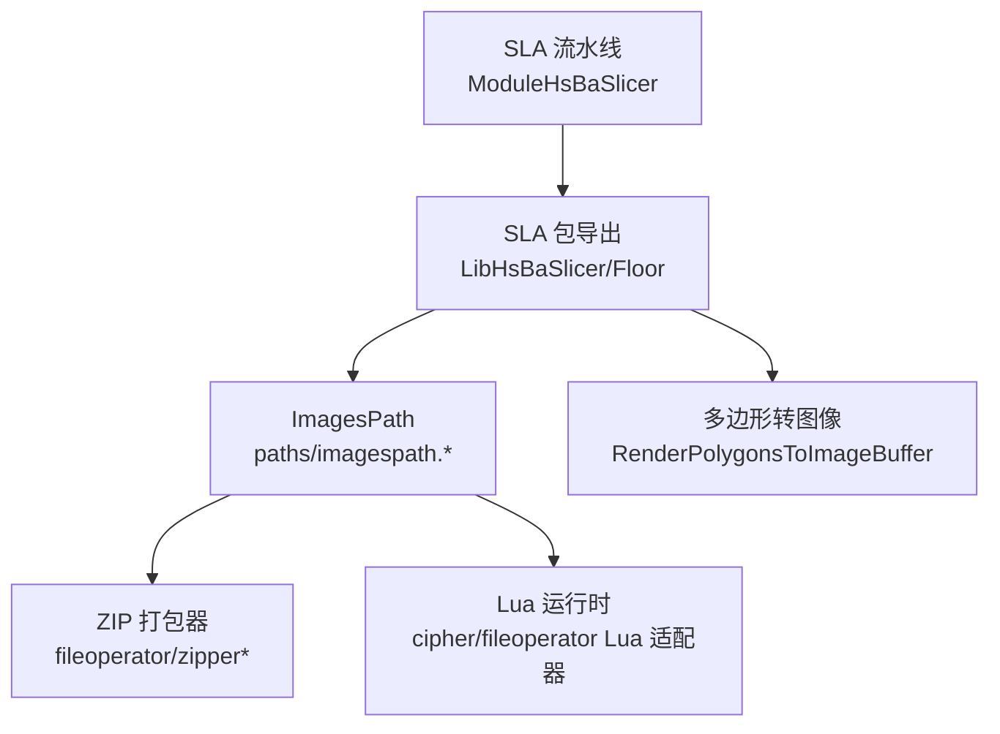
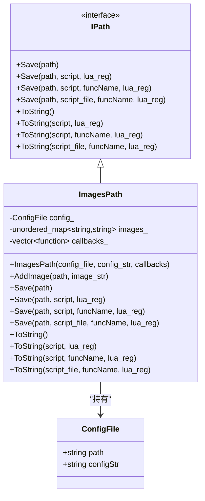
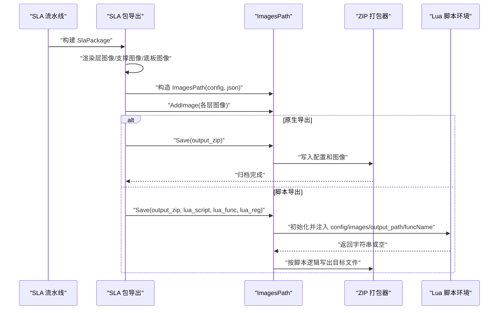
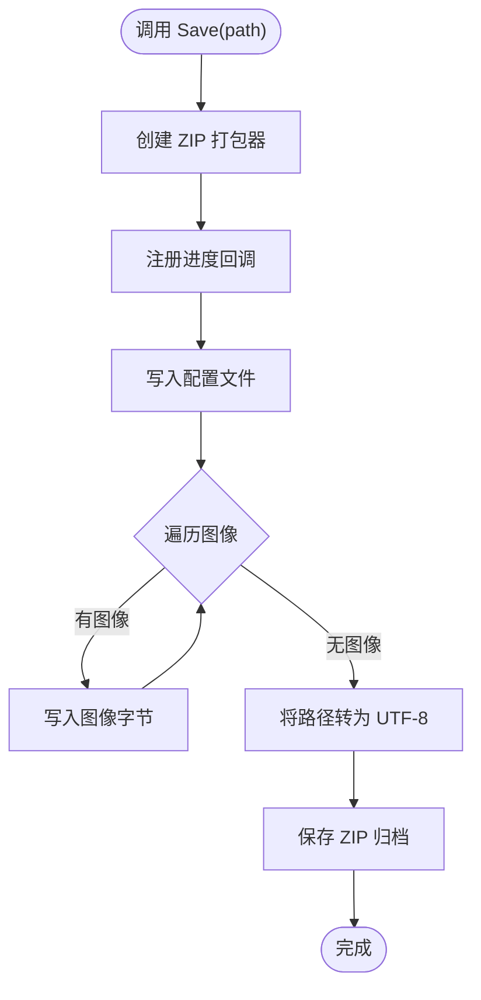
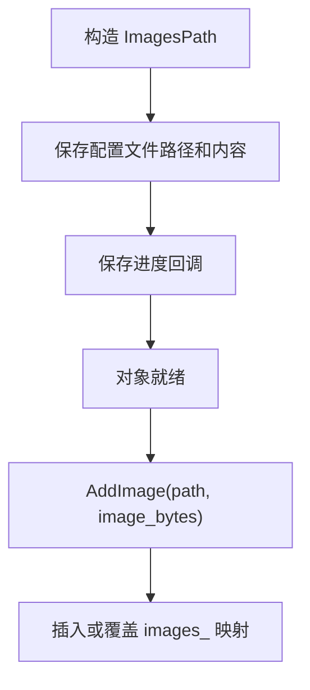
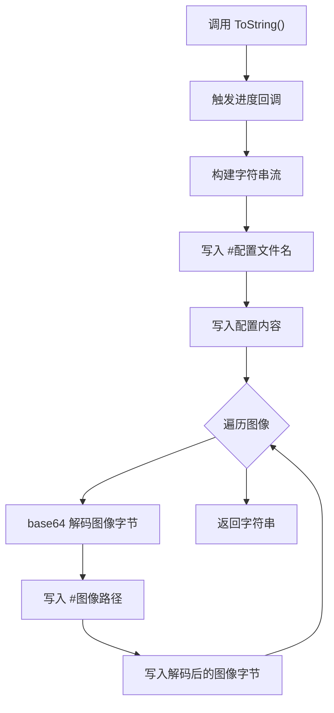
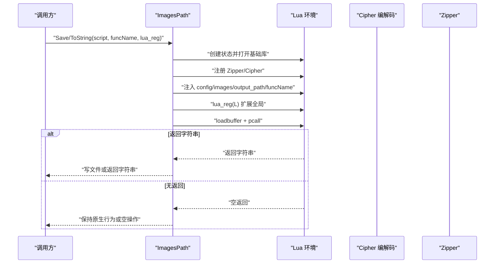
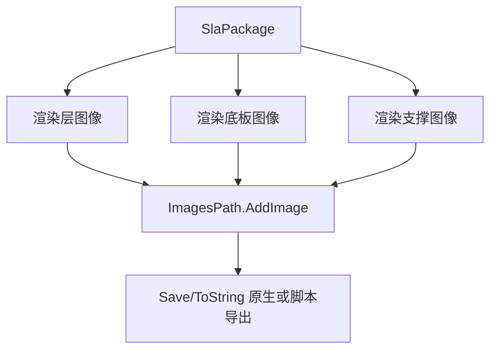
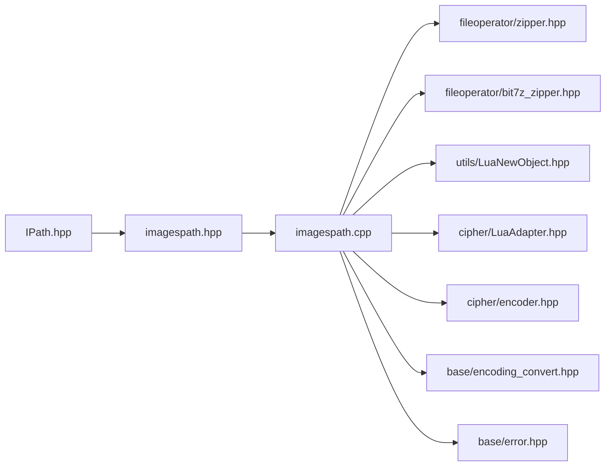

# 图像路径生成

<cite>
**本文引用的文件**   
- [imagespath.hpp](file://paths/imagespath.hpp)
- [imagespath.cpp](file://paths/imagespath.cpp)
- [IPath.hpp](file://paths/IPath.hpp)
- [sla_floor.hpp](file://LibHsBaSlicer/Floor/sla_floor.hpp)
- [sla_floor.cpp](file://LibHsBaSlicer/Floor/sla_floor.cpp)
- [pipeline_types.h](file://pipelinetypes/pipeline_types.h)
- [hsba_slicer.cppm](file://ModuleHsBaSlicer/hsba_slicer.cppm)
- [images_path_test.cpp](file://tests/PathsOut/images_path_test.cpp)
</cite>

## 目录
1. [引言](#引言)
2. [项目结构定位](#项目结构定位)
3. [核心概念](#核心概念)
4. [ImagesPath 类总览](#imagespath-类总览)
5. [架构与数据流](#架构与数据流)
6. [详细组件分析](#详细组件分析)
7. [依赖关系分析](#依赖关系分析)
8. [性能与内存管理](#性能与内存管理)
9. [API 参考](#api-参考)
10. [使用示例](#使用示例)
11. [故障排除](#故障排除)
12. [结论](#结论)

## 引言
本技术文档聚焦 `ImagesPath` 类，它是 HsBaSlicer 中用于“将切片层多边形数据转换为图像序列”的图像路径输出实现。该类并不直接执行像素级图像编码，而是负责：
- 携带一个配置侧车文件（例如 `config.json`）及其内容字符串；
- 维护一组以路径为键、以图像字节串为值的命名图像集合；
- 提供原生 ZIP 打包导出能力；
- 通过 Lua 脚本对图像数据进行后处理、自定义序列化或批量导出；
- 在 SLA/SLS 等流水线中作为最终图像包载体，承接上层渲染结果并输出到 zip 或脚本指定格式。

需要特别说明的是：当前仓库中 `ImagesPath` 本身不包含分辨率设置、颜色映射策略、填充模式、边缘检测或抗锯齿算法的实现；这些图像处理逻辑位于上层渲染接口和 2D 几何库中。`ImagesPath` 的职责是“包装、传递、打包和脚本化导出”已经生成的图像字节。

## 项目结构定位
`ImagesPath` 属于路径输出子系统，位于 `paths` 模块中，继承自抽象路径接口 `IPath`。SLA 流水线在 `LibHsBaSlicer/Floor` 中将多边形渲染为图像字节，再交给 `ImagesPath` 进行打包或脚本导出。

**图表来源**
- [hsba_slicer.cppm:837-856](file://ModuleHsBaSlicer/hsba_slicer.cppm#L837-L856)
- [sla_floor.cpp:532-600](file://LibHsBaSlicer/Floor/sla_floor.cpp#L532-L600)
- [imagespath.cpp:35-49](file://paths/imagespath.cpp#L35-L49)

**章节来源**
- [imagespath.hpp:1-64](file://paths/imagespath.hpp#L1-L64)
- [imagespath.cpp:1-387](file://paths/imagespath.cpp#L1-L387)
- [sla_floor.hpp:118-195](file://LibHsBaSlicer/Floor/sla_floor.hpp#L118-L195)

## 核心概念
- **图像路径产物**：不是传统 G-code 路径，而是“配置 + 图像集合”的产物，适合 SLA/SLS 等基于投影图像的增材制造流程。
- **配置侧车**：每个 `ImagesPath` 都绑定一个配置文件名和内容字符串，通常对应 `config.json`。
- **命名图像**：图像以路径名（如 `layers/layer_0.png`）索引，支持覆盖写入。
- **原生导出**：默认将配置和图像写入 ZIP 归档。
- **脚本化导出**：通过 Lua 脚本访问 `config`、`images`、`output_path`、`funcName` 等全局变量，实现自定义导出逻辑。
- **进度回调**：构造时可传入进度回调，原生保存时会驱动 ZIP 进度。

**章节来源**
- [imagespath.hpp:16-33](file://paths/imagespath.hpp#L16-L33)
- [imagespath.cpp:24-33](file://paths/imagespath.cpp#L24-L33)

## ImagesPath 类总览
`ImagesPath` 继承自 `IPath`，实现统一的 Save/ToString 家族接口，同时暴露 `AddImage` 用于添加图像负载。其内部维护：
- `ConfigFile config_`：包含配置文件路径和内容；
- `std::unordered_map<std::string, std::string> images_`：路径到图像字节串的映射；
- `callbacks_`：进度回调函数列表。

**图表来源**
- [IPath.hpp:20-56](file://paths/IPath.hpp#L20-L56)
- [imagespath.hpp:16-61](file://paths/imagespath.hpp#L16-L61)

**章节来源**
- [imagespath.hpp:16-61](file://paths/imagespath.hpp#L16-L61)
- [IPath.hpp:20-56](file://paths/IPath.hpp#L20-L56)

## 架构与数据流
### 整体导出流程
SLA 流水线将每层轮廓、支撑、底板多边形渲染为图像字节，然后由 `ImagesPath` 统一打包。

**图表来源**
- [hsba_slicer.cppm:837-856](file://ModuleHsBaSlicer/hsba_slicer.cppm#L837-L856)
- [sla_floor.cpp:532-600](file://LibHsBaSlicer/Floor/sla_floor.cpp#L532-L600)
- [imagespath.cpp:52-130](file://paths/imagespath.cpp#L52-L130)

### 原生保存流程
原生 `Save(path)` 会创建 ZIP 归档，依次写入配置文件和所有图像字节。

**图表来源**
- [imagespath.cpp:35-49](file://paths/imagespath.cpp#L35-L49)

**章节来源**
- [imagespath.cpp:35-49](file://paths/imagespath.cpp#L35-L49)

## 详细组件分析

### 构造函数与图像添加
- 构造函数接收配置文件名、配置内容字符串以及可选进度回调列表。
- `AddImage` 接受路径名和图像字节串，若同名已存在则覆盖。

**图表来源**
- [imagespath.cpp:24-33](file://paths/imagespath.cpp#L24-L33)
- [imagespath.hpp:32-50](file://paths/imagespath.hpp#L32-L50)

**章节来源**
- [imagespath.cpp:24-33](file://paths/imagespath.cpp#L24-L33)
- [imagespath.hpp:32-50](file://paths/imagespath.hpp#L32-L50)

### 原生 ToString 序列化
当没有脚本时，`ToString()` 会：
- 触发所有进度回调；
- 输出配置文件名行；
- 输出配置内容；
- 对每个图像先进行 base64 解码，再以路径名和原始字节形式输出。

**图表来源**
- [imagespath.cpp:369-383](file://paths/imagespath.cpp#L369-L383)

**章节来源**
- [imagespath.cpp:369-383](file://paths/imagespath.cpp#L369-L383)

### Lua 脚本导出流程
`Save(path, script, ...)` 和 `ToString(script, ...)` 都会：
- 创建独立 Lua 状态；
- 注册基础库、ZIP 适配器、Cipher 编解码；
- 注入 `config`、`images`、`output_path`、`funcName` 等全局；
- 加载并运行脚本；
- 若脚本返回字符串，则写入文件或返回字符串。

**图表来源**
- [imagespath.cpp:52-130](file://paths/imagespath.cpp#L52-L130)
- [imagespath.cpp:222-284](file://paths/imagespath.cpp#L222-L284)
- [imagespath.cpp:287-352](file://paths/imagespath.cpp#L287-L352)

**章节来源**
- [imagespath.cpp:52-130](file://paths/imagespath.cpp#L52-L130)
- [imagespath.cpp:222-284](file://paths/imagespath.cpp#L222-L284)
- [imagespath.cpp:287-352](file://paths/imagespath.cpp#L287-L352)

### 与 SLA 流水线的集成
SLA 包导出会将层轮廓、支撑、底板多边形渲染为图像，并通过 `ImagesPath` 输出。关键参数包括：
- `image_width`、`image_height`：图像宽高；
- `image_extension`：`.png`、`.jpg`、`.svg`；
- `include_floor_images`、`include_support_images`：是否包含底板和支撑图像。

**图表来源**
- [sla_floor.hpp:160-171](file://LibHsBaSlicer/Floor/sla_floor.hpp#L160-L171)
- [sla_floor.cpp:537-585](file://LibHsBaSlicer/Floor/sla_floor.cpp#L537-L585)

**章节来源**
- [sla_floor.hpp:118-195](file://LibHsBaSlicer/Floor/sla_floor.hpp#L118-L195)
- [sla_floor.cpp:532-600](file://LibHsBaSlicer/Floor/sla_floor.cpp#L532-L600)

## 依赖关系分析
`ImagesPath` 的依赖可分为三类：
- **路径接口依赖**：继承 `IPath`，统一导出语义；
- **文件与压缩依赖**：使用 ZIP 打包器，支持原生 bit7z 编译选项；
- **Lua 生态依赖**：Cipher 编解码、文件操作、Lua 状态管理。

**图表来源**
- [imagespath.cpp:5-20](file://paths/imagespath.cpp#L5-L20)
- [IPath.hpp:1-68](file://paths/IPath.hpp#L1-L68)

**章节来源**
- [imagespath.cpp:5-20](file://paths/imagespath.cpp#L5-L20)
- [IPath.hpp:1-68](file://paths/IPath.hpp#L1-L68)

## 性能与内存管理
- **图像存储**：图像以 `std::string` 存储在 `unordered_map` 中，重复路径会覆盖旧值，避免重复分配但可能丢失历史帧。
- **序列化开销**：原生 `ToString()` 会对每个图像执行 base64 解码，产生额外内存和 CPU 开销；适合调试或小规模导出。
- **ZIP 打包**：原生 `Save` 将所有图像写入 ZIP，大图像或大量图层会显著增加内存峰值和归档时间。
- **Lua 导出**：每次脚本导出都会创建新的 Lua 状态，适合灵活定制，但不适合高频循环调用。
- **并行渲染**：SLA 流水线在渲染阶段使用并行策略，而 `ImagesPath` 本身不引入线程模型；性能瓶颈通常在图像编码和 ZIP 写入阶段。

优化建议：
- 控制图像数量和分辨率，避免一次性加载过多大图；
- 使用脚本导出时尽量复用脚本逻辑，减少频繁创建 Lua 环境；
- 对超大工程可考虑分批次导出或使用外部归档工具；
- 利用 `image_width=0`、`image_height=0` 的自动尺寸策略，平衡清晰度与体积。

[本节为通用性能讨论，不直接分析具体代码片段]

## API 参考

### 类定义与成员
- **类名**：`HsBa::Slicer::ImagesPath`
- **基类**：`IPath`
- **主要成员**：
  - 构造函数：`ImagesPath(std::string_view config_file, std::string_view config_str, const std::vector<std::function<void(double, std::string_view)>>& callback = {})`
  - 图像添加：`void AddImage(std::string_view path, std::string_view image_str)`
  - 保存接口：`Save(const std::filesystem::path&)`、`Save(const std::filesystem::path&, std::string_view script, ...)`、`Save(const std::filesystem::path&, const std::filesystem::path& script_file, std::string_view funcName, ...)`
  - 序列化接口：`ToString()`、`ToString(const std::string_view script, ...)`, `ToString(const std::string_view script, const std::string_view funcName, ...)`, `ToString(const std::filesystem::path& script_file, const std::string_view funcName, ...)`

**章节来源**
- [imagespath.hpp:23-50](file://paths/imagespath.hpp#L23-L50)

### 支持的图像格式
`ImagesPath` 本身不限制图像格式，它只接收任意字节串。实际格式由上游渲染接口决定，常见扩展名包括：
- `.png`
- `.jpg`
- `.svg`

SLA 流水线中通过 `SlaPackage.image_extension` 选择编码器，并在导出时将该扩展名附加到图像路径。

**章节来源**
- [sla_floor.hpp:160-171](file://LibHsBaSlicer/Floor/sla_floor.hpp#L160-L171)
- [hsba_slicer.cppm:842-851](file://ModuleHsBaSlicer/hsba_slicer.cppm#L842-L851)

### 分辨率设置
分辨率由上层渲染接口控制，`ImagesPath` 仅承载渲染后的图像字节。相关配置字段：
- `image_width`：图像宽度，0 表示自动；
- `image_height`：图像高度，0 表示自动。

**章节来源**
- [sla_floor.hpp:160-171](file://LibHsBaSlicer/Floor/sla_floor.hpp#L160-L171)
- [pipeline_types.h:215-216](file://pipelinetypes/pipeline_types.h#L215-L216)

### 颜色映射策略
`ImagesPath` 不负责颜色映射；颜色映射由上游 2D 渲染管线决定。若需自定义颜色，应在渲染阶段调整多边形绘制策略或使用 Lua 脚本对图像字节进行后处理。

[本节为概念说明，不直接分析具体代码片段]

### 批量导出流程
批量导出通常由 SLA 流水线完成：
1. 渲染每层轮廓图像；
2. 渲染支撑图像；
3. 渲染底板图像；
4. 调用 `ImagesPath.AddImage` 加入所有图像；
5. 调用 `Save` 或 `ToString` 输出 ZIP 或脚本指定格式。

**章节来源**
- [sla_floor.cpp:537-585](file://LibHsBaSlicer/Floor/sla_floor.cpp#L537-L585)

### 多边形转位图的技术边界
`ImagesPath` 不实现多边形到像素的转换。该转换由 `RenderPolygonsToImage` / `RenderPolygonsToImageBuffer` 等接口完成。因此，关于填充模式、边缘检测和抗锯齿的具体实现应查阅 2D 几何与渲染模块，而不是 `ImagesPath`。

**章节来源**
- [sla_floor.hpp:122-151](file://LibHsBaSlicer/Floor/sla_floor.hpp#L122-L151)

## 使用示例

### 基本用法：添加图像并原生导出 ZIP
1. 构造 `ImagesPath`，传入配置文件名和 JSON 内容；
2. 调用 `AddImage` 添加若干图像；
3. 调用 `Save` 输出 ZIP 归档。

测试用例展示了这一流程，并验证了临时 ZIP 文件是否生成。

**章节来源**
- [images_path_test.cpp:56-81](file://tests/PathsOut/images_path_test.cpp#L56-L81)
- [images_path_test.cpp:100-112](file://tests/PathsOut/images_path_test.cpp#L100-L112)

### 使用 Lua 脚本导出
脚本可通过以下全局变量访问数据：
- `config.path`：配置文件名；
- `config.configStr`：配置文件内容；
- `images[i].path`：第 i 个图像的路径名；
- `images[i].data`：第 i 个图像的字节串；
- `output_path`：输出路径；
- `funcName`：指定函数名（部分重载注入）。

测试用例演示了：
- 使用 `Cipher.base64_decode` 解码图像；
- 使用 `Zipper` 创建 ZIP；
- 通过 `funcName` 验证脚本注入。

**章节来源**
- [images_path_test.cpp:26-54](file://tests/PathsOut/images_path_test.cpp#L26-L54)
- [images_path_test.cpp:114-129](file://tests/PathsOut/images_path_test.cpp#L114-L129)
- [images_path_test.cpp:177-213](file://tests/PathsOut/images_path_test.cpp#L177-L213)

### 在 SLA 流水线中使用
SLA 流水线将 `SlaPackage` 中的层轮廓、支撑、底板多边形渲染为图像，再通过 `ImagesPath.Save` 输出。用户可通过传入 Lua 脚本和函数名自定义导出逻辑。

**章节来源**
- [sla_floor.cpp:532-600](file://LibHsBaSlicer/Floor/sla_floor.cpp#L532-L600)

## 故障排除
常见问题及处理方式：
- **Lua 初始化失败**：抛出 `RuntimeError`，检查 Lua 环境是否正常加载。
- **脚本加载失败**：Lua 语法错误或无效脚本会导致 `RuntimeError`。
- **脚本运行时错误**：脚本内部 `error(...)` 会被捕获并包装为 `RuntimeError`。
- **脚本文件不存在**：`ToString` 或 `Save` 的文件版会抛出 `RuntimeError`。
- **输出文件无法打开**：写入目标路径失败时抛出 `RuntimeError`。
- **Cipher 编解码异常**：非法 hex 输入等会触发底层异常，并被 Lua 层包装为运行时错误。

**章节来源**
- [imagespath.cpp:55-59](file://paths/imagespath.cpp#L55-L59)
- [imagespath.cpp:105-116](file://paths/imagespath.cpp#L105-L116)
- [imagespath.cpp:181-193](file://paths/imagespath.cpp#L181-L193)
- [imagespath.cpp:211-219](file://paths/imagespath.cpp#L211-L219)
- [imagespath.cpp:265-276](file://paths/imagespath.cpp#L265-L276)
- [imagespath.cpp:332-344](file://paths/imagespath.cpp#L332-L344)
- [images_path_test.cpp:157-175](file://tests/PathsOut/images_path_test.cpp#L157-L175)
- [images_path_test.cpp:218-235](file://tests/PathsOut/images_path_test.cpp#L218-L235)

## 结论
`ImagesPath` 是 HsBaSlicer 图像输出链路的“容器与出口”。它不负责像素级图像处理，而是专注于：
- 统一管理配置与图像字节；
- 提供原生 ZIP 打包；
- 通过 Lua 脚本实现灵活的序列化与导出；
- 与 SLA/SLS 流水线无缝衔接。

对于分辨率、颜色映射、填充、边缘检测、抗锯齿等图像处理细节，应关注上层渲染接口和 2D 几何库；`ImagesPath` 的价值在于将这些结果可靠地组织、传递并导出到下游系统。

[本节为总结性内容，不直接分析具体代码片段]