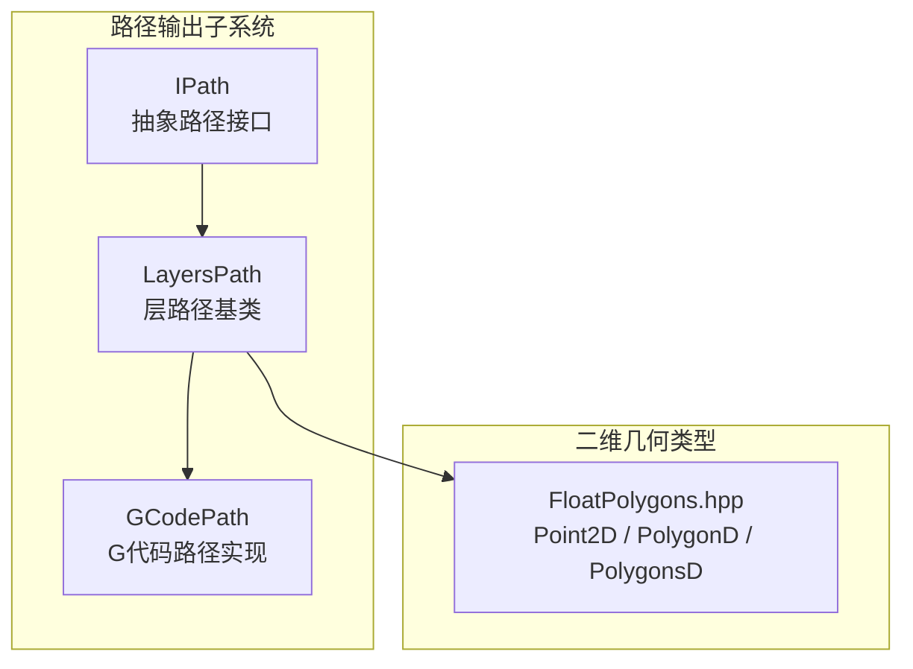
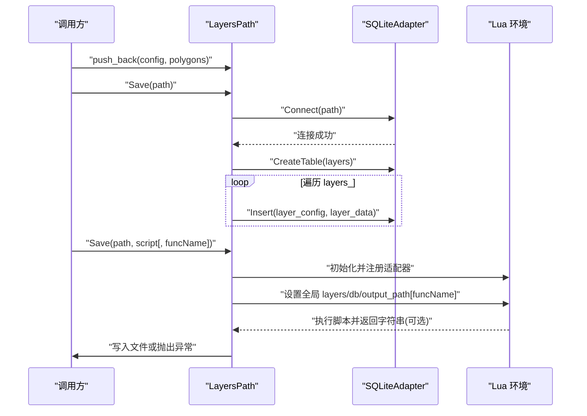
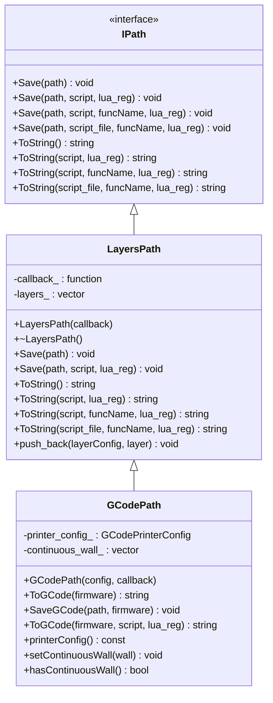
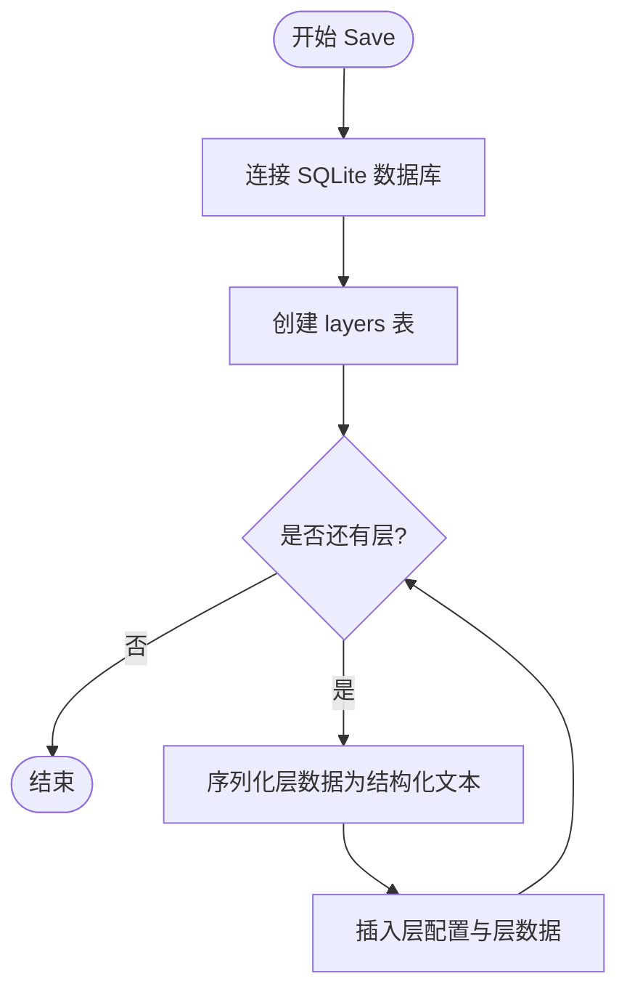
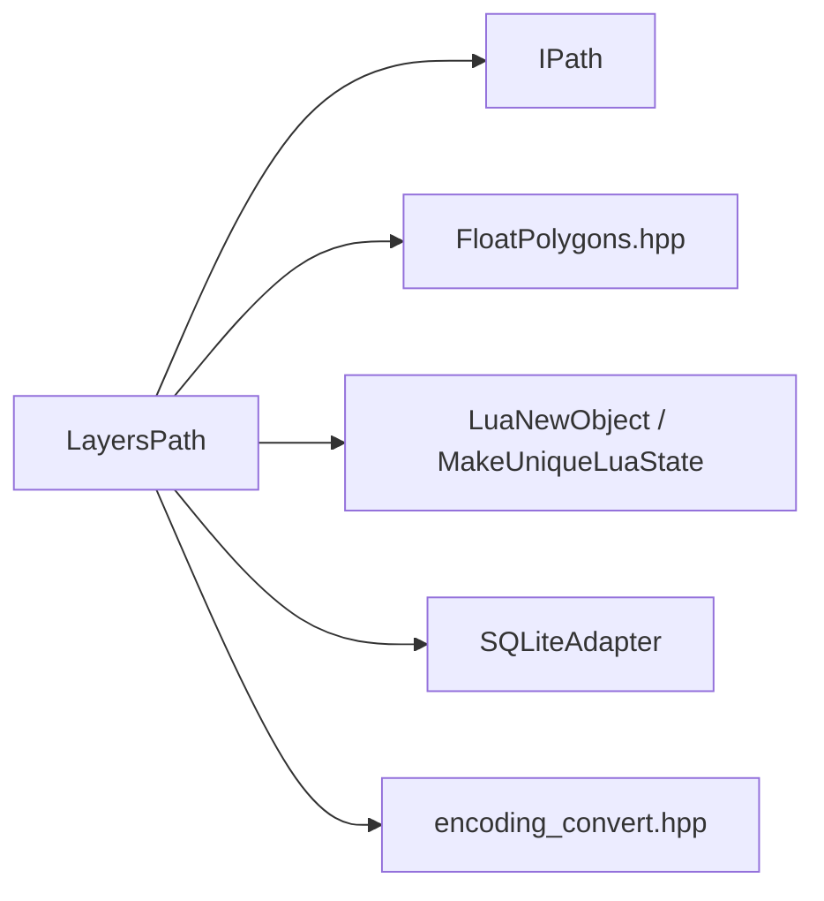
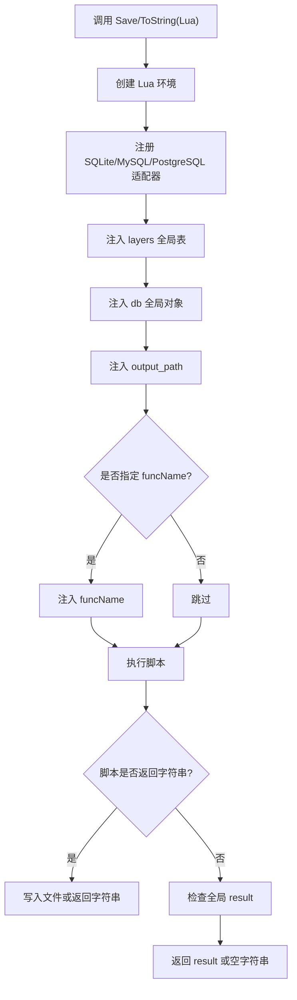

# 层数据管理

<cite>
**本文引用的文件**   
- [layerspath.hpp](file://paths/layerspath.hpp)
- [layerspath.cpp](file://paths/layerspath.cpp)
- [IPath.hpp](file://paths/IPath.hpp)
- [FloatPolygons.hpp](file://2D/FloatPolygons.hpp)
- [gcodepath.hpp](file://paths/gcodepath.hpp)
- [layers_path_test.cpp](file://tests/PathsOut/layers_path_test.cpp)
</cite>

## 目录
1. [引言](#引言)
2. [项目结构定位](#项目结构定位)
3. [核心概念与职责](#核心概念与职责)
4. [架构总览](#架构总览)
5. [详细组件分析](#详细组件分析)
6. [依赖关系分析](#依赖关系分析)
7. [API 参考文档](#api-参考文档)
8. [Lua 脚本集成与扩展机制](#lua-脚本集成与扩展机制)
9. [生命周期、内存与并发安全](#生命周期内存与并发安全)
10. [性能调优建议](#性能调优建议)
11. [故障排除指南](#故障排除指南)
12. [结论](#结论)

## 引言
本技术文档围绕 `LayersPath` 基类展开，系统性说明其在切片路径输出体系中的角色：以“层”为单位组织双精度多边形集合，并提供原生序列化、SQLite 存储以及 Lua 脚本后处理三种输出通道。文档同时覆盖继承扩展方式（如 `GCodePath`）、与 Lua 系统的集成契约、错误处理策略、性能特征和最佳实践，帮助读者在不直接阅读源码的情况下也能正确使用并扩展该模块。

## 项目结构定位
`LayersPath` 位于路径输出子系统 `paths` 中，是多种具体路径类型的基类之一；其数据模型基于 `2D/FloatPolygons.hpp` 提供的双精度多边形类型，对外通过 `IPath` 抽象接口暴露统一的保存与序列化能力。

**图表来源**
- [IPath.hpp:29-57](file://paths/IPath.hpp#L29-L57)
- [layerspath.hpp:25-60](file://paths/layerspath.hpp#L25-L60)
- [gcodepath.hpp:66-107](file://paths/gcodepath.hpp#L66-L107)
- [FloatPolygons.hpp:18-25](file://2D/FloatPolygons.hpp#L18-L25)

**章节来源**
- [layerspath.hpp:1-64](file://paths/layerspath.hpp#L1-L64)
- [IPath.hpp:1-68](file://paths/IPath.hpp#L1-L68)
- [FloatPolygons.hpp:1-271](file://2D/FloatPolygons.hpp#L1-L271)

## 核心概念与职责
- 层数据单元：每个层包含一个自由格式的字符串配置和一个双精度多边形集合。
- 有序层序列：`LayersPath` 维护按添加顺序排列的层列表，便于逐层遍历、序列化或脚本处理。
- 统一输出接口：通过 `IPath` 提供 `Save` 与 `ToString` 系列方法，支持原生格式、内联 Lua 脚本、脚本文件和函数名等多种模式。
- 可扩展性：作为基类，派生类可复用层数据结构并叠加特定格式逻辑（例如 `GCodePath` 增加打印机配置与连续外壁）。

关键数据结构如下：

| 名称 | 类型 | 含义 | 复杂度影响 |
|---|---|---|---|
| `LayersData::layerConfig` | `std::string` | 层的自由格式配置文本 | 随配置长度线性增长 |
| `LayersData::layer` | `PolygonsD` | 双精度多边形集合 | 随顶点数线性增长 |
| `LayersPath::layers_` | `std::vector<LayersData>` | 有序层容器 | push_back 均摊 O(1)，遍历 O(n) |
| `callback_` | `std::function<void(string_view,string_view)>` | 进度/状态回调 | 每次数据库操作可能触发回调 |

**章节来源**
- [layerspath.hpp:52-60](file://paths/layerspath.hpp#L52-L60)
- [layerspath.cpp:26-29](file://paths/layerspath.cpp#L26-L29)

## 架构总览
`LayersPath` 在整体路径输出架构中承担“层数据容器 + 通用序列化入口”的职责。其核心流程包括：
- 数据构建：调用 `push_back` 追加层。
- 原生保存：写入 SQLite 表 `layers`，字段包含自增 id、层配置和层数据的 JSON-like BLOB。
- Lua 后处理：创建独立 Lua 环境，注入全局 `layers`、`db`、`output_path`、可选 `funcName`，执行脚本并将返回值写入文件或返回字符串。
- 继承扩展：子类可在保留层数据的同时增加自身字段与生成逻辑。

**图表来源**
- [layerspath.cpp:31-62](file://paths/layerspath.cpp#L31-L62)
- [layerspath.cpp:64-166](file://paths/layerspath.cpp#L64-L166)
- [layerspath.cpp:168-280](file://paths/layerspath.cpp#L168-L280)

**章节来源**
- [layerspath.cpp:31-62](file://paths/layerspath.cpp#L31-L62)
- [layerspath.cpp:64-166](file://paths/layerspath.cpp#L64-L166)
- [layerspath.cpp:168-280](file://paths/layerspath.cpp#L168-L280)

## 详细组件分析

### 类层次与继承关系
`LayersPath` 继承自 `IPath`，并被 `GCodePath` 继承用于生成 G 代码。

**图表来源**
- [IPath.hpp:29-57](file://paths/IPath.hpp#L29-L57)
- [layerspath.hpp:25-60](file://paths/layerspath.hpp#L25-L60)
- [gcodepath.hpp:66-107](file://paths/gcodepath.hpp#L66-L107)

**章节来源**
- [layerspath.hpp:25-60](file://paths/layerspath.hpp#L25-L60)
- [gcodepath.hpp:66-107](file://paths/gcodepath.hpp#L66-L107)

### 层数据存储结构
- 原生保存使用 SQLite 表 `layers`，字段为：
  - `id`：自增主键。
  - `layer_config`：TEXT，不可为空。
  - `layer_data`：BLOB，存储每层多边形的结构化文本。
- 层数据序列化采用紧凑的嵌套结构：外层为层数组，每层包含 `config` 与 `data`，`data` 是多边形数组，每个多边形是点数组，点包含 `x`、`y`。

**图表来源**
- [layerspath.cpp:31-62](file://paths/layerspath.cpp#L31-L62)

**章节来源**
- [layerspath.cpp:31-62](file://paths/layerspath.cpp#L31-L62)

### 访问接口与遍历语义
- 添加层：`push_back(layerConfig, layer)` 将层追加到末尾，保持顺序稳定。
- 遍历：原生序列化与 Lua 导出均按 `layers_` 顺序遍历，保证输出顺序与添加顺序一致。
- 查询：原生模式下可通过 SQL 查询 `layers` 表；Lua 模式下脚本可直接读取全局 `layers` 表进行任意过滤、聚合或转换。

**章节来源**
- [layerspath.cpp:26-29](file://paths/layerspath.cpp#L26-L29)
- [layerspath.cpp:282-304](file://paths/layerspath.cpp#L282-L304)
- [layerspath.cpp:93-124](file://paths/layerspath.cpp#L93-L124)

## 依赖关系分析
`LayersPath` 的依赖主要包含：
- 几何类型：`FloatPolygons.hpp` 提供 `Point2D`、`PolygonD`、`PolygonsD`。
- 抽象接口：`IPath.hpp` 定义统一保存与序列化 API。
- Lua 系统：通过 `MakeUniqueLuaState`、`RegisterLuaSQLiteAdapter` 等工具创建并配置 Lua 环境。
- 数据库适配：`SQL::SQLiteAdapter` 负责 SQLite 连接、建表与插入。
- 编码转换：`path_to_utf8` 确保跨平台路径正确传递。

**图表来源**
- [layerspath.cpp:5-17](file://paths/layerspath.cpp#L5-L17)
- [layerspath.cpp:31-62](file://paths/layerspath.cpp#L31-L62)
- [layerspath.cpp:64-166](file://paths/layerspath.cpp#L64-L166)

**章节来源**
- [layerspath.cpp:5-17](file://paths/layerspath.cpp#L5-L17)
- [layerspath.cpp:31-62](file://paths/layerspath.cpp#L31-L62)
- [layerspath.cpp:64-166](file://paths/layerspath.cpp#L64-L166)

## API 参考文档

### 构造与析构
- `LayersPath(callback = 空回调)`  
  构造层路径对象，可选传入进度/状态回调，回调签名 `(key, value)`。
- `~LayersPath()`  
  虚析构，遵循 C++ 基类析构约定。

**章节来源**
- [layerspath.hpp:32-34](file://paths/layerspath.hpp#L32-L34)

### 层数据操作
- `push_back(layerConfig, layer)`  
  追加一层：`layerConfig` 为自由格式字符串，`layer` 为 `PolygonsD`。

**章节来源**
- [layerspath.hpp:49-50](file://paths/layerspath.hpp#L49-L50)
- [layerspath.cpp:26-29](file://paths/layerspath.cpp#L26-L29)

### 原生保存
- `Save(path)`  
  将层数据保存到 SQLite 文件，自动建表并插入每层配置与结构化层数据。

**章节来源**
- [layerspath.hpp:35](file://paths/layerspath.hpp#L35)
- [layerspath.cpp:31-62](file://paths/layerspath.cpp#L31-L62)

### 字符串序列化
- `ToString()`  
  返回层数据的结构化字符串表示。
- `ToString(script, lua_reg)`  
  若脚本为空则回退到原生序列化；否则执行 Lua 脚本，优先取返回值，其次取全局 `result`。
- `ToString(script, funcName, lua_reg)`  
  在执行脚本前注入全局 `funcName`，适用于带命名函数的脚本。
- `ToString(script_file, funcName, lua_reg)`  
  从脚本文件加载脚本并执行。

**章节来源**
- [layerspath.hpp:38-48](file://paths/layerspath.hpp#L38-L48)
- [layerspath.cpp:282-304](file://paths/layerspath.cpp#L282-L304)
- [layerspath.cpp:306-395](file://paths/layerspath.cpp#L306-L395)
- [layerspath.cpp:397-481](file://paths/layerspath.cpp#L397-L481)
- [layerspath.cpp:483-496](file://paths/layerspath.cpp#L483-L496)

### Lua 后处理保存
- `Save(path, script, lua_reg)`  
  创建 Lua 环境，注入 `layers`、`db`、`output_path`，执行脚本；若脚本返回字符串则写入目标文件。
- `Save(path, script, funcName, lua_reg)`  
  额外注入 `funcName`，供脚本区分不同处理函数。
- `Save(path, script_file, funcName, lua_reg)`  
  从脚本文件加载脚本并执行。

**章节来源**
- [layerspath.hpp:35-48](file://paths/layerspath.hpp#L35-L48)
- [layerspath.cpp:64-166](file://paths/layerspath.cpp#L64-L166)
- [layerspath.cpp:168-280](file://paths/layerspath.cpp#L168-L280)

### 与 IPath 的关系
`LayersPath` 完整实现 `IPath` 的所有纯虚函数，从而可被任何期望 `IPath` 的流水线阶段替换或组合。

**章节来源**
- [IPath.hpp:29-57](file://paths/IPath.hpp#L29-L57)

## Lua 脚本集成与扩展机制

### 全局变量契约
当调用 `Save` 或 `ToString` 的 Lua 重载时，`LayersPath` 会向脚本暴露以下全局变量：
- `layers`：数组形式的层数据，元素结构为 `{config, data}`，其中 `data` 是多边形数组，每个多边形是点数组，点结构为 `{x, y}`。
- `db`：已连接的 `SQLiteAdapter` 实例，可用于在脚本中进一步写入数据库。
- `output_path`：目标输出路径（UTF-8 字符串）。
- `funcName`：仅在带函数名的重载中可用，表示当前处理的函数名。

**图表来源**
- [layerspath.cpp:64-166](file://paths/layerspath.cpp#L64-L166)
- [layerspath.cpp:168-280](file://paths/layerspath.cpp#L168-L280)
- [layerspath.cpp:306-395](file://paths/layerspath.cpp#L306-L395)
- [layerspath.cpp:397-481](file://paths/layerspath.cpp#L397-L481)

### 自定义算法注册
通过 `lua_reg` 参数，调用方可在 Lua 环境中注册自定义函数或对象。典型用法：
- 注册自定义编码器、压缩器或业务校验函数。
- 注册第三方库包装函数，使脚本可直接调用。
- 注入运行时配置或日志钩子。

示例场景（不展示源码）：
- 在 `lua_reg` 中注册 `encodeLayer`，脚本调用该函数对层数据进行编码后再写入。
- 在 `lua_reg` 中注册 `logProgress`，脚本在遍历层时上报进度。

**章节来源**
- [layerspath.cpp:81-84](file://paths/layerspath.cpp#L81-L84)
- [layerspath.cpp:184-187](file://paths/layerspath.cpp#L184-L187)
- [layerspath.cpp:319-322](file://paths/layerspath.cpp#L319-L322)
- [layerspath.cpp:406-409](file://paths/layerspath.cpp#L406-L409)

### 脚本行为约定
- 返回字符串优先：如果脚本返回字符串，`Save` 会将该字符串写入目标文件，`ToString` 会直接返回该字符串。
- 回退到全局 `result`：如果脚本未返回字符串但设置了全局 `result`，则使用该值。
- 空脚本短路：`ToString(script="")` 直接返回原生序列化结果。
- 错误传播：Lua 加载错误或运行时会抛出 `RuntimeError`。

**章节来源**
- [layerspath.cpp:126-166](file://paths/layerspath.cpp#L126-L166)
- [layerspath.cpp:306-395](file://paths/layerspath.cpp#L306-L395)
- [layerspath.cpp:397-481](file://paths/layerspath.cpp#L397-L481)

## 生命周期、内存与并发安全

### 生命周期管理
- 构造：仅保存回调函数，不分配层数据。
- 数据构建：`push_back` 将层配置和多边形集合拷贝进 `layers_`。
- 序列化：每次 `Save` 或 `ToString` 都会创建新的 Lua 环境，并在作用域结束时释放。
- 析构：默认析构，清理内部容器与回调。

**章节来源**
- [layerspath.cpp:22-24](file://paths/layerspath.cpp#L22-L24)
- [layerspath.cpp:26-29](file://paths/layerspath.cpp#L26-L29)
- [layerspath.cpp:64-166](file://paths/layerspath.cpp#L64-L166)

### 内存优化策略
- 层数据以 `std::vector<LayersData>` 顺序存储，避免随机访问开销。
- 原生序列化与 Lua 导出均采用流式遍历，不额外复制整个层集合。
- Lua 侧通过逐层构建 table 的方式减少一次性大对象压力。
- 建议在大量层场景下控制每层多边形规模，避免单次序列化过大。

**章节来源**
- [layerspath.cpp:93-124](file://paths/layerspath.cpp#L93-L124)
- [layerspath.cpp:282-304](file://paths/layerspath.cpp#L282-L304)

### 并发访问安全
- `LayersPath` 本身不提供内部锁保护，所有公开方法均为非线程安全。
- 多线程使用时应由调用方保证互斥访问，或使用只读副本。
- 回调 `callback_` 的执行由上层决定，应避免在回调中进行阻塞 IO。

**章节来源**
- [layerspath.hpp:58-59](file://paths/layerspath.hpp#L58-L59)
- [layerspath.cpp:31-62](file://paths/layerspath.cpp#L31-L62)

## 性能调优建议
- 批量构建层：尽量合并多次 `push_back` 调用，减少容器扩容次数。
- 控制层规模：单层多边形数量过多会导致序列化与 Lua 传输成本上升。
- 避免重复序列化：缓存 `ToString` 结果，仅在数据变化时重新计算。
- 合理使用 Lua：脚本越复杂，Lua 环境初始化与数据绑定开销越大；简单转换优先使用原生序列化。
- 数据库写入：原生 `Save` 会逐层插入，必要时可在 Lua 脚本中使用事务批量写入。

[本节为通用性能指导，不直接分析具体源码]

## 故障排除指南

### 常见错误与定位
- Lua 初始化失败：检查 Lua 库是否正确链接，确认 `MakeUniqueLuaState` 返回有效状态。
- 脚本加载失败：检查脚本语法，确认传入脚本内容非空且编码正确。
- 脚本运行失败：检查脚本中使用的全局变量是否存在，确认 `layers`、`db`、`output_path`、`funcName` 是否符合预期。
- 文件打开失败：检查目标路径权限与磁盘空间，确认路径编码转换正常。

**章节来源**
- [layerspath.cpp:68-74](file://paths/layerspath.cpp#L68-L74)
- [layerspath.cpp:135-147](file://paths/layerspath.cpp#L135-L147)
- [layerspath.cpp:155-161](file://paths/layerspath.cpp#L155-L161)
- [layerspath.cpp:271-279](file://paths/layerspath.cpp#L271-L279)

### 测试用例验证要点
- 原生序列化应包含层配置与多边形坐标。
- Lua 脚本返回字符串时应被写入文件或返回。
- 空脚本应回退到原生序列化。
- 缺失脚本文件应抛出运行时错误。
- 带函数名的脚本应能访问 `funcName`。

**章节来源**
- [layers_path_test.cpp:16-54](file://tests/PathsOut/layers_path_test.cpp#L16-L54)
- [layers_path_test.cpp:103-140](file://tests/PathsOut/layers_path_test.cpp#L103-L140)
- [layers_path_test.cpp:144-163](file://tests/PathsOut/layers_path_test.cpp#L144-L163)
- [layers_path_test.cpp:167-177](file://tests/PathsOut/layers_path_test.cpp#L167-L177)
- [layers_path_test.cpp:180-226](file://tests/PathsOut/layers_path_test.cpp#L180-L226)

## 结论
`LayersPath` 提供了稳定、可扩展的层数据管理能力，既支持高效的 SQLite 原生存储，也支持灵活的 Lua 脚本后处理。通过 `IPath` 抽象，它可与切片流水线无缝集成；通过继承机制，派生类可复用层数据并叠加特定格式逻辑。在实际使用中，建议关注层规模控制、Lua 脚本复杂度与并发访问安全，以获得更稳定的性能与可维护性。