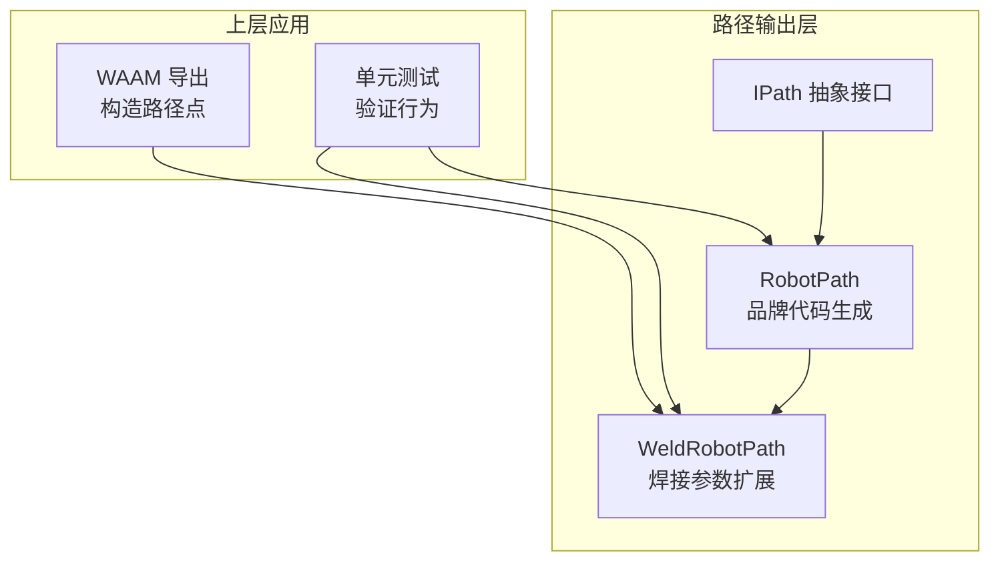
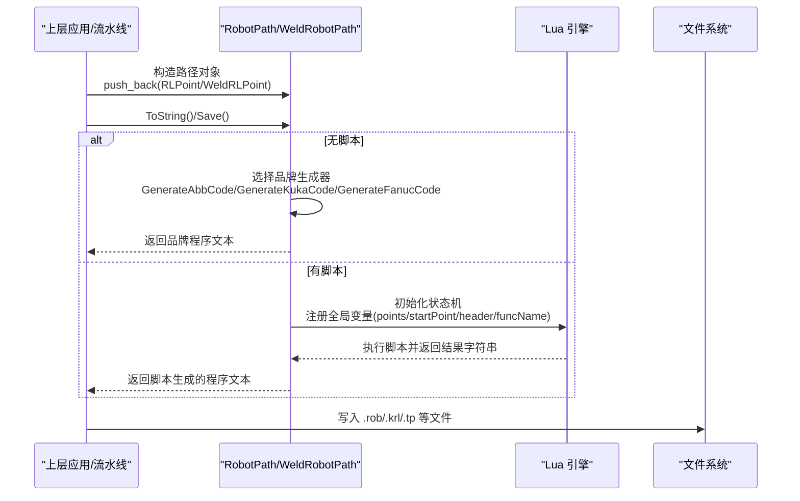
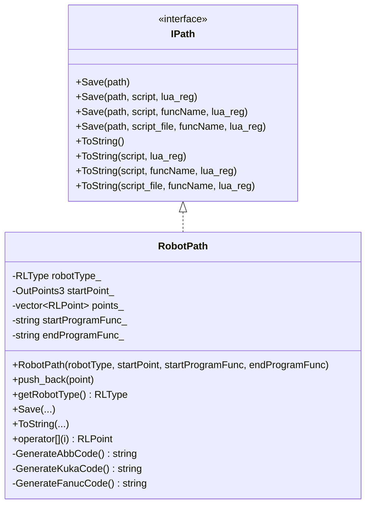
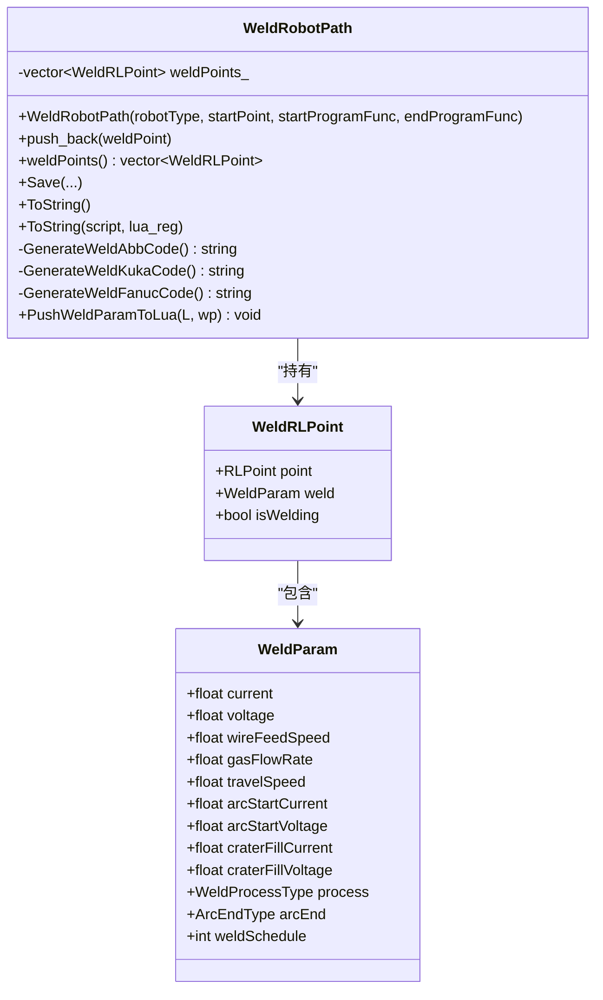
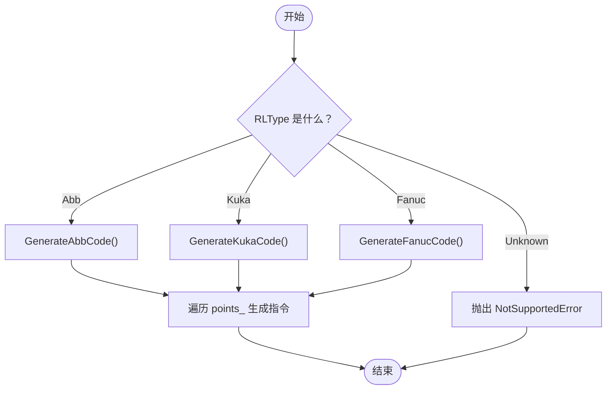
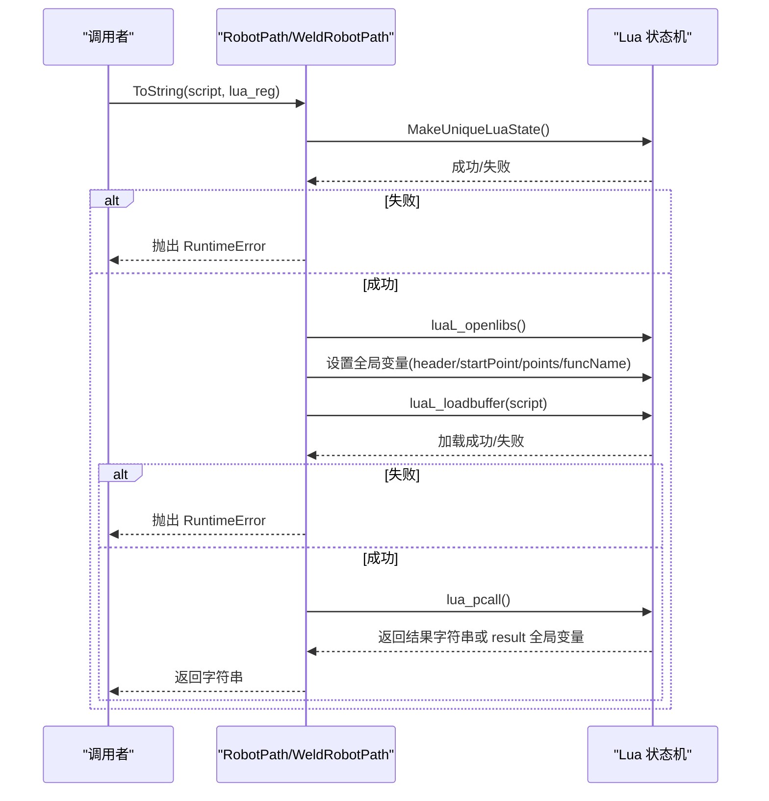
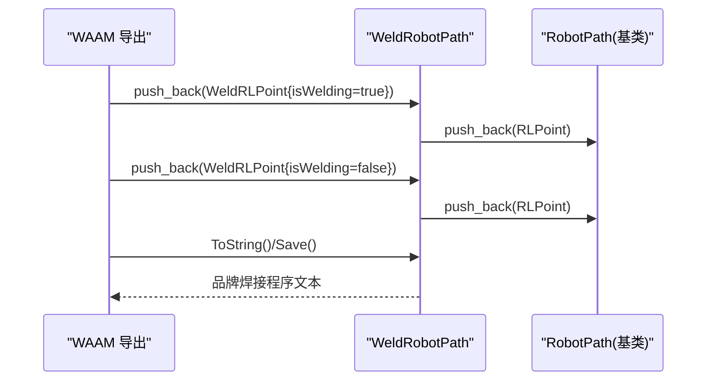
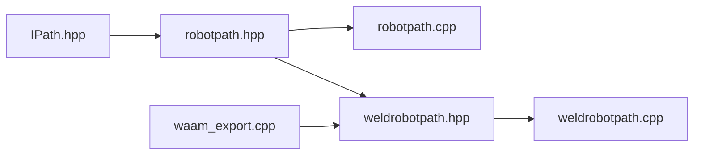

# 机器人路径生成

<cite>
**本文引用的文件 **
- [paths/IPath.hpp](file://paths/IPath.hpp)
- [paths/robotpath.hpp](file://paths/robotpath.hpp)
- [paths/robotpath.cpp](file://paths/robotpath.cpp)
- [paths/weldrobotpath.hpp](file://paths/weldrobotpath.hpp)
- [paths/weldrobotpath.cpp](file://paths/weldrobotpath.cpp)
- [LibHsBaSlicer/Path/waam_export.cpp](file://LibHsBaSlicer/Path/waam_export.cpp)
- [tests/PathsOut/robot_path_test.cpp](file://tests/PathsOut/robot_path_test.cpp)
- [tests/PathsOut/weld_robot_path_test.cpp](file://tests/PathsOut/weld_robot_path_test.cpp)
</cite>

## 目录
1. [引言](#引言)
2. [项目结构](#项目结构)
3. [核心组件](#核心组件)
4. [架构总览](#架构总览)
5. [详细组件分析](#详细组件分析)
6. [依赖关系分析](#依赖关系分析)
7. [性能与复杂度](#性能与复杂度)
8. [API 参考](#api-参考)
9. [集成指南](#集成指南)
10. [安全与最佳实践](#安全与最佳实践)
11. [故障排除](#故障排除)
12. [结论](#结论)

## 引言
本文件面向工业机器人编程与轨迹规划工程师，聚焦 HsBaSlicer 中的 RobotPath 与 WeldRobotPath 两个核心类。它们负责将抽象的机器人路径点序列转换为 ABB、KUKA、FANUC 等主流工业机器人的可执行程序文本，并支持通过 Lua 脚本进行二次定制。文档重点说明：
- 路径点的语义（端点、中间点、速度、指令类型）
- 品牌代码生成流程（ABB/KUKA/FANUC）
- 焊接路径扩展（WeldRobotPath）
- Lua 脚本导出接口与参数传递机制
- 与上层流水线（如 WAAM 增材制造）的集成方式
- 使用建议、安全注意事项与常见问题排查

需要特别说明的是：当前仓库中的 RobotPath/WeldRobotPath 主要承担“路径输出与品牌代码生成”的职责，并不直接实现运动学求解、碰撞检测或工作空间可达性分析；这些能力通常由上游几何/路径规划模块提供，再由 RobotPath 消费为 RLPoint/WeldRLPoint 序列。

## 项目结构
RobotPath 相关代码集中在 paths 目录，并通过 IPath 抽象接口暴露统一的保存与序列化 API；WeldRobotPath 在 RobotPath 基础上扩展焊接参数；WAAM 导出逻辑位于 LibHsBaSlicer/Path 下，演示如何构造 RLPoint/WeldRLPoint 并调用 WeldRobotPath。

**图表来源**
- [paths/IPath.hpp:20-57](file://paths/IPath.hpp#L20-L57)
- [paths/robotpath.hpp:54-104](file://paths/robotpath.hpp#L54-L104)
- [paths/weldrobotpath.hpp:59-96](file://paths/weldrobotpath.hpp#L59-L96)
- [LibHsBaSlicer/Path/waam_export.cpp:62-162](file://LibHsBaSlicer/Path/waam_export.cpp#L62-L162)
- [tests/PathsOut/robot_path_test.cpp](file://tests/PathsOut/robot_path_test.cpp)
- [tests/PathsOut/weld_robot_path_test.cpp](file://tests/PathsOut/weld_robot_path_test.cpp)

**章节来源**
- [paths/IPath.hpp:20-65](file://paths/IPath.hpp#L20-L65)
- [paths/robotpath.hpp:15-104](file://paths/robotpath.hpp#L15-L104)
- [paths/weldrobotpath.hpp:16-96](file://paths/weldrobotpath.hpp#L16-L96)
- [LibHsBaSlicer/Path/waam_export.cpp:62-162](file://LibHsBaSlicer/Path/waam_export.cpp#L62-L162)

## 核心组件
- IPath：定义所有路径输出的统一接口，包括 Save/ToString 系列方法，以及可选的 Lua 脚本后处理回调。
- RobotPath：实现 IPath，维护起点 startPoint_、点集 points_、目标机器人品牌 robotType_，以及程序块头尾函数名 startProgramFunc_/endProgramFunc_。根据 robotType_ 生成 ABB/KUKA/FANUC 代码，或通过 Lua 脚本自定义输出。
- WeldRobotPath：继承 RobotPath，增加 weldPoints_ 存储带焊接参数的路径点，并在 ToString/Save 中按品牌生成包含起弧/收弧、熔池填充等指令的程序文本。

关键数据结构：
- OutPoints3：三维输出点（X/Y/Z），Z 表示构建高度。
- RLPoint：单条机器人路径点，含 end/middle 位置、velocity、type、programIndex。
- RLPointType：MoveJ/MoveL/MoveC 及 Program* 程序块标记。
- RLType：Unknown/Abb/Kuka/Fanuc/Undefine。
- WeldParam：电流、电压、送丝速度、气体流量、行走速度、引弧参数、熄弧参数、工艺类型、熄弧方式、焊道号等。
- WeldRLPoint：组合 RLPoint 与 WeldParam，并标记 isWelding。

**章节来源**
- [paths/IPath.hpp:20-65](file://paths/IPath.hpp#L20-L65)
- [paths/robotpath.hpp:15-104](file://paths/robotpath.hpp#L15-L104)
- [paths/weldrobotpath.hpp:16-96](file://paths/weldrobotpath.hpp#L16-L96)

## 架构总览
RobotPath/WeldRobotPath 处于“路径输出层”，向上承接上层路径生成器（例如 WAAM 导出），向下对接具体品牌控制器语言。Lua 脚本作为可扩展的后处理通道，允许用户在不修改 C++ 的情况下定制输出格式。

**图表来源**
- [paths/robotpath.cpp:91-113](file://paths/robotpath.cpp#L91-L113)
- [paths/robotpath.cpp:115-225](file://paths/robotpath.cpp#L115-L225)
- [paths/robotpath.cpp:227-404](file://paths/robotpath.cpp#L227-L404)
- [paths/robotpath.cpp:406-523](file://paths/robotpath.cpp#L406-L523)
- [paths/weldrobotpath.cpp:79-101](file://paths/weldrobotpath.cpp#L79-L101)
- [paths/weldrobotpath.cpp:103-194](file://paths/weldrobotpath.cpp#L103-L194)

## 详细组件分析

### RobotPath 类
职责：
- 管理机器人路径点集合与起点
- 根据 RLType 生成 ABB/KUKA/FANUC 程序文本
- 支持通过 Lua 脚本进行输出定制（内联脚本或脚本文件 + 函数名）
- 支持程序块起始/结束标记（ProgramStart/ProgramLStart/ProgramCStart 与对应 End）

关键点：
- 默认速度常量 DEFAULT_ROBOT_VELOCITY
- ABB 速度区间常量 ABB_MIN_SPEED/ABB_MAX_SPEED/ABB_HIGH_SPEED
- 对 MoveC 使用 middle 作为中间点
- 对未知品牌抛出 NotSupportedError，引导用户使用 Lua 脚本

**图表来源**
- [paths/IPath.hpp:20-57](file://paths/IPath.hpp#L20-L57)
- [paths/robotpath.hpp:54-104](file://paths/robotpath.hpp#L54-L104)

**章节来源**
- [paths/robotpath.hpp:15-104](file://paths/robotpath.hpp#L15-L104)
- [paths/robotpath.cpp:60-113](file://paths/robotpath.cpp#L60-L113)
- [paths/robotpath.cpp:227-404](file://paths/robotpath.cpp#L227-L404)

### WeldRobotPath 类
职责：
- 在 RobotPath 基础上增加焊接参数与焊接段控制
- 自动生成起弧/收弧、熔池填充、连续焊接等指令
- 支持 ABB/KUKA/FANUC 三种品牌的焊接程序文本

关键点：
- WeldProcessType：MIG_MAG/TIG/Plasma/Laser
- ArcEndType：Normal/CraterFill/SlowRetract
- WeldParam：完整焊接参数集
- isWelding 标志用于判断是否进入焊接段
- PushWeldParamToLua 将焊接参数推入 Lua 表供脚本使用

**图表来源**
- [paths/weldrobotpath.hpp:16-96](file://paths/weldrobotpath.hpp#L16-L96)
- [paths/weldrobotpath.cpp:54-101](file://paths/weldrobotpath.cpp#L54-L101)
- [paths/weldrobotpath.cpp:196-223](file://paths/weldrobotpath.cpp#L196-L223)

**章节来源**
- [paths/weldrobotpath.hpp:16-96](file://paths/weldrobotpath.hpp#L16-L96)
- [paths/weldrobotpath.cpp:54-101](file://paths/weldrobotpath.cpp#L54-L101)
- [paths/weldrobotpath.cpp:103-194](file://paths/weldrobotpath.cpp#L103-L194)
- [paths/weldrobotpath.cpp:225-481](file://paths/weldrobotpath.cpp#L225-L481)

### 路径点与指令类型
- RLPointType：
  - MoveJ：关节插补（PTP）
  - MoveL：直线插补（LIN）
  - MoveC：圆弧插补（CIRC/ARC）
  - ProgramStart/ProgramLStart/ProgramCStart：程序块开始
  - ProgramL/ProgramC：程序块内的移动
  - ProgramLEnd/ProgramCEnd：程序块结束
- RLType：
  - Unknown：未指定品牌
  - Abb/Kuka/Fanuc：支持的三大品牌
  - Undefine：显式未定义标记

注意：
- 当 RLType 为 Unknown 时，ToString() 会抛出 NotSupportedError，提示使用 Lua 脚本。
- MoveC 使用 RLPoint.middle 作为中间点，end 作为终点。

**章节来源**
- [paths/robotpath.hpp:15-52](file://paths/robotpath.hpp#L15-L52)
- [paths/robotpath.cpp:27-55](file://paths/robotpath.cpp#L27-L55)
- [paths/robotpath.cpp:91-113](file://paths/robotpath.cpp#L91-L113)

### 品牌代码生成流程
- ABB：
  - 使用 MOVEJ/MOVEL/MOVEC 指令
  - 速度参数以数组形式传入，包含最小/最大/高速阈值
  - 支持 tooldata1 与 workjob1 工件坐标系
- KUKA：
  - 使用 LIN/CIRC 指令
  - 对于 MoveC 使用 CIRC 指令，end 作为目标点
- FANUC：
  - 使用 J/L/C/ARC 指令
  - 对于 MoveC 使用 ARC 指令，middle 作为 via 点，end 作为目标点

**图表来源**
- [paths/robotpath.cpp:91-113](file://paths/robotpath.cpp#L91-L113)
- [paths/robotpath.cpp:227-404](file://paths/robotpath.cpp#L227-L404)

**章节来源**
- [paths/robotpath.cpp:227-404](file://paths/robotpath.cpp#L227-L404)

### Lua 脚本导出接口
RobotPath/WeldRobotPath 支持两种脚本模式：
- 内联脚本：ToString(std::string_view script, ...)
- 脚本文件：ToString(const std::filesystem::path& script_file, const std::string_view funcName, ...)

脚本运行时注入的全局变量：
- header：脚本头部注释
- startPoint：初始位置（x/y/z）
- points：路径点数组，每个元素包含 end/middle/velocity/type/programIndex
- funcName：指定脚本入口函数名（当使用带 funcName 的 API 时）

WeldRobotPath 额外注入：
- points 中的 type 固定为 "WeldPoint"
- isWelding：布尔值，指示是否为焊接段
- weld：WeldParam 表，包含电流、电压、送丝速度、气体流量、行走速度、引弧参数、熄弧参数、工艺类型、熄弧方式、焊道号

错误处理：
- Lua 初始化失败：抛出 RuntimeError("Lua init failed")
- 脚本加载失败：抛出 RuntimeError("-- Lua load error: ...")
- 脚本运行失败：抛出 RuntimeError("-- Lua runtime error: ...")

**图表来源**
- [paths/robotpath.cpp:115-225](file://paths/robotpath.cpp#L115-L225)
- [paths/robotpath.cpp:406-523](file://paths/robotpath.cpp#L406-L523)
- [paths/weldrobotpath.cpp:103-194](file://paths/weldrobotpath.cpp#L103-L194)

**章节来源**
- [paths/robotpath.cpp:115-225](file://paths/robotpath.cpp#L115-L225)
- [paths/robotpath.cpp:406-523](file://paths/robotpath.cpp#L406-L523)
- [paths/weldrobotpath.cpp:103-194](file://paths/weldrobotpath.cpp#L103-L194)

### 与上层流水线的集成（WAAM 示例）
WAAM 导出逻辑展示了如何构造 RLPoint/WeldRLPoint 并调用 WeldRobotPath：
- 非焊接段：使用 RLPoint，type=MoveJ 或 MoveL
- 焊接段：使用 WeldRLPoint，isWelding=true，type=MoveL，并设置 WeldParam

**图表来源**
- [LibHsBaSlicer/Path/waam_export.cpp:62-162](file://LibHsBaSlicer/Path/waam_export.cpp#L62-L162)
- [paths/weldrobotpath.cpp:60-65](file://paths/weldrobotpath.cpp#L60-L65)

**章节来源**
- [LibHsBaSlicer/Path/waam_export.cpp:62-162](file://LibHsBaSlicer/Path/waam_export.cpp#L62-L162)
- [paths/weldrobotpath.cpp:60-65](file://paths/weldrobotpath.cpp#L60-L65)

## 依赖关系分析
- RobotPath 依赖 IPath 抽象接口，实现统一的 Save/ToString 协议。
- WeldRobotPath 依赖 RobotPath，复用其基础路径管理能力，并扩展焊接参数。
- 两者均依赖 Lua 引擎进行脚本化输出。
- WAAM 导出逻辑依赖 WeldRobotPath 来生成焊接程序。

**图表来源**
- [paths/IPath.hpp:20-57](file://paths/IPath.hpp#L20-L57)
- [paths/robotpath.hpp:54-104](file://paths/robotpath.hpp#L54-L104)
- [paths/robotpath.cpp:1-524](file://paths/robotpath.cpp#L1-L524)
- [paths/weldrobotpath.hpp:59-96](file://paths/weldrobotpath.hpp#L59-L96)
- [paths/weldrobotpath.cpp:1-483](file://paths/weldrobotpath.cpp#L1-L483)
- [LibHsBaSlicer/Path/waam_export.cpp:62-162](file://LibHsBaSlicer/Path/waam_export.cpp#L62-L162)

**章节来源**
- [paths/IPath.hpp:20-57](file://paths/IPath.hpp#L20-L57)
- [paths/robotpath.hpp:54-104](file://paths/robotpath.hpp#L54-L104)
- [paths/robotpath.cpp:1-524](file://paths/robotpath.cpp#L1-L524)
- [paths/weldrobotpath.hpp:59-96](file://paths/weldrobotpath.hpp#L59-L96)
- [paths/weldrobotpath.cpp:1-483](file://paths/weldrobotpath.cpp#L1-L483)
- [LibHsBaSlicer/Path/waam_export.cpp:62-162](file://LibHsBaSlicer/Path/waam_export.cpp#L62-L162)

## 性能与复杂度
- 时间复杂度：
  - ToString()/Save()：O(n)，n 为路径点数。每个点按品牌生成器线性处理。
  - Lua 脚本模式：额外开销来自 Lua 状态机初始化、全局变量设置、脚本加载与执行。
- 空间复杂度：
  - 存储 points_ 与 weldPoints_ 为 O(n)。
  - 生成字符串为 O(m)，m 为输出程序文本长度。
- 优化建议：
  - 批量 push_back 后再 ToString，避免频繁刷新。
  - 使用脚本文件而非内联脚本，便于缓存与复用。
  - 合理设置 velocity，避免过高的速度导致控制器插补抖动。

[本节为通用性能讨论，不直接分析具体文件]

## API 参考

### 数据模型
- OutPoints3：三维输出点（x/y/z）。
- RLPoint：路径点（end/middle/velocity/type/programIndex）。
- RLPointType：MoveJ/MoveL/MoveC/ProgramStart/ProgramLStart/ProgramCStart/ProgramL/ProgramC/ProgramLEnd/ProgramCEnd。
- RLType：Unknown/Abb/Kuka/Fanuc/Undefine。
- WeldParam：焊接参数（current/voltage/wireFeedSpeed/gasFlowRate/travelSpeed/arcStartCurrent/arcStartVoltage/craterFillCurrent/craterFillVoltage/process/arcEnd/weldSchedule）。
- WeldRLPoint：WeldParam + RLPoint + isWelding。

**章节来源**
- [paths/IPath.hpp:59-65](file://paths/IPath.hpp#L59-L65)
- [paths/robotpath.hpp:15-52](file://paths/robotpath.hpp#L15-L52)
- [paths/weldrobotpath.hpp:16-57](file://paths/weldrobotpath.hpp#L16-L57)

### RobotPath 公共接口
- 构造函数：RobotPath(RLType robotType = Unknown, OutPoints3 startPoint = {}, std::string startProgramFunc = "", std::string endProgramFunc = "")
- push_back(const RLPoint& point)
- getRobotType() const -> RLType
- Save(const std::filesystem::path&) const
- Save(const std::filesystem::path&, std::string_view script, const std::function<void(lua_State*)>& lua_reg = {}) const
- Save(const std::filesystem::path& path, std::string_view script, std::string_view funcName, const std::function<void(lua_State*)>& lua_reg = {}) const
- Save(const std::filesystem::path& path, const std::filesystem::path& script_file, std::string_view funcName, const std::function<void(lua_State*)>& lua_reg = {}) const
- ToString() const -> std::string
- ToString(std::string_view script, const std::function<void(lua_State*)>& lua_reg = {}) const -> std::string
- ToString(const std::string_view script, const std::string_view funcName, const std::function<void(lua_State*)>& lua_reg = {}) const -> std::string
- ToString(const std::filesystem::path& script_file, const std::string_view funcName, const std::function<void(lua_State*)>& lua_reg = {}) const -> std::string
- operator -> RLPoint

**章节来源**
- [paths/robotpath.hpp:61-94](file://paths/robotpath.hpp#L61-L94)
- [paths/robotpath.cpp:60-113](file://paths/robotpath.cpp#L60-L113)
- [paths/robotpath.cpp:115-225](file://paths/robotpath.cpp#L115-L225)
- [paths/robotpath.cpp:406-523](file://paths/robotpath.cpp#L406-L523)

### WeldRobotPath 公共接口
- 构造函数：WeldRobotPath(RLType robotType = Unknown, OutPoints3 startPoint = {}, std::string startProgramFunc = "", std::string endProgramFunc = "")
- push_back(const WeldRLPoint& weldPoint)
- using RobotPath::push_back
- weldPoints() const -> const std::vector<WeldRLPoint>&
- Save(...) 重载（继承自 RobotPath）
- ToString() const -> std::string
- ToString(std::string_view script, const std::function<void(lua_State*)>& lua_reg = {}) const -> std::string

**章节来源**
- [paths/weldrobotpath.hpp:65-86](file://paths/weldrobotpath.hpp#L65-L86)
- [paths/weldrobotpath.cpp:54-101](file://paths/weldrobotpath.cpp#L54-L101)
- [paths/weldrobotpath.cpp:103-194](file://paths/weldrobotpath.cpp#L103-L194)

## 集成指南
- 与上层流水线集成：
  - 使用 WAAM 导出逻辑作为参考，构造 RLPoint/WeldRLPoint 并调用 WeldRobotPath。
  - 非焊接段使用 MoveJ/MoveL，焊接段使用 MoveL 并设置 isWelding=true。
- 与 Lua 脚本集成：
  - 使用 ToString(script, lua_reg) 或 ToString(script_file, funcName, lua_reg) 进行脚本化输出。
  - 在脚本中访问 points/startPoint/header/funcName 全局变量。
  - 对于 WeldRobotPath，访问 points[].weld 获取焊接参数。
- 与品牌控制器集成：
  - ABB：使用 ABB 语法（MOVEJ/MOVEL/MOVEC），注意工具与工件坐标系配置。
  - KUKA：使用 KRL 语法（LIN/CIRC），必要时启用 ArcTech 包。
  - FANUC：使用 TP 语法（J/L/C/ARC），注意焊道号与速度单位。

**章节来源**
- [LibHsBaSlicer/Path/waam_export.cpp:62-162](file://LibHsBaSlicer/Path/waam_export.cpp#L62-L162)
- [paths/robotpath.cpp:227-404](file://paths/robotpath.cpp#L227-L404)
- [paths/weldrobotpath.cpp:225-481](file://paths/weldrobotpath.cpp#L225-L481)

## 安全与最佳实践
- 安全考虑：
  - 在真实机器人上运行前，务必在仿真环境中验证程序。
  - 确保工具坐标系与工件坐标系正确配置。
  - 对焊接程序，确认引弧/收弧参数与材料匹配，避免飞溅与缺陷。
- 最佳实践：
  - 使用 MoveJ 进行快速定位，MoveL 进行精确路径，MoveC 进行平滑过渡。
  - 合理设置 velocity，避免过高速度导致插补误差。
  - 使用程序块标记（ProgramStart/ProgramLEnd）组织复杂路径。
  - 通过 Lua 脚本统一格式化输出，便于版本管理与团队协作。

[本节为通用指导，不直接分析具体文件]

## 故障排除
- 常见错误：
  - 未知品牌：ToString() 抛出 NotSupportedError，请使用 Lua 脚本。
  - Lua 初始化失败：检查 Lua 环境是否正确加载。
  - 脚本加载失败：检查脚本语法与路径。
  - 脚本运行失败：检查全局变量是否正确注入。
- 调试建议：
  - 先使用 ToString() 生成默认品牌代码，确认路径点正确。
  - 逐步引入 Lua 脚本，定位问题所在。
  - 使用单元测试验证基本行为。

**章节来源**
- [paths/robotpath.cpp:91-113](file://paths/robotpath.cpp#L91-L113)
- [paths/robotpath.cpp:115-225](file://paths/robotpath.cpp#L115-L225)
- [paths/weldrobotpath.cpp:79-101](file://paths/weldrobotpath.cpp#L79-L101)
- [tests/PathsOut/weld_robot_path_test.cpp:52-75](file://tests/PathsOut/weld_robot_path_test.cpp#L52-L75)

## 结论
RobotPath 与 WeldRobotPath 提供了稳定、可扩展的工业机器人路径输出能力。它们将抽象的路径点序列转化为 ABB/KUKA/FANUC 的可执行程序文本，并通过 Lua 脚本支持深度定制。虽然当前实现不包含运动学求解、碰撞检测与工作空间分析，但通过与上层路径规划模块协作，可以形成完整的工业机器人生成管线。建议在工程实践中结合仿真验证、参数调优与脚本化管理，确保路径质量与安全。

[本节为总结性内容，不直接分析具体文件]