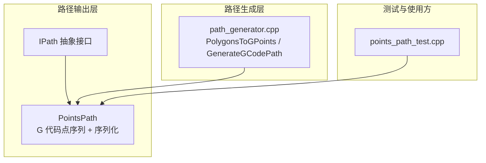
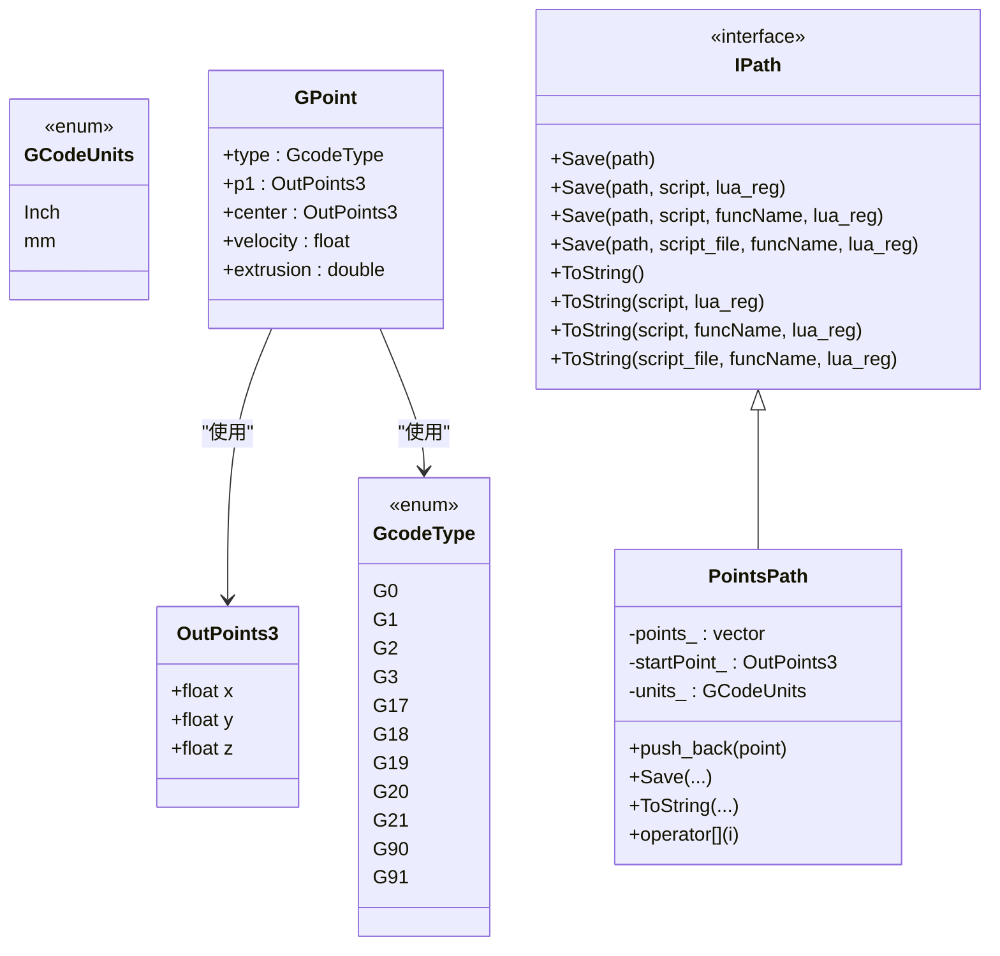
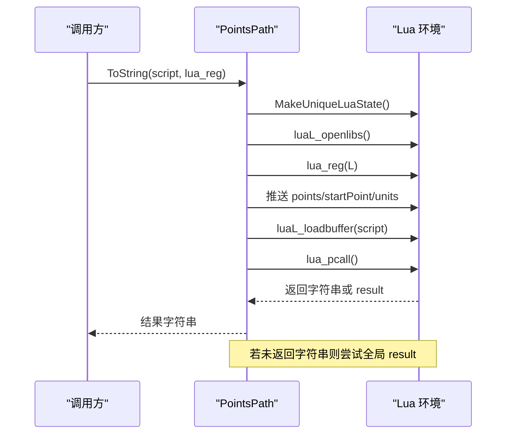
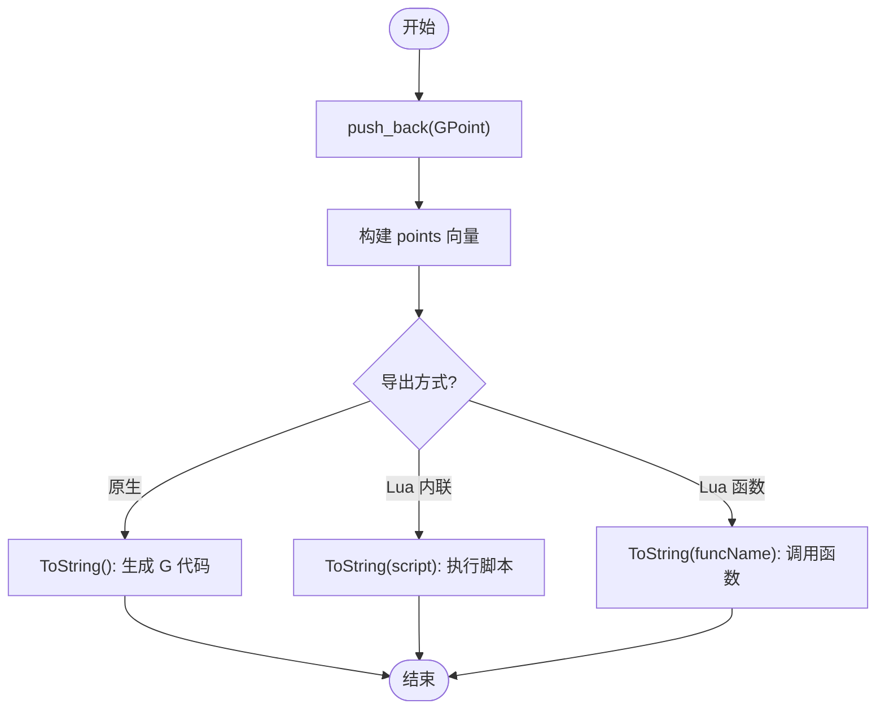
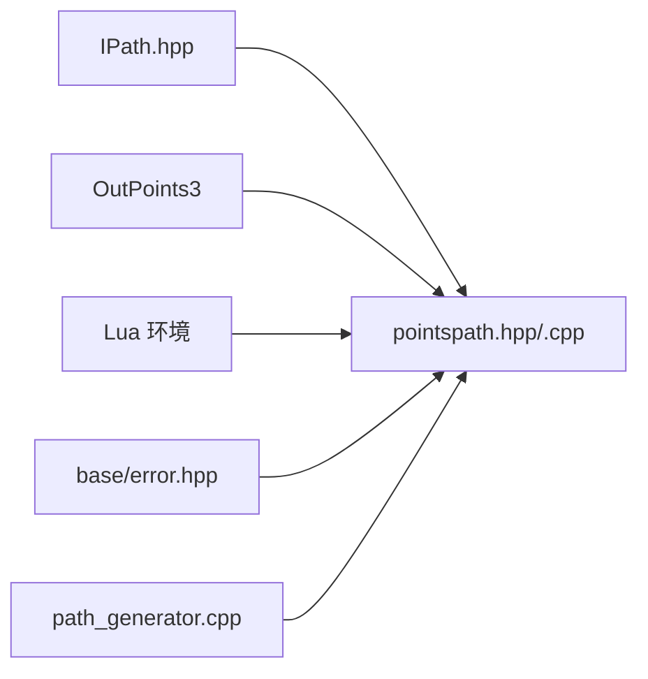

# 点集路径处理

<cite>
**本文引用的文件**   
- [pointspath.hpp](file://paths/pointspath.hpp)
- [pointspath.cpp](file://paths/pointspath.cpp)
- [IPath.hpp](file://paths/IPath.hpp)
- [path_generator.cpp](file://LibHsBaSlicer/Path/path_generator.cpp)
- [points_path_test.cpp](file://tests/PathsOut/points_path_test.cpp)
</cite>

## 目录
1. [简介](#简介)
2. [项目结构定位](#项目结构定位)
3. [核心概念与数据模型](#核心概念与数据模型)
4. [架构总览](#架构总览)
5. [详细组件分析](#详细组件分析)
6. [依赖关系分析](#依赖关系分析)
7. [性能与内存优化建议](#性能与内存优化建议)
8. [API 参考](#api-参考)
9. [故障排除](#故障排除)
10. [结论](#结论)

## 简介
本文件面向 HsBaSlicer 中的 `PointsPath` 类，提供一份以源码为依据的技术文档。`PointsPath` 是切片器输出路径体系中的一个具体实现，用于管理按顺序排列的 G 代码点序列，并支持原生序列化、Lua 脚本后处理和多种导出方式。它并不直接实现点云聚类、空间索引或大规模点集过滤算法；这些能力通常位于上层路径生成、填充和支撑模块中。本文会明确区分 `PointsPath` 的职责边界，同时说明它与路径生成器的集成方式，以及如何在现有接口基础上扩展点集处理能力。

## 项目结构定位
`PointsPath` 属于路径输出层，位于 `paths` 子模块中，继承自抽象路径接口 `IPath`。路径生成逻辑在 `LibHsBaSlicer/Path/path_generator.cpp` 中，负责将多边形轮廓、填充和支撑区域转换为 `GPoint` 序列，并最终由 `PointsPath` 序列化为 G 代码文本或供 Lua 脚本消费的数据结构。测试用例位于 `tests/PathsOut/points_path_test.cpp`，覆盖了 G 代码输出、Lua 脚本回调、函数名调用、文件保存等关键行为。

**图表来源**  
- [IPath.hpp:29-65](file://paths/IPath.hpp#L29-L65)  
- [pointspath.hpp:54-94](file://paths/pointspath.hpp#L54-L94)  
- [path_generator.cpp:14-87](file://LibHsBaSlicer/Path/path_generator.cpp#L14-L87)  
- [points_path_test.cpp:14-339](file://tests/PathsOut/points_path_test.cpp#L14-L339)

**章节来源**  
- [IPath.hpp:29-65](file://paths/IPath.hpp#L29-L65)  
- [pointspath.hpp:54-94](file://paths/pointspath.hpp#L54-L94)  
- [path_generator.cpp:14-87](file://LibHsBaSlicer/Path/path_generator.cpp#L14-L87)  
- [points_path_test.cpp:14-339](file://tests/PathsOut/points_path_test.cpp#L14-L339)

## 核心概念与数据模型
`PointsPath` 围绕以下核心概念组织：

- **坐标系统**：使用 `OutPoints3` 表示三维输出点，包含 X、Y 平面坐标和 Z 构建高度。该类型定义在 `IPath.hpp` 中，是所有路径类型的通用三维点表示。
- **运动命令类型**：`GcodeType` 枚举覆盖快速移动（G0）、直线插补（G1）、顺时针圆弧（G2）、逆时针圆弧（G3），以及平面选择（G17/G18/G19）、单位设置（G20/G21）和定位模式（G90/G91）。
- **长度单位**：`GCodeUnits` 支持毫米和英寸两种单位，影响 G 代码头部指令。
- **单点数据结构**：`GPoint` 描述一个 G 代码运动或设置项，包括目标点 `p1`、圆弧中心点 `center`、进给速度 `velocity` 和挤出量 `extrusion`。
- **路径状态**：`PointsPath` 维护起点 `startPoint_`、点序列 `points_` 和单位 `units_`。

**图表来源**  
- [IPath.hpp:29-65](file://paths/IPath.hpp#L29-L65)  
- [pointspath.hpp:21-52](file://paths/pointspath.hpp#L21-L52)  
- [pointspath.hpp:61-94](file://paths/pointspath.hpp#L61-L94)

**章节来源**  
- [IPath.hpp:59-65](file://paths/IPath.hpp#L59-L65)  
- [pointspath.hpp:21-52](file://paths/pointspath.hpp#L21-L52)  
- [pointspath.hpp:61-94](file://paths/pointspath.hpp#L61-L94)

## 架构总览
`PointsPath` 的序列化流程分为两条主线：

1. **原生 G 代码序列化**：根据 `units_` 输出单位头（G20/G21），输出绝对定位（G90），输出起点快速移动（G0），然后遍历 `points_`，对 G0/G1 输出 XYZ/F/E，对 G2/G3 输出 XYZ/IJK/F/E，其他类型跳过。
2. **Lua 脚本后处理**：创建独立 Lua 状态，加载标准库，可选注册自定义函数，将 `points`、`startPoint`、`units` 推入全局表，执行内联脚本或从文件读取脚本，支持返回字符串或设置全局 `result`。当通过函数名调用时，先解析并调用指定函数，再取返回值或全局 `result`。

**图表来源**  
- [pointspath.cpp:124-230](file://paths/pointspath.cpp#L124-L230)

**章节来源**  
- [pointspath.cpp:66-122](file://paths/pointspath.cpp#L66-L122)  
- [pointspath.cpp:124-230](file://paths/pointspath.cpp#L124-L230)

## 详细组件分析

### 坐标系统与变换矩阵应用
- **坐标系统**：`OutPoints3` 是统一的三维输出点，X/Y 为平面坐标，Z 为构建高度。`PointsPath` 的起点 `startPoint_` 作为路径初始位置，所有后续点的坐标均相对于同一坐标系。
- **变换矩阵**：当前 `PointsPath` 不直接持有或应用变换矩阵。若需要对点进行批量变换，应在调用 `push_back` 之前完成坐标转换，或在 Lua 脚本后处理阶段对 `points` 进行逐点变换。
- **推荐实践**：对外暴露一个 `transform` 方法，接收变换矩阵并对 `points_` 和 `startPoint_` 进行原地更新；或者在 Lua 侧提供向量化变换函数，避免 C++ 层频繁分配临时对象。

**章节来源**  
- [IPath.hpp:59-65](file://paths/IPath.hpp#L59-L65)  
- [pointspath.hpp:69-94](file://paths/pointspath.hpp#L69-L94)

### 批量处理方法
- **追加点**：`push_back` 直接将 `GPoint` 追加到内部 `std::vector<GPoint>`。
- **访问点**：`operator[]` 提供下标访问，便于外部遍历或修改。
- **批量导出**：`ToString` 和 `Save` 系列方法一次性遍历全部点并生成输出。Lua 模式会将整个 `points` 表传给脚本，适合批量过滤、排序、重排或格式转换。

**图表来源**  
- [pointspath.cpp:60-63](file://paths/pointspath.cpp#L60-L63)  
- [pointspath.cpp:66-122](file://paths/pointspath.cpp#L66-L122)  
- [pointspath.cpp:124-230](file://paths/pointspath.cpp#L124-L230)  
- [pointspath.cpp:247-346](file://paths/pointspath.cpp#L247-L346)

**章节来源**  
- [pointspath.hpp:71-88](file://paths/pointspath.hpp#L71-L88)  
- [pointspath.cpp:60-63](file://paths/pointspath.cpp#L60-L63)

### 过滤、排序与聚类算法
- **当前实现**：`PointsPath` 本身不包含过滤、排序或聚类算法。其职责是存储和序列化点序列。
- **扩展建议**：
  - 在 C++ 层增加 `filter`、`sort`、`cluster` 等方法，基于 `GPoint` 的属性（如速度、挤出量、距离）进行处理。
  - 在 Lua 层利用 `points` 表进行灵活过滤和排序，例如按 Z 分层、按距离阈值聚类、按速度分段。
  - 对于大规模点集，建议在 Lua 中使用增量处理，避免一次性复制大量数据。

**章节来源**  
- [pointspath.cpp:124-230](file://paths/pointspath.cpp#L124-L230)

### 空间索引优化
- **当前实现**：`PointsPath` 使用线性存储，无空间索引结构。
- **扩展建议**：
  - 引入 KD-Tree 或网格索引，加速最近邻查询、半径搜索和聚类。
  - 在 Lua 侧可结合外部库实现空间索引，C++ 侧提供只读视图以减少拷贝。
  - 对高频查询场景，考虑在 `PointsPath` 中缓存索引并在点变更时增量更新。

**章节来源**  
- [pointspath.hpp:90-94](file://paths/pointspath.hpp#L90-L94)

### 与三维几何库的集成
- **集成点**：路径生成器 `path_generator.cpp` 将二维多边形（`PolygonsD`）转换为 `GPoint` 序列，其中 X/Y 来自多边形顶点，Z 来自层高配置。
- **几何库类型**：多边形类型为 `Clipper2Lib::PathD` 等，通过 `static_cast<float>` 转换为 `OutPoints3`。
- **建议**：保持几何计算与路径序列化分离，几何库负责形状计算，`PointsPath` 负责路径表达和输出。

**章节来源**  
- [path_generator.cpp:14-41](file://LibHsBaSlicer/Path/path_generator.cpp#L14-L41)

### 点云格式支持
- **当前支持**：`PointsPath` 主要面向 G 代码输出，支持毫米/英寸单位、直线/圆弧运动、速度和挤出参数。
- **扩展方向**：可通过 Lua 脚本将点序列转换为 PLY、XYZ、OBJ 等点云格式，或在 C++ 层新增导出方法。

**章节来源**  
- [pointspath.cpp:66-122](file://paths/pointspath.cpp#L66-L122)

## 依赖关系分析
`PointsPath` 依赖以下组件：

- **IPath 接口**：定义统一的 Save/ToString 契约，支持 Lua 后处理。
- **OutPoints3**：通用三维点类型。
- **Lua 环境**：通过 `MakeUniqueLuaState` 和 `luaL_openlibs` 初始化，支持内联脚本和函数调用。
- **错误处理**：使用 `RuntimeError` 抛出 Lua 初始化失败、函数不存在、脚本文件打开失败等异常。
- **路径生成器**：`GenerateGCodePath` 创建 `PointsPath` 实例并填充点序列。

**图表来源**  
- [IPath.hpp:29-65](file://paths/IPath.hpp#L29-L65)  
- [pointspath.hpp:61-94](file://paths/pointspath.hpp#L61-L94)  
- [pointspath.cpp:15-18](file://paths/pointspath.cpp#L15-L18)  
- [path_generator.cpp:63-87](file://LibHsBaSlicer/Path/path_generator.cpp#L63-L87)

**章节来源**  
- [IPath.hpp:29-65](file://paths/IPath.hpp#L29-L65)  
- [pointspath.cpp:15-18](file://paths/pointspath.cpp#L15-L18)  
- [path_generator.cpp:63-87](file://LibHsBaSlicer/Path/path_generator.cpp#L63-L87)

## 性能与内存优化建议
- **预分配容量**：在已知点数时，可在 `PointsPath` 中提供 `reserve` 方法，减少 `std::vector` 扩容开销。
- **批量写入**：`ToString` 已使用 `std::ostringstream` 一次性构建字符串，避免多次 IO。
- **Lua 脚本优化**：
  - 避免在脚本中频繁创建大表，尽量复用局部变量。
  - 对大规模点集，采用分块处理，减少单次脚本执行的数据量。
- **内存池**：若点集生命周期短且数量巨大，可考虑对象池或内存池管理 `GPoint`。
- **并发处理**：对多层路径生成，可在外层并行处理不同层，但需保证每层的 `PointsPath` 线程安全。

[本节为通用性能建议，不直接分析具体文件]

## API 参考

### 构造与基本操作
- `PointsPath(GCodeUnits units = GCodeUnits::mm, OutPoints3 p = {0.0, 0.0, 0.0})`  
  构造路径，设置长度单位和起点。
- `void push_back(const GPoint& point)`  
  追加一个 G 代码点。
- `GPoint operator`  
  访问第 i 个点。

**章节来源**  
- [pointspath.hpp:69-88](file://paths/pointspath.hpp#L69-L88)

### 序列化与导出
- `std::string ToString() const`  
  原生 G 代码序列化。
- `std::string ToString(std::string_view script, const std::function<void(lua_State*)>& lua_reg = {}) const`  
  使用内联 Lua 脚本后处理，返回字符串或全局 `result`。
- `std::string ToString(std::string_view script, std::string_view funcName, const std::function<void(lua_State*)>& lua_reg = {}) const`  
  调用注册的 Lua 函数，返回字符串或全局 `result`。
- `std::string ToString(const std::filesystem::path& script_file, std::string_view funcName, const std::function<void(lua_State*)>& lua_reg = {}) const`  
  从脚本文件加载并调用函数。
- `void Save(const std::filesystem::path&) const`  
  保存原生 G 代码到文件。
- `void Save(const std::filesystem::path&, std::string_view script, const std::function<void(lua_State*)>& lua_reg = {}) const`  
  使用内联脚本结果保存到文件。
- `void Save(const std::filesystem::path&, std::string_view script, std::string_view funcName, const std::function<void(lua_State*)>& lua_reg = {}) const`  
  调用函数结果保存到文件。
- `void Save(const std::filesystem::path&, const std::filesystem::path& script_file, std::string_view funcName, const std::function<void(lua_State*)>& lua_reg = {}) const`  
  从脚本文件调用函数并保存结果。

**章节来源**  
- [pointspath.hpp:73-86](file://paths/pointspath.hpp#L73-L86)  
- [pointspath.cpp:66-122](file://paths/pointspath.cpp#L66-L122)  
- [pointspath.cpp:124-230](file://paths/pointspath.cpp#L124-L230)  
- [pointspath.cpp:232-376](file://paths/pointspath.cpp#L232-L376)

### 数据类型
- `struct OutPoints3`  
  三维输出点，包含 x、y、z。
- `enum class GcodeType`  
  G 代码运动/设置类型。
- `enum class GCodeUnits`  
  长度单位。
- `struct GPoint`  
  单点运动/设置数据。

**章节来源**  
- [IPath.hpp:59-65](file://paths/IPath.hpp#L59-L65)  
- [pointspath.hpp:21-52](file://paths/pointspath.hpp#L21-L52)

## 故障排除
- **Lua 初始化失败**：`ToString(script)` 和 `ToString(funcName)` 在 Lua 初始化失败时抛出 `RuntimeError`。
- **脚本加载错误**：内联脚本语法错误时，`ToString(script)` 返回包含 “Lua load error” 的诊断字符串。
- **脚本运行时错误**：脚本执行异常时，返回包含 “Lua runtime error” 的诊断字符串。
- **函数不存在**：通过 `funcName` 调用时，若未注册对应函数，抛出 `RuntimeError`。
- **脚本文件打开失败**：从文件加载脚本时，若文件不存在，抛出 `RuntimeError`。

**章节来源**  
- [pointspath.cpp:124-230](file://paths/pointspath.cpp#L124-L230)  
- [pointspath.cpp:247-346](file://paths/pointspath.cpp#L247-L346)  
- [pointspath.cpp:356-368](file://paths/pointspath.cpp#L356-L368)

## 结论
`PointsPath` 是 HsBaSlicer 路径输出层的核心组件之一，专注于 G 代码点序列的管理与序列化。它提供了简洁的 C++ API 和灵活的 Lua 后处理机制，适用于从简单 G 代码生成到复杂脚本化导出的多种场景。虽然它本身不包含点云聚类、空间索引等高级算法，但其设计允许在上层模块或 Lua 脚本中轻松扩展这些能力。在实际工程中，建议将几何计算、路径优化与路径序列化解耦，并通过 Lua 脚本实现可配置的导出流程，从而兼顾性能与灵活性。

[本节为总结性内容，不直接分析具体文件]