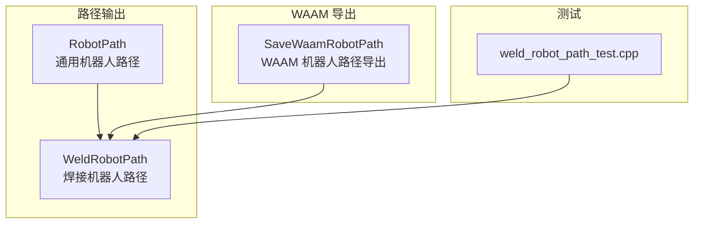
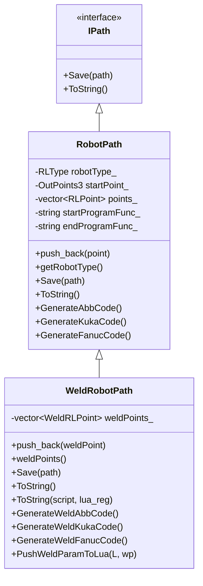
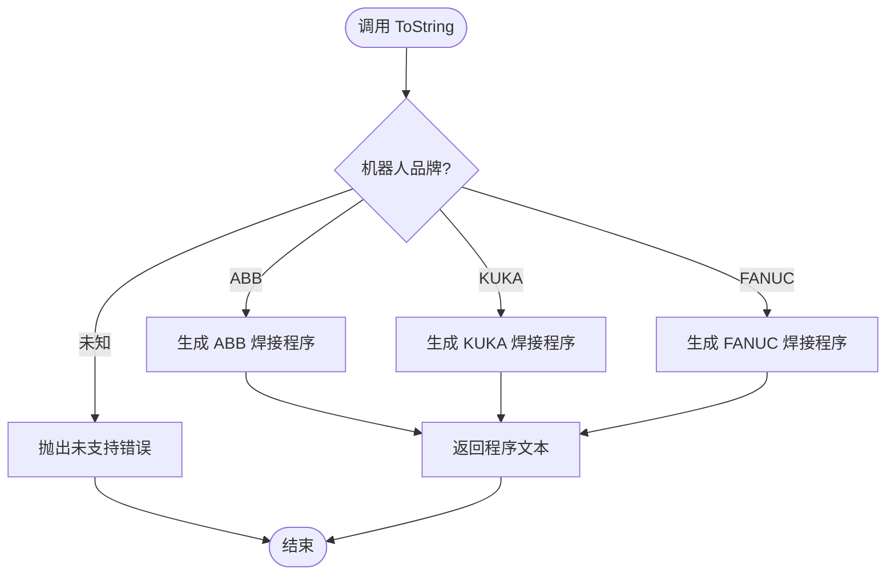
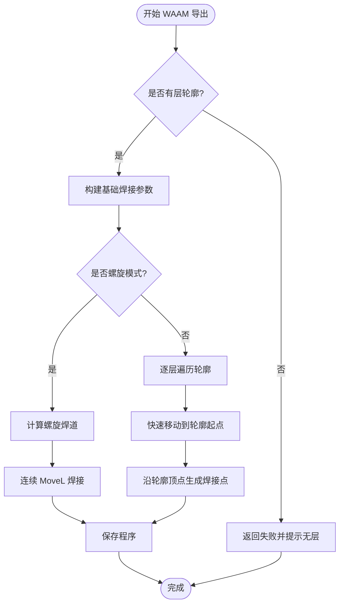
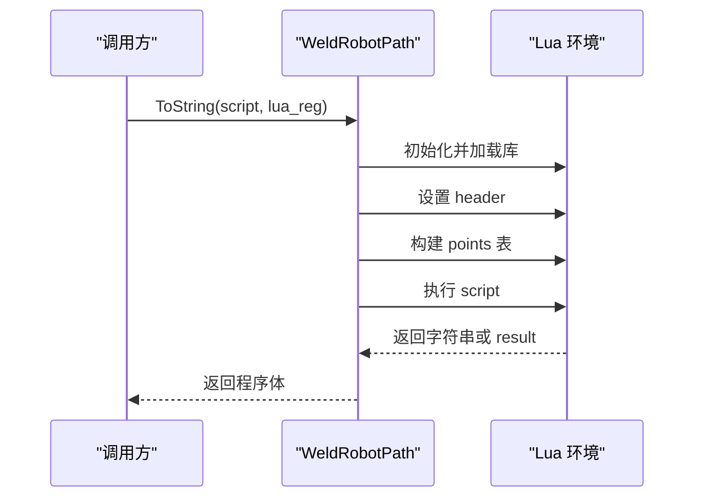
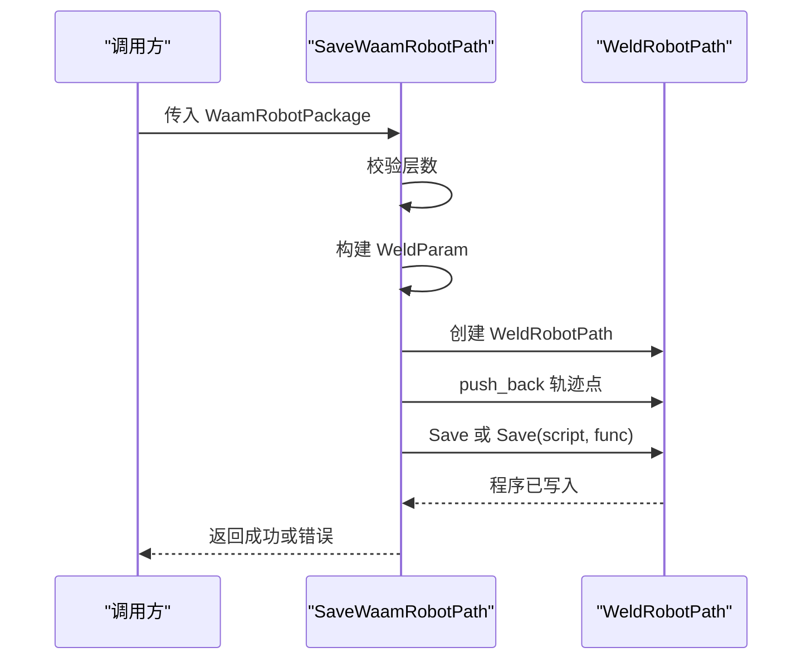
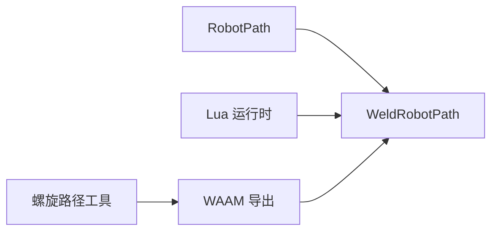

# 焊接机器人路径

<cite>
**本文引用的文件**   
- [paths/weldrobotpath.hpp](file://paths/weldrobotpath.hpp)
- [paths/weldrobotpath.cpp](file://paths/weldrobotpath.cpp)
- [paths/robotpath.hpp](file://paths/robotpath.hpp)
- [LibHsBaSlicer/Path/waam_export.hpp](file://LibHsBaSlicer/Path/waam_export.hpp)
- [LibHsBaSlicer/Path/waam_export.cpp](file://LibHsBaSlicer/Path/waam_export.cpp)
- [tests/PathsOut/weld_robot_path_test.cpp](file://tests/PathsOut/weld_robot_path_test.cpp)
</cite>

## 目录
1. [简介](#简介)
2. [项目结构定位](#项目结构定位)
3. [核心概念与数据模型](#核心概念与数据模型)
4. [架构总览](#架构总览)
5. [WeldRobotPath 类详解](#weldrobotpath-类详解)
6. [焊接参数配置与工艺语义](#焊接参数配置与工艺语义)
7. [焊缝轨迹生成与熔池控制策略](#焊缝轨迹生成与熔池控制策略)
8. [品牌机器人程序生成](#品牌机器人程序生成)
9. [Lua 脚本扩展接口](#lua-脚本扩展接口)
10. [WAAM 导出集成](#waam-导出集成)
11. [API 参考](#api-参考)
12. [依赖关系分析](#依赖关系分析)
13. [性能与可扩展性](#性能与可扩展性)
14. [故障诊断指南](#故障诊断指南)
15. [结论](#结论)

## 简介
本文件围绕 `WeldRobotPath` 类，系统化说明焊接专用机器人路径生成器的设计、数据结构、算法流程、品牌代码生成、Lua 扩展机制以及与 WAAM 导出的集成方式。文档重点覆盖：
- 焊接参数建模（电流、电压、送丝速度、气体流量、行走速度、起弧/收弧参数）。
- 焊缝点与运动点的统一抽象。
- ABB、KUKA、FANUC 三种机器人语言的焊接程序生成逻辑。
- Lua 脚本化路径后处理的数据契约。
- WAAM 层轮廓到连续焊道或逐层沉积的轨迹构建。
- 测试用例验证的关键行为边界。

需要特别说明的是：当前仓库实现聚焦于“路径与程序生成”，并未直接实现热影响区仿真、变形预测或闭环熔池控制算法；这些能力可通过 Lua 脚本扩展和上层系统集成进行补充。

## 项目结构定位
`WeldRobotPath` 位于路径输出模块中，继承通用机器人路径基类，并在 WAAM 导出层被调用以生成最终机器人程序。

**图表来源**
- [paths/robotpath.hpp:61-104](file://paths/robotpath.hpp#L61-L104)
- [paths/weldrobotpath.hpp:65-96](file://paths/weldrobotpath.hpp#L65-L96)
- [LibHsBaSlicer/Path/waam_export.cpp:62-190](file://LibHsBaSlicer/Path/waam_export.cpp#L62-L190)
- [tests/PathsOut/weld_robot_path_test.cpp:36-113](file://tests/PathsOut/weld_robot_path_test.cpp#L36-L113)

**章节来源**
- [paths/robotpath.hpp:15-52](file://paths/robotpath.hpp#L15-L52)
- [paths/weldrobotpath.hpp:16-57](file://paths/weldrobotpath.hpp#L16-L57)
- [LibHsBaSlicer/Path/waam_export.hpp:17-52](file://LibHsBaSlicer/Path/waam_export.hpp#L17-L52)

## 核心概念与数据模型
### 焊接工艺类型与收弧方式
- 焊接工艺类型包括 MIG/MAG、TIG、等离子、激光等。
- 收弧方式支持普通熄弧、填坑收弧、慢速回抽等策略。

| 枚举 | 含义 | 典型用途 |
|---|---|---|
| `WeldProcessType::MIG_MAG` | 熔化极气体保护电弧焊 | 常见 WAAM 电弧沉积 |
| `WeldProcessType::TIG` | 钨极惰性气体保护焊 | 高质量薄板或精密焊缝 |
| `WeldProcessType::Plasma` | 等离子弧焊 | 高能量密度焊接 |
| `WeldProcessType::Laser` | 激光焊 | 高速度、窄熔深应用 |
| `ArcEndType::Normal` | 普通熄弧 | 一般收弧 |
| `ArcEndType::CraterFill` | 填坑收弧 | 防止弧坑裂纹 |
| `ArcEndType::SlowRetract` | 慢速回抽 | 减少应力集中 |

**章节来源**
- [paths/weldrobotpath.hpp:16-32](file://paths/weldrobotpath.hpp#L16-L32)

### 焊接参数结构
`WeldParam` 描述单段焊缝的工艺参数，包含电流、电压、送丝速度、气体流量、行走速度、起弧参数、收弧参数、工艺类型、收弧方式和 FANUC 风格焊规号。

| 字段 | 默认值 | 单位 | 说明 |
|---|---:|---|---|
| `current` | 200.0 | A | 焊接电流 |
| `voltage` | 22.0 | V | 电弧电压 |
| `wireFeedSpeed` | 10.0 | m/min | 送丝速度 |
| `gasFlowRate` | 15.0 | L/min | 保护气体流量 |
| `travelSpeed` | 5.0 | mm/s | 焊枪行走速度 |
| `arcStartCurrent` | 150.0 | A | 起弧电流 |
| `arcStartVoltage` | 20.0 | V | 起弧电压 |
| `craterFillCurrent` | 120.0 | A | 填坑电流 |
| `craterFillVoltage` | 18.0 | V | 填坑电压 |
| `process` | `MIG_MAG` | 枚举 | 焊接工艺类型 |
| `arcEnd` | `Normal` | 枚举 | 收弧方式 |
| `weldSchedule` | 1 | 整数 | FANUC 焊规编号 |

**章节来源**
- [paths/weldrobotpath.hpp:34-49](file://paths/weldrobotpath.hpp#L34-L49)

### 焊接机器人点
`WeldRLPoint` 将基础机器人路径点与焊接参数绑定，并标记该点是否处于焊接状态。

| 字段 | 类型 | 说明 |
|---|---|---|
| `point` | `RLPoint` | 基础机器人路径点，包含终点、中间点、速度和指令类型 |
| `weld` | `WeldParam` | 该点关联的焊接参数 |
| `isWelding` | `bool` | 是否为焊缝段上的点 |

**章节来源**
- [paths/weldrobotpath.hpp:51-57](file://paths/weldrobotpath.hpp#L51-L57)
- [paths/robotpath.hpp:44-52](file://paths/robotpath.hpp#L44-L52)

## 架构总览
`WeldRobotPath` 继承自 `RobotPath`，在保留通用机器人路径能力的同时，增加焊接参数上下文和品牌焊接程序生成逻辑。WAAM 导出层负责把层轮廓转换为焊接点序列，再交给 `WeldRobotPath` 生成目标机器人语言。

**图表来源**
- [paths/robotpath.hpp:61-104](file://paths/robotpath.hpp#L61-L104)
- [paths/weldrobotpath.hpp:65-96](file://paths/weldrobotpath.hpp#L65-L96)

**章节来源**
- [paths/robotpath.hpp:54-104](file://paths/robotpath.hpp#L54-L104)
- [paths/weldrobotpath.hpp:59-96](file://paths/weldrobotpath.hpp#L59-L96)

## WeldRobotPath 类详解
### 构造与基本行为
- 构造函数接收机器人品牌、起始位姿、程序头尾函数名，并委托给基类。
- `push_back(const WeldRLPoint&)` 会同时保存焊接点并转发到底层基础路径，保证兼容原有 `RobotPath` API。
- `weldPoints()` 提供只读访问焊接点序列。

**章节来源**
- [paths/weldrobotpath.cpp:54-70](file://paths/weldrobotpath.cpp#L54-L70)
- [paths/weldrobotpath.hpp:68-78](file://paths/weldrobotpath.hpp#L68-L78)

### 保存与字符串化
- `Save(path)` 通过 `ToString()` 生成文本程序并写入文件。
- `ToString()` 根据机器人品牌选择对应生成器；未知品牌抛出未支持错误。
- `ToString(script, lua_reg)` 创建 Lua 环境，注入 `header` 和 `points` 表，执行用户脚本并返回结果。

**图表来源**
- [paths/weldrobotpath.cpp:79-101](file://paths/weldrobotpath.cpp#L79-L101)

**章节来源**
- [paths/weldrobotpath.cpp:72-101](file://paths/weldrobotpath.cpp#L72-L101)

### 内部生成器
- `GenerateWeldAbbCode()`：生成 ABB RAPID 风格的 ArcLStart/ArcLEnd 与 MoveJ/MoveL/MoveC 指令。
- `GenerateWeldKukaCode()`：生成 KUKA KRL 风格的 ARC_On/ARC_Off、LIN/CIRC 指令。
- `GenerateWeldFanucCode()`：生成 FANUC TP 风格的 ARC START/END 与 L/C/J 指令。

三个生成器均遵循相同状态机：检测 `isWelding` 标志，在第一个焊接点起弧，在最后一个焊接点收弧，中间使用连续焊接移动。

**章节来源**
- [paths/weldrobotpath.cpp:225-481](file://paths/weldrobotpath.cpp#L225-L481)

## 焊接参数配置与工艺语义
### 参数映射与默认值
- 内部 `WeldParam` 是完整焊接参数模型。
- WAAM 导出层通过 `WaamWeldParams` 暴露 C ABI 子集，并将默认收弧方式设为填坑收弧。

| 外部参数 | 内部字段 | 默认值 | 单位 |
|---|---|---:|---|
| `current` | `current` | 180.0 | A |
| `voltage` | `voltage` | 22.0 | V |
| `wire_feed_speed` | `wireFeedSpeed` | 5.0 | m/min |
| `gas_flow_rate` | `gasFlowRate` | 15.0 | L/min |
| `travel_speed` | `travelSpeed` | 8.0 | mm/s |
| `process` | `process` | 0 → MIG/MAG | 枚举映射 |

**章节来源**
- [LibHsBaSlicer/Path/waam_export.hpp:23-31](file://LibHsBaSlicer/Path/waam_export.hpp#L23-L31)
- [LibHsBaSlicer/Path/waam_export.cpp:46-58](file://LibHsBaSlicer/Path/waam_export.cpp#L46-L58)
- [paths/weldrobotpath.hpp:34-49](file://paths/weldrobotpath.hpp#L34-L49)

### 工艺类型映射
- 外部 `process=0` 表示电弧焊（MIG/MAG），`process=1` 表示激光焊。
- 其他值回退为 MIG/MAG。

**章节来源**
- [LibHsBaSlicer/Path/waam_export.cpp:39-44](file://LibHsBaSlicer/Path/waam_export.cpp#L39-L44)

## 焊缝轨迹生成与熔池控制策略
### 轨迹构建模式
WAAM 导出支持两种主要模式：
1. **螺旋模式**：将所有层的外轮廓合并为一条连续上升焊道，层间不抬枪、不断弧。
2. **逐层模式**：每层独立走外轮廓，每层起点前插入快速非焊接移动。

**图表来源**
- [LibHsBaSlicer/Path/waam_export.cpp:62-190](file://LibHsBaSlicer/Path/waam_export.cpp#L62-L190)

**章节来源**
- [LibHsBaSlicer/Path/waam_export.cpp:62-190](file://LibHsBaSlicer/Path/waam_export.cpp#L62-L190)

### 熔池控制策略
当前实现通过以下手段间接表达熔池相关工艺意图：
- 起弧阶段使用 `arcStartCurrent` 和 `arcStartVoltage`，模拟热起弧。
- 收弧阶段使用 `craterFillCurrent` 和 `craterFillVoltage`，配合 `ArcEndType::CraterFill` 填充弧坑。
- 行走速度 `travelSpeed` 与送丝速度、电流电压共同决定热输入趋势。

需要注意：
- 当前代码未实现实时熔池监控、反馈控制或动态参数调整。
- 若需闭环控制，应通过上层设备通信协议与 Lua 脚本扩展实现。

**章节来源**
- [paths/weldrobotpath.hpp:34-49](file://paths/weldrobotpath.hpp#L34-L49)
- [paths/weldrobotpath.cpp:225-481](file://paths/weldrobotpath.cpp#L225-L481)

## 品牌机器人程序生成
### ABB 生成逻辑
- 使用 `ArcLStart` 起弧，`ArcLEnd` 收弧。
- 连续焊接使用 `ArcL`。
- 非焊接移动使用 `MoveJ`、`MoveL`、`MoveC`。
- 起弧和收弧时嵌入电流、电压、送丝速度和气体流量。

**章节来源**
- [paths/weldrobotpath.cpp:225-305](file://paths/weldrobotpath.cpp#L225-L305)

### KUKA 生成逻辑
- 初始化焊接技术包，设置焊接参数和起弧参数。
- 使用 `ARC_On` 起弧，`ARC_Off` 收弧。
- 支持 `ARC_SetCraterParam` 和 `ARC_CraterFill`。
- 非焊接移动使用 `PTP`、`LIN`、`CIRC`。

**章节来源**
- [paths/weldrobotpath.cpp:307-394](file://paths/weldrobotpath.cpp#L307-L394)

### FANUC 生成逻辑
- 使用 `ARC START` 起弧，`ARC END[Schedule]` 收弧。
- 连续焊接使用带进给速度的直线插补。
- 非焊接移动使用 `J`、`L`、`C`。
- 通过 `weldSchedule` 指定焊规号。

**章节来源**
- [paths/weldrobotpath.cpp:396-481](file://paths/weldrobotpath.cpp#L396-L481)

## Lua 脚本扩展接口
### 数据契约
当调用 `ToString(script, lua_reg)` 时，系统会向 Lua 环境注入：
- `header`：固定注释字符串。
- `points`：数组，每个元素包含：
  - `end`：终点坐标 `{x, y, z}`。
  - `middle`：中间点坐标 `{x, y, z}`。
  - `velocity`：移动速度。
  - `type`：固定为 `"WeldPoint"`。
  - `isWelding`：布尔值。
  - `weld`：嵌套表，包含 `current`、`voltage`、`wireFeedSpeed`、`gasFlowRate`、`travelSpeed`、`arcStartCurrent`、`arcStartVoltage`、`craterFillCurrent`、`craterFillVoltage`、`process`、`arcEnd`、`weldSchedule`。

**图表来源**
- [paths/weldrobotpath.cpp:103-194](file://paths/weldrobotpath.cpp#L103-L194)
- [paths/weldrobotpath.cpp:196-223](file://paths/weldrobotpath.cpp#L196-L223)

**章节来源**
- [paths/weldrobotpath.cpp:103-223](file://paths/weldrobotpath.cpp#L103-L223)
- [tests/PathsOut/weld_robot_path_test.cpp:94-113](file://tests/PathsOut/weld_robot_path_test.cpp#L94-L113)

## WAAM 导出集成
### 导出入口
`SaveWaamRobotPath` 是 WAAM 机器人路径导出的公共接口，负责：
- 校验层轮廓数量。
- 构建基础焊接参数。
- 选择螺旋模式或逐层模式。
- 调用 `WeldRobotPath` 生成并保存程序。
- 可选地通过 Lua 脚本后处理。

**图表来源**
- [LibHsBaSlicer/Path/waam_export.cpp:62-190](file://LibHsBaSlicer/Path/waam_export.cpp#L62-L190)

**章节来源**
- [LibHsBaSlicer/Path/waam_export.hpp:54-72](file://LibHsBaSlicer/Path/waam_export.hpp#L54-L72)
- [LibHsBaSlicer/Path/waam_export.cpp:62-190](file://LibHsBaSlicer/Path/waam_export.cpp#L62-L190)

## API 参考
### WeldRobotPath 公开接口
| 接口 | 参数 | 返回值 | 说明 |
|---|---|---|---|
| `WeldRobotPath(robotType, startPoint, startProgramFunc, endProgramFunc)` | 机器人品牌、起始位姿、程序头尾函数名 | 对象 | 构造焊接路径 |
| `push_back(weldPoint)` | `WeldRLPoint` | void | 添加焊接点 |
| `weldPoints()` | 无 | `const vector<WeldRLPoint>&` | 获取焊接点序列 |
| `Save(path)` | 文件路径 | void | 保存为品牌程序文本 |
| `ToString()` | 无 | string | 生成品牌程序文本 |
| `ToString(script, lua_reg)` | Lua 脚本、注册函数 | string | 通过 Lua 脚本生成程序体 |

**章节来源**
- [paths/weldrobotpath.hpp:68-85](file://paths/weldrobotpath.hpp#L68-L85)

### WAAM 导出接口
| 接口 | 参数 | 返回值 | 说明 |
|---|---|---|---|
| `SaveWaamRobotPath(pkg, output_path, lua_script, lua_func, error_out)` | WAAM 包、输出路径、Lua 脚本路径、函数名、错误输出 | bool | 生成 WAAM 机器人程序 |

**章节来源**
- [LibHsBaSlicer/Path/waam_export.hpp:69-72](file://LibHsBaSlicer/Path/waam_export.hpp#L69-L72)

### 关键数据结构
| 结构 | 关键字段 | 用途 |
|---|---|---|
| `WeldParam` | current、voltage、wireFeedSpeed、gasFlowRate、travelSpeed、arcStartCurrent、arcStartVoltage、craterFillCurrent、craterFillVoltage、process、arcEnd、weldSchedule | 单段焊缝工艺参数 |
| `WeldRLPoint` | point、weld、isWelding | 带焊接参数的机器人路径点 |
| `WaamWeldParams` | current、voltage、wire_feed_speed、gas_flow_rate、travel_speed、process | WAAM 外部焊接参数 |
| `WaamRobotPackage` | layer_outlines、layer_z_heights、weld、robot_type、bead_width、config_json、spiral_mode | WAAM 导出数据包 |

**章节来源**
- [paths/weldrobotpath.hpp:34-57](file://paths/weldrobotpath.hpp#L34-L57)
- [LibHsBaSlicer/Path/waam_export.hpp:23-52](file://LibHsBaSlicer/Path/waam_export.hpp#L23-L52)

## 依赖关系分析
### 组件耦合
- `WeldRobotPath` 依赖 `RobotPath` 提供基础路径存储和品牌代码生成框架。
- `WeldRobotPath` 依赖 Lua 运行时用于脚本化路径后处理。
- `SaveWaamRobotPath` 依赖 `WeldRobotPath` 和螺旋路径工具生成轨迹。

**图表来源**
- [paths/robotpath.hpp:61-104](file://paths/robotpath.hpp#L61-L104)
- [paths/weldrobotpath.cpp:103-194](file://paths/weldrobotpath.cpp#L103-L194)
- [LibHsBaSlicer/Path/waam_export.cpp:13-14](file://LibHsBaSlicer/Path/waam_export.cpp#L13-L14)

**章节来源**
- [paths/robotpath.hpp:61-104](file://paths/robotpath.hpp#L61-L104)
- [paths/weldrobotpath.cpp:103-194](file://paths/weldrobotpath.cpp#L103-L194)
- [LibHsBaSlicer/Path/waam_export.cpp:13-14](file://LibHsBaSlicer/Path/waam_export.cpp#L13-L14)

## 性能与可扩展性
### 性能特征
- 轨迹构建为线性复杂度，按层和轮廓顶点逐个生成焊接点。
- 品牌程序生成同样为线性扫描焊接点序列。
- Lua 脚本执行开销取决于脚本复杂度和返回数据大小。

### 可扩展方向
- 新增机器人品牌：扩展 `ToString()` 分支并实现对应生成器。
- 增强熔池控制：在 Lua 脚本中引入传感器数据、动态参数调整和报警逻辑。
- 热影响区与变形补偿：在上层系统中结合材料热物性与有限元模型，将补偿向量注入 `point.middle` 或路径偏移。

**章节来源**
- [paths/weldrobotpath.cpp:79-101](file://paths/weldrobotpath.cpp#L79-L101)
- [paths/weldrobotpath.cpp:225-481](file://paths/weldrobotpath.cpp#L225-L481)
- [LibHsBaSlicer/Path/waam_export.cpp:83-169](file://LibHsBaSlicer/Path/waam_export.cpp#L83-L169)

## 故障诊断指南
### 常见问题与定位
| 现象 | 可能原因 | 排查建议 |
|---|---|---|
| 未知机器人品牌报错 | 传入 `RLType::Unknown` 且未使用 Lua 脚本 | 检查机器人类型映射或使用 Lua 脚本模式 |
| Lua 脚本加载失败 | 脚本语法错误或 Lua 环境初始化失败 | 查看 RuntimeError 消息，简化脚本逐步定位 |
| Lua 运行时报错 | 脚本运行时异常 | 检查 `points` 表结构和字段访问方式 |
| 生成的程序缺少焊接指令 | 焊接点未设置 `isWelding=true` | 检查轨迹构建逻辑和参数赋值 |
| 收弧不符合预期 | 收弧方式或参数未正确设置 | 检查 `ArcEndType` 和填坑参数 |

**章节来源**
- [paths/weldrobotpath.cpp:79-101](file://paths/weldrobotpath.cpp#L79-L101)
- [paths/weldrobotpath.cpp:103-194](file://paths/weldrobotpath.cpp#L103-L194)
- [tests/PathsOut/weld_robot_path_test.cpp:52-75](file://tests/PathsOut/weld_robot_path_test.cpp#L52-L75)
- [tests/PathsOut/weld_robot_path_test.cpp:94-113](file://tests/PathsOut/weld_robot_path_test.cpp#L94-L113)

## 结论
`WeldRobotPath` 提供了面向焊接工艺的机器人路径抽象，将焊接参数与机器人轨迹统一建模，并支持 ABB、KUKA、FANUC 三种主流机器人语言的程序生成。其核心价值在于：
- 明确的焊接参数模型与收弧策略。
- 可插拔的 Lua 脚本扩展机制。
- 与 WAAM 导出流程的紧密集成。
- 清晰的测试覆盖与行为约束。

对于更高级的焊接工艺需求，如热影响区分析、变形预测、熔池闭环控制和设备通信协议，建议在现有路径生成基础上，通过 Lua 脚本和上层系统集成扩展实现。