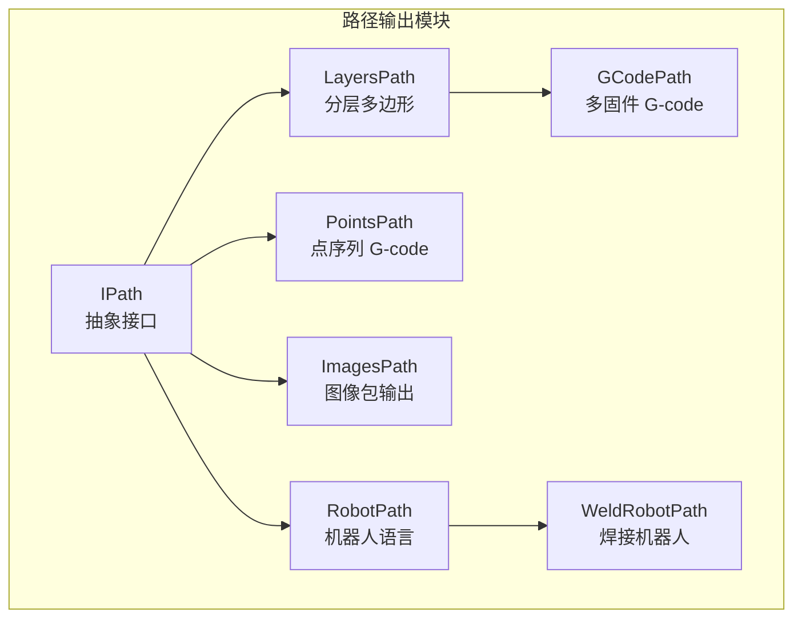
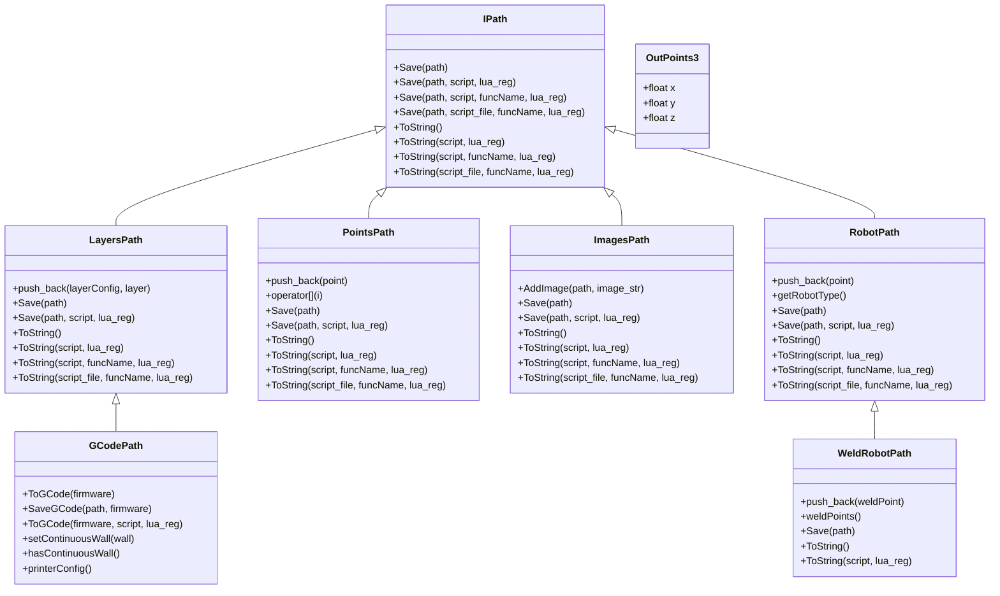
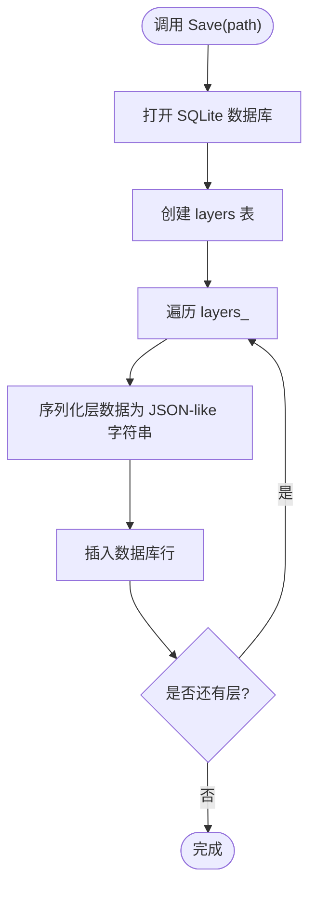
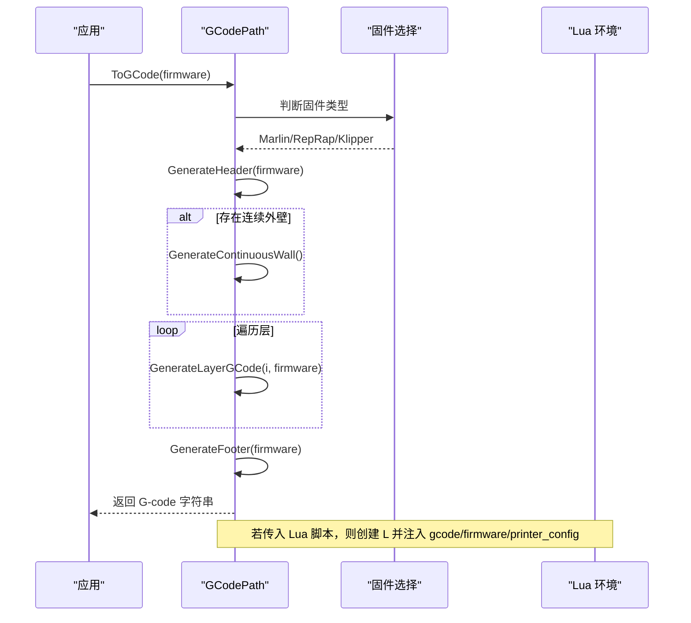
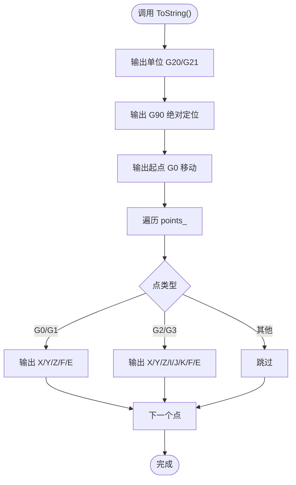
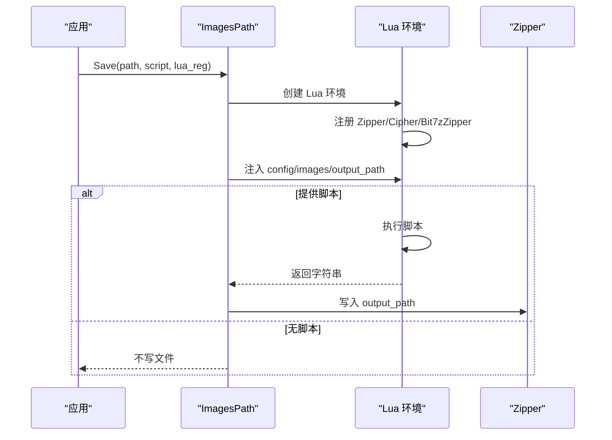
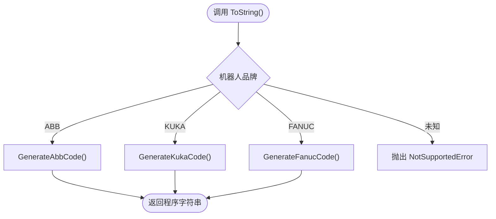
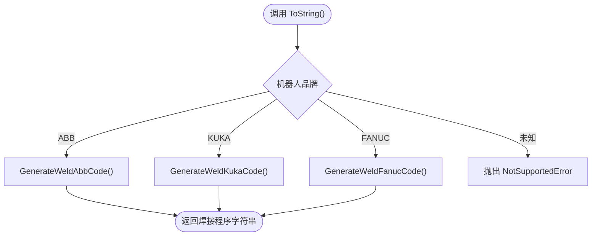
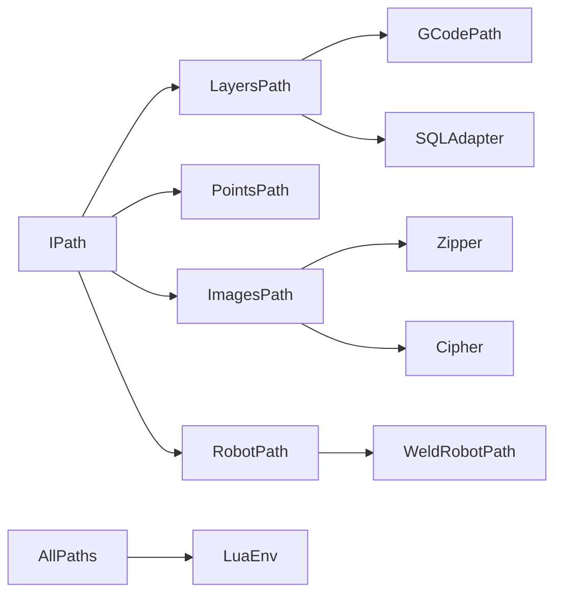

# 路径输出管理（Path Output Management）

<cite>
**本文引用的文件**   
- [IPath.hpp](file://paths/IPath.hpp)
- [layerspath.hpp](file://paths/layerspath.hpp)
- [layerspath.cpp](file://paths/layerspath.cpp)
- [gcodepath.hpp](file://paths/gcodepath.hpp)
- [gcodepath.cpp](file://paths/gcodepath.cpp)
- [pointspath.hpp](file://paths/pointspath.hpp)
- [pointspath.cpp](file://paths/pointspath.cpp)
- [imagespath.hpp](file://paths/imagespath.hpp)
- [imagespath.cpp](file://paths/imagespath.cpp)
- [robotpath.hpp](file://paths/robotpath.hpp)
- [robotpath.cpp](file://paths/robotpath.cpp)
- [weldrobotpath.hpp](file://paths/weldrobotpath.hpp)
- [weldrobotpath.cpp](file://paths/weldrobotpath.cpp)
</cite>

## 目录
1. [引言](#引言)
2. [项目结构](#项目结构)
3. [核心组件](#核心组件)
4. [架构总览](#架构总览)
5. [详细组件分析](#详细组件分析)
6. [依赖关系分析](#依赖关系分析)
7. [性能与优化建议](#性能与优化建议)
8. [故障排除指南](#故障排除指南)
9. [结论](#结论)
10. [附录：API 参考与使用示例](#附录api-参考与使用示例)

## 引言
本文件面向 HsBaSlicer 的 paths 模块，系统性说明路径数据管理与输出能力。该模块提供统一的抽象接口 IPath，并在此基础上实现多种工艺路径输出类型：
- GCodePath：多固件 G-code 路径输出，支持连续螺旋外壁。
- ImagesPath：图像包输出，包含配置侧车与命名图像载荷。
- LayersPath：分层多边形数据管理，用于层切片、层导出等。
- PointsPath：基于点序列的 G-code 路径。
- RobotPath：工业机器人语言程序生成，支持 ABB/KUKA/FANUC。
- WeldRobotPath：在机器人路径基础上增加焊接参数，生成带起弧/收弧指令的程序。

所有实现均支持原生保存或序列化，以及通过 Lua 脚本进行后处理，便于扩展不同厂商格式和自定义流程。

## 项目结构
paths 模块位于仓库根目录下的 `paths` 子目录，采用“按输出类型划分”的文件组织方式：每个主要输出类型一个头文件和一个实现文件，并通过 IPath 抽象统一对外暴露 Save/ToString 系列接口。

**图示来源**
- [IPath.hpp:29-57](file://paths/IPath.hpp#L29-L57)
- [layerspath.hpp:25-60](file://paths/layerspath.hpp#L25-L60)
- [gcodepath.hpp:66-107](file://paths/gcodepath.hpp#L66-L107)
- [pointspath.hpp:61-94](file://paths/pointspath.hpp#L61-L94)
- [imagespath.hpp:23-61](file://paths/imagespath.hpp#L23-L61)
- [robotpath.hpp:61-104](file://paths/robotpath.hpp#L61-L104)
- [weldrobotpath.hpp:65-96](file://paths/weldrobotpath.hpp#L65-L96)

**章节来源**
- [IPath.hpp:1-68](file://paths/IPath.hpp#L1-L68)
- [layerspath.hpp:1-64](file://paths/layerspath.hpp#L1-L64)
- [gcodepath.hpp:1-112](file://paths/gcodepath.hpp#L1-L112)
- [pointspath.hpp:1-99](file://paths/pointspath.hpp#L1-L99)
- [imagespath.hpp:1-64](file://paths/imagespath.hpp#L1-L64)
- [robotpath.hpp:1-108](file://paths/robotpath.hpp#L1-L108)
- [weldrobotpath.hpp:1-100](file://paths/weldrobotpath.hpp#L1-L100)

## 核心组件
- IPath：定义统一的保存与序列化接口，支持原生输出与 Lua 后处理回调。
- LayersPath：维护有序的分层多边形集合，每层包含自由格式配置字符串与双精度多边形组。
- GCodePath：继承 LayersPath，根据打印机配置和多固件目标生成 G-code，支持连续螺旋外壁。
- PointsPath：维护 GPoint 序列，输出标准 G-code 运动指令。
- ImagesPath：维护配置侧车与命名图像映射，可打包为压缩包或通过 Lua 自定义导出。
- RobotPath：维护 RLPoint 序列，按目标机器人品牌生成程序代码。
- WeldRobotPath：继承 RobotPath，附加 WeldParam 与 isWelding 标记，生成带焊接参数的程序。

**章节来源**
- [IPath.hpp:29-65](file://paths/IPath.hpp#L29-L65)
- [layerspath.hpp:25-60](file://paths/layerspath.hpp#L25-L60)
- [gcodepath.hpp:66-107](file://paths/gcodepath.hpp#L66-L107)
- [pointspath.hpp:61-94](file://paths/pointspath.hpp#L61-L94)
- [imagespath.hpp:23-61](file://paths/imagespath.hpp#L23-L61)
- [robotpath.hpp:61-104](file://paths/robotpath.hpp#L61-L104)
- [weldrobotpath.hpp:65-96](file://paths/weldrobotpath.hpp#L65-L96)

## 架构总览
paths 模块以 IPath 为抽象基类，具体实现围绕“数据模型 + 输出器”模式组织：
- 数据模型：OutPoints3、GPoint、RLPoint、WeldRLPoint、PolygonsD 等。
- 输出器：各 Path 类的 Save/ToString 方法，负责将数据模型转换为目标格式文本或文件。
- 扩展点：Lua 脚本注册回调与全局变量注入，允许用户在后处理阶段修改输出内容。

**图示来源**
- [IPath.hpp:29-57](file://paths/IPath.hpp#L29-L57)
- [layerspath.hpp:25-60](file://paths/layerspath.hpp#L25-L60)
- [gcodepath.hpp:66-107](file://paths/gcodepath.hpp#L66-L107)
- [pointspath.hpp:61-94](file://paths/pointspath.hpp#L61-L94)
- [imagespath.hpp:23-61](file://paths/imagespath.hpp#L23-L61)
- [robotpath.hpp:61-104](file://paths/robotpath.hpp#L61-L104)
- [weldrobotpath.hpp:65-96](file://paths/weldrobotpath.hpp#L65-L96)

## 详细组件分析

### IPath 抽象接口
IPath 定义了路径输出的统一契约：
- Save 系列：将路径保存到文件，支持原生格式、内联 Lua 脚本、指定函数名、脚本文件四种方式。
- ToString 系列：将路径序列化为字符串，同样支持 Lua 后处理。
- Lua 回调：通过 std::function<void(lua_State*)> 注册额外 Lua 函数，供脚本调用。
- OutPoints3：通用三维输出点结构，广泛用于各 Path 类型。

关键设计要点：
- 所有 Save/ToString 重载保持语义一致，便于上层统一调用。
- Lua 环境在各实现中独立创建，避免状态污染。
- 错误处理通过 RuntimeError 抛出，便于调用方捕获。

**章节来源**
- [IPath.hpp:29-65](file://paths/IPath.hpp#L29-L65)

### LayersPath 分层路径
LayersPath 是许多输出类型的基础，维护以下数据结构：
- layers_：有序向量，元素为 LayersData，包含 layerConfig 与 PolygonsD。
- callback_：可选的状态回调，用于进度或日志上报。

主要行为：
- push_back：追加一层配置与多边形。
- Save(path)：默认将层数据写入 SQLite 数据库，表名为 layers，字段包括 id、layer_config、layer_data。
- Save/ToString 的 Lua 变体：将 layers 作为全局表注入 Lua，db 作为 SQLiteAdapter 对象暴露，output_path 为目标路径。

**图示来源**
- [layerspath.cpp:31-62](file://paths/layerspath.cpp#L31-L62)

**章节来源**
- [layerspath.hpp:25-60](file://paths/layerspath.hpp#L25-L60)
- [layerspath.cpp:22-62](file://paths/layerspath.cpp#L22-L62)
- [layerspath.cpp:282-304](file://paths/layerspath.cpp#L282-L304)

### GCodePath 多固件 G-code 输出
GCodePath 继承 LayersPath，新增：
- GCodeFirmware：目标固件枚举（Marlin、RepRap、Klipper）。
- GCodePrinterConfig：喷嘴直径、线材直径、温度、速度、层高、线宽、挤出倍率、相对/绝对挤出、回抽等配置。
- PathPoint3D：连续螺旋外壁的点序列，Z 值逐点递增。
- ToGCode/SaverGCode：生成标准 G-code 字符串或文件。
- setContinuousWall：设置连续外壁，用于花瓶模式。

核心算法：
- CalcExtrusion：根据线段长度、线宽、层高、线材截面积计算挤出量。
- GenerateHeader/Footer：按固件类型生成头部/尾部指令。
- GenerateLayerGCode：解析层 Z 高度，生成逐层 G-code，支持回抽与相对/绝对挤出。
- GenerateContinuousWall：将连续外壁点序列转换为无中断的挤出路径。

**图示来源**
- [gcodepath.cpp:69-158](file://paths/gcodepath.cpp#L69-L158)
- [gcodepath.cpp:211-289](file://paths/gcodepath.cpp#L211-L289)
- [gcodepath.cpp:291-330](file://paths/gcodepath.cpp#L291-L330)
- [gcodepath.cpp:332-351](file://paths/gcodepath.cpp#L332-L351)
- [gcodepath.cpp:364-456](file://paths/gcodepath.cpp#L364-L456)

**章节来源**
- [gcodepath.hpp:24-107](file://paths/gcodepath.hpp#L24-L107)
- [gcodepath.cpp:51-67](file://paths/gcodepath.cpp#L51-L67)
- [gcodepath.cpp:69-158](file://paths/gcodepath.cpp#L69-L158)
- [gcodepath.cpp:211-289](file://paths/gcodepath.cpp#L211-L289)
- [gcodepath.cpp:291-330](file://paths/gcodepath.cpp#L291-L330)
- [gcodepath.cpp:332-351](file://paths/gcodepath.cpp#L332-L351)
- [gcodepath.cpp:353-362](file://paths/gcodepath.cpp#L353-L362)
- [gcodepath.cpp:364-456](file://paths/gcodepath.cpp#L364-L456)

### PointsPath 点序列 G-code 输出
PointsPath 维护 GPoint 序列，支持：
- GcodeType：G0/G1/G2/G3/G17/G18/G19/G20/G21/G90/G91。
- GCodeUnits：英寸或毫米。
- ToString：输出单位声明、绝对定位、起点移动、线性/圆弧运动指令。
- Lua 后处理：注入 points/startPoint/units 全局变量，支持函数名调用。

**图示来源**
- [pointspath.cpp:66-122](file://paths/pointspath.cpp#L66-L122)

**章节来源**
- [pointspath.hpp:16-94](file://paths/pointspath.hpp#L16-L94)
- [pointspath.cpp:56-63](file://paths/pointspath.cpp#L56-L63)
- [pointspath.cpp:66-122](file://paths/pointspath.cpp#L66-L122)
- [pointspath.cpp:124-230](file://paths/pointspath.cpp#L124-L230)
- [pointspath.cpp:232-245](file://paths/pointspath.cpp#L232-L245)
- [pointspath.cpp:247-346](file://paths/pointspath.cpp#L247-L346)
- [pointspath.cpp:348-376](file://paths/pointspath.cpp#L348-L376)

### ImagesPath 图像包输出
ImagesPath 维护：
- config_：配置文件名与内容。
- images_：命名图像映射（路径 -> 二进制字符串）。
- callbacks_：进度回调列表。

主要行为：
- AddImage：添加或替换图像载荷。
- Save(path)：默认使用 Zipper 将配置与图像打包为压缩包。
- Save/ToString 的 Lua 变体：注入 config/images/output_path 全局变量，支持 Zipper/Cipher/Bit7zZipper 等工具库。

**图示来源**
- [imagespath.cpp:35-50](file://paths/imagespath.cpp#L35-L50)
- [imagespath.cpp:52-130](file://paths/imagespath.cpp#L52-L130)
- [imagespath.cpp:132-220](file://paths/imagespath.cpp#L132-L220)
- [imagespath.cpp:222-285](file://paths/imagespath.cpp#L222-L285)
- [imagespath.cpp:287-367](file://paths/imagespath.cpp#L287-L367)
- [imagespath.cpp:369-384](file://paths/imagespath.cpp#L369-L384)

**章节来源**
- [imagespath.hpp:23-61](file://paths/imagespath.hpp#L23-L61)
- [imagespath.cpp:24-33](file://paths/imagespath.cpp#L24-L33)
- [imagespath.cpp:35-50](file://paths/imagespath.cpp#L35-L50)
- [imagespath.cpp:52-130](file://paths/imagespath.cpp#L52-L130)
- [imagespath.cpp:132-220](file://paths/imagespath.cpp#L132-L220)
- [imagespath.cpp:222-285](file://paths/imagespath.cpp#L222-L285)
- [imagespath.cpp:287-367](file://paths/imagespath.cpp#L287-L367)
- [imagespath.cpp:369-384](file://paths/imagespath.cpp#L369-L384)

### RobotPath 工业机器人路径
RobotPath 维护：
- robotType_：目标机器人品牌（Unknown/Abb/Kuka/Fanuc/Undefine）。
- startPoint_：初始位置。
- points_：RLPoint 序列，包含 end/middle/velocity/type/programIndex。
- startProgramFunc_/endProgramFunc_：程序块起止函数名。

主要行为：
- ToString：按品牌生成程序代码，未知品牌抛出 NotSupportedError。
- ToString(script, lua_reg)：注入 header/startProgramFunc/endProgramFunc/points/startPoint 全局变量。
- GenerateAbbCode/GenerateKukaCode/GenerateFanucCode：分别生成对应品牌的程序片段。

**图示来源**
- [robotpath.cpp:91-113](file://paths/robotpath.cpp#L91-L113)
- [robotpath.cpp:227-306](file://paths/robotpath.cpp#L227-L306)
- [robotpath.cpp:308-356](file://paths/robotpath.cpp#L308-L356)
- [robotpath.cpp:358-404](file://paths/robotpath.cpp#L358-L404)

**章节来源**
- [robotpath.hpp:15-104](file://paths/robotpath.hpp#L15-L104)
- [robotpath.cpp:60-74](file://paths/robotpath.cpp#L60-L74)
- [robotpath.cpp:76-89](file://paths/robotpath.cpp#L76-L89)
- [robotpath.cpp:91-113](file://paths/robotpath.cpp#L91-L113)
- [robotpath.cpp:115-225](file://paths/robotpath.cpp#L115-L225)
- [robotpath.cpp:227-306](file://paths/robotpath.cpp#L227-L306)
- [robotpath.cpp:308-356](file://paths/robotpath.cpp#L308-L356)
- [robotpath.cpp:358-404](file://paths/robotpath.cpp#L358-L404)
- [robotpath.cpp:406-507](file://paths/robotpath.cpp#L406-L507)
- [robotpath.cpp:509-524](file://paths/robotpath.cpp#L509-L524)

### WeldRobotPath 焊接机器人路径
WeldRobotPath 继承 RobotPath，新增：
- WeldProcessType：MIG_MAG/TIG/Plasma/Laser。
- ArcEndType：Normal/CraterFill/SlowRetract。
- WeldParam：电流、电压、送丝速度、气体流量、行走速度、起弧参数、收弧参数、工艺类型、收弧方式、焊道号。
- WeldRLPoint：基础 RLPoint + WeldParam + isWelding 标记。

主要行为：
- push_back：同时添加到 weldPoints_ 与基类 points_。
- ToString：按品牌生成带焊接参数的程序代码。
- ToString(script, lua_reg)：注入 header/points 全局变量，points 元素包含 weld 表。
- PushWeldParamToLua：将 WeldParam 推入 Lua 表。

**图示来源**
- [weldrobotpath.cpp:79-101](file://paths/weldrobotpath.cpp#L79-L101)
- [weldrobotpath.cpp:225-305](file://paths/weldrobotpath.cpp#L225-L305)
- [weldrobotpath.cpp:307-394](file://paths/weldrobotpath.cpp#L307-L394)
- [weldrobotpath.cpp:396-481](file://paths/weldrobotpath.cpp#L396-L481)

**章节来源**
- [weldrobotpath.hpp:16-96](file://paths/weldrobotpath.hpp#L16-L96)
- [weldrobotpath.cpp:54-70](file://paths/weldrobotpath.cpp#L54-L70)
- [weldrobotpath.cpp:72-77](file://paths/weldrobotpath.cpp#L72-L77)
- [weldrobotpath.cpp:79-101](file://paths/weldrobotpath.cpp#L79-L101)
- [weldrobotpath.cpp:103-194](file://paths/weldrobotpath.cpp#L103-L194)
- [weldrobotpath.cpp:196-223](file://paths/weldrobotpath.cpp#L196-L223)
- [weldrobotpath.cpp:225-305](file://paths/weldrobotpath.cpp#L225-L305)
- [weldrobotpath.cpp:307-394](file://paths/weldrobotpath.cpp#L307-L394)
- [weldrobotpath.cpp:396-481](file://paths/weldrobotpath.cpp#L396-L481)

## 依赖关系分析
paths 模块内部依赖关系清晰：
- IPath 是所有实现的抽象基类。
- LayersPath 被 GCodePath 继承。
- RobotPath 被 WeldRobotPath 继承。
- 各实现依赖 base/error.hpp、utils/LuaNewObject.hpp、lua.hpp 等公共库。
- ImagesPath 依赖 fileoperator/zipper.hpp、cipher/LuaAdapter.hpp、cipher/encoder.hpp 等。
- LayersPath 依赖 fileoperator/sql_adapter.hpp。

**图示来源**
- [IPath.hpp:29-57](file://paths/IPath.hpp#L29-L57)
- [layerspath.hpp:25-60](file://paths/layerspath.hpp#L25-L60)
- [gcodepath.hpp:66-107](file://paths/gcodepath.hpp#L66-L107)
- [pointspath.hpp:61-94](file://paths/pointspath.hpp#L61-L94)
- [imagespath.hpp:23-61](file://paths/imagespath.hpp#L23-L61)
- [robotpath.hpp:61-104](file://paths/robotpath.hpp#L61-L104)
- [weldrobotpath.hpp:65-96](file://paths/weldrobotpath.hpp#L65-L96)

**章节来源**
- [layerspath.cpp:13-17](file://paths/layerspath.cpp#L13-L17)
- [imagespath.cpp:11-20](file://paths/imagespath.cpp#L11-L20)
- [gcodepath.cpp:14-19](file://paths/gcodepath.cpp#L14-L19)
- [pointspath.cpp:15-18](file://paths/pointspath.cpp#L15-L18)
- [robotpath.cpp:13-17](file://paths/robotpath.cpp#L13-L17)
- [weldrobotpath.cpp:12-15](file://paths/weldrobotpath.cpp#L12-L15)

## 性能与优化建议
- 批量操作：优先使用 push_back 批量添加点或层，减少多次内存分配。
- 避免重复序列化：ToString 结果可缓存，尤其在多次 Save 场景下。
- Lua 后处理开销：Lua 环境创建与脚本加载有固定成本，建议在高频调用时复用脚本或合并处理逻辑。
- 文件 I/O：大文件输出建议使用流式写入，避免一次性构建超大字符串。
- 几何计算：GCodePath 的 CalcExtrusion 涉及浮点运算，可在预处理阶段缓存线段长度。
- 并行输出：对于独立层或图像，可考虑并行生成，但需注意线程安全与资源竞争。

[本节为通用性能指导，不直接分析具体文件]

## 故障排除指南
常见错误与处理：
- Lua 初始化失败：各实现中 MakeUniqueLuaState 返回空时会抛出 RuntimeError。
- Lua 脚本加载失败：loadbuffer 返回非 LUA_OK 时抛出带错误信息的 RuntimeError。
- Lua 运行时错误：pcall 返回非 LUA_OK 时抛出带错误信息的 RuntimeError。
- 文件打开失败：ofstream/open 失败时抛出 RuntimeError，提示路径无效或权限问题。
- 不支持的机器人品牌：RobotPath/WeldRobotPath 在 ToString 中遇到 Unknown/Undefine 会抛出 NotSupportedError。

调试建议：
- 检查 Lua 脚本语法与全局变量名称是否正确。
- 确认输出路径是否为 UTF-8 编码（Windows 平台特别注意）。
- 验证配置文件与图像数据是否完整。
- 对 GCodePath 检查打印机配置是否合理（如层高、线径、温度）。
- 对 RobotPath/WeldRobotPath 确认品牌枚举与程序块函数名匹配。

**章节来源**
- [gcodepath.cpp:376-380](file://paths/gcodepath.cpp#L376-L380)
- [gcodepath.cpp:422-434](file://paths/gcodepath.cpp#L422-L434)
- [imagespath.cpp:55-59](file://paths/imagespath.cpp#L55-L59)
- [imagespath.cpp:105-116](file://paths/imagespath.cpp#L105-L116)
- [layerspath.cpp:68-72](file://paths/layerspath.cpp#L68-L72)
- [layerspath.cpp:135-147](file://paths/layerspath.cpp#L135-L147)
- [pointspath.cpp:127-131](file://paths/pointspath.cpp#L127-L131)
- [pointspath.cpp:192-204](file://paths/pointspath.cpp#L192-L204)
- [robotpath.cpp:121-125](file://paths/robotpath.cpp#L121-L125)
- [robotpath.cpp:188-200](file://paths/robotpath.cpp#L188-L200)
- [robotpath.cpp:409-413](file://paths/robotpath.cpp#L409-L413)
- [robotpath.cpp:457-468](file://paths/robotpath.cpp#L457-L468)
- [weldrobotpath.cpp:105-109](file://paths/weldrobotpath.cpp#L105-L109)
- [weldrobotpath.cpp:164-175](file://paths/weldrobotpath.cpp#L164-L175)

## 结论
HsBaSlicer 的 paths 模块提供了完整的路径数据管理与输出能力，覆盖从分层多边形到 G-code、图像包、机器人程序等多种工艺格式。其设计以 IPath 为抽象核心，结合 Lua 脚本扩展机制，既保证了核心逻辑的稳定性，又赋予了用户高度的定制能力。在实际应用中，建议根据工艺需求选择合适的 Path 类型，并结合 Lua 后处理实现厂商特定格式与优化策略。

[本节为总结性内容，不直接分析具体文件]

## 附录：API 参考与使用示例

### IPath API
- Save(path)：原生保存。
- Save(path, script, lua_reg)：内联脚本保存。
- Save(path, script, funcName, lua_reg)：指定函数名保存。
- Save(path, script_file, funcName, lua_reg)：脚本文件保存。
- ToString()：原生序列化。
- ToString(script, lua_reg)：内联脚本序列化。
- ToString(script, funcName, lua_reg)：指定函数名序列化。
- ToString(script_file, funcName, lua_reg)：脚本文件序列化。

**章节来源**
- [IPath.hpp:34-56](file://paths/IPath.hpp#L34-L56)

### LayersPath API
- push_back(layerConfig, layer)：追加层。
- Save(path)：保存到 SQLite。
- Save/ToString 的 Lua 变体：同上。

**章节来源**
- [layerspath.hpp:49-60](file://paths/layerspath.hpp#L49-L60)
- [layerspath.cpp:26-29](file://paths/layerspath.cpp#L26-L29)

### GCodePath API
- ToGCode(firmware)：生成 G-code 字符串。
- SaveGCode(path, firmware)：保存 G-code 文件。
- ToGCode(firmware, script, lua_reg)：带 Lua 后处理的 G-code 生成。
- setContinuousWall(wall)：设置连续外壁。
- hasContinuousWall()：检查是否存在连续外壁。
- printerConfig()：获取打印机配置。

**章节来源**
- [gcodepath.hpp:74-96](file://paths/gcodepath.hpp#L74-L96)
- [gcodepath.cpp:332-351](file://paths/gcodepath.cpp#L332-L351)
- [gcodepath.cpp:353-362](file://paths/gcodepath.cpp#L353-L362)
- [gcodepath.cpp:364-456](file://paths/gcodepath.cpp#L364-L456)

### PointsPath API
- push_back(point)：追加点。
- operator：访问第 i 个点。
- Save/ToString 的 Lua 变体：同上。

**章节来源**
- [pointspath.hpp:70-94](file://paths/pointspath.hpp#L70-L94)
- [pointspath.cpp:60-63](file://paths/pointspath.cpp#L60-L63)

### ImagesPath API
- AddImage(path, image_str)：添加图像。
- Save/ToString 的 Lua 变体：同上。

**章节来源**
- [imagespath.hpp:49-61](file://paths/imagespath.hpp#L49-L61)
- [imagespath.cpp:30-33](file://paths/imagespath.cpp#L30-L33)

### RobotPath API
- push_back(point)：追加点。
- getRobotType()：获取机器人品牌。
- Save/ToString 的 Lua 变体：同上。

**章节来源**
- [robotpath.hpp:73-93](file://paths/robotpath.hpp#L73-L93)
- [robotpath.cpp:66-74](file://paths/robotpath.cpp#L66-L74)

### WeldRobotPath API
- push_back(weldPoint)：追加焊接点。
- weldPoints()：获取所有焊接点。
- Save/ToString 的 Lua 变体：同上。

**章节来源**
- [weldrobotpath.hpp:72-86](file://paths/weldrobotpath.hpp#L72-L86)
- [weldrobotpath.cpp:60-70](file://paths/weldrobotpath.cpp#L60-L70)