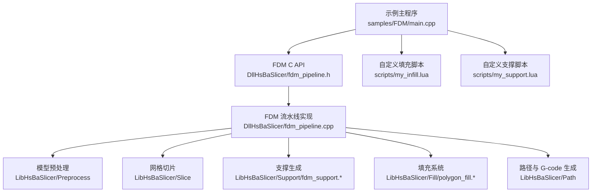
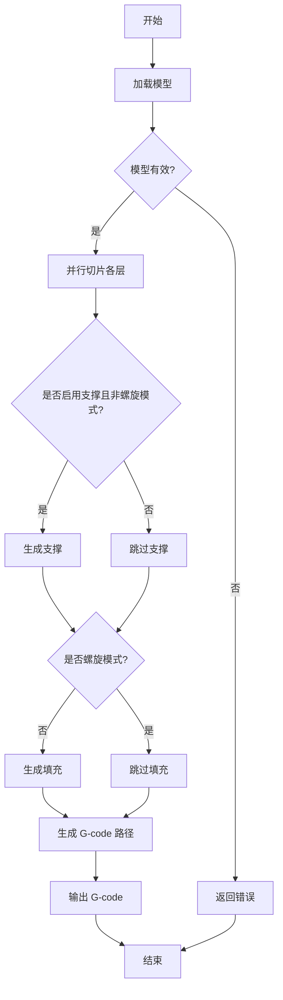
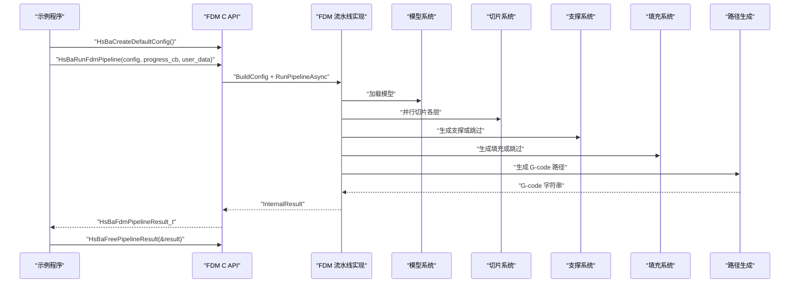
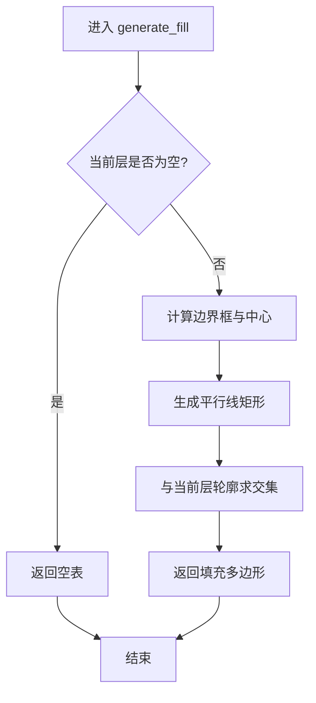
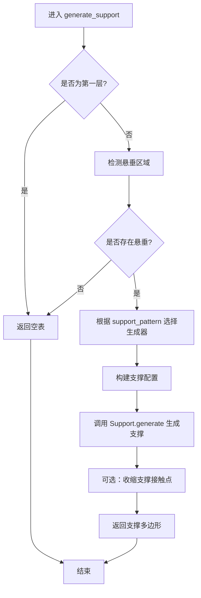
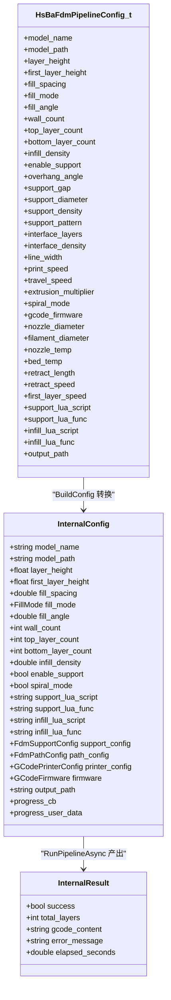
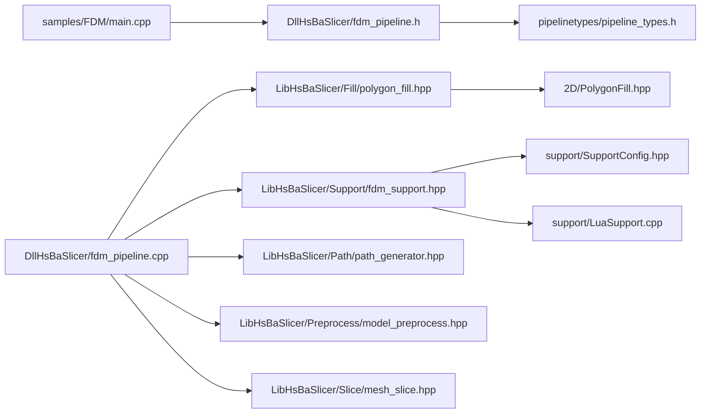
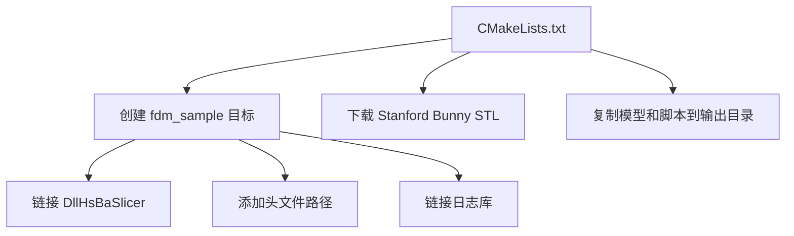
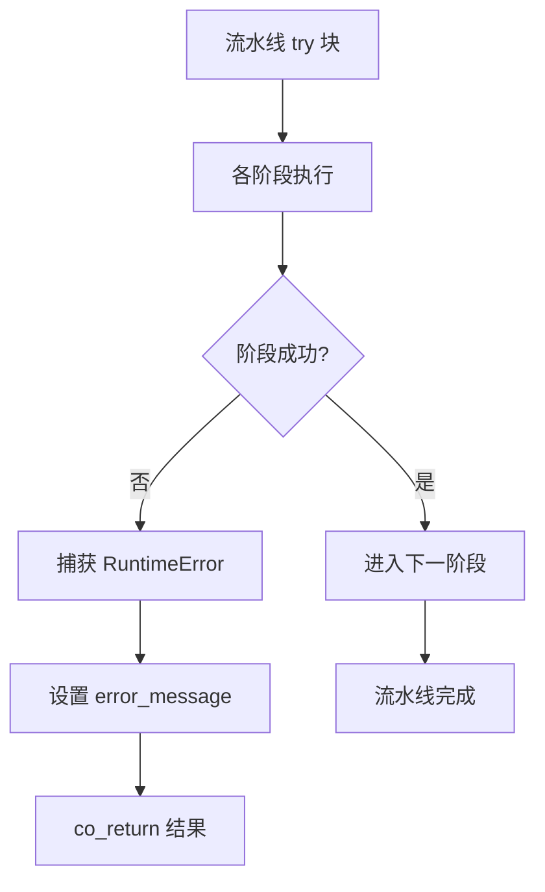

# FDM 流水线示例

<cite>
**本文引用的文件**   
- [samples/FDM/main.cpp](file://samples/FDM/main.cpp)
- [samples/FDM/CMakeLists.txt](file://samples/FDM/CMakeLists.txt)
- [samples/FDM/scripts/my_infill.lua](file://samples/FDM/scripts/my_infill.lua)
- [samples/FDM/scripts/my_support.lua](file://samples/FDM/scripts/my_support.lua)
- [pipelinetypes/pipeline_types.h](file://pipelinetypes/pipeline_types.h)
- [DllHsBaSlicer/fdm_pipeline.h](file://DllHsBaSlicer/fdm_pipeline.h)
- [DllHsBaSlicer/fdm_pipeline.cpp](file://DllHsBaSlicer/fdm_pipeline.cpp)
- [LibHsBaSlicer/Fill/polygon_fill.hpp](file://LibHsBaSlicer/Fill/polygon_fill.hpp)
- [LibHsBaSlicer/Fill/polygon_fill.cpp](file://LibHsBaSlicer/Fill/polygon_fill.cpp)
- [2D/PolygonFill.hpp](file://2D/PolygonFill.hpp)
- [support/SupportConfig.hpp](file://support/SupportConfig.hpp)
- [support/LuaSupport.cpp](file://support/LuaSupport.cpp)
- [LibHsBaSlicer/Support/fdm_support.hpp](file://LibHsBaSlicer/Support/fdm_support.hpp)
- [LibHsBaSlicer/Support/fdm_support.cpp](file://LibHsBaSlicer/Support/fdm_support.cpp)
</cite>

## 目录

1. [引言](#引言)
2. [项目结构](#项目结构)
3. [核心组件](#核心组件)
4. [架构总览](#架构总览)
5. [详细组件分析](#详细组件分析)
6. [依赖关系分析](#依赖关系分析)
7. [性能与扩展性](#性能与扩展性)
8. [构建与运行指南](#构建与运行指南)
9. [故障排除](#故障排除)
10. [结论](#结论)

## 引言

本教程面向希望使用 HsBaSlicer 完成 FDM（熔融沉积成型）切片流水线的用户。文档围绕 `samples/FDM` 示例展开，完整演示以下目标：

- 使用 C API 加载模型、配置切片参数、生成填充、创建支撑并输出 G-code。
- 解释 FDM 流水线配置结构体 `HsBaFdmPipelineConfig_t` 的字段含义和默认值。
- 详解自定义填充脚本 `my_infill.lua`，说明如何基于现有 Polygon Fill 能力实现新的填充模式。
- 提供支撑生成脚本 `my_support.lua` 编写指南，展示如何根据悬垂角度自动生成支撑结构。
- 给出完整的 CMake 构建配置和可运行的示例代码路径。

该示例支持同步调用、异步回调、Lua 自定义填充与支撑、螺旋花瓶模式等常见 FDM 工作流。

## 项目结构

FDM 示例位于仓库的 `samples/FDM` 目录中，主要包含三部分：

| 路径 | 作用 |
|---|---|
| `samples/FDM/main.cpp` | FDM 流水线示例入口，演示基本用法、自定义参数、Lua 自定义、异步模式和螺旋模式。 |
| `samples/FDM/CMakeLists.txt` | 示例工程的 CMake 构建配置，负责链接 DllHsBaSlicer、下载 Stanford Bunny STL 模型、复制脚本资源到输出目录。 |
| `samples/FDM/scripts/my_infill.lua` | 自定义填充脚本，演示按角度生成平行线并与当前层轮廓做交集。 |
| `samples/FDM/scripts/my_support.lua` | 自定义支撑脚本，演示使用内置悬垂检测器和多种支撑生成器。 |

**图表来源**
- [samples/FDM/main.cpp:53-332](file://samples/FDM/main.cpp#L53-L332)
- [DllHsBaSlicer/fdm_pipeline.h:17-61](file://DllHsBaSlicer/fdm_pipeline.h#L17-L61)
- [DllHsBaSlicer/fdm_pipeline.cpp:220-446](file://DllHsBaSlicer/fdm_pipeline.cpp#L220-L446)
- [LibHsBaSlicer/Support/fdm_support.hpp:19-67](file://LibHsBaSlicer/Support/fdm_support.hpp#L19-L67)
- [LibHsBaSlicer/Fill/polygon_fill.hpp:17-53](file://LibHsBaSlicer/Fill/polygon_fill.hpp#L17-L53)

**章节来源**
- [samples/FDM/main.cpp:1-337](file://samples/FDM/main.cpp#L1-L337)
- [samples/FDM/CMakeLists.txt:1-72](file://samples/FDM/CMakeLists.txt#L1-L72)

## 核心组件

FDM 流水线的核心由以下部分组成：

| 组件 | 职责 | 关键接口或文件 |
|---|---|---|
| FDM 配置结构体 | 描述模型、切片、填充、支撑、路径、G-code 输出和 Lua 自定义行为 | `HsBaFdmPipelineConfig_t` |
| FDM C API | 暴露创建默认配置、同步运行、异步运行和释放结果的接口 | `HsBaCreateDefaultConfig`、`HsBaRunFdmPipeline`、`HsBaRunFdmPipelineAsync`、`HsBaFreePipelineResult` |
| FDM 流水线实现 | 将 C API 转换为内部协程执行流程，串联模型加载、切片、支撑、填充、路径生成 | `RunPipelineAsync` |
| 填充系统 | 提供直线、简单折线、高级折线、带边框填充和 Lua 自定义填充 | `FillPolygon`、`FillWithBorder`、`LuaCustomFillByFile` |
| 支撑系统 | 提供平面、树状、蜂窝支撑以及 Lua 自定义支撑 | `GenerateFdmSupport`、`GenerateAllFdmSupport`、`GenerateAllLuaSupport` |
| 示例主程序 | 演示典型 FDM 使用方式 | `main.cpp` |

**章节来源**
- [pipelinetypes/pipeline_types.h:23-127](file://pipelinetypes/pipeline_types.h#L23-L127)
- [DllHsBaSlicer/fdm_pipeline.h:17-61](file://DllHsBaSlicer/fdm_pipeline.h#L17-L61)
- [DllHsBaSlicer/fdm_pipeline.cpp:220-446](file://DllHsBaSlicer/fdm_pipeline.cpp#L220-L446)
- [LibHsBaSlicer/Fill/polygon_fill.hpp:17-53](file://LibHsBaSlicer/Fill/polygon_fill.hpp#L17-L53)
- [LibHsBaSlicer/Support/fdm_support.hpp:19-67](file://LibHsBaSlicer/Support/fdm_support.hpp#L19-L67)

## 架构总览

FDM 流水线在内部是一个五阶段协程流程：

1. **模型预处理**：从模型名称或路径加载模型，获取包围盒和体积信息。
2. **网格切片**：构建切片拓扑并按层并行切片，得到每层的多边形轮廓。
3. **支撑生成**：根据配置启用或禁用支撑；可选择内置算法或 Lua 自定义脚本。
4. **填充生成**：对顶层/底层实心区域和普通中间层分别处理；可选择 C++ 填充或 Lua 自定义填充。
5. **路径生成**：根据轮廓、填充、支撑和层高生成 G-code 路径，最终输出字符串或写入文件。

**图表来源**
- [DllHsBaSlicer/fdm_pipeline.cpp:220-446](file://DllHsBaSlicer/fdm_pipeline.cpp#L220-L446)

**章节来源**
- [DllHsBaSlicer/fdm_pipeline.cpp:220-446](file://DllHsBaSlicer/fdm_pipeline.cpp#L220-L446)

## 详细组件分析

### FDM 流水线配置结构体 `HsBaFdmPipelineConfig_t`

`HsBaFdmPipelineConfig_t` 是 FDM 流水线的 C 兼容配置结构体，涵盖模型、切片、填充、支撑、路径、G-code 输出和 Lua 自定义等全部关键参数。其默认值由 `HsBaFdmConfigDefault` 初始化函数提供。

| 分类 | 字段 | 类型 | 默认值 | 含义 |
|---|---|---|---|---|
| 模型 | `model_name` | `const char*` | `NULL` | 模型名称 |
| 模型 | `model_path` | `const char*` | `NULL` | 模型文件路径 |
| 切片 | `layer_height` | `float` | `0.2f` | 层高，单位毫米 |
| 切片 | `first_layer_height` | `float` | `0.25f` | 首层层高，单位毫米 |
| 填充 | `fill_spacing` | `double` | `0.4` | 填充线间距，单位毫米 |
| 填充 | `fill_mode` | `HsBaFillMode_t` | `HSBA_FILL_ZIGZAG` | 填充模式 |
| 填充 | `fill_angle` | `double` | `45.0` | 填充角度，单位度 |
| 填充 | `wall_count` | `int` | `3` | 壁厚圈数 |
| 填充 | `top_layer_count` | `int` | `3` | 顶层实心层数 |
| 填充 | `bottom_layer_count` | `int` | `3` | 底层实心层数 |
| 填充 | `infill_density` | `double` | `0.2` | 中间层填充密度，范围 `[0,1]` |
| 支撑 | `enable_support` | `int` | `1` | 是否启用支撑 |
| 支撑 | `overhang_angle` | `float` | `45.0f` | 悬垂角度阈值，单位度 |
| 支撑 | `support_gap` | `float` | `0.5f` | 支撑与模型间隙，单位毫米 |
| 支撑 | `support_diameter` | `float` | `2.0f` | 支撑柱直径，单位毫米 |
| 支撑 | `support_density` | `float` | `0.3f` | 支撑填充密度，范围 `[0,1]` |
| 支撑 | `support_pattern` | `HsBaSupportPattern_t` | `HSBA_SUPPORT_PLANE` | 支撑图案 |
| 支撑 | `interface_layers` | `int` | `2` | 支撑与模型之间的界面层数 |
| 支撑 | `interface_density` | `float` | `0.5f` | 界面层填充密度，范围 `[0,1]` |
| 路径 | `line_width` | `float` | `0.4f` | 线宽，单位毫米 |
| 路径 | `print_speed` | `float` | `50.0f` | 打印速度，单位毫米每秒 |
| 路径 | `travel_speed` | `float` | `100.0f` | 空走速度，单位毫米每秒 |
| 路径 | `extrusion_multiplier` | `float` | `1.0f` | 挤出倍率 |
| 路径 | `spiral_mode` | `int` | `0` | 螺旋模式开关 |
| G-code | `gcode_firmware` | `HsBaGCodeFirmware_t` | `HSBA_GCODE_MARLIN` | 目标固件 |
| G-code | `nozzle_diameter` | `float` | `0.4f` | 喷嘴直径，单位毫米 |
| G-code | `filament_diameter` | `float` | `1.75f` | 耗材直径，单位毫米 |
| G-code | `nozzle_temp` | `float` | `200.0f` | 喷嘴温度，单位摄氏度 |
| G-code | `bed_temp` | `float` | `60.0f` | 热床温度，单位摄氏度 |
| G-code | `retract_length` | `float` | `1.0f` | 回抽长度，单位毫米 |
| G-code | `retract_speed` | `float` | `40.0f` | 回抽速度，单位毫米每秒 |
| G-code | `first_layer_speed` | `float` | `20.0f` | 首层速度，单位毫米每秒 |
| Lua | `support_lua_script` | `const char*` | `NULL` | 自定义支撑脚本路径 |
| Lua | `support_lua_func` | `const char*` | `NULL` | 自定义支撑函数名 |
| Lua | `infill_lua_script` | `const char*` | `NULL` | 自定义填充脚本路径 |
| Lua | `infill_lua_func` | `const char*` | `NULL` | 自定义填充函数名 |
| 输出 | `output_path` | `const char*` | `NULL` | 输出 G-code 文件路径 |

填充模式枚举定义如下：

| 枚举值 | 含义 |
|---|---|
| `HSBA_FILL_LINE` | 平行线填充 |
| `HSBA_FILL_SIMPLE_ZIGZAG` | 简单折线填充 |
| `HSBA_FILL_ZIGZAG` | 高级折线填充 |

支撑图案枚举定义如下：

| 枚举值 | 含义 |
|---|---|
| `HSBA_SUPPORT_PLANE` | 平面支撑 |
| `HSBA_SUPPORT_TREE` | 树状支撑 |
| `HSBA_SUPPORT_HONEYCOMB` | 蜂窝支撑 |

G-code 固件枚举定义如下：

| 枚举值 | 含义 |
|---|---|
| `HSBA_GCODE_MARLIN` | Marlin 固件 |
| `HSBA_GCODE_REPRAP` | RepRap / RRF 固件 |
| `HSBA_GCODE_KLIPPER` | Klipper 固件 |

**章节来源**
- [pipelinetypes/pipeline_types.h:23-127](file://pipelinetypes/pipeline_types.h#L23-L127)
- [pipelinetypes/pipeline_types.h:742-783](file://pipelinetypes/pipeline_types.h#L742-L783)

### FDM C API 与流水线入口

FDM 流水线的对外 C ABI 提供四个关键接口：

| 接口 | 行为 |
|---|---|
| `HsBaCreateDefaultConfig` | 创建带有默认值的 FDM 配置结构体 |
| `HsBaRunFdmPipeline` | 同步运行 FDM 流水线，阻塞直到结果可用 |
| `HsBaRunFdmPipelineAsync` | 异步运行 FDM 流水线，通过回调返回结果 |
| `HsBaFreePipelineResult` | 释放流水线结果中的动态内存 |

同步调用的典型流程是：创建配置 → 设置模型和工艺参数 → 调用 `HsBaRunFdmPipeline` → 检查 `result.success` → 读取 `result.gcode_content` → 调用 `HsBaFreePipelineResult`。

异步调用的典型流程是：创建配置 → 设置回调 → 调用 `HsBaRunFdmPipelineAsync` → 在 `OnPipelineComplete` 中处理结果并释放内存。

**图表来源**
- [DllHsBaSlicer/fdm_pipeline.h:17-61](file://DllHsBaSlicer/fdm_pipeline.h#L17-L61)
- [DllHsBaSlicer/fdm_pipeline.cpp:455-496](file://DllHsBaSlicer/fdm_pipeline.cpp#L455-L496)
- [DllHsBaSlicer/fdm_pipeline.cpp:220-446](file://DllHsBaSlicer/fdm_pipeline.cpp#L220-L446)

**章节来源**
- [DllHsBaSlicer/fdm_pipeline.h:17-61](file://DllHsBaSlicer/fdm_pipeline.h#L17-L61)
- [DllHsBaSlicer/fdm_pipeline.cpp:455-496](file://DllHsBaSlicer/fdm_pipeline.cpp#L455-L496)

### 示例主程序 `samples/FDM/main.cpp`

示例主程序展示了五种典型用法：

| 示例 | 功能 | 关键配置 |
|---|---|---|
| 基本流水线 | 使用默认配置运行 FDM 切片 | 仅设置模型名称和路径 |
| 自定义工艺参数 | 调整层高、填充、壁厚、支撑、路径和输出 | 设置 `layer_height`、`fill_mode`、`wall_count`、`enable_support`、`line_width` 等 |
| Lua 自定义支撑与填充 | 使用 `my_support.lua` 和 `my_infill.lua` | 设置 `support_lua_script`、`support_lua_func`、`infill_lua_script`、`infill_lua_func` |
| 异步流水线 | 非阻塞运行，通过回调接收结果 | 使用 `HsBaRunFdmPipelineAsync` |
| 螺旋花瓶模式 | 外壁合并为连续上升路径，跳过填充和支撑 | 设置 `spiral_mode = 1` |

示例还定义了进度回调函数，用于打印流水线阶段和百分比。

**章节来源**
- [samples/FDM/main.cpp:24-48](file://samples/FDM/main.cpp#L24-L48)
- [samples/FDM/main.cpp:53-96](file://samples/FDM/main.cpp#L53-L96)
- [samples/FDM/main.cpp:101-165](file://samples/FDM/main.cpp#L101-L165)
- [samples/FDM/main.cpp:170-220](file://samples/FDM/main.cpp#L170-L220)
- [samples/FDM/main.cpp:227-269](file://samples/FDM/main.cpp#L227-L269)
- [samples/FDM/main.cpp:274-318](file://samples/FDM/main.cpp#L274-L318)

### 填充系统与自定义填充 `my_infill.lua`

填充系统提供三种内置填充模式：

| 模式 | 对应 C++ 函数 | 特点 |
|---|---|---|
| 直线填充 | `LineFill` | 沿指定角度生成平行线 |
| 简单折线填充 | `SimpleZigzagFill` | 基础折线路径 |
| 高级折线填充 | `ZigzagFill` | 改进拐角处理的折线填充 |

C++ 侧通过 `FillWithBorder` 将壁厚偏移区域与内部填充组合，形成“边框 + 内部填充”的复合结果。

Lua 自定义填充通过 `LuaCustomFillByFile` 调用，脚本需要实现 `generate_fill(current_layer)` 函数，输入是当前层多边形表，返回值是填充多边形表。

`my_infill.lua` 的实现逻辑如下：

1. 如果当前层为空，直接返回空表。
2. 使用脚本内默认值设置填充间距和角度。
3. 计算当前层的边界框中心与范围。
4. 沿指定角度生成多条平行线，每条线表示为一个细长矩形。
5. 使用 `PolygonOperations.intersection` 将填充线与当前层轮廓做交集，裁剪到有效区域。
6. 返回裁剪后的填充多边形。

**图表来源**
- [samples/FDM/scripts/my_infill.lua:20-87](file://samples/FDM/scripts/my_infill.lua#L20-L87)

**章节来源**
- [2D/PolygonFill.hpp:30-68](file://2D/PolygonFill.hpp#L30-L68)
- [LibHsBaSlicer/Fill/polygon_fill.cpp:13-33](file://LibHsBaSlicer/Fill/polygon_fill.cpp#L13-L33)
- [LibHsBaSlicer/Fill/polygon_fill.cpp:35-49](file://LibHsBaSlicer/Fill/polygon_fill.cpp#L35-L49)
- [samples/FDM/scripts/my_infill.lua:1-89](file://samples/FDM/scripts/my_infill.lua#L1-L89)

### 支撑系统与自定义支撑 `my_support.lua`

支撑系统支持三种内置支撑模式：

| 模式 | 数值 | 说明 |
|---|---:|---|
| 平面支撑 | `0` | 柱状支撑，适合大多数情况 |
| 树状支撑 | `1` | 树状分支支撑，接触面积小 |
| 蜂窝支撑 | `2` | 蜂窝结构支撑，强度较高 |

支撑配置结构体 `Support::FdmSupportConfig` 继承自通用支撑配置 `Support::SupportConfig`，额外增加界面层相关参数。

`my_support.lua` 的实现逻辑如下：

1. 如果上一层为空，说明是首层，直接返回空表。
2. 使用 `Support.detect_overhang` 检测悬垂区域。
3. 如果没有悬垂区域，返回空表。
4. 根据 `config.support_pattern` 选择支撑生成器：平面、树状或蜂窝。
5. 使用 `Support.default_config()` 获取默认支撑配置，并覆盖层高、间隙、直径、密度等参数。
6. 调用 `Support.generate` 生成支撑截面多边形。
7. 可选地对支撑结果进行多边形收缩，使接触更精细。

**图表来源**
- [samples/FDM/scripts/my_support.lua:32-79](file://samples/FDM/scripts/my_support.lua#L32-L79)

**章节来源**
- [support/SupportConfig.hpp:14-34](file://support/SupportConfig.hpp#L14-L34)
- [LibHsBaSlicer/Support/fdm_support.cpp:14-52](file://LibHsBaSlicer/Support/fdm_support.cpp#L14-L52)
- [support/LuaSupport.cpp:19-90](file://support/LuaSupport.cpp#L19-L90)
- [samples/FDM/scripts/my_support.lua:1-83](file://samples/FDM/scripts/my_support.lua#L1-L83)

### 流水线阶段与数据流

FDM 流水线内部维护多个层数据结构：

| 数据结构 | 含义 |
|---|---|
| `layer_outlines` | 每层模型轮廓 |
| `layer_supports` | 每层支撑截面 |
| `layer_fills` | 每层填充截面 |
| `layer_path_data` | 路径生成所需的数据集合 |
| `layer_zs` | 螺旋模式下每层 Z 高度 |

流水线对顶层和底层使用实心填充，对中间层根据 `infill_density` 调整填充间距。若启用 Lua 自定义填充，则逐层串行调用脚本；若使用 C++ 填充，则可并行处理各层。

**图表来源**
- [DllHsBaSlicer/fdm_pipeline.cpp:34-70](file://DllHsBaSlicer/fdm_pipeline.cpp#L34-L70)
- [DllHsBaSlicer/fdm_pipeline.cpp:142-197](file://DllHsBaSlicer/fdm_pipeline.cpp#L142-L197)
- [pipelinetypes/pipeline_types.h:56-127](file://pipelinetypes/pipeline_types.h#L56-L127)

**章节来源**
- [DllHsBaSlicer/fdm_pipeline.cpp:220-446](file://DllHsBaSlicer/fdm_pipeline.cpp#L220-L446)

## 依赖关系分析

FDM 示例及其核心实现的依赖关系如下：

**图表来源**
- [samples/FDM/main.cpp:17-17](file://samples/FDM/main.cpp#L17-L17)
- [DllHsBaSlicer/fdm_pipeline.h:9-10](file://DllHsBaSlicer/fdm_pipeline.h#L9-L10)
- [DllHsBaSlicer/fdm_pipeline.cpp:17-26](file://DllHsBaSlicer/fdm_pipeline.cpp#L17-L26)
- [LibHsBaSlicer/Fill/polygon_fill.hpp:9-13](file://LibHsBaSlicer/Fill/polygon_fill.hpp#L9-L13)
- [LibHsBaSlicer/Support/fdm_support.hpp:9-15](file://LibHsBaSlicer/Support/fdm_support.hpp#L9-L15)

**章节来源**
- [samples/FDM/main.cpp:17-17](file://samples/FDM/main.cpp#L17-L17)
- [DllHsBaSlicer/fdm_pipeline.cpp:17-26](file://DllHsBaSlicer/fdm_pipeline.cpp#L17-L26)
- [LibHsBaSlicer/Fill/polygon_fill.hpp:9-13](file://LibHsBaSlicer/Fill/polygon_fill.hpp#L9-L13)
- [LibHsBaSlicer/Support/fdm_support.hpp:9-15](file://LibHsBaSlicer/Support/fdm_support.hpp#L9-L15)

## 性能与扩展性

### 性能特性

FDM 流水线在多个阶段采用并行化策略：

- **切片阶段**：使用 `ParallelForLayers` 并行切片各层，因为每层切片只读共享拓扑。
- **填充阶段**：C++ 填充使用 `ParallelForLayers` 并行处理；Lua 自定义填充因 Lua 解释器状态限制，改为逐层串行。
- **支撑阶段**：根据配置选择内置算法或 Lua 脚本，整体仍按层顺序处理。
- **路径生成**：最后统一生成 G-code 路径，螺旋模式与普通模式分别走不同分支。

### 扩展点

| 扩展点 | 说明 |
|---|---|
| 自定义填充 | 通过 `infill_lua_script` 和 `infill_lua_func` 替换内置填充逻辑 |
| 自定义支撑 | 通过 `support_lua_script` 和 `support_lua_func` 替换内置支撑逻辑 |
| 自定义填充算法 | 参考 `my_infill.lua`，基于 `PolygonOperations` 实现新的几何填充模式 |
| 自定义支撑算法 | 参考 `my_support.lua`，基于 `Support` 模块实现新的支撑生成逻辑 |
| 螺旋模式 | 开启 `spiral_mode` 后跳过填充和支撑，将外壁合并为连续路径 |

**章节来源**
- [DllHsBaSlicer/fdm_pipeline.cpp:267-279](file://DllHsBaSlicer/fdm_pipeline.cpp#L267-L279)
- [DllHsBaSlicer/fdm_pipeline.cpp:331-383](file://DllHsBaSlicer/fdm_pipeline.cpp#L331-L383)
- [samples/FDM/main.cpp:274-318](file://samples/FDM/main.cpp#L274-L318)

## 构建与运行指南

### CMake 构建配置

`samples/FDM/CMakeLists.txt` 的主要职责包括：

1. 在非移动端平台创建可执行目标 `fdm_sample`，在 Android/iOS 上创建静态库目标。
2. 链接 `DllHsBaSlicer`。
3. 添加头文件搜索路径。
4. 在非游戏控制台平台链接日志库。
5. 自动下载 Stanford Bunny STL 模型。
6. 在构建后将模型和脚本复制到可执行文件输出目录。

**图表来源**
- [samples/FDM/CMakeLists.txt:5-24](file://samples/FDM/CMakeLists.txt#L5-L24)
- [samples/FDM/CMakeLists.txt:29-71](file://samples/FDM/CMakeLists.txt#L29-L71)

**章节来源**
- [samples/FDM/CMakeLists.txt:1-72](file://samples/FDM/CMakeLists.txt#L1-L72)

### 运行示例

运行 FDM 示例的典型步骤如下：

1. 构建项目，确保 `fdm_sample` 可执行文件生成。
2. 确认输出目录中存在 `models/stanford_bunny.stl` 和 `scripts/my_infill.lua`、`scripts/my_support.lua`。
3. 运行 `fdm_sample`。
4. 查看日志输出和各示例生成的 G-code 文件。

示例会依次执行：

- 基本流水线：生成 `output/stanford_bunny_basic.gcode`
- 自定义参数流水线：生成 `output/stanford_bunny_custom.gcode`
- Lua 自定义流水线：生成 `output/stanford_bunny_lua.gcode`
- 异步流水线：通过回调报告完成状态
- 螺旋模式流水线：生成 `output/stanford_bunny_spiral.gcode`

**章节来源**
- [samples/FDM/main.cpp:323-336](file://samples/FDM/main.cpp#L323-L336)
- [samples/FDM/main.cpp:53-96](file://samples/FDM/main.cpp#L53-L96)
- [samples/FDM/main.cpp:101-165](file://samples/FDM/main.cpp#L101-L165)
- [samples/FDM/main.cpp:170-220](file://samples/FDM/main.cpp#L170-L220)
- [samples/FDM/main.cpp:274-318](file://samples/FDM/main.cpp#L274-L318)

## 故障排除

### 常见问题

| 问题 | 可能原因 | 处理方法 |
|---|---|---|
| 模型加载失败 | `model_path` 不存在或格式不支持 | 检查模型路径，确认 Stanford Bunny STL 已下载到正确位置 |
| G-code 写入失败 | 输出目录不可写或路径无效 | 检查 `output_path` 和文件系统权限 |
| Lua 脚本加载失败 | 脚本路径错误或语法错误 | 检查 `support_lua_script`、`infill_lua_script` 路径，验证脚本语法 |
| 支撑未生成 | 悬垂角度阈值过高或模型无悬垂 | 调整 `overhang_angle`，或使用可视化检查悬垂区域 |
| 填充过密或过疏 | `fill_spacing` 或 `infill_density` 设置不当 | 降低密度或增大间距 |
| 螺旋模式异常 | 模型不适合花瓶模式 | 关闭 `spiral_mode`，检查模型是否为封闭实体 |

### 错误传播机制

FDM 流水线内部使用 `RuntimeError` 捕获异常，并将错误消息放入结果结构体的 `error_message` 字段。C API 层通过 `OwnedCString` 管理动态分配的 C 字符串，确保异常路径下也能正确释放内存。

**图表来源**
- [DllHsBaSlicer/fdm_pipeline.cpp:437-446](file://DllHsBaSlicer/fdm_pipeline.cpp#L437-L446)

**章节来源**
- [DllHsBaSlicer/fdm_pipeline.cpp:72-108](file://DllHsBaSlicer/fdm_pipeline.cpp#L72-L108)
- [DllHsBaSlicer/fdm_pipeline.cpp:437-446](file://DllHsBaSlicer/fdm_pipeline.cpp#L437-L446)
- [DllHsBaSlicer/fdm_pipeline.cpp:488-496](file://DllHsBaSlicer/fdm_pipeline.cpp#L488-L496)

## 结论

HsBaSlicer 的 FDM 流水线提供了一个完整、可扩展且跨平台的 3D 打印切片解决方案。通过 `HsBaFdmPipelineConfig_t`，用户可以精确控制模型、切片、填充、支撑、路径和 G-code 输出；通过 Lua 脚本，用户可以灵活替换填充和支撑算法，而不必修改 C++ 核心代码。

对于初学者，建议从 `samples/FDM/main.cpp` 的基本流水线开始，逐步尝试自定义参数、Lua 自定义填充和支撑，最后再探索螺旋模式和异步调用。对于高级用户，可以基于 `PolygonFill` 和 `Support` 模块扩展新的填充模式和支撑结构，以满足特定打印需求。