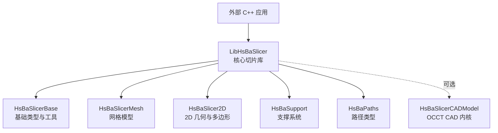
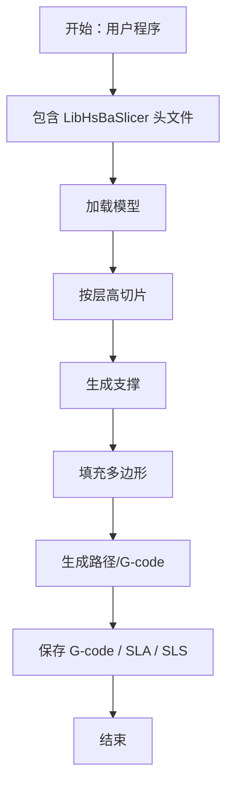
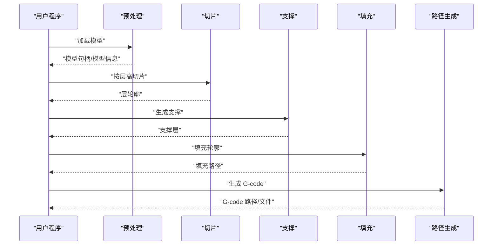
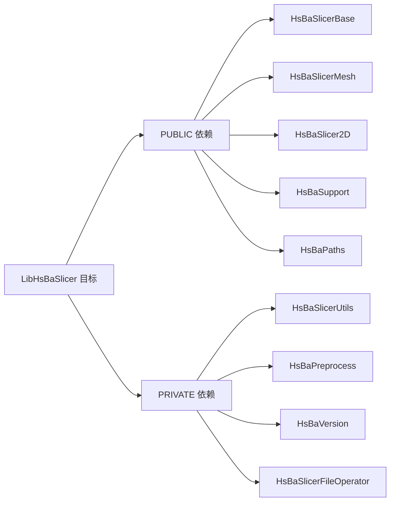
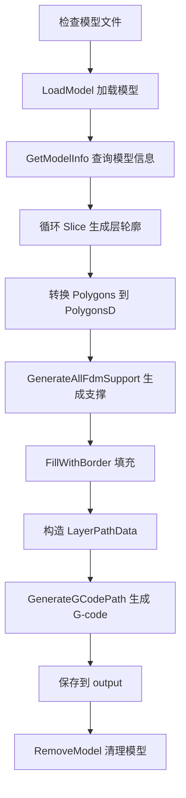
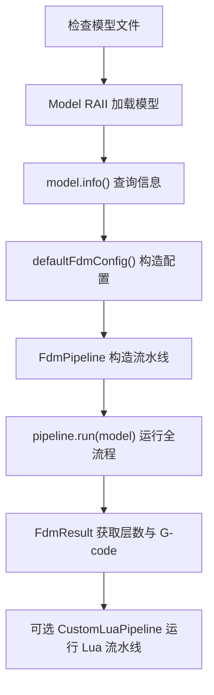

# LibHsBaSlicer 集成示例

<cite>
**本文引用的文件**   
- [LibHsBaSlicer/CMakeLists.txt](file://LibHsBaSlicer/CMakeLists.txt)
- [LibHsBaSlicer/export.h](file://LibHsBaSlicer/export.h)
- [samples/LibHsBaSlicer/CMakeLists.txt](file://samples/LibHsBaSlicer/CMakeLists.txt)
- [samples/LibHsBaSlicer/main_header.cpp](file://samples/LibHsBaSlicer/main_header.cpp)
- [samples/LibHsBaSlicer/main_module.cpp](file://samples/LibHsBaSlicer/main_module.cpp)
- [docs/zh/cpp_cmake_usage.md](file://docs/zh/cpp_cmake_usage.md)
- [docs/en/cpp_cmake_usage.md](file://docs/en/cpp_cmake_usage.md)
- [docs/zh/LibHsBaSlicer/README.md](file://docs/zh/LibHsBaSlicer/README.md)
- [docs/en/LibHsBaSlicer/README.md](file://docs/en/LibHsBaSlicer/README.md)
</cite>

## 目录
1. [简介](#简介)
2. [项目结构与定位](#项目结构与定位)
3. [核心组件与职责](#核心组件与职责)
4. [架构总览](#架构总览)
5. [在 C++ 项目中直接链接 LibHsBaSlicer](#在-c-项目中直接链接-libhsbaslicer)
6. [头文件包含与命名空间](#头文件包含与命名空间)
7. [基本 API 调用流程](#基本-api-调用流程)
8. [CMake 配置与依赖管理](#cmake-配置与依赖管理)
9. [模型加载、切片参数与结果获取](#模型加载切片参数与结果获取)
10. [内存管理与错误处理](#内存管理与错误处理)
11. [性能优化建议](#性能优化建议)
12. [与其他第三方库集成的实践](#与其他第三方库集成的实践)
13. [常见问题排查](#常见问题排查)
14. [结论](#结论)

## 简介
本文面向需要在 C++ 项目中直接链接并使用 `LibHsBaSlicer` 静态库进行 3D 模型切片处理的开发者。文档基于仓库中的实际源码、构建脚本和官方中文/英文文档，给出：
- 如何理解 `LibHsBaSlicer` 的模块边界与依赖关系；
- 如何在 CMake 中正确引入并链接该库；
- 如何使用传统头文件和 C++20 模块两种方式使用核心切片 API；
- 如何进行模型加载、切片、支撑、填充、路径生成和 G-code 输出；
- 如何处理内存、异常、Lua 扩展、SLA/SLS 导出、参数存储等高级能力；
- 如何结合 Qt、wxWidgets、Unity、Unreal Engine 等第三方生态。

## 项目结构与定位
`LibHsBaSlicer` 是 HsBaSlicer 的核心 C++ 库，提供完整的切片流水线能力，包括模型预处理、网格切片、支撑生成、多边形填充、路径生成、SLA 地板/渲染/打包、SLS Lua 导出、文件传输、工艺参数存储以及 Lua 扩展注册。



**图表来源**  
- [LibHsBaSlicer/CMakeLists.txt:85-105](file://LibHsBaSlicer/CMakeLists.txt#L85-L105)

**章节来源**  
- [docs/zh/LibHsBaSlicer/README.md:1-31](file://docs/zh/LibHsBaSlicer/README.md#L1-L31)
- [docs/en/LibHsBaSlicer/README.md:1-31](file://docs/en/LibHsBaSlicer/README.md#L1-L31)
- [LibHsBaSlicer/CMakeLists.txt:85-105](file://LibHsBaSlicer/CMakeLists.txt#L85-L105)

## 核心组件与职责
`LibHsBaSlicer` 按功能划分为多个子模块，每个子模块对应一个明确的职责：

| 子模块 | 主要职责 | 典型使用场景 |
| --- | --- | --- |
| Preprocess | 模型加载、变换、信息查询、布尔运算与抽壳 | 加载 STL/OBJ/STEP 等模型，执行缩放、平移、布尔差集/并集 |
| Slice | Z 轴平面切片，生成层轮廓 | 根据层高逐层生成多边形轮廓 |
| Support | FDM/SLA/Lua 支撑截面生成 | 生成悬垂支撑、平台支撑 |
| Fill | 多边形填充模式 | 生成内部填充、边框填充、Zigzag 等 |
| Path | G-code 路径生成与区域路径优化 | 将层数据转换为打印机可执行的 G-code |
| Floor | SLA 底座生成、层图渲染、zip 打包 | SLA 光固化打印的筏板与图片输出 |
| Transfer | 远程文件传输（连接池化 TCP） | 批量上传切片结果到远端设备 |
| ParamStore | 工艺参数写入/读取数据库 | 复用 FDM/SLA/SLS 等流水线配置 |
| Extends | Lua 函数注册、事件回调、C++ 事件源 | 扩展 Lua 流水线、监听压缩进度或数据库事件 |

**章节来源**  
- [docs/zh/LibHsBaSlicer/README.md:5-16](file://docs/zh/LibHsBaSlicer/README.md#L5-L16)
- [docs/en/LibHsBaSlicer/README.md:5-16](file://docs/en/LibHsBaSlicer/README.md#L5-L16)

## 架构总览
从集成视角看，`LibHsBaSlicer` 对外暴露 C++ API，对内依赖基础几何、网格、支撑、路径、文件操作、版本信息等子系统。若启用 OCCT 相关编译选项，还会链接 CAD 内核以支持 BRep 布尔运算与抽壳。



**图表来源**  
- [samples/LibHsBaSlicer/main_header.cpp:61-177](file://samples/LibHsBaSlicer/main_header.cpp#L61-L177)
- [samples/LibHsBaSlicer/main_module.cpp:47-97](file://samples/LibHsBaSlicer/main_module.cpp#L47-L97)

**章节来源**  
- [samples/LibHsBaSlicer/main_header.cpp:61-177](file://samples/LibHsBaSlicer/main_header.cpp#L61-L177)
- [samples/LibHsBaSlicer/main_module.cpp:47-97](file://samples/LibHsBaSlicer/main_module.cpp#L47-L97)

## 在 C++ 项目中直接链接 LibHsBaSlicer
有两种主流方式：

1. **传统头文件方式**：适用于所有支持 C++20 的编译器，不需要模块支持。
2. **C++20 模块方式**：通过 `ModuleHsRaSlicer` 包装层使用类风格 API，需要编译器支持 C++20 模块。

推荐优先使用 `find_package(HsBaSlicer REQUIRED)` 的方式引入已安装的 HsBaSlicer，或通过 `add_subdirectory` 将 HsBaSlicer 作为子目录集成。

**章节来源**  
- [docs/zh/cpp_cmake_usage.md:57-99](file://docs/zh/cpp_cmake_usage.md#L57-L99)
- [docs/en/cpp_cmake_usage.md:57-99](file://docs/en/cpp_cmake_usage.md#L57-L99)

## 头文件包含与命名空间
`LibHsBaSlicer` 的所有 API 均位于 `HsBa::Slicer` 命名空间中。典型头文件包括：

- `LibHsBaSlicer/Preprocess/model_preprocess.hpp`
- `LibHsBaSlicer/Slice/mesh_slice.hpp`
- `LibHsBaSlicer/Support/fdm_support.hpp`
- `LibHsBaSlicer/Fill/polygon_fill.hpp`
- `LibHsBaSlicer/Path/path_generator.hpp`
- `LibHsBaSlicer/Path/path_optimizer.hpp`
- `LibHsBaSlicer/Path/sls_export.hpp`
- `LibHsBaSlicer/Floor/sla_floor.hpp`
- `LibHsBaSlicer/Transfer/file_transfer.hpp`
- `LibHsBaSlicer/ParamStore/param_store_ops.hpp`
- `LibHsBaSlicer/Extends/LuaAddFunction.hpp`
- `LibHsBaSlicer/Extends/EventSourceFunction.hpp`
- `LibHsBaSlicer/version_info.hpp`

使用时通常配合 `using namespace HsBa::Slicer;`，以便直接调用 `LoadModel`、`Slice`、`GenerateAllFdmSupport`、`FillWithBorder`、`GenerateGCodePathV2` 等接口。

**章节来源**  
- [docs/zh/LibHsBaSlicer/README.md:33-55](file://docs/zh/LibHsBaSlicer/README.md#L33-L55)
- [docs/en/LibHsBaSlicer/README.md:33-55](file://docs/en/LibHsBaSlicer/README.md#L33-L55)
- [docs/zh/LibHsBaSlicer/README.md:462-464](file://docs/zh/LibHsBaSlicer/README.md#L462-L464)
- [docs/en/LibHsBaSlicer/README.md:465-467](file://docs/en/LibHsBaSlicer/README.md#L465-L467)

## 基本 API 调用流程
最典型的 FDM 切片流程为：

1. **预处理**：加载模型，查询包围盒、体积等信息，可选执行变换、布尔运算、抽壳。
2. **切片**：按层高逐层调用切片函数，得到每层的二维多边形轮廓。
3. **支撑**：根据悬垂角度、支撑密度、支撑模式生成支撑结构。
4. **填充**：对每层轮廓进行边框与内部填充，可选择 Zigzag、Grid 等填充模式。
5. **路径**：将层数据转换为 G-code 路径，并按目标固件格式输出。



**图表来源**  
- [samples/LibHsBaSlicer/main_header.cpp:61-177](file://samples/LibHsBaSlicer/main_header.cpp#L61-L177)
- [samples/LibHsBaSlicer/main_module.cpp:47-97](file://samples/LibHsBaSlicer/main_module.cpp#L47-L97)

**章节来源**  
- [docs/zh/LibHsBaSlicer/README.md:357-365](file://docs/zh/LibHsBaSlicer/README.md#L357-L365)
- [docs/en/LibHsBaSlicer/README.md:360-368](file://docs/en/LibHsBaSlicer/README.md#L360-L368)
- [samples/LibHsBaSlicer/main_header.cpp:61-177](file://samples/LibHsBaSlicer/main_header.cpp#L61-L177)

## CMake 配置与依赖管理
### 使用 find_package 引入已安装库
如果已经通过 `cmake --install` 安装了 HsBaSlicer，可以在外部项目中这样配置：

```cmake
cmake_minimum_required(VERSION 3.28)
project(MySlicerApp LANGUAGES CXX)

set(CMAKE_CXX_STANDARD 20)
set(CMAKE_CXX_STANDARD_REQUIRED ON)

find_package(HsBaSlicer REQUIRED)

add_executable(my_app main.cpp)
target_link_libraries(my_app PRIVATE HsBaSlicer::LibHsBaSlicer)
```

配置时可指定安装前缀：

```bash
cmake -B build -DCMAKE_PREFIX_PATH=/path/to/install
```

**章节来源**  
- [docs/zh/cpp_cmake_usage.md:57-78](file://docs/zh/cpp_cmake_usage.md#L57-L78)
- [docs/en/cpp_cmake_usage.md:57-78](file://docs/en/cpp_cmake_usage.md#L57-L78)

### 使用 add_subdirectory 集成整个项目
如果不希望安装 HsBaSlicer，可以直接把 HsBaSlicer 作为子目录引入：

```cmake
cmake_minimum_required(VERSION 3.28)
project(MyProject LANGUAGES CXX)

set(CMAKE_CXX_STANDARD 20)
set(CMAKE_CXX_STANDARD_REQUIRED ON)

add_subdirectory(third_party/HsBaSlicer)

add_executable(my_app main.cpp)
target_link_libraries(my_app PRIVATE LibHsBaSlicer)
```

注意：使用 `add_subdirectory` 时，目标名称不带 `HsBaSlicer::` 命名空间前缀。

**章节来源**  
- [docs/zh/cpp_cmake_usage.md:417-444](file://docs/zh/cpp_cmake_usage.md#L417-L444)
- [docs/en/cpp_cmake_usage.md:417-444](file://docs/en/cpp_cmake_usage.md#L417-L444)

### LibHsBaSlicer 的构建目标与依赖
`LibHsBaSlicer` 默认既支持静态库也支持共享库，由 `BUILD_SHARED_LIBS` 控制。其公共依赖包括基础类型、网格模型、2D 几何、支撑系统和路径类型；私有依赖包括工具、预处理、版本信息和文件操作模块。



**图表来源**  
- [LibHsBaSlicer/CMakeLists.txt:85-100](file://LibHsBaSlicer/CMakeLists.txt#L85-L100)

**章节来源**  
- [LibHsBaSlicer/CMakeLists.txt:1-115](file://LibHsBaSlicer/CMakeLists.txt#L1-L115)
- [docs/zh/cpp_cmake_usage.md:448-472](file://docs/zh/cpp_cmake_usage.md#L448-L472)
- [docs/en/cpp_cmake_usage.md:448-472](file://docs/en/cpp_cmake_usage.md#L448-L472)

### 样本工程的 CMake 配置
仓库自带的 `samples/LibHsBaSlicer/CMakeLists.txt` 演示了如何绕过 DllHsBaSlicer C ABI 层，直接调用 LibHsBaSlicer C++ API，并提供传统头文件版和 C++20 模块版两个目标。

关键点：
- 非 Android/iOS 平台构建可执行文件；Android/iOS 构建静态库。
- 传统头文件版链接 `LibHsBaSlicer`。
- 模块版链接 `ModuleHsBaSlicer`。
- 自动复制 Stanford Bunny STL 模型资源。
- 模块版还可复制 Custom 流水线的 Lua 脚本资源。

**章节来源**  
- [samples/LibHsBaSlicer/CMakeLists.txt:1-71](file://samples/LibHsBaSlicer/CMakeLists.txt#L1-L71)

## 模型加载、切片参数与结果获取
### 传统头文件版完整流程
传统头文件版示例展示了完整的 FDM 切片流程：

1. 检查模型文件是否存在。
2. 使用 `LoadModel` 加载模型。
3. 使用 `GetModelInfo` 获取包围盒和体积。
4. 按层高循环调用 `Slice` 生成层轮廓。
5. 将整数多边形转换为浮点多边形后调用 `GenerateAllFdmSupport`。
6. 使用 `FillWithBorder` 进行边框与内部填充。
7. 构造 `LayerPathData` 并通过 `GenerateGCodePath` 生成 G-code。
8. 保存到 `output/lib_header_sample.gcode`。
9. 最后清理模型池。



**图表来源**  
- [samples/LibHsBaSlicer/main_header.cpp:46-185](file://samples/LibHsBaSlicer/main_header.cpp#L46-L185)

**章节来源**  
- [samples/LibHsBaSlicer/main_header.cpp:46-185](file://samples/LibHsBaSlicer/main_header.cpp#L46-L185)

### C++20 模块版完整流程
模块版示例使用 `import hsba.slicer;` 和类风格 API：

1. 检查模型文件是否存在。
2. 使用 RAII 的 `Model` 加载模型。
3. 通过 `model.info()` 获取模型信息。
4. 构造 `HsBaFdmPipelineConfig_t` 配置 FDM 全流程。
5. 使用 `FdmPipeline` 运行完整流水线。
6. 从 `FdmResult` 中获取层数和 G-code。
7. 可选运行完全由 Lua 脚本定义的自定义流水线。



**图表来源**  
- [samples/LibHsBaSlicer/main_module.cpp:31-127](file://samples/LibHsBaSlicer/main_module.cpp#L31-L127)

**章节来源**  
- [samples/LibHsBaSlicer/main_module.cpp:31-127](file://samples/LibHsBaSlicer/main_module.cpp#L31-L127)

## 内存管理与错误处理
### 模型与对象生命周期
- 传统头文件版使用模型池：加载模型后需手动调用 `RemoveModel` 清理。
- 模块版使用 RAII 的 `Model`，析构时自动清理模型。
- 模块版中 `FdmPipeline`、`CustomLuaPipeline` 等对象也遵循 RAII 语义。

**章节来源**  
- [samples/LibHsBaSlicer/main_header.cpp:181-183](file://samples/LibHsBaSlicer/main_header.cpp#L181-L183)
- [samples/LibHsBaSlicer/main_module.cpp:99-100](file://samples/LibHsBaSlicer/main_module.cpp#L99-L100)

### 异常处理
模块版示例使用 `try/catch` 捕获 `SlicerError` 和其他标准异常，避免未处理异常导致程序崩溃。传统头文件版则更多通过返回值、空指针检查和日志输出判断失败。

**章节来源**  
- [samples/LibHsBaSlicer/main_module.cpp:45-138](file://samples/LibHsBaSlicer/main_module.cpp#L45-L138)

### 工艺参数存储的内存释放
工艺参数存储 API 中，读取回填的 `const char*` 字段由库内部分配，必须调用对应的释放函数释放堆字符串。例如：

- 使用 `FreeLoadedConfigStrings` 释放读取到的配置字符串。
- 模块版的 `ParamStorePipeline` 提供 `freeLoaded` 方法释放读取结果。

**章节来源**  
- [docs/zh/LibHsBaSlicer/README.md:138-172](file://docs/zh/LibHsBaSlicer/README.md#L138-L172)
- [docs/en/LibHsBaSlicer/README.md:138-172](file://docs/en/LibHsBaSlicer/README.md#L138-L172)
- [docs/zh/cpp_cmake_usage.md:233-259](file://docs/zh/cpp_cmake_usage.md#L233-L259)
- [docs/en/cpp_cmake_usage.md:233-259](file://docs/en/cpp_cmake_usage.md#L233-L259)

## 性能优化建议
### 分层优化策略
1. **合理设置层高**：层高越小，层数越多，计算量和输出体积越大。
2. **控制填充密度**：填充间距过小会显著增加路径长度和计算时间。
3. **减少不必要的布尔运算**：布尔运算和抽壳可能触发 CGAL/OCCT 复杂几何计算。
4. **复用模型池**：避免重复加载相同模型。
5. **使用路径优化器**：对多边形区域或填充结果进行访问顺序优化，减少空走距离。

**章节来源**  
- [docs/zh/LibHsBaSlicer/README.md:236-344](file://docs/zh/LibHsBaSlicer/README.md#L236-L344)
- [docs/en/LibHsBaSlicer/README.md:236-347](file://docs/en/LibHsBaSlicer/README.md#L236-L347)

### 并行与线程池
虽然本文聚焦 `LibHsBaSlicer` 的直接集成，但仓库中存在线程池、协程、对象池等基础能力，适合在高并发切片任务中复用。若你的应用需要批量处理多个模型，应结合线程池控制并发度，避免一次性加载过多模型导致内存峰值过高。

**章节来源**  
- [docs/zh/LibHsBaSlicer/README.md:367-401](file://docs/zh/LibHsBaSlicer/README.md#L367-L401)
- [docs/en/LibHsBaSlicer/README.md:370-404](file://docs/en/LibHsBaSlicer/README.md#L370-L404)

## 与其他第三方库集成的实践
### Qt 与 wxWidgets 集成
官方文档提供了 DllHsBaSlicer 的 Qt/wxWidgets 集成指南。对于直接使用 `LibHsBaSlicer` 的场景，核心思路是：
- 在 UI 线程中发起切片任务；
- 将耗时切片逻辑放到工作线程；
- 通过进度回调更新 UI；
- 将生成的 G-code 或 SLA/SLS 结果交给 UI 层显示或下载。

**章节来源**  
- [docs/zh/cpp_cmake_usage.md:511-517](file://docs/zh/cpp_cmake_usage.md#L511-L517)
- [docs/en/cpp_cmake_usage.md:511-517](file://docs/en/cpp_cmake_usage.md#L511-L517)

### Unity 与 Unreal Engine 集成
游戏引擎集成通常通过 DllHsBaSlicer 的 C ABI 层完成，因为 C ABI 更容易被 C#/C++/Native 插件桥接。若你选择直接集成 `LibHsBaSlicer`，需要注意：
- 确保引擎侧能正确链接静态库或动态库；
- 注意 Windows 下 DLL 导入/导出宏；
- 注意 Lua 脚本路径、模型路径和资源拷贝；
- 注意引擎主线程与工作线程的边界。

**章节来源**  
- [docs/zh/cpp_cmake_usage.md:511-517](file://docs/zh/cpp_cmake_usage.md#L511-L517)
- [docs/en/cpp_cmake_usage.md:511-517](file://docs/en/cpp_cmake_usage.md#L511-L517)

### Lua 扩展与事件回调
`LibHsBaSlicer` 支持通过 `Extends/LuaAddFunction.hpp` 注册外部 Lua 函数，并通过 `Extends/EventSourceFunction.hpp` 注册 C++ 事件回调。这在集成第三方脚本系统、监控系统或遥测系统时非常有用。

**章节来源**  
- [docs/zh/LibHsBaSlicer/README.md:57-113](file://docs/zh/LibHsBaSlicer/README.md#L57-L113)
- [docs/en/LibHsBaSlicer/README.md:57-113](file://docs/en/LibHsBaSlicer/README.md#L57-L113)

## 常见问题排查
### 找不到模型文件
传统头文件版和模块版示例都会检查模型文件是否存在。如果运行时报错，请确认：
- 模型路径是否正确；
- 是否已将 `stanford_bunny.stl` 复制到可执行文件目录下的 `models/` 文件夹；
- CMake 的 POST_BUILD 命令是否成功复制了资源。

**章节来源**  
- [samples/LibHsBaSlicer/main_header.cpp:50-59](file://samples/LibHsBaSlicer/main_header.cpp#L50-L59)
- [samples/LibHsBaSlicer/main_module.cpp:35-43](file://samples/LibHsBaSlicer/main_module.cpp#L35-L43)
- [samples/LibHsBaSlicer/CMakeLists.txt:40-70](file://samples/LibHsBaSlicer/CMakeLists.txt#L40-L70)

### MSVC 模块相关编译错误
MSVC 下使用 C++20 模块时需注意：
- `#include` 必须在 `import` 之前；
- CGAL 传播的编译标志会通过 INTERFACE 属性传递给消费者；
- ModuleHsBaSlicer 始终构建为 STATIC，避免 DLL 链接阶段依赖系统库。

**章节来源**  
- [docs/zh/cpp_cmake_usage.md:312-333](file://docs/zh/cpp_cmake_usage.md#L312-L333)
- [docs/en/cpp_cmake_usage.md:312-333](file://docs/en/cpp_cmake_usage.md#L312-L333)

### 找不到 HsBaSlicer 包
如果使用 `find_package(HsBaSlicer REQUIRED)`，请确认：
- 已通过 `cmake --install` 安装 HsBaSlicer；
- `CMAKE_PREFIX_PATH` 指向正确的安装前缀；
- vcpkg 或其他包管理器已正确安装 Eigen3、Lua、Protobuf、OpenSSL 等依赖。

**章节来源**  
- [docs/zh/cpp_cmake_usage.md:22-78](file://docs/zh/cpp_cmake_usage.md#L22-L78)
- [docs/en/cpp_cmake_usage.md:22-78](file://docs/en/cpp_cmake_usage.md#L22-L78)
- [docs/zh/cpp_cmake_usage.md:461-472](file://docs/zh/cpp_cmake_usage.md#L461-L472)
- [docs/en/cpp_cmake_usage.md:461-472](file://docs/en/cpp_cmake_usage.md#L461-L472)

### 导出符号问题
`LibHsBaSlicer` 在非 Windows 平台不强制要求导出装饰符；在 Windows 共享库模式下会定义 `HSBA_SLICER_EXPORTS` 并使用 `__declspec(dllexport)`/`__declspec(dllimport)`。如果你自行构建共享库，请确保构建方定义了导出宏，消费方正确包含 `export.h`。

**章节来源**  
- [LibHsBaSlicer/export.h:1-22](file://LibHsBaSlicer/export.h#L1-L22)
- [LibHsBaSlicer/CMakeLists.txt:77-83](file://LibHsBaSlicer/CMakeLists.txt#L77-L83)

## 结论
`LibHsBaSlicer` 是一个结构清晰、职责分明的 3D 切片核心库。对于 C++ 项目集成，推荐优先使用 `find_package(HsBaSlicer REQUIRED)` 引入已安装库，并在需要时使用传统头文件或 C++20 模块两种方式之一。典型集成路径是：加载模型 → 切片 → 支撑 → 填充 → 路径生成 → 输出 G-code/SLA/SLS。在实际工程中，应重点关注模型生命周期、异常处理、Lua 扩展、路径优化、资源路径和第三方库依赖管理。