# SLA 流水线示例

<cite>
**本文引用的文件**   
- [sla_pipeline.h](file://DllHsBaSlicer/sla_pipeline.h)
- [sla_pipeline.cpp](file://DllHsBaSlicer/sla_pipeline.cpp)
- [pipeline_types.h](file://pipelinetypes/pipeline_types.h)
- [sla_floor.hpp](file://LibHsBaSlicer/Floor/sla_floor.hpp)
- [sla_floor.cpp](file://LibHsBaSlicer/Floor/sla_floor.cpp)
- [SlaSupport.hpp](file://support/SlaSupport.hpp)
- [SlaSupport.cpp](file://support/SlaSupport.cpp)
- [SupportConfig.hpp](file://support/SupportConfig.hpp)
- [FdmSupport.hpp](file://support/FdmSupport.hpp)
- [FdmSupport.cpp](file://support/FdmSupport.cpp)
- [main.cpp](file://samples/SLA/main.cpp)
- [my_sla_floor.lua](file://samples/SLA/scripts/my_sla_floor.lua)
- [my_sla_support.lua](file://samples/SLA/scripts/my_sla_support.lua)
- [CMakeLists.txt](file://samples/SLA/CMakeLists.txt)
- [sla_pipeline.proto](file://proto/sla_pipeline.proto)
</cite>

## 目录
1. [引言](#引言)
2. [项目结构](#项目结构)
3. [核心概念：SLA 与 FDM 切片差异](#核心概念sla-与-fdm-切片差异)
4. [架构总览](#架构总览)
5. [详细组件分析](#详细组件分析)
6. [依赖关系分析](#依赖关系分析)
7. [性能与并行特性](#性能与并行特性)
8. [配置选项与最佳实践](#配置选项与最佳实践)
9. [自定义底板脚本 my_sla_floor.lua](#自定义底板脚本-my_sla_floorlua)
10. [自定义支撑算法 my_sla_support.lua](#自定义支撑算法-my_sla_supportlua)
11. [编译、运行与测试流程](#编译运行与测试流程)
12. [故障排除](#故障排除)
13. [结论](#结论)

## 引言
本教程面向希望使用 HsBaSlicer 构建完整 SLA（立体光刻）流水线的开发者。文档从系统架构出发，解释 SLA 切片与 FDM 切片的本质差异，重点说明层厚、曝光参数、底板与支撑结构的区别；随后给出 SlaPipelineConfig_t 的配置字段说明、Lua 自定义底板与支撑脚本的实现指南，并提供完整的编译与测试流程。读者无需深入 C++ 源码即可理解如何正确配置和扩展 SLA 流水线。

## 项目结构
SLA 流水线由 C ABI 接口、内部流水线实现、底层地板与支撑模块、以及示例程序组成。关键路径如下：
- C ABI 与流水线入口：DllHsBaSlicer/sla_pipeline.h、sla_pipeline.cpp
- 公共类型定义：pipelinetypes/pipeline_types.h
- 地板生成与导出：LibHsBaSlicer/Floor/sla_floor.hpp、sla_floor.cpp
- SLA 支撑算法：support/SlaSupport.hpp、SlaSupport.cpp
- FDM 支撑对比：support/FdmSupport.hpp、FdmSupport.cpp
- 示例程序与脚本：samples/SLA/main.cpp、scripts/my_sla_floor.lua、scripts/my_sla_support.lua
- 构建配置：samples/SLA/CMakeLists.txt
- 协议定义：proto/sla_pipeline.proto

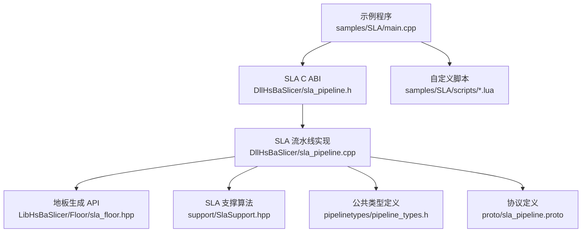

**图示来源** 
- [sla_pipeline.h:17-56](file://DllHsBaSlicer/sla_pipeline.h#L17-L56)
- [sla_pipeline.cpp:298-483](file://DllHsBaSlicer/sla_pipeline.cpp#L298-L483)
- [sla_floor.hpp:21-116](file://LibHsBaSlicer/Floor/sla_floor.hpp#L21-L116)
- [SlaSupport.hpp:13-42](file://support/SlaSupport.hpp#L13-L42)
- [pipeline_types.h:165-218](file://pipelinetypes/pipeline_types.h#L165-L218)
- [sla_pipeline.proto:18-58](file://proto/sla_pipeline.proto#L18-L58)

**章节来源**
- [sla_pipeline.h:17-56](file://DllHsBaSlicer/sla_pipeline.h#L17-L56)
- [sla_pipeline.cpp:298-483](file://DllHsBaSlicer/sla_pipeline.cpp#L298-L483)
- [sla_floor.hpp:21-116](file://LibHsBaSlicer/Floor/sla_floor.hpp#L21-L116)
- [SlaSupport.hpp:13-42](file://support/SlaSupport.hpp#L13-L42)
- [pipeline_types.h:165-218](file://pipelinetypes/pipeline_types.h#L165-L218)
- [sla_pipeline.proto:18-58](file://proto/sla_pipeline.proto#L18-L58)

## 核心概念：SLA 与 FDM 切片差异
SLA 与 FDM 在切片阶段都输出每层轮廓，但后续处理逻辑不同：
- 层厚设置
  - SLA 默认层厚更小，适合高精度树脂打印；FDM 通常使用较大层厚以匹配挤出工艺。
  - SLA 首层层高与普通层高分离，用于增强首层粘附。
- 曝光参数
  - SLA 需要底部曝光时间、普通曝光时间、抬升距离、抬升速度、回抽速度等参数；FDM 没有这些参数。
- 底板与支撑
  - SLA 支持 Raft/底板生成，并采用牺牲型细柱支撑或锥形支撑，便于后处理移除；FDM 使用平面、树形、蜂窝支撑，且常包含界面层密度与层数控制。
- 输出格式
  - SLA 输出为 zip 包，内含每层图像（PNG/JPG/SVG）、底板图像、支撑图像与配置文件；FDM 输出通常为 G-code。

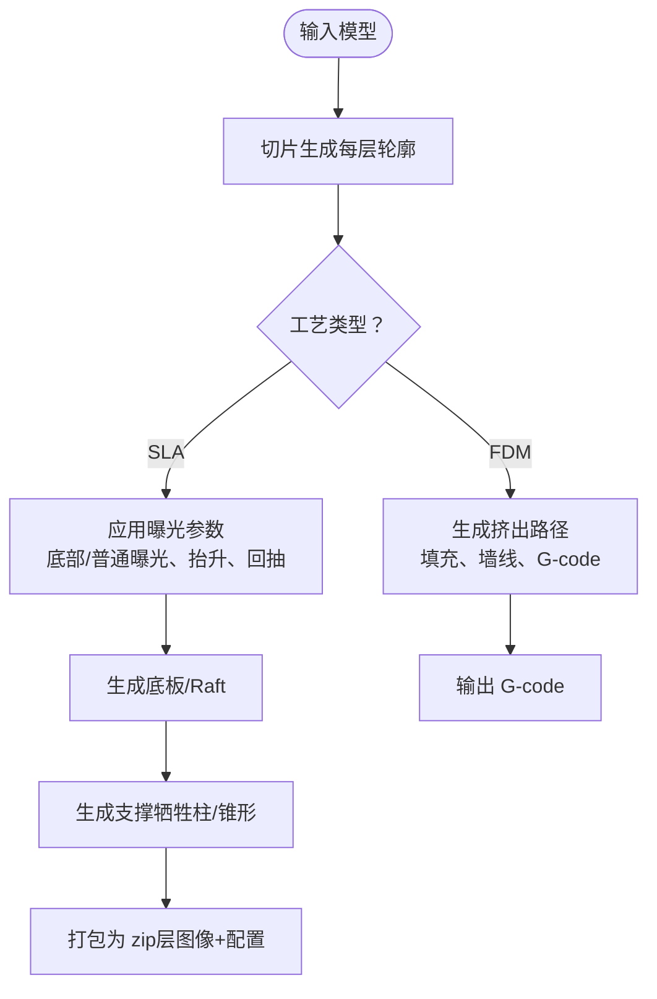

**图示来源**
- [sla_pipeline.cpp:338-421](file://DllHsBaSlicer/sla_pipeline.cpp#L338-L421)
- [FdmSupport.cpp:48-76](file://support/FdmSupport.cpp#L48-L76)
- [SlaSupport.cpp:81-124](file://support/SlaSupport.cpp#L81-L124)

**章节来源**
- [pipeline_types.h:165-218](file://pipelinetypes/pipeline_types.h#L165-L218)
- [pipeline_types.h:56-113](file://pipelinetypes/pipeline_types.h#L56-L113)
- [sla_pipeline.cpp:338-421](file://DllHsBaSlicer/sla_pipeline.cpp#L338-L421)
- [FdmSupport.cpp:48-76](file://support/FdmSupport.cpp#L48-L76)
- [SlaSupport.cpp:81-124](file://support/SlaSupport.cpp#L81-L124)

## 架构总览
SLA 流水线通过 C ABI 暴露同步与异步接口，内部按阶段执行：预处理、切片、底板、支撑、导出。Lua 脚本可替换底板、支撑与导出逻辑。

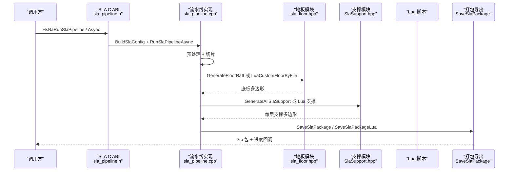

**图示来源**
- [sla_pipeline.h:23-47](file://DllHsBaSlicer/sla_pipeline.h#L23-L47)
- [sla_pipeline.cpp:298-483](file://DllHsBaSlicer/sla_pipeline.cpp#L298-L483)
- [sla_floor.hpp:81-116](file://LibHsBaSlicer/Floor/sla_floor.hpp#L81-L116)
- [SlaSupport.hpp:23-35](file://support/SlaSupport.hpp#L23-L35)

**章节来源**
- [sla_pipeline.h:23-47](file://DllHsBaSlicer/sla_pipeline.h#L23-L47)
- [sla_pipeline.cpp:298-483](file://DllHsBaSlicer/sla_pipeline.cpp#L298-L483)

## 详细组件分析

### SLA 流水线 C ABI 与内部实现
- 对外接口
  - HsBaCreateDefaultSlaConfig：创建默认配置
  - HsBaRunSlaPipeline：同步执行
  - HsBaRunSlaPipelineAsync：异步执行
  - HsBaFreeSlaPipelineResult：释放结果内存
- 内部阶段
  - 预处理与切片：构建拓扑并按层并行切片
  - 底板生成：内置 GenerateFloorRaft 或 Lua 自定义
  - 支撑生成：内置 SLA 牺牲支撑或 Lua 自定义
  - 导出：SaveSlaPackage 或 SaveSlaPackageLua

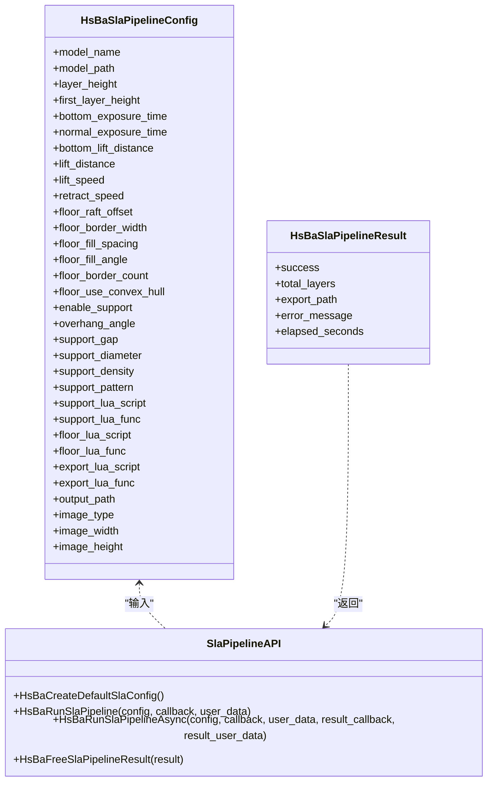

**图示来源**
- [pipeline_types.h:165-232](file://pipelinetypes/pipeline_types.h#L165-L232)
- [sla_pipeline.h:17-56](file://DllHsBaSlicer/sla_pipeline.h#L17-L56)

**章节来源**
- [pipeline_types.h:165-232](file://pipelinetypes/pipeline_types.h#L165-L232)
- [sla_pipeline.h:17-56](file://DllHsBaSlicer/sla_pipeline.h#L17-L56)
- [sla_pipeline.cpp:491-531](file://DllHsBaSlicer/sla_pipeline.cpp#L491-L531)

### 地板生成模块
- 核心函数
  - GenerateFloorContact：计算接触区域
  - GenerateFloorBorder：生成边框环
  - GenerateFloorFill：生成内部填充
  - GenerateFloorRaft：生成完整底板
  - LuaCustomFloorByFile/String：Lua 自定义底板
- 渲染与导出
  - RenderPolygonsToImage/Buffer：将多边形渲染为图像
  - SaveSlaPackage/SaveSlaPackageLua：打包 zip

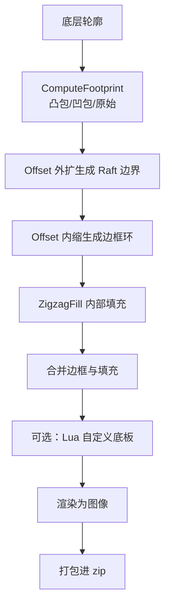

**图示来源**
- [sla_floor.cpp:34-118](file://LibHsBaSlicer/Floor/sla_floor.cpp#L34-L118)
- [sla_floor.cpp:149-315](file://LibHsBaSlicer/Floor/sla_floor.cpp#L149-L315)
- [sla_floor.cpp:358-382](file://LibHsBaSlicer/Floor/sla_floor.cpp#L358-L382)
- [sla_floor.cpp:469-530](file://LibHsBaSlicer/Floor/sla_floor.cpp#L469-L530)

**章节来源**
- [sla_floor.hpp:21-116](file://LibHsBaSlicer/Floor/sla_floor.hpp#L21-L116)
- [sla_floor.cpp:34-118](file://LibHsBaSlicer/Floor/sla_floor.cpp#L34-L118)
- [sla_floor.cpp:149-315](file://LibHsBaSlicer/Floor/sla_floor.cpp#L149-L315)
- [sla_floor.cpp:358-382](file://LibHsBaSlicer/Floor/sla_floor.cpp#L358-L382)
- [sla_floor.cpp:469-530](file://LibHsBaSlicer/Floor/sla_floor.cpp#L469-L530)

### SLA 支撑算法
- 牺牲支撑
  - 基于悬垂检测生成小直径柱状支撑点，间距由支撑直径决定
  - 支持间隙收缩悬垂区域，避免与模型粘连
- 配置结构
  - SlaSupportConfig 继承 SupportConfig，增加 tip_diameter、raft_thickness

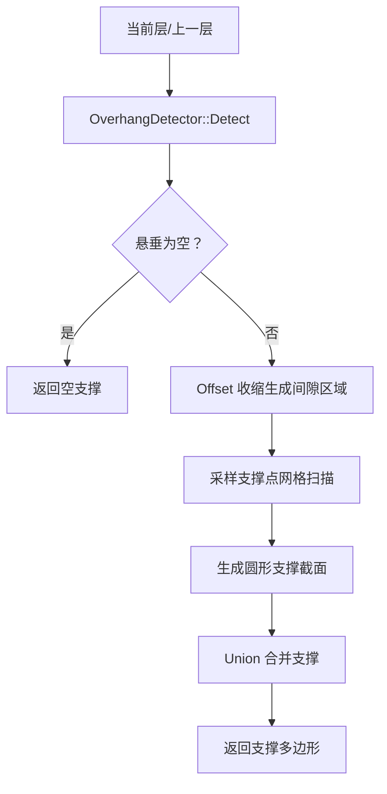

**图示来源**
- [SlaSupport.cpp:38-124](file://support/SlaSupport.cpp#L38-L124)
- [SupportConfig.hpp:39-43](file://support/SupportConfig.hpp#L39-L43)

**章节来源**
- [SlaSupport.hpp:13-42](file://support/SlaSupport.hpp#L13-L42)
- [SlaSupport.cpp:38-124](file://support/SlaSupport.cpp#L38-L124)
- [SupportConfig.hpp:39-43](file://support/SupportConfig.hpp#L39-L43)

### FDM 支撑对比
- FDM 支撑策略包括平面、树形、蜂窝
- 平面支撑通过膨胀过hang区域形成柱体
- 树形支撑在顶层生成分支圆点，向下扩展
- 蜂窝支撑用六边形单元填充悬垂区域

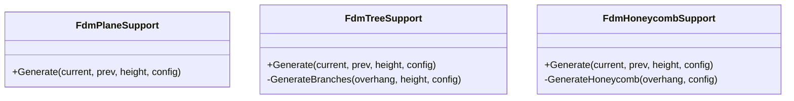

**图示来源**
- [FdmSupport.hpp:19-63](file://support/FdmSupport.hpp#L19-L63)
- [FdmSupport.cpp:48-76](file://support/FdmSupport.cpp#L48-L76)
- [FdmSupport.cpp:81-168](file://support/FdmSupport.cpp#L81-L168)
- [FdmSupport.cpp:173-267](file://support/FdmSupport.cpp#L173-L267)

**章节来源**
- [FdmSupport.hpp:19-63](file://support/FdmSupport.hpp#L19-L63)
- [FdmSupport.cpp:48-76](file://support/FdmSupport.cpp#L48-L76)
- [FdmSupport.cpp:81-168](file://support/FdmSupport.cpp#L81-L168)
- [FdmSupport.cpp:173-267](file://support/FdmSupport.cpp#L173-L267)

## 依赖关系分析
SLA 流水线依赖以下模块：
- 模型加载与切片：LibHsBaSlicer/Preprocess/model_preprocess.hpp、LibHsBaSlicer/Slice/mesh_slice.hpp
- 地板生成：LibHsBaSlicer/Floor/sla_floor.hpp
- 支撑生成：support/SlaSupport.hpp、support/SupportConfig.hpp
- 导出与图像：LibHsBaSlicer/Floor/sla_floor.cpp（ImagesPath、RenderPolygonsToImage）
- Lua 扩展：2D/LuaAdapter.hpp、PolygonFill、EventSourceFunction

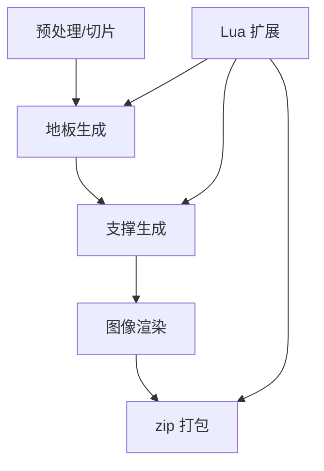

**图示来源**
- [sla_pipeline.cpp:310-421](file://DllHsBaSlicer/sla_pipeline.cpp#L310-L421)
- [sla_floor.cpp:469-530](file://LibHsBaSlicer/Floor/sla_floor.cpp#L469-L530)

**章节来源**
- [sla_pipeline.cpp:310-421](file://DllHsBaSlicer/sla_pipeline.cpp#L310-L421)
- [sla_floor.cpp:469-530](file://LibHsBaSlicer/Floor/sla_floor.cpp#L469-L530)

## 性能与并行特性
- 切片阶段：使用 ParallelForLayers 对每层独立切片进行并行处理
- 导出阶段：ForLayersParallel 并行渲染层图像与支持图像，环境变量 HSBA_PIPELINE_THREADS 可限制线程数
- 异常处理：RuntimeError 被捕获并转换为错误消息

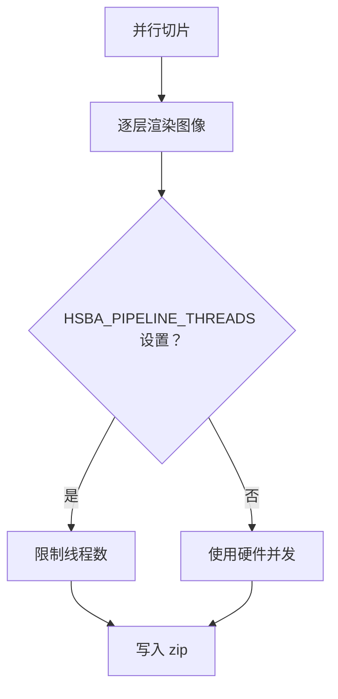

**图示来源**
- [sla_pipeline.cpp:346-357](file://DllHsBaSlicer/sla_pipeline.cpp#L346-L357)
- [sla_floor.cpp:406-466](file://LibHsBaSlicer/Floor/sla_floor.cpp#L406-L466)

**章节来源**
- [sla_pipeline.cpp:346-357](file://DllHsBaSlicer/sla_pipeline.cpp#L346-L357)
- [sla_floor.cpp:406-466](file://LibHsBaSlicer/Floor/sla_floor.cpp#L406-L466)

## 配置选项与最佳实践
- 模型与切片
  - model_name、model_path：必填
  - layer_height、first_layer_height：建议根据树脂特性调整，首层略大以提升粘附
- 曝光参数
  - bottom_exposure_time：底部层曝光时间，过长易过度固化，过短粘附不足
  - normal_exposure_time：普通层曝光时间，影响细节与强度
  - bottom_lift_distance、lift_distance、lift_speed、retract_speed：影响剥离力与成功率
- 底板参数
  - floor_raft_offset、floor_border_width、floor_fill_spacing、floor_fill_angle、floor_border_count、floor_use_convex_hull
- 支撑参数
  - enable_support、overhang_angle、support_gap、support_diameter、support_density、support_pattern
- Lua 自定义
  - support_lua_script/support_lua_func、floor_lua_script/floor_lua_func、export_lua_script/export_lua_func
- 输出
  - output_path、image_type、image_width、image_height

最佳实践：
- 先使用默认配置运行，再逐步调整曝光与抬升参数
- 对于复杂悬垂结构，启用支撑并适当增大 overhang_angle
- 使用 Lua 自定义底板时，优先使用凸包简化轮廓以减少材料
- 导出图像选择 PNG 以获得无损质量，SVG 适合矢量查看

**章节来源**
- [pipeline_types.h:165-218](file://pipelinetypes/pipeline_types.h#L165-L218)
- [sla_pipeline.cpp:181-242](file://DllHsBaSlicer/sla_pipeline.cpp#L181-L242)

## 自定义底板脚本 my_sla_floor.lua
该脚本演示如何基于底层轮廓生成 SLA 专用底板：
- 输入：bottom_layer（底层多边形表）、config（底板配置表）
- 可用函数：PolygonOperations（offsetOperation、union、difference、intersection、convexHullOperation）、PolygonFill（zigzagFill、lineFill、offsetFill）
- 返回值：底板多边形表

实现要点：
- 可选凸包简化轮廓
- 向外偏移生成 Raft 外边界
- 向内收缩生成内边界
- 生成边框环与内部填充
- 合并边框与填充

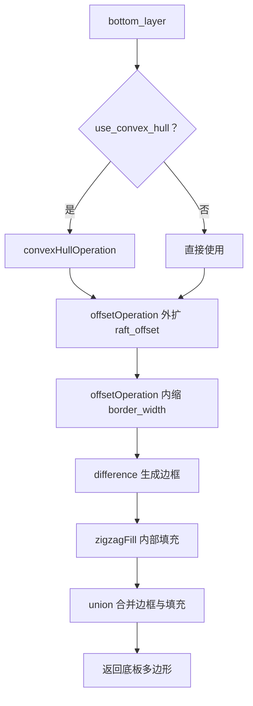

**图示来源**
- [my_sla_floor.lua:35-62](file://samples/SLA/scripts/my_sla_floor.lua#L35-L62)

**章节来源**
- [my_sla_floor.lua:1-64](file://samples/SLA/scripts/my_sla_floor.lua#L1-L64)
- [sla_floor.hpp:81-116](file://LibHsBaSlicer/Floor/sla_floor.hpp#L81-L116)

## 自定义支撑算法 my_sla_support.lua
该脚本演示如何生成 SLA 专用支撑：
- 全局变量：current_layer、prev_layer、layer_height、config
- 可用函数：PolygonOperations、Support.new_sla、Support.generate、Support.detect_overhang、Support.default_config
- 返回值：支撑截面多边形表

实现要点：
- 首层跳过支撑
- 检测悬垂区域
- 使用内置 SLA 支撑生成器
- 可选面积过滤减少支撑体积

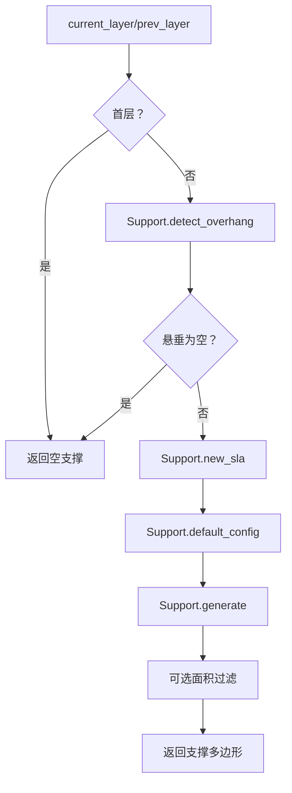

**图示来源**
- [my_sla_support.lua:34-72](file://samples/SLA/scripts/my_sla_support.lua#L34-L72)

**章节来源**
- [my_sla_support.lua:1-76](file://samples/SLA/scripts/my_sla_support.lua#L1-L76)
- [SlaSupport.cpp:81-124](file://support/SlaSupport.cpp#L81-L124)

## 编译、运行与测试流程
- 构建目标
  - samples/SLA/CMakeLists.txt 定义 sla_sample 目标，链接 DllHsBaSlicer
  - 非移动端构建可执行文件，移动端构建静态库
- 资源复制
  - 复制 stanford_bunny.stl 到 models 目录
  - 复制 scripts 目录到可执行文件目录
- 运行示例
  - main.cpp 提供四个示例：基础、自定义参数、Lua 自定义、异步

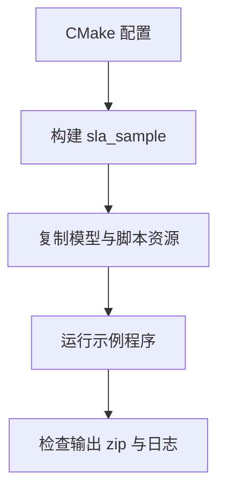

**图示来源**
- [CMakeLists.txt:1-48](file://samples/SLA/CMakeLists.txt#L1-L48)
- [main.cpp:244-258](file://samples/SLA/main.cpp#L244-L258)

**章节来源**
- [CMakeLists.txt:1-48](file://samples/SLA/CMakeLists.txt#L1-L48)
- [main.cpp:52-84](file://samples/SLA/main.cpp#L52-L84)
- [main.cpp:89-144](file://samples/SLA/main.cpp#L89-L144)
- [main.cpp:149-191](file://samples/SLA/main.cpp#L149-L191)
- [main.cpp:217-239](file://samples/SLA/main.cpp#L217-L239)

## 故障排除
常见问题与解决思路：
- 模型加载失败
  - 检查 model_path 是否正确，确保 STL 文件存在
- 切片结果为空
  - 检查 layer_height 与 first_layer_height 是否合理，模型高度是否为正
- 底板生成失败
  - 检查 Lua 脚本路径与函数名，确认返回多边形表格式正确
- 支撑生成失败
  - 检查 support_lua_script 内容是否可读，悬垂角度阈值是否过低
- 导出失败
  - 检查 output_path 权限，图像尺寸与格式是否有效

**章节来源**
- [sla_pipeline.cpp:310-336](file://DllHsBaSlicer/sla_pipeline.cpp#L310-L336)
- [sla_floor.cpp:149-191](file://LibHsBaSlicer/Floor/sla_floor.cpp#L149-L191)
- [sla_pipeline.cpp:400-419](file://DllHsBaSlicer/sla_pipeline.cpp#L400-L419)
- [sla_floor.cpp:469-530](file://LibHsBaSlicer/Floor/sla_floor.cpp#L469-L530)

## 结论
HsBaSlicer 的 SLA 流水线提供了完整的切片、底板、支撑与导出能力，并通过 Lua 脚本开放高度定制化空间。开发者可根据树脂特性与模型几何特征调整曝光、抬升、底板与支撑参数，结合示例代码快速验证效果。建议在生产环境中优先使用默认配置，再逐步优化关键参数，并利用异步接口提升批处理能力。