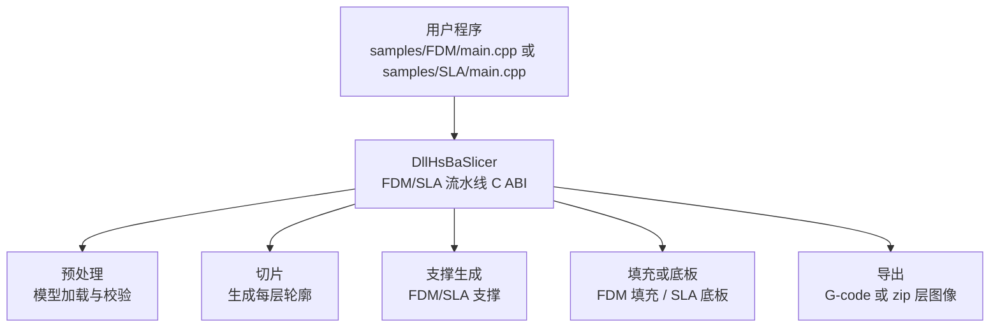
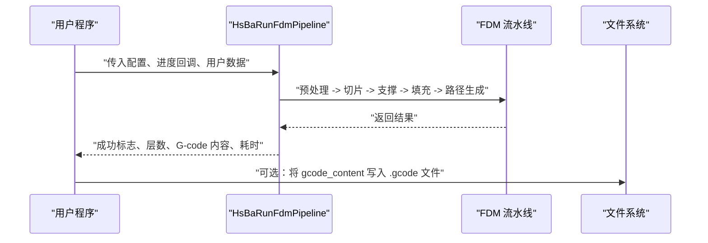
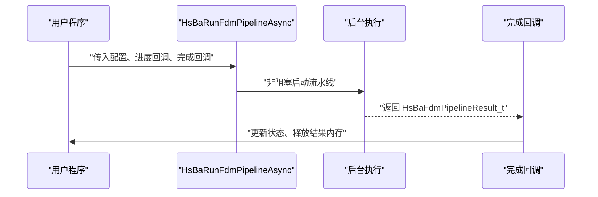
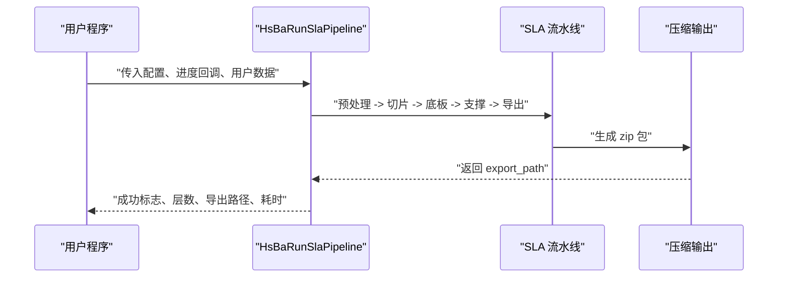
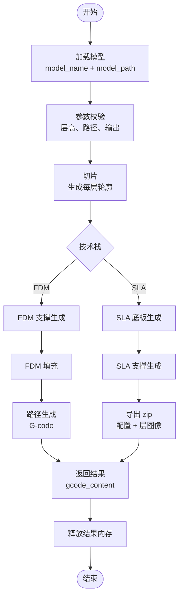

# 基础示例

<cite>
**本文引用的文件**   
- [samples/FDM/main.cpp](file://samples/FDM/main.cpp)
- [samples/SLA/main.cpp](file://samples/SLA/main.cpp)
- [DllHsBaSlicer/fdm_pipeline.h](file://DllHsBaSlicer/fdm_pipeline.h)
- [DllHsBaSlicer/sla_pipeline.h](file://DllHsBaSlicer/sla_pipeline.h)
- [pipelinetypes/pipeline_types.h](file://pipelinetypes/pipeline_types.h)
- [DllHsBaSlicer/fdm_pipeline.cpp](file://DllHsBaSlicer/fdm_pipeline.cpp)
- [DllHsBaSlicer/sla_pipeline.cpp](file://DllHsBaSlicer/sla_pipeline.cpp)
- [ModuleHsBaSlicer/hsba_slicer.cppm](file://ModuleHsBaSlicer/hsba_slicer.cppm)
- [README.md](file://README.md)
</cite>

## 目录
1. [引言](#引言)
2. [项目结构与入口](#项目结构与入口)
3. [核心概念](#核心概念)
4. [FDM 切片入门示例](#fdm-切片入门示例)
5. [SLA 切片入门示例](#sla-切片入门示例)
6. [架构与数据流总览](#架构与数据流总览)
7. [配置字段速查表](#配置字段速查表)
8. [常见问题与排错](#常见问题与排错)
9. [最佳实践建议](#最佳实践建议)
10. [结论](#结论)

## 引言
本页面面向初次接触 HsBaSlicer 的用户，目标是帮助你快速完成一次完整的 3D 打印切片流程。文档围绕两个最常用技术栈展开：

- FDM（熔融沉积成型）：输出 G-code，用于桌面级或工业级 FDM 打印机。
- SLA（立体光刻）：输出层图像与配置压缩包，用于光固化 3D 打印机。

每个示例都包含：
- 完整示例源码路径
- 分步说明
- 输入模型、关键参数、输出结果
- 同步与异步调用方式
- Lua 自定义支撑/填充/底板的扩展点

如果你已经安装好构建环境，可以直接参考根仓库的 README 进行编译；如果你只想理解 API 和示例逻辑，也可以直接阅读本节内容。

**章节来源**
- [README.md:21-39](file://README.md#L21-L39)

## 项目结构与入口
HsBaSlicer 提供两种主要使用方式：

| 使用方式 | 对应模块 | 典型入口 | 适用场景 |
|---|---|---|---|
| C ABI 动态库接口 | DllHsBaSlicer | `HsBaCreateDefaultConfig`、`HsBaRunFdmPipeline`、`HsBaRunSlaPipeline` | 外部语言集成、跨进程调用、C/C#/Python/Java 等 |
| C++ 全流程封装 | ModuleHsBaSlicer / LibHsBaSlicer | `FdmPipeline::run` | C++ 应用内直接调用切片流水线 |

示例程序位于 `samples/FDM/main.cpp` 与 `samples/SLA/main.cpp`，它们演示了如何创建配置、设置模型、运行流水线、处理进度回调、获取结果并释放内存。

**图表来源**
- [samples/FDM/main.cpp:53-96](file://samples/FDM/main.cpp#L53-L96)
- [samples/SLA/main.cpp:52-84](file://samples/SLA/main.cpp#L52-L84)
- [DllHsBaSlicer/fdm_pipeline.h:23-35](file://DllHsBaSlicer/fdm_pipeline.h#L23-L35)
- [DllHsBaSlicer/sla_pipeline.h:23-34](file://DllHsBaSlicer/sla_pipeline.h#L23-L34)

**章节来源**
- [samples/FDM/main.cpp:1-18](file://samples/FDM/main.cpp#L1-L18)
- [samples/SLA/main.cpp:1-17](file://samples/SLA/main.cpp#L1-L17)
- [ModuleHsBaSlicer/hsba_slicer.cppm:197-212](file://ModuleHsBaSlicer/hsba_slicer.cppm#L197-L212)

## 核心概念
在开始具体示例之前，先统一理解以下核心概念：

| 概念 | 含义 | 在示例中的体现 |
|---|---|---|
| 模型加载 | 从 STL 或其他网格格式读取 3D 模型 | 示例中通过 `model_name` 与 `model_path` 指定模型 |
| 参数配置 | 层高、壁厚、填充率、支撑、曝光时间、底板等 | FDM 使用 `HsBaFdmPipelineConfig_t`，SLA 使用 `HsBaSlaPipelineConfig_t` |
| 切片执行 | 将三维模型切分为二维层轮廓 | 内部调用切片模块，逐层生成多边形 |
| 支撑生成 | 为悬垂区域生成可移除结构 | FDM 支持树形/蜂窝/平面支撑；SLA 支持牺牲型/锥形支撑 |
| 填充或底板 | FDM 生成内部填充；SLA 生成底板接触面 | FDM 由填充算法决定；SLA 由底板生成器决定 |
| 路径导出 | FDM 输出 G-code；SLA 输出 zip 包 | FDM 返回 `gcode_content`；SLA 返回 `export_path` |
| 同步与异步 | 阻塞等待结果 vs 回调通知完成 | 示例同时展示同步函数与异步函数 |
| Lua 扩展 | 自定义支撑、填充、底板或导出逻辑 | 示例通过脚本路径与函数名注入 Lua 实现 |

这些概念贯穿所有示例。初学者建议先跑通“基本用法”，再逐步调整工艺参数，最后尝试 Lua 自定义。

**章节来源**
- [pipelinetypes/pipeline_types.h:56-113](file://pipelinetypes/pipeline_types.h#L56-L113)
- [pipelinetypes/pipeline_types.h:170-218](file://pipelinetypes/pipeline_types.h#L170-L218)

## FDM 切片入门示例
FDM 示例位于 `samples/FDM/main.cpp`，它展示了五种常见用法：

1. 基本流水线：使用默认配置运行 FDM 切片。
2. 自定义工艺参数：设置层高、壁厚、填充模式、支撑、打印速度等。
3. Lua 自定义支撑与填充：通过脚本替换内置算法。
4. 异步流水线：非阻塞启动，完成后回调结果。
5. 螺旋/花瓶模式：开启 `spiral_mode`，将外壁合并为连续上升路径。

### 步骤一：准备模型与输出目录
示例会创建 `output` 目录，并从 `models/stanford_bunny.stl` 加载模型。实际使用时，请确保：

- 模型路径存在且可读
- 输出目录有写入权限
- 如果使用 Lua 脚本，脚本路径正确且可加载

### 步骤二：创建默认配置
FDM 默认配置通过 `HsBaCreateDefaultConfig()` 创建，内部默认值包括：

| 配置类别 | 关键字段 | 默认值 |
|---|---|---|
| 模型 | `model_name`、`model_path` | 空字符串 |
| 切片 | `layer_height`、`first_layer_height` | 0.2 mm、0.25 mm |
| 填充 | `fill_spacing`、`fill_mode`、`fill_angle`、`wall_count`、`top_layer_count`、`bottom_layer_count`、`infill_density` | 0.4、锯齿填充、45°、3、3、3、0.2 |
| 支撑 | `enable_support`、`overhang_angle`、`support_gap`、`support_diameter`、`support_density`、`support_pattern` | 1、45°、0.5、2.0、0.3、平面支撑 |
| 路径 | `line_width`、`print_speed`、`travel_speed`、`extrusion_multiplier`、`spiral_mode` | 0.4、50、100、1.0、0 |
| G-code | `gcode_firmware`、`nozzle_diameter`、`filament_diameter`、温度与回抽参数 | Marlin、0.4、1.75、200°C、60°C、1.0、40、20 |
| Lua | `support_lua_script`、`support_lua_func`、`infill_lua_script`、`infill_lua_func` | 空 |
| 输出 | `output_path` | 空 |

这些默认值来自类型定义中的初始化逻辑，示例代码也覆盖了部分常用字段。

**章节来源**
- [pipelinetypes/pipeline_types.h:56-113](file://pipelinetypes/pipeline_types.h#L56-L113)
- [pipelinetypes/pipeline_types.h:742-783](file://pipelinetypes/pipeline_types.h#L742-L783)

### 步骤三：运行同步流水线
FDM 同步调用签名如下：

**图表来源**
- [samples/FDM/main.cpp:53-96](file://samples/FDM/main.cpp#L53-L96)
- [DllHsBaSlicer/fdm_pipeline.h:23-35](file://DllHsBaSlicer/fdm_pipeline.h#L23-L35)

### 步骤四：检查结果并释放内存
FDM 结果结构体包含：

| 字段 | 含义 | 注意事项 |
|---|---|---|
| `success` | 是否成功 | 必须优先判断 |
| `total_layers` | 总层数 | 可用于 UI 显示或日志 |
| `gcode_content` | UTF-8 编码的 G-code 文本 | 需要调用 `HsBaFreePipelineResult` 释放 |
| `error_message` | 错误信息 | 失败时查看 |
| `elapsed_seconds` | 切片耗时 | 可用于性能评估 |

示例中，如果成功则把 `gcode_content` 写入 `output/stanford_bunny_basic.gcode` 或自定义文件名；如果失败则记录 `error_message`。

**章节来源**
- [pipelinetypes/pipeline_types.h:120-127](file://pipelinetypes/pipeline_types.h#L120-L127)
- [samples/FDM/main.cpp:66-96](file://samples/FDM/main.cpp#L66-L96)

### 步骤五：异步流水线
异步调用不会阻塞主线程，而是通过完成回调返回结果。示例中使用一个整型标志位模拟等待，实际应用中可以结合事件循环、任务队列或 UI 线程更新。

**图表来源**
- [samples/FDM/main.cpp:227-269](file://samples/FDM/main.cpp#L227-L269)
- [DllHsBaSlicer/fdm_pipeline.h:37-51](file://DllHsBaSlicer/fdm_pipeline.h#L37-L51)

### 步骤六：Lua 自定义支撑与填充
FDM 示例允许通过 Lua 脚本替换支撑和填充算法。配置字段包括：

- `support_lua_script`：支撑脚本路径
- `support_lua_func`：支撑脚本函数名
- `infill_lua_script`：填充脚本路径
- `infill_lua_func`：填充脚本函数名

当这些字段为空时，系统使用内置算法；当提供脚本后，流水线会在相应阶段调用 Lua 函数。

**章节来源**
- [samples/FDM/main.cpp:170-220](file://samples/FDM/main.cpp#L170-L220)
- [pipelinetypes/pipeline_types.h:104-108](file://pipelinetypes/pipeline_types.h#L104-L108)

### 步骤七：螺旋/花瓶模式
开启 `spiral_mode = 1` 后，外壁会被合并为一条随 Z 轴连续上升的单次挤出路径，同时跳过常规层间填充与支撑。该模式适合花瓶类模型或连续挤出需求。

**章节来源**
- [samples/FDM/main.cpp:274-318](file://samples/FDM/main.cpp#L274-L318)
- [pipelinetypes/pipeline_types.h:90-92](file://pipelinetypes/pipeline_types.h#L90-L92)

## SLA 切片入门示例
SLA 示例位于 `samples/SLA/main.cpp`，它展示了四种常见用法：

1. 基本流水线：使用默认配置运行 SLA 切片。
2. 自定义工艺参数：设置层高、曝光时间、提升距离、底板、支撑等。
3. Lua 自定义底板、支撑与导出：通过脚本扩展 SLA 流程。
4. 异步流水线：非阻塞启动，完成后回调结果。

### 步骤一：准备模型与输出路径
SLA 默认输出为 zip 包，包含配置文件与层图像。示例中输出路径为 `output/sla_basic_output.zip`。实际使用时，请确保：

- 模型路径有效
- 输出目录可写
- 如果需要 SVG/PNG/JPG，确认图像格式与尺寸配置合理

### 步骤二：创建默认配置
SLA 默认配置通过 `HsBaCreateDefaultSlaConfig()` 创建，内部默认值包括：

| 配置类别 | 关键字段 | 默认值 |
|---|---|---|
| 模型 | `model_name`、`model_path` | 空字符串 |
| 切片 | `layer_height`、`first_layer_height` | 0.05 mm、0.1 mm |
| 曝光 | `bottom_exposure_time`、`normal_exposure_time`、`bottom_lift_distance`、`lift_distance`、`lift_speed`、`retract_speed` | 60s、2.5s、5mm、3mm、60mm/s、150mm/s |
| 底板 | `floor_raft_offset`、`floor_border_width`、`floor_fill_spacing`、`floor_fill_angle`、`floor_border_count`、`floor_use_convex_hull` | 2.0、1.0、0.5、0°、2、0 |
| 支撑 | `enable_support`、`overhang_angle`、`support_gap`、`support_diameter`、`support_density`、`support_pattern` | 1、45°、0.5、2.0、0.3、牺牲型支撑 |
| Lua | `support_lua_script`、`support_lua_func`、`floor_lua_script`、`floor_lua_func`、`export_lua_script`、`export_lua_func` | 空 |
| 输出 | `output_path`、`image_type`、`image_width`、`image_height` | 空、PNG、自动宽高 |

这些默认值来自类型定义中的初始化逻辑。

**章节来源**
- [pipelinetypes/pipeline_types.h:170-218](file://pipelinetypes/pipeline_types.h#L170-L218)
- [pipelinetypes/pipeline_types.h:789-825](file://pipelinetypes/pipeline_types.h#L789-L825)

### 步骤三：运行同步流水线
SLA 同步调用签名如下：

**图表来源**
- [samples/SLA/main.cpp:52-84](file://samples/SLA/main.cpp#L52-L84)
- [DllHsBaSlicer/sla_pipeline.h:23-34](file://DllHsBaSlicer/sla_pipeline.h#L23-L34)

### 步骤四：检查结果并释放内存
SLA 结果结构体包含：

| 字段 | 含义 | 注意事项 |
|---|---|---|
| `success` | 是否成功 | 必须优先判断 |
| `total_layers` | 总层数 | 可用于 UI 显示或日志 |
| `export_path` | 导出的 zip 文件路径 | 需要调用 `HsBaFreeSlaPipelineResult` 释放 |
| `error_message` | 错误信息 | 失败时查看 |
| `elapsed_seconds` | 切片耗时 | 可用于性能评估 |

示例中，成功时会打印层数和导出路径；失败时会打印错误信息。

**章节来源**
- [pipelinetypes/pipeline_types.h:225-232](file://pipelinetypes/pipeline_types.h#L225-L232)
- [samples/SLA/main.cpp:67-84](file://samples/SLA/main.cpp#L67-L84)

### 步骤五：异步流水线
SLA 异步调用与 FDM 类似，区别在于结果字段是 `export_path` 而不是 `gcode_content`。

**章节来源**
- [samples/SLA/main.cpp:197-239](file://samples/SLA/main.cpp#L197-L239)
- [DllHsBaSlicer/sla_pipeline.h:36-47](file://DllHsBaSlicer/sla_pipeline.h#L36-L47)

### 步骤六：Lua 自定义底板、支撑与导出
SLA 示例允许通过 Lua 脚本替换底板、支撑和导出逻辑。配置字段包括：

- `floor_lua_script`、`floor_lua_func`：底板脚本与函数
- `support_lua_script`、`support_lua_func`：支撑脚本与函数
- `export_lua_script`、`export_lua_func`：导出脚本与函数

当这些字段为空时，系统使用内置底板、支撑和 zip 导出；当提供脚本后，流水线会在相应阶段调用 Lua 函数。

**章节来源**
- [samples/SLA/main.cpp:149-191](file://samples/SLA/main.cpp#L149-L191)
- [pipelinetypes/pipeline_types.h:204-210](file://pipelinetypes/pipeline_types.h#L204-L210)

## 架构与数据流总览
FDM 与 SLA 流水线共享相似的生命周期，但输出形态不同：

**图表来源**
- [DllHsBaSlicer/fdm_pipeline.cpp:1-27](file://DllHsBaSlicer/fdm_pipeline.cpp#L1-L27)
- [DllHsBaSlicer/sla_pipeline.cpp:1-27](file://DllHsBaSlicer/sla_pipeline.cpp#L1-L27)
- [samples/FDM/main.cpp:53-96](file://samples/FDM/main.cpp#L53-L96)
- [samples/SLA/main.cpp:52-84](file://samples/SLA/main.cpp#L52-L84)

## 配置字段速查表
本节汇总 FDM 与 SLA 最常用的配置字段，便于快速对照。

### FDM 配置字段
| 字段 | 类型 | 默认值 | 说明 |
|---|---|---|---|
| `model_name` | 字符串 | 空 | 模型名称 |
| `model_path` | 字符串 | 空 | 模型文件路径 |
| `layer_height` | 浮点数 | 0.2 | 层高，单位毫米 |
| `first_layer_height` | 浮点数 | 0.25 | 首层层高，单位毫米 |
| `fill_spacing` | 双精度 | 0.4 | 填充线间距，单位毫米 |
| `fill_mode` | 枚举 | HSBA_FILL_ZIGZAG | 填充模式 |
| `fill_angle` | 双精度 | 45.0 | 填充角度，单位度 |
| `wall_count` | 整数 | 3 | 壁厚圈数 |
| `top_layer_count` | 整数 | 3 | 顶层实心层数 |
| `bottom_layer_count` | 整数 | 3 | 底层实心层数 |
| `infill_density` | 双精度 | 0.2 | 中间层填充率，范围 0 到 1 |
| `enable_support` | 整数 | 1 | 是否启用支撑 |
| `overhang_angle` | 浮点数 | 45.0 | 悬垂阈值角度 |
| `support_gap` | 浮点数 | 0.5 | 支撑与模型间隙 |
| `support_diameter` | 浮点数 | 2.0 | 支撑柱直径 |
| `support_density` | 浮点数 | 0.3 | 支撑填充密度 |
| `support_pattern` | 枚举 | HSBA_SUPPORT_PLANE | 支撑图案 |
| `line_width` | 浮点数 | 0.4 | 线宽 |
| `print_speed` | 浮点数 | 50.0 | 打印速度 |
| `travel_speed` | 浮点数 | 100.0 | 移动速度 |
| `extrusion_multiplier` | 浮点数 | 1.0 | 挤出倍率 |
| `spiral_mode` | 整数 | 0 | 螺旋模式 |
| `output_path` | 字符串 | 空 | G-code 输出路径 |

**章节来源**
- [pipelinetypes/pipeline_types.h:56-113](file://pipelinetypes/pipeline_types.h#L56-L113)
- [pipelinetypes/pipeline_types.h:742-783](file://pipelinetypes/pipeline_types.h#L742-L783)

### SLA 配置字段
| 字段 | 类型 | 默认值 | 说明 |
|---|---|---|---|
| `model_name` | 字符串 | 空 | 模型名称 |
| `model_path` | 字符串 | 空 | 模型文件路径 |
| `layer_height` | 浮点数 | 0.05 | 层高，单位毫米 |
| `first_layer_height` | 浮点数 | 0.1 | 首层层高，单位毫米 |
| `bottom_exposure_time` | 浮点数 | 60.0 | 底层曝光时间，单位秒 |
| `normal_exposure_time` | 浮点数 | 2.5 | 正常层曝光时间，单位秒 |
| `bottom_lift_distance` | 浮点数 | 5.0 | 底层提升距离 |
| `lift_distance` | 浮点数 | 3.0 | 正常层提升距离 |
| `lift_speed` | 浮点数 | 60.0 | 提升速度 |
| `retract_speed` | 浮点数 | 150.0 | 回抽速度 |
| `floor_raft_offset` | 浮点数 | 2.0 | 底板外扩偏移 |
| `floor_border_width` | 浮点数 | 1.0 | 底板边框宽度 |
| `floor_fill_spacing` | 浮点数 | 0.5 | 底板填充间距 |
| `floor_fill_angle` | 浮点数 | 0.0 | 底板填充角度 |
| `floor_border_count` | 整数 | 2 | 底板边框圈数 |
| `floor_use_convex_hull` | 整数 | 0 | 是否使用凸包 |
| `enable_support` | 整数 | 1 | 是否启用支撑 |
| `overhang_angle` | 浮点数 | 45.0 | 悬垂阈值角度 |
| `support_gap` | 浮点数 | 0.5 | 支撑与模型间隙 |
| `support_diameter` | 浮点数 | 2.0 | 支撑柱直径 |
| `support_density` | 浮点数 | 0.3 | 支撑填充密度 |
| `support_pattern` | 枚举 | HSBA_SLA_SUPPORT_SACRIFICIAL | SLA 支撑图案 |
| `output_path` | 字符串 | 空 | zip 输出路径 |
| `image_type` | 枚举 | HSBA_SLA_IMAGE_PNG | 层图像格式 |
| `image_width` | 整数 | 0 | 图像宽度，0 表示自动 |
| `image_height` | 整数 | 0 | 图像高度，0 表示自动 |

**章节来源**
- [pipelinetypes/pipeline_types.h:170-218](file://pipelinetypes/pipeline_types.h#L170-L218)
- [pipelinetypes/pipeline_types.h:789-825](file://pipelinetypes/pipeline_types.h#L789-L825)

## 常见问题与排错
以下是初学者最容易遇到的问题及解决思路：

| 问题 | 可能原因 | 解决方案 |
|---|---|---|
| 模型路径不存在 | `model_path` 指向的文件不可读 | 检查相对路径或绝对路径，确保模型文件存在 |
| 输出写入失败 | 输出目录无权限或磁盘空间不足 | 创建 `output` 目录并赋予写入权限 |
| FDM 结果为空 | `gcode_content` 未写入文件或结果未释放 | 检查 `result.success`，并在处理后调用 `HsBaFreePipelineResult` |
| SLA 导出路径为空 | `export_path` 未设置或导出失败 | 检查 `result.success` 与 `error_message` |
| Lua 脚本未生效 | 脚本路径错误或函数名不匹配 | 确认 `*_lua_script` 与 `*_lua_func` 配置正确 |
| 切片耗时过长 | 层高过小、填充密度过高、支撑过密 | 适当增大层高、降低填充密度或关闭支撑 |
| 异步回调未触发 | 主线程提前退出或未完成等待 | 在真实应用中保留事件循环或等待标志位变化 |
| G-code 不符合打印机固件 | 固件目标不匹配 | 设置 `gcode_firmware` 为 Marlin、RepRap 或 Klipper |

**章节来源**
- [samples/FDM/main.cpp:66-96](file://samples/FDM/main.cpp#L66-L96)
- [samples/SLA/main.cpp:67-84](file://samples/SLA/main.cpp#L67-L84)
- [pipelinetypes/pipeline_types.h:120-127](file://pipelinetypes/pipeline_types.h#L120-L127)
- [pipelinetypes/pipeline_types.h:225-232](file://pipelinetypes/pipeline_types.h#L225-L232)

## 最佳实践建议
根据示例与源码设计，推荐以下实践：

1. **始终使用默认配置初始化**  
   通过 `HsBaCreateDefaultConfig()` 或 `HsBaCreateDefaultSlaConfig()` 获取初始值，再覆盖必要字段，避免遗漏关键字段。

2. **优先检查成功标志**  
   不要直接使用 `gcode_content` 或 `export_path`，应先判断 `success`，再读取结果字段。

3. **及时释放结果内存**  
   FDM 使用 `HsBaFreePipelineResult`，SLA 使用 `HsBaFreeSlaPipelineResult`，防止内存泄漏。

4. **分层调参**  
   先调层高与壁厚，再调填充与支撑，最后调打印速度与 G-code 参数，避免一次性修改过多变量导致难以定位问题。

5. **合理使用异步接口**  
   在 GUI 或服务器场景中，使用异步流水线避免阻塞主线程；在简单脚本中可使用同步接口简化逻辑。

6. **谨慎使用 Lua 扩展**  
   Lua 脚本能灵活定制支撑、填充、底板与导出，但调试成本更高。建议先用内置算法验证模型与参数，再替换为自定义脚本。

7. **关注输出格式差异**  
   FDM 输出 G-code 文本；SLA 输出 zip 包。不要把两者混用，例如把 SLA 的 `export_path` 当成 G-code 内容。

8. **利用日志与耗时字段**  
   示例中通过日志打印进度、层数与耗时；实际项目中可将这些信息上报到监控系统，便于分析切片性能瓶颈。

[本节为通用指导，不直接分析具体源码文件]

## 结论
通过本基础示例文档，你应该已经掌握：

- 如何使用 FDM 流水线生成 G-code
- 如何使用 SLA 流水线生成层图像与配置压缩包
- 如何配置模型、层高、填充、支撑、曝光时间与底板
- 如何区分同步与异步调用
- 如何通过 Lua 脚本扩展支撑、填充、底板与导出逻辑
- 如何处理结果、释放内存并排查常见问题

下一步你可以：
- 修改示例中的模型路径与输出路径
- 调整层高、填充密度、支撑密度以观察输出变化
- 编写简单的 Lua 脚本替换内置算法
- 将示例集成到你的 C++、C#、Python 或 Java 应用中

[本节为总结性内容，不直接分析具体源码文件]