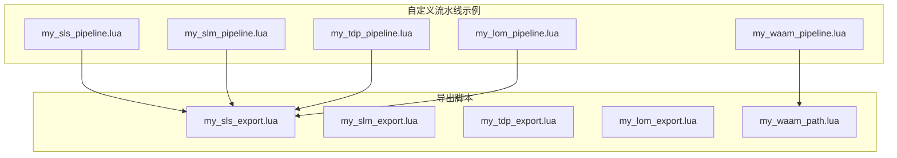
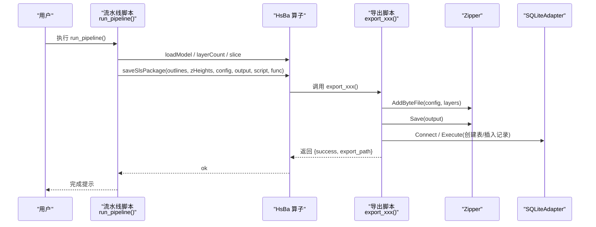
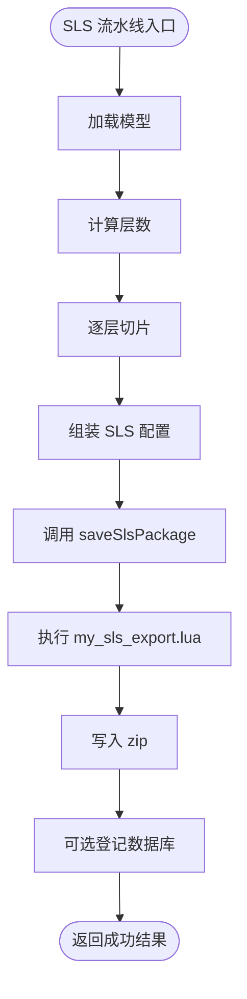
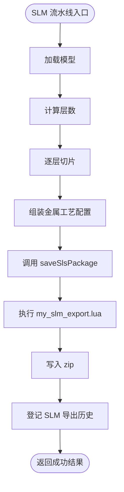
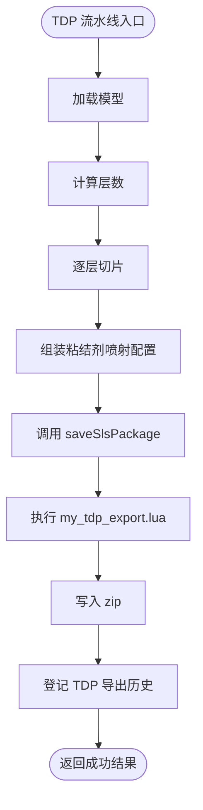
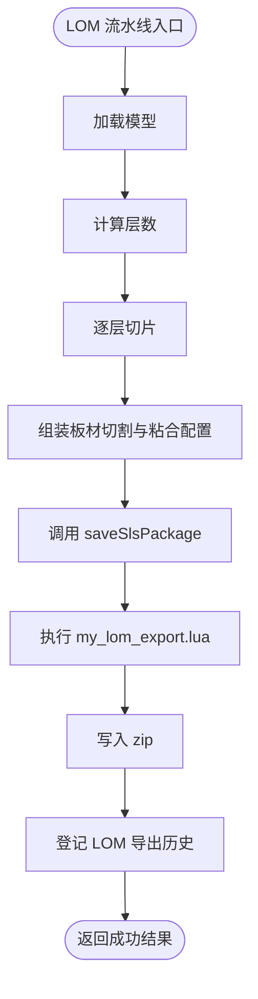
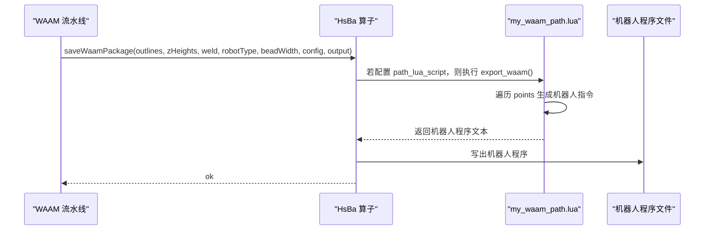
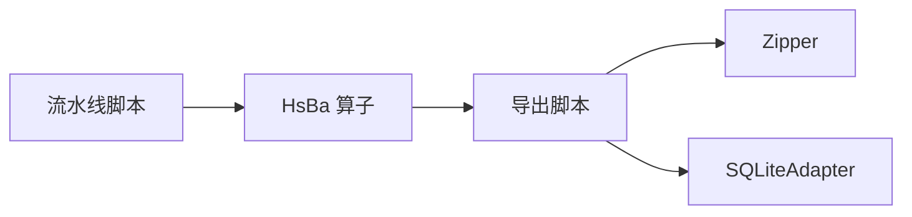

# 导出脚本示例

<cite>
**本文引用的文件**   
- [my_sls_export.lua](file://samples/Custom/scripts/my_sls_export.lua)
- [my_slm_export.lua](file://samples/SLM/scripts/my_slm_export.lua)
- [my_tdp_export.lua](file://samples/TDP/scripts/my_tdp_export.lua)
- [my_lom_export.lua](file://samples/LOM/scripts/my_lom_export.lua)
- [my_waam_path.lua](file://samples/WAAM/scripts/my_waam_path.lua)
- [my_sls_pipeline.lua](file://samples/Custom/scripts/my_sls_pipeline.lua)
- [my_slm_pipeline.lua](file://samples/Custom/scripts/my_slm_pipeline.lua)
- [my_tdp_pipeline.lua](file://samples/Custom/scripts/my_tdp_pipeline.lua)
- [my_lom_pipeline.lua](file://samples/Custom/scripts/my_lom_pipeline.lua)
- [my_waam_pipeline.lua](file://samples/Custom/scripts/my_waam_pipeline.lua)
</cite>

## 目录
1. [引言](#引言)
2. [项目结构](#项目结构)
3. [核心组件](#核心组件)
4. [架构总览](#架构总览)
5. [详细组件分析](#详细组件分析)
6. [依赖关系分析](#依赖关系分析)
7. [性能与扩展建议](#性能与扩展建议)
8. [故障排除指南](#故障排除指南)
9. [结论](#结论)
10. [附录：工艺参数映射与输出格式参考](#附录工艺参数映射与输出格式参考)

## 引言
本文件面向需要为 SLS、SLM、LOM、TDP 等 3D 打印技术编写专用导出脚本，以及为 WAAM 开发路径生成脚本的开发者。文档基于仓库中的 Lua 示例脚本，说明如何组织流水线、构造配置、序列化逐层数据、打包输出，以及如何通过可插拔脚本实现不同技术的特殊输出要求。

SLS、SLM、LOM、TDP 在 HsBaSlicer 中采用“C++ 负责切片与打包流程，Lua 导出脚本决定最终文件格式”的模式；WAAM 则进一步支持“可选的机器人代码生成脚本”，用于替换内置 ABB/KUKA/FANUC 代码生成逻辑。

## 项目结构
与导出脚本直接相关的示例位于 `samples` 目录下：
- Custom 示例提供完全由 Lua 驱动的流水线模板，并包含 SLS 导出脚本。
- SLM、TDP、LOM 各自提供独立的导出脚本。
- WAAM 提供路径生成脚本和完整流水线示例。

**图表来源**
- [my_sls_pipeline.lua:1-102](file://samples/Custom/scripts/my_sls_pipeline.lua#L1-L102)
- [my_slm_pipeline.lua:1-94](file://samples/Custom/scripts/my_slm_pipeline.lua#L1-L94)
- [my_tdp_pipeline.lua:1-91](file://samples/Custom/scripts/my_tdp_pipeline.lua#L1-L91)
- [my_lom_pipeline.lua:1-92](file://samples/Custom/scripts/my_lom_pipeline.lua#L1-L92)
- [my_waam_pipeline.lua:1-94](file://samples/Custom/scripts/my_waam_pipeline.lua#L1-L94)
- [my_sls_export.lua:1-76](file://samples/Custom/scripts/my_sls_export.lua#L1-L76)
- [my_slm_export.lua:1-63](file://samples/SLM/scripts/my_slm_export.lua#L1-L63)
- [my_tdp_export.lua:1-63](file://samples/TDP/scripts/my_tdp_export.lua#L1-L63)
- [my_lom_export.lua:1-58](file://samples/LOM/scripts/my_lom_export.lua#L1-L58)
- [my_waam_path.lua:1-46](file://samples/WAAM/scripts/my_waam_path.lua#L1-L46)

**章节来源**
- [my_sls_pipeline.lua:1-102](file://samples/Custom/scripts/my_sls_pipeline.lua#L1-L102)
- [my_slm_pipeline.lua:1-94](file://samples/Custom/scripts/my_slm_pipeline.lua#L1-L94)
- [my_tdp_pipeline.lua:1-91](file://samples/Custom/scripts/my_tdp_pipeline.lua#L1-L91)
- [my_lom_pipeline.lua:1-92](file://samples/Custom/scripts/my_lom_pipeline.lua#L1-L92)
- [my_waam_pipeline.lua:1-94](file://samples/Custom/scripts/my_waam_pipeline.lua#L1-L94)
- [my_sls_export.lua:1-76](file://samples/Custom/scripts/my_sls_export.lua#L1-L76)
- [my_slm_export.lua:1-63](file://samples/SLM/scripts/my_slm_export.lua#L1-L63)
- [my_tdp_export.lua:1-63](file://samples/TDP/scripts/my_tdp_export.lua#L1-L63)
- [my_lom_export.lua:1-58](file://samples/LOM/scripts/my_lom_export.lua#L1-L58)
- [my_waam_path.lua:1-46](file://samples/WAAM/scripts/my_waam_path.lua#L1-L46)

## 核心组件
本项目的导出相关核心组件包括两类：
- 流水线脚本：负责加载模型、计算层数、逐层切片、组装工艺配置、调用打包接口。
- 导出脚本：负责把 C++ 注入的数据序列化为最终输出（zip 包或机器人程序文本），并可注册数据库记录。

关键约定如下：
- 流水线脚本通常暴露 `run_pipeline()`，并通过全局变量 `HsBa`、`model_name`、`model_path`、`output_path`、`pipeline_config`、`machine` 获取上下文。
- 粉末床类工艺（SLS、SLM、LOM、TDP）使用 `HsBa.saveSlsPackage` 将轮廓与配置交给导出脚本处理。
- WAAM 使用 `HsBa.saveWaamPackage` 生成机器人程序，并可设置 `path_lua_script` 以启用自定义路径生成脚本。

**章节来源**
- [my_sls_pipeline.lua:12-20](file://samples/Custom/scripts/my_sls_pipeline.lua#L12-L20)
- [my_slm_pipeline.lua:10-13](file://samples/Custom/scripts/my_slm_pipeline.lua#L10-L13)
- [my_tdp_pipeline.lua:8-11](file://samples/Custom/scripts/my_tdp_pipeline.lua#L8-L11)
- [my_lom_pipeline.lua:7-10](file://samples/Custom/scripts/my_lom_pipeline.lua#L7-L10)
- [my_waam_pipeline.lua:10-13](file://samples/Custom/scripts/my_waam_pipeline.lua#L10-L13)

## 架构总览
下图展示从流水线脚本到导出脚本的整体调用关系。

**图表来源**
- [my_sls_pipeline.lua:80-90](file://samples/Custom/scripts/my_sls_pipeline.lua#L80-L90)
- [my_sls_export.lua:21-75](file://samples/Custom/scripts/my_sls_export.lua#L21-L75)
- [my_slm_export.lua:15-62](file://samples/SLM/scripts/my_slm_export.lua#L15-L62)
- [my_tdp_export.lua:15-62](file://samples/TDP/scripts/my_tdp_export.lua#L15-L62)
- [my_lom_export.lua:10-57](file://samples/LOM/scripts/my_lom_export.lua#L10-L57)

## 详细组件分析

### SLS 导出脚本与流水线
SLS 是粉末床激光烧结工艺，无需支撑和地板，也没有标准输出格式。其导出行为完全由 Lua 控制。

- 流水线职责：
  - 读取 `machine` 中的工艺参数，如层厚、首层层厚、激光功率、扫描速度、 Hatch 间距与角度、床温。
  - 调用 `HsBa.loadModel`、`layerCount`、`slice` 获取每层轮廓。
  - 组装 JSON 配置，调用 `HsBa.saveSlsPackage` 指定导出脚本与函数名。
- 导出脚本职责：
  - 使用 `Zipper` 写入配置文件、逐层 JSON 轮廓与 README。
  - 可选地通过 `SQLiteAdapter` 登记导出历史。
  - 返回 table，避免覆盖 zip 文件。

**图表来源**
- [my_sls_pipeline.lua:30-100](file://samples/Custom/scripts/my_sls_pipeline.lua#L30-L100)
- [my_sls_export.lua:21-75](file://samples/Custom/scripts/my_sls_export.lua#L21-L75)

**章节来源**
- [my_sls_pipeline.lua:1-102](file://samples/Custom/scripts/my_sls_pipeline.lua#L1-L102)
- [my_sls_export.lua:1-76](file://samples/Custom/scripts/my_sls_export.lua#L1-L76)

### SLM 导出脚本与流水线
SLM 复用 SLS 的打包流程，但配置中包含金属工艺参数，例如材料、保护气、光源参数等。

- 流水线差异：
  - 默认层厚更小，激光功率更高，材料字段通常为金属牌号。
- 导出脚本差异：
  - README 强调金属工艺配置。
  - 数据库表名与历史记录库名区分 SLM。

**图表来源**
- [my_slm_pipeline.lua:22-92](file://samples/Custom/scripts/my_slm_pipeline.lua#L22-L92)
- [my_slm_export.lua:15-62](file://samples/SLM/scripts/my_slm_export.lua#L15-L62)

**章节来源**
- [my_slm_pipeline.lua:1-94](file://samples/Custom/scripts/my_slm_pipeline.lua#L1-L94)
- [my_slm_export.lua:1-63](file://samples/SLM/scripts/my_slm_export.lua#L1-L63)

### TDP 导出脚本与流水线
TDP（粘结剂喷射）同样是粉末床工艺，但能量来源是粘结剂喷射而非激光烧结。

- 流水线差异：
  - 配置包含喷头数量、液滴间距、粘结剂饱和度、固化时间、床温、粘结模式等。
- 导出脚本差异：
  - README 强调 3DP 粘结剂喷射。
  - 数据库表名与历史记录库名区分 TDP。

**图表来源**
- [my_tdp_pipeline.lua:20-90](file://samples/Custom/scripts/my_tdp_pipeline.lua#L20-L90)
- [my_tdp_export.lua:15-62](file://samples/TDP/scripts/my_tdp_export.lua#L15-L62)

**章节来源**
- [my_tdp_pipeline.lua:1-91](file://samples/Custom/scripts/my_tdp_pipeline.lua#L1-L91)
- [my_tdp_export.lua:1-63](file://samples/TDP/scripts/my_tdp_export.lua#L1-L63)

### LOM 导出脚本与流水线
LOM 是叠层实体切割工艺，每层对应一张板材轮廓。

- 流水线差异：
  - 配置包含板材厚度、切割速度、切割余量、激光功率、粘合温度、压力、时间、切割模式等。
- 导出脚本差异：
  - README 强调板材切割与粘合。
  - 数据库表名与历史记录库名区分 LOM。

**图表来源**
- [my_lom_pipeline.lua:19-91](file://samples/Custom/scripts/my_lom_pipeline.lua#L19-L91)
- [my_lom_export.lua:10-57](file://samples/LOM/scripts/my_lom_export.lua#L10-L57)

**章节来源**
- [my_lom_pipeline.lua:1-92](file://samples/Custom/scripts/my_lom_pipeline.lua#L1-L92)
- [my_lom_export.lua:1-58](file://samples/LOM/scripts/my_lom_export.lua#L1-L58)

### WAAM 路径生成脚本与流水线
WAAM 不是 zip 打包工艺，而是沿逐层轮廓驱动机器人进行丝材沉积，输出机器人语言程序。

- 流水线职责：
  - 使用更大的层厚，模拟较厚的沉积道。
  - 组装焊接工艺参数，如电流、电压、送丝速度、气体流量、行走速度、焊接工艺类型。
  - 调用 `HsBa.saveWaamPackage`，可选择传入 `robotType`、`beadWidth`、`config`、`output`。
- 路径生成脚本职责：
  - 接收 `header`、`startProgramFunc`、`endProgramFunc`、`points` 等全局变量。
  - 根据点类型生成 MoveJ/MOVEL 等机器人指令。
  - 返回字符串形式的完整机器人程序文本。

**图表来源**
- [my_waam_pipeline.lua:64-81](file://samples/Custom/scripts/my_waam_pipeline.lua#L64-L81)
- [my_waam_path.lua:17-45](file://samples/WAAM/scripts/my_waam_path.lua#L17-L45)

**章节来源**
- [my_waam_pipeline.lua:1-94](file://samples/Custom/scripts/my_waam_pipeline.lua#L1-L94)
- [my_waam_path.lua:1-46](file://samples/WAAM/scripts/my_waam_path.lua#L1-L46)

## 依赖关系分析
导出脚本依赖的运行时能力来自 C++ 注入的全局对象与方法：
- `Zipper`：用于添加字节文件或文件路径，并最终保存 zip。
- `SQLiteAdapter`：用于连接数据库、执行 SQL、查询结果。
- `HsBa`：流水线算子，提供进度、模型管理、切片、打包等接口。
- 全局变量：`config`、`images`、`output_path`、`header`、`startProgramFunc`、`endProgramFunc`、`points`。

**图表来源**
- [my_sls_export.lua:8-19](file://samples/Custom/scripts/my_sls_export.lua#L8-L19)
- [my_slm_export.lua:7-13](file://samples/SLM/scripts/my_slm_export.lua#L7-L13)
- [my_tdp_export.lua:7-13](file://samples/TDP/scripts/my_tdp_export.lua#L7-L13)
- [my_lom_export.lua:1-8](file://samples/LOM/scripts/my_lom_export.lua#L1-L8)
- [my_waam_path.lua:7-15](file://samples/WAAM/scripts/my_waam_path.lua#L7-L15)

**章节来源**
- [my_sls_export.lua:8-19](file://samples/Custom/scripts/my_sls_export.lua#L8-L19)
- [my_slm_export.lua:7-13](file://samples/SLM/scripts/my_slm_export.lua#L7-L13)
- [my_tdp_export.lua:7-13](file://samples/TDP/scripts/my_tdp_export.lua#L7-L13)
- [my_lom_export.lua:1-8](file://samples/LOM/scripts/my_lom_export.lua#L1-L8)
- [my_waam_path.lua:7-15](file://samples/WAAM/scripts/my_waam_path.lua#L7-L15)

## 性能与扩展建议
- 大数据量导出：
  - 对大量层数据，优先使用 `Zipper:AddByteFile(name, data)` 直接写入内存数据，避免额外临时文件。
  - 数据库登记应放在独立 pcall 块中，失败不影响主导出流程。
- 可扩展性：
  - 导出脚本应仅关注“数据序列化与归档”，复杂业务逻辑尽量放在流水线脚本中。
  - 对于机器人路径生成，保持 `points` 数据结构稳定，便于切换不同机器人后处理器。
- 错误处理：
  - 所有外部资源操作（压缩、数据库、网络）都应包裹 pcall，保证导出主流程健壮。
  - 日志输出应包含工艺名称、层数、输出路径，便于问题定位。

[本节为通用指导，不直接分析具体文件]

## 故障排除指南
常见问题与排查要点：
- 导出返回字符串导致 zip 被覆盖：
  - 导出脚本必须返回 table 或 nil，不要返回字符串。
  - 检查导出脚本末尾是否直接 return 字符串。
- 数据库登记失败：
  - 使用 pcall 包裹数据库操作，失败时打印警告但不中断导出。
  - 确认 SQLiteAdapter 已正确注册并可连接目标数据库。
- 机器人程序为空或格式错误：
  - 检查 `points` 数组是否为空，`type` 字段是否正确。
  - 确认 `startProgramFunc`、`endProgramFunc` 非空时确实写入头尾程序段。
- 配置未写入 zip：
  - 确认流水线脚本调用了 `saveSlsPackage` 并传入了 `config`。
  - 确认导出脚本调用了 `AddByteFile(config.path, config.configStr)`。

**章节来源**
- [my_sls_export.lua:18-19](file://samples/Custom/scripts/my_sls_export.lua#L18-L19)
- [my_slm_export.lua:12-13](file://samples/SLM/scripts/my_slm_export.lua#L12-L13)
- [my_tdp_export.lua:12-13](file://samples/TDP/scripts/my_tdp_export.lua#L12-L13)
- [my_lom_export.lua:7-8](file://samples/LOM/scripts/my_lom_export.lua#L7-L8)
- [my_waam_path.lua:14-15](file://samples/WAAM/scripts/my_waam_path.lua#L14-L15)

## 结论
HsBaSlicer 的导出脚本体系通过“流水线脚本 + 导出脚本”解耦了切片流程与输出格式。SLS、SLM、LOM、TDP 统一使用 zip 打包与可选数据库登记；WAAM 则支持机器人程序文本输出与可插拔路径生成脚本。开发者可以基于现有模板快速实现新工艺的导出逻辑，只需关注工艺参数映射、数据序列化与输出格式定义。

[本节为总结性内容，不直接分析具体文件]

## 附录：工艺参数映射与输出格式参考

### 工艺参数映射
| 技术 | 典型参数 | 流水线脚本位置 | 导出脚本行为 |
|---|---|---|---|
| SLS | 层厚、首层层厚、激光功率、扫描速度、Hatch 间距、Hatch 旋转、床温 | [my_sls_pipeline.lua:64-78](file://samples/Custom/scripts/my_sls_pipeline.lua#L64-L78) | 原样归档 config.json |
| SLM | 层厚、首层层厚、激光功率、扫描速度、Hatch 间距、Hatch 旋转、材料、床温 | [my_slm_pipeline.lua:55-70](file://samples/Custom/scripts/my_slm_pipeline.lua#L55-L70) | 原样归档 config.json |
| TDP | 层厚、首层层厚、喷头数量、液滴间距、粘结剂饱和度、固化时间、床温、粘结模式 | [my_tdp_pipeline.lua:53-67](file://samples/Custom/scripts/my_tdp_pipeline.lua#L53-L67) | 原样归档 config.json |
| LOM | 层厚、首层层厚、板材厚度、切割速度、切割余量、激光功率、粘合温度、粘合压力、粘合时间、切割模式 | [my_lom_pipeline.lua:52-68](file://samples/Custom/scripts/my_lom_pipeline.lua#L52-L68) | 原样归档 config.json |
| WAAM | 层厚、首层层厚、焊道宽度、电流、电压、送丝速度、气体流量、行走速度、焊接工艺类型、机器人类型 | [my_waam_pipeline.lua:56-80](file://samples/Custom/scripts/my_waam_pipeline.lua#L56-L80) | 生成机器人程序文本 |

**章节来源**
- [my_sls_pipeline.lua:64-78](file://samples/Custom/scripts/my_sls_pipeline.lua#L64-L78)
- [my_slm_pipeline.lua:55-70](file://samples/Custom/scripts/my_slm_pipeline.lua#L55-L70)
- [my_tdp_pipeline.lua:53-67](file://samples/Custom/scripts/my_tdp_pipeline.lua#L53-L67)
- [my_lom_pipeline.lua:52-68](file://samples/Custom/scripts/my_lom_pipeline.lua#L52-L68)
- [my_waam_pipeline.lua:56-80](file://samples/Custom/scripts/my_waam_pipeline.lua#L56-L80)

### 输出格式定义
| 技术 | 输出类型 | 主要文件 | 备注 |
|---|---|---|---|
| SLS | zip 包 | config.json、layers/N.json、README.txt | 无标准格式，Lua 完全控制 |
| SLM | zip 包 | config.json、layers/N.json、README.txt | 金属工艺参数写入 config |
| TDP | zip 包 | config.json、layers/N.json、README.txt | 粘结剂喷射参数写入 config |
| LOM | zip 包 | config.json、layers/N.json、README.txt | 板材切割与粘合参数写入 config |
| WAAM | 机器人程序文本 | 由 robotType 决定后缀与语法 | 可替换为自定义路径生成脚本 |

**章节来源**
- [my_sls_export.lua:21-45](file://samples/Custom/scripts/my_sls_export.lua#L21-L45)
- [my_slm_export.lua:15-33](file://samples/SLM/scripts/my_slm_export.lua#L15-L33)
- [my_tdp_export.lua:15-33](file://samples/TDP/scripts/my_tdp_export.lua#L15-L33)
- [my_lom_export.lua:10-28](file://samples/LOM/scripts/my_lom_export.lua#L10-L28)
- [my_waam_path.lua:17-45](file://samples/WAAM/scripts/my_waam_path.lua#L17-L45)