# 示例与教程

<cite>
**本文引用的文件**   
- [samples/FDM/main.cpp](file://samples/FDM/main.cpp)
- [samples/SLA/main.cpp](file://samples/SLA/main.cpp)
- [samples/SLS/main.cpp](file://samples/SLS/main.cpp)
- [samples/SLM/main.cpp](file://samples/SLM/main.cpp)
- [samples/LOM/main.cpp](file://samples/LOM/main.cpp)
- [samples/TDP/main.cpp](file://samples/TDP/main.cpp)
- [samples/WAAM/main.cpp](file://samples/WAAM/main.cpp)
- [samples/LibHsBaSlicer/main_header.cpp](file://samples/LibHsBaSlicer/main_header.cpp)
- [samples/FDM/scripts/my_support.lua](file://samples/FDM/scripts/my_support.lua)
- [samples/FDM/scripts/my_infill.lua](file://samples/FDM/scripts/my_infill.lua)
- [samples/SLA/scripts/my_sla_floor.lua](file://samples/SLA/scripts/my_sla_floor.lua)
- [samples/SLA/scripts/my_sla_support.lua](file://samples/SLA/scripts/my_sla_support.lua)
- [samples/SLS/scripts/my_sls_export.lua](file://samples/SLS/scripts/my_sls_export.lua)
- [samples/SLM/scripts/my_slm_export.lua](file://samples/SLM/scripts/my_slm_export.lua)
- [samples/LOM/scripts/my_lom_export.lua](file://samples/LOM/scripts/my_lom_export.lua)
- [samples/TDP/scripts/my_tdp_export.lua](file://samples/TDP/scripts/my_tdp_export.lua)
</cite>

## 目录
1. [项目概述与快速开始](#项目概述与快速开始)
2. [架构总览](#架构总览)
3. [核心概念](#核心概念)
4. [核心模块详解](#核心模块详解)
5. [高级主题](#高级主题)
6. [Lua 脚本系统](#lua-脚本系统)
7. [API 参考文档](#api-参考文档)
8. [集成指南](#集成指南)
9. [开发测试与贡献](#开发测试与贡献)
10. [扩展开发指南](#扩展开发指南)
11. [示例与教程](#示例与教程)
12. [部署故障排除与FAQ](#部署故障排除与faq)
13. [附录](#附录)

## 项目概述与快速开始
本示例与教程面向 HsBaSlicer 的多种 3D 打印技术流水线，覆盖 FDM、SLA、SLS、SLM、LOM、TDP、WAAM，并演示如何使用 LibHsBaSlicer 进行 C++ 切片流程，以及如何通过 DllHsBaSlicer 进行跨语言调用。每个示例均包含：
- 完整的入口程序配置与运行方式
- 工艺参数说明
- Lua 自定义脚本（支撑、填充、地板、导出、路径）
- 同步与异步执行模式
- 螺旋/花瓶模式等高级特性

快速开始建议：
- 先运行 FDM 基本示例，熟悉模型加载、切片、支撑、填充、G-code 输出。
- 再尝试 SLA 示例，了解层片 SVG 与地板/支撑生成。
- 随后根据目标工艺选择 SLS/SLM/LOM/TDP/WAAM 示例，重点理解 Lua 导出或机器人代码生成。
- 最后阅读 LibHsBaSlicer 示例，掌握从预处理到路径生成的完整 C++ API 工作流。

[本节不直接分析具体源码文件]

## 架构总览
HsBaSlicer 在示例侧提供多套独立可执行程序，每套对应一种工艺；LibHsBaSlicer 暴露 C++ 接口供应用直接调用；DllHsBaSlicer 暴露 C ABI 供跨语言调用。下图展示示例程序、流水线头文件与 Lua 脚本之间的关系。

```mermaid
graph TB
subgraph "示例程序"
FDM["FDM 示例<br/>samples/FDM/main.cpp"]
SLA["SLA 示例<br/>samples/SLA/main.cpp"]
SLS["SLS 示例<br/>samples/SLS/main.cpp"]
SLM["SLM 示例<br/>samples/SLM/main.cpp"]
LOM["LOM 示例<br/>samples/LOM/main.cpp"]
TDP["TDP 示例<br/>samples/TDP/main.cpp"]
WAAM["WAAM 示例<br/>samples/WAAM/main.cpp"]
LIB["LibHsBaSlicer 示例<br/>samples/LibHsBaSlicer/main_header.cpp"]
end
subgraph "流水线头文件"
FDMP["fdm_pipeline.h"]
SLAP["sla_pipeline.h"]
SLSP["sls_pipeline.h"]
SLMP["slm_pipeline.h"]
LOMP["lom_pipeline.h"]
TDPP["tdp_pipeline.h"]
WAAMP["waam_pipeline.h"]
end
subgraph "Lua 脚本"
FDM_SUP["FDM 支撑脚本<br/>my_support.lua"]
FDM_INF["FDM 填充脚本<br/>my_infill.lua"]
SLA_FLR["SLA 地板脚本<br/>my_sla_floor.lua"]
SLA_SUP["SLA 支撑脚本<br/>my_sla_support.lua"]
SLS_EXP["SLS 导出脚本<br/>my_sls_export.lua"]
SLM_EXP["SLM 导出脚本<br/>my_slm_export.lua"]
LOM_EXP["LOM 导出脚本<br/>my_lom_export.lua"]
TDP_EXP["TDP 导出脚本<br/>my_tdp_export.lua"]
end
FDM --> FDMP
SLA --> SLAP
SLS --> SLSP
SLM --> SLMP
LOM --> LOMP
TDP --> TDPP
WAAM --> WAAMP
FDM --> FDM_SUP
FDM --> FDM_INF
SLA --> SLA_FLR
SLA --> SLA_SUP
SLS --> SLS_EXP
SLM --> SLM_EXP
LOM --> LOM_EXP
TDP --> TDP_EXP
```

**图示来源**
- [samples/FDM/main.cpp:17-17](file://samples/FDM/main.cpp#L17-L17)
- [samples/SLA/main.cpp:16-16](file://samples/SLA/main.cpp#L16-L16)
- [samples/SLS/main.cpp:20-20](file://samples/SLS/main.cpp#L20-L20)
- [samples/SLM/main.cpp:20-20](file://samples/SLM/main.cpp#L20-L20)
- [samples/LOM/main.cpp:20-20](file://samples/LOM/main.cpp#L20-L20)
- [samples/TDP/main.cpp:20-20](file://samples/TDP/main.cpp#L20-L20)
- [samples/WAAM/main.cpp:19-19](file://samples/WAAM/main.cpp#L19-L19)
- [samples/LibHsBaSlicer/main_header.cpp:21-26](file://samples/LibHsBaSlicer/main_header.cpp#L21-L26)

**章节来源**
- [samples/FDM/main.cpp:1-337](file://samples/FDM/main.cpp#L1-L337)
- [samples/SLA/main.cpp:1-259](file://samples/SLA/main.cpp#L1-L259)
- [samples/SLS/main.cpp:1-209](file://samples/SLS/main.cpp#L1-L209)
- [samples/SLM/main.cpp:1-196](file://samples/SLM/main.cpp#L1-L196)
- [samples/LOM/main.cpp:1-194](file://samples/LOM/main.cpp#L1-L194)
- [samples/TDP/main.cpp:1-225](file://samples/TDP/main.cpp#L1-L225)
- [samples/WAAM/main.cpp:1-237](file://samples/WAAM/main.cpp#L1-L237)
- [samples/LibHsBaSlicer/main_header.cpp:1-186](file://samples/LibHsBaSlicer/main_header.cpp#L1-L186)

## 核心概念
- 流水线配置对象：每种工艺都有对应的默认配置创建函数，例如 FDM 使用 HsBaCreateDefaultConfig，SLA 使用 HsBaCreateDefaultSlaConfig，SLS/SLM/LOM/TDP/WAAM 也各自有默认配置函数。
- 模型输入：所有示例都要求设置 model_name 和 model_path，指向待切片的 STL 模型。
- 输出格式：
  - FDM 输出 G-code 文本。
  - SLA 输出 zip（配置文件 + 层轮廓 SVG）。
  - SLS/SLM/LOM/TDP 输出 zip（配置文件 + 层轮廓 JSON），并由 Lua 导出脚本控制归档与数据库登记。
  - WAAM 输出机器人语言程序（ABB/KUKA/FANUC 或自定义 Lua 路径脚本）。
- 执行模式：
  - 同步：Run*Pipeline 阻塞等待结果。
  - 异步：Run*PipelineAsync 非阻塞启动，通过完成回调返回结果。
- 进度回调：OnProgress(percent, stage, user_data) 用于显示切片阶段与百分比。
- 结果释放：所有 Run*Pipeline 返回的结果结构体都必须调用对应的 Free*PipelineResult 释放内存。

**章节来源**
- [samples/FDM/main.cpp:50-96](file://samples/FDM/main.cpp#L50-L96)
- [samples/SLA/main.cpp:49-84](file://samples/SLA/main.cpp#L49-L84)
- [samples/SLS/main.cpp:53-92](file://samples/SLS/main.cpp#L53-L92)
- [samples/SLM/main.cpp:53-84](file://samples/SLM/main.cpp#L53-L84)
- [samples/LOM/main.cpp:52-82](file://samples/LOM/main.cpp#L52-L82)
- [samples/TDP/main.cpp:52-82](file://samples/TDP/main.cpp#L52-L82)
- [samples/WAAM/main.cpp:51-81](file://samples/WAAM/main.cpp#L51-L81)

## 核心模块详解
### FDM 流水线示例
FDM 示例展示了：
- 基本流水线：默认配置 + 模型 + 同步运行。
- 自定义工艺参数：层高、壁厚、填充间距、填充模式、顶层/底层实心层数、悬垂角度、支撑模式、线宽、打印速度、移动速度、挤出倍率。
- Lua 自定义支撑与填充：通过 support_lua_script/support_lua_func 与 infill_lua_script/infill_lua_func 注入脚本。
- 异步流水线：非阻塞启动，完成回调处理成功/失败。
- 螺旋/花瓶模式：开启 spiral_mode 后外壁合并为连续上升路径，跳过填充与支撑。

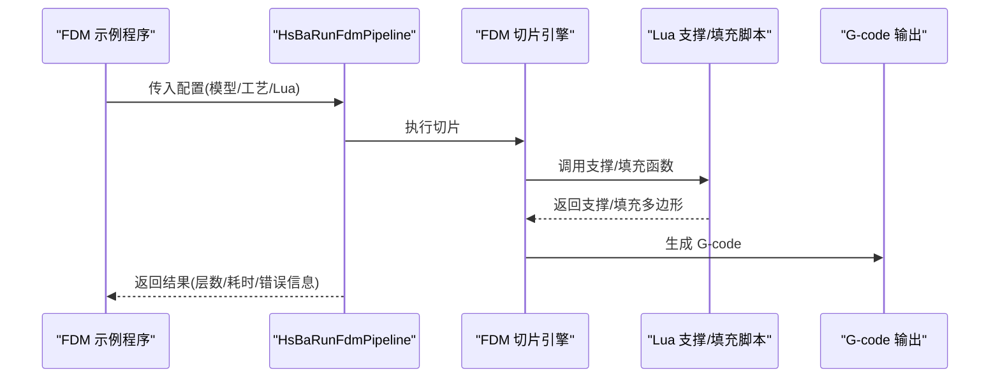

**图示来源**
- [samples/FDM/main.cpp:50-96](file://samples/FDM/main.cpp#L50-L96)
- [samples/FDM/main.cpp:98-165](file://samples/FDM/main.cpp#L98-L165)
- [samples/FDM/main.cpp:167-220](file://samples/FDM/main.cpp#L167-L220)
- [samples/FDM/main.cpp:222-269](file://samples/FDM/main.cpp#L222-L269)
- [samples/FDM/main.cpp:271-318](file://samples/FDM/main.cpp#L271-L318)

**章节来源**
- [samples/FDM/main.cpp:1-337](file://samples/FDM/main.cpp#L1-L337)
- [samples/FDM/scripts/my_support.lua:1-83](file://samples/FDM/scripts/my_support.lua#L1-L83)
- [samples/FDM/scripts/my_infill.lua:1-89](file://samples/FDM/scripts/my_infill.lua#L1-L89)

### SLA 流水线示例
SLA 示例展示了：
- 基本流水线：默认配置 + 模型 + 输出 zip。
- 自定义工艺参数：层高、曝光时间、抬升距离/速度、回抽速度、地板偏移/边框宽度/填充间距/凸包开关、支撑间隙/直径/密度/模式。
- Lua 自定义地板与支撑：floor_lua_script/floor_lua_func 与 support_lua_script/support_lua_func。
- 异步流水线：非阻塞启动，完成回调处理结果。

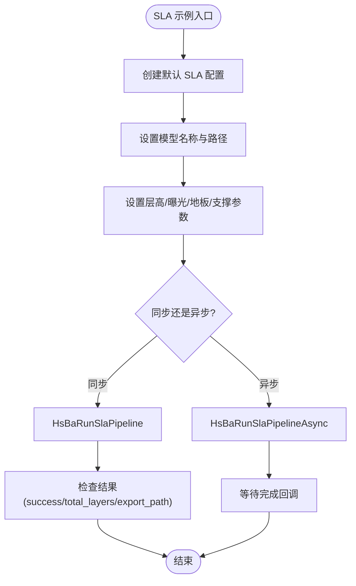

**图示来源**
- [samples/SLA/main.cpp:49-84](file://samples/SLA/main.cpp#L49-L84)
- [samples/SLA/main.cpp:86-144](file://samples/SLA/main.cpp#L86-L144)
- [samples/SLA/main.cpp:146-191](file://samples/SLA/main.cpp#L146-L191)
- [samples/SLA/main.cpp:193-239](file://samples/SLA/main.cpp#L193-L239)

**章节来源**
- [samples/SLA/main.cpp:1-259](file://samples/SLA/main.cpp#L1-L259)
- [samples/SLA/scripts/my_sla_floor.lua:1-64](file://samples/SLA/scripts/my_sla_floor.lua#L1-L64)
- [samples/SLA/scripts/my_sla_support.lua:1-76](file://samples/SLA/scripts/my_sla_support.lua#L1-L76)

### SLS 流水线示例
SLS 示例展示了：
- 基本流水线：默认配置 + 模型 + Lua 导出脚本。
- 自定义激光参数：功率、扫描速度、 Hatch 间距/旋转、床温。
- 异步流水线：非阻塞启动，完成回调处理结果。

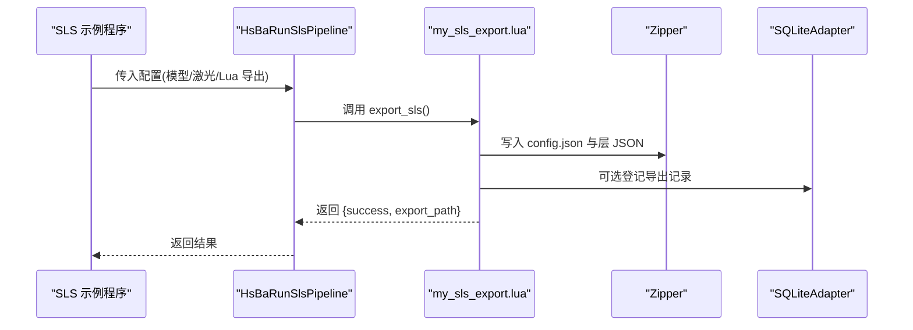

**图示来源**
- [samples/SLS/main.cpp:53-92](file://samples/SLS/main.cpp#L53-L92)
- [samples/SLS/main.cpp:94-140](file://samples/SLS/main.cpp#L94-L140)
- [samples/SLS/main.cpp:142-190](file://samples/SLS/main.cpp#L142-L190)
- [samples/SLS/scripts/my_sls_export.lua:23-79](file://samples/SLS/scripts/my_sls_export.lua#L23-L79)

**章节来源**
- [samples/SLS/main.cpp:1-209](file://samples/SLS/main.cpp#L1-L209)
- [samples/SLS/scripts/my_sls_export.lua:1-80](file://samples/SLS/scripts/my_sls_export.lua#L1-L80)

### SLM 流水线示例
SLM 示例展示了：
- 基本流水线：默认配置 + 模型 + Lua 导出脚本。
- 金属工艺参数：材料、光源、保护气体、激光/扫描/Hatch/床温。
- 异步流水线：非阻塞启动，完成回调处理结果。

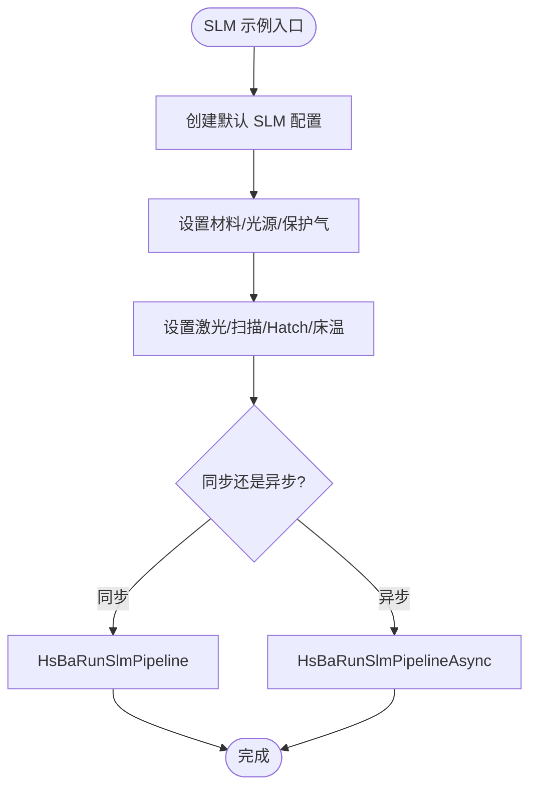

**图示来源**
- [samples/SLM/main.cpp:53-84](file://samples/SLM/main.cpp#L53-L84)
- [samples/SLM/main.cpp:86-132](file://samples/SLM/main.cpp#L86-L132)
- [samples/SLM/main.cpp:134-177](file://samples/SLM/main.cpp#L134-L177)

**章节来源**
- [samples/SLM/main.cpp:1-196](file://samples/SLM/main.cpp#L1-L196)
- [samples/SLM/scripts/my_slm_export.lua:1-63](file://samples/SLM/scripts/my_slm_export.lua#L1-L63)

### LOM 流水线示例
LOM 示例展示了：
- 基本流水线：默认配置 + 模型 + Lua 导出脚本。
- 切割/粘合参数：切割速度/余量/功率/密封轮廓/模式，粘合温度/压力/时间。
- 异步流水线：非阻塞启动，完成回调处理结果。

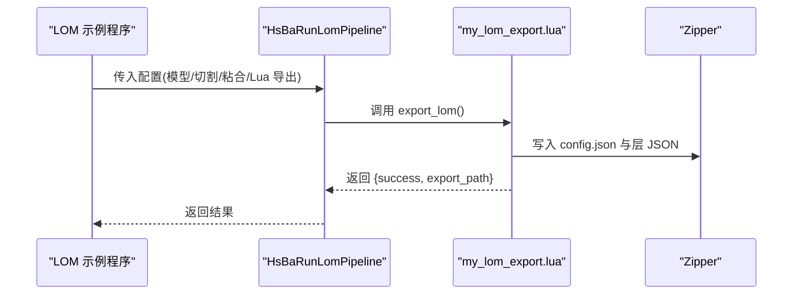

**图示来源**
- [samples/LOM/main.cpp:52-82](file://samples/LOM/main.cpp#L52-L82)
- [samples/LOM/main.cpp:84-130](file://samples/LOM/main.cpp#L84-L130)
- [samples/LOM/main.cpp:132-175](file://samples/LOM/main.cpp#L132-L175)
- [samples/LOM/scripts/my_lom_export.lua:10-57](file://samples/LOM/scripts/my_lom_export.lua#L10-L57)

**章节来源**
- [samples/LOM/main.cpp:1-194](file://samples/LOM/main.cpp#L1-L194)
- [samples/LOM/scripts/my_lom_export.lua:1-58](file://samples/LOM/scripts/my_lom_export.lua#L1-L58)

### TDP 流水线示例
TDP 示例展示了：
- 基本流水线：默认配置 + 模型 + Lua 导出脚本。
- 粘结剂喷射参数：喷头数量/液滴间距/饱和浓度/固化时间/床温/模式。
- 螺旋模式：spiral_mode 开启后导出连续上升的外壁路径。
- 异步流水线：非阻塞启动，完成回调处理结果。

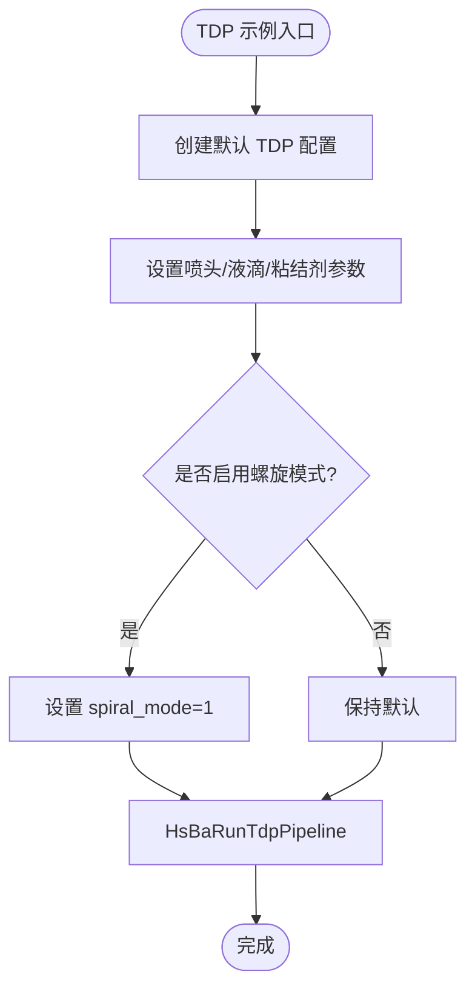

**图示来源**
- [samples/TDP/main.cpp:52-82](file://samples/TDP/main.cpp#L52-L82)
- [samples/TDP/main.cpp:84-125](file://samples/TDP/main.cpp#L84-L125)
- [samples/TDP/main.cpp:127-170](file://samples/TDP/main.cpp#L127-L170)
- [samples/TDP/main.cpp:172-205](file://samples/TDP/main.cpp#L172-L205)

**章节来源**
- [samples/TDP/main.cpp:1-225](file://samples/TDP/main.cpp#L1-L225)
- [samples/TDP/scripts/my_tdp_export.lua:1-63](file://samples/TDP/scripts/my_tdp_export.lua#L1-L63)

### WAAM 流水线示例
WAAM 示例展示了：
- 基本流水线：内置 ABB 机器人代码生成。
- 自定义焊接参数：材料/焊接工艺/保护/电弧电流/电压/送丝速度/气体流量/层间温度。
- 自定义机器人类型：KUKA 内置代码生成。
- 自定义 Lua 路径脚本：path_lua_script/path_lua_func 替换品牌代码生成器。
- 螺旋模式：spiral_mode 开启后合并外层焊道为连续上升路径。

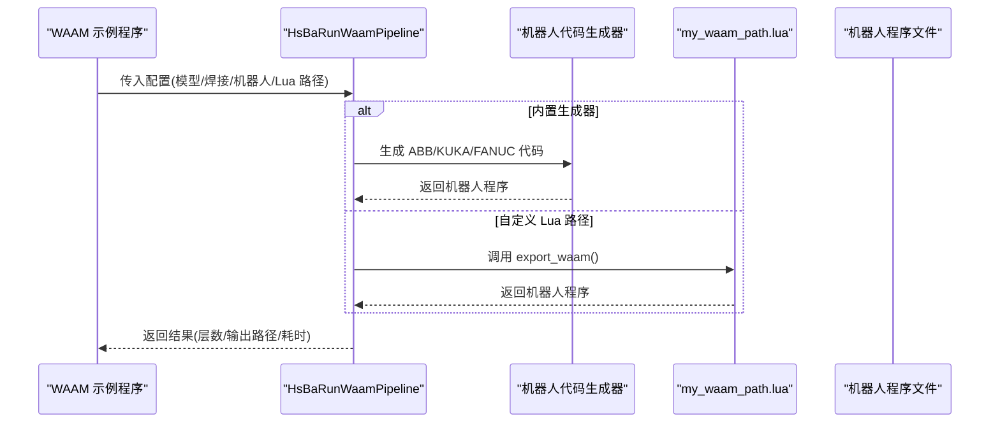

**图示来源**
- [samples/WAAM/main.cpp:51-81](file://samples/WAAM/main.cpp#L51-L81)
- [samples/WAAM/main.cpp:83-131](file://samples/WAAM/main.cpp#L83-L131)
- [samples/WAAM/main.cpp:133-178](file://samples/WAAM/main.cpp#L133-L178)
- [samples/WAAM/main.cpp:180-217](file://samples/WAAM/main.cpp#L180-L217)

**章节来源**
- [samples/WAAM/main.cpp:1-237](file://samples/WAAM/main.cpp#L1-L237)

### LibHsBaSlicer 示例
LibHsBaSlicer 示例展示了不使用模块的传统头文件方式，直接调用 C++ API 完成 FDM 切片全流程：
- 预处理：LoadModel、GetModelInfo。
- 切片：Slice 逐层生成轮廓。
- 支撑：GenerateAllFdmSupport。
- 填充：FillWithBorder。
- 路径生成：GenerateGCodePath 并保存 G-code。

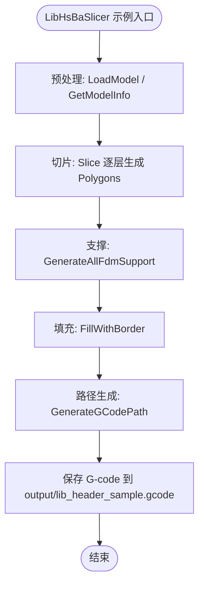

**图示来源**
- [samples/LibHsBaSlicer/main_header.cpp:46-185](file://samples/LibHsBaSlicer/main_header.cpp#L46-L185)

**章节来源**
- [samples/LibHsBaSlicer/main_header.cpp:1-186](file://samples/LibHsBaSlicer/main_header.cpp#L1-L186)

## 高级主题
### 螺旋/花瓶模式
- FDM：开启 spiral_mode 后，外壁被合并为一条随 Z 连续上升的单次挤出路径，无层间空走/回抽，同时跳过填充与支撑。
- TDP：spiral_mode 额外向导出脚本暴露连续上升的外壁路径，同时保留每层图像。
- WAAM：spiral_mode 将各层外壁合并为一条连续上升的焊道，避免层间移动与电弧重启。

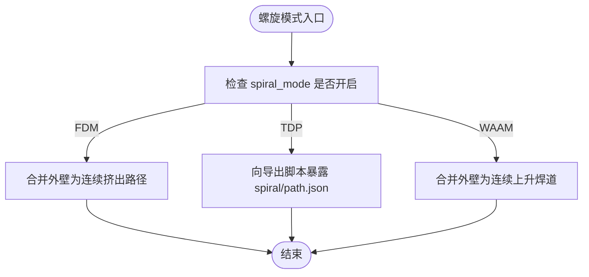

**图示来源**
- [samples/FDM/main.cpp:271-318](file://samples/FDM/main.cpp#L271-L318)
- [samples/TDP/main.cpp:172-205](file://samples/TDP/main.cpp#L172-L205)
- [samples/WAAM/main.cpp:180-217](file://samples/WAAM/main.cpp#L180-L217)

**章节来源**
- [samples/FDM/main.cpp:271-318](file://samples/FDM/main.cpp#L271-L318)
- [samples/TDP/main.cpp:172-205](file://samples/TDP/main.cpp#L172-L205)
- [samples/WAAM/main.cpp:180-217](file://samples/WAAM/main.cpp#L180-L217)

### 异步流水线与进度回调
所有示例都支持：
- OnProgress(percent, stage, user_data)：用于显示当前阶段与百分比。
- Run*PipelineAsync：非阻塞启动，通过完成回调接收结果。
- 完成回调中必须调用对应的 Free*PipelineResult 释放内存。

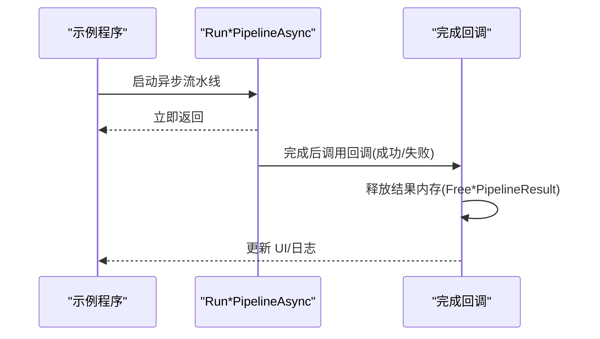

**图示来源**
- [samples/FDM/main.cpp:222-269](file://samples/FDM/main.cpp#L222-L269)
- [samples/SLA/main.cpp:193-239](file://samples/SLA/main.cpp#L193-L239)
- [samples/SLS/main.cpp:142-190](file://samples/SLS/main.cpp#L142-L190)
- [samples/SLM/main.cpp:134-177](file://samples/SLM/main.cpp#L134-L177)
- [samples/LOM/main.cpp:132-175](file://samples/LOM/main.cpp#L132-L175)
- [samples/TDP/main.cpp:127-170](file://samples/TDP/main.cpp#L127-L170)
- [samples/WAAM/main.cpp:133-178](file://samples/WAAM/main.cpp#L133-L178)

**章节来源**
- [samples/FDM/main.cpp:222-269](file://samples/FDM/main.cpp#L222-L269)
- [samples/SLA/main.cpp:193-239](file://samples/SLA/main.cpp#L193-L239)
- [samples/SLS/main.cpp:142-190](file://samples/SLS/main.cpp#L142-L190)
- [samples/SLM/main.cpp:134-177](file://samples/SLM/main.cpp#L134-L177)
- [samples/LOM/main.cpp:132-175](file://samples/LOM/main.cpp#L132-L175)
- [samples/TDP/main.cpp:127-170](file://samples/TDP/main.cpp#L127-L170)
- [samples/WAAM/main.cpp:133-178](file://samples/WAAM/main.cpp#L133-L178)

## Lua 脚本系统
### FDM 自定义支撑脚本
- 全局变量：current_layer、prev_layer、layer_height、config。
- 可用 PolygonOperations：offsetOperation、intersection、difference、union、makeCircle、area。
- 可用 Support 模块：new_plane/new_tree/new_honeycomb/sla、generate、detect_overhang、default_config。
- 返回值：支撑截面多边形表。

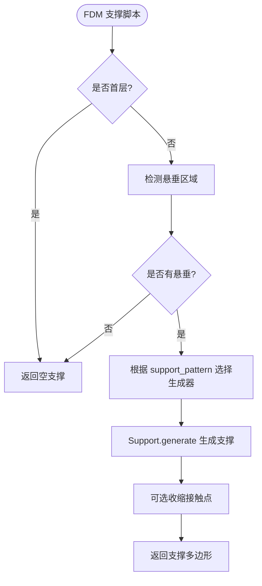

**图示来源**
- [samples/FDM/scripts/my_support.lua:30-82](file://samples/FDM/scripts/my_support.lua#L30-L82)

**章节来源**
- [samples/FDM/scripts/my_support.lua:1-83](file://samples/FDM/scripts/my_support.lua#L1-L83)

### FDM 自定义填充脚本
- 调用约定：胶水先执行脚本定义 generate_fill(current_layer)，再调用该函数。
- 参数：current_layer（已扣除壁厚区域的多边形）。
- 实现思路：计算边界框，生成平行线矩形，与当前层做交集裁剪。

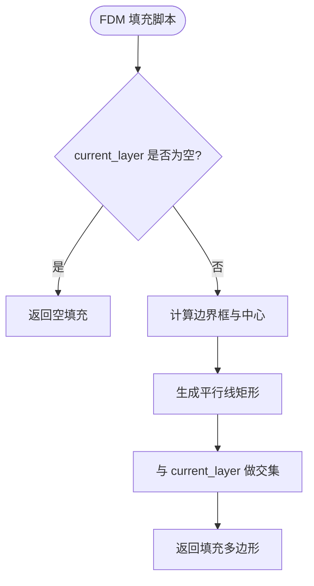

**图示来源**
- [samples/FDM/scripts/my_infill.lua:20-87](file://samples/FDM/scripts/my_infill.lua#L20-L87)

**章节来源**
- [samples/FDM/scripts/my_infill.lua:1-89](file://samples/FDM/scripts/my_infill.lua#L1-L89)

### SLA 自定义地板脚本
- 调用约定：胶水先执行脚本定义 generate_floor(bottom_layer, config)，再调用该函数。
- 参数：bottom_layer（底层多边形）、config（raft_offset/border_width/fill_spacing/fill_angle_deg/border_count/use_convex_hull/concave_hull_points）。
- 可用 PolygonOperations：offsetOperation、union、difference、intersection、convexHullOperation。
- 可用 PolygonFill：zigzagFill、lineFill、offsetFill。

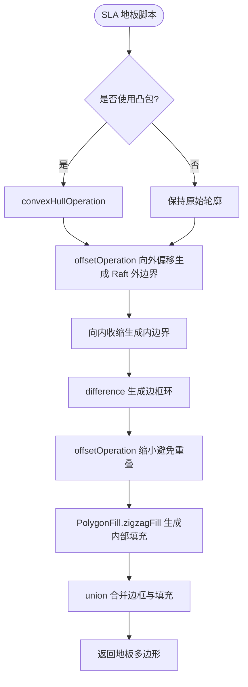

**图示来源**
- [samples/SLA/scripts/my_sla_floor.lua:35-62](file://samples/SLA/scripts/my_sla_floor.lua#L35-L62)

**章节来源**
- [samples/SLA/scripts/my_sla_floor.lua:1-64](file://samples/SLA/scripts/my_sla_floor.lua#L1-L64)

### SLA 自定义支撑脚本
- 全局变量：current_layer、prev_layer、layer_height、config。
- 可用 Support 模块：new_sla、generate、detect_overhang、default_config。
- 可选过滤：按面积阈值过滤支撑点。

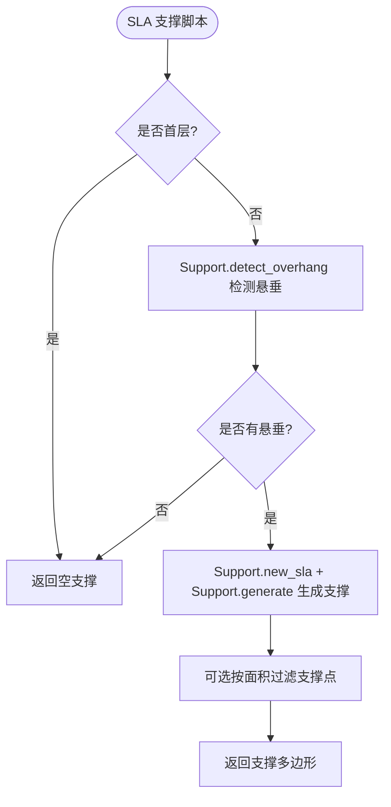

**图示来源**
- [samples/SLA/scripts/my_sla_support.lua:34-72](file://samples/SLA/scripts/my_sla_support.lua#L34-L72)

**章节来源**
- [samples/SLA/scripts/my_sla_support.lua:1-76](file://samples/SLA/scripts/my_sla_support.lua#L1-L76)

### SLS/SLM/LOM/TDP 自定义导出脚本
这些脚本的共同模式：
- 全局变量：config（含 path/configStr）、images（每层 JSON）、output_path。
- 使用 Zipper 打包 config.json 与层 JSON。
- 可选使用 SQLiteAdapter 登记导出历史。
- 返回值：{success=true/false, export_path="..."}。

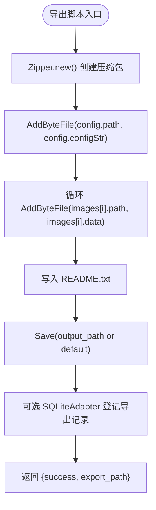

**图示来源**
- [samples/SLS/scripts/my_sls_export.lua:23-79](file://samples/SLS/scripts/my_sls_export.lua#L23-L79)
- [samples/SLM/scripts/my_slm_export.lua:15-62](file://samples/SLM/scripts/my_slm_export.lua#L15-L62)
- [samples/LOM/scripts/my_lom_export.lua:10-57](file://samples/LOM/scripts/my_lom_export.lua#L10-L57)
- [samples/TDP/scripts/my_tdp_export.lua:15-62](file://samples/TDP/scripts/my_tdp_export.lua#L15-L62)

**章节来源**
- [samples/SLS/scripts/my_sls_export.lua:1-80](file://samples/SLS/scripts/my_sls_export.lua#L1-L80)
- [samples/SLM/scripts/my_slm_export.lua:1-63](file://samples/SLM/scripts/my_slm_export.lua#L1-L63)
- [samples/LOM/scripts/my_lom_export.lua:1-58](file://samples/LOM/scripts/my_lom_export.lua#L1-L58)
- [samples/TDP/scripts/my_tdp_export.lua:1-63](file://samples/TDP/scripts/my_tdp_export.lua#L1-L63)

## API 参考文档
### FDM API
- 配置创建：HsBaCreateDefaultConfig。
- 同步运行：HsBaRunFdmPipeline(&cfg, OnProgress, nullptr)。
- 异步运行：HsBaRunFdmPipelineAsync(&cfg, OnProgress, nullptr, OnPipelineComplete, &user_data)。
- 结果释放：HsBaFreePipelineResult(&result)。

关键配置字段（示例中使用）：
- model_name、model_path
- layer_height、first_layer_height
- fill_spacing、fill_mode、fill_angle、wall_count
- top_layer_count、bottom_layer_count、infill_density
- enable_support、overhang_angle、support_pattern
- line_width、print_speed、travel_speed、extrusion_multiplier
- spiral_mode
- output_path

**章节来源**
- [samples/FDM/main.cpp:50-96](file://samples/FDM/main.cpp#L50-L96)
- [samples/FDM/main.cpp:98-165](file://samples/FDM/main.cpp#L98-L165)
- [samples/FDM/main.cpp:167-220](file://samples/FDM/main.cpp#L167-L220)
- [samples/FDM/main.cpp:222-269](file://samples/FDM/main.cpp#L222-L269)
- [samples/FDM/main.cpp:271-318](file://samples/FDM/main.cpp#L271-L318)

### SLA API
- 配置创建：HsBaCreateDefaultSlaConfig。
- 同步运行：HsBaRunSlaPipeline(&cfg, OnProgress, nullptr)。
- 异步运行：HsBaRunSlaPipelineAsync(&cfg, OnProgress, nullptr, OnSlaPipelineComplete, &user_data)。
- 结果释放：HsBaFreeSlaPipelineResult(&result)。

关键配置字段（示例中使用）：
- model_name、model_path
- layer_height、first_layer_height
- bottom_exposure_time、normal_exposure_time
- bottom_lift_distance、lift_distance、lift_speed、retract_speed
- floor_raft_offset、floor_border_width、floor_fill_spacing、floor_border_count、floor_use_convex_hull
- enable_support、overhang_angle、support_gap、support_diameter、support_density、support_pattern
- floor_lua_script、floor_lua_func
- support_lua_script、support_lua_func
- output_path

**章节来源**
- [samples/SLA/main.cpp:49-84](file://samples/SLA/main.cpp#L49-L84)
- [samples/SLA/main.cpp:86-144](file://samples/SLA/main.cpp#L86-L144)
- [samples/SLA/main.cpp:146-191](file://samples/SLA/main.cpp#L146-L191)
- [samples/SLA/main.cpp:193-239](file://samples/SLA/main.cpp#L193-L239)

### SLS API
- 配置创建：HsBaCreateDefaultSlsConfig。
- 同步运行：HsBaRunSlsPipeline(&cfg, OnProgress, nullptr)。
- 异步运行：HsBaRunSlsPipelineAsync(&cfg, OnProgress, nullptr, OnSlsPipelineComplete, &user_data)。
- 结果释放：HsBaFreeSlsPipelineResult(&result)。

关键配置字段（示例中使用）：
- model_name、model_path
- layer_height、first_layer_height
- laser_power、scan_speed、hatch_spacing、hatch_rotation、bed_temperature
- export_lua_script、export_lua_func
- output_path

**章节来源**
- [samples/SLS/main.cpp:53-92](file://samples/SLS/main.cpp#L53-L92)
- [samples/SLS/main.cpp:94-140](file://samples/SLS/main.cpp#L94-L140)
- [samples/SLS/main.cpp:142-190](file://samples/SLS/main.cpp#L142-L190)

### SLM API
- 配置创建：HsBaCreateDefaultSlmConfig。
- 同步运行：HsBaRunSlmPipeline(&cfg, OnProgress, nullptr)。
- 异步运行：HsBaRunSlmPipelineAsync(&cfg, OnProgress, nullptr, OnSlmPipelineComplete, &user_data)。
- 结果释放：HsBaFreeSlmPipelineResult(&result)。

关键配置字段（示例中使用）：
- model_name、model_path
- layer_height、first_layer_height
- laser_power、scan_speed、hatch_spacing、hatch_rotation、bed_temperature
- material、light_source、protect_gas
- export_lua_script、export_lua_func
- output_path

**章节来源**
- [samples/SLM/main.cpp:53-84](file://samples/SLM/main.cpp#L53-L84)
- [samples/SLM/main.cpp:86-132](file://samples/SLM/main.cpp#L86-L132)
- [samples/SLM/main.cpp:134-177](file://samples/SLM/main.cpp#L134-L177)

### LOM API
- 配置创建：HsBaCreateDefaultLomConfig。
- 同步运行：HsBaRunLomPipeline(&cfg, OnProgress, nullptr)。
- 异步运行：HsBaRunLomPipelineAsync(&cfg, OnProgress, nullptr, OnLomPipelineComplete, &user_data)。
- 结果释放：HsBaFreeLomPipelineResult(&result)。

关键配置字段（示例中使用）：
- model_name、model_path
- layer_height、first_layer_height
- cut_speed、cut_margin、cut_power、seal_contour、cut_mode
- bond_temperature、bond_pressure、bond_time
- export_lua_script、export_lua_func
- output_path

**章节来源**
- [samples/LOM/main.cpp:52-82](file://samples/LOM/main.cpp#L52-L82)
- [samples/LOM/main.cpp:84-130](file://samples/LOM/main.cpp#L84-L130)
- [samples/LOM/main.cpp:132-175](file://samples/LOM/main.cpp#L132-L175)

### TDP API
- 配置创建：HsBaCreateDefaultTdpConfig。
- 同步运行：HsBaRunTdpPipeline(&cfg, OnProgress, nullptr)。
- 异步运行：HsBaRunTdpPipelineAsync(&cfg, OnProgress, nullptr, OnTdpPipelineComplete, &user_data)。
- 结果释放：HsBaFreeTdpPipelineResult(&result)。

关键配置字段（示例中使用）：
- model_name、model_path
- layer_height、first_layer_height
- head_count、drop_spacing、binder_saturation、ink_curing_time、bed_temperature、binder_mode
- spiral_mode
- export_lua_script、export_lua_func
- output_path

**章节来源**
- [samples/TDP/main.cpp:52-82](file://samples/TDP/main.cpp#L52-L82)
- [samples/TDP/main.cpp:84-125](file://samples/TDP/main.cpp#L84-L125)
- [samples/TDP/main.cpp:127-170](file://samples/TDP/main.cpp#L127-L170)
- [samples/TDP/main.cpp:172-205](file://samples/TDP/main.cpp#L172-L205)

### WAAM API
- 配置创建：HsBaCreateDefaultWaamConfig。
- 同步运行：HsBaRunWaamPipeline(&cfg, OnProgress, nullptr)。
- 异步运行：HsBaRunWaamPipelineAsync(&cfg, OnProgress, nullptr, OnWaamPipelineComplete, &user_data)。
- 结果释放：HsBaFreeWaamPipelineResult(&result)。

关键配置字段（示例中使用）：
- model_name、model_path
- layer_height、first_layer_height、bead_width、travel_speed
- material、welding_process、protection、protect_gas
- arc_current、arc_voltage、wire_feed_speed、gas_flow_rate、interpass_temperature
- robot_type
- path_lua_script、path_lua_func
- spiral_mode
- output_path

**章节来源**
- [samples/WAAM/main.cpp:51-81](file://samples/WAAM/main.cpp#L51-L81)
- [samples/WAAM/main.cpp:83-131](file://samples/WAAM/main.cpp#L83-L131)
- [samples/WAAM/main.cpp:133-178](file://samples/WAAM/main.cpp#L133-L178)
- [samples/WAAM/main.cpp:180-217](file://samples/WAAM/main.cpp#L180-L217)

### LibHsBaSlicer C++ API
- 预处理：LoadModel、GetModelInfo、TranslateModel、ScaleModel、RemoveModel。
- 切片：Slice(model, z) 返回 Polygons。
- 支撑：GenerateAllFdmSupport(layers_d, support_cfg)。
- 填充：FillWithBorder(polygons, spacing, wall_count, mode, angle)。
- 路径生成：GenerateGCodePath(all_layer_data, path_cfg)。

数据类型与配置（示例中使用）：
- ModelInfo：bbox_min/bbox_max/volume。
- Polygons/PolygonsD：整数/浮点多边形集合。
- LayerPathData：z_height/outlines/fills/supports。
- Support::FdmSupportConfig：overhang_angle_threshold/layer_height/support_density/support_pattern。
- FdmPathConfig：layer_height/line_width/print_speed/travel_speed/extrusion_multiplier/units。

**章节来源**
- [samples/LibHsBaSlicer/main_header.cpp:46-185](file://samples/LibHsBaSlicer/main_header.cpp#L46-L185)

## 集成指南
### 跨语言调用（DllHsBaSlicer）
虽然本示例主要展示 C++ 与 Lua 集成，但 DllHsBaSlicer 提供 C ABI，可用于 Python/C#/Java 等语言调用。典型步骤：
- 加载 DLL。
- 调用 HsBaCreateDefault*Config 获取默认配置。
- 设置模型路径与输出路径。
- 调用 HsBaRun*Pipeline 或 HsBaRun*PipelineAsync。
- 在回调中处理结果并调用 HsBaFree*PipelineResult。

注意：
- 确保进程 UTF-8 编码正确（Windows 下建议使用 HsBaWindowsUtf8.cmake）。
- 多线程环境下注意日志与资源释放线程安全。
- Lua 脚本路径需相对于工作目录或绝对路径。

[本节为通用集成指导，不直接分析具体源码文件]

### Android 与 iOS 移动端集成
仓库中包含 android 与 ios 示例目录，表明 HsBaSlicer 支持移动端平台。移动端集成要点：
- 使用 NDK 编译原生库（CMake 构建）。
- 在 Java/Swift 层通过 JNI/ObjC++ 桥接调用 C ABI。
- 将模型与 Lua 脚本打包进应用资源。
- 在后台线程执行切片任务，避免阻塞 UI。
- 输出文件保存到应用沙盒目录。

[本节为通用移动端集成指导，不直接分析具体源码文件]

## 开发测试与贡献
- 单元测试位于 tests 目录，涵盖任意对象、枚举转换、文件操作、网格模型、路径输出、填充算法、支撑算法等。
- 静态检查与格式化由 .clang-format/.clang-tidy/static_check 管理。
- 文档维护脚本 scripts/repowiki_to_github_wiki.py 用于同步 Wiki。

[本节为通用开发指导，不直接分析具体源码文件]

## 扩展开发指南
- 自定义填充：参考 my_infill.lua，实现 generate_fill(current_layer)，返回填充多边形。
- 自定义支撑：参考 my_support.lua 或 my_sla_support.lua，使用 Support.detect_overhang 与 Support.generate。
- 自定义地板：参考 my_sla_floor.lua，使用 PolygonOperations 与 PolygonFill。
- 自定义导出：参考 SLS/SLM/LOM/TDP 导出脚本，使用 Zipper 与 SQLiteAdapter。
- 自定义路径：参考 WAAM 的 path_lua_script，实现 export_waam 生成机器人代码。

[本节为通用扩展开发指导，不直接分析具体源码文件]

## 示例与教程
本节汇总所有示例的运行要点与常见用法：

### FDM 示例
- 基本用法：默认配置 + 模型 + 同步运行。
- 自定义参数：层高/壁厚/填充/支撑/路径参数。
- Lua 自定义：支撑与填充脚本。
- 异步执行：非阻塞启动 + 完成回调。
- 螺旋模式：spiral_mode=1。

**章节来源**
- [samples/FDM/main.cpp:50-96](file://samples/FDM/main.cpp#L50-L96)
- [samples/FDM/main.cpp:98-165](file://samples/FDM/main.cpp#L98-L165)
- [samples/FDM/main.cpp:167-220](file://samples/FDM/main.cpp#L167-L220)
- [samples/FDM/main.cpp:222-269](file://samples/FDM/main.cpp#L222-L269)
- [samples/FDM/main.cpp:271-318](file://samples/FDM/main.cpp#L271-L318)

### SLA 示例
- 基本用法：默认配置 + 模型 + zip 输出。
- 自定义参数：层高/曝光/地板/支撑参数。
- Lua 自定义：地板与支撑脚本。
- 异步执行：非阻塞启动 + 完成回调。

**章节来源**
- [samples/SLA/main.cpp:49-84](file://samples/SLA/main.cpp#L49-L84)
- [samples/SLA/main.cpp:86-144](file://samples/SLA/main.cpp#L86-L144)
- [samples/SLA/main.cpp:146-191](file://samples/SLA/main.cpp#L146-L191)
- [samples/SLA/main.cpp:193-239](file://samples/SLA/main.cpp#L193-L239)

### SLS 示例
- 基本用法：默认配置 + 模型 + Lua 导出脚本。
- 自定义参数：激光功率/扫描速度/Hatch/床温。
- 异步执行：非阻塞启动 + 完成回调。

**章节来源**
- [samples/SLS/main.cpp:53-92](file://samples/SLS/main.cpp#L53-L92)
- [samples/SLS/main.cpp:94-140](file://samples/SLS/main.cpp#L94-L140)
- [samples/SLS/main.cpp:142-190](file://samples/SLS/main.cpp#L142-L190)

### SLM 示例
- 基本用法：默认配置 + 模型 + Lua 导出脚本。
- 自定义参数：材料/光源/保护气/激光/扫描/Hatch/床温。
- 异步执行：非阻塞启动 + 完成回调。

**章节来源**
- [samples/SLM/main.cpp:53-84](file://samples/SLM/main.cpp#L53-L84)
- [samples/SLM/main.cpp:86-132](file://samples/SLM/main.cpp#L86-L132)
- [samples/SLM/main.cpp:134-177](file://samples/SLM/main.cpp#L134-L177)

### LOM 示例
- 基本用法：默认配置 + 模型 + Lua 导出脚本。
- 自定义参数：切割/粘合参数。
- 异步执行：非阻塞启动 + 完成回调。

**章节来源**
- [samples/LOM/main.cpp:52-82](file://samples/LOM/main.cpp#L52-L82)
- [samples/LOM/main.cpp:84-130](file://samples/LOM/main.cpp#L84-L130)
- [samples/LOM/main.cpp:132-175](file://samples/LOM/main.cpp#L132-L175)

### TDP 示例
- 基本用法：默认配置 + 模型 + Lua 导出脚本。
- 自定义参数：喷头/液滴/粘结剂/固化/床温/模式。
- 螺旋模式：spiral_mode=1。
- 异步执行：非阻塞启动 + 完成回调。

**章节来源**
- [samples/TDP/main.cpp:52-82](file://samples/TDP/main.cpp#L52-L82)
- [samples/TDP/main.cpp:84-125](file://samples/TDP/main.cpp#L84-L125)
- [samples/TDP/main.cpp:127-170](file://samples/TDP/main.cpp#L127-L170)
- [samples/TDP/main.cpp:172-205](file://samples/TDP/main.cpp#L172-L205)

### WAAM 示例
- 基本用法：内置 ABB 机器人代码生成。
- 自定义参数：焊接工艺/机器人类型。
- 自定义路径：Lua 路径脚本。
- 螺旋模式：spiral_mode=1。
- 异步执行：非阻塞启动 + 完成回调。

**章节来源**
- [samples/WAAM/main.cpp:51-81](file://samples/WAAM/main.cpp#L51-L81)
- [samples/WAAM/main.cpp:83-131](file://samples/WAAM/main.cpp#L83-L131)
- [samples/WAAM/main.cpp:133-178](file://samples/WAAM/main.cpp#L133-L178)
- [samples/WAAM/main.cpp:180-217](file://samples/WAAM/main.cpp#L180-L217)

### LibHsBaSlicer 示例
- 传统头文件方式调用 C++ API。
- 完整 FDM 流程：预处理 -> 切片 -> 支撑 -> 填充 -> 路径生成。
- 输出 G-code 到 output/lib_header_sample.gcode。

**章节来源**
- [samples/LibHsBaSlicer/main_header.cpp:46-185](file://samples/LibHsBaSlicer/main_header.cpp#L46-L185)

## 部署故障排除与FAQ
常见问题与建议：
- 模型文件未找到：确认 model_path 指向有效 STL 文件。
- Lua 脚本路径错误：确保脚本路径相对于工作目录或提供绝对路径。
- 输出文件写入失败：检查输出目录权限与磁盘空间。
- 异步回调未触发：确认完成回调已注册且主线程未提前退出。
- 内存泄漏：务必调用 HsBaFree*PipelineResult 释放结果内存。
- 中文路径乱码：Windows 下启用 UTF-8 支持（HsBaWindowsUtf8.cmake）。

[本节为通用故障排除指导，不直接分析具体源码文件]

## 附录
- 所有示例均支持 Windows/Linux/macOS/Android/iOS 平台。
- 日志输出在非游戏控制台模式下使用 LoggerSingletone，在游戏控制台模式下禁用日志。
- 进度回调 OnProgress(percent, stage, user_data) 可用于 UI 进度条与阶段提示。
- 结果结构体包含 success、total_layers、elapsed_seconds、error_message、gcode_content/export_path/output_path 等字段。

[本节为通用附录内容，不直接分析具体源码文件]