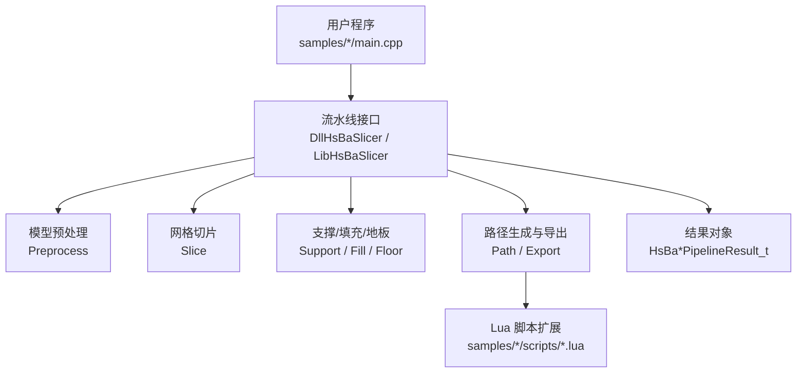
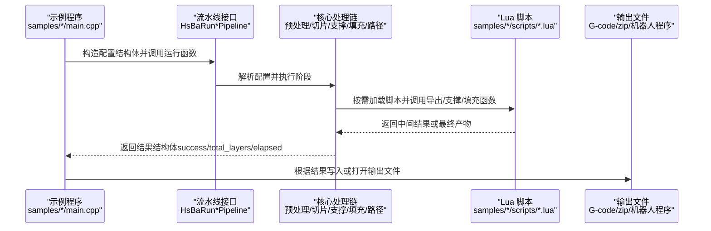
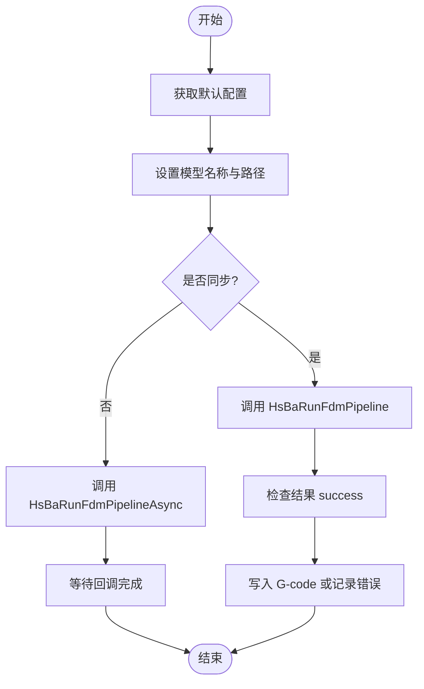
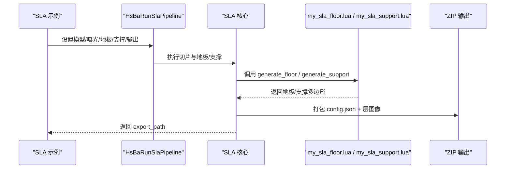
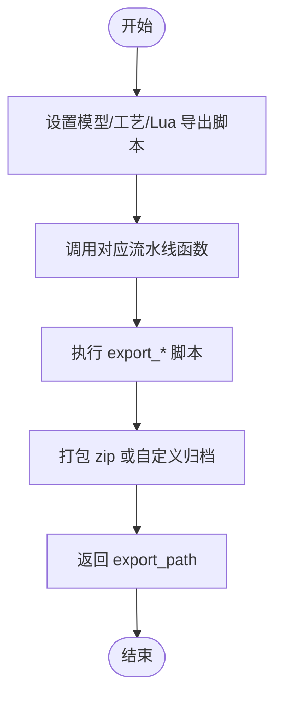
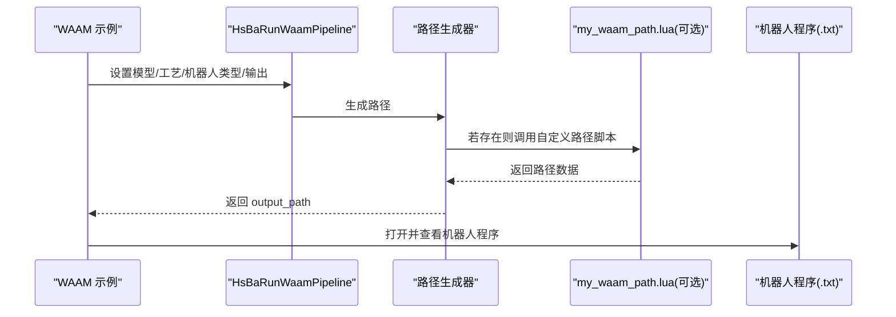
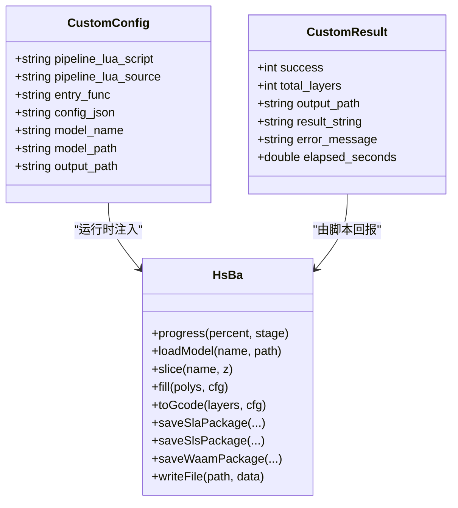
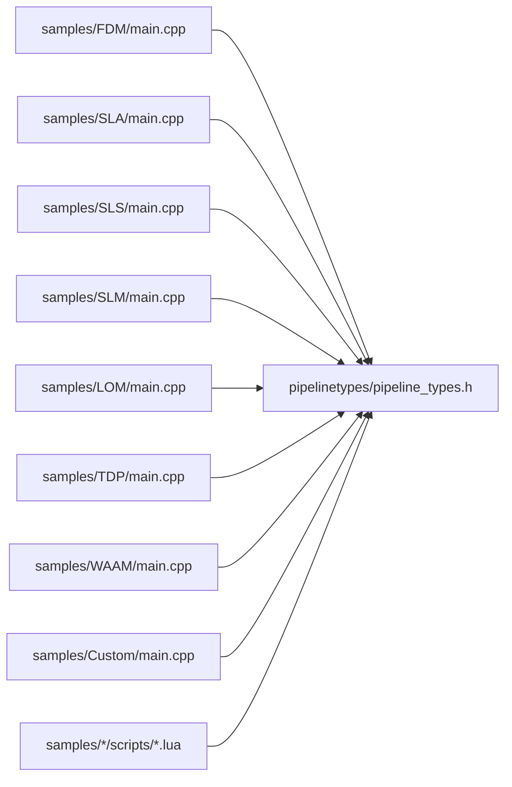

# 示例与教程

<cite>
**本文引用的文件**   
- [README.md](file://README.md)
- [pipeline_types.h](file://pipelinetypes/pipeline_types.h)
- [samples/FDM/main.cpp](file://samples/FDM/main.cpp)
- [samples/SLA/main.cpp](file://samples/SLA/main.cpp)
- [samples/SLS/main.cpp](file://samples/SLS/main.cpp)
- [samples/SLM/main.cpp](file://samples/SLM/main.cpp)
- [samples/LOM/main.cpp](file://samples/LOM/main.cpp)
- [samples/TDP/main.cpp](file://samples/TDP/main.cpp)
- [samples/WAAM/main.cpp](file://samples/WAAM/main.cpp)
- [samples/Custom/main.cpp](file://samples/Custom/main.cpp)
- [samples/Custom/scripts/my_fdm_pipeline.lua](file://samples/Custom/scripts/my_fdm_pipeline.lua)
- [samples/FDM/scripts/my_infill.lua](file://samples/FDM/scripts/my_infill.lua)
- [samples/FDM/scripts/my_support.lua](file://samples/FDM/scripts/my_support.lua)
- [samples/SLA/scripts/my_sla_floor.lua](file://samples/SLA/scripts/my_sla_floor.lua)
- [samples/SLA/scripts/my_sla_support.lua](file://samples/SLA/scripts/my_sla_support.lua)
- [samples/SLS/scripts/my_sls_export.lua](file://samples/SLS/scripts/my_sls_export.lua)
- [samples/SLM/scripts/my_slm_export.lua](file://samples/SLM/scripts/my_slm_export.lua)
- [samples/LOM/scripts/my_lom_export.lua](file://samples/LOM/scripts/my_lom_export.lua)
</cite>

## 目录
1. [简介](#简介)
2. [项目结构](#项目结构)
3. [核心组件](#核心组件)
4. [架构总览](#架构总览)
5. [详细组件分析](#详细组件分析)
6. [依赖关系分析](#依赖关系分析)
7. [性能与最佳实践](#性能与最佳实践)
8. [故障排除指南](#故障排除指南)
9. [结论](#结论)
10. [附录：完整学习路径与可运行示例索引](#附录完整学习路径与可运行示例索引)

## 简介
本教程面向希望从零开始掌握 HsBaSlicer 切片能力的开发者，提供从基础到高级的完整学习路径。内容覆盖：
- 基本切片流程：FDM、SLA、SLS、SLM、LOM、TDP、WAAM 七类工艺的最小可用示例。
- 自定义算法实现：Lua 自定义填充、支撑、地板、导出脚本。
- 多技术栈处理：C++ 调用流水线接口、Lua 脚本扩展、Protobuf 跨语言调用。
- 批量与异步处理：同步与异步流水线、进度回调、结果释放。
- 典型应用场景：花瓶模式（螺旋）、机器人路径生成、粉末床打包、数据库登记等。

每个示例均给出“源代码位置 + 配置文件字段 + 输入数据约定 + 预期输出”，并附带分步说明、关键代码片段解释、常见陷阱与解决方案。

## 项目结构
HsBaSlicer 提供两类主要入口：
- C++ 静态/动态库 API：通过 `samples/*/main.cpp` 演示如何配置并运行各工艺流水线。
- Lua 脚本系统：通过 `samples/*/scripts/*.lua` 或 `samples/Custom/scripts/*.lua` 定义阶段逻辑与导出格式。

图表来源
- [samples/FDM/main.cpp:53-96](file://samples/FDM/main.cpp#L53-L96)
- [samples/SLA/main.cpp:52-84](file://samples/SLA/main.cpp#L52-L84)
- [samples/SLS/main.cpp:56-92](file://samples/SLS/main.cpp#L56-L92)
- [samples/SLM/main.cpp:56-84](file://samples/SLM/main.cpp#L56-L84)
- [samples/LOM/main.cpp:55-82](file://samples/LOM/main.cpp#L55-L82)
- [samples/TDP/main.cpp:55-82](file://samples/TDP/main.cpp#L55-L82)
- [samples/WAAM/main.cpp:54-81](file://samples/WAAM/main.cpp#L54-L81)

章节来源
- [README.md:25-39](file://README.md#L25-L39)

## 核心组件
本节聚焦“可运行的最小示例”和“关键配置字段”。所有示例都遵循统一模式：
- 获取默认配置结构体。
- 设置模型名称与路径。
- 可选：设置输出路径、工艺参数、Lua 脚本。
- 调用同步或异步流水线函数。
- 检查 result.success，读取 total_layers、elapsed_seconds，以及输出路径或 G-code 内容。
- 必须调用对应的 Free 函数释放内存。

### FDM 基本流水线
- 目标：生成 G-code。
- 关键配置：层高、首层层高、填充间距/模式/角度、壁厚、顶层/底层实心层数、填充密度、支撑开关与模式、线宽、打印速度、G-code 固件类型、喷嘴/耗材直径、温度、回抽参数、输出路径。
- 参考实现：[samples/FDM/main.cpp:53-96](file://samples/FDM/main.cpp#L53-L96)。

### SLA 基本流水线
- 目标：输出 zip（包含 config.json 与各层轮廓图像）。
- 关键配置：层高、首层层高、曝光时间、提升距离/速度、地板偏移/边框宽度/填充间距/角度/边框数量/凸包、支撑开关/间隙/直径/密度/模式、图像格式与尺寸、输出路径。
- 参考实现：[samples/SLA/main.cpp:52-84](file://samples/SLA/main.cpp#L52-L84)。

### SLS / SLM / LOM / TDP 基本流水线
- 共同点：无标准输出格式，需指定 Lua 导出脚本；输出通常为 zip 或自定义归档。
- SLS：激光功率、扫描速度、 Hatch 间距/旋转、粉床温度。
- SLM：在 SLS 基础上增加金属材料、光源类型、保护气体。
- LOM：切割速度/余量/功率、封边、切割模式、粘合温度/压力/时间。
- TDP：喷头数量、滴落间距、粘结剂饱和度、固化时间、粉床温度、粘结模式；支持螺旋外壁模式。
- 参考实现：
  - [samples/SLS/main.cpp:56-92](file://samples/SLS/main.cpp#L56-L92)
  - [samples/SLM/main.cpp:56-84](file://samples/SLM/main.cpp#L56-L84)
  - [samples/LOM/main.cpp:55-82](file://samples/LOM/main.cpp#L55-L82)
  - [samples/TDP/main.cpp:55-82](file://samples/TDP/main.cpp#L55-L82)

### WAAM 基本流水线
- 目标：输出机器人语言程序（ABB/KUKA/FANUC），非 zip。
- 关键配置：层高/首层层高、焊道宽度、行走速度、材料、焊接工艺、保护方式、保护气体、电流/电压、送丝速度、气体流量、层间温度、机器人类型、可选 Lua 路径脚本、螺旋模式。
- 参考实现：[samples/WAAM/main.cpp:54-81](file://samples/WAAM/main.cpp#L54-L81)。

章节来源
- [pipeline_types.h:56-127](file://pipelinetypes/pipeline_types.h#L56-L127)
- [pipeline_types.h:170-232](file://pipelinetypes/pipeline_types.h#L170-L232)
- [pipeline_types.h:259-310](file://pipelinetypes/pipeline_types.h#L259-L310)
- [pipeline_types.h:359-401](file://pipelinetypes/pipeline_types.h#L359-L401)
- [pipeline_types.h:419-461](file://pipelinetypes/pipeline_types.h#L419-L461)
- [pipeline_types.h:480-521](file://pipelinetypes/pipeline_types.h#L480-L521)
- [pipeline_types.h:578-625](file://pipelinetypes/pipeline_types.h#L578-L625)

## 架构总览
下图展示“C++ 示例程序 -> 流水线接口 -> 内部模块 -> Lua 脚本”的数据与控制流。

图表来源
- [samples/FDM/main.cpp:53-96](file://samples/FDM/main.cpp#L53-L96)
- [samples/SLA/main.cpp:52-84](file://samples/SLA/main.cpp#L52-L84)
- [samples/SLS/main.cpp:56-92](file://samples/SLS/main.cpp#L56-L92)
- [samples/SLM/main.cpp:56-84](file://samples/SLM/main.cpp#L56-L84)
- [samples/LOM/main.cpp:55-82](file://samples/LOM/main.cpp#L55-L82)
- [samples/TDP/main.cpp:55-82](file://samples/TDP/main.cpp#L55-L82)
- [samples/WAAM/main.cpp:54-81](file://samples/WAAM/main.cpp#L54-L81)

## 详细组件分析

### FDM 流水线详解
- 同步运行：构造默认配置，设置模型与输出路径，调用 `HsBaRunFdmPipeline`，检查 `result.success`，将 `gcode_content` 写入文件，最后调用 `HsBaFreePipelineResult`。
- 异步运行：使用 `HsBaRunFdmPipelineAsync`，传入完成回调，在回调中释放结果。
- 螺旋/花瓶模式：设置 `spiral_mode=1`，外壁合并为连续上升路径，跳过填充与支撑。
- Lua 自定义支撑/填充：通过 `support_lua_script`/`support_lua_func` 与 `infill_lua_script`/`infill_lua_func` 替换内置算法。

图表来源
- [samples/FDM/main.cpp:53-96](file://samples/FDM/main.cpp#L53-L96)
- [samples/FDM/main.cpp:245-269](file://samples/FDM/main.cpp#L245-L269)
- [samples/FDM/main.cpp:274-318](file://samples/FDM/main.cpp#L274-L318)

章节来源
- [samples/FDM/main.cpp:53-96](file://samples/FDM/main.cpp#L53-L96)
- [samples/FDM/main.cpp:101-165](file://samples/FDM/main.cpp#L101-L165)
- [samples/FDM/main.cpp:170-220](file://samples/FDM/main.cpp#L170-L220)
- [samples/FDM/main.cpp:245-269](file://samples/FDM/main.cpp#L245-L269)
- [samples/FDM/main.cpp:274-318](file://samples/FDM/main.cpp#L274-L318)

### SLA 流水线详解
- 基本用法：设置模型与输出路径，调用 `HsBaRunSlaPipeline`，得到 zip 输出路径。
- 自定义参数：调整层高、曝光、提升、地板偏移/边框/填充、支撑参数。
- Lua 自定义地板/支撑/导出：通过 `floor_lua_script`/`floor_lua_func`、`support_lua_script`/`support_lua_func`、`export_lua_script`/`export_lua_func` 替换内置逻辑。
- 异步运行：使用 `HsBaRunSlaPipelineAsync`。

图表来源
- [samples/SLA/main.cpp:52-84](file://samples/SLA/main.cpp#L52-L84)
- [samples/SLA/main.cpp:89-144](file://samples/SLA/main.cpp#L89-L144)
- [samples/SLA/main.cpp:149-191](file://samples/SLA/main.cpp#L149-L191)
- [samples/SLA/main.cpp:217-239](file://samples/SLA/main.cpp#L217-L239)

章节来源
- [samples/SLA/main.cpp:52-84](file://samples/SLA/main.cpp#L52-L84)
- [samples/SLA/main.cpp:89-144](file://samples/SLA/main.cpp#L89-L144)
- [samples/SLA/main.cpp:149-191](file://samples/SLA/main.cpp#L149-L191)
- [samples/SLA/main.cpp:217-239](file://samples/SLA/main.cpp#L217-L239)

### SLS / SLM / LOM / TDP 流水线详解
- 共同点：必须指定 Lua 导出脚本；输出由脚本决定，通常为 zip。
- SLS：激光功率、扫描速度、Hatch 间距/旋转、粉床温度。
- SLM：材料、光源、保护气体。
- LOM：切割/粘合参数。
- TDP：喷头数量、滴落间距、粘结剂饱和度、固化时间、粉床温度、粘结模式；支持螺旋模式。

图表来源
- [samples/SLS/main.cpp:56-92](file://samples/SLS/main.cpp#L56-L92)
- [samples/SLM/main.cpp:56-84](file://samples/SLM/main.cpp#L56-L84)
- [samples/LOM/main.cpp:55-82](file://samples/LOM/main.cpp#L55-L82)
- [samples/TDP/main.cpp:55-82](file://samples/TDP/main.cpp#L55-L82)

章节来源
- [samples/SLS/main.cpp:56-92](file://samples/SLS/main.cpp#L56-L92)
- [samples/SLM/main.cpp:56-84](file://samples/SLM/main.cpp#L56-L84)
- [samples/LOM/main.cpp:55-82](file://samples/LOM/main.cpp#L55-L82)
- [samples/TDP/main.cpp:55-82](file://samples/TDP/main.cpp#L55-L82)

### WAAM 流水线详解
- 目标：输出机器人语言程序（ABB/KUKA/FANUC）。
- 关键特性：支持螺旋模式（连续上升焊道）、可选 Lua 路径脚本替换内置代码生成器。
- 异步运行：使用 `HsBaRunWaamPipelineAsync`。

图表来源
- [samples/WAAM/main.cpp:54-81](file://samples/WAAM/main.cpp#L54-L81)
- [samples/WAAM/main.cpp:86-131](file://samples/WAAM/main.cpp#L86-L131)
- [samples/WAAM/main.cpp:155-178](file://samples/WAAM/main.cpp#L155-L178)
- [samples/WAAM/main.cpp:183-217](file://samples/WAAM/main.cpp#L183-L217)

章节来源
- [samples/WAAM/main.cpp:54-81](file://samples/WAAM/main.cpp#L54-L81)
- [samples/WAAM/main.cpp:86-131](file://samples/WAAM/main.cpp#L86-L131)
- [samples/WAAM/main.cpp:155-178](file://samples/WAAM/main.cpp#L155-L178)
- [samples/WAAM/main.cpp:183-217](file://samples/WAAM/main.cpp#L183-L217)

### Custom Lua 流水线详解
- 特点：整条工作流由 Lua 决定，C++ 只提供算子环境（全局表 `HsBa`）与入口函数名。
- 能力：模型加载/信息、切片、支撑、填充、G-code 生成、SLA/SLS/WAAM 打包、图像渲染、文件读写、进度上报。
- 示例：
  - 纯 Lua FDM 流水线（脚本文件）。
  - 纯 Lua SLS/SLM/LOM/TDP/WAAM 流水线（脚本文件）。
  - 内联 Lua 源码（无脚本文件）。
  - 异步执行。
  - Protobuf 字节流驱动（跨进程/跨语言）。

图表来源
- [samples/Custom/main.cpp:100-132](file://samples/Custom/main.cpp#L100-L132)
- [samples/Custom/main.cpp:140-165](file://samples/Custom/main.cpp#L140-L165)
- [samples/Custom/main.cpp:174-265](file://samples/Custom/main.cpp#L174-L265)
- [samples/Custom/main.cpp:270-314](file://samples/Custom/main.cpp#L270-L314)
- [samples/Custom/main.cpp:331-354](file://samples/Custom/main.cpp#L331-L354)
- [samples/Custom/main.cpp:516-589](file://samples/Custom/main.cpp#L516-L589)

章节来源
- [samples/Custom/main.cpp:100-132](file://samples/Custom/main.cpp#L100-L132)
- [samples/Custom/main.cpp:140-165](file://samples/Custom/main.cpp#L140-L165)
- [samples/Custom/main.cpp:174-265](file://samples/Custom/main.cpp#L174-L265)
- [samples/Custom/main.cpp:270-314](file://samples/Custom/main.cpp#L270-L314)
- [samples/Custom/main.cpp:331-354](file://samples/Custom/main.cpp#L331-L354)
- [samples/Custom/main.cpp:516-589](file://samples/Custom/main.cpp#L516-L589)

## 依赖关系分析
- 示例程序依赖各自工艺的流水线头文件（如 `fdm_pipeline.h`、`sla_pipeline.h` 等）。
- 流水线头文件依赖统一的管道类型定义（`pipelinetypes/pipeline_types.h`）。
- Lua 脚本依赖已注册的通用库（PolygonOperations、Support、PolygonFill、PathOptimize、Zipper、Cipher、SQLiteAdapter 等）。

图表来源
- [samples/FDM/main.cpp:17-22](file://samples/FDM/main.cpp#L17-L22)
- [samples/SLA/main.cpp:16-21](file://samples/SLA/main.cpp#L16-L21)
- [samples/SLS/main.cpp:20-25](file://samples/SLS/main.cpp#L20-L25)
- [samples/SLM/main.cpp:20-25](file://samples/SLM/main.cpp#L20-L25)
- [samples/LOM/main.cpp:20-25](file://samples/LOM/main.cpp#L20-L25)
- [samples/TDP/main.cpp:20-25](file://samples/TDP/main.cpp#L20-L25)
- [samples/WAAM/main.cpp:19-24](file://samples/WAAM/main.cpp#L19-L24)
- [samples/Custom/main.cpp:47-49](file://samples/Custom/main.cpp#L47-L49)
- [pipeline_types.h:56-127](file://pipelinetypes/pipeline_types.h#L56-L127)

章节来源
- [pipeline_types.h:56-127](file://pipelinetypes/pipeline_types.h#L56-L127)

## 性能与最佳实践
- 优先使用默认配置初始化，再仅修改必要字段，减少遗漏。
- 对大模型或高分辨率切片，建议先以较大层高快速验证，再逐步降低层高。
- 使用异步流水线避免阻塞 UI 线程；在回调中释放结果对象。
- 对于 SLS/SLM/LOM/TDP，确保 Lua 导出脚本返回 table（而非字符串），否则会覆盖 zip 输出。
- 使用螺旋模式时注意：外壁合并为连续路径，通常跳过填充与支撑，适用于花瓶/薄壁件。
- 合理设置支撑密度与间隙，避免过度支撑导致移除困难或表面质量下降。
- 控制图像分辨率（SLA）与填充间距，平衡精度与体积。

## 故障排除指南
- 未释放结果内存：务必调用 `HsBaFreePipelineResult`、`HsBaFreeSlaPipelineResult`、`HsBaFreeSlsPipelineResult`、`HsBaFreeSlmPipelineResult`、`HsBaFreeLomPipelineResult`、`HsBaFreeTdpPipelineResult`、`HsBaFreeWaamPipelineResult`、`HsBaFreeCustomPipelineResult`。
- Lua 导出脚本返回类型错误：SLS/SLM/LOM 导出脚本应返回 table，否则可能覆盖 zip 输出。
- 模型路径不存在：确保 `model_path` 指向有效 STL/OBJ 等模型文件。
- 输出路径不可写：检查目录权限与路径是否存在。
- 异步回调未触发：确认主循环或事件循环未被阻塞；示例中使用忙等待仅作演示，实际应使用事件机制。
- Protobuf 调用冲突：示例注释指出，不要把 HsBaSlicerProto 的 .pb.cc 与 DllHsBaSlicer 链进同一进程，避免同名 proto 重复注册导致进程终止。

章节来源
- [samples/Custom/main.cpp:357-364](file://samples/Custom/main.cpp#L357-L364)
- [samples/SLS/scripts/my_sls_export.lua:73-79](file://samples/SLS/scripts/my_sls_export.lua#L73-L79)
- [samples/SLM/scripts/my_slm_export.lua:56-62](file://samples/SLM/scripts/my_slm_export.lua#L56-L62)
- [samples/LOM/scripts/my_lom_export.lua:51-57](file://samples/LOM/scripts/my_lom_export.lua#L51-L57)

## 结论
通过本教程，你可以：
- 使用 C++ 示例快速运行 FDM/SLA/SLS/SLM/LOM/TDP/WAAM 流水线。
- 用 Lua 脚本自定义支撑、填充、地板与导出逻辑。
- 采用异步与进度回调构建响应式应用。
- 借助 Custom Lua 流水线完全掌控工作流顺序与内容。
- 通过 Protobuf 字节流进行跨语言/跨进程调用。

## 附录：完整学习路径与可运行示例索引

### 入门路径（基础切片）
- FDM 基本流水线：[samples/FDM/main.cpp:53-96](file://samples/FDM/main.cpp#L53-L96)
- SLA 基本流水线：[samples/SLA/main.cpp:52-84](file://samples/SLA/main.cpp#L52-L84)
- SLS 基本流水线：[samples/SLS/main.cpp:56-92](file://samples/SLS/main.cpp#L56-L92)
- SLM 基本流水线：[samples/SLM/main.cpp:56-84](file://samples/SLM/main.cpp#L56-L84)
- LOM 基本流水线：[samples/LOM/main.cpp:55-82](file://samples/LOM/main.cpp#L55-L82)
- TDP 基本流水线：[samples/TDP/main.cpp:55-82](file://samples/TDP/main.cpp#L55-L82)
- WAAM 基本流水线：[samples/WAAM/main.cpp:54-81](file://samples/WAAM/main.cpp#L54-L81)

### 进阶路径（自定义算法与多技术栈）
- FDM 自定义填充脚本：[samples/FDM/scripts/my_infill.lua:20-88](file://samples/FDM/scripts/my_infill.lua#L20-L88)
- FDM 自定义支撑脚本：[samples/FDM/scripts/my_support.lua:32-80](file://samples/FDM/scripts/my_support.lua#L32-L80)
- SLA 自定义地板脚本：[samples/SLA/scripts/my_sla_floor.lua:35-62](file://samples/SLA/scripts/my_sla_floor.lua#L35-L62)
- SLA 自定义支撑脚本：[samples/SLA/scripts/my_sla_support.lua:34-72](file://samples/SLA/scripts/my_sla_support.lua#L34-L72)
- SLS 导出脚本（zip+数据库登记）：[samples/SLS/scripts/my_sls_export.lua:23-79](file://samples/SLS/scripts/my_sls_export.lua#L23-L79)
- SLM 导出脚本（zip+数据库登记）：[samples/SLM/scripts/my_slm_export.lua:15-62](file://samples/SLM/scripts/my_slm_export.lua#L15-L62)
- LOM 导出脚本（zip+数据库登记）：[samples/LOM/scripts/my_lom_export.lua:10-57](file://samples/LOM/scripts/my_lom_export.lua#L10-L57)
- Custom Lua FDM 流水线：[samples/Custom/scripts/my_fdm_pipeline.lua:52-171](file://samples/Custom/scripts/my_fdm_pipeline.lua#L52-L171)
- Custom Lua 全流水线入口（含异步与 Protobuf）：[samples/Custom/main.cpp:100-132](file://samples/Custom/main.cpp#L100-L132), [samples/Custom/main.cpp:331-354](file://samples/Custom/main.cpp#L331-L354), [samples/Custom/main.cpp:516-589](file://samples/Custom/main.cpp#L516-L589)

### 典型应用场景
- 螺旋/花瓶模式（FDM/TDP/WAAM）：
  - FDM：[samples/FDM/main.cpp:274-318](file://samples/FDM/main.cpp#L274-L318)
  - TDP：[samples/TDP/main.cpp:175-205](file://samples/TDP/main.cpp#L175-L205)
  - WAAM：[samples/WAAM/main.cpp:183-217](file://samples/WAAM/main.cpp#L183-L217)
- 机器人路径生成（WAAM）：[samples/WAAM/main.cpp:54-81](file://samples/WAAM/main.cpp#L54-L81)
- 粉末床打包（SLS/SLM/LOM/TDP）：
  - SLS：[samples/SLS/scripts/my_sls_export.lua:23-79](file://samples/SLS/scripts/my_sls_export.lua#L23-L79)
  - SLM：[samples/SLM/scripts/my_slm_export.lua:15-62](file://samples/SLM/scripts/my_slm_export.lua#L15-L62)
  - LOM：[samples/LOM/scripts/my_lom_export.lua:10-57](file://samples/LOM/scripts/my_lom_export.lua#L10-L57)
  - TDP：[samples/TDP/main.cpp:55-82](file://samples/TDP/main.cpp#L55-L82)

### 配置字段速查（节选）
- FDM 配置关键字段：
  - 模型：model_name、model_path
  - 切片：layer_height、first_layer_height
  - 填充：fill_spacing、fill_mode、fill_angle、wall_count、top_layer_count、bottom_layer_count、infill_density
  - 支撑：enable_support、overhang_angle、support_gap、support_diameter、support_density、support_pattern
  - 路径：line_width、print_speed、travel_speed、extrusion_multiplier、spiral_mode
  - G-code：gcode_firmware、nozzle_diameter、filament_diameter、nozzle_temp、bed_temp、retract_length、retract_speed、first_layer_speed
  - Lua：support_lua_script、support_lua_func、infill_lua_script、infill_lua_func
  - 输出：output_path
  - 参考：[pipeline_types.h:56-127](file://pipelinetypes/pipeline_types.h#L56-L127)

- SLA 配置关键字段：
  - 模型：model_name、model_path
  - 切片：layer_height、first_layer_height
  - 曝光：bottom_exposure_time、normal_exposure_time、bottom_lift_distance、lift_distance、lift_speed、retract_speed
  - 地板：floor_raft_offset、floor_border_width、floor_fill_spacing、floor_fill_angle、floor_border_count、floor_use_convex_hull
  - 支撑：enable_support、overhang_angle、support_gap、support_diameter、support_density、support_pattern
  - Lua：support_lua_script、support_lua_func、floor_lua_script、floor_lua_func、export_lua_script、export_lua_func
  - 输出：output_path、image_type、image_width、image_height
  - 参考：[pipeline_types.h:170-232](file://pipelinetypes/pipeline_types.h#L170-L232)

- SLS/SLM/LOM/TDP/WAAM 配置关键字段：
  - SLS：layer_height、first_layer_height、laser_power、scan_speed、hatch_spacing、hatch_rotation、bed_temperature、export_lua_script、export_lua_func、output_path
  - SLM：同上 + material、light_source、protect_gas
  - LOM：layer_height、first_layer_height、cut_speed、cut_margin、cut_power、bond_temperature、bond_pressure、bond_time、seal_contour、cut_mode、export_lua_script、export_lua_func、output_path
  - TDP：layer_height、first_layer_height、head_count、drop_spacing、binder_saturation、ink_curing_time、bed_temperature、binder_mode、export_lua_script、export_lua_func、output_path、spiral_mode
  - WAAM：layer_height、first_layer_height、bead_width、travel_speed、wire_feed_speed、arc_current、arc_voltage、gas_flow_rate、material、welding_process、protection、protect_gas、interpass_temperature、robot_type、path_lua_script、path_lua_func、output_path、spiral_mode
  - 参考：
    - [pipeline_types.h:259-310](file://pipelinetypes/pipeline_types.h#L259-L310)
    - [pipeline_types.h:359-401](file://pipelinetypes/pipeline_types.h#L359-L401)
    - [pipeline_types.h:419-461](file://pipelinetypes/pipeline_types.h#L419-L461)
    - [pipeline_types.h:480-521](file://pipelinetypes/pipeline_types.h#L480-L521)
    - [pipeline_types.h:578-625](file://pipelinetypes/pipeline_types.h#L578-L625)