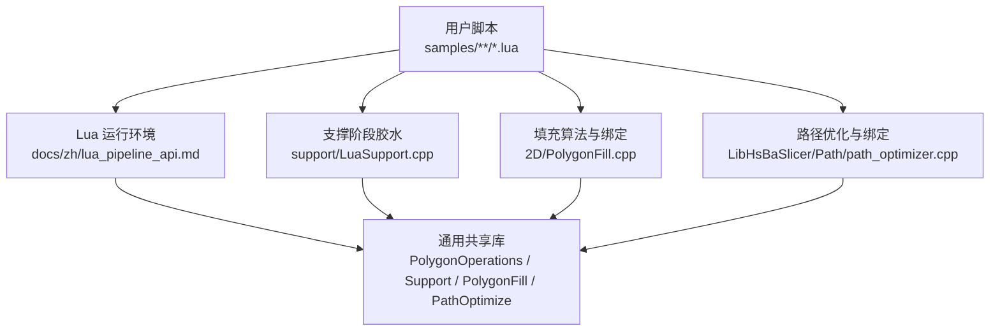
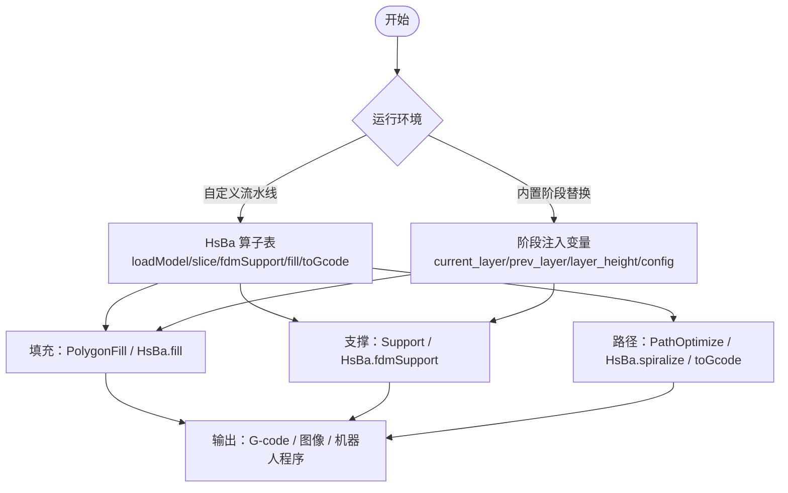
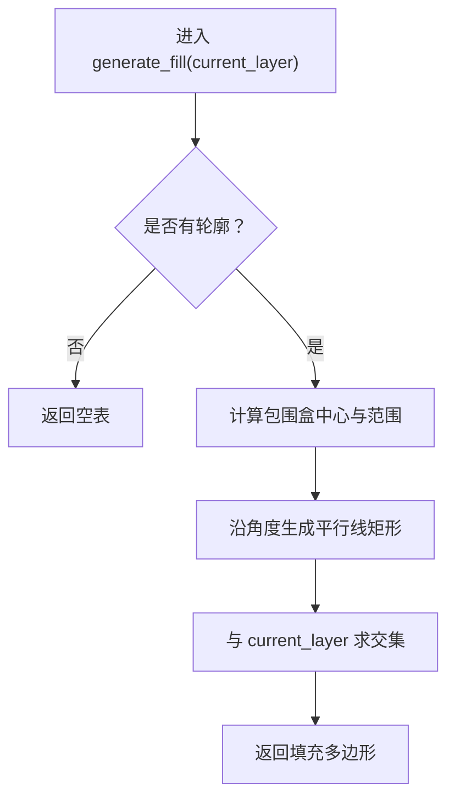
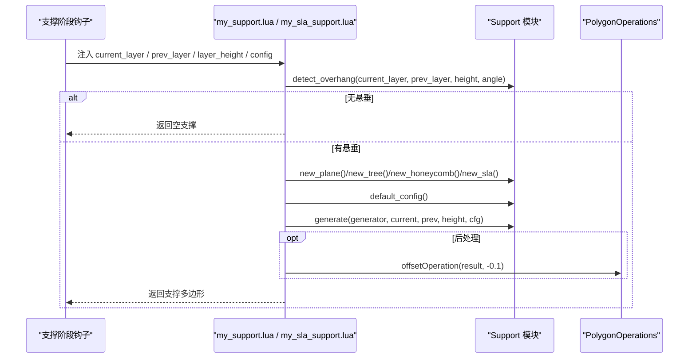
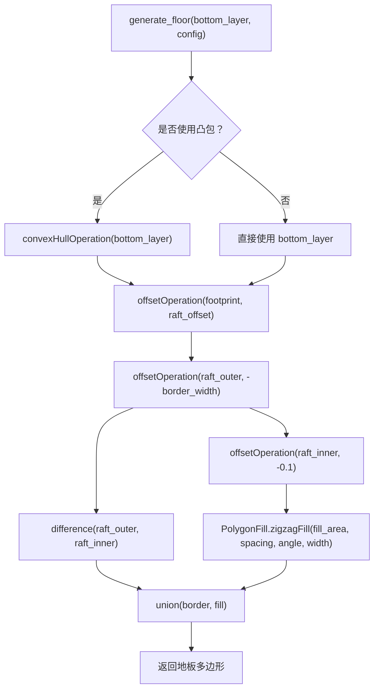
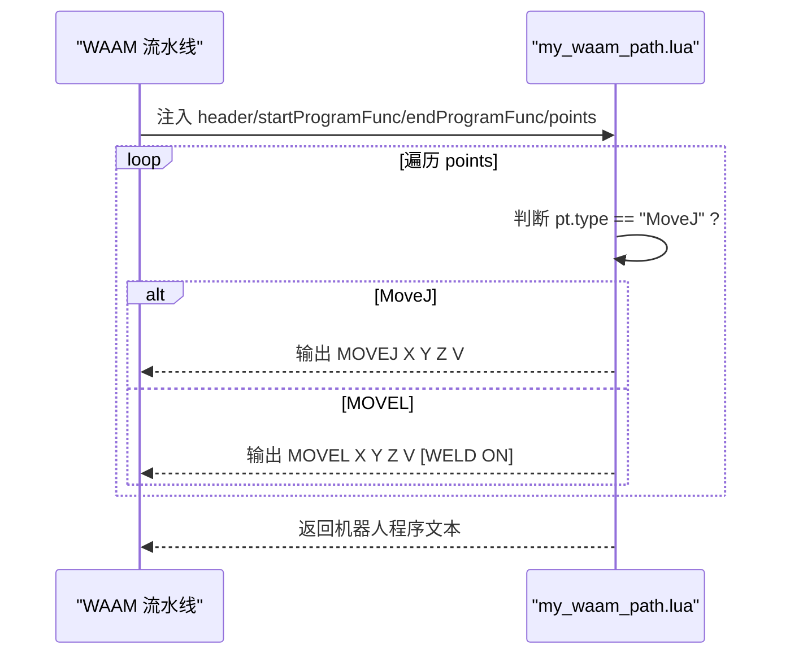
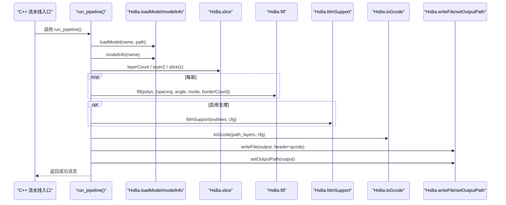
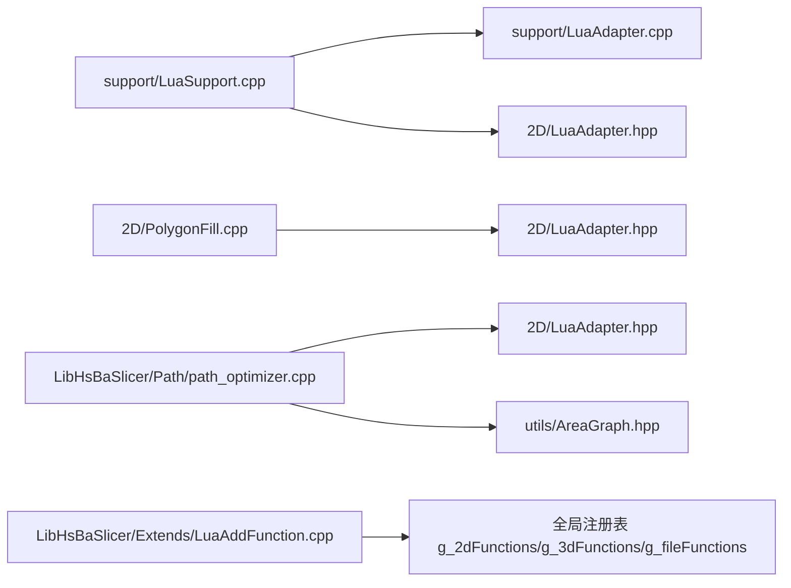

# 算法示例

<cite>
**本文引用的文件**   
- [samples/FDM/scripts/my_infill.lua](file://samples/FDM/scripts/my_ininfill.lua)
- [samples/FDM/scripts/my_support.lua](file://samples/FDM/scripts/my_support.lua)
- [samples/SLA/scripts/my_sla_floor.lua](file://samples/SLA/scripts/my_sla_floor.lua)
- [samples/SLA/scripts/my_sla_support.lua](file://samples/SLA/scripts/my_sla_support.lua)
- [samples/WAAM/scripts/my_waam_path.lua](file://samples/WAAM/scripts/my_waam_path.lua)
- [samples/Custom/scripts/my_fdm_pipeline.lua](file://samples/Custom/scripts/my_fdm_pipeline.lua)
- [docs/zh/lua_pipeline_api.md](file://docs/zh/lua_pipeline_api.md)
- [support/LuaSupport.cpp](file://support/LuaSupport.cpp)
- [2D/PolygonFill.cpp](file://2D/PolygonFill.cpp)
- [LibHsBaSlicer/Path/path_optimizer.cpp](file://LibHsBaSlicer/Path/path_optimizer.cpp)
- [LibHsBaSlicer/Extends/LuaAddFunction.cpp](file://LibHsBaSlicer/Extends/LuaAddFunction.cpp)
</cite>

## 目录
1. [引言](#引言)
2. [项目结构](#项目结构)
3. [核心组件](#核心组件)
4. [架构总览](#架构总览)
5. [详细组件分析](#详细组件分析)
6. [依赖关系分析](#依赖关系分析)
7. [性能与优化](#性能与优化)
8. [调试与故障排除](#调试与故障排除)
9. [结论](#结论)
10. [附录：Lua 脚本 API 速查](#附录lua-脚本-api-速查)

## 引言
本文面向希望扩展 HsBaSlicer 的开发者，聚焦「如何开发和集成自定义算法」，包括填充算法、支撑生成算法、路径规划算法以及完整流水线脚本。文档以仓库中已有的 Lua 示例为核心，结合 C++ 胶水层与 Lua API 文档，说明接口规范、参数配置、数据流处理、性能优化技巧与调试方法。读者可据此编写自定义 FDM/SLA/WAAM 工艺算法，或完全由 Lua 驱动的自定义流水线。

## 项目结构
围绕「算法示例」相关代码，主要涉及以下目录与文件：
- `samples`：各工艺的 Lua 示例脚本，覆盖 FDM 填充、FDM/SLA 支撑、SLA 地板、WAAM 机器人路径、自定义 FDM 流水线等。
- `docs/zh/lua_pipeline_api.md`：Lua 流水线 API 参考，定义两种运行环境、通用几何类型、`HsBa` 算子表、共享库与内置阶段替换约定。
- `support/LuaSupport.cpp`：支撑阶段的 Lua 胶水层，负责注入全局变量、加载脚本并调用约定函数。
- `2D/PolygonFill.cpp`：填充算法实现与 `PolygonFill` Lua 绑定。
- `LibHsBaSlicer/Path/path_optimizer.cpp`：路径顺序优化器与 `PathOptimize` Lua 绑定。
- `LibHsBaSlicer/Extends/LuaAddFunction.cpp`：按维度（2D/3D/文件）注册外部 Lua 函数与事件回调。

**图表来源**
- [docs/zh/lua_pipeline_api.md:19-28](file://docs/zh/lua_pipeline_api.md#L19-L28)
- [support/LuaSupport.cpp:67-90](file://support/LuaSupport.cpp#L67-L90)
- [2D/PolygonFill.cpp:488-502](file://2D/PolygonFill.cpp#L488-L502)
- [LibHsBaSlicer/Path/path_optimizer.cpp:699-709](file://LibHsBaSlicer/Path/path_optimizer.cpp#L699-L709)

**章节来源**
- [docs/zh/lua_pipeline_api.md:19-28](file://docs/zh/lua_pipeline_api.md#L19-L28)
- [support/LuaSupport.cpp:67-90](file://support/LuaSupport.cpp#L67-L90)
- [2D/PolygonFill.cpp:488-502](file://2D/PolygonFill.cpp#L488-L502)
- [LibHsBaSlicer/Path/path_optimizer.cpp:699-709](file://LibHsBaSlicer/Path/path_optimizer.cpp#L699-L709)

## 核心组件
本节从「算法扩展点」角度梳理三类关键能力：填充、支撑、路径规划，并给出它们在 Lua 侧的使用入口与 C++ 实现位置。

| 能力 | Lua 入口 | C++ 实现/绑定 | 典型用途 |
|------|----------|---------------|----------|
| 填充算法 | `PolygonFill.offsetFill` / `lineFill` / `simpleZigzagFill` / `zigzagFill` / `compositeOffsetFill` / `hybridFill` / `offsetOnly`；`HsBa.fill` | `2D/PolygonFill.cpp` | 将当前层多边形转换为填充路径 |
| 支撑生成 | `Support.new_plane/tree/honeycomb/sla` + `Support.generate`；`Support.detect_overhang`；`HsBa.fdmSupport` / `HsBa.slaSupport` | `support/LuaSupport.cpp`、`support/LuaAdapter.cpp` | 根据悬垂检测生成支撑截面 |
| 路径规划 | `PathOptimize.new()`、`optimizeRegions`、`optimizePolygons`；`HsBa.spiralize` / `toGcode` | `LibHsBaSlicer/Path/path_optimizer.cpp` | 优化区域访问顺序、生成连续路径或 G-code |

**章节来源**
- [docs/zh/lua_pipeline_api.md:136-177](file://docs/zh/lua_pipeline_api.md#L136-L177)
- [2D/PolygonFill.cpp:488-502](file://2D/PolygonFill.cpp#L488-L502)
- [support/LuaSupport.cpp:67-90](file://support/LuaSupport.cpp#L67-L90)
- [LibHsBaSlicer/Path/path_optimizer.cpp:699-709](file://LibHsBaSlicer/Path/path_optimizer.cpp#L699-L709)

## 架构总览
HsBaSlicer 的算法扩展采用「C++ 提供核心算法 + Lua 暴露 API + 用户脚本组合策略」的模式。两类运行环境如下：

- **自定义流水线（Custom Pipeline）**：脚本自行决定加载模型、切片、支撑、填充、路径、写文件的顺序，拥有完整 `HsBa` 算子表。
- **内置流水线阶段替换（Stage Hook）**：仅替换某个阶段（支撑/填充/地板/导出），阶段顺序由 C++ 固定。

**图表来源**
- [docs/zh/lua_pipeline_api.md:19-28](file://docs/zh/lua_pipeline_api.md#L19-L28)
- [docs/zh/lua_pipeline_api.md:48-133](file://docs/zh/lua_pipeline_api.md#L48-L133)
- [support/LuaSupport.cpp:67-90](file://support/LuaSupport.cpp#L67-L90)

**章节来源**
- [docs/zh/lua_pipeline_api.md:19-28](file://docs/zh/lua_pipeline_api.md#L19-L28)
- [docs/zh/lua_pipeline_api.md:48-133](file://docs/zh/lua_pipeline_api.md#L48-L133)
- [support/LuaSupport.cpp:67-90](file://support/LuaSupport.cpp#L67-L90)

## 详细组件分析

### 填充算法示例：FDM 自定义填充
`my_infill.lua` 展示了如何在填充阶段用纯 Lua 生成平行线填充，并通过 `PolygonOperations.intersection` 裁剪到有效轮廓。该脚本遵循「仅定义函数、不末尾自调用」的约定，由胶水层调用 `generate_fill(current_layer)`。

关键点：
- 输入：`current_layer`（已扣除壁厚区域的多边形集合）。
- 默认参数：间距 `spacing=0.4`，角度 `angle=45°`。
- 算法流程：计算包围盒 → 生成平行线矩形 → 与当前层做交集 → 返回填充多边形。

**图表来源**
- [samples/FDM/scripts/my_infill.lua:20-87](file://samples/FDM/scripts/my_infill.lua#L20-L87)

**章节来源**
- [samples/FDM/scripts/my_infill.lua:1-89](file://samples/FDM/scripts/my_infill.lua#L1-L89)
- [docs/zh/lua_pipeline_api.md:234-239](file://docs/zh/lua_pipeline_api.md#L234-L239)

### 支撑生成示例：FDM 与 SLA
两个脚本分别演示了 FDM 与 SLA 支撑的 Lua 实现思路：先检测悬垂区域，再选择内置支撑生成器（平面/树状/蜂窝/SLA 牺牲柱），最后可选进行多边形后处理。

共同模式：
- 首层跳过支撑（`prev_layer` 为空）。
- 使用 `Support.detect_overhang(current_layer, prev_layer, layer_height, angle)` 获取悬垂区域。
- 通过 `Support.default_config()` 合并配置字段（层高、间隙、直径、密度、图案等）。
- 返回支撑截面多边形表。

**图表来源**
- [samples/FDM/scripts/my_support.lua:32-79](file://samples/FDM/scripts/my_support.lua#L32-L79)
- [samples/SLA/scripts/my_sla_support.lua:34-72](file://samples/SLA/scripts/my_sla_support.lua#L34-L72)
- [support/LuaSupport.cpp:67-90](file://support/LuaSupport.cpp#L67-L90)

**章节来源**
- [samples/FDM/scripts/my_support.lua:1-83](file://samples/FDM/scripts/my_support.lua#L1-L83)
- [samples/SLA/scripts/my_sla_support.lua:1-76](file://samples/SLA/scripts/my_sla_support.lua#L1-L76)
- [support/LuaSupport.cpp:67-90](file://support/LuaSupport.cpp#L67-L90)

### 地板生成示例：SLA 底部 Raft
`my_sla_floor.lua` 演示了 SLA 底部地板/raft 的生成逻辑：可选凸包简化轮廓 → 外扩 raft → 内缩边框 → 差集得到边框环 → 内部填充 → 合并结果。

**图表来源**
- [samples/SLA/scripts/my_sla_floor.lua:35-62](file://samples/SLA/scripts/my_sla_floor.lua#L35-L62)

**章节来源**
- [samples/SLA/scripts/my_sla_floor.lua:1-64](file://samples/SLA/scripts/my_sla_floor.lua#L1-L64)
- [docs/zh/lua_pipeline_api.md:241-244](file://docs/zh/lua_pipeline_api.md#L241-L244)

### 路径规划与机器人程序：WAAM 自定义路径
`my_waam_path.lua` 展示了 WAAM 流水线中自定义机器人程序生成的入口：读取全局 `points` 数组，按 `type` 输出 `MOVEJ`/`MOVEL` 指令，并可包裹 `startProgramFunc`/`endProgramFunc`。

注意：与导出型脚本不同，WAAM 路径脚本必须返回字符串。

**图表来源**
- [samples/WAAM/scripts/my_waam_path.lua:17-42](file://samples/WAAM/scripts/my_waam_path.lua#L17-L42)

**章节来源**
- [samples/WAAM/scripts/my_waam_path.lua:1-46](file://samples/WAAM/scripts/my_waam_path.lua#L1-L46)

### 完整流水线示例：Lua 驱动 FDM
`my_fdm_pipeline.lua` 是一个完全由 Lua 驱动的 FDM 流水线示例：加载模型、计算层数、逐层切片与填充、可选支撑、组装路径层、生成 G-code、写入文件并上报进度与输出路径。

**图表来源**
- [samples/Custom/scripts/my_fdm_pipeline.lua:52-170](file://samples/Custom/scripts/my_fdm_pipeline.lua#L52-L170)
- [docs/zh/lua_pipeline_api.md:48-133](file://docs/zh/lua_pipeline_api.md#L48-L133)

**章节来源**
- [samples/Custom/scripts/my_fdm_pipeline.lua:1-172](file://samples/Custom/scripts/my_fdm_pipeline.lua#L1-L172)
- [docs/zh/lua_pipeline_api.md:48-133](file://docs/zh/lua_pipeline_api.md#L48-L133)

## 依赖关系分析
Lua 脚本对 C++ 的依赖主要通过以下机制注入：
- `support/LuaSupport.cpp`：在支撑阶段创建独立 Lua 状态，注册 `PolygonOperations` 与 `Support`，并注入 `current_layer`、`prev_layer`、`layer_height`、`config`。
- `2D/PolygonFill.cpp`：注册 `PolygonFill` 表，提供多种填充算法。
- `LibHsBaSlicer/Path/path_optimizer.cpp`：注册 `PathOptimize` 表与 `RegionPathOptimizer` userdata，提供区域路径优化。
- `LibHsBaSlicer/Extends/LuaAddFunction.cpp`：维护 2D/3D/文件三类外部函数注册表，支持扩展更多 Lua 函数。

**图表来源**
- [support/LuaSupport.cpp:10-13](file://support/LuaSupport.cpp#L10-L13)
- [2D/PolygonFill.cpp:16-19](file://2D/PolygonFill.cpp#L16-L19)
- [LibHsBaSlicer/Path/path_optimizer.cpp:17-22](file://LibHsBaSlicer/Path/path_optimizer.cpp#L17-L22)
- [LibHsBaSlicer/Extends/LuaAddFunction.cpp:13-19](file://LibHsBaSlicer/Extends/LuaAddFunction.cpp#L13-L19)

**章节来源**
- [support/LuaSupport.cpp:10-13](file://support/LuaSupport.cpp#L10-L13)
- [2D/PolygonFill.cpp:16-19](file://2D/PolygonFill.cpp#L16-L19)
- [LibHsBaSlicer/Path/path_optimizer.cpp:17-22](file://LibHsBaSlicer/Path/path_optimizer.cpp#L17-L22)
- [LibHsBaSlicer/Extends/LuaAddFunction.cpp:13-19](file://LibHsBaSlicer/Extends/LuaAddFunction.cpp#L13-L19)

## 性能与优化
基于源码实现的观察，可从以下方面优化算法性能：

- **填充算法**
  - 使用整数化精度减少浮点误差：`INTEGERIZATION_PRECISION` 控制整型化缩放。
  - 限制迭代次数避免死循环：`MAX_FILL_ITERATIONS` 与 `MAX_BINARY_SEARCH_ITERATIONS`。
  - 合理设置 `spacing`、`join_type`，避免过多偏移步数导致大量布尔运算。

- **路径优化**
  - 使用 `PathOptimize.optimizeRegions` 或 `optimizePolygons` 一键优化，避免手动 TSP 实现。
  - 对于不可达区域，优化器使用极大惩罚成本 `UNREACHABLE_COST`，应确保区域连通性良好。
  - 在填充前使用 `optimizePolygons` 可减少后续填充计算量。

- **支撑生成**
  - 优先使用内置 `Support.detect_overhang`，避免重复实现悬垂检测。
  - 调整 `support_gap`、`support_density`、`support_diameter` 平衡支撑强度与材料用量。

- **流水线调度**
  - 在自定义流水线中使用 `HsBa.progress` 分阶段上报进度，便于 UI 反馈与中断控制。
  - 批量写入文件时，先在内存拼接头部与内容，再一次性 `writeFile`，减少 I/O 开销。

**章节来源**
- [2D/PolygonFill.cpp:26-31](file://2D/PolygonFill.cpp#L26-L31)
- [2D/PolygonFill.cpp:504-540](file://2D/PolygonFill.cpp#L504-L540)
- [LibHsBaSlicer/Path/path_optimizer.cpp:28-34](file://LibHsBaSlicer/Path/path_optimizer.cpp#L28-L34)
- [LibHsBaSlicer/Path/path_optimizer.cpp:129-184](file://LibHsBaSlicer/Path/path_optimizer.cpp#L129-L184)
- [samples/Custom/scripts/my_fdm_pipeline.lua:65-102](file://samples/Custom/scripts/my_fdm_pipeline.lua#L65-L102)

## 调试与故障排除
常见问题与定位方法：

- **Lua 脚本加载失败**
  - 检查脚本语法与函数名是否符合约定（如 `generate_support`、`generate_fill`、`export_waam`）。
  - 查看 `support/LuaSupport.cpp` 中的错误抛出位置，确认 `luaL_loadfile`/`lua_pcall` 返回值。

- **支撑结果为空**
  - 确认 `prev_layer` 是否为空（首层无需支撑）。
  - 检查 `overhang_angle_threshold` 与 `layer_height` 是否与模型尺寸匹配。
  - 使用 `Support.default_config()` 打印默认配置，对比传入 `cfg` 字段。

- **填充路径异常**
  - 检查 `spacing` 是否为正数，角度是否在合理范围。
  - 使用 `PolygonOperations.area` 验证裁剪前后面积变化。
  - 若使用 `offsetOnly`，注意 `inner`/`outer` 计数与 `join_type` 设置。

- **路径优化顺序不合理**
  - 检查区域 ID 是否重复（优化器会抛错）。
  - 使用 `addRoute` 手动指定可达路径成本，改善 TSP 求解质量。
  - 区分 polygon 模式与 path 模式，不要混用。

- **G-code 输出异常**
  - 确认 `path_layers` 每层包含 `outlines`、`fills`、`supports`、`zHeight`。
  - 检查 `toGcode` 配置字段（层高、线宽、速度、固件类型等）。

**章节来源**
- [support/LuaSupport.cpp:130-177](file://support/LuaSupport.cpp#L130-L177)
- [samples/FDM/scripts/my_support.lua:32-79](file://samples/FDM/scripts/my_support.lua#L32-L79)
- [samples/SLA/scripts/my_sla_support.lua:34-72](file://samples/SLA/scripts/my_sla_support.lua#L34-L72)
- [2D/PolygonFill.cpp:231-486](file://2D/PolygonFill.cpp#L231-L486)
- [LibHsBaSlicer/Path/path_optimizer.cpp:441-474](file://LibHsBaSlicer/Path/path_optimizer.cpp#L441-L474)
- [samples/Custom/scripts/my_fdm_pipeline.lua:130-151](file://samples/Custom/scripts/my_fdm_pipeline.lua#L130-L151)

## 结论
HsBaSlicer 通过清晰的 Lua API 与 C++ 胶水层，为开发者提供了灵活的算法扩展能力。无论是替换内置阶段的填充/支撑/地板/导出算法，还是完全由 Lua 驱动的自定义流水线，均可借助 `PolygonOperations`、`PolygonFill`、`Support`、`PathOptimize` 与 `HsBa` 算子表完成。建议从仓库示例入手，逐步理解数据流与接口契约，再结合自身工艺需求定制算法，并利用性能优化与调试技巧提升稳定性与效率。

## 附录：Lua 脚本 API 速查
本节汇总与算法示例直接相关的 API，供快速查阅。

| 类别 | API | 说明 |
|------|-----|------|
| 几何构造 | `PolygonOperations.union/intersection/difference/xor` | 2D 布尔运算 |
| 几何构造 | `PolygonOperations.offsetOperation/polys, delta` | 内外偏移 |
| 几何构造 | `PolygonOperations.convexHullOperation/concaveHullOperation` | 凸包/凹包 |
| 填充算法 | `PolygonFill.offsetFill/lineFill/simpleZigzagFill/zigzagFill/compositeOffsetFill/hybridFill/offsetOnly` | 多种填充模式 |
| 支撑工具 | `Support.new_plane/new_tree/new_honeycomb/new_sla` | 创建支撑生成器 |
| 支撑工具 | `Support.detect_overhang(current, prev, height, angle)` | 悬垂检测 |
| 支撑工具 | `Support.default_config()` | 默认支撑配置 |
| 路径优化 | `PathOptimize.new()` | 创建优化器对象 |
| 路径优化 | `PathOptimize.optimizeRegions(regions)` | 填充结果模式一键优化 |
| 路径优化 | `PathOptimize.optimizePolygons(regions)` | 多边形模式一键优化 |
| 流水线控制 | `HsBa.progress(percent[, stage])` | 上报进度 |
| 流水线控制 | `HsBa.setLayers(n)` | 上报总层数 |
| 流水线控制 | `HsBa.setOutputPath(path)` | 上报输出路径 |
| 模型管理 | `HsBa.loadModel(name, path)` | 加载模型 |
| 模型管理 | `HsBa.modelInfo(name)` | 获取模型信息 |
| 切片 | `HsBa.slice(name, z)` | 安全切片 |
| 填充 | `HsBa.fill(polygons[, cfg])` | 填充（含壁厚） |
| 支撑 | `HsBa.fdmSupport(layers, cfg)` | FDM 支撑 |
| 支撑 | `HsBa.slaSupport(layers, cfg)` | SLA 支撑 |
| 路径 | `HsBa.spiralize(sections[, cfg])` | 螺旋路径 |
| 路径 | `HsBa.toGcode(layers, cfg)` | 生成 G-code |

**章节来源**
- [docs/zh/lua_pipeline_api.md:136-177](file://docs/zh/lua_pipeline_api.md#L136-L177)
- [docs/zh/lua_pipeline_api.md:48-133](file://docs/zh/lua_pipeline_api.md#L48-L133)