# 自定义算法示例

<cite>
**本文引用的文件**   
- [hsba_pipeline.d.lua](file://types/hsba_pipeline.d.lua)
- [lua_register.h](file://DllHsBaSlicer/lua_register.h)
- [lua_pipeline_api.md](file://docs/zh/lua_pipeline_api.md)
- [my_fdm_pipeline.lua](file://samples/Custom/scripts/my_fdm_pipeline.lua)
- [my_sla_pipeline.lua](file://samples/Custom/scripts/my_sla_pipeline.lua)
- [my_lom_pipeline.lua](file://samples/Custom/scripts/my_lom_pipeline.lua)
- [my_slm_pipeline.lua](file://samples/Custom/scripts/my_slm_pipeline.lua)
- [my_sls_pipeline.lua](file://samples/Custom/scripts/my_sls_pipeline.lua)
- [my_tdp_pipeline.lua](file://samples/Custom/scripts/my_tdp_pipeline.lua)
- [my_waam_pipeline.lua](file://samples/Custom/scripts/my_waam_pipeline.lua)
- [my_sls_export.lua](file://samples/Custom/scripts/my_sls_export.lua)
- [my_infill.lua](file://samples/FDM/scripts/my_infill.lua)
- [my_support.lua](file://samples/FDM/scripts/my_support.lua)
- [my_sla_floor.lua](file://samples/SLA/scripts/my_sla_floor.lua)
- [my_sla_support.lua](file://samples/SLA/scripts/my_sla_support.lua)
- [my_waam_path.lua](file://samples/WAAM/scripts/my_waam_path.lua)
</cite>

## 目录
1. [引言](#引言)
2. [项目结构](#项目结构)
3. [核心组件](#核心组件)
4. [架构总览](#架构总览)
5. [详细组件分析](#详细组件分析)
6. [依赖关系分析](#依赖关系分析)
7. [性能与优化建议](#性能与优化建议)
8. [故障排除指南](#故障排除指南)
9. [结论](#结论)
10. [附录：各工艺流水线速查表](#附录各工艺流水线速查表)

## 引言
本文件面向希望在 HsBaSlicer 中开发“自定义算法”和“自定义流水线”的工程师，提供一套完整、可复用的示例集合。内容覆盖 FDM、SLA、LOM、SLM、SLS、TDP、WAAM 等主流 3D 打印技术栈的 Lua 脚本实现，并说明如何在 C++ 主程序中加载和执行这些脚本。文档重点包括：
- 生命周期函数约定：run_pipeline、generate_support、generate_fill、generate_floor、export_sls/export_slm/export_lom/export_tdp/export_sla/export_waam 等。
- 配置参数说明与数据格式转换（多边形、层列表、G-code、机器人程序）。
- 错误处理、进度回调与日志记录模式。
- 性能优化与调试技巧。

## 项目结构
仓库中与自定义算法和流水线相关的代码主要分布在以下位置：
- types/hsba_pipeline.d.lua：Lua 类型定义与 IDE 提示，描述 HsBa 算子表、全局变量、阶段入口函数签名。
- docs/zh/lua_pipeline_api.md：Lua API 参考文档，解释两种运行环境（自定义流水线 vs 内置阶段替换）及可用性矩阵。
- samples/Custom/scripts/*：各工艺的完全由 Lua 驱动的流水线示例。
- samples/FDM/scripts/*、samples/SLA/scripts/*、samples/WAAM/scripts/*：内置流水线的阶段替换脚本示例（支撑、填充、地板、路径）。
- DllHsBaSlicer/lua_register.h：C ABI，用于从 C++ 向 Lua 注入扩展函数与事件回调。

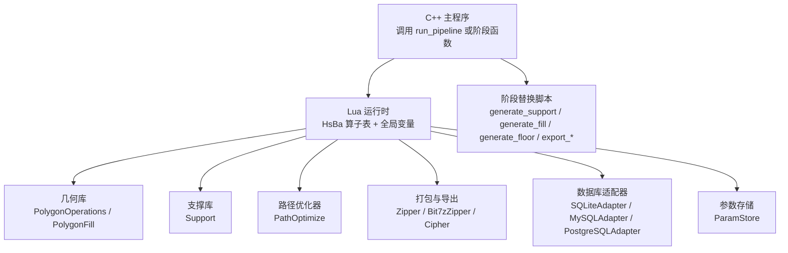

图表来源
- [lua_pipeline_api.md:19-28](file://docs/zh/lua_pipeline_api.md#L19-L28)
- [hsba_pipeline.d.lua:32-223](file://types/hsba_pipeline.d.lua#L32-L223)
- [hsba_pipeline.d.lua:326-499](file://types/hsba_pipeline.d.lua#L326-L499)
- [hsba_pipeline.d.lua:501-659](file://types/hsba_pipeline.d.lua#L501-L659)

章节来源
- [lua_pipeline_api.md:1-342](file://docs/zh/lua_pipeline_api.md#L1-L342)
- [hsba_pipeline.d.lua:1-699](file://types/hsba_pipeline.d.lua#L1-L699)

## 核心组件
本节聚焦两类关键能力：
- 自定义流水线环境（Custom Pipeline）：脚本自行编排“加载模型 → 切片 → 支撑 → 填充 → 路径 → 写文件”的全部阶段，通过 HsBa 算子表暴露全部能力。
- 内置流水线阶段替换（Stage Hook）：仅替换某个阶段的算法（支撑/填充/地板/导出），阶段顺序仍由 C++ 固定。

核心组件要点：
- HsBa 算子表：提供模型管理、切片、坐标转换、填充、支撑、地板、路径生成、打包导出等能力。
- 共享库：PolygonOperations、PolygonFill、Support、PathOptimize、Cipher、Zipper/Bit7zZipper、数据库适配器、ParamStore。
- 阶段入口函数：
  - 自定义流水线：run_pipeline()
  - 支撑阶段：generate_support()
  - 填充阶段：generate_fill(polys)
  - SLA 地板阶段：generate_floor(bottomLayer, floorCfg)
  - 导出阶段：export_sls()/export_slm()/export_lom()/export_tdp()/export_sla()/export_waam()

章节来源
- [lua_pipeline_api.md:19-28](file://docs/zh/lua_pipeline_api.md#L19-L28)
- [lua_pipeline_api.md:48-133](file://docs/zh/lua_pipeline_api.md#L48-L133)
- [hsba_pipeline.d.lua:501-659](file://types/hsba_pipeline.d.lua#L501-L659)

## 架构总览
下图展示 C++ 主程序如何加载并执行 Lua 脚本，以及脚本内部对 HsBa 算子表和共享库的调用关系。

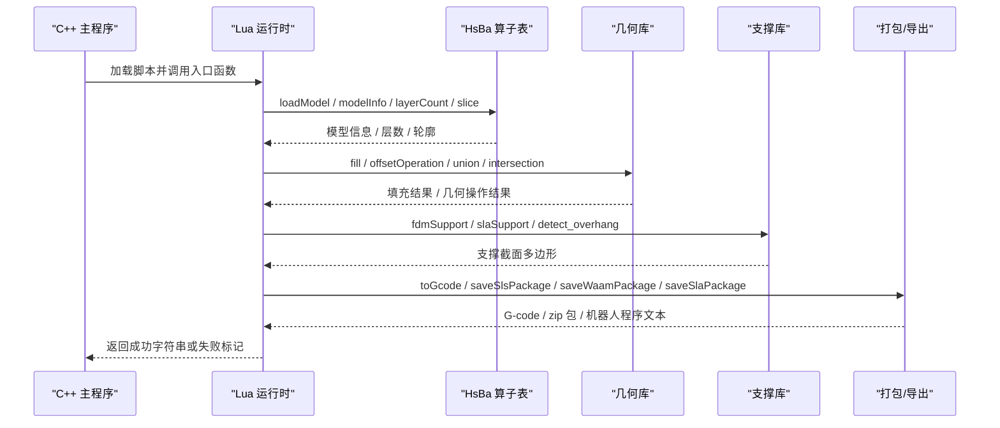

图表来源
- [lua_pipeline_api.md:48-133](file://docs/zh/lua_pipeline_api.md#L48-L133)
- [hsba_pipeline.d.lua:326-499](file://types/hsba_pipeline.d.lua#L326-L499)

## 详细组件分析

### FDM 自定义流水线（FDM）
FDM 流水线通常包含：加载模型 → 逐层切片 → 可选支撑 → 填充 → 生成 G-code → 写入文件。

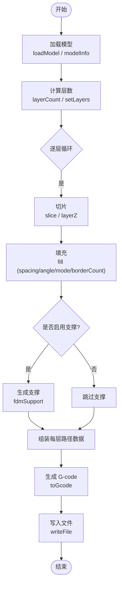

图表来源
- [my_fdm_pipeline.lua:52-171](file://samples/Custom/scripts/my_fdm_pipeline.lua#L52-L171)
- [hsba_pipeline.d.lua:392-474](file://types/hsba_pipeline.d.lua#L392-L474)

章节来源
- [my_fdm_pipeline.lua:1-172](file://samples/Custom/scripts/my_fdm_pipeline.lua#L1-L172)
- [hsba_pipeline.d.lua:392-474](file://types/hsba_pipeline.d.lua#L392-L474)

### SLA 自定义流水线（SLA）
SLA 流水线包含：加载模型 → 逐层切片 → 生成支撑 → 生成地板/Raft → 渲染层图并打包 zip。

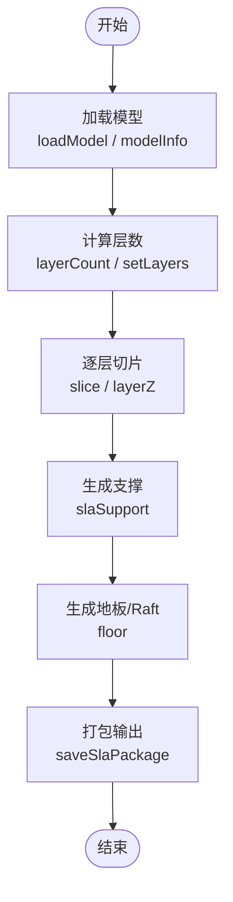

图表来源
- [my_sla_pipeline.lua:27-104](file://samples/Custom/scripts/my_sla_pipeline.lua#L27-L104)
- [hsba_pipeline.d.lua:454-491](file://types/hsba_pipeline.d.lua#L454-L491)

章节来源
- [my_sla_pipeline.lua:1-105](file://samples/Custom/scripts/my_sla_pipeline.lua#L1-L105)
- [hsba_pipeline.d.lua:454-491](file://types/hsba_pipeline.d.lua#L454-L491)

### LOM 自定义流水线（LOM）
LOM 流水线复用 SLS 式打包流程（zip + 数据库注册），但工艺参数不同（切割/粘合）。

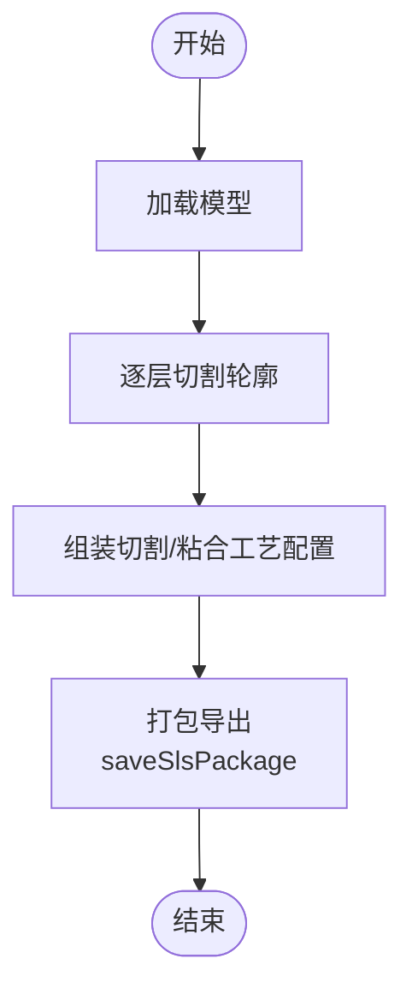

图表来源
- [my_lom_pipeline.lua:19-91](file://samples/Custom/scripts/my_lom_pipeline.lua#L19-L91)
- [hsba_pipeline.d.lua:478-481](file://types/hsba_pipeline.d.lua#L478-L481)

章节来源
- [my_lom_pipeline.lua:1-92](file://samples/Custom/scripts/my_lom_pipeline.lua#L1-L92)
- [hsba_pipeline.d.lua:478-481](file://types/hsba_pipeline.d.lua#L478-L481)

### SLM 自定义流水线（SLM）
SLM 为金属粉末床工艺，无需支撑/地板，复用 SLS 打包流程，config 内写入金属熔覆参数。

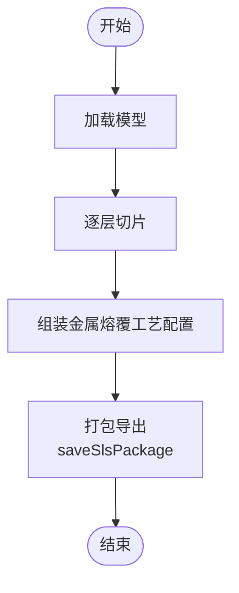

图表来源
- [my_slm_pipeline.lua:22-93](file://samples/Custom/scripts/my_slm_pipeline.lua#L22-L93)
- [hsba_pipeline.d.lua:478-481](file://types/hsba_pipeline.d.lua#L478-L481)

章节来源
- [my_slm_pipeline.lua:1-94](file://samples/Custom/scripts/my_slm_pipeline.lua#L1-L94)
- [hsba_pipeline.d.lua:478-481](file://types/hsba_pipeline.d.lua#L478-L481)

### SLS 自定义流水线（SLS）
SLS 为粉末床工艺，无标准输出格式，最终打包与数据库注册完全由导出脚本决定。

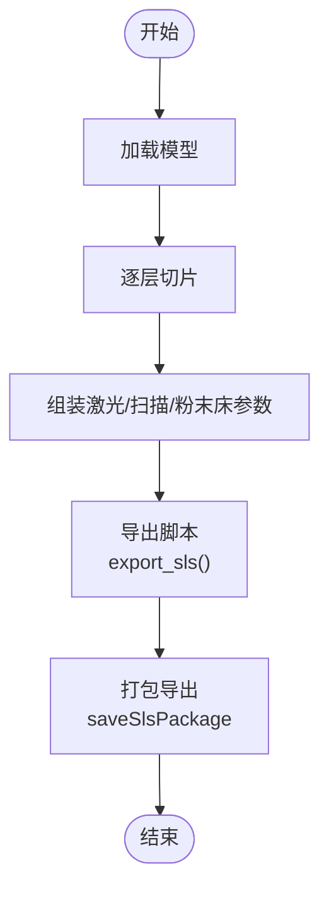

图表来源
- [my_sls_pipeline.lua:30-101](file://samples/Custom/scripts/my_sls_pipeline.lua#L30-L101)
- [my_sls_export.lua:21-76](file://samples/Custom/scripts/my_sls_export.lua#L21-L76)
- [hsba_pipeline.d.lua:478-481](file://types/hsba_pipeline.d.lua#L478-L481)

章节来源
- [my_sls_pipeline.lua:1-102](file://samples/Custom/scripts/my_sls_pipeline.lua#L1-L102)
- [my_sls_export.lua:1-76](file://samples/Custom/scripts/my_sls_export.lua#L1-L76)
- [hsba_pipeline.d.lua:478-481](file://types/hsba_pipeline.d.lua#L478-L481)

### TDP 自定义流水线（TDP/3DP）
TDP（粘结剂喷射）为粉末床工艺，无需支撑/地板，喷头/液滴/固化参数由 config.json 表达。

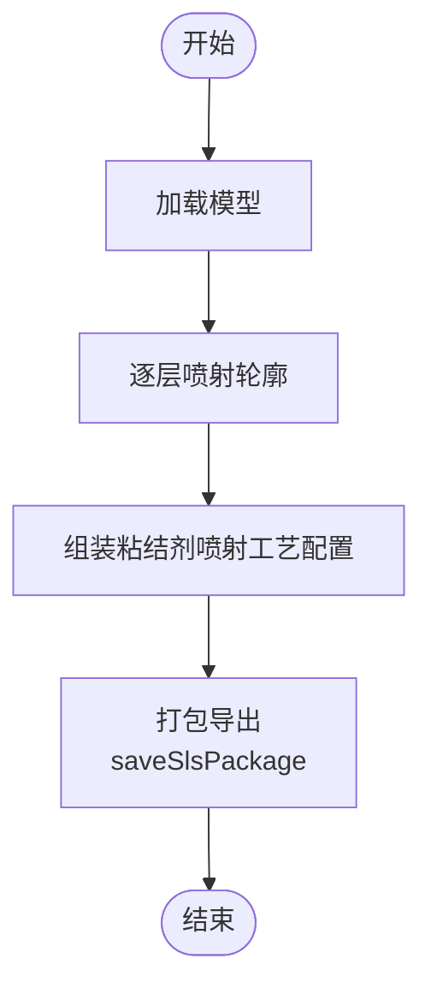

图表来源
- [my_tdp_pipeline.lua:20-90](file://samples/Custom/scripts/my_tdp_pipeline.lua#L20-L90)
- [hsba_pipeline.d.lua:478-481](file://types/hsba_pipeline.d.lua#L478-L481)

章节来源
- [my_tdp_pipeline.lua:1-91](file://samples/Custom/scripts/my_tdp_pipeline.lua#L1-L91)
- [hsba_pipeline.d.lua:478-481](file://types/hsba_pipeline.d.lua#L478-L481)

### WAAM 自定义流水线（WAAM）
WAAM 输出机器人语言程序（ABB/KUKA/FANUC），而非 zip 包；使用 saveWaamPackage 构建 WeldRobotPath 并写出机器人程序。

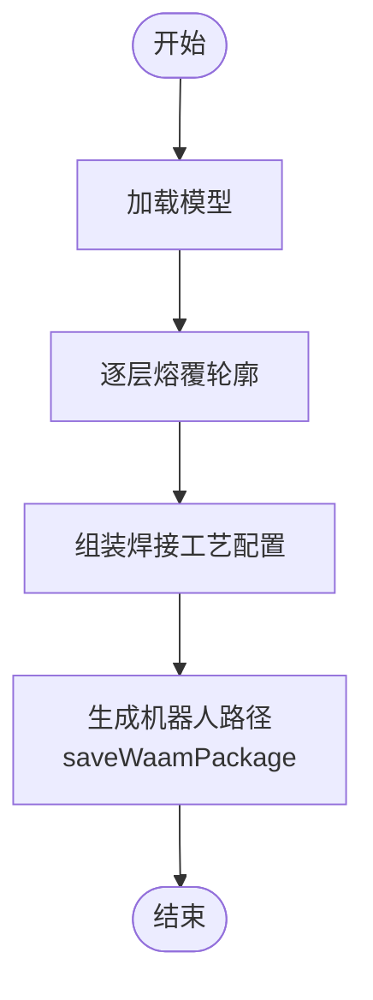

图表来源
- [my_waam_pipeline.lua:22-93](file://samples/Custom/scripts/my_waam_pipeline.lua#L22-L93)
- [hsba_pipeline.d.lua:483-486](file://types/hsba_pipeline.d.lua#L483-L486)

章节来源
- [my_waam_pipeline.lua:1-94](file://samples/Custom/scripts/my_waam_pipeline.lua#L1-L94)
- [hsba_pipeline.d.lua:483-486](file://types/hsba_pipeline.d.lua#L483-L486)

### 内置阶段替换脚本（支撑/填充/地板/路径）
- 支撑阶段（FDM/SLA）：generate_support()，可用 Support.detect_overhang 与 Support.generate。
- 填充阶段：generate_fill(current_layer)，返回填充多边形。
- SLA 地板阶段：generate_floor(bottom_layer, config)。
- WAAM 路径阶段：export_waam()，返回机器人程序文本。

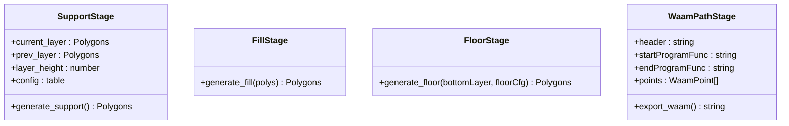

图表来源
- [hsba_pipeline.d.lua:525-659](file://types/hsba_pipeline.d.lua#L525-L659)
- [my_support.lua:32-83](file://samples/FDM/scripts/my_support.lua#L32-L83)
- [my_infill.lua:20-89](file://samples/FDM/scripts/my_infill.lua#L20-L89)
- [my_sla_floor.lua:35-64](file://samples/SLA/scripts/my_sla_floor.lua#L35-L64)
- [my_waam_path.lua:17-46](file://samples/WAAM/scripts/my_waam_path.lua#L17-L46)

章节来源
- [hsba_pipeline.d.lua:525-659](file://types/hsba_pipeline.d.lua#L525-L659)
- [my_support.lua:1-83](file://samples/FDM/scripts/my_support.lua#L1-L83)
- [my_infill.lua:1-89](file://samples/FDM/scripts/my_infill.lua#L1-L89)
- [my_sla_floor.lua:1-64](file://samples/SLA/scripts/my_sla_floor.lua#L1-L64)
- [my_waam_path.lua:1-46](file://samples/WAAM/scripts/my_waam_path.lua#L1-L46)

## 依赖关系分析
- 自定义流水线脚本依赖 HsBa 算子表与共享库（几何、支撑、路径优化、打包、数据库、参数存储）。
- 阶段替换脚本依赖对应阶段注入的全局变量与共享库。
- C++ 侧通过 lua_register.h 提供的 C ABI 注入扩展函数与事件回调，增强 Lua 环境能力。

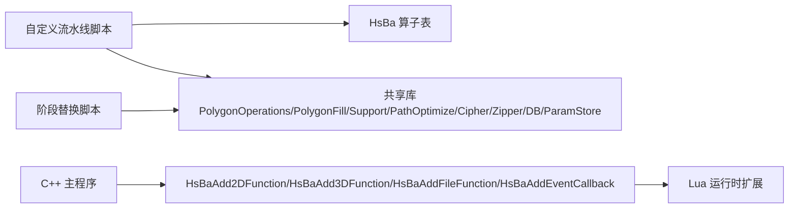

图表来源
- [lua_register.h:14-31](file://DllHsBaSlicer/lua_register.h#L14-L31)
- [hsba_pipeline.d.lua:32-223](file://types/hsba_pipeline.d.lua#L32-L223)

章节来源
- [lua_register.h:1-38](file://DllHsBaSlicer/lua_register.h#L1-L38)
- [hsba_pipeline.d.lua:32-223](file://types/hsba_pipeline.d.lua#L32-L223)

## 性能与优化建议
- 批量切片与填充：在循环中按层切片与填充，避免重复加载模型；合理设置层高与首层层高以减少层数。
- 填充角度轮换：如 FDM 示例中每若干层旋转填充角度，有助于减少层间应力与提升强度。
- 支撑密度与间隙：根据悬垂角度阈值调整支撑密度与间隙，平衡支撑强度与后处理成本。
- 路径优化：使用 PathOptimize.optimizeRegions/optimizePolygons 进行区域级或多边形级路径顺序优化，减少空行程。
- 打包与导出：优先使用 Zipper/Bit7zZipper 进行压缩；导出脚本应返回 table 而非字符串，避免覆盖 zip 文件。
- 进度回调：在长耗时循环中定期调用 HsBa.progress 上报进度，提升用户体验。

[本节为通用指导，不直接分析具体文件]

## 故障排除指南
- 导出脚本返回值错误：导出脚本若返回字符串，C++ 会用它覆盖 output_path（破坏 zip）。务必返回 { success = true/false, export_path = "..." }。
- 数据库注册失败：SQLiteAdapter/MySQLAdapter/PostgreSQLAdapter 连接或 SQL 执行失败不影响导出结果，但应记录警告日志。
- 模型未释放：流水线结束后调用 HsBa.removeModel 清理模型池，避免内存泄漏。
- 进度与日志：使用 HsBa.progress 上报阶段名称与百分比；必要时使用 print 输出调试信息。
- 配置缺失：确保 pipeline_config/output_path/model_name/model_path 等全局变量正确传入；脚本中应有默认值兜底。

章节来源
- [my_sls_export.lua:18-19](file://samples/Custom/scripts/my_sls_export.lua#L18-L19)
- [my_sls_export.lua:47-66](file://samples/Custom/scripts/my_sls_export.lua#L47-L66)
- [my_fdm_pipeline.lua:166-170](file://samples/Custom/scripts/my_fdm_pipeline.lua#L166-L170)
- [lua_pipeline_api.md:256-270](file://docs/zh/lua_pipeline_api.md#L256-L270)

## 结论
通过 HsBaSlicer 的 Lua 脚本系统，开发者可以灵活地实现各种 3D 打印技术的自定义流水线与阶段替换。本文提供了 FDM、SLA、LOM、SLM、SLS、TDP、WAAM 的完整示例，并说明了生命周期函数、配置参数、数据格式转换、错误处理、进度回调与日志记录模式。结合性能优化建议与调试技巧，开发者可以快速构建高效、可维护的自定义算法与流水线。

[本节为总结性内容，不直接分析具体文件]

## 附录：各工艺流水线速查表

| 工艺 | 入口函数 | 关键步骤 | 打包/输出方式 | 典型配置字段 |
|------|----------|----------|---------------|--------------|
| FDM | run_pipeline() | 加载模型 → 切片 → 填充 → 支撑 → G-code | writeFile(toGcode(...)) | layerHeight, lineWidth, printSpeed, firmware, nozzleDiameter |
| SLA | run_pipeline() | 加载模型 → 切片 → 支撑 → 地板 → 打包 | saveSlaPackage(...) | layerHeight, overhangAngle, supportGap, raftThickness |
| LOM | run_pipeline() | 加载模型 → 切片 → 配置 → 打包 | saveSlsPackage(...) | sheetThickness, cutSpeed, laserPower, bondTemperature |
| SLM | run_pipeline() | 加载模型 → 切片 → 配置 → 打包 | saveSlsPackage(...) | laserPower, scanSpeed, hatchSpacing, material |
| SLS | run_pipeline() + export_sls() | 加载模型 → 切片 → 配置 → 导出脚本 | saveSlsPackage(...) + Zipper | laserPower, scanSpeed, bedTemperature |
| TDP | run_pipeline() | 加载模型 → 切片 → 配置 → 打包 | saveSlsPackage(...) | headCount, dropSpacing, binderSaturation |
| WAAM | run_pipeline() | 加载模型 → 切片 → 机器人路径 | saveWaamPackage(...) | arcCurrent, arcVoltage, wireFeedSpeed, robotType |

章节来源
- [my_fdm_pipeline.lua:52-171](file://samples/Custom/scripts/my_fdm_pipeline.lua#L52-L171)
- [my_sla_pipeline.lua:27-104](file://samples/Custom/scripts/my_sla_pipeline.lua#L27-L104)
- [my_lom_pipeline.lua:19-91](file://samples/Custom/scripts/my_lom_pipeline.lua#L19-L91)
- [my_slm_pipeline.lua:22-93](file://samples/Custom/scripts/my_slm_pipeline.lua#L22-L93)
- [my_sls_pipeline.lua:30-101](file://samples/Custom/scripts/my_sls_pipeline.lua#L30-L101)
- [my_tdp_pipeline.lua:20-90](file://samples/Custom/scripts/my_tdp_pipeline.lua#L20-L90)
- [my_waam_pipeline.lua:22-93](file://samples/Custom/scripts/my_waam_pipeline.lua#L22-L93)