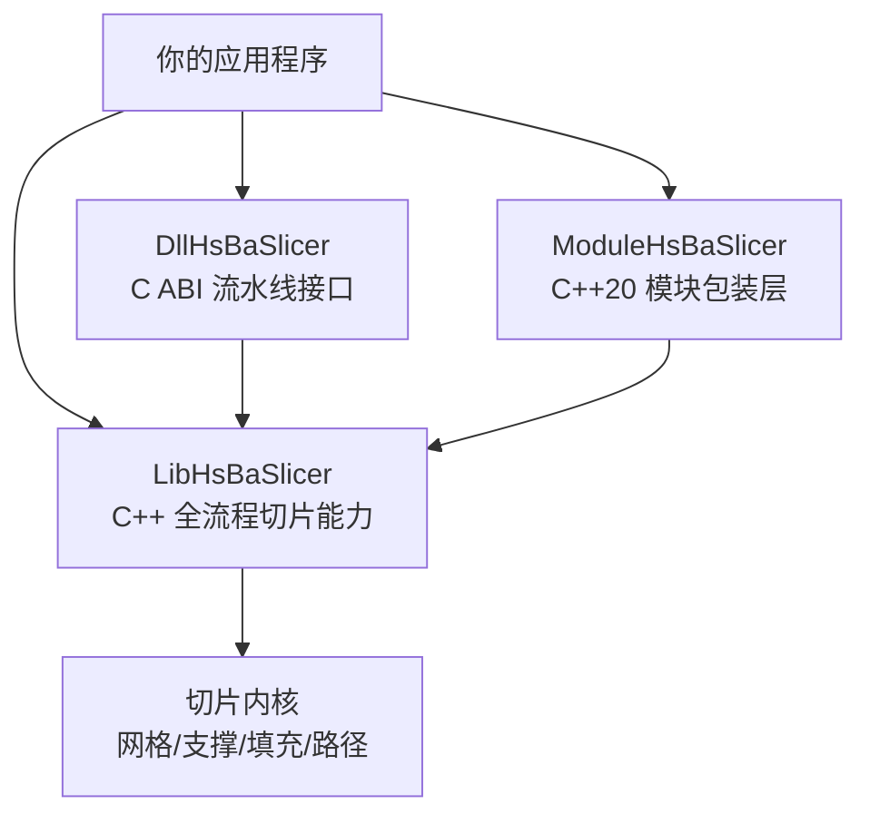
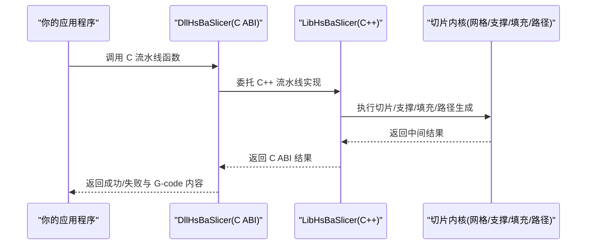
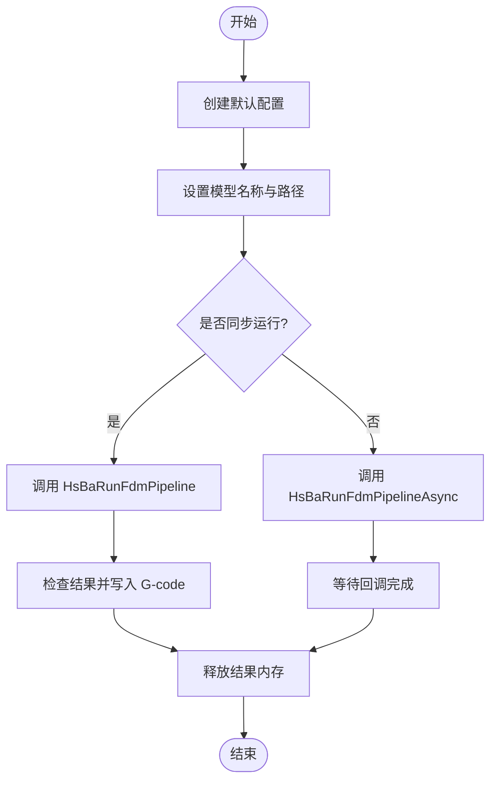
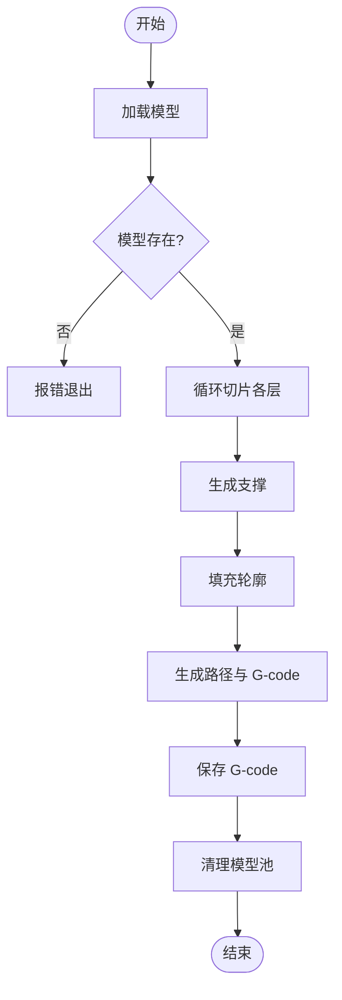
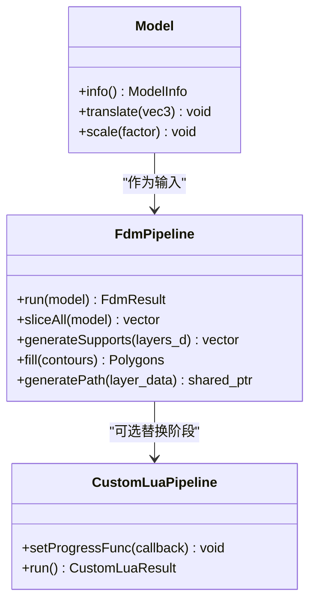
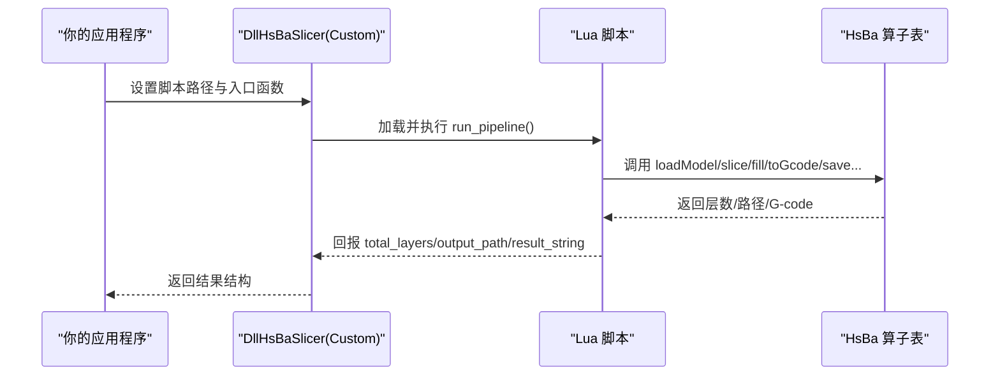
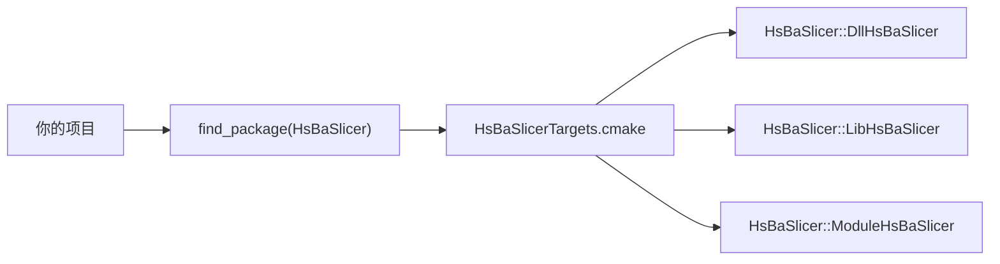

# 集成示例

<cite>
**本文引用的文件**   
- [README.md](file://README.md)
- [CMakeLists.txt](file://CMakeLists.txt)
- [cpp_cmake_usage.md（中文）](file://docs/zh/cpp_cmake_usage.md)
- [samples/FDM/CMakeLists.txt](file://samples/FDM/CMakeLists.txt)
- [samples/FDM/main.cpp](file://samples/FDM/main.cpp)
- [samples/LibHsBaSlicer/CMakeLists.txt](file://samples/LibHsBaSlicer/CMakeLists.txt)
- [samples/LibHsBaSlicer/main_header.cpp](file://samples/LibHsBaSlicer/main_header.cpp)
- [samples/LibHsBaSlicer/main_module.cpp](file://samples/LibHsBaSlicer/main_module.cpp)
- [samples/Custom/CMakeLists.txt](file://samples/Custom/CMakeLists.txt)
- [samples/Custom/main.cpp](file://samples/Custom/main.cpp)
- [DllHsBaSlicer/CMakeLists.txt](file://DllHsBaSlicer/CMakeLists.txt)
- [HsBaSlicer/CMakeLists.txt](file://HsBaSlicer/CMakeLists.txt)
</cite>

## 目录
1. [引言](#引言)
2. [项目结构](#项目结构)
3. [核心组件](#核心组件)
4. [架构总览](#架构总览)
5. [详细集成示例](#详细集成示例)
6. [依赖与 CMake 配置](#依赖与-cmake-配置)
7. [性能与调优建议](#性能与调优建议)
8. [常见问题与排错](#常见问题与排错)
9. [结论](#结论)
10. [附录：安装与导出布局](#附录安装与导出布局)

## 引言
本“集成示例”文档面向希望将 HsBaSlicer 集成到自有应用的开发者，覆盖三种主流集成方式：
- 通过 C ABI 动态库 DllHsBaSlicer 进行跨语言或进程外调用。
- 直接链接静态库 LibHsBaSlicer，使用 C++ API 完成切片流水线。
- 使用 C++20 模块 ModuleHsBaSlicer，以类风格 API 简化模型与流水线管理。

文档同时给出完整的 CMake 配置、依赖管理、运行时初始化、资源复制策略、异步执行、Lua 自定义流水线以及常见问题的解决方案，帮助你在桌面、Android、iOS 等环境中无缝集成 HsBaSlicer。

## 项目结构
HsBaSlicer 提供多层次的集成点：
- DllHsBaSlicer：对外暴露 C ABI，适合 Java、C#、Python、Unity 等外部语言或引擎集成。
- LibHsBaSlicer：封装完整切片流程的 C++ 静态/共享库，适合 C++ 应用直接链接。
- ModuleHsBaSlicer：C++20 模块包装层，提供 Model、FdmPipeline、CustomLuaPipeline 等类风格接口。
- HsBaSlicer：平台入口（桌面为可执行文件，Android 为 .so，iOS 为 .a），内部链接 DllHsBaSlicer。

图表来源
- [CMakeLists.txt:434-439](file://CMakeLists.txt#L434-L439)
- [DllHsBaSlicer/CMakeLists.txt:84-100](file://DllHsBaSlicer/CMakeLists.txt#L84-L100)

章节来源
- [README.md:104-124](file://README.md#L104-L124)
- [CMakeLists.txt:434-439](file://CMakeLists.txt#L434-L439)

## 核心组件
- DllHsBaSlicer：导出 C ABI，包含 FDM、SLA、SLS、SLM、LOM、TDP、WAAM、Custom Lua Pipeline、参数存储、文件传输等流水线入口；在 iOS 上构建为静态库，其他平台默认构建为共享库。
- LibHsBaSlicer：提供 LoadModel、Slice、GenerateAllFdmSupport、FillWithBorder、GenerateGCodePath 等 C++ API，以及版本信息、导出宏等。
- ModuleHsBaSlicer：暴露 hsba.slicer 模块，支持 import hsba.slicer; 并使用 Model、FdmPipeline、CustomLuaPipeline 等类。
- HsBaSlicer：平台入口，Android 下构建为共享库并链接 DllHsBaSlicer，确保 .so 输出到相同目录。

章节来源
- [DllHsBaSlicer/CMakeLists.txt:1-100](file://DllHsBaSlicer/CMakeLists.txt#L1-L100)
- [samples/LibHsBaSlicer/main_header.cpp:20-27](file://samples/LibHsBaSlicer/main_header.cpp#L20-L27)
- [samples/LibHsBaSlicer/main_module.cpp:22-29](file://samples/LibHsBaSlicer/main_module.cpp#L22-L29)
- [HsBaSlicer/CMakeLists.txt:11-35](file://HsBaSlicer/CMakeLists.txt#L11-L35)

## 架构总览
下图展示三种集成方式在运行时的调用关系与数据流：
- C ABI 方式：应用调用 DllHsBaSlicer 的 C 函数，内部委托给 LibHsBaSlicer 完成切片。
- C++ 静态库方式：应用直接链接 LibHsBaSlicer，调用高层 API。
- C++20 模块方式：应用 import hsba.slicer，使用类风格 API 管理模型与流水线。

图表来源
- [samples/FDM/main.cpp:53-96](file://samples/FDM/main.cpp#L53-L96)
- [samples/LibHsBaSlicer/main_header.cpp:61-178](file://samples/LibHsBaSlicer/main_header.cpp#L61-L178)
- [samples/LibHsBaSlicer/main_module.cpp:45-97](file://samples/LibHsBaSlicer/main_module.cpp#L45-L97)

## 详细集成示例

### 示例一：通过 DllHsBaSlicer 集成（C ABI）
适用场景：跨语言调用、游戏引擎集成、进程外服务。

- CMake 配置要点：
  - 链接目标 DllHsBaSlicer。
  - 非游戏主机平台可选链接日志库 HsBaSlicerLog。
  - 添加头文件搜索路径，使示例能访问 DllHsBaSlicer 公开头文件。
- 运行时初始化与调用：
  - 创建默认配置 HsBaCreateDefaultConfig()。
  - 设置模型名称与路径。
  - 同步调用 HsBaRunFdmPipeline()，或使用异步接口 HsBaRunFdmPipelineAsync()。
  - 处理结果并释放内存 HsBaFreePipelineResult()。

图表来源
- [samples/FDM/CMakeLists.txt:13-24](file://samples/FDM/CMakeLists.txt#L13-L24)
- [samples/FDM/main.cpp:53-96](file://samples/FDM/main.cpp#L53-L96)
- [samples/FDM/main.cpp:245-269](file://samples/FDM/main.cpp#L245-L269)

章节来源
- [samples/FDM/CMakeLists.txt:1-72](file://samples/FDM/CMakeLists.txt#L1-L72)
- [samples/FDM/main.cpp:1-337](file://samples/FDM/main.cpp#L1-L337)

### 示例二：直接链接 LibHsBaSlicer（C++ 静态库）
适用场景：C++ 应用直接调用切片 API，无需 C ABI 层。

- CMake 配置要点：
  - 链接目标 LibHsBaSlicer。
  - 添加头文件搜索路径。
  - 移动端（Android/iOS）构建为静态库，桌面端构建为可执行文件。
- 典型工作流：
  - 加载模型 LoadModel(...)。
  - 逐层切片 Slice(...)。
  - 生成支撑 GenerateAllFdmSupport(...)。
  - 填充 FillWithBorder(...)。
  - 生成路径 GenerateGCodePath(...) 并保存 G-code。

图表来源
- [samples/LibHsBaSlicer/CMakeLists.txt:8-21](file://samples/LibHsBaSlicer/CMakeLists.txt#L8-L21)
- [samples/LibHsBaSlicer/main_header.cpp:46-184](file://samples/LibHsBaSlicer/main_header.cpp#L46-L184)

章节来源
- [samples/LibHsBaSlicer/CMakeLists.txt:1-71](file://samples/LibHsBaSlicer/CMakeLists.txt#L1-L71)
- [samples/LibHsBaSlicer/main_header.cpp:1-186](file://samples/LibHsBaSlicer/main_header.cpp#L1-L186)

### 示例三：使用 C++20 模块 ModuleHsBaSlicer
适用场景：现代 C++ 工程，偏好类风格 API 与 RAII 管理。

- CMake 配置要点：
  - 启用 HSBA_SLICER_MODULE（默认 ON）。
  - 链接目标 ModuleHsBaSlicer。
  - 添加头文件搜索路径。
- 典型工作流：
  - import hsba.slicer;
  - 构造 Model("stanford_bunny", model_path)。
  - 配置 FdmPipeline 并运行 pipeline.run(model)。
  - 可选运行 CustomLuaPipeline，完全由 Lua 脚本定义流水线。

图表来源
- [samples/LibHsBaSlicer/CMakeLists.txt:23-38](file://samples/LibHsBaSlicer/CMakeLists.txt#L23-L38)
- [samples/LibHsBaSlicer/main_module.cpp:27-97](file://samples/LibHsBaSlicer/main_module.cpp#L27-L97)

章节来源
- [samples/LibHsBaSlicer/CMakeLists.txt:1-71](file://samples/LibHsBaSlicer/CMakeLists.txt#L1-L71)
- [samples/LibHsBaSlicer/main_module.cpp:1-162](file://samples/LibHsBaSlicer/main_module.cpp#L1-L162)

### 示例四：完全由 Lua 驱动的 Custom 流水线
适用场景：需要灵活定制整条工作流（阶段顺序与算法均由 Lua 决定）。

- CMake 配置要点：
  - 链接目标 DllHsBaSlicer。
  - 非游戏主机平台可选链接日志库 HsBaSlicerLog。
  - 添加头文件搜索路径。
- 典型用法：
  - 设置 pipeline_lua_script 与 entry_func。
  - 通过 pipeline_lua_source 注入机台参数。
  - 调用 HsBaRunCustomPipeline() 或异步接口 HsBaRunCustomPipelineAsync()。
  - 支持 Protobuf wire 字节流驱动（From/ToProtoBytes）。

图表来源
- [samples/Custom/CMakeLists.txt:13-30](file://samples/Custom/CMakeLists.txt#L13-L30)
- [samples/Custom/main.cpp:98-132](file://samples/Custom/main.cpp#L98-L132)
- [samples/Custom/main.cpp:509-589](file://samples/Custom/main.cpp#L509-L589)

章节来源
- [samples/Custom/CMakeLists.txt:1-51](file://samples/Custom/CMakeLists.txt#L1-L51)
- [samples/Custom/main.cpp:1-616](file://samples/Custom/main.cpp#L1-L616)

## 依赖与 CMake 配置
- 推荐通过 find_package(HsBaSlicer CONFIG REQUIRED) 引用已安装的 HsBaSlicer。
- 下游 target_link_libraries 可选择：
  - HsBaSlicer::DllHsBaSlicer（C ABI）
  - HsBaSlicer::LibHsBaSlicer（C++ 全流程）
  - HsBaSlicer::ModuleHsBaSlicer（C++20 模块）
- 自动传递依赖包括 Eigen3、magic_enum、Clipper2、Lua、Protobuf、OpenSSL 等。
- 构建选项参考：
  - BUILD_SHARED_LIBS：控制共享/静态库。
  - HSBA_SLICER_MODULE：构建 C++20 模块包装层。
  - HSBA_SLICER_BUILD_SAMPLES：构建示例程序。
  - HSBA_SLICER_USE_TESTS：构建测试。
  - HSBA_COVERAGE：gcov 覆盖率。
  - HSBA_PROTOBUF_OUT：输出 Proto 多语言生成文件。

图表来源
- [README.md:165-179](file://README.md#L165-L179)
- [cpp_cmake_usage.md（中文）:57-78](file://docs/zh/cpp_cmake_usage.md#L57-L78)

章节来源
- [README.md:100-124](file://README.md#L100-L124)
- [cpp_cmake_usage.md（中文）:1-81](file://docs/zh/cpp_cmake_usage.md#L1-L81)

## 性能与调优建议
- Debug 模式下布尔运算可能较慢且占用较高内存，可通过构建选项关闭相关特性。
- 模型对象池大小根据是否启用 CGAL/OpenCascade 调整：启用时为 10，否则为 1。
- 线程池协程支持可通过 HSBA_ENABLE_THREAD_POOL_COROUTINE 开启。
- 在桌面平台启用 SVG 多边形导出工具（HSBA_POLYGON_DUMP）有助于调试与可视化。
- 避免在 Debug 构建中启用不必要的内核（CGAL/OpenCASCADE），以减少编译与运行开销。

章节来源
- [CMakeLists.txt:294-306](file://CMakeLists.txt#L294-L306)
- [CMakeLists.txt:258-262](file://CMakeLists.txt#L258-L262)
- [CMakeLists.txt:159-168](file://CMakeLists.txt#L159-L168)

## 常见问题与排错
- 重复注册 protobuf 描述符导致进程终止：
  - 现象：跨语言调用方使用自己的 protobuf 运行库时正常；若 C++ 调用方把 HsBaSlicerProto 的 .pb.cc 与 DllHsBaSlicer 链进同一进程，会报 “File already exists in database”。
  - 解决：避免在同一进程中重复链接 protobuf 描述符；使用 From/ToProtoBytes 的 C 接口传递 wire 字节流。
- 资源路径问题：
  - 现象：模型或脚本找不到。
  - 解决：使用 add_custom_command 在构建后复制资源到可执行文件所在目录；注意 CMAKE_RUNTIME_OUTPUT_DIRECTORY 含 $<CONFIG>，需使用生成器表达式。
- 移动端构建差异：
  - Android/iOS 上某些示例构建为静态库以保证代码被校验；iOS 上 DllHsBaSlicer 构建为静态库，因为 iOS 应用不能加载任意 dylib。
- 日志库链接：
  - 非游戏主机平台可链接 HsBaSlicerLog；游戏主机平台禁用日志功能。

章节来源
- [samples/Custom/CMakeLists.txt:15-20](file://samples/Custom/CMakeLists.txt#L15-L20)
- [samples/FDM/CMakeLists.txt:56-71](file://samples/FDM/CMakeLists.txt#L56-L71)
- [DllHsBaSlicer/CMakeLists.txt:1-4](file://DllHsBaSlicer/CMakeLists.txt#L1-L4)
- [samples/FDM/CMakeLists.txt:21-24](file://samples/FDM/CMakeLists.txt#L21-L24)

## 结论
通过 DllHsBaSlicer、LibHsBaSlicer 与 ModuleHsBaSlicer，HsBaSlicer 提供了从跨语言 C ABI 到现代 C++ 类风格 API 的多层次集成方案。配合 CMake 的 find_package 与目标导出机制，你可以在不同平台与工程中快速集成切片能力，并通过 Lua 脚本灵活定制流水线。遵循本文的集成示例与排错建议，能够显著降低集成成本并提升开发效率。

## 附录：安装与导出布局
- 安装命令：cmake --install <build_dir> --prefix <install_prefix> --config Release。
- 安装后的目录布局：
  - include/HsBaSlicer：所有公开头文件。
  - lib/cmake/HsBaSlicer：CMake 包配置文件。
  - share/HsBaSlicer/proto：Proto 多语言生成文件（可选）。
- 下游引用示例：
  - find_package(HsBaSlicer CONFIG REQUIRED)
  - target_link_libraries(my_app PRIVATE HsBaSlicer::DllHsBaSlicer)

章节来源
- [README.md:181-185](file://README.md#L181-L185)
- [README.md:126-163](file://README.md#L126-L163)