# 高级示例

<cite>
**本文引用的文件**   
- [README.md](file://README.md)
- [pipeline_types.h](file://pipelinetypes/pipeline_types.h)
- [custom_pipeline.h](file://DllHsBaSlicer/custom_pipeline.h)
- [custom_pipeline.cpp](file://DllHsBaSlicer/custom_pipeline.cpp)
- [fdm_pipeline.h](file://DllHsBaSlicer/fdm_pipeline.h)
- [fdm_pipeline.cpp](file://DllHsBaSlicer/fdm_pipeline.cpp)
- [sla_pipeline.h](file://DllHsBaSlicer/sla_pipeline.h)
- [sla_pipeline.cpp](file://DllHsBaSlicer/sla_pipeline.cpp)
- [lom_pipeline.h](file://DllHsBaSlicer/lom_pipeline.h)
- [lom_pipeline.cpp](file://DllHsBaSlicer/lom_pipeline.cpp)
- [waam_pipeline.h](file://DllHsBaSlicer/waam_pipeline.h)
- [waam_pipeline.cpp](file://DllHsBaSlicer/waam_pipeline.cpp)
- [slm_pipeline.h](file://DllHsBaSlicer/slm_pipeline.h)
- [slm_pipeline.cpp](file://DllHsBaSlicer/slm_pipeline.cpp)
- [sls_pipeline.h](file://DllHsBaSlicer/sls_pipeline.h)
- [sls_pipeline.cpp](file://DllHsBaSlicer/sls_pipeline.cpp)
- [tdp_pipeline.h](file://DllHsBaSlicer/tdp_pipeline.h)
- [tdp_pipeline.cpp](file://DllHsBaSlicer/tdp_pipeline.cpp)
- [lua_register.h](file://DllHsBaSlicer/lua_register.h)
- [lua_register.cpp](file://DllHsBaSlicer/lua_register.cpp)
- [lua_pipeline.hpp](file://LibHsBaSlicer/Extends/lua_pipeline.hpp)
- [lua_pipeline.cpp](file://LibHsBaSlicer/Extends/lua_pipeline.cpp)
- [event_source_function.hpp](file://LibHsBaSlicer/Extends/EventSourceFunction.hpp)
- [event_source_function.cpp](file://LibHsBaSlicer/Extends/EventSourceFunction.cpp)
- [thread_pool.hpp](file://base/thread_pool.hpp)
- [coroutine.hpp](file://base/coroutine.hpp)
- [param_store_pipeline.h](file://DllHsBaSlicer/param_store_pipeline.h)
- [param_store_pipeline.cpp](file://DllHsBaSlicer/param_store_pipeline.cpp)
- [model_preprocess_pipeline.h](file://DllHsBaSlicer/model_preprocess_pipeline.h)
- [model_preprocess_pipeline.cpp](file://DllHsBaSlicer/model_preprocess_pipeline.cpp)
- [file_transfer_pipeline.h](file://DllHsBaSlicer/file_transfer_pipeline.h)
- [file_transfer_pipeline.cpp](file://DllHsBaSlicer/file_transfer_pipeline.cpp)
- [pipeline_convert.h](file://DllHsBaSlicer/pipeline_convert.h)
- [pipeline_convert.cpp](file://DllHsBaSlicer/pipeline_convert.cpp)
- [initialize.h](file://DllHsBaSlicer/initialize.h)
- [initialize.cpp](file://DllHsBaSlicer/initialize.cpp)
- [main.cpp](file://samples/Custom/main.cpp)
- [CMakeLists.txt](file://samples/Custom/CMakeLists.txt)
- [my_fdm_pipeline.lua](file://samples/Custom/scripts/my_fdm_pipeline.lua)
- [my_sla_pipeline.lua](file://samples/Custom/scripts/my_sla_pipeline.lua)
- [my_lom_pipeline.lua](file://samples/Custom/scripts/my_lom_pipeline.lua)
- [my_waam_pipeline.lua](file://samples/Custom/scripts/my_waam_pipeline.lua)
- [my_slm_pipeline.lua](file://samples/Custom/scripts/my_slm_pipeline.lua)
- [my_sls_pipeline.lua](file://samples/Custom/scripts/my_sls_pipeline.lua)
- [my_tdp_pipeline.lua](file://samples/Custom/scripts/my_tdp_pipeline.lua)
- [hsba_pipeline.d.lua](file://types/hsba_pipeline.d.lua)
</cite>

## 目录
1. [简介](#简介)
2. [项目结构](#项目结构)
3. [核心组件](#核心组件)
4. [架构总览](#架构总览)
5. [详细组件分析](#详细组件分析)
6. [依赖关系分析](#依赖关系分析)
7. [性能与并行优化](#性能与并行优化)
8. [故障排除指南](#故障排除指南)
9. [结论](#结论)
10. [附录：多技术栈高级示例](#附录多技术栈高级示例)

## 简介
本“高级示例”文档面向需要实现复杂切片需求的工程师，重点展示如何在 HsBaSlicer 中通过自定义流水线、Lua 脚本扩展和高级配置选项完成跨技术栈的切片任务。内容覆盖 FDM、SLA、WAAM、LOM、SLM、SLS、TDP 七类工艺，并演示如何编写自定义算法、替换内置组件、接入事件源、使用并行与异步能力，以及进行性能调优。

## 项目结构
HsBaSlicer 提供两类主要扩展点：
- C++ 动态库接口：在 DllHsBaSlicer 中导出各工艺流水线（FDM/SLA/WAAM/LOM/SLM/SLS/TDP）及通用流水线（参数存储、模型预处理、文件传输、协议转换等）。
- Lua 脚本系统：通过 LibHsBaSlicer 的 Lua 扩展模块加载用户脚本，并在运行时注入到流水线节点中。

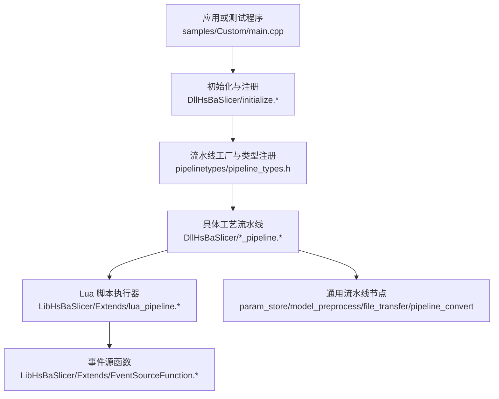

**图示来源**
- [main.cpp:1-200](file://samples/Custom/main.cpp#L1-L200)
- [initialize.h:1-200](file://DllHsBaSlicer/initialize.h#L1-L200)
- [pipeline_types.h:1-200](file://pipelinetypes/pipeline_types.h#L1-L200)
- [lua_pipeline.hpp:1-200](file://LibHsBaSlicer/Extends/lua_pipeline.hpp#L1-L200)
- [event_source_function.hpp:1-200](file://LibHsBaSlicer/Extends/EventSourceFunction.hpp#L1-L200)

**章节来源**
- [README.md:1-211](file://README.md#L1-L211)

## 核心组件
- 流水线类型系统：通过 pipeline_types.h 定义所有可注册的流水线类型与参数结构，是构建自定义流水线的类型基础。
- 自定义流水线接口：custom_pipeline.h/.cpp 提供自定义流水线基类与生命周期钩子，用于替换或增强内置行为。
- 工艺流水线：每个 *_pipeline.h/.cpp 对应一种工艺（FDM/SLA/WAAM/LOM/SLM/SLS/TDP），封装该工艺的切片、支撑、路径生成与导出逻辑。
- Lua 扩展：lua_pipeline.hpp/.cpp 提供 Lua 脚本执行环境；lua_register.h/.cpp 将 C++ API 暴露给 Lua；EventSourceFunction 提供事件回调机制。
- 通用流水线节点：param_store、model_preprocess、file_transfer、pipeline_convert 提供参数持久化、模型预处理、文件传输与协议转换等通用能力。

**章节来源**
- [pipeline_types.h:1-200](file://pipelinetypes/pipeline_types.h#L1-L200)
- [custom_pipeline.h:1-200](file://DllHsBaSlicer/custom_pipeline.h#L1-L200)
- [custom_pipeline.cpp:1-200](file://DllHsBaSlicer/custom_pipeline.cpp#L1-L200)
- [lua_pipeline.hpp:1-200](file://LibHsBaSlicer/Extends/lua_pipeline.hpp#L1-L200)
- [lua_pipeline.cpp:1-200](file://LibHsBaSlicer/Extends/lua_pipeline.cpp#L1-L200)
- [lua_register.h:1-200](file://DllHsBaSlicer/lua_register.h#L1-L200)
- [lua_register.cpp:1-200](file://DllHsBaSlicer/lua_register.cpp#L1-L200)
- [event_source_function.hpp:1-200](file://LibHsBaSlicer/Extends/EventSourceFunction.hpp#L1-L200)
- [event_source_function.cpp:1-200](file://LibHsBaSlicer/Extends/EventSourceFunction.cpp#L1-L200)
- [param_store_pipeline.h:1-200](file://DllHsBaSlicer/param_store_pipeline.h#L1-L200)
- [param_store_pipeline.cpp:1-200](file://DllHsBaSlicer/param_store_pipeline.cpp#L1-L200)
- [model_preprocess_pipeline.h:1-200](file://DllHsBaSlicer/model_preprocess_pipeline.h#L1-L200)
- [model_preprocess_pipeline.cpp:1-200](file://DllHsBaSlicer/model_preprocess_pipeline.cpp#L1-L200)
- [file_transfer_pipeline.h:1-200](file://DllHsBaSlicer/file_transfer_pipeline.h#L1-L200)
- [file_transfer_pipeline.cpp:1-200](file://DllHsBaSlicer/file_transfer_pipeline.cpp#L1-L200)
- [pipeline_convert.h:1-200](file://DllHsBaSlicer/pipeline_convert.h#L1-L200)
- [pipeline_convert.cpp:1-200](file://DllHsBaSlicer/pipeline_convert.cpp#L1-L200)

## 架构总览
下图展示了从应用入口到具体工艺流水线的调用链，以及 Lua 脚本与事件源的集成位置。

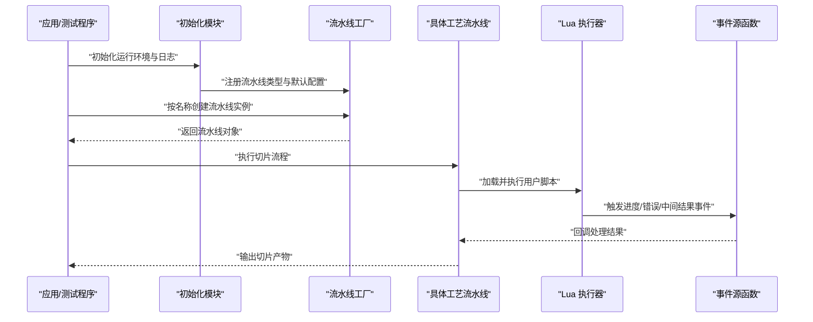

**图示来源**
- [initialize.h:1-200](file://DllHsBaSlicer/initialize.h#L1-L200)
- [initialize.cpp:1-200](file://DllHsBaSlicer/initialize.cpp#L1-L200)
- [pipeline_types.h:1-200](file://pipelinetypes/pipeline_types.h#L1-L200)
- [lua_pipeline.hpp:1-200](file://LibHsBaSlicer/Extends/lua_pipeline.hpp#L1-L200)
- [event_source_function.hpp:1-200](file://LibHsBaSlicer/Extends/EventSourceFunction.hpp#L1-L200)

## 详细组件分析

### 自定义流水线与组件替换
- 自定义流水线基类提供统一的开始、阶段执行、结束与资源清理钩子，允许在任意阶段插入业务逻辑。
- 通过流水线工厂注册自定义类型名，即可在配置中以字符串选择自定义实现，从而替换内置组件。
- 典型用法：继承自定义基类，重写关键阶段方法，并在初始化时注册到工厂。

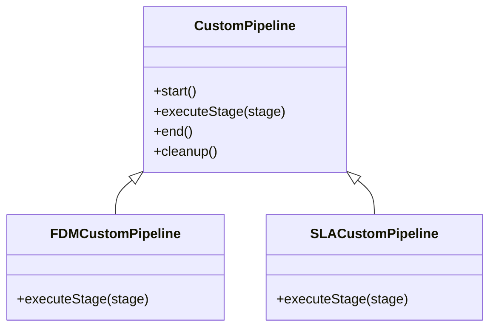

**图示来源**
- [custom_pipeline.h:1-200](file://DllHsBaSlicer/custom_pipeline.h#L1-L200)
- [custom_pipeline.cpp:1-200](file://DllHsBaSlicer/custom_pipeline.cpp#L1-L200)

**章节来源**
- [custom_pipeline.h:1-200](file://DllHsBaSlicer/custom_pipeline.h#L1-L200)
- [custom_pipeline.cpp:1-200](file://DllHsBaSlicer/custom_pipeline.cpp#L1-L200)

### Lua 脚本扩展与事件驱动
- Lua 执行器负责加载脚本、绑定 C++ API、执行用户定义的流水线节点。
- 事件源函数提供进度、警告、错误与中间数据回调，便于 UI 或监控系统实时反馈。
- 推荐模式：在 Lua 中实现特定算法（如填充、支撑、路径优化），并通过事件源上报状态。

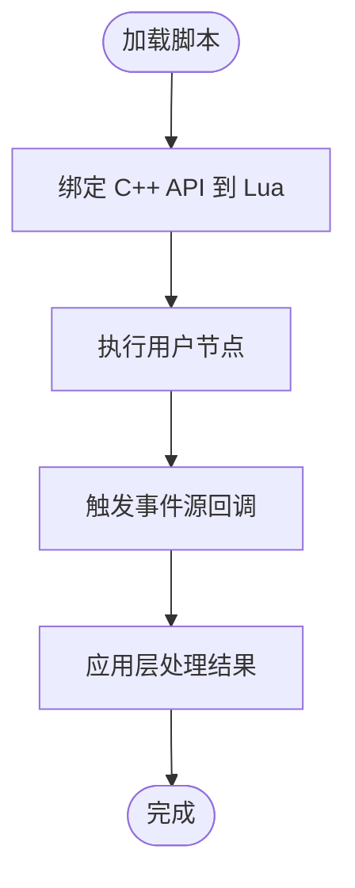

**图示来源**
- [lua_pipeline.hpp:1-200](file://LibHsBaSlicer/Extends/lua_pipeline.hpp#L1-L200)
- [lua_pipeline.cpp:1-200](file://LibHsBaSlicer/Extends/lua_pipeline.cpp#L1-L200)
- [event_source_function.hpp:1-200](file://LibHsBaSlicer/Extends/EventSourceFunction.hpp#L1-L200)
- [event_source_function.cpp:1-200](file://LibHsBaSlicer/Extends/EventSourceFunction.cpp#L1-L200)

**章节来源**
- [lua_pipeline.hpp:1-200](file://LibHsBaSlicer/Extends/lua_pipeline.hpp#L1-L200)
- [lua_pipeline.cpp:1-200](file://LibHsBaSlicer/Extends/lua_pipeline.cpp#L1-L200)
- [event_source_function.hpp:1-200](file://LibHsBaSlicer/Extends/EventSourceFunction.hpp#L1-L200)
- [event_source_function.cpp:1-200](file://LibHsBaSlicer/Extends/EventSourceFunction.cpp#L1-L200)

### 通用流水线节点
- 参数存储：将流水线参数序列化到文件或数据库，支持版本兼容与回滚。
- 模型预处理：对输入 CAD/网格进行修复、合并、简化等操作。
- 文件传输：支持远程上传、下载与断点续传。
- 协议转换：在不同消息格式之间转换（例如 Protobuf 与内部结构体）。

**图示来源**
- [param_store_pipeline.h:1-200](file://DllHsBaSlicer/param_store_pipeline.h#L1-L200)
- [param_store_pipeline.cpp:1-200](file://DllHsBaSlicer/param_store_pipeline.cpp#L1-L200)
- [model_preprocess_pipeline.h:1-200](file://DllHsBaSlicer/model_preprocess_pipeline.h#L1-L200)
- [model_preprocess_pipeline.cpp:1-200](file://DllHsBaSlicer/model_preprocess_pipeline.cpp#L1-L200)
- [file_transfer_pipeline.h:1-200](file://DllHsBaSlicer/file_transfer_pipeline.h#L1-L200)
- [file_transfer_pipeline.cpp:1-200](file://DllHsBaSlicer/file_transfer_pipeline.cpp#L1-L200)
- [pipeline_convert.h:1-200](file://DllHsBaSlicer/pipeline_convert.h#L1-L200)
- [pipeline_convert.cpp:1-200](file://DllHsBaSlicer/pipeline_convert.cpp#L1-L200)

**章节来源**
- [param_store_pipeline.h:1-200](file://DllHsBaSlicer/param_store_pipeline.h#L1-L200)
- [param_store_pipeline.cpp:1-200](file://DllHsBaSlicer/param_store_pipeline.cpp#L1-L200)
- [model_preprocess_pipeline.h:1-200](file://DllHsBaSlicer/model_preprocess_pipeline.h#L1-L200)
- [model_preprocess_pipeline.cpp:1-200](file://DllHsBaSlicer/model_preprocess_pipeline.cpp#L1-L200)
- [file_transfer_pipeline.h:1-200](file://DllHsBaSlicer/file_transfer_pipeline.h#L1-L200)
- [file_transfer_pipeline.cpp:1-200](file://DllHsBaSlicer/file_transfer_pipeline.cpp#L1-L200)
- [pipeline_convert.h:1-200](file://DllHsBaSlicer/pipeline_convert.h#L1-L200)
- [pipeline_convert.cpp:1-200](file://DllHsBaSlicer/pipeline_convert.cpp#L1-L200)

## 依赖关系分析
- 类型依赖：所有工艺流水线均基于 pipeline_types.h 中的类型定义，确保参数与数据结构一致。
- 运行时依赖：初始化模块负责注册所有流水线类型与默认配置；Lua 执行器依赖事件源函数进行回调。
- 外部依赖：线程池与协程用于并行与异步执行，提升吞吐与响应性。

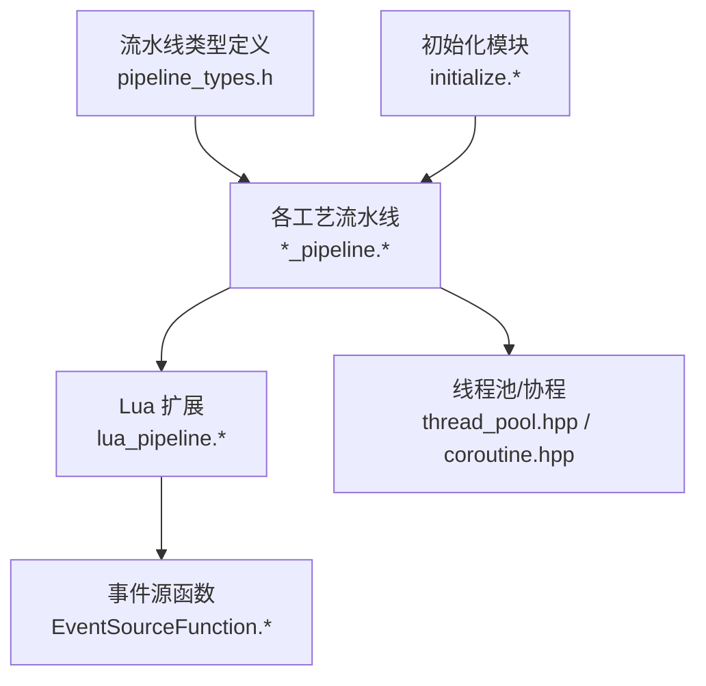

**图示来源**
- [pipeline_types.h:1-200](file://pipelinetypes/pipeline_types.h#L1-L200)
- [initialize.h:1-200](file://DllHsBaSlicer/initialize.h#L1-L200)
- [initialize.cpp:1-200](file://DllHsBaSlicer/initialize.cpp#L1-L200)
- [lua_pipeline.hpp:1-200](file://LibHsBaSlicer/Extends/lua_pipeline.hpp#L1-L200)
- [event_source_function.hpp:1-200](file://LibHsBaSlicer/Extends/EventSourceFunction.hpp#L1-L200)
- [thread_pool.hpp:1-200](file://base/thread_pool.hpp#L1-L200)
- [coroutine.hpp:1-200](file://base/coroutine.hpp#L1-L200)

**章节来源**
- [pipeline_types.h:1-200](file://pipelinetypes/pipeline_types.h#L1-L200)
- [initialize.h:1-200](file://DllHsBaSlicer/initialize.h#L1-L200)
- [lua_pipeline.hpp:1-200](file://LibHsBaSlicer/Extends/lua_pipeline.hpp#L1-L200)
- [thread_pool.hpp:1-200](file://base/thread_pool.hpp#L1-L200)
- [coroutine.hpp:1-200](file://base/coroutine.hpp#L1-L200)

## 性能与并行优化
- 并行处理：利用线程池并发执行独立阶段（如多层切片、支撑生成），注意共享状态保护与内存池复用。
- 异步执行：使用协程或异步回调避免阻塞主线程，结合事件源上报进度。
- 缓存与批处理：对重复计算结果进行缓存；批量处理小对象以减少分配开销。
- I/O 优化：文件传输采用分块读写与压缩；远程传输启用重试与断点续传。

[本节为通用指导，不直接分析具体文件]

## 故障排除指南
- 流水线未注册：检查初始化模块是否正确调用注册函数，确认类型名与配置一致。
- Lua 脚本错误：查看事件源的错误回调，定位脚本语法或 API 调用问题。
- 参数解析失败：校验参数 schema 与版本兼容性，必要时启用回滚。
- 性能瓶颈：监控线程池利用率与内存占用，调整批次大小与并行度。

**章节来源**
- [initialize.h:1-200](file://DllHsBaSlicer/initialize.h#L1-L200)
- [lua_pipeline.hpp:1-200](file://LibHsBaSlicer/Extends/lua_pipeline.hpp#L1-L200)
- [event_source_function.hpp:1-200](file://LibHsBaSlicer/Extends/EventSourceFunction.hpp#L1-L200)

## 结论
通过自定义流水线、Lua 脚本扩展与通用节点组合，HsBaSlicer 能够灵活适配多种 3D 打印工艺。配合线程池与协程，可实现高性能、可扩展的切片解决方案。建议在生产环境中结合事件源与参数存储，建立完整的监控与回滚机制。

[本节为总结性内容，不直接分析具体文件]

## 附录：多技术栈高级示例

### FDM 高级示例
- 目标：实现复杂填充与支撑策略，支持多材料挤出与温度控制。
- 关键点：
  - 使用 FDM 流水线作为基类，重写填充与支撑阶段。
  - 通过 Lua 脚本实现自定义填充算法，并上报进度。
  - 使用参数存储保存材料配方与温度曲线。

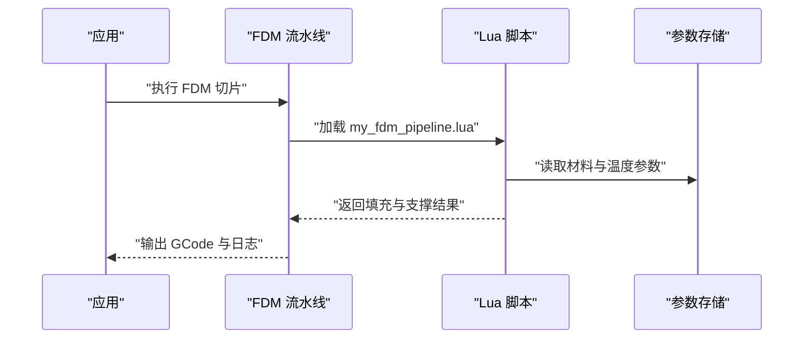

**图示来源**
- [fdm_pipeline.h:1-200](file://DllHsBaSlicer/fdm_pipeline.h#L1-L200)
- [fdm_pipeline.cpp:1-200](file://DllHsBaSlicer/fdm_pipeline.cpp#L1-L200)
- [my_fdm_pipeline.lua:1-200](file://samples/Custom/scripts/my_fdm_pipeline.lua#L1-L200)
- [param_store_pipeline.h:1-200](file://DllHsBaSlicer/param_store_pipeline.h#L1-L200)

**章节来源**
- [fdm_pipeline.h:1-200](file://DllHsBaSlicer/fdm_pipeline.h#L1-L200)
- [fdm_pipeline.cpp:1-200](file://DllHsBaSlicer/fdm_pipeline.cpp#L1-L200)
- [my_fdm_pipeline.lua:1-200](file://samples/Custom/scripts/my_fdm_pipeline.lua#L1-L200)

### SLA 高级示例
- 目标：实现高精度层厚控制与支撑优化，支持树脂特性建模。
- 关键点：
  - 使用 SLA 流水线，重写底层支撑与曝光策略。
  - 通过 Lua 脚本实现自适应支撑密度。
  - 使用事件源上报曝光进度与异常。

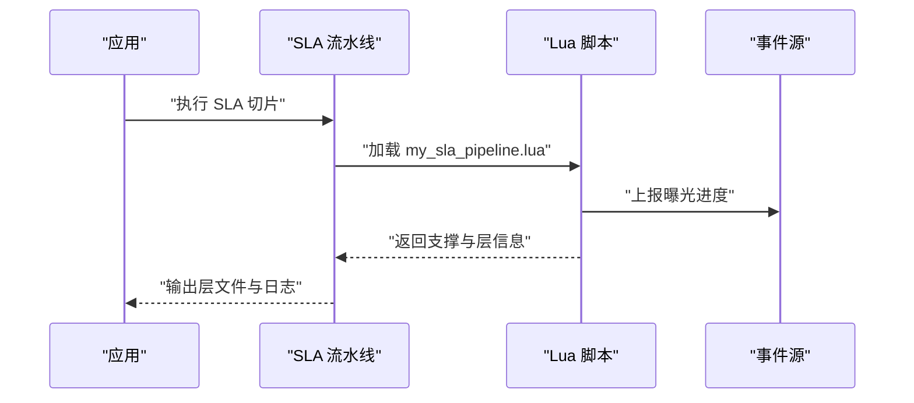

**图示来源**
- [sla_pipeline.h:1-200](file://DllHsBaSlicer/sla_pipeline.h#L1-L200)
- [sla_pipeline.cpp:1-200](file://DllHsBaSlicer/sla_pipeline.cpp#L1-L200)
- [my_sla_pipeline.lua:1-200](file://samples/Custom/scripts/my_sla_pipeline.lua#L1-L200)
- [event_source_function.hpp:1-200](file://LibHsBaSlicer/Extends/EventSourceFunction.hpp#L1-L200)

**章节来源**
- [sla_pipeline.h:1-200](file://DllHsBaSlicer/sla_pipeline.h#L1-L200)
- [sla_pipeline.cpp:1-200](file://DllHsBaSlicer/sla_pipeline.cpp#L1-L200)
- [my_sla_pipeline.lua:1-200](file://samples/Custom/scripts/my_sla_pipeline.lua#L1-L200)

### WAAM 高级示例
- 目标：实现机器人路径规划与焊接参数优化。
- 关键点：
  - 使用 WAAM 流水线，重写路径生成与轨迹优化。
  - 通过 Lua 脚本实现焊缝轨迹平滑与速度控制。
  - 使用文件传输将路径发送至机器人控制器。

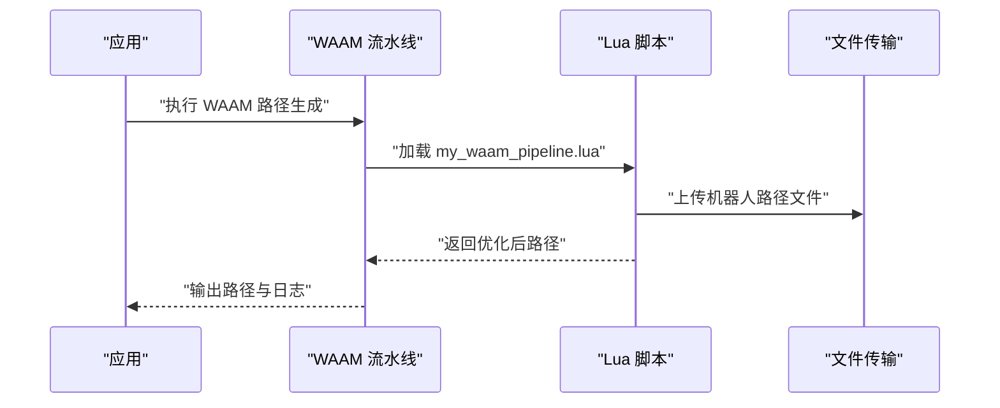

**图示来源**
- [waam_pipeline.h:1-200](file://DllHsBaSlicer/waam_pipeline.h#L1-L200)
- [waam_pipeline.cpp:1-200](file://DllHsBaSlicer/waam_pipeline.cpp#L1-L200)
- [my_waam_pipeline.lua:1-200](file://samples/Custom/scripts/my_waam_pipeline.lua#L1-L200)
- [file_transfer_pipeline.h:1-200](file://DllHsBaSlicer/file_transfer_pipeline.h#L1-L200)

**章节来源**
- [waam_pipeline.h:1-200](file://DllHsBaSlicer/waam_pipeline.h#L1-L200)
- [waam_pipeline.cpp:1-200](file://DllHsBaSlicer/waam_pipeline.cpp#L1-L200)
- [my_waam_pipeline.lua:1-200](file://samples/Custom/scripts/my_waam_pipeline.lua#L1-L200)

### LOM 高级示例
- 目标：实现层压切割与材料厚度控制。
- 关键点：
  - 使用 LOM 流水线，重写切割路径与材料进给。
  - 通过 Lua 脚本实现自适应切割速度与张力控制。
  - 使用参数存储记录材料批次与厚度校准。

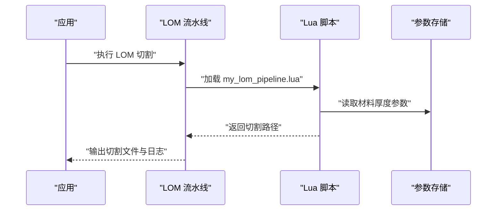

**图示来源**
- [lom_pipeline.h:1-200](file://DllHsBaSlicer/lom_pipeline.h#L1-L200)
- [lom_pipeline.cpp:1-200](file://DllHsBaSlicer/lom_pipeline.cpp#L1-L200)
- [my_lom_pipeline.lua:1-200](file://samples/Custom/scripts/my_lom_pipeline.lua#L1-L200)
- [param_store_pipeline.h:1-200](file://DllHsBaSlicer/param_store_pipeline.h#L1-L200)

**章节来源**
- [lom_pipeline.h:1-200](file://DllHsBaSlicer/lom_pipeline.h#L1-L200)
- [lom_pipeline.cpp:1-200](file://DllHsBaSlicer/lom_pipeline.cpp#L1-L200)
- [my_lom_pipeline.lua:1-200](file://samples/Custom/scripts/my_lom_pipeline.lua#L1-L200)

### SLM 高级示例
- 目标：实现金属粉末床熔融的路径优化与热影响区控制。
- 关键点：
  - 使用 SLM 流水线，重写扫描路径与激光功率控制。
  - 通过 Lua 脚本实现热点补偿与路径重排。
  - 使用事件源上报熔池状态与异常。

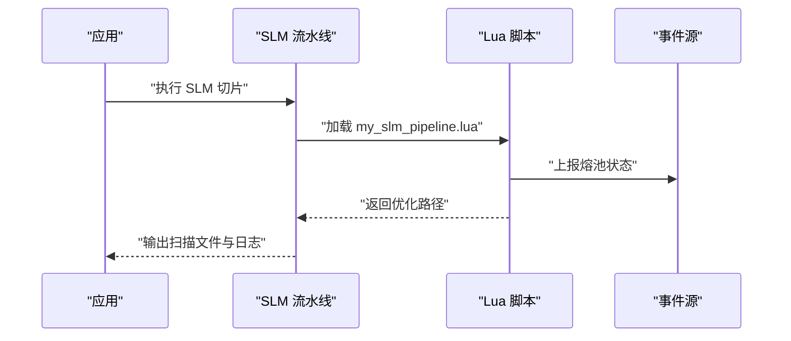

**图示来源**
- [slm_pipeline.h:1-200](file://DllHsBaSlicer/slm_pipeline.h#L1-L200)
- [slm_pipeline.cpp:1-200](file://DllHsBaSlicer/slm_pipeline.cpp#L1-L200)
- [my_slm_pipeline.lua:1-200](file://samples/Custom/scripts/my_slm_pipeline.lua#L1-L200)
- [event_source_function.hpp:1-200](file://LibHsBaSlicer/Extends/EventSourceFunction.hpp#L1-L200)

**章节来源**
- [slm_pipeline.h:1-200](file://DllHsBaSlicer/slm_pipeline.h#L1-L200)
- [slm_pipeline.cpp:1-200](file://DllHsBaSlicer/slm_pipeline.cpp#L1-L200)
- [my_slm_pipeline.lua:1-200](file://samples/Custom/scripts/my_slm_pipeline.lua#L1-L200)

### SLS 高级示例
- 目标：实现选择性激光烧结的路径优化与粉末铺粉控制。
- 关键点：
  - 使用 SLS 流水线，重写扫描路径与铺粉策略。
  - 通过 Lua 脚本实现能量分布优化与缺陷检测。
  - 使用参数存储记录粉末特性与烧结参数。

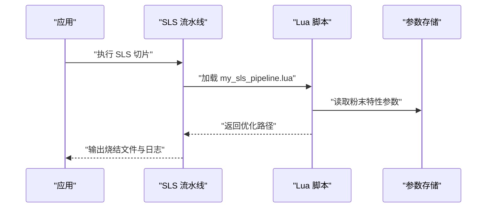

**图示来源**
- [sls_pipeline.h:1-200](file://DllHsBaSlicer/sls_pipeline.h#L1-L200)
- [sls_pipeline.cpp:1-200](file://DllHsBaSlicer/sls_pipeline.cpp#L1-L200)
- [my_sls_pipeline.lua:1-200](file://samples/Custom/scripts/my_sls_pipeline.lua#L1-L200)
- [param_store_pipeline.h:1-200](file://DllHsBaSlicer/param_store_pipeline.h#L1-L200)

**章节来源**
- [sls_pipeline.h:1-200](file://DllHsBaSlicer/sls_pipeline.h#L1-L200)
- [sls_pipeline.cpp:1-200](file://DllHsBaSlicer/sls_pipeline.cpp#L1-L200)
- [my_sls_pipeline.lua:1-200](file://samples/Custom/scripts/my_sls_pipeline.lua#L1-L200)

### TDP 高级示例
- 目标：实现三维打印粘结剂的路径优化与粘结剂分布控制。
- 关键点：
  - 使用 TDP 流水线，重写喷射路径与粘结剂量控制。
  - 通过 Lua 脚本实现密度梯度与强度优化。
  - 使用事件源上报喷射状态与异常。

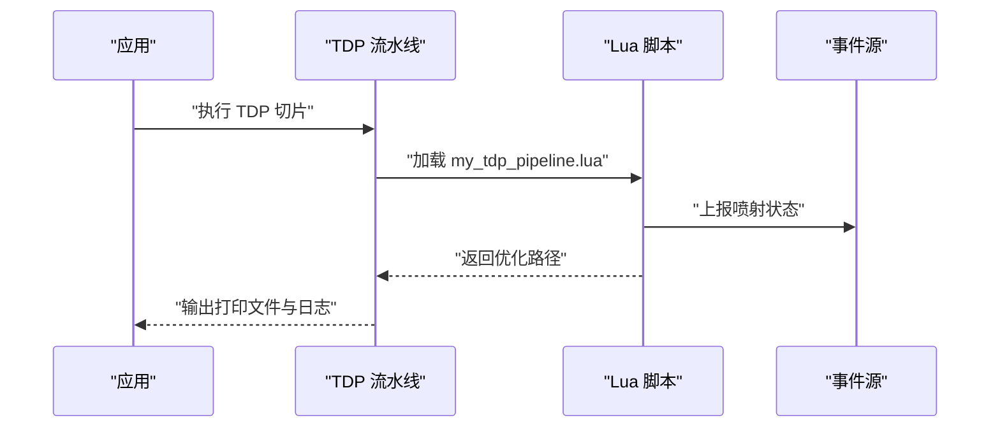

**图示来源**
- [tdp_pipeline.h:1-200](file://DllHsBaSlicer/tdp_pipeline.h#L1-L200)
- [tdp_pipeline.cpp:1-200](file://DllHsBaSlicer/tdp_pipeline.cpp#L1-L200)
- [my_tdp_pipeline.lua:1-200](file://samples/Custom/scripts/my_tdp_pipeline.lua#L1-L200)
- [event_source_function.hpp:1-200](file://LibHsBaSlicer/Extends/EventSourceFunction.hpp#L1-L200)

**章节来源**
- [tdp_pipeline.h:1-200](file://DllHsBaSlicer/tdp_pipeline.h#L1-L200)
- [tdp_pipeline.cpp:1-200](file://DllHsBaSlicer/tdp_pipeline.cpp#L1-L200)
- [my_tdp_pipeline.lua:1-200](file://samples/Custom/scripts/my_tdp_pipeline.lua#L1-L200)

### 自定义流水线示例工程
- 工程入口：samples/Custom/main.cpp 演示如何初始化、注册并运行自定义流水线。
- 构建配置：samples/Custom/CMakeLists.txt 定义目标与依赖。
- 脚本示例：samples/Custom/scripts/*.lua 提供各工艺脚本模板。

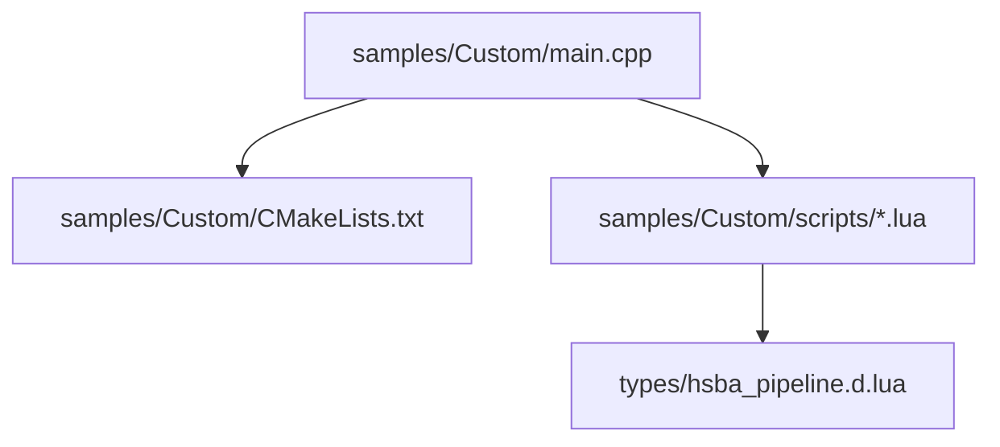

**图示来源**
- [main.cpp:1-200](file://samples/Custom/main.cpp#L1-L200)
- [CMakeLists.txt:1-200](file://samples/Custom/CMakeLists.txt#L1-L200)
- [my_fdm_pipeline.lua:1-200](file://samples/Custom/scripts/my_fdm_pipeline.lua#L1-L200)
- [my_sla_pipeline.lua:1-200](file://samples/Custom/scripts/my_sla_pipeline.lua#L1-L200)
- [my_lom_pipeline.lua:1-200](file://samples/Custom/scripts/my_lom_pipeline.lua#L1-L200)
- [my_waam_pipeline.lua:1-200](file://samples/Custom/scripts/my_waam_pipeline.lua#L1-L200)
- [my_slm_pipeline.lua:1-200](file://samples/Custom/scripts/my_slm_pipeline.lua#L1-L200)
- [my_sls_pipeline.lua:1-200](file://samples/Custom/scripts/my_sls_pipeline.lua#L1-L200)
- [my_tdp_pipeline.lua:1-200](file://samples/Custom/scripts/my_tdp_pipeline.lua#L1-L200)
- [hsba_pipeline.d.lua:1-200](file://types/hsba_pipeline.d.lua#L1-L200)

**章节来源**
- [main.cpp:1-200](file://samples/Custom/main.cpp#L1-L200)
- [CMakeLists.txt:1-200](file://samples/Custom/CMakeLists.txt#L1-L200)
- [hsba_pipeline.d.lua:1-200](file://types/hsba_pipeline.d.lua#L1-L200)