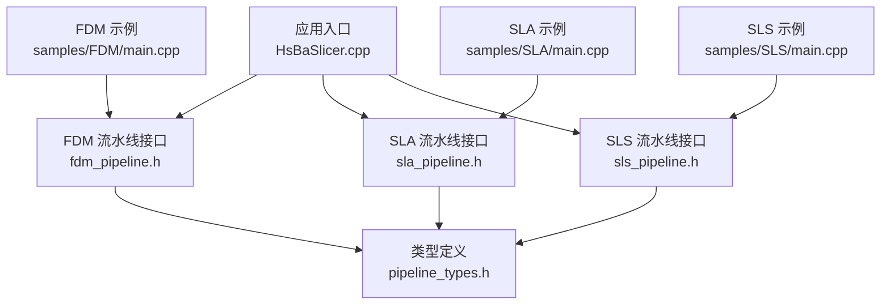
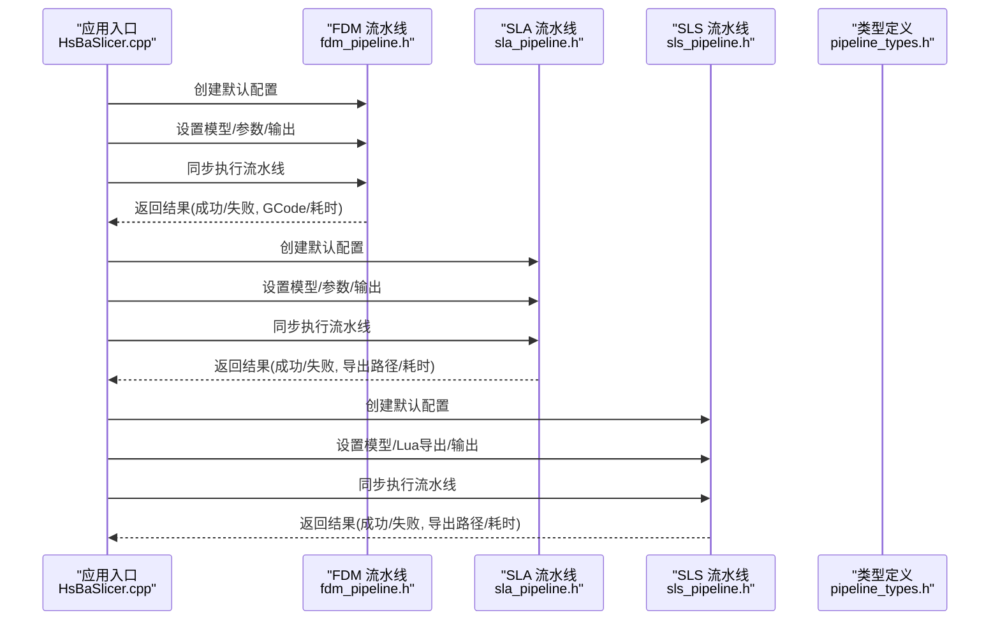
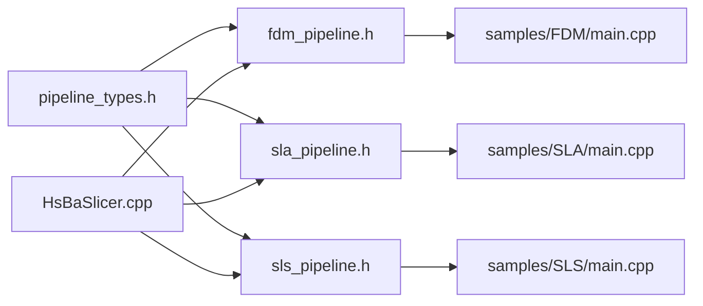

# 基础示例

<cite>
**本文引用的文件**   
- [HsBaSlicer.cpp](file://HsBaSlicer/HsBaSlicer.cpp)
- [fdm_pipeline.h](file://DllHsBaSlicer/fdm_pipeline.h)
- [sla_pipeline.h](file://DllHsBaSlicer/sla_pipeline.h)
- [sls_pipeline.h](file://DllHsBaSlicer/sls_pipeline.h)
- [pipeline_types.h](file://pipelinetypes/pipeline_types.h)
- [FDM 示例 main.cpp](file://samples/FDM/main.cpp)
- [SLA 示例 main.cpp](file://samples/SLA/main.cpp)
- [SLS 示例 main.cpp](file://samples/SLS/main.cpp)
- [FDM 自定义支撑脚本 my_support.lua](file://samples/FDM/scripts/my_support.lua)
- [FDM 自定义填充脚本 my_infill.lua](file://samples/FDM/scripts/my_infill.lua)
- [SLA 自定义地板脚本 my_sla_floor.lua](file://samples/SLA/scripts/my_sla_floor.lua)
</cite>

## 目录
1. [简介](#简介)
2. [项目结构](#项目结构)
3. [核心组件](#核心组件)
4. [架构总览](#架构总览)
5. [详细组件分析](#详细组件分析)
6. [依赖关系分析](#依赖关系分析)
7. [性能注意事项](#性能注意事项)
8. [故障排查指南](#故障排查指南)
9. [结论](#结论)
10. [附录：快速上手清单](#附录快速上手清单)

## 简介
本“基础示例”文档面向初学者，帮助你快速掌握 HsBaSlicer 的最简使用流程与入门级功能。你将学习如何：
- 加载模型、设置参数、执行切片、获取 GCode（FDM）或导出结果（SLA/SLS）。
- 配置 FDM/SLA 打印参数，包括层高、壁厚、填充、支撑、曝光、底板等。
- 处理错误与异常，确保程序健壮性。
- 理解模型加载、流水线执行、结果获取等核心概念。

HsBaSlicer 提供 C ABI 的流水线接口，便于在桌面、移动端、游戏引擎等多平台集成。示例代码位于 samples 目录，可直接编译运行以验证基本用法。

## 项目结构
下图展示与“基础示例”直接相关的模块与入口：

图表来源
- [HsBaSlicer.cpp:18-22](file://HsBaSlicer/HsBaSlicer.cpp#L18-L22)
- [fdm_pipeline.h:1-68](file://DllHsBaSlicer/fdm_pipeline.h#L1-L68)
- [sla_pipeline.h:1-63](file://DllHsBaSlicer/sla_pipeline.h#L1-L63)
- [sls_pipeline.h:1-63](file://DllHsBaSlicer/sls_pipeline.h#L1-L63)
- [pipeline_types.h:1-12](file://pipelinetypes/pipeline_types.h#L1-L12)

章节来源
- [HsBaSlicer.cpp:1-305](file://HsBaSlicer/HsBaSlicer.cpp#L1-L305)
- [fdm_pipeline.h:1-68](file://DllHsBaSlicer/fdm_pipeline.h#L1-L68)
- [sla_pipeline.h:1-63](file://DllHsBaSlicer/sla_pipeline.h#L1-L63)
- [sls_pipeline.h:1-63](file://DllHsBaSlicer/sls_pipeline.h#L1-L63)
- [pipeline_types.h:1-12](file://pipelinetypes/pipeline_types.h#L1-L12)

## 核心组件
- 流水线接口（C ABI）
  - FDM：创建默认配置、同步/异步执行、释放结果。
  - SLA：创建默认配置、同步/异步执行、释放结果。
  - SLS：创建默认配置、同步/异步执行、释放结果。
- 类型定义
  - 统一的配置与结果结构体，包含模型路径、工艺参数、输出路径、回调函数类型等。
- 示例程序
  - FDM/SLA/SLS 三个独立示例，演示基本用法、参数定制、Lua 扩展与异步调用。

章节来源
- [fdm_pipeline.h:17-61](file://DllHsBaSlicer/fdm_pipeline.h#L17-L61)
- [sla_pipeline.h:17-56](file://DllHsBaSlicer/sla_pipeline.h#L17-L56)
- [sls_pipeline.h:17-56](file://DllHsBaSlicer/sls_pipeline.h#L17-L56)
- [pipeline_types.h:53-127](file://pipelinetypes/pipeline_types.h#L53-L127)
- [pipeline_types.h:165-245](file://pipelinetypes/pipeline_types.h#L165-L245)
- [pipeline_types.h:259-310](file://pipelinetypes/pipeline_types.h#L259-L310)

## 架构总览
下图展示从应用入口到具体流水线的调用关系，以及数据流向：

图表来源
- [HsBaSlicer.cpp:49-106](file://HsBaSlicer/HsBaSlicer.cpp#L49-L106)
- [HsBaSlicer.cpp:112-156](file://HsBaSlicer/HsBaSlicer.cpp#L112-L156)
- [HsBaSlicer.cpp:162-208](file://HsBaSlicer/HsBaSlicer.cpp#L162-L208)
- [fdm_pipeline.h:23-35](file://DllHsBaSlicer/fdm_pipeline.h#L23-L35)
- [sla_pipeline.h:23-34](file://DllHsBaSlicer/sla_pipeline.h#L23-L34)
- [sls_pipeline.h:23-34](file://DllHsBaSlicer/sls_pipeline.h#L23-L34)

## 详细组件分析

### FDM 流水线（熔融沉积成型）
- 典型流程
  - 预处理 -> 切片 -> 支撑 -> 填充 -> 路径生成 -> 输出 GCode。
- 关键 API
  - 创建默认配置：HsBaCreateDefaultConfig。
  - 同步执行：HsBaRunFdmPipeline。
  - 异步执行：HsBaRunFdmPipelineAsync。
  - 释放结果：HsBaFreePipelineResult。
- 常用参数（节选）
  - 模型：model_name、model_path。
  - 切片：layer_height、first_layer_height。
  - 填充：fill_spacing、fill_mode、fill_angle、wall_count、top_layer_count、bottom_layer_count、infill_density。
  - 支撑：enable_support、overhang_angle、support_pattern。
  - 路径：line_width、print_speed、travel_speed、extrusion_multiplier。
  - GCode：gcode_firmware、nozzle_diameter、filament_diameter、nozzle_temp、bed_temp、retract_length、retract_speed、first_layer_speed。
  - Lua 扩展：support_lua_script/support_lua_func、infill_lua_script/infill_lua_func。
  - 输出：output_path。

#### FDM 基本流程示例（可运行步骤）
- 步骤说明
  - 初始化日志（可选）。
  - 创建默认配置。
  - 设置模型名称与路径。
  - 设置输出路径。
  - 同步执行流水线。
  - 检查 success 字段；若成功，将 gcode_content 写入 .gcode 文件。
  - 调用 HsBaFreePipelineResult 释放内存。
- 参考实现位置
  - [FDM 示例 main.cpp:53-96](file://samples/FDM/main.cpp#L53-L96)
  - [HsBaSlicer.cpp:49-106](file://HsBaSlicer/HsBaSlicer.cpp#L49-L106)

#### FDM 参数定制示例（顶层/底层/填充率）
- 步骤说明
  - 在默认配置基础上，设置层高、首层层高、填充间距/模式/角度、壁厚、顶/底实心层数、填充密度、支撑开关与悬垂角度、支撑图案、线宽、打印速度、挤出倍率、输出路径。
- 参考实现位置
  - [FDM 示例 main.cpp:101-165](file://samples/FDM/main.cpp#L101-L165)

#### FDM Lua 自定义支撑与填充
- 步骤说明
  - 设置 support_lua_script/support_lua_func 与 infill_lua_script/infill_lua_func。
  - 运行后，内置胶水会调用对应 Lua 函数进行支撑/填充生成。
- 参考脚本
  - [FDM 自定义支撑脚本 my_support.lua:32-80](file://samples/FDM/scripts/my_support.lua#L32-L80)
  - [FDM 自定义填充脚本 my_infill.lua:20-87](file://samples/FDM/scripts/my_infill.lua#L20-L87)
- 参考实现位置
  - [FDM 示例 main.cpp:170-220](file://samples/FDM/main.cpp#L170-L220)

#### FDM 异步流水线
- 步骤说明
  - 使用 HsBaRunFdmPipelineAsync 启动非阻塞任务。
  - 通过 OnPipelineComplete 回调接收结果并释放内存。
- 参考实现位置
  - [FDM 示例 main.cpp:227-269](file://samples/FDM/main.cpp#L227-L269)

#### FDM 螺旋/花瓶模式
- 步骤说明
  - 开启 spiral_mode，外壁合并为连续上升的单条挤出路径，跳过填充与支撑。
- 参考实现位置
  - [FDM 示例 main.cpp:274-318](file://samples/FDM/main.cpp#L274-L318)

章节来源
- [fdm_pipeline.h:23-61](file://DllHsBaSlicer/fdm_pipeline.h#L23-L61)
- [pipeline_types.h:53-127](file://pipelinetypes/pipeline_types.h#L53-L127)
- [FDM 示例 main.cpp:53-318](file://samples/FDM/main.cpp#L53-L318)
- [HsBaSlicer.cpp:49-106](file://HsBaSlicer/HsBaSlicer.cpp#L49-L106)
- [FDM 自定义支撑脚本 my_support.lua:32-80](file://samples/FDM/scripts/my_support.lua#L32-L80)
- [FDM 自定义填充脚本 my_infill.lua:20-87](file://samples/FDM/scripts/my_infill.lua#L20-L87)

### SLA 流水线（立体光刻）
- 典型流程
  - 预处理 -> 切片 -> 底板/垫板 -> 支撑 -> 导出（zip：配置文件 + 层轮廓图像）。
- 关键 API
  - 创建默认配置：HsBaCreateDefaultSlaConfig。
  - 同步执行：HsBaRunSlaPipeline。
  - 异步执行：HsBaRunSlaPipelineAsync。
  - 释放结果：HsBaFreeSlaPipelineResult。
- 常用参数（节选）
  - 模型：model_name、model_path。
  - 切片：layer_height、first_layer_height。
  - 曝光：bottom_exposure_time、normal_exposure_time、lift_distance、lift_speed、retract_speed。
  - 底板/垫板：floor_raft_offset、floor_border_width、floor_fill_spacing、floor_border_count、floor_use_convex_hull。
  - 支撑：enable_support、overhang_angle、support_pattern。
  - 导出：image_type、image_width、image_height、output_path。
  - Lua 扩展：support_lua_script/support_lua_func、floor_lua_script/floor_lua_func、export_lua_script/export_lua_func。

#### SLA 基本流程示例（可运行步骤）
- 步骤说明
  - 创建默认配置，设置模型与输出路径，同步执行，检查 success 与 export_path。
- 参考实现位置
  - [SLA 示例 main.cpp:52-84](file://samples/SLA/main.cpp#L52-L84)

#### SLA 参数定制示例（层高/曝光/底板）
- 步骤说明
  - 设置层高、首层层高、曝光时间、抬升距离/速度、底板偏移/边框宽度/填充间距/边框数量/凸包选项、支撑参数、输出路径。
- 参考实现位置
  - [SLA 示例 main.cpp:89-144](file://samples/SLA/main.cpp#L89-L144)

#### SLA Lua 自定义地板/支撑/导出
- 步骤说明
  - 设置 floor_lua_script/floor_lua_func 与 support_lua_script/support_lua_func，必要时设置 export_lua_script/export_lua_func。
- 参考脚本
  - [SLA 自定义地板脚本 my_sla_floor.lua:35-62](file://samples/SLA/scripts/my_sla_floor.lua#L35-L62)
- 参考实现位置
  - [SLA 示例 main.cpp:149-191](file://samples/SLA/main.cpp#L149-L191)

#### SLA 异步流水线
- 步骤说明
  - 使用 HsBaRunSlaPipelineAsync 启动非阻塞任务，通过回调处理结果。
- 参考实现位置
  - [SLA 示例 main.cpp:197-239](file://samples/SLA/main.cpp#L197-L239)

章节来源
- [sla_pipeline.h:17-56](file://DllHsBaSlicer/sla_pipeline.h#L17-L56)
- [pipeline_types.h:165-245](file://pipelinetypes/pipeline_types.h#L165-L245)
- [SLA 示例 main.cpp:52-239](file://samples/SLA/main.cpp#L52-L239)
- [SLA 自定义地板脚本 my_sla_floor.lua:35-62](file://samples/SLA/scripts/my_sla_floor.lua#L35-L62)

### SLS 流水线（选择性激光烧结）
- 典型流程
  - 预处理 -> 切片 -> Lua 导出（zip + 数据库注册），无标准输出格式。
- 关键 API
  - 创建默认配置：HsBaCreateDefaultSlsConfig。
  - 同步执行：HsBaRunSlsPipeline。
  - 异步执行：HsBaRunSlsPipelineAsync。
  - 释放结果：HsBaFreeSlsPipelineResult。
- 常用参数（节选）
  - 模型：model_name、model_path。
  - 切片：layer_height、first_layer_height。
  - 激光：laser_power、scan_speed、hatch_spacing、hatch_rotation、bed_temperature。
  - Lua 导出：export_lua_script、export_lua_func（必须）。
  - 输出：output_path。

#### SLS 基本流程示例（可运行步骤）
- 步骤说明
  - 创建默认配置，设置模型与 Lua 导出脚本，设置输出路径，同步执行，检查 success 与 export_path。
- 参考实现位置
  - [SLS 示例 main.cpp:56-92](file://samples/SLS/main.cpp#L56-L92)

#### SLS 参数定制示例（激光功率/扫描速度/栅格）
- 步骤说明
  - 设置层高、首层层高、激光功率、扫描速度、栅格间距/旋转角度、床温、Lua 导出脚本、输出路径。
- 参考实现位置
  - [SLS 示例 main.cpp:97-140](file://samples/SLS/main.cpp#L97-L140)

#### SLS 异步流水线
- 步骤说明
  - 使用 HsBaRunSlsPipelineAsync 启动非阻塞任务，通过回调处理结果。
- 参考实现位置
  - [SLS 示例 main.cpp:147-190](file://samples/SLS/main.cpp#L147-L190)

章节来源
- [sls_pipeline.h:17-56](file://DllHsBaSlicer/sls_pipeline.h#L17-L56)
- [pipeline_types.h:259-310](file://pipelinetypes/pipeline_types.h#L259-L310)
- [SLS 示例 main.cpp:56-190](file://samples/SLS/main.cpp#L56-L190)

### 错误处理与异常捕获
- 通用策略
  - 始终检查 result.success。
  - 读取 result.error_message 获取错误信息。
  - 对成功分支中的文件写入进行二次检查（如 ofstream 是否打开成功）。
  - 无论成功与否，最终调用对应的释放函数（HsBaFreePipelineResult / HsBaFreeSlaPipelineResult / HsBaFreeSlsPipelineResult）。
- 参考实现位置
  - [HsBaSlicer.cpp:80-105](file://HsBaSlicer/HsBaSlicer.cpp#L80-L105)
  - [HsBaSlicer.cpp:143-155](file://HsBaSlicer/HsBaSlicer.cpp#L143-L155)
  - [HsBaSlicer.cpp:195-207](file://HsBaSlicer/HsBaSlicer.cpp#L195-L207)
  - [FDM 示例 main.cpp:70-96](file://samples/FDM/main.cpp#L70-L96)
  - [SLA 示例 main.cpp:70-84](file://samples/SLA/main.cpp#L70-L84)
  - [SLS 示例 main.cpp:77-92](file://samples/SLS/main.cpp#L77-L92)

章节来源
- [HsBaSlicer.cpp:80-105](file://HsBaSlicer/HsBaSlicer.cpp#L80-L105)
- [HsBaSlicer.cpp:143-155](file://HsBaSlicer/HsBaSlicer.cpp#L143-L155)
- [HsBaSlicer.cpp:195-207](file://HsBaSlicer/HsBaSlicer.cpp#L195-L207)
- [FDM 示例 main.cpp:70-96](file://samples/FDM/main.cpp#L70-L96)
- [SLA 示例 main.cpp:70-84](file://samples/SLA/main.cpp#L70-L84)
- [SLS 示例 main.cpp:77-92](file://samples/SLS/main.cpp#L77-L92)

## 依赖关系分析
- 头文件依赖
  - 各流水线头文件依赖公共类型定义 pipeline_types.h。
- 示例依赖
  - FDM/SLA/SLS 示例分别依赖对应流水线头文件。
- 应用入口依赖
  - HsBaSlicer.cpp 同时引入 FDM/SLA/SLS 流水线头文件与日志模块。

图表来源
- [pipeline_types.h:1-12](file://pipelinetypes/pipeline_types.h#L1-L12)
- [fdm_pipeline.h:1-10](file://DllHsBaSlicer/fdm_pipeline.h#L1-L10)
- [sla_pipeline.h:1-10](file://DllHsBaSlicer/sla_pipeline.h#L1-L10)
- [sls_pipeline.h:1-10](file://DllHsBaSlicer/sls_pipeline.h#L1-L10)
- [HsBaSlicer.cpp:18-22](file://HsBaSlicer/HsBaSlicer.cpp#L18-L22)

章节来源
- [pipeline_types.h:1-12](file://pipelinetypes/pipeline_types.h#L1-L12)
- [fdm_pipeline.h:1-10](file://DllHsBaSlicer/fdm_pipeline.h#L1-L10)
- [sla_pipeline.h:1-10](file://DllHsBaSlicer/sla_pipeline.h#L1-L10)
- [sls_pipeline.h:1-10](file://DllHsBaSlicer/sls_pipeline.h#L1-L10)
- [HsBaSlicer.cpp:18-22](file://HsBaSlicer/HsBaSlicer.cpp#L18-L22)

## 性能注意事项
- 同步 vs 异步
  - 同步调用会阻塞直到流水线完成；异步调用适合需要并发处理的场景。
- 进度回调
  - 使用进度回调观察流水线阶段，有助于定位耗时环节。
- 资源释放
  - 务必调用对应的释放函数，避免内存泄漏。
- I/O 优化
  - 大模型或高分辨率切片时，合理设置输出路径与图像格式（SLA 支持 PNG/JPG/SVG）。

[本节为通用指导，不直接分析具体文件]

## 故障排查指南
- 常见问题
  - 模型路径错误：确认 model_path 指向有效文件。
  - 输出路径无效：确保 output_path 所在目录存在且可写。
  - Lua 脚本未找到：检查 script 路径与函数名是否正确。
  - 写入失败：检查文件系统权限与磁盘空间。
- 调试技巧
  - 启用日志输出，查看进度与阶段信息。
  - 逐步简化参数，定位问题参数。
  - 使用最小配置复现问题，再逐步增加复杂度。
- 参考实现位置
  - [HsBaSlicer.cpp:283-303](file://HsBaSlicer/HsBaSlicer.cpp#L283-L303)
  - [FDM 示例 main.cpp:27-48](file://samples/FDM/main.cpp#L27-L48)
  - [SLA 示例 main.cpp:23-47](file://samples/SLA/main.cpp#L23-L47)
  - [SLS 示例 main.cpp:27-51](file://samples/SLS/main.cpp#L27-L51)

章节来源
- [HsBaSlicer.cpp:283-303](file://HsBaSlicer/HsBaSlicer.cpp#L283-L303)
- [FDM 示例 main.cpp:27-48](file://samples/FDM/main.cpp#L27-L48)
- [SLA 示例 main.cpp:23-47](file://samples/SLA/main.cpp#L23-L47)
- [SLS 示例 main.cpp:27-51](file://samples/SLS/main.cpp#L27-L51)

## 结论
通过本“基础示例”文档，你已经掌握了 HsBaSlicer 的核心使用方式：
- 使用 C ABI 流水线接口进行 FDM/SLA/SLS 切片。
- 配置关键工艺参数，获得 GCode 或导出结果。
- 正确处理错误与释放资源。
- 利用 Lua 扩展自定义支撑、填充、地板与导出逻辑。

建议从“基本流程示例”开始，逐步尝试“参数定制”和“Lua 自定义”，最后结合“异步流水线”提升整体效率。

[本节为总结性内容，不直接分析具体文件]

## 附录：快速上手清单
- 环境准备
  - 安装构建工具（CMake、C++20 编译器、vcpkg）。
  - 克隆仓库并构建示例工程。
- 运行示例
  - 进入 samples/FDM、samples/SLA、samples/SLS 目录，分别编译运行 main.cpp。
- 验证输出
  - FDM：检查 output/*.gcode。
  - SLA：检查 output/*.zip（内含配置文件与层图像）。
  - SLS：检查 output/*.zip（由 Lua 导出脚本决定内容）。
- 扩展开发
  - 根据需求编写 Lua 脚本，并在配置中指定脚本路径与函数名。

[本节为通用指导，不直接分析具体文件]