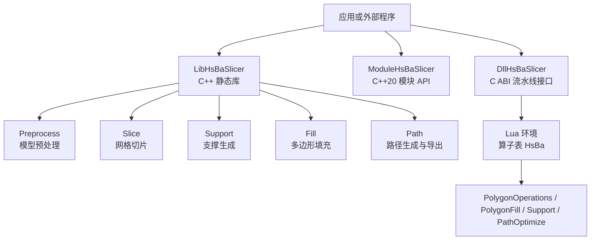
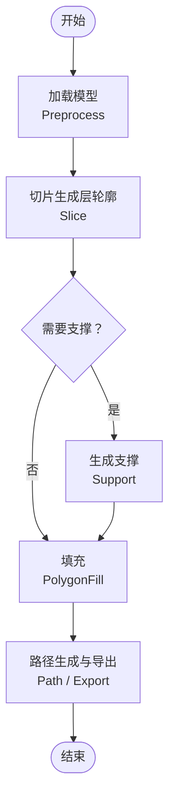
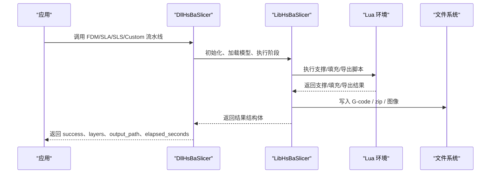
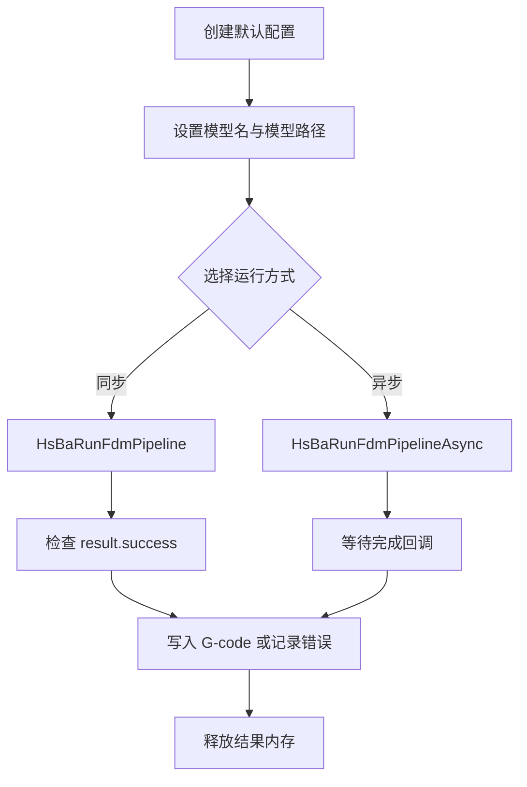
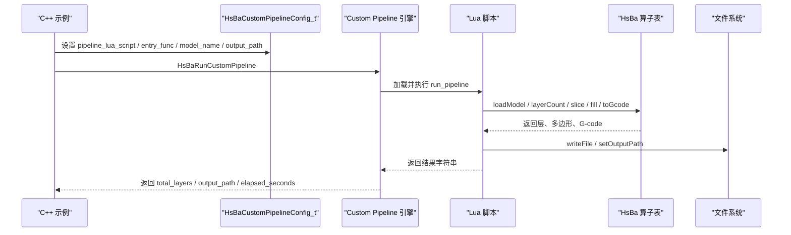
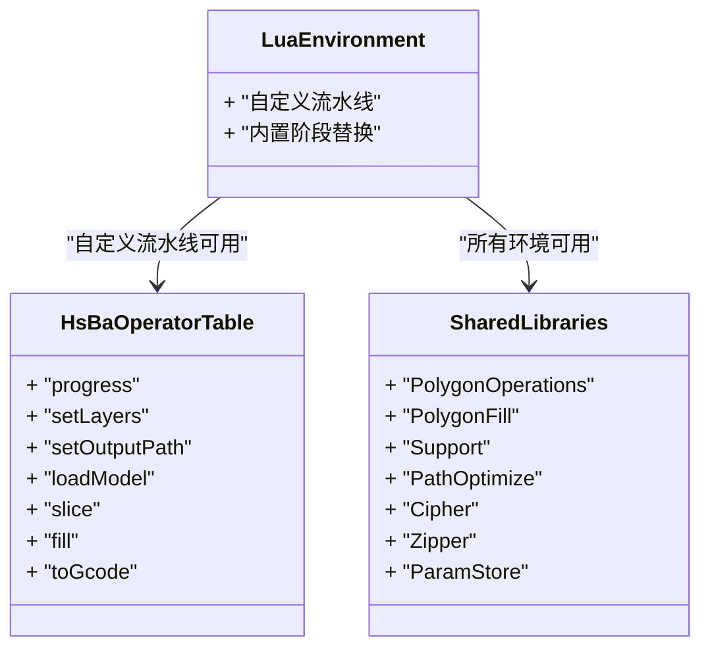
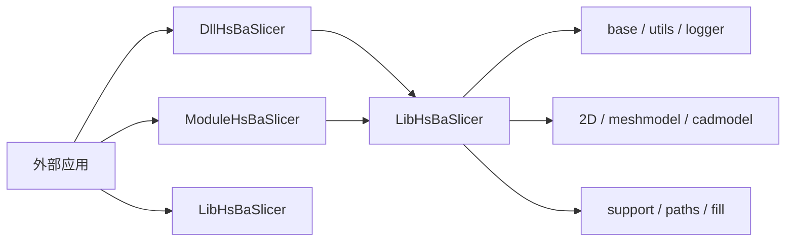

# 学习路径

<cite>
**本文引用的文件**   
- [README.md](file://README.md)
- [docs/zh/README.md](file://docs/zh/README.md)
- [docs/zh/cpp_cmake_usage.md](file://docs/zh/cpp_cmake_usage.md)
- [docs/zh/lua_pipeline_api.md](file://docs/zh/lua_pipeline_api.md)
- [samples/FDM/main.cpp](file://samples/FDM/main.cpp)
- [samples/Custom/main.cpp](file://samples/Custom/main.cpp)
</cite>

## 目录
1. [引言](#引言)
2. [项目结构总览](#项目结构总览)
3. [分层学习路径](#分层学习路径)
4. [核心组件与能力地图](#核心组件与能力地图)
5. [架构总览](#架构总览)
6. [详细组件分析](#详细组件分析)
7. [依赖关系分析](#依赖关系分析)
8. [性能与优化建议](#性能与优化建议)
9. [故障排查指南](#故障排查指南)
10. [结论](#结论)
11. [附录：渐进式练习清单](#附录渐进式练习清单)

## 引言
本学习路径文档面向不同水平的开发者，围绕 HsBaSlicer 的“安装 → 第一个切片程序 → API 使用 → 基础定制 → 深度定制 → 性能优化”主线，提供分阶段的学习目标、推荐示例、技能要求与评估标准。读者可据此从简单的 Hello World 式 FDM 流水线，逐步过渡到由 Lua 完全驱动的自定义流水线，并掌握 C++ 模块版、C ABI 导出层、Lua 扩展函数、Protobuf 跨语言调用等高级特性。

HsBaSlicer 是一个面向 3D 打印切片领域的高性能 C++ 软件框架，提供模块化、跨平台的切片核心能力，适用于研发与生产级别的切片流水线。它同时暴露三类主要集成方式：
- LibHsBaSlicer：C++ 全流程切片能力封装；
- ModuleHsBaSlicer：C++20 模块包装层，类风格 API；
- DllHsBaSlicer：C ABI 流水线接口，适合跨语言调用。

这些能力在仓库的 README 与中文文档中均有说明，并在 samples 目录下提供了可直接运行的示例程序。

**章节来源**
- [README.md:21-39](file://README.md#L21-L39)
- [docs/zh/README.md:10-49](file://docs/zh/README.md#L10-L49)

## 项目结构总览
HsBaSlicer 的项目结构以“基础库 → 几何模型 → 切片核心 → 上层流水线 → 示例与测试”组织。对学习者而言，最关键的目录是：
- base / utils / logger / cipher / fileoperator：基础类型、工具、日志、加密、文件操作；
- meshmodel / cadmodel / preprocess：网格与 CAD 模型加载；
- paths / support / 2D：路径输出、支撑生成、多边形处理；
- LibHsBaSlicer：核心切片接口集合；
- DllHsBaSlicer：C ABI 流水线接口；
- samples：FDM / SLA / SLS / LOM / SLM / TDP / WAAM / Custom 等示例；
- docs/zh：中文文档入口与模块说明。

**图表来源**
- [docs/zh/README.md:14-49](file://docs/zh/README.md#L14-L49)
- [docs/zh/cpp_cmake_usage.md:5-10](file://docs/zh/cpp_cmake_usage.md#L5-L10)

**章节来源**
- [README.md:25-39](file://README.md#L25-L39)
- [docs/zh/README.md:14-49](file://docs/zh/README.md#L14-L49)

## 分层学习路径

### 初学者路径：从安装到第一个切片程序
学习目标
- 完成 HsBaSlicer 的安装与构建；
- 理解 CMake 如何引入 HsBaSlicer；
- 运行第一个 FDM 切片示例，得到 G-code；
- 了解同步与异步流水线的基本差异。

推荐示例
- 阅读中文文档中的 C++ 使用指南，了解 find_package、头文件布局与目标名称；
- 运行 samples/FDM/main.cpp，观察基本流水线、参数定制、Lua 自定义支撑/填充、异步执行、螺旋模式等示例。

技能要求
- 会使用 CMake 配置和构建 C++ 项目；
- 能区分 LibHsBaSlicer、ModuleHsBaSlicer、DllHsBaSlicer 三种使用方式；
- 能根据日志判断流水线是否成功，并定位输出路径。

评估标准
- 能在本地构建 HsBaSlicer；
- 能独立修改 FDM 示例中的层高、壁厚、填充率等参数并重新运行；
- 能解释同步调用与异步回调的区别；
- 能写出一个最小 FDM 流水线调用（不要求手写算法）。

参考材料
- 中文文档：[cpp_cmake_usage.md](file://docs/zh/cpp_cmake_usage.md)
- FDM 示例入口：[samples/FDM/main.cpp](file://samples/FDM/main.cpp)

**章节来源**
- [docs/zh/cpp_cmake_usage.md:22-53](file://docs/zh/cpp_cmake_usage.md#L22-L53)
- [samples/FDM/main.cpp:50-96](file://samples/FDM/main.cpp#L50-L96)

### 进阶路径：API 使用与基础定制
学习目标
- 熟练使用 DllHsBaSlicer 的 C ABI 流水线接口；
- 理解 HsBaFdmPipelineConfig_t 等配置结构体的关键字段；
- 能够编写 Lua 脚本替换支撑或填充阶段；
- 理解进度回调、错误消息、结果释放的生命周期。

推荐示例
- 继续深入 samples/FDM/main.cpp，重点阅读“自定义工艺参数”“Lua 自定义支撑与填充”“异步流水线”三个示例；
- 阅读 docs/zh/lua_pipeline_api.md，了解内置阶段替换脚本的约定与可用共享库。

技能要求
- 能配置顶层/底层实心层数、填充间距、填充模式、悬垂角度、支撑类型；
- 能编写一个简单的 my_support.lua 或 my_infill.lua；
- 能处理 HsBaRunFdmPipeline 返回的结果结构体，包括 success、error_message、gcode_content、total_layers、elapsed_seconds；
- 能使用 OnProgress 进度回调更新 UI 或日志。

评估标准
- 能独立完成一次带支撑与填充的 FDM 切片；
- 能通过 Lua 脚本改变支撑或填充行为；
- 能解释 result.success 为 false 时可能的原因；
- 能正确调用 HsBaFreePipelineResult 释放内存。

参考材料
- FDM 示例：[samples/FDM/main.cpp](file://samples/FDM/main.cpp)
- Lua 流水线 API：[docs/zh/lua_pipeline_api.md](file://docs/zh/lua_pipeline_api.md)

**章节来源**
- [samples/FDM/main.cpp:98-165](file://samples/FDM/main.cpp#L98-L165)
- [samples/FDM/main.cpp:167-220](file://samples/FDM/main.cpp#L167-L220)
- [samples/FDM/main.cpp:222-269](file://samples/FDM/main.cpp#L222-L269)
- [docs/zh/lua_pipeline_api.md:215-259](file://docs/zh/lua_pipeline_api.md#L215-L259)

### 专家路径：深度定制与性能优化
学习目标
- 掌握 Custom Lua Pipeline：让 Lua 决定整条工作流；
- 理解 HsBa 算子表、上下文全局变量、模型池、逐层切片、G-code 生成；
- 掌握 Protobuf wire 字节流调用方式，实现跨进程或跨语言调度；
- 掌握 ModuleHsBaSlicer 的类风格 API、异常处理、RAII 模型管理；
- 理解性能关键点：并行流水线、对象池、线程池、Lua 绑定开销、IO 与序列化。

推荐示例
- 阅读 samples/Custom/main.cpp，理解纯 Lua FDM、SLS、SLM、LOM、TDP、WAAM、内联源码、异步执行、Protobuf 字节流驱动五种场景；
- 阅读 docs/zh/lua_pipeline_api.md 中“自定义流水线环境”“通用共享库”“完整示例”；
- 阅读 docs/zh/cpp_cmake_usage.md 中 ModuleHsBaSlicer 与 DllHsBaSlicer 的使用说明。

技能要求
- 能编写 run_pipeline 入口函数，完成 loadModel → layerCount → slice → fill → toGcode → writeFile 的完整流程；
- 能使用 HsBa.progress、HsBa.setLayers、HsBa.setOutputPath 回报状态；
- 能使用 PolygonOperations、PolygonFill、Support、PathOptimize、Zipper、Cipher、ParamStore 等共享库；
- 能基于 proto/custom_pipeline.proto 定义，构造请求字节流并解析响应；
- 能在 C++ 中使用 import hsba.slicer 进行类风格编程，并处理 SlicerError。

评估标准
- 能脱离内置流水线，用一条 Lua 脚本重建任意 3D 打印模式；
- 能解释 Custom Pipeline 与内置阶段替换的区别；
- 能设计一个跨语言调用方案，将 C# / Python / Java 的请求转为 HsBaCustomPipelineConfig_t；
- 能给出至少三项性能优化措施，并说明其适用场景。

参考材料
- Custom 示例入口：[samples/Custom/main.cpp](file://samples/Custom/main.cpp)
- Lua 流水线 API：[docs/zh/lua_pipeline_api.md](file://docs/zh/lua_pipeline_api.md)
- C++ 使用指南：[docs/zh/cpp_cmake_usage.md](file://docs/zh/cpp_cmake_usage.md)

**章节来源**
- [samples/Custom/main.cpp:1-33](file://samples/Custom/main.cpp#L1-L33)
- [samples/Custom/main.cpp:97-132](file://samples/Custom/main.cpp#L97-L132)
- [samples/Custom/main.cpp:267-314](file://samples/Custom/main.cpp#L267-L314)
- [samples/Custom/main.cpp:316-354](file://samples/Custom/main.cpp#L316-L354)
- [samples/Custom/main.cpp:356-589](file://samples/Custom/main.cpp#L356-L589)
- [docs/zh/lua_pipeline_api.md:19-65](file://docs/zh/lua_pipeline_api.md#L19-L65)
- [docs/zh/lua_pipeline_api.md:283-331](file://docs/zh/lua_pipeline_api.md#L283-L331)
- [docs/zh/cpp_cmake_usage.md:155-232](file://docs/zh/cpp_cmake_usage.md#L155-L232)

## 核心组件与能力地图
HsBaSlicer 的核心能力可以按“数据 → 几何 → 切片 → 支撑 → 填充 → 路径 → 导出”理解：
- 数据层：模型加载、预处理、Proto 消息、配置文件；
- 几何层：2D 多边形、网格模型、CAD 模型；
- 切片层：MeshSlice、Layer 生成；
- 支撑层：FDM/SLA 支撑、悬垂检测；
- 填充层：多种填充算法；
- 路径层：G-code、图像、机器人路径、打包导出；
- 扩展层：Lua 算子、事件回调、参数存储、压缩与数据库。

**图表来源**
- [docs/zh/README.md:29-42](file://docs/zh/README.md#L29-L42)
- [docs/zh/cpp_cmake_usage.md:101-140](file://docs/zh/cpp_cmake_usage.md#L101-L140)

**章节来源**
- [docs/zh/README.md:29-42](file://docs/zh/README.md#L29-L42)
- [docs/zh/cpp_cmake_usage.md:101-140](file://docs/zh/cpp_cmake_usage.md#L101-L140)

## 架构总览
从调用者视角，HsBaSlicer 提供三层集成点：
- 高层：HsBaSlicer 可执行入口；
- 中层：DllHsBaSlicer 的 C ABI 流水线接口；
- 底层：LibHsBaSlicer 的 C++ 核心接口，以及 ModuleHsBaSlicer 的类风格 API。

**图表来源**
- [docs/zh/cpp_cmake_usage.md:336-400](file://docs/zh/cpp_cmake_usage.md#L336-L400)
- [samples/FDM/main.cpp:50-96](file://samples/FDM/main.cpp#L50-L96)
- [samples/Custom/main.cpp:97-132](file://samples/Custom/main.cpp#L97-L132)

**章节来源**
- [docs/zh/cpp_cmake_usage.md:5-10](file://docs/zh/cpp_cmake_usage.md#L5-L10)
- [docs/zh/cpp_cmake_usage.md:336-400](file://docs/zh/cpp_cmake_usage.md#L336-L400)

## 详细组件分析

### FDM 流水线示例分析
FDM 示例展示了五种典型用法：
- 基本流水线：默认配置 + 同步运行；
- 自定义工艺参数：层高、壁厚、填充、支撑、路径速度；
- Lua 自定义支撑与填充：通过脚本替换算法；
- 异步流水线：非阻塞启动 + 完成回调；
- 螺旋/花瓶模式：连续挤出路径。

**图表来源**
- [samples/FDM/main.cpp:50-96](file://samples/FDM/main.cpp#L50-L96)
- [samples/FDM/main.cpp:222-269](file://samples/FDM/main.cpp#L222-L269)

**章节来源**
- [samples/FDM/main.cpp:50-96](file://samples/FDM/main.cpp#L50-L96)
- [samples/FDM/main.cpp:98-165](file://samples/FDM/main.cpp#L98-L165)
- [samples/FDM/main.cpp:167-220](file://samples/FDM/main.cpp#L167-L220)
- [samples/FDM/main.cpp:222-269](file://samples/FDM/main.cpp#L222-L269)
- [samples/FDM/main.cpp:271-318](file://samples/FDM/main.cpp#L271-L318)

### Custom Lua 流水线示例分析
Custom 示例强调“整条工作流由 Lua 决定”，C++ 只提供算子环境与入口函数。它覆盖：
- 纯 Lua FDM 流水线；
- 纯 Lua SLS / SLM / LOM / TDP / WAAM 流水线；
- 内联 Lua 源码；
- 异步执行；
- Protobuf wire 字节流驱动。

**图表来源**
- [samples/Custom/main.cpp:97-132](file://samples/Custom/main.cpp#L97-L132)
- [samples/Custom/main.cpp:267-314](file://samples/Custom/main.cpp#L267-L314)
- [docs/zh/lua_pipeline_api.md:48-133](file://docs/zh/lua_pipeline_api.md#L48-L133)

**章节来源**
- [samples/Custom/main.cpp:1-33](file://samples/Custom/main.cpp#L1-L33)
- [samples/Custom/main.cpp:97-132](file://samples/Custom/main.cpp#L97-L132)
- [samples/Custom/main.cpp:267-314](file://samples/Custom/main.cpp#L267-L314)
- [samples/Custom/main.cpp:316-354](file://samples/Custom/main.cpp#L316-L354)
- [samples/Custom/main.cpp:356-589](file://samples/Custom/main.cpp#L356-L589)
- [docs/zh/lua_pipeline_api.md:48-133](file://docs/zh/lua_pipeline_api.md#L48-L133)

### Lua 流水线 API 关键概念
Lua 流水线 API 分为两类运行环境：
- 自定义流水线：拥有完整 HsBa 算子表；
- 内置流水线阶段替换：仅替换支撑、填充、地板、导出等阶段。

关键概念包括：
- 几何数据类型：Point、Polygon、Polygons、Layers；
- 控制与文件 IO：progress、setLayers、setOutputPath、readFile、writeFile；
- 模型管理：loadModel、modelInfo、translateModel、rotateModel、scaleModel、removeModel；
- 切片：layerCount、layerZ、slice、sliceUnsafe；
- 填充：toInt、toDouble、fill；
- 支撑与地板：fdmSupport、slaSupport、floor；
- 路径与 G-code：spiralize、toGcode；
- 打包与导出：saveSlsPackage、saveWaamPackage、saveSlaPackage、renderImage。

**图表来源**
- [docs/zh/lua_pipeline_api.md:19-65](file://docs/zh/lua_pipeline_api.md#L19-L65)
- [docs/zh/lua_pipeline_api.md:136-213](file://docs/zh/lua_pipeline_api.md#L136-L213)

**章节来源**
- [docs/zh/lua_pipeline_api.md:19-65](file://docs/zh/lua_pipeline_api.md#L19-L65)
- [docs/zh/lua_pipeline_api.md:136-213](file://docs/zh/lua_pipeline_api.md#L136-L213)
- [docs/zh/lua_pipeline_api.md:264-279](file://docs/zh/lua_pipeline_api.md#L264-L279)

## 依赖关系分析
从构建与集成角度看，HsBaSlicer 对外暴露的目标包括：
- DllHsBaSlicer：C ABI 流水线接口；
- LibHsBaSlicer：核心 C++ 切片库；
- ModuleHsBaSlicer：C++20 模块包装层；
- HsBaSlicer：最终应用程序入口；
- 其他静态库：base、utils、mesh、support、paths、fileoperator、proto、cipher、version 等。

**图表来源**
- [docs/zh/cpp_cmake_usage.md:5-10](file://docs/zh/cpp_cmake_usage.md#L5-L10)
- [docs/zh/cpp_cmake_usage.md:142-152](file://docs/zh/cpp_cmake_usage.md#L142-L152)

**章节来源**
- [docs/zh/cpp_cmake_usage.md:5-10](file://docs/zh/cpp_cmake_usage.md#L5-L10)
- [docs/zh/cpp_cmake_usage.md:142-152](file://docs/zh/cpp_cmake_usage.md#L142-L152)
- [README.md:104-124](file://README.md#L104-L124)

## 性能与优化建议
针对 HsBaSlicer 的学习与使用，可从以下维度考虑性能：
- 流水线并行：优先使用异步流水线，避免主线程阻塞；
- Lua 脚本复杂度：避免在逐层循环中进行高成本计算，尽量复用 PolygonOperations 与 PolygonFill；
- 模型与对象生命周期：及时 removeModel，避免模型池膨胀；
- IO 与序列化：批量写入文件，减少频繁小文件 IO；
- 编译选项：根据平台选择合适的 Release 构建，必要时关闭不必要的可选功能；
- 模块 vs 头文件：C++20 模块版更适合现代 C++ 工程，但需注意编译器支持与头文件顺序。

这些建议与仓库中的示例行为一致：FDM 示例展示异步回调，Custom 示例展示逐层统计与进度上报，Lua API 文档强调几何类型转换与共享库复用。

**章节来源**
- [samples/FDM/main.cpp:222-269](file://samples/FDM/main.cpp#L222-L269)
- [samples/Custom/main.cpp:267-314](file://samples/Custom/main.cpp#L267-L314)
- [docs/zh/lua_pipeline_api.md:32-45](file://docs/zh/lua_pipeline_api.md#L32-L45)
- [docs/zh/cpp_cmake_usage.md:312-333](file://docs/zh/cpp_cmake_usage.md#L312-L333)

## 故障排查指南
常见问题与定位思路：
- 构建失败：检查 CMake 版本、C++20 编译器、vcpkg 工具链；
- 找不到 HsBaSlicer：确认 cmake --install 已执行，且 find_package 能找到安装前缀；
- 流水线失败：查看 result.error_message，检查模型路径、输出路径、Lua 脚本路径；
- Lua 脚本错误：确认入口函数名、全局变量名、返回值类型；
- 内存泄漏：确保调用 HsBaFreePipelineResult 或 HsBaFreeCustomPipelineResult；
- 跨语言调用：确认 Protobuf 字段编号与 wire 类型一致，避免重复注册同名 proto。

**章节来源**
- [README.md:41-94](file://README.md#L41-L94)
- [README.md:100-124](file://README.md#L100-L124)
- [samples/FDM/main.cpp:69-96](file://samples/FDM/main.cpp#L69-L96)
- [samples/Custom/main.cpp:80-95](file://samples/Custom/main.cpp#L80-L95)
- [samples/Custom/main.cpp:509-589](file://samples/Custom/main.cpp#L509-L589)

## 结论
HsBaSlicer 的学习路径可以从“安装与构建 → FDM 示例 → Lua 阶段替换 → Custom 流水线 → 跨语言调用 → 性能优化”逐步推进。初学者应优先掌握 DllHsBaSlicer 的 FDM 流水线；进阶者应掌握 Lua 阶段替换与配置参数；专家则应掌握 Custom Pipeline、Protobuf wire 调用、ModuleHsBaSlicer 类风格 API，并能结合项目实际进行性能调优。

## 附录：渐进式练习清单
- 练习 1：安装 HsBaSlicer，使用 find_package 引入 LibHsBaSlicer；
- 练习 2：运行 samples/FDM/main.cpp，输出第一个 G-code；
- 练习 3：修改层高、壁厚、填充率，观察层数与耗时变化；
- 练习 4：启用支撑，尝试树形支撑与蜂窝支撑；
- 练习 5：编写 my_support.lua 或 my_infill.lua，替换默认算法；
- 练习 6：切换到 Custom 流水线，用 Lua 重写 FDM 流程；
- 练习 7：尝试 SLS / SLA / WAAM 的 Custom 流水线；
- 练习 8：使用内联 Lua 源码，不落地脚本文件；
- 练习 9：使用 Protobuf wire 字节流调用 Custom 流水线；
- 练习 10：使用 ModuleHsBaSlicer 的类风格 API，处理 SlicerError。

**章节来源**
- [docs/zh/cpp_cmake_usage.md:57-78](file://docs/zh/cpp_cmake_usage.md#L57-L78)
- [samples/FDM/main.cpp:50-96](file://samples/FDM/main.cpp#L50-L96)
- [samples/Custom/main.cpp:97-132](file://samples/Custom/main.cpp#L97-L132)
- [samples/Custom/main.cpp:267-314](file://samples/Custom/main.cpp#L267-L314)
- [samples/Custom/main.cpp:356-589](file://samples/Custom/main.cpp#L356-L589)