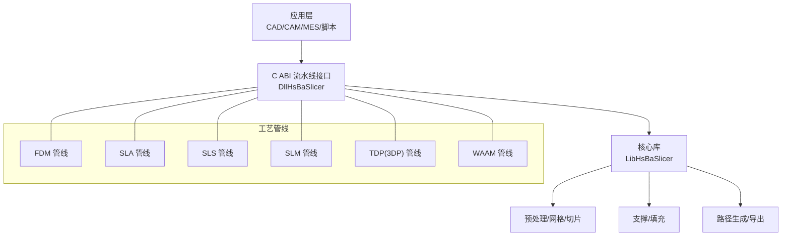
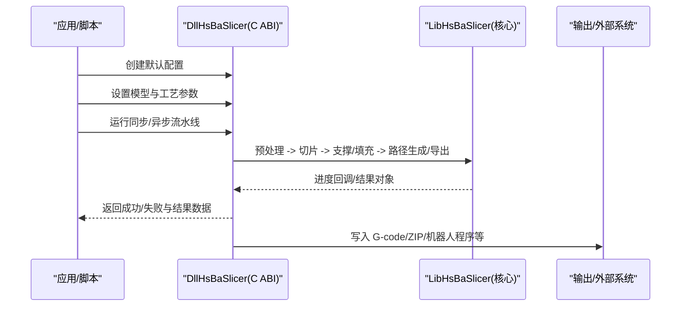
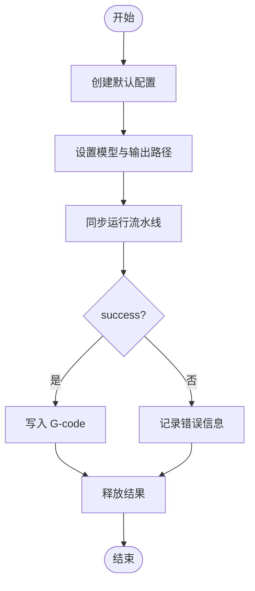
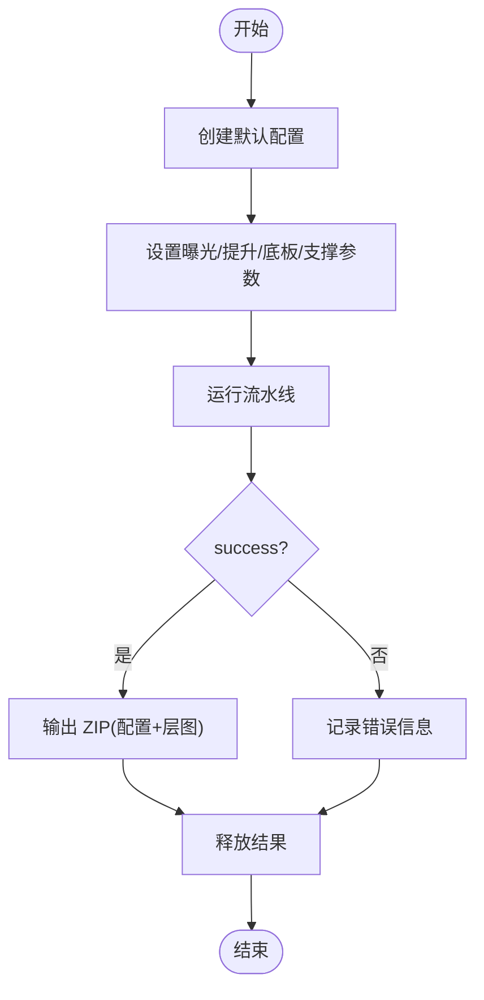
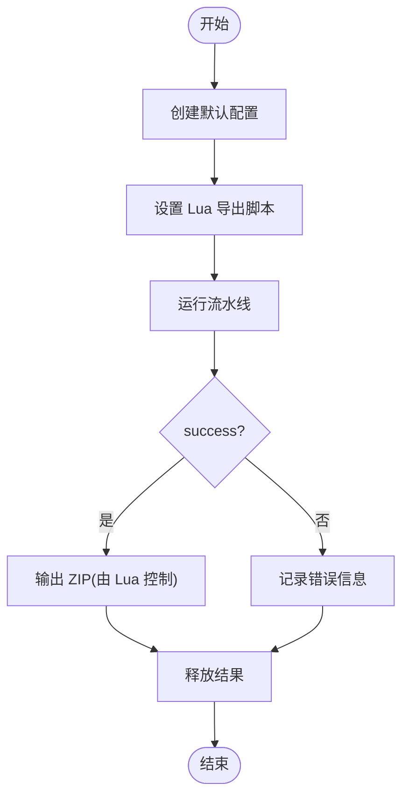
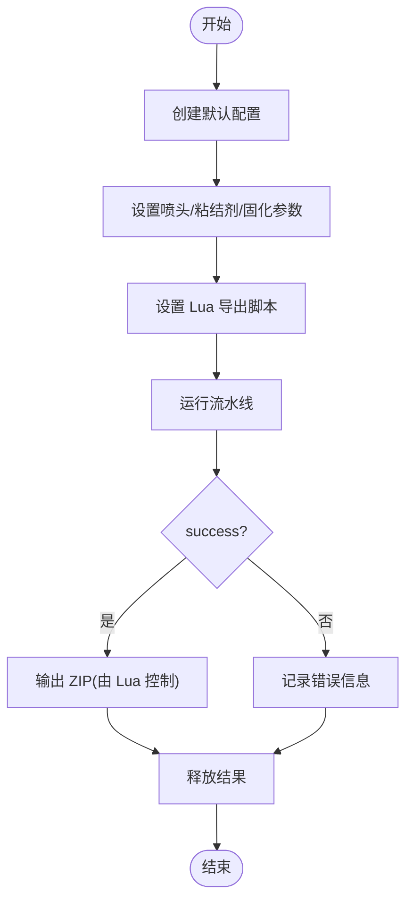
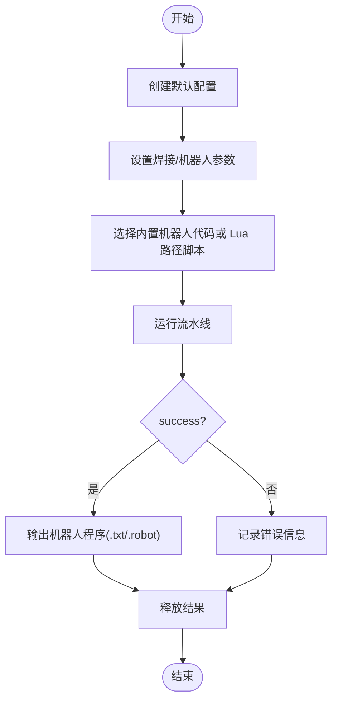
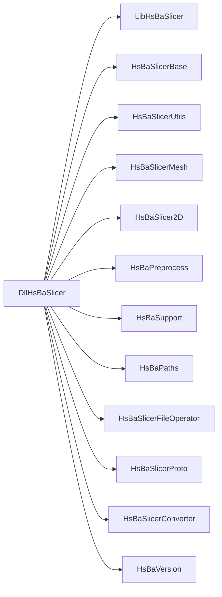

# 实战案例

<cite>
**本文引用的文件**   
- [README.md](file://README.md)
- [CMakeLists.txt](file://CMakeLists.txt)
- [fdm_pipeline.h](file://DllHsBaSlicer/fdm_pipeline.h)
- [sla_pipeline.h](file://DllHsBaSlicer/sla_pipeline.h)
- [sls_pipeline.h](file://DllHsBaSlicer/sls_pipeline.h)
- [slm_pipeline.h](file://DllHsBaSlicer/slm_pipeline.h)
- [tdp_pipeline.h](file://DllHsBaSlicer/tdp_pipeline.h)
- [waam_pipeline.h](file://DllHsBaSlicer/waam_pipeline.h)
- [samples/FDM/main.cpp](file://samples/FDM/main.cpp)
- [samples/SLA/main.cpp](file://samples/SLA/main.cpp)
- [samples/SLS/main.cpp](file://samples/SLS/main.cpp)
- [samples/SLM/main.cpp](file://samples/SLM/main.cpp)
- [samples/TDP/main.cpp](file://samples/TDP/main.cpp)
- [samples/WAAM/main.cpp](file://samples/WAAM/main.cpp)
</cite>

## 目录
1. [引言](#引言)
2. [项目结构](#项目结构)
3. [核心组件](#核心组件)
4. [架构总览](#架构总览)
5. [详细组件分析](#详细组件分析)
6. [依赖关系分析](#依赖关系分析)
7. [性能与生产调优](#性能与生产调优)
8. [故障排查指南](#故障排查指南)
9. [结论](#结论)
10. [附录：企业集成与部署清单](#附录企业集成与部署清单)

## 引言
本实战案例文档面向工程团队，系统展示 HsBaSlicer 在 FDM、SLA、SLS、SLM、TDP（3DP）、WAAM 等典型增材制造技术中的完整工作流程。每个案例均包含技术特点、参数配置要点、优化策略、常见问题解决方案，以及与企业 CAD/CAM/MES 系统的集成思路与最佳实践。文档以仓库中提供的 C ABI 接口与示例程序为依据，确保可落地、可复现。

## 项目结构
HsBaSlicer 提供模块化、跨平台的切片核心能力，上层通过 DllHsBaSlicer 暴露 C ABI 的全流程流水线接口，底层由 LibHsBaSlicer 提供预处理、切片、支撑、填充、路径生成等核心能力。各工艺管线（FDM/SLA/SLS/SLM/TDP/WAAM）均以统一的“创建默认配置 -> 设置模型与参数 -> 运行同步/异步流水线 -> 释放结果”的模式使用。

图示来源
- [README.md:25-39](file://README.md#L25-L39)
- [CMakeLists.txt:481-509](file://CMakeLists.txt#L481-L509)

章节来源
- [README.md:25-39](file://README.md#L25-L39)
- [CMakeLists.txt:481-509](file://CMakeLists.txt#L481-L509)

## 核心组件
- DllHsBaSlicer：对外暴露 C ABI 的流水线接口，支持同步与异步调用，封装协程执行与结果内存管理。
- LibHsBaSlicer：核心静态库，提供预处理、切片、支撑、填充、路径生成、SLA 地板/渲染/打包、SLS 导出、文件传输与 Lua 扩展等能力。
- 各工艺头文件：为每种技术提供默认配置创建、同步/异步运行与结果释放函数。

章节来源
- [fdm_pipeline.h:17-61](file://DllHsBaSlicer/fdm_pipeline.h#L17-L61)
- [sla_pipeline.h:17-56](file://DllHsBaSlicer/sla_pipeline.h#L17-L56)
- [sls_pipeline.h:17-56](file://DllHsBaSlicer/sls_pipeline.h#L17-L56)
- [slm_pipeline.h:17-56](file://DllHsBaSlicer/slm_pipeline.h#L17-L56)
- [tdp_pipeline.h:17-56](file://DllHsBaSlicer/tdp_pipeline.h#L17-L56)
- [waam_pipeline.h:17-57](file://DllHsBaSlicer/waam_pipeline.h#L17-L57)

## 架构总览
下图展示了从应用到具体工艺管线的调用关系，以及各管线内部的关键阶段。

图示来源
- [fdm_pipeline.h:23-61](file://DllHsBaSlicer/fdm_pipeline.h#L23-L61)
- [sla_pipeline.h:23-56](file://DllHsBaSlicer/sla_pipeline.h#L23-L56)
- [sls_pipeline.h:23-56](file://DllHsBaSlicer/sls_pipeline.h#L23-L56)
- [slm_pipeline.h:23-56](file://DllHsBaSlicer/slm_pipeline.h#L23-L56)
- [tdp_pipeline.h:23-56](file://DllHsBaSlicer/tdp_pipeline.h#L23-L56)
- [waam_pipeline.h:23-57](file://DllHsBaSlicer/waam_pipeline.h#L23-L57)

## 详细组件分析

### FDM（熔融沉积成型）实战案例
- 技术特点
  - 输出标准 G-code；支持顶层/底层实心、中间层填充、外壁圈数、悬垂阈值、树状支撑、螺旋/花瓶模式等。
- 关键参数
  - 层高、首层层高、填充间距/角度/密度、壁厚、顶/底实心层数、支撑开关与模式、线宽、打印速度、移动速度、挤出倍率、螺旋模式等。
- 工作流程
  - 创建默认配置 -> 设置模型与工艺参数 -> 运行流水线 -> 检查 success 并写入 .gcode -> 释放结果。
- 优化策略
  - 合理设置 top/bottom layer count 与 infill density 平衡强度与耗时；开启 spiral_mode 减少回抽与空走；根据悬垂角度调整支撑密度与直径。
- 常见问题
  - 写入失败：检查 output_path 权限与磁盘空间；错误信息来自 result.error_message。
  - 耗时过长：降低分辨率或填充密度，或使用异步流水线并行处理其他任务。

图示来源
- [samples/FDM/main.cpp:53-96](file://samples/FDM/main.cpp#L53-L96)
- [samples/FDM/main.cpp:101-165](file://samples/FDM/main.cpp#L101-L165)
- [samples/FDM/main.cpp:170-220](file://samples/FDM/main.cpp#L170-L220)
- [samples/FDM/main.cpp:274-318](file://samples/FDM/main.cpp#L274-L318)
- [fdm_pipeline.h:23-61](file://DllHsBaSlicer/fdm_pipeline.h#L23-L61)

章节来源
- [samples/FDM/main.cpp:53-96](file://samples/FDM/main.cpp#L53-L96)
- [samples/FDM/main.cpp:101-165](file://samples/FDM/main.cpp#L101-L165)
- [samples/FDM/main.cpp:170-220](file://samples/FDM/main.cpp#L170-L220)
- [samples/FDM/main.cpp:274-318](file://samples/FDM/main.cpp#L274-L318)
- [fdm_pipeline.h:23-61](file://DllHsBaSlicer/fdm_pipeline.h#L23-L61)

### SLA（立体光固化）实战案例
- 技术特点
  - 输出 ZIP（配置 JSON + 逐层 SVG），支持底座/底板生成、支撑生成、曝光/提升/回抽参数、Lua 自定义地板/支撑/导出。
- 关键参数
  - 层高、首层层高、底部/正常曝光时间、提升距离/速度、回抽速度、底板偏移/边框宽度/填充间距/边框圈数/凸包、支撑间隙/直径/密度/模式等。
- 工作流程
  - 创建默认配置 -> 设置模型与输出 ZIP -> 运行流水线 -> 检查 success 并记录导出路径 -> 释放结果。
- 优化策略
  - 精细层高与曝光时间匹配树脂特性；合理设置底板与支撑以减少翘曲与断裂；使用 Lua 自定义导出对接 CAM。
- 常见问题
  - 导出为空：确认 export_lua_script/export_lua_func 是否启用且路径正确；检查 output_path 权限。

图示来源
- [samples/SLA/main.cpp:52-84](file://samples/SLA/main.cpp#L52-L84)
- [samples/SLA/main.cpp:89-144](file://samples/SLA/main.cpp#L89-L144)
- [samples/SLA/main.cpp:149-191](file://samples/SLA/main.cpp#L149-L191)
- [sla_pipeline.h:23-56](file://DllHsBaSlicer/sla_pipeline.h#L23-L56)

章节来源
- [samples/SLA/main.cpp:52-84](file://samples/SLA/main.cpp#L52-L84)
- [samples/SLA/main.cpp:89-144](file://samples/SLA/main.cpp#L89-L144)
- [samples/SLA/main.cpp:149-191](file://samples/SLA/main.cpp#L149-L191)
- [sla_pipeline.h:23-56](file://DllHsBaSlicer/sla_pipeline.h#L23-L56)

### SLS（选择性激光烧结）实战案例
- 技术特点
  - 粉末床工艺，无需底板与支撑；输出格式完全由 Lua 导出脚本控制（ZIP + 数据库注册）。
- 关键参数
  - 层高、首层层高、激光功率、扫描速度、 Hatch 间距/旋转、粉床温度等。
- 工作流程
  - 创建默认配置 -> 设置模型与 Lua 导出脚本 -> 运行流水线 -> 检查 success 并记录导出路径 -> 释放结果。
- 优化策略
  - 调整 hatch 旋转避免层间条纹；根据材料选择合适粉床温度与激光能量。
- 常见问题
  - 未设置 export_lua_script/export_lua_func：SLS 无标准输出，必须提供导出脚本。

图示来源
- [samples/SLS/main.cpp:56-92](file://samples/SLS/main.cpp#L56-L92)
- [samples/SLS/main.cpp:97-140](file://samples/SLS/main.cpp#L97-L140)
- [sls_pipeline.h:23-56](file://DllHsBaSlicer/sls_pipeline.h#L23-L56)

章节来源
- [samples/SLS/main.cpp:56-92](file://samples/SLS/main.cpp#L56-L92)
- [samples/SLS/main.cpp:97-140](file://samples/SLS/main.cpp#L97-L140)
- [sls_pipeline.h:23-56](file://DllHsBaSlicer/sls_pipeline.h#L23-L56)

### SLM（选择性激光熔化）实战案例
- 技术特点
  - 金属粉末床工艺，流程镜像 SLS；增加金属材料、光源、保护气体等金属相关参数；输出由 Lua 导出脚本控制。
- 关键参数
  - 层高、首层层高、激光功率、扫描速度、Hatch 间距/旋转、粉床温度、材料枚举、光源枚举、保护气体枚举等。
- 工作流程
  - 创建默认配置 -> 设置模型与金属参数 -> 指定 Lua 导出脚本 -> 运行流水线 -> 检查 success -> 释放结果。
- 优化策略
  - 针对铝合金/钛合金等材料校准激光能量与扫描策略；合理设置保护气体与粉床温度以降低缺陷。
- 常见问题
  - 未设置 export_lua_script/export_lua_func：同 SLS，必须提供导出脚本。

图示来源
- [samples/SLM/main.cpp:56-84](file://samples/SLM/main.cpp#L56-L84)
- [samples/SLM/main.cpp:89-132](file://samples/SLM/main.cpp#L89-L132)
- [slm_pipeline.h:23-56](file://DllHsBaSlicer/slm_pipeline.h#L23-L56)

章节来源
- [samples/SLM/main.cpp:56-84](file://samples/SLM/main.cpp#L56-L84)
- [samples/SLM/main.cpp:89-132](file://samples/SLM/main.cpp#L89-L132)
- [slm_pipeline.h:23-56](file://DllHsBaSlicer/slm_pipeline.h#L23-L56)

### TDP/3DP（三维打印/粘结剂喷射）实战案例
- 技术特点
  - 粉末床逐层喷射粘结剂；将喷头/液滴/固化参数通过配置 JSON 交给 Lua 导出脚本；输出由 Lua 控制。
- 关键参数
  - 层高、首层层高、喷头数量、液滴间距、粘结剂饱和度、墨水固化时间、粉床温度、粘结剂模式等。
- 工作流程
  - 创建默认配置 -> 设置模型与粘结剂参数 -> 指定 Lua 导出脚本 -> 运行流水线 -> 检查 success -> 释放结果。
- 优化策略
  - 调节喷头密度与液滴间距提高分辨率；根据材料调整固化时间与粉床温度。
- 常见问题
  - 未设置 export_lua_script/export_lua_func：必须提供导出脚本。

图示来源
- [samples/TDP/main.cpp:55-82](file://samples/TDP/main.cpp#L55-L82)
- [samples/TDP/main.cpp:87-125](file://samples/TDP/main.cpp#L87-L125)
- [tdp_pipeline.h:23-56](file://DllHsBaSlicer/tdp_pipeline.h#L23-L56)

章节来源
- [samples/TDP/main.cpp:55-82](file://samples/TDP/main.cpp#L55-L82)
- [samples/TDP/main.cpp:87-125](file://samples/TDP/main.cpp#L87-L125)
- [tdp_pipeline.h:23-56](file://DllHsBaSlicer/tdp_pipeline.h#L23-L56)

### WAAM（电弧增材制造）实战案例
- 技术特点
  - 机器人逐道沉积金属焊道；输出为机器人语言程序（ABB/KUKA/FANUC），非 ZIP；可选 Lua 路径脚本替换内置代码生成器。
- 关键参数
  - 层高、首层层高、焊道宽度、移动速度、材料、焊接工艺、保护方式、保护气体、电弧电流/电压、送丝速度、气体流量、层间温度、机器人类型等。
- 工作流程
  - 创建默认配置 -> 设置模型与焊接参数 -> 选择机器人类型或 Lua 路径脚本 -> 运行流水线 -> 检查 success -> 释放结果。
- 优化策略
  - 根据材料/工艺曲线设定电流/电压/送丝速度；结合机器人运动学优化路径与起弧/收弧点。
- 常见问题
  - 输出为空：确认 robot_type 或 path_lua_script 已正确设置；检查 output_path 权限。

图示来源
- [samples/WAAM/main.cpp:54-81](file://samples/WAAM/main.cpp#L54-L81)
- [samples/WAAM/main.cpp:86-131](file://samples/WAAM/main.cpp#L86-L131)
- [samples/WAAM/main.cpp:155-178](file://samples/WAAM/main.cpp#L155-L178)
- [waam_pipeline.h:23-57](file://DllHsBaSlicer/waam_pipeline.h#L23-L57)

章节来源
- [samples/WAAM/main.cpp:54-81](file://samples/WAAM/main.cpp#L54-L81)
- [samples/WAAM/main.cpp:86-131](file://samples/WAAM/main.cpp#L86-L131)
- [samples/WAAM/main.cpp:155-178](file://samples/WAAM/main.cpp#L155-L178)
- [waam_pipeline.h:23-57](file://DllHsBaSlicer/waam_pipeline.h#L23-L57)

## 依赖关系分析
- DllHsBaSlicer 依赖 LibHsBaSlicer 与各基础模块（base/utils/mesh/2D/preprocess/support/paths/fileoperator/version/converter/proto）。
- 各工艺管线头文件统一提供默认配置创建、同步/异步运行与结果释放接口，便于上层应用以一致方式集成。

图示来源
- [CMakeLists.txt:466-509](file://CMakeLists.txt#L466-L509)

章节来源
- [CMakeLists.txt:466-509](file://CMakeLists.txt#L466-L509)

## 性能与生产调优
- 并发与异步
  - 使用异步流水线接口进行批量作业调度，主线程继续执行其他任务，避免阻塞。
- 分层与填充
  - FDM：适当增大层高、降低填充密度以提升速度；对强度敏感区域局部加密填充或增加壁厚。
  - SLA：精细层高配合曝光/提升参数，平衡表面质量与打印时长。
  - SLS/SLM：合理 Hatch 旋转与粉床温度，减少热应力与层间缺陷。
  - TDP：调节喷头密度与液滴间距，兼顾分辨率与产能。
  - WAAM：依据材料/工艺曲线优化电流/电压/送丝速度，减少气孔与变形。
- 螺旋/花瓶模式
  - FDM/TDP/WAAM 支持螺旋模式，合并外层轮廓为连续上升路径，减少回抽/起弧与空走，显著提升效率与外观一致性。
- 资源与 I/O
  - 大模型建议分批次处理；ZIP 导出注意磁盘空间与压缩开销；日志级别按需调整。

[本节为通用指导，不直接分析具体文件]

## 故障排查指南
- 常见错误定位
  - 检查 result.success 与 result.error_message，快速定位失败原因。
  - 确认必要字段已设置：模型路径、输出路径、Lua 导出脚本（SLS/SLM/TDP 必需）。
- 平台与环境
  - 构建与安装遵循 README 说明；Windows 建议使用 Release 预设；Linux/macOS 按示例命令构建。
- 日志与调试
  - 使用 LoggerSingletone 输出进度与错误信息；在异步回调中记录完成状态与耗时。

章节来源
- [samples/FDM/main.cpp:53-96](file://samples/FDM/main.cpp#L53-L96)
- [samples/SLA/main.cpp:52-84](file://samples/SLA/main.cpp#L52-L84)
- [samples/SLS/main.cpp:56-92](file://samples/SLS/main.cpp#L56-L92)
- [samples/SLM/main.cpp:56-84](file://samples/SLM/main.cpp#L56-L84)
- [samples/TDP/main.cpp:55-82](file://samples/TDP/main.cpp#L55-L82)
- [samples/WAAM/main.cpp:54-81](file://samples/WAAM/main.cpp#L54-L81)
- [README.md:41-98](file://README.md#L41-L98)

## 结论
HsBaSlicer 通过统一的 C ABI 流水线接口，为 FDM/SLA/SLS/SLM/TDP/WAAM 提供了可扩展、高性能、跨平台的切片与路径生成能力。借助 Lua 扩展、异步调用与丰富的工艺参数，工程团队可在研发与生产环境中快速落地多技术路线的增材制造方案，并与 CAD/CAM/MES 系统集成，实现从设计到制造的闭环。

[本节为总结性内容，不直接分析具体文件]

## 附录：企业集成与部署清单
- 构建与安装
  - 使用 CMake 构建并安装，下游项目通过 find_package(HsBaSlicer) 引用目标。
- 集成方式
  - 桌面/移动端：链接 DllHsBaSlicer 动态库，调用同步/异步流水线接口。
  - 服务端：以异步流水线驱动批量切片任务，结合消息队列与任务队列进行调度。
- 与 CAD/CAM/MES 集成
  - CAD：导入 STL/STEP 等模型，自动触发切片。
  - CAM：对接 SLA ZIP 层图、SLS/SLM/TDP Lua 导出产物、WAAM 机器人程序，进入后处理与质检。
  - MES：记录批次、工艺参数、耗时、良率等指标，形成追溯链。
- 质量控制
  - 在线校验：层厚、覆盖率、支撑密度、焊缝连续性等指标监控。
  - 离线抽检：尺寸精度、力学性能、表面粗糙度等测试。
- 性能调优
  - 并行化：多线程/多进程批处理；GPU/加速后端按需启用。
  - I/O 优化：缓冲写入、增量压缩、远程存储直写。
- 安全与合规
  - 许可证：根据是否链接 GPL/LGPL 内核决定 MIT 或 GPL-3.0-or-later。
  - 数据安全：加密/哈希工具用于配置与工件完整性校验。

章节来源
- [README.md:100-185](file://README.md#L100-L185)
- [README.md:192-210](file://README.md#L192-L210)