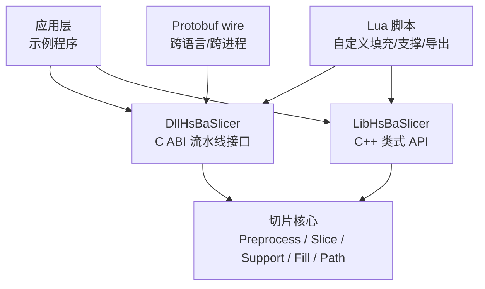
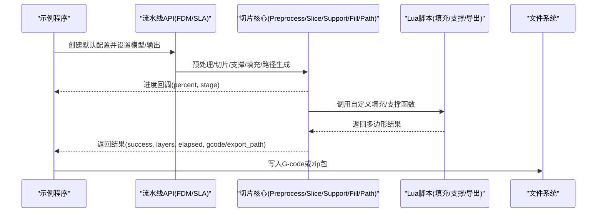
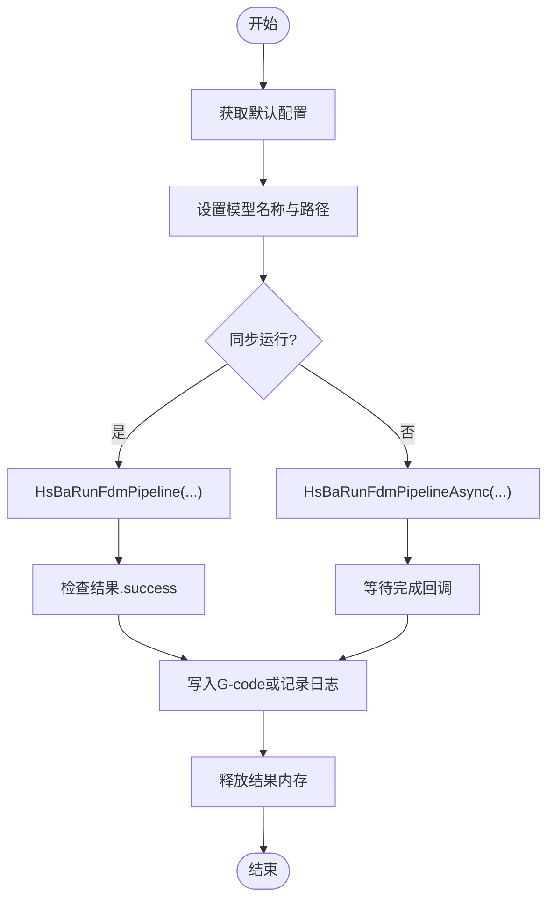
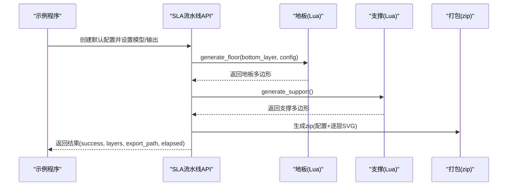
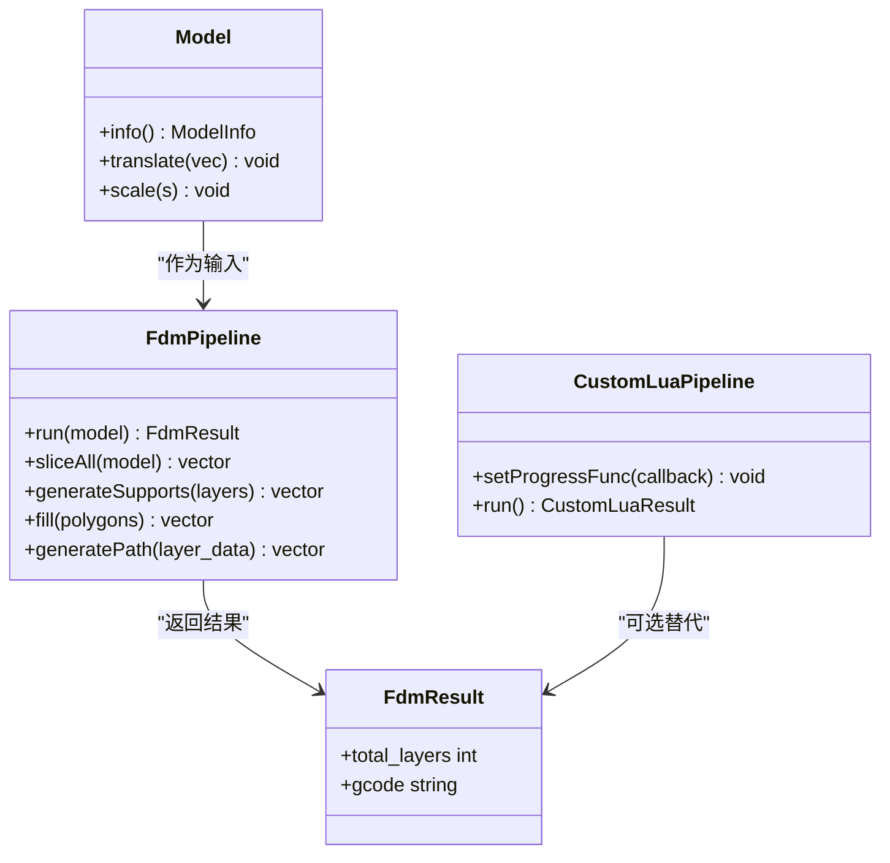
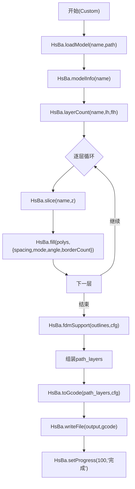
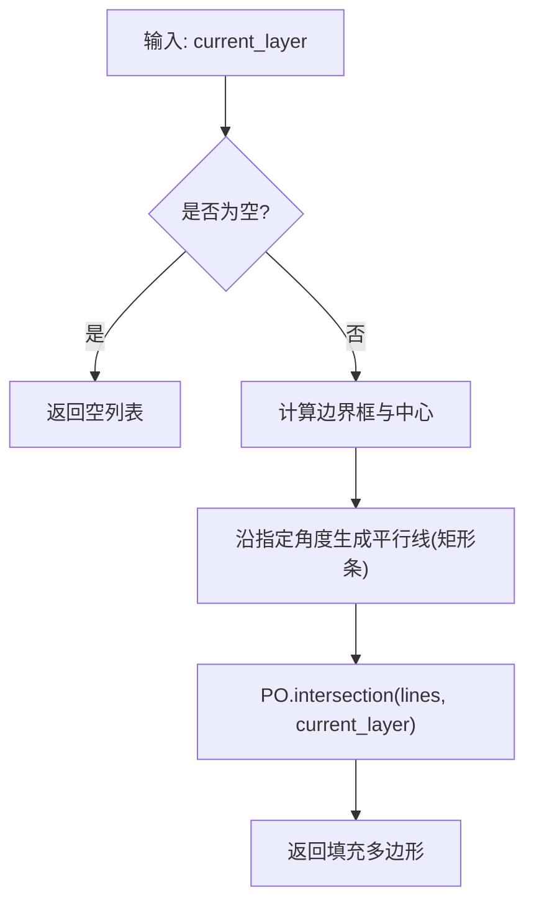
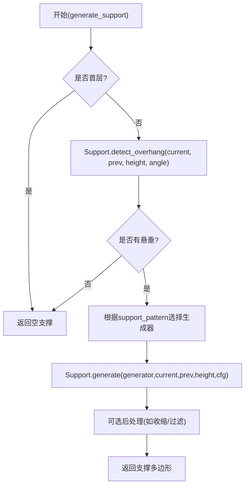
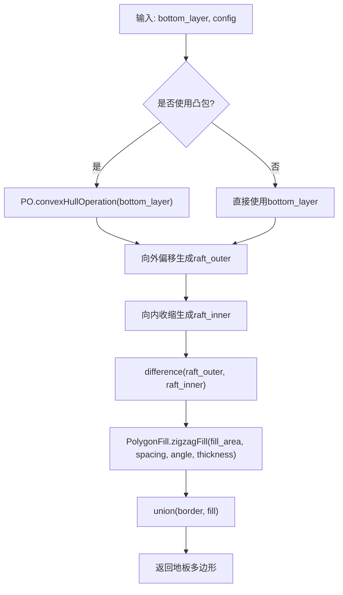
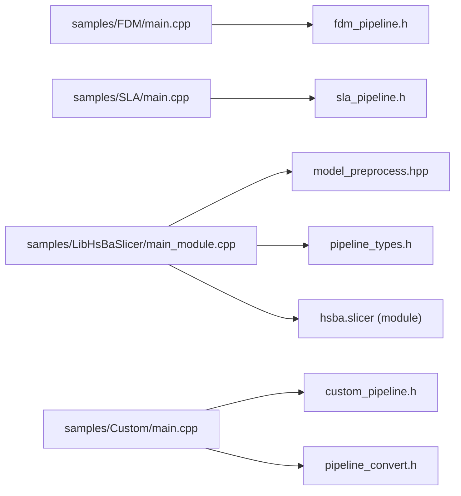

# 示例和教程

<cite>
**本文引用的文件**   
- [README.md](file://README.md)
- [samples/FDM/main.cpp](file://samples/FDM/main.cpp)
- [samples/SLA/main.cpp](file://samples/SLA/main.cpp)
- [samples/LibHsBaSlicer/main_module.cpp](file://samples/LibHsBaSlicer/main_module.cpp)
- [samples/Custom/main.cpp](file://samples/Custom/main.cpp)
- [samples/FDM/scripts/my_infill.lua](file://samples/FDM/scripts/my_infill.lua)
- [samples/FDM/scripts/my_support.lua](file://samples/FDM/scripts/my_support.lua)
- [samples/SLA/scripts/my_sla_floor.lua](file://samples/SLA/scripts/my_sla_floor.lua)
- [samples/SLA/scripts/my_sla_support.lua](file://samples/SLA/scripts/my_sla_support.lua)
- [samples/Custom/scripts/my_fdm_pipeline.lua](file://samples/Custom/scripts/my_fdm_pipeline.lua)
</cite>

## 目录
1. [引言](#引言)
2. [项目结构](#项目结构)
3. [核心组件](#核心组件)
4. [架构总览](#架构总览)
5. [详细组件分析](#详细组件分析)
6. [依赖关系分析](#依赖关系分析)
7. [性能与可维护性建议](#性能与可维护性建议)
8. [故障排查指南](#故障排查指南)
9. [结论](#结论)
10. [附录：学习路径与模板](#附录学习路径与模板)

## 引言
本教程面向不同水平的开发者，提供 HsBaSlicer 从“最简切片”到“完全自定义流水线”的完整示例与实战指导。内容覆盖：
- 基础示例：简单切片、参数配置、错误处理
- 高级示例：自定义填充算法、自定义支撑生成、批量与异步处理
- 实战案例：FDM/SLA 全流程、纯 Lua 自定义流水线、C++20 Module 用法、Protobuf 跨语言调用

通过循序渐进的学习路径，你将掌握：
- 如何使用 C API（DllHsBaSlicer）快速运行 FDM/SLA 流水线
- 如何扩展填充与支撑逻辑（Lua）
- 如何用 LibHsBaSlicer 的 C++ 类式 API 进行模块化开发
- 如何通过 Custom Lua Pipeline 完全掌控工作流阶段与顺序
- 如何在跨进程/跨语言场景下使用 Protobuf wire 数据驱动流水线

## 项目结构
HsBaSlicer 提供多层次的接口与示例工程，便于不同技术栈的用户接入：
- DllHsBaSlicer：导出 C ABI 的运行时流水线接口，适合外部语言或轻量集成
- LibHsBaSlicer：C++ 全流程切片能力封装，提供类式 API 与模块支持
- samples：按工艺类型（FDM/SLA/SLS/SLM/LOM/WAAM）与集成方式（C API/C++ Module/Custom Lua）组织示例

图示来源
- [README.md:100-124](file://README.md#L100-L124)
- [samples/FDM/main.cpp:17-22](file://samples/FDM/main.cpp#L17-L22)
- [samples/SLA/main.cpp:16-21](file://samples/SLA/main.cpp#L16-L21)
- [samples/LibHsBaSlicer/main_module.cpp:24-29](file://samples/LibHsBaSlicer/main_module.cpp#L24-L29)
- [samples/Custom/main.cpp:47-49](file://samples/Custom/main.cpp#L47-L49)

章节来源
- [README.md:100-124](file://README.md#L100-L124)

## 核心组件
本节聚焦示例中直接使用的核心组件与关键流程：
- FDM 流水线（C API）：同步/异步执行、参数配置、螺旋模式、Lua 自定义填充/支撑
- SLA 流水线（C API）：曝光/提升参数、地板/支撑 Lua 定制、zip 打包输出
- LibHsBaSlicer（C++ 类式 API）：Model -> FdmPipeline -> FdmResult，可选 CustomLuaPipeline
- Custom Lua Pipeline：整条工作流由 Lua 决定，C++ 仅提供算子环境

章节来源
- [samples/FDM/main.cpp:50-318](file://samples/FDM/main.cpp#L50-L318)
- [samples/SLA/main.cpp:49-239](file://samples/SLA/main.cpp#L49-L239)
- [samples/LibHsBaSlicer/main_module.cpp:31-161](file://samples/LibHsBaSlicer/main_module.cpp#L31-L161)
- [samples/Custom/main.cpp:97-354](file://samples/Custom/main.cpp#L97-L354)

## 架构总览
下图展示从应用入口到切片核心再到输出的整体数据流，以及 Lua 脚本在其中的扩展点。

图示来源
- [samples/FDM/main.cpp:50-96](file://samples/FDM/main.cpp#L50-L96)
- [samples/SLA/main.cpp:49-84](file://samples/SLA/main.cpp#L49-L84)
- [samples/Custom/main.cpp:97-132](file://samples/Custom/main.cpp#L97-L132)

## 详细组件分析

### FDM 流水线（C API）示例
- 基本用法：获取默认配置、设置模型、同步运行、检查成功与否、释放结果内存
- 自定义工艺参数：层高、壁厚、填充率、支撑模式、打印速度等
- Lua 自定义填充/支撑：通过脚本路径与函数名注入
- 异步流水线：非阻塞启动 + 完成回调
- 螺旋/花瓶模式：开启后外壁合并为连续挤出路径，跳过填充与支撑

图示来源
- [samples/FDM/main.cpp:50-96](file://samples/FDM/main.cpp#L50-L96)
- [samples/FDM/main.cpp:222-269](file://samples/FDM/main.cpp#L222-L269)

章节来源
- [samples/FDM/main.cpp:50-318](file://samples/FDM/main.cpp#L50-L318)

### SLA 流水线（C API）示例
- 基本用法：默认配置、设置模型、输出 zip（config.json + 逐层 SVG）
- 自定义参数：层高、曝光时间、提升距离/速度、地板偏移/边框/填充、支撑间隙/密度/模式
- Lua 自定义地板/支撑：通过脚本路径与函数名注入
- 异步流水线：非阻塞启动 + 完成回调

图示来源
- [samples/SLA/main.cpp:49-84](file://samples/SLA/main.cpp#L49-L84)
- [samples/SLA/main.cpp:86-144](file://samples/SLA/main.cpp#L86-L144)
- [samples/SLA/main.cpp:146-191](file://samples/SLA/main.cpp#L146-L191)

章节来源
- [samples/SLA/main.cpp:49-239](file://samples/SLA/main.cpp#L49-L239)

### LibHsBaSlicer（C++ 类式 API）示例
- 加载模型：RAII 自动清理，查询包围盒/体积等信息
- 配置 FDM 流水线：层高、线宽、填充模式、支撑模式等
- 运行完整流水线：FdmPipeline.run(model) -> FdmResult
- 可选：CustomLuaPipeline 完全由 Lua 定义工作流

图示来源
- [samples/LibHsBaSlicer/main_module.cpp:31-161](file://samples/LibHsBaSlicer/main_module.cpp#L31-L161)

章节来源
- [samples/LibHsBaSlicer/main_module.cpp:31-161](file://samples/LibHsBaSlicer/main_module.cpp#L31-L161)

### Custom Lua Pipeline（完全自定义工作流）
- 特点：C++ 固定阶段的内置流水线仅允许替换个别阶段；Custom 流水线则把整条工作流交给 Lua，C++ 只提供算子表（HsBa）
- 典型步骤：加载模型 -> 计算层数 -> 逐层切片 -> 填充 -> 支撑 -> 生成 G-code -> 写文件
- 支持多种工艺：FDM/SLS/SLM/LOM/3DP/WAAM，只需切换脚本
- 支持内联源码与脚本文件两种形式，支持异步执行与 Protobuf wire 数据驱动

图示来源
- [samples/Custom/scripts/my_fdm_pipeline.lua:52-171](file://samples/Custom/scripts/my_fdm_pipeline.lua#L52-L171)
- [samples/Custom/main.cpp:97-132](file://samples/Custom/main.cpp#L97-L132)

章节来源
- [samples/Custom/main.cpp:97-354](file://samples/Custom/main.cpp#L97-L354)
- [samples/Custom/scripts/my_fdm_pipeline.lua:1-172](file://samples/Custom/scripts/my_fdm_pipeline.lua#L1-L172)

### 自定义填充算法（Lua）
- 目标：在当前层多边形上生成自定义填充图案
- 关键点：
  - 不依赖全局变量，使用函数参数传入当前层多边形
  - 使用 PolygonOperations 做几何运算（交集/偏移/面积等）
  - 根据边界框与角度生成平行线，再与轮廓求交得到填充区域

图示来源
- [samples/FDM/scripts/my_infill.lua:20-88](file://samples/FDM/scripts/my_infill.lua#L20-L88)

章节来源
- [samples/FDM/scripts/my_infill.lua:1-89](file://samples/FDM/scripts/my_infill.lua#L1-L89)

### 自定义支撑生成（Lua）
- FDM 支撑：
  - 使用 Support.detect_overhang 检测悬垂区域
  - 根据 support_pattern 选择平面/树状/蜂窝支撑生成器
  - 使用 Support.generate 生成支撑截面，并可进一步收缩接触点
- SLA 支撑：
  - 使用 Support.new_sla() 生成牺牲支撑
  - 可按面积阈值过滤小支撑

图示来源
- [samples/FDM/scripts/my_support.lua:32-82](file://samples/FDM/scripts/my_support.lua#L32-L82)
- [samples/SLA/scripts/my_sla_support.lua:34-75](file://samples/SLA/scripts/my_sla_support.lua#L34-L75)

章节来源
- [samples/FDM/scripts/my_support.lua:1-83](file://samples/FDM/scripts/my_support.lua#L1-L83)
- [samples/SLA/scripts/my_sla_support.lua:1-76](file://samples/SLA/scripts/my_sla_support.lua#L1-L76)

### SLA 地板生成（Lua）
- 目标：基于底层轮廓生成 Raft/边框/填充
- 关键点：
  - 可选择凸包简化轮廓
  - 通过 offsetOperation 生成外边界与内边界
  - 使用 PolygonFill.zigzagFill 生成内部填充
  - 合并边框与填充得到最终地板

图示来源
- [samples/SLA/scripts/my_sla_floor.lua:35-62](file://samples/SLA/scripts/my_sla_floor.lua#L35-L62)

章节来源
- [samples/SLA/scripts/my_sla_floor.lua:1-64](file://samples/SLA/scripts/my_sla_floor.lua#L1-L64)

## 依赖关系分析
- 示例程序依赖对应流水线头文件（fdm_pipeline.h/sla_pipeline.h），并通过 LoggerSingletone 输出日志
- Custom Lua Pipeline 依赖 custom_pipeline.h 与 pipeline_convert.h，用于配置转换与执行
- LibHsBaSlicer 示例依赖 model_preprocess.hpp 与 pipelinetypes/pipeline_types.h，并使用 import hsba.slicer 模块

图示来源
- [samples/FDM/main.cpp:17-22](file://samples/FDM/main.cpp#L17-L22)
- [samples/SLA/main.cpp:16-21](file://samples/SLA/main.cpp#L16-L21)
- [samples/LibHsBaSlicer/main_module.cpp:24-29](file://samples/LibHsBaSlicer/main_module.cpp#L24-L29)
- [samples/Custom/main.cpp:47-49](file://samples/Custom/main.cpp#L47-L49)

章节来源
- [samples/FDM/main.cpp:17-22](file://samples/FDM/main.cpp#L17-L22)
- [samples/SLA/main.cpp:16-21](file://samples/SLA/main.cpp#L16-L21)
- [samples/LibHsBaSlicer/main_module.cpp:24-29](file://samples/LibHsBaSlicer/main_module.cpp#L24-L29)
- [samples/Custom/main.cpp:47-49](file://samples/Custom/main.cpp#L47-L49)

## 性能与可维护性建议
- 分层策略：对大模型优先使用较低层高分辨率测试，逐步提高精度
- 填充优化：旋转填充角度避免弱方向累积应力；合理设置间距与壁厚
- 支撑控制：适当增大 overhang_angle 阈值以减少支撑量；使用树状/蜂窝支撑降低材料消耗
- 异步处理：UI 应用中采用异步流水线，避免阻塞主线程
- Lua 脚本：将通用参数抽离至 machine 表，便于复用与调试

[本节为通用建议，不直接分析具体文件]

## 故障排查指南
- 常见错误与处理：
  - 切片失败：检查 result.success 与 error_message，确认模型路径与文件格式正确
  - 写入失败：确保输出目录存在且可写；必要时先创建目录
  - Lua 脚本错误：检查脚本路径与函数名是否正确；在脚本中增加 progress 上报以定位阶段
  - 资源泄漏：务必调用对应的释放函数（如 HsBaFreePipelineResult/HsBaFreeSlaPipelineResult/HsBaFreeCustomPipelineResult）
- 调试技巧：
  - 使用 LoggerSingletone 输出关键阶段信息
  - 在 Lua 脚本中打印中间结果（如层数、面积、输出路径）
  - 对 Custom Lua Pipeline，先用内联源码验证逻辑，再迁移到脚本文件

章节来源
- [samples/FDM/main.cpp:66-96](file://samples/FDM/main.cpp#L66-L96)
- [samples/SLA/main.cpp:66-84](file://samples/SLA/main.cpp#L66-L84)
- [samples/Custom/main.cpp:80-95](file://samples/Custom/main.cpp#L80-L95)

## 结论
通过本教程，你可以：
- 快速上手 FDM/SLA 流水线的同步与异步调用
- 灵活扩展填充与支撑逻辑（Lua）
- 使用 LibHsBaSlicer 的 C++ 类式 API 进行模块化开发
- 用 Custom Lua Pipeline 完全掌控工作流阶段与顺序
- 在跨语言/跨进程场景中通过 Protobuf wire 数据驱动流水线

这些能力覆盖了从入门到进阶再到生产级定制化的全链路需求。

[本节为总结性内容，不直接分析具体文件]

## 附录：学习路径与模板

### 学习路径
- 入门（1-2小时）：
  - 运行 FDM 基本示例，理解默认配置与结果结构
  - 运行 SLA 基本示例，理解 zip 输出与基础参数
- 进阶（半天-1天）：
  - 自定义填充与支撑（Lua），观察对 G-code 的影响
  - 使用 LibHsBaSlicer 的 C++ 类式 API 进行模块化开发
- 高阶（1-2天）：
  - 使用 Custom Lua Pipeline 完全自定义工作流
  - 探索异步执行与 Protobuf wire 数据驱动

### 常用代码模板（路径引用）
- FDM 基本流水线模板：[samples/FDM/main.cpp:50-96](file://samples/FDM/main.cpp#L50-L96)
- FDM 自定义参数模板：[samples/FDM/main.cpp:98-165](file://samples/FDM/main.cpp#L98-L165)
- FDM Lua 自定义填充/支撑模板：[samples/FDM/main.cpp:167-220](file://samples/FDM/main.cpp#L167-L220)
- FDM 异步流水线模板：[samples/FDM/main.cpp:222-269](file://samples/FDM/main.cpp#L222-L269)
- FDM 螺旋模式模板：[samples/FDM/main.cpp:271-318](file://samples/FDM/main.cpp#L271-L318)
- SLA 基本流水线模板：[samples/SLA/main.cpp:49-84](file://samples/SLA/main.cpp#L49-L84)
- SLA 自定义参数模板：[samples/SLA/main.cpp:86-144](file://samples/SLA/main.cpp#L86-L144)
- SLA Lua 自定义地板/支撑模板：[samples/SLA/main.cpp:146-191](file://samples/SLA/main.cpp#L146-L191)
- SLA 异步流水线模板：[samples/SLA/main.cpp:193-239](file://samples/SLA/main.cpp#L193-L239)
- LibHsBaSlicer C++ 类式 API 模板：[samples/LibHsBaSlicer/main_module.cpp:31-161](file://samples/LibHsBaSlicer/main_module.cpp#L31-L161)
- Custom Lua Pipeline 模板（FDM）：[samples/Custom/main.cpp:97-132](file://samples/Custom/main.cpp#L97-L132)
- Custom Lua Pipeline 脚本（FDM）：[samples/Custom/scripts/my_fdm_pipeline.lua:52-171](file://samples/Custom/scripts/my_fdm_pipeline.lua#L52-L171)

[本节为模板索引，不直接分析具体文件]