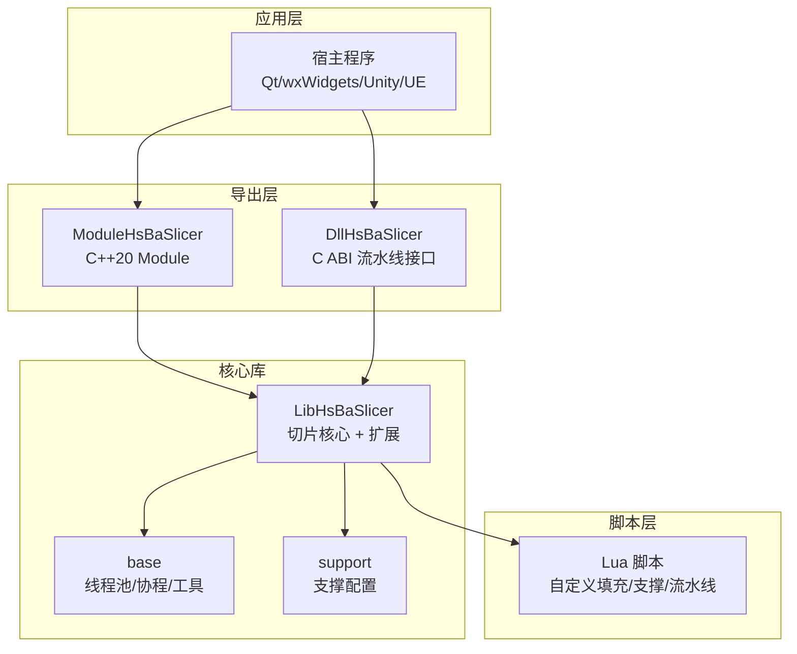
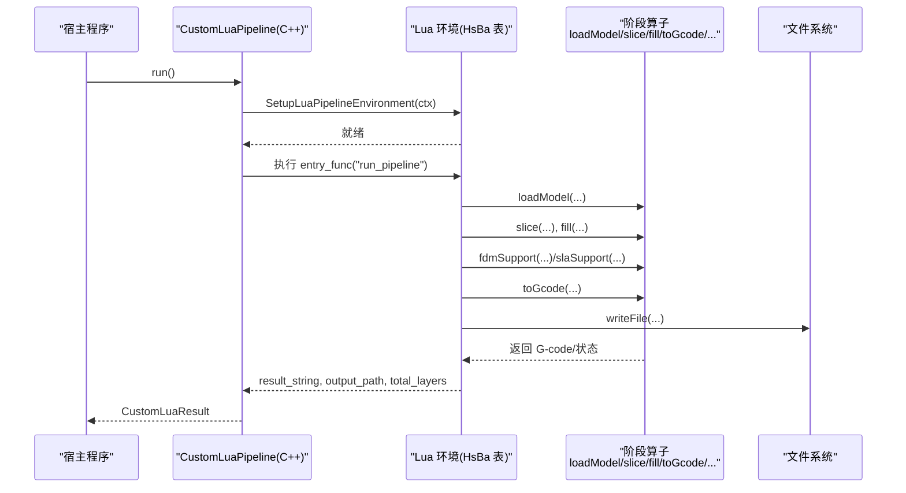
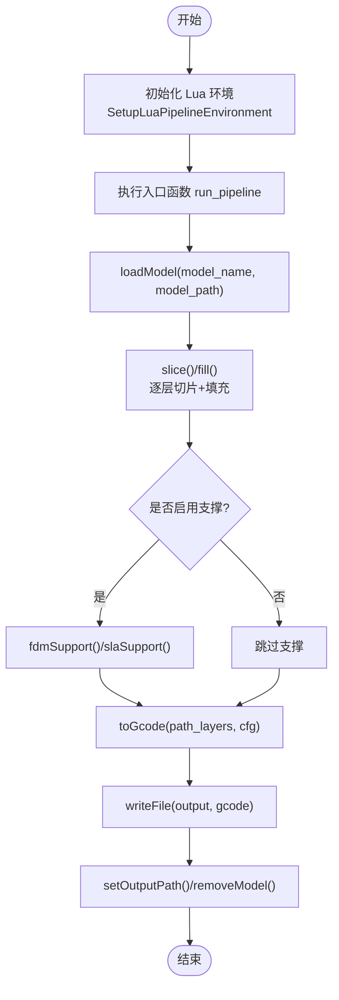
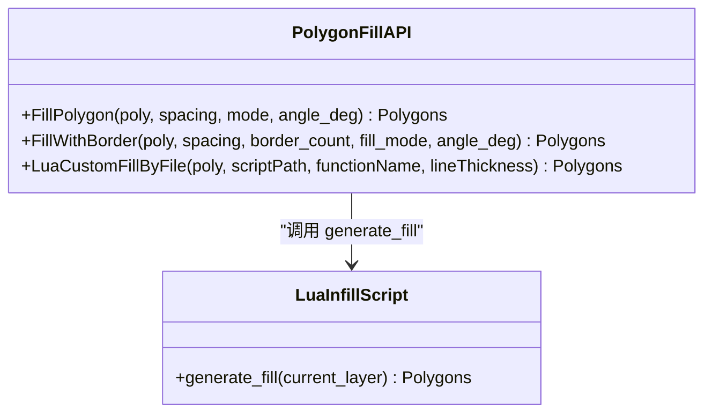
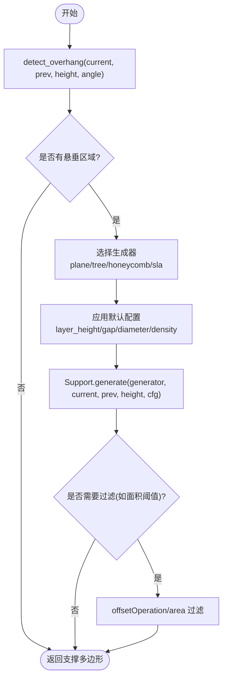
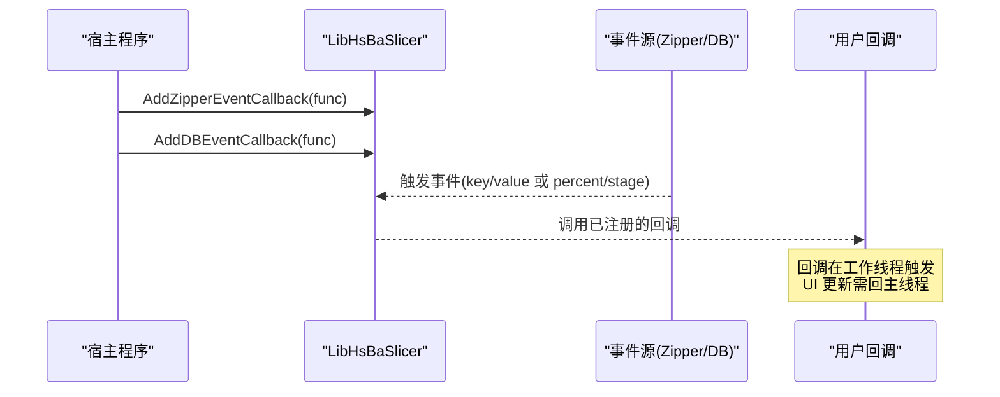
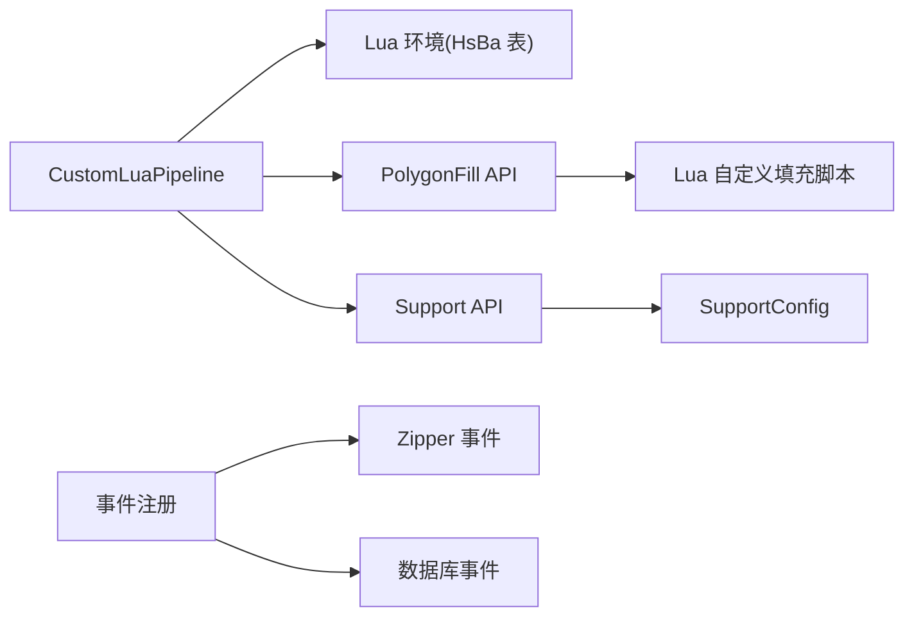

# 高级示例

<cite>
**本文引用的文件**   
- [README.md](file://README.md)
- [pipeline_types.h](file://pipelinetypes/pipeline_types.h)
- [hsba_slicer.cppm](file://ModuleHsBaSlicer/hsba_slicer.cppm)
- [lua_pipeline.hpp](file://LibHsBaSlicer/Extends/lua_pipeline.hpp)
- [EventSourceFunction.hpp](file://LibHsBaSlicer/Extends/EventSourceFunction.hpp)
- [thread_pool.hpp](file://base/thread_pool.hpp)
- [my_fdm_pipeline.lua](file://samples/Custom/scripts/my_fdm_pipeline.lua)
- [my_infill.lua](file://samples/FDM/scripts/my_infill.lua)
- [my_support.lua](file://samples/FDM/scripts/my_support.lua)
- [my_sla_support.lua](file://samples/SLA/scripts/my_sla_support.lua)
- [polygon_fill.hpp](file://LibHsBaSlicer/Fill/polygon_fill.hpp)
- [SupportConfig.hpp](file://support/SupportConfig.hpp)
</cite>

## 目录
1. [引言](#引言)
2. [项目结构](#项目结构)
3. [核心组件](#核心组件)
4. [架构总览](#架构总览)
5. [详细组件分析](#详细组件分析)
6. [依赖关系分析](#依赖关系分析)
7. [性能与并发优化](#性能与并发优化)
8. [故障排查指南](#故障排查指南)
9. [结论](#结论)
10. [附录：最佳实践清单](#附录最佳实践清单)

## 引言
本“高级示例”文档面向有经验的开发者，聚焦 HsBaSlicer 的复杂定制与扩展能力。内容覆盖：
- 自定义填充算法（Lua 脚本 + C++ 插件）
- 自定义支撑生成逻辑（FDM / SLA）
- 完全由 Lua 驱动的流水线编排
- 批量处理与多线程优化
- Lua 脚本接口、事件机制、错误处理与性能调优

HsBaSlicer 是面向 3D 打印切片的高性能 C++ 框架，提供模块化、跨平台的切片核心能力，适用于研发与生产级流水线。其导出目标包括动态库（C ABI）、静态库（C++ API），并配套丰富的 Lua 扩展点与事件回调机制。

**章节来源**
- [README.md:21-39](file://README.md#L21-L39)

## 项目结构
从高级定制视角，重点关注以下模块：
- LibHsBaSlicer：C++ 全流程切片能力封装，包含 Fill、Support、Path、Floor、Preprocess、Slice 等子模块，以及 Extends 中的 Lua 管道与事件源注册。
- ModuleHsBaSlicer：C++20 module 入口，暴露 CustomLuaPipeline 等高级流水线类型。
- samples：官方示例脚本，展示 FDM/SLA/SLS/SLM/TDP/WAAM 等工艺的全 Lua 驱动或局部替换方案。
- base：线程池、协程、内存池等基础工具。
- support：支撑配置与通用支撑数据结构。



**图表来源**
- [hsba_slicer.cppm:445-479](file://ModuleHsBaSlicer/hsba_slicer.cppm#L445-L479)
- [lua_pipeline.hpp:19-83](file://LibHsBaSlicer/Extends/lua_pipeline.hpp#L19-L83)
- [thread_pool.hpp:29-162](file://base/thread_pool.hpp#L29-L162)
- [SupportConfig.hpp:14-43](file://support/SupportConfig.hpp#L14-L43)

**章节来源**
- [README.md:29-39](file://README.md#L29-L39)

## 核心组件
- 完全 Lua 驱动的自定义流水线：通过 CustomLuaPipeline 与 LuaPipelineContext/LuaPipelineOutput 暴露给 C++，Lua 侧通过全局 HsBa 表编排加载模型、切片、支撑、填充、路径输出与打包。
- 填充扩展点：支持内置填充模式（直线/锯齿/混合）与 Lua 自定义填充（按文件或内联脚本）。
- 支撑扩展点：FDM/SLA 支撑生成器与悬垂检测，配合 SupportConfig 统一参数。
- 事件系统：Zipper 压缩进度与数据库事件回调，支持 C++ 与 Lua 双向注册。
- 并发与批处理：ThreadPool 提供任务队列与协程执行器；异步流水线回调在内部工作线程触发，宿主需回主线程更新 UI。

**章节来源**
- [hsba_slicer.cppm:445-479](file://ModuleHsBaSlicer/hsba_slicer.cppm#L445-L479)
- [polygon_fill.hpp:17-53](file://LibHsBaSlicer/Fill/polygon_fill.hpp#L17-L53)
- [SupportConfig.hpp:14-43](file://support/SupportConfig.hpp#L14-L43)
- [EventSourceFunction.hpp:18-41](file://LibHsBaSlicer/Extends/EventSourceFunction.hpp#L18-L41)

## 架构总览
下图展示了“完全 Lua 驱动流水线”的端到端调用链：C++ 构建 Lua 环境，Lua 脚本通过 HsBa 表调用各阶段算子，最终返回结果与输出路径。



**图表来源**
- [hsba_slicer.cppm:1145-1178](file://ModuleHsBaSlicer/hsba_slicer.cppm#L1145-L1178)
- [lua_pipeline.hpp:29-83](file://LibHsBaSlicer/Extends/lua_pipeline.hpp#L29-L83)
- [my_fdm_pipeline.lua:52-171](file://samples/Custom/scripts/my_fdm_pipeline.lua#L52-L171)

## 详细组件分析

### 完全 Lua 驱动的流水线（CustomLuaPipeline）
- C++ 侧提供 CustomLuaPipeline 类，负责创建 Lua 环境、注入 HsBa 操作表、执行脚本入口函数，并将结果映射为 CustomLuaResult。
- Lua 侧通过 HsBa.progress/setLayers/setOutputPath/removeModel 等接口进行进度上报、层数设置、输出路径设置与资源清理。
- 典型流程：加载模型 -> 计算层数 -> 逐层切片与填充 -> 可选支撑 -> 组装路径数据 -> 生成 G-code -> 写文件。



**图表来源**
- [hsba_slicer.cppm:1145-1178](file://ModuleHsBaSlicer/hsba_slicer.cppm#L1145-L1178)
- [my_fdm_pipeline.lua:52-171](file://samples/Custom/scripts/my_fdm_pipeline.lua#L52-L171)

**章节来源**
- [hsba_slicer.cppm:445-479](file://ModuleHsBaSlicer/hsba_slicer.cppm#L445-L479)
- [hsba_slicer.cppm:1145-1178](file://ModuleHsBaSlicer/hsba_slicer.cppm#L1145-L1178)
- [lua_pipeline.hpp:29-83](file://LibHsBaSlicer/Extends/lua_pipeline.hpp#L29-L83)
- [my_fdm_pipeline.lua:52-171](file://samples/Custom/scripts/my_fdm_pipeline.lua#L52-L171)

### 自定义填充算法（Lua 脚本与 C++ 插件）
- Lua 自定义填充：通过 PolygonOperations 进行多边形运算，实现平行线扫描、角度控制、边界裁剪等策略。
- C++ 插件：LibHsBaSlicer 提供 LuaCustomFillByFile 接口，允许以文件形式加载 Lua 填充脚本，并在 C++ 管线中直接调用。



**图表来源**
- [polygon_fill.hpp:17-53](file://LibHsBaSlicer/Fill/polygon_fill.hpp#L17-L53)
- [my_infill.lua:20-88](file://samples/FDM/scripts/my_infill.lua#L20-L88)

**章节来源**
- [polygon_fill.hpp:17-53](file://LibHsBaSlicer/Fill/polygon_fill.hpp#L17-L53)
- [my_infill.lua:20-88](file://samples/FDM/scripts/my_infill.lua#L20-L88)

### 自定义支撑生成逻辑（FDM / SLA）
- FDM 支撑：使用 Support.detect_overhang 检测悬垂区域，选择平面/树状/蜂窝生成器，结合 Support.default_config 调整间隙、直径、密度等参数。
- SLA 支撑：使用 Support.new_sla 生成牺牲柱支撑，可基于面积阈值过滤支撑点。



**图表来源**
- [my_support.lua:32-80](file://samples/FDM/scripts/my_support.lua#L32-L80)
- [my_sla_support.lua:34-73](file://samples/SLA/scripts/my_sla_support.lua#L34-L73)
- [SupportConfig.hpp:14-43](file://support/SupportConfig.hpp#L14-L43)

**章节来源**
- [my_support.lua:32-80](file://samples/FDM/scripts/my_support.lua#L32-L80)
- [my_sla_support.lua:34-73](file://samples/SLA/scripts/my_sla_support.lua#L34-L73)
- [SupportConfig.hpp:14-43](file://support/SupportConfig.hpp#L14-L43)

### 事件处理机制与回调模型
- C++ 侧可通过 AddZipperEventCallback/AddDBEventCallback 注册 Zipper 压缩进度与数据库事件回调。
- DLL 层的回调在内部工作线程触发，宿主必须将 UI 更新调度到主线程；stage 字符串仅在回调期间有效，需要拷贝保存。



**图表来源**
- [EventSourceFunction.hpp:18-41](file://LibHsBaSlicer/Extends/EventSourceFunction.hpp#L18-L41)

**章节来源**
- [EventSourceFunction.hpp:18-41](file://LibHsBaSlicer/Extends/EventSourceFunction.hpp#L18-L41)

### 批量处理与多线程优化
- ThreadPool 提供任务提交、等待全部完成、活跃任务计数等功能，并可作为协程执行器集成。
- 异步流水线回调（进度与结果）在内部工作线程触发，适合后台批量切片与并行处理。

```mermaid
classDiagram
class ThreadPool {
+submit(f, args...) future
+PendingTasks() size_t
+ActiveTasks() size_t
+WaitAll() void
}
class Task {
+GetResult() T
}
ThreadPool --> Task : "返回 std : : future"
```

**图表来源**
- [thread_pool.hpp:29-162](file://base/thread_pool.hpp#L29-L162)

**章节来源**
- [thread_pool.hpp:29-162](file://base/thread_pool.hpp#L29-L162)

## 依赖关系分析
- CustomLuaPipeline 依赖 LuaPipelineContext/LuaPipelineOutput 与 HsBa 全局表提供的各阶段算子。
- 填充模块依赖 2D 多边形引擎与 Lua 自定义填充胶水。
- 支撑模块依赖 SupportConfig 与具体生成器（平面/树状/蜂窝/SLA）。
- 事件系统解耦了 Zipper/DB 与宿主回调，便于扩展与测试。



**图表来源**
- [hsba_slicer.cppm:445-479](file://ModuleHsBaSlicer/hsba_slicer.cppm#L445-L479)
- [polygon_fill.hpp:17-53](file://LibHsBaSlicer/Fill/polygon_fill.hpp#L17-L53)
- [SupportConfig.hpp:14-43](file://support/SupportConfig.hpp#L14-L43)
- [EventSourceFunction.hpp:18-41](file://LibHsBaSlicer/Extends/EventSourceFunction.hpp#L18-L41)

**章节来源**
- [hsba_slicer.cppm:445-479](file://ModuleHsBaSlicer/hsba_slicer.cppm#L445-L479)
- [polygon_fill.hpp:17-53](file://LibHsBaSlicer/Fill/polygon_fill.hpp#L17-L53)
- [SupportConfig.hpp:14-43](file://support/SupportConfig.hpp#L14-L43)
- [EventSourceFunction.hpp:18-41](file://LibHsBaSlicer/Extends/EventSourceFunction.hpp#L18-L41)

## 性能与并发优化
- 线程池与协程：使用 ThreadPool 提交独立任务（如批量切片、路径优化），并通过 WaitAll 同步；协程执行器可无缝接入现有异步任务。
- 回调线程模型：DLL 层的进度与结果回调在内部工作线程触发，避免阻塞 UI；宿主应使用线程安全的 UI 调度机制。
- 内存管理：避免在回调中持有长生命周期引用；stage 字符串仅回调期间有效，需拷贝。
- 填充与支撑：合理设置间距、角度、密度与间隙，减少不必要的几何运算；必要时对支撑结果进行面积过滤以降低后续处理成本。
- 批量处理：将多个模型的切片/填充/支撑任务分片提交至线程池，结合进度回调实现可视化进度条。

[本节为通用指导，不直接分析具体文件]

## 故障排查指南
- Lua 流水线失败：检查 pipeline_lua_script 或 pipeline_lua_source 是否正确传入；确认 entry_func 名称与脚本定义一致；查看 error_message 定位 Lua 错误。
- 填充为空：确认当前层多边形非空；检查间距与角度是否导致线条未覆盖有效区域；验证 PolygonOperations 交集/偏移结果。
- 支撑未生成：确认悬垂检测阈值与层高匹配；检查支撑生成器选择与配置字段（gap/diameter/density）；必要时缩小 offset 步长提高精度。
- 回调未触发：确保已注册 Zipper/DB 事件回调；注意回调在工作线程触发，UI 更新需回主线程；复制 stage/key/value 字符串后再使用。
- 异步回调线程安全：不要直接在回调中修改共享状态；使用线程安全容器或加锁保护。

**章节来源**
- [hsba_slicer.cppm:1152-1178](file://ModuleHsBaSlicer/hsba_slicer.cppm#L1152-L1178)
- [my_infill.lua:20-88](file://samples/FDM/scripts/my_infill.lua#L20-L88)
- [my_support.lua:32-80](file://samples/FDM/scripts/my_support.lua#L32-L80)
- [my_sla_support.lua:34-73](file://samples/SLA/scripts/my_sla_support.lua#L34-L73)
- [EventSourceFunction.hpp:18-41](file://LibHsBaSlicer/Extends/EventSourceFunction.hpp#L18-L41)

## 结论
HsBaSlicer 提供了强大的可扩展切片框架：通过完全 Lua 驱动的流水线、灵活的填充与支撑扩展点、完善的事件系统与并发工具，开发者可以高效实现复杂定制与高性能生产流水线。建议遵循本文的最佳实践，结合线程池与回调模型，逐步迭代优化算法与参数，达到稳定、可维护且高性能的切片解决方案。

[本节为总结性内容，不直接分析具体文件]

## 附录：最佳实践清单
- 使用 CustomLuaPipeline 编排完整流水线，优先在 Lua 侧决定阶段顺序与参数策略。
- 填充算法优先使用 PolygonOperations 组合，避免重复造轮子；必要时用 LuaCustomFillByFile 引入 C++ 可调用的 Lua 脚本。
- 支撑生成先做悬垂检测，再选择合适生成器；根据工艺调整 gap/diameter/density 等参数。
- 事件回调务必线程安全，UI 更新回主线程；复制回调参数后使用。
- 批量任务通过 ThreadPool.submit 分发，使用 WaitAll 同步；结合进度回调提升用户体验。
- 错误处理：捕获 SlicerError 与 std::exception，记录日志并返回友好提示。

[本节为通用指导，不直接分析具体文件]