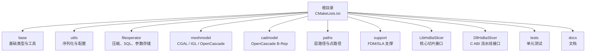

# 贡献指南

<cite>
**本文引用的文件**   
- [README.md](file://README.md)
- [CMakeLists.txt](file://CMakeLists.txt)
- [CMakePresets.json](file://CMakePresets.json)
- [vcpkg.json](file://vcpkg.json)
- [.clang-format](file://.clang-format)
- [clang-format-batch.py](file://static_check/clang-format-batch.py)
- [tests/CMakeLists.txt](file://tests/CMakeLists.txt)
</cite>

## 目录
1. [简介](#简介)
2. [项目结构](#项目结构)
3. [开发环境搭建](#开发环境搭建)
4. [代码风格与格式化](#代码风格与格式化)
5. [命名约定与注释规范](#命名约定与注释规范)
6. [分支管理与提交规范](#分支管理与提交规范)
7. [提交流程与代码审查](#提交流程与代码审查)
8. [测试要求与质量保证](#测试要求与质量保证)
9. [调试技巧与性能分析](#调试技巧与性能分析)
10. [文档编写与更新流程](#文档编写与更新流程)
11. [依赖与构建配置要点](#依赖与构建配置要点)
12. [常见问题排查](#常见问题排查)
13. [结语](#结语)

## 简介
HsBaSlicer 是一个面向 3D 打印切片领域的高性能 C++ 框架，提供模块化、跨平台的切片核心能力，适用于研发与生产级别的切片流水线。对外部贡献者而言，本项目已经具备较完整的构建系统、测试体系、静态格式化工具和多平台预设，适合在 Windows、Linux、macOS、Android、iOS 等平台上参与开发与验证。

本贡献指南面向希望参与 HsBaSlicer 开发的贡献者，涵盖开发环境搭建、工具链与 IDE 配置、代码风格、提交与分支管理、Pull Request 流程、测试与质量门禁、调试与性能分析方法，以及文档编写规范。

## 项目结构
HsBaSlicer 采用按功能域划分的模块结构，核心包括基础类型与工具、网格模型、CAD 模型、路径输出、支撑生成、文件操作、协议转换、动态库导出接口等。顶层 `CMakeLists.txt` 负责全局特性检测、依赖发现、目标安装与导出、测试开关、文档构建开关等；`CMakePresets.json` 提供多平台、多配置的预设；`vcpkg.json` 声明依赖与可选的 copyleft 内核特性。

**图示来源**
- [CMakeLists.txt:410-440](file://CMakeLists.txt#L410-L440)
- [README.md:25-39](file://README.md#L25-L39)

**章节来源**
- [README.md:25-39](file://README.md#L25-L39)
- [CMakeLists.txt:410-440](file://CMakeLists.txt#L410-L440)

## 开发环境搭建

### 必需工具链
- CMake 版本要求：根 CMake 使用较高版本进行特性检测，建议满足或高于项目最低要求。
- C++ 编译器：需要支持 C++20，并尽可能支持现代特性（如 concepts、ranges、source_location、coroutines、explicit this）。
- vcpkg：用于依赖管理与多平台 triplet 控制。
- PowerShell：Windows 下建议使用 PowerShell 7，Windows PowerShell 5.1 也可用。
- Linux/macOS 示例依赖：g++、make、ninja-build、pkg-config、automake、libtool、m4、autoconf、python3、OpenGL/GLU/X11 相关开发包等。

**章节来源**
- [README.md:41-98](file://README.md#L41-L98)
- [CMakeLists.txt:4-38](file://CMakeLists.txt#L4-L38)

### Windows 环境
- 推荐安装 Visual Studio 2022 或更高版本，勾选“使用 C++ 的桌面开发”、CMake 工具与 vcpkg。
- 将 vcpkg 路径加入系统环境变量，以便 IDE 和命令行均可调用。
- 推荐使用 `windows-release` 预设进行发布构建；包含 CGAL 的子模块在 Debug 模式下可能遇到问题。

**章节来源**
- [README.md:57-62](file://README.md#L57-L62)

### Linux/macOS 环境
- 以 Ubuntu/Debian 为例，需安装 cmake、git、python3、g++、make、ninja-build、pkg-config、automake、libtool、m4、autoconf、OpenGL/GLU/X11 相关开发包。
- 安装 vcpkg 后，通过 CMake 预设或手动指定 toolchain 文件进行构建。
- 可使用 `linux-release` 或 `linux-debug` 预设；CI 场景可使用 `linux-coverage` 预设进行覆盖率门禁。

**章节来源**
- [README.md:63-94](file://README.md#L63-L94)
- [CMakePresets.json:42-110](file://CMakePresets.json#L42-L110)

### Android/iOS 环境
- Android 通常在 Linux 环境下完成，需安装 Android SDK/NDK，并设置 `ANDROID_NDK_HOME`。
- iOS 在 CI 上已验证，本地 macOS 构建未进行广泛测试。
- 可通过 `android-release` 与 `ios-release` 预设进行交叉编译。

**章节来源**
- [README.md:96-98](file://README.md#L96-L98)
- [CMakePresets.json:113-205](file://CMakePresets.json#L113-L205)

## 代码风格与格式化

### 统一代码风格
项目使用 `.clang-format` 定义 Allman 风格：大括号始终独立成行、缩进为 4 空格、列限制 120、指针与引用左对齐、模板与继承列表换行策略明确、包含排序与 using 声明排序启用。

建议在 IDE 中集成 clang-format，并在保存时自动格式化；或在提交前运行批量格式化脚本。

**章节来源**
- [.clang-format:1-99](file://.clang-format#L1-L99)

### 批量格式化脚本
项目提供 `static_check/clang-format-batch.py`，可递归扫描 C/C++ 文件，忽略 `.gitignore` 中的目录与文件，并按 `.clang-format` 规则格式化。支持并行线程数、dry-run 预览、自定义 clang-format 路径与风格。

典型用法：
- 在当前目录执行批量格式化。
- 指定项目根路径。
- 使用 LLVM 风格覆盖项目默认风格。
- 仅预览不修改文件。
- 调整并行线程数。

注意：脚本会排除部分自动生成或特殊处理文件（例如 `encoding_convert.cpp`、`version.cpp`），以避免干扰生成内容。

**章节来源**
- [clang-format-batch.py:1-274](file://static_check/clang-format-batch.py#L1-L274)

## 命名约定与注释规范

### 命名约定
- 头文件与源文件采用小写加下划线或驼峰混合风格，具体以现有模块为准。
- 类名、函数名、变量名遵循 C++ 通用习惯：类名使用大驼峰，函数与变量使用小驼峰，常量使用大写加下划线。
- 命名空间使用小写，避免与标准库冲突。
- 宏与编译期开关使用大写加下划线，如 `HSBA_COPL`、`USE_CGAL`、`USE_OCCT`。

### 注释规范
- 公共 API 应提供清晰的功能说明、参数含义、返回值语义与异常行为。
- 复杂算法或关键逻辑处添加行内注释，解释设计动机与边界条件。
- 对第三方库或外部接口的封装，应注明来源与版本约束。
- 对许可证与法律相关注释（如 copyleft 内核）应保持准确与一致。

由于仓库未提供统一的注释模板，建议参考现有模块的注释风格保持一致性。

[本节为概念性指导，不直接分析具体源码文件]

## 分支管理与提交规范

### 分支策略
- 主分支：`main`（或仓库默认分支）作为稳定基线。
- 功能分支：从主分支创建 `feature/<功能名>` 分支进行开发。
- 修复分支：从主分支创建 `fix/<问题描述>` 分支修复缺陷。
- 发布分支：由维护者在发布前创建 `release/<版本号>` 分支进行冻结与回归测试。
- 热修复分支：从对应发布分支创建 `hotfix/<问题描述>` 分支快速修复线上问题。

### 提交信息规范
- 提交标题简洁明了，动词开头，描述变更目的。
- 正文说明变更背景、影响范围、测试方法与注意事项。
- 关联 issue 或 PR 编号，便于追踪。
- 避免无意义提交（如“update”“fix typo”），尽量拆分细粒度提交。

[本节为概念性指导，不直接分析具体源码文件]

## 提交流程与代码审查

### Pull Request 创建
- 在功能分支完成后，推送至远程仓库并创建 Pull Request。
- PR 标题与描述应清晰说明变更内容、影响模块、测试情况与风险点。
- 若涉及 API 变更，需同步更新相关文档与示例。

### 代码审查标准
- 代码符合 `.clang-format` 风格。
- 新增或修改逻辑需配套单元测试或集成测试。
- 复杂逻辑需提供必要注释与设计说明。
- 依赖变更需在 `vcpkg.json` 中明确，并说明平台差异。
- 对 copyleft 内核（CGAL、OpenCascade）的使用需评估许可影响。

### 合并前检查
- 所有单元测试通过。
- 静态格式检查通过。
- 构建成功（至少 Release 配置）。
- 文档更新完整（如涉及公共 API）。

[本节为概念性指导，不直接分析具体源码文件]

## 测试要求与质量保证

### 单元测试
- 使用 Boost.Test 框架编写单元测试，测试目标在 `tests/CMakeLists.txt` 中注册。
- 每个测试目标链接相应模块库，并通过 `add_test` 注册到 CTest。
- 可在构建后自动运行单个测试或全部测试。

常见测试目标包括：
- 基础类型与工具：`any_object_test`、`anyvisit_test`、`coroutines_test`、`memory_pool_test`、`thread_pool_test`、`object_pool_test`。
- 文件与配置：`filename_check_test`、`encoding_convert_test`、`configmap_test`、`json_convert_test`。
- 加密与哈希：`cipher_test`、`cipher_lua_adapter_test`。
- 路径与几何：`points_path_test`、`layers_path_test`、`images_path_test`、`polygon_fill_test`、`spiral_path_test`、`float_polygons_test`、`int_polygon_test`。
- 模型与支撑：`igl_model_test`、`full_topo_model_test`、`openvdb_model_test`、`support_test`、`fdm_support_lib_test`。
- 其他：`param_store_test`、`hull_2d_test`、`gcode_path_test`、`weld_robot_path_test`、`robot_path_test`、`path_generator_test`。

**章节来源**
- [tests/CMakeLists.txt:1-800](file://tests/CMakeLists.txt#L1-L800)

### 集成测试与覆盖率
- 使用 `linux-coverage` 预设构建带 gcov 插桩的二进制，并在测试后运行覆盖率门禁。
- 覆盖率阈值：核心模块 45%，其他模块 25%。
- 可通过 `buildPresets` 与 `testPresets` 自动化构建、测试与报告生成。

**章节来源**
- [CMakePresets.json:84-110](file://CMakePresets.json#L84-L110)
- [CMakePresets.json:207-234](file://CMakePresets.json#L207-L234)

### 静态代码检查
- 使用 `clang-format-batch.py` 进行批量格式化与风格检查。
- 建议在 CI 中加入格式化检查步骤，确保提交代码符合项目风格。
- 可扩展引入 clang-tidy、cppcheck 等静态分析工具，结合 CMake 预设统一管理。

**章节来源**
- [clang-format-batch.py:1-274](file://static_check/clang-format-batch.py#L1-L274)

## 调试技巧与性能分析

### 调试技巧
- 使用 Debug 配置构建，便于断点调试与日志输出。
- 在 Windows 上使用 Visual Studio 调试器；在 Linux/macOS 上使用 GDB 或 LLDB。
- 利用项目日志模块（`logger`）输出运行时信息，定位问题。
- 对于协程与线程池相关逻辑，关注并发安全与资源释放。

### 性能分析
- 使用性能分析工具（如 Windows Performance Analyzer、perf、Instruments）识别热点。
- 对网格布尔运算与支撑生成等计算密集型模块，关注内存占用与 CPU 时间。
- 在 Debug 模式下禁用布尔运算以提升构建与运行速度，避免高内存占用。

**章节来源**
- [CMakeLists.txt:294-298](file://CMakeLists.txt#L294-L298)

## 文档编写与更新流程

### 文档结构
- 英文文档位于 `docs/en`，中文文档位于 `docs/zh`。
- 模块级文档按子目录组织，如 `base`、`cipher`、`utils`、`DllHsBaSlicer`、`LibHsBaSlicer` 等。
- 根级文档包括项目概述、构建说明、依赖说明、API 说明等。

### 更新流程
- 新增或修改公共 API 时，同步更新对应模块的 README 或专题文档。
- 保持中英文文档一致性，必要时提供翻译。
- 使用 Doxygen 生成 API 文档（需安装 Doxygen），或通过 CMake 预设控制文档构建。

**章节来源**
- [CMakeLists.txt:682-694](file://CMakeLists.txt#L682-L694)
- [README.md:126-179](file://README.md#L126-L179)

## 依赖与构建配置要点

### 依赖管理
- 使用 `vcpkg.json` 声明依赖与可选特性（如 `copyleft`）。
- 依赖包括 Boost、Clipper2、miniz、bit7z、Protobuf、RapidJSON、Eigen3、OpenSSL、OpenCV、libigl、CGAL、OpenCASCADE、OpenVDB、sqlpp11、Lua、tinyxml2、yaml-cpp、magic_enum 等。
- 不同平台启用不同依赖（如 Android/iOS 禁用部分桌面依赖）。

**章节来源**
- [vcpkg.json:1-113](file://vcpkg.json#L1-L113)

### 构建选项
- `HSBA_SLICER_USE_TESTS`：启用单元测试。
- `HSBA_SLICER_RUN_TESTS_AFTER_BUILD`：构建后自动运行测试。
- `HSBA_SLICER_BUILD_SAMPLES`：构建示例程序。
- `HSBA_SLICER_BUILD_DOCS`：构建文档（需 Doxygen）。
- `HSBA_COPL`：启用 copyleft 内核（CGAL、OpenCascade），切换项目许可为 GPL-3.0-or-later。
- `BUILD_SHARED_LIBS`：控制静态/动态库构建。

**章节来源**
- [CMakeLists.txt:106-127](file://CMakeLists.txt#L106-L127)
- [CMakeLists.txt:170-204](file://CMakeLists.txt#L170-L204)
- [CMakeLists.txt:392-407](file://CMakeLists.txt#L392-L407)
- [CMakeLists.txt:442-454](file://CMakeLists.txt#L442-L454)
- [CMakeLists.txt:667-694](file://CMakeLists.txt#L667-L694)

### 预设与平台
- `windows-base`、`x64-debug`、`x64-release`：Windows 构建预设。
- `linux-debug`、`linux-release`、`linux-coverage`：Linux 构建与覆盖率预设。
- `android-release`：Android 交叉编译预设。
- `macos-debug`、`macos-release`：macOS 构建预设。
- `ios-release`：iOS 构建预设。

**章节来源**
- [CMakePresets.json:1-236](file://CMakePresets.json#L1-L236)

## 常见问题排查

### 构建失败
- 确认 CMake 版本与编译器支持 C++20。
- 检查 vcpkg 是否安装并配置正确。
- 在 Windows 上使用 `windows-release` 预设避免 CGAL Debug 问题。
- 在 Linux/macOS 上安装缺失的系统依赖（OpenGL、X11、pkg-config 等）。

**章节来源**
- [README.md:41-98](file://README.md#L41-L98)

### 测试失败
- 检查测试目标是否正确链接所需模块库。
- 确认 Boost.Test 可用且动态链接标志正确。
- 使用 CTest 单独运行失败测试，查看详细输出。

**章节来源**
- [tests/CMakeLists.txt:1-800](file://tests/CMakeLists.txt#L1-L800)

### 许可与 copyleft 内核
- 启用 `copyleft` 特性会引入 CGAL、OpenCascade，项目许可切换为 GPL-3.0-or-later。
- 在不包含 copyleft 内核的构建中，项目采用 MIT 许可。
- 运行时可通过版本信息查询实际许可。

**章节来源**
- [README.md:192-211](file://README.md#L192-L211)
- [vcpkg.json:89-111](file://vcpkg.json#L89-L111)

## 结语
感谢你对 HsBaSlicer 的关注与贡献。请遵循本指南中的环境搭建、代码风格、提交规范、测试与质量保证流程，确保你的变更能够顺利融入项目。如有任何疑问，欢迎通过 Issue 或 Pull Request 与社区交流。