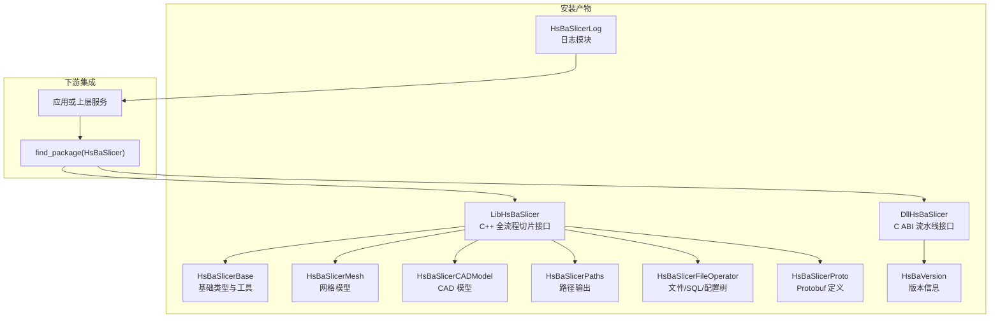
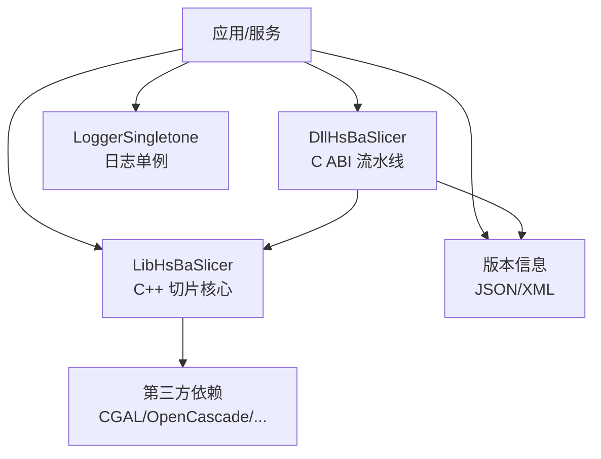
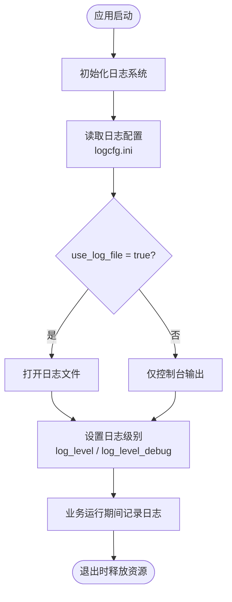
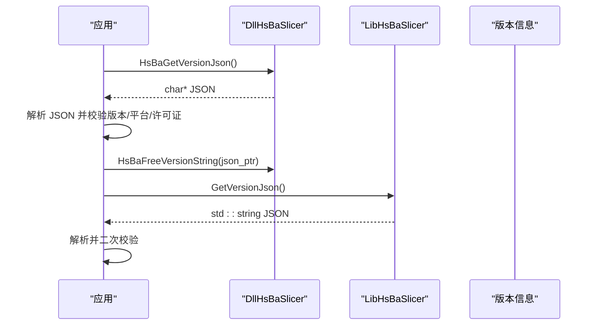
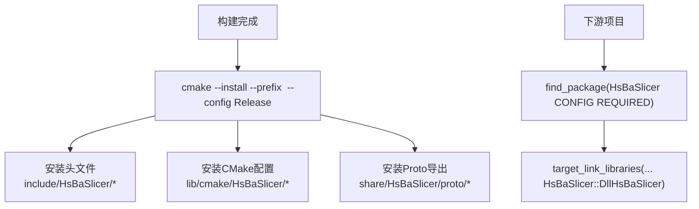
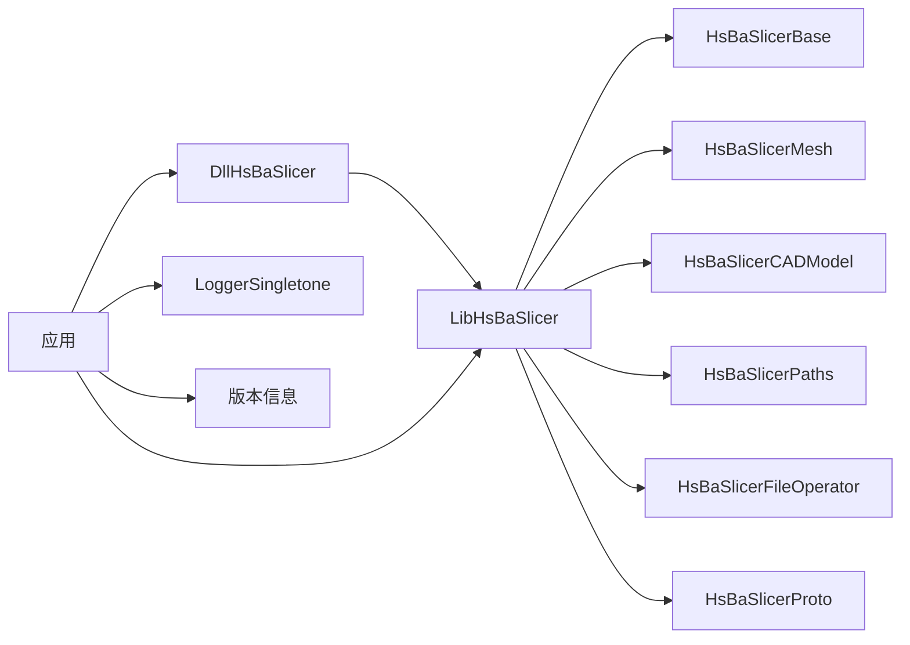
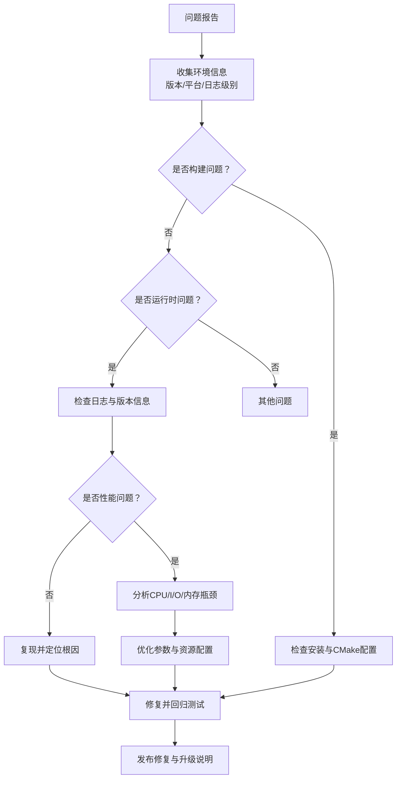

# 部署·故障排除与FAQ

<cite>
**本文引用的文件**   
- [README.md](file://README.md)
- [logger.hpp](file://logger/logger.hpp)
- [logcfg.ini](file://utils/logcfg.ini)
- [version.hpp](file://version/version.hpp)
- [version_info.h](file://DllHsBaSlicer/version_info.h)
- [version_info.hpp](file://LibHsBaSlicer/version_info.hpp)
</cite>

## 目录
1. [简介](#简介)
2. [项目结构](#项目结构)
3. [核心组件](#核心组件)
4. [架构总览](#架构总览)
5. [详细组件分析](#详细组件分析)
6. [依赖关系分析](#依赖关系分析)
7. [性能考虑](#性能考虑)
8. [故障排除指南](#故障排除指南)
9. [结论](#结论)
10. [附录](#附录)

## 简介
本页面聚焦 HsBaSlicer 在生产环境的部署策略、配置管理、日志记录与性能监控，并提供常见问题的诊断方法、错误定位思路、性能瓶颈分析与优化建议。文档同时给出完整的故障排除流程、调试工具使用建议、日志分析方法，以及用户最常遇到的构建、运行时、性能与兼容性问题及解决方案，并包含版本升级指南、向后兼容性说明与迁移建议，帮助运维人员与最终用户高效排障与稳定运行。

## 项目结构
HsBaSlicer 提供多目标安装导出能力，支持通过 CMake 的 find_package 集成到下游工程。关键安装产物包括动态库 DllHsBaSlicer（C ABI）、静态库 LibHsBaSlicer（C++ 全流程切片接口），以及日志、基础类型、网格模型、CAD、路径输出等模块。安装后头文件位于 include/HsBaSlicer，CMake 配置文件位于 lib/cmake/HsBaSlicer，Proto 多语言导出在 share/HsBaSlicer/proto。

图表来源
- [README.md:100-185](file://README.md#L100-L185)

章节来源
- [README.md:100-185](file://README.md#L100-L185)

## 核心组件
- 动态库 DllHsBaSlicer：对外暴露 C ABI，用于跨语言调用与流水线编排；提供版本信息查询 JSON/XML 能力。
- 静态库 LibHsBaSlicer：封装预处理、切片、支撑、填充、路径生成等核心能力，供 C++ 应用直接链接。
- 日志系统 LoggerSingletone：线程安全的单例日志器，支持多级日志、文件输出与平台适配（iOS/Android/桌面）。
- 版本信息：统一的结构化版本元数据，支持 JSON/XML 查询，便于运行时诊断与合规审计。

章节来源
- [README.md:100-185](file://README.md#L100-L185)
- [logger.hpp:35-122](file://logger/logger.hpp#L35-L122)
- [version.hpp:15-43](file://version/version.hpp#L15-L43)
- [version_info.h:16-41](file://DllHsBaSlicer/version_info.h#L16-L41)
- [version_info.hpp:15-25](file://LibHsBaSlicer/version_info.hpp#L15-L25)

## 架构总览
生产环境通常采用“应用/服务 + DllHsBaSlicer + LibHsBaSlicer”的分层架构。应用通过 CMake 查找 HsBaSlicer 包并链接 DllHsBaSlicer 或 LibHsBaSlicer；日志由 LoggerSingletone 统一管理；版本信息通过 C ABI 或 C++ API 获取，用于健康检查与兼容性校验。

图表来源
- [README.md:100-185](file://README.md#L100-L185)
- [version_info.h:16-41](file://DllHsBaSlicer/version_info.h#L16-L41)
- [version_info.hpp:15-25](file://LibHsBaSlicer/version_info.hpp#L15-L25)
- [logger.hpp:35-122](file://logger/logger.hpp#L35-L122)

## 详细组件分析

### 日志系统与配置
- LoggerSingletone 提供线程安全的多级日志（Debug/Info/Warning/Error）与文件输出开关，支持 iOS/Android/桌面平台差异实现。
- 日志配置通过 INI 文件控制级别、是否写文件、日志文件路径与时间格式。默认示例中关闭文件输出，日志级别为 3，调试级别为 1。
- 建议在生产环境开启文件输出，并将 log_level 设置为 Info 或 Warning，避免 Debug 级别造成 I/O 压力。

图表来源
- [logger.hpp:35-122](file://logger/logger.hpp#L35-L122)
- [logcfg.ini:1-8](file://utils/logcfg.ini#L1-L8)

章节来源
- [logger.hpp:35-122](file://logger/logger.hpp#L35-L122)
- [logcfg.ini:1-8](file://utils/logcfg.ini#L1-L8)

### 版本信息与兼容性
- 版本信息结构 VersionInfo 包含产品名称、许可证、版本号、构建类型、平台、配置时间、vcpkg triplet 与第三方库清单。
- DllHsBaSlicer 提供 C ABI 的 HsBaGetVersionJson/HsBaGetVersionXml，返回 UTF-8 编码字符串，需调用 HsBaFreeVersionString 释放内存。
- LibHsBaSlicer 提供 C++ 版本的 GetVersionJson/GetVersionXml，返回 std::string。
- 建议在应用启动时获取版本信息并进行兼容性校验，例如比较主版本号、构建平台与许可证字段。

图表来源
- [version_info.h:16-41](file://DllHsBaSlicer/version_info.h#L16-L41)
- [version_info.hpp:15-25](file://LibHsBaSlicer/version_info.hpp#L15-L25)
- [version.hpp:15-43](file://version/version.hpp#L15-L43)

章节来源
- [version_info.h:16-41](file://DllHsBaSlicer/version_info.h#L16-L41)
- [version_info.hpp:15-25](file://LibHsBaSlicer/version_info.hpp#L15-L25)
- [version.hpp:15-43](file://version/version.hpp#L15-L43)

### 安装与导出
- 通过 cmake --install 将库、头文件与 CMake 配置文件安装至指定前缀。
- 下游项目使用 find_package(HsBaSlicer CONFIG REQUIRED) 并链接 HsBaSlicer::DllHsBaSlicer 或 HsBaSlicer::LibHsBaSlicer。
- Android/iOS/游戏主机平台下，HsBaSlicerCADModel 不参与安装（缺少 OpenCascade 支持）。

图表来源
- [README.md:100-185](file://README.md#L100-L185)

章节来源
- [README.md:100-185](file://README.md#L100-L185)

## 依赖关系分析
- DllHsBaSlicer 作为 C ABI 层，主要面向外部语言调用，内部可复用 LibHsBaSlicer 的核心能力。
- LibHsBaSlicer 依赖基础类型、网格模型、CAD、路径输出、文件操作与 Protobuf 消息转换等模块。
- 日志系统独立于切片核心，但被应用广泛引用以进行问题追踪。
- 版本信息贯穿 Dll 与 Lib，确保运行时一致性。

图表来源
- [README.md:100-185](file://README.md#L100-L185)
- [logger.hpp:35-122](file://logger/logger.hpp#L35-L122)
- [version_info.h:16-41](file://DllHsBaSlicer/version_info.h#L16-L41)
- [version_info.hpp:15-25](file://LibHsBaSlicer/version_info.hpp#L15-L25)

章节来源
- [README.md:100-185](file://README.md#L100-L185)
- [logger.hpp:35-122](file://logger/logger.hpp#L35-L122)
- [version_info.h:16-41](file://DllHsBaSlicer/version_info.h#L16-L41)
- [version_info.hpp:15-25](file://LibHsBaSlicer/version_info.hpp#L15-L25)

## 性能考虑
- 日志级别：生产环境建议将 log_level 设为 Info 或 Warning，避免 Debug 级别带来的 I/O 开销；必要时仅在关键路径启用 Debug。
- 文件输出：开启 use_log_file 时，应确保日志磁盘具备足够 IOPS，并定期轮转日志文件以避免磁盘占满。
- 并发与线程池：切片核心涉及大量几何计算，建议使用线程池与对象池减少分配开销（参考 base 模块中的线程池与对象池能力）。
- 模型与网格后端：CGAL/OpenCascade 等内核计算密集，合理选择后端与参数，避免不必要的布尔运算与高精度模式。
- 版本与兼容性：在升级前通过版本信息比对构建平台与 vcpkg triplet，确保二进制兼容。

[本节为通用性能指导，不直接分析具体文件]

## 故障排除指南

### 常见问题分类与排查步骤

- 构建问题
  - 现象：找不到 HsBaSlicer 包或链接失败。
  - 排查：确认已执行 cmake --install 并将 install_prefix 加入 CMake 搜索路径；检查 find_package(HsBaSlicer CONFIG REQUIRED) 与 target_link_libraries 是否正确。
  - 参考：安装与导出说明。

- 运行时日志无输出
  - 现象：未看到日志文件或控制台输出。
  - 排查：检查 logger 初始化是否成功；确认 logcfg.ini 中 use_log_file 与 log_file 路径有效；验证 log_level 阈值是否高于当前日志级别。
  - 参考：日志系统与配置。

- 版本信息为空或不一致
  - 现象：HsBaGetVersionJson/GetVersionJson 返回空或版本不一致。
  - 排查：确认 Dll 与 Lib 来自同一构建；检查构建类型（Debug/Release）与平台；对比 VersionInfo 的 buildType/buildPlatform/vcpkgTargetTriplet。
  - 参考：版本信息 API。

- 性能退化
  - 现象：切片耗时显著增加。
  - 排查：降低日志级别；检查是否启用了高成本后端（CGAL/OpenCascade）；评估模型复杂度与支撑/填充参数；观察 I/O 是否成为瓶颈。
  - 参考：性能考虑。

- 兼容性问题
  - 现象：升级后出现崩溃或行为异常。
  - 排查：比对 VersionInfo 的 version/license；确认第三方依赖版本与 vcpkg triplet 一致；回滚到已知稳定版本。
  - 参考：版本信息 API 与 README 许可说明。

### 错误代码解释
- 本项目未集中暴露统一的错误码枚举；错误主要通过日志与异常传播。建议在关键路径捕获异常并记录上下文（函数名、行号、输入参数摘要），结合日志级别快速定位。
- 若使用 C ABI（DllHsBaSlicer），请确保正确释放 HsBaGetVersionJson/HsBaGetVersionXml 返回的指针，避免内存泄漏。

### 性能瓶颈分析与优化建议
- I/O 瓶颈：日志文件频繁写入导致延迟。优化：调低日志级别、异步落盘或限制日志量。
- CPU 瓶颈：网格布尔运算、支撑生成、路径优化等高计算阶段。优化：调整算法参数、减少冗余计算、使用更高效的后端。
- 内存瓶颈：大模型或高频分配。优化：启用对象池/内存池，减少临时对象创建。

### 完整故障排除流程

[该图为概念性流程图，不直接映射具体源码文件]

## 结论
HsBaSlicer 提供了模块化、跨平台的切片核心能力与完善的安装导出机制。生产环境中，建议通过合理的日志配置、版本信息校验与性能调优，确保系统稳定与可观测性。遇到问题时，优先从构建与安装、日志与版本信息入手，逐步缩小范围并定位根因。

[本节为总结性内容，不直接分析具体文件]

## 附录

### 版本升级指南与迁移建议
- 升级前
  - 备份现有构建产物与配置文件（尤其是 logcfg.ini）。
  - 通过 HsBaGetVersionJson/GetVersionJson 获取当前版本信息，记录 version/license/buildType/buildPlatform/vcpkgTargetTriplet。
- 升级中
  - 重新构建并安装新版本；确保第三方依赖与 vcpkg triplet 一致。
  - 对下游项目进行最小化回归测试，重点覆盖切片流水线与路径输出。
- 升级后
  - 验证版本信息一致性与功能正确性；观察日志与性能指标。
  - 如出现兼容性问题，根据 VersionInfo 的 license 字段评估许可变更影响。

章节来源
- [version.hpp:15-43](file://version/version.hpp#L15-L43)
- [version_info.h:16-41](file://DllHsBaSlicer/version_info.h#L16-L41)
- [version_info.hpp:15-25](file://LibHsBaSlicer/version_info.hpp#L15-L25)
- [README.md:196-211](file://README.md#L196-L211)