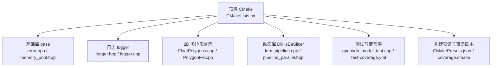
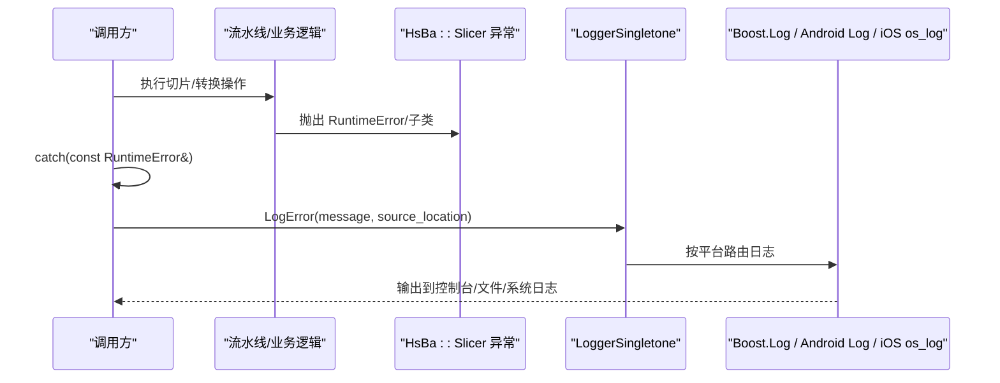
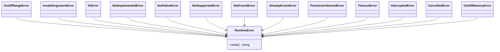
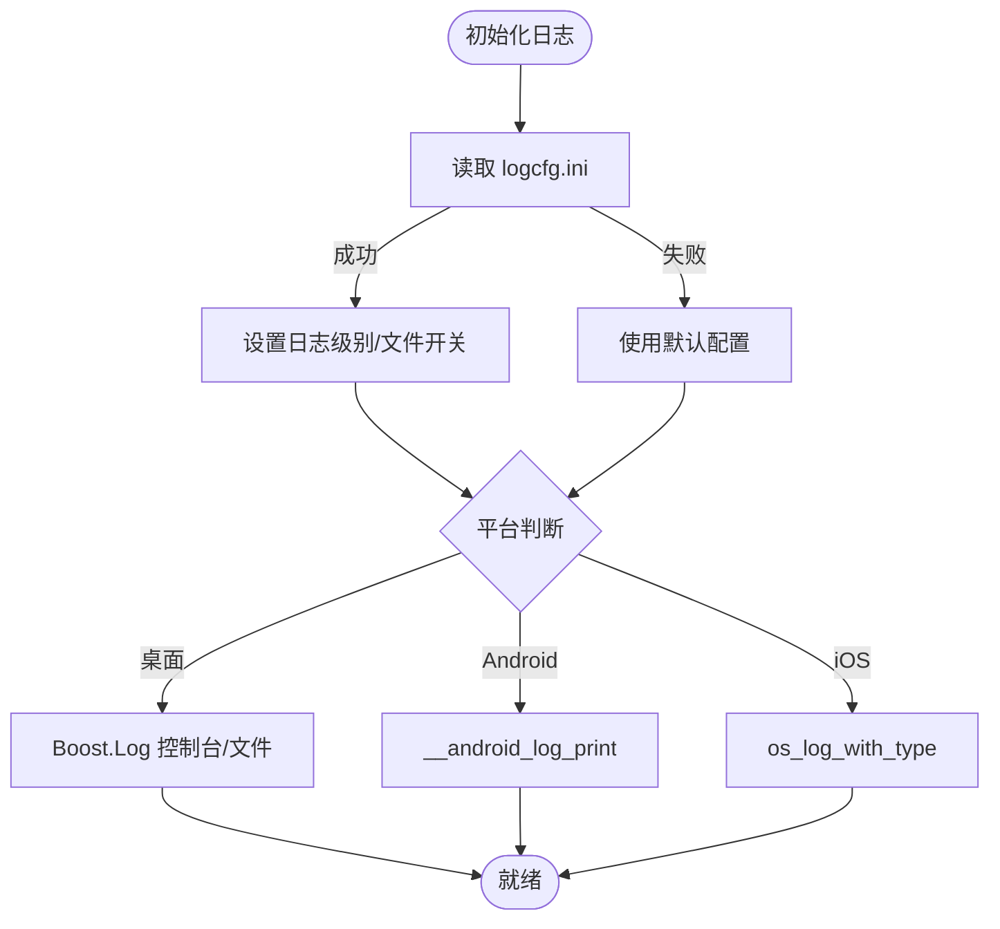
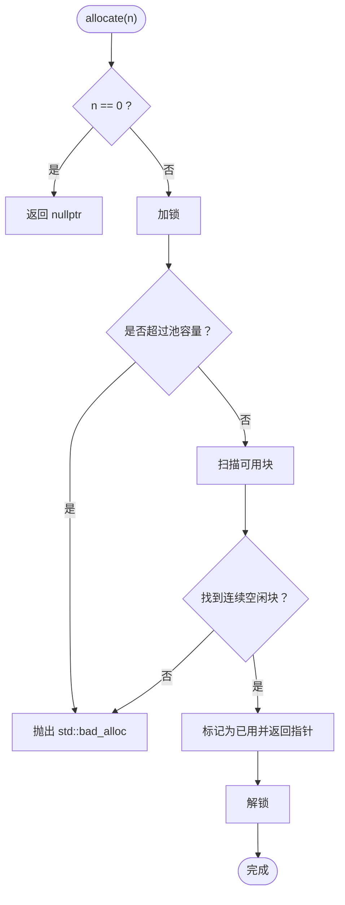
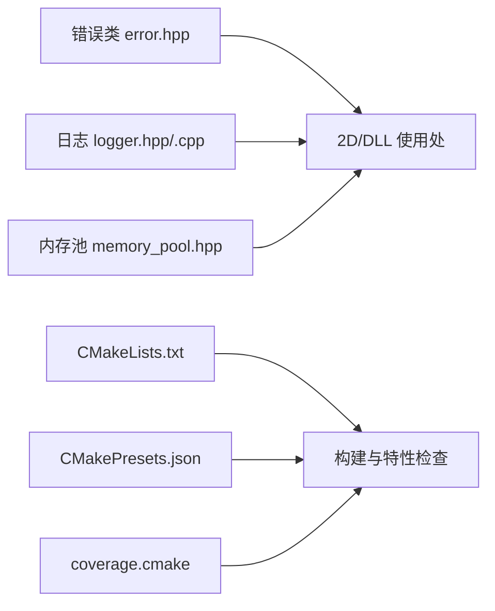
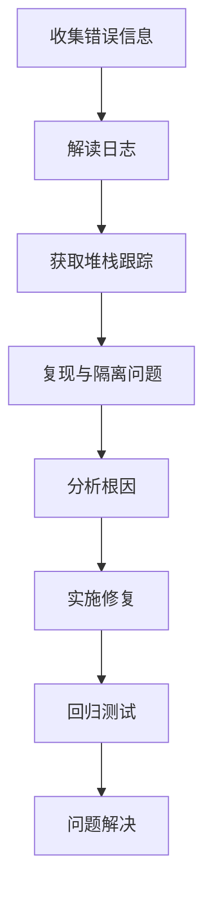

# 故障排除

<cite>
**本文引用的文件**   
- [README.md](file://README.md)
- [CMakeLists.txt](file://CMakeLists.txt)
- [CMakePresets.json](file://CMakePresets.json)
- [coverage.cmake](file://cmake/coverage.cmake)
- [error.hpp](file://base/error.hpp)
- [logger.hpp](file://logger/logger.hpp)
- [logger.cpp](file://logger/logger.cpp)
- [memory_pool.hpp](file://base/memory_pool.hpp)
- [FloatPolygons.cpp](file://2D/FloatPolygons.cpp)
- [ImageToPolygons.cpp](file://2D/ImageToPolygons.cpp)
- [PolygonFill.cpp](file://2D/PolygonFill.cpp)
- [fdm_pipeline.cpp](file://DllHsBaSlicer/fdm_pipeline.cpp)
- [file_transfer_pipeline.cpp](file://DllHsBaSlicer/file_transfer_pipeline.cpp)
- [lom_pipeline.cpp](file://DllHsBaSlicer/lom_pipeline.cpp)
- [pipeline_parallel.hpp](file://DllHsBaSlicer/pipeline_parallel.hpp)
- [openvdb_model_test.cpp](file://tests/Models/openvdb_model_test.cpp)
- [test-coverage.yml](file:.github/workflows/test-coverage.yml)
</cite>

## 目录
1. [简介](#简介)
2. [项目结构](#项目结构)
3. [核心组件](#核心组件)
4. [架构总览](#架构总览)
5. [详细组件分析](#详细组件分析)
6. [依赖关系分析](#依赖关系分析)
7. [性能注意事项](#性能注意事项)
8. [故障排除指南](#故障排除指南)
9. [结论](#结论)
10. [附录](#附录)

## 简介
本手册面向 HsBaSlicer 的开发者和用户，聚焦于常见错误类型与系统化排查方法，包括编译错误、运行时异常、内存泄漏、性能问题。文档基于仓库中的错误类、日志系统、构建配置、测试与覆盖率脚本进行分析，提供可操作的诊断流程、调试技巧、工具使用建议以及已知问题的临时解决方案。

## 项目结构
HsBaSlicer 是一个模块化 C++ 切片框架，包含基础库、日志、网格/CAD 模型、路径输出、支撑生成、Lua 扩展等模块。顶层 CMake 负责全局特性检查与标准设置；日志子系统提供跨平台单例日志；错误体系通过自定义异常类统一表达；内存池用于高频小对象分配优化。

**图表来源**
- [CMakeLists.txt:1-73](file://CMakeLists.txt#L1-L73)
- [error.hpp:1-147](file://base/error.hpp#L1-L147)
- [logger.hpp:1-196](file://logger/logger.hpp#L1-L196)
- [logger.cpp:1-422](file://logger/logger.cpp#L1-L422)
- [memory_pool.hpp:1-375](file://base/memory_pool.hpp#L1-L375)
- [FloatPolygons.cpp:351-361](file://2D/FloatPolygons.cpp#L351-L361)
- [PolygonFill.cpp:1293-1321](file://2D/PolygonFill.cpp#L1293-L1321)
- [fdm_pipeline.cpp:424-424](file://DllHsBaSlicer/fdm_pipeline.cpp#L424-L424)
- [pipeline_parallel.hpp:51-51](file://DllHsBaSlicer/pipeline_parallel.hpp#L51-L51)
- [openvdb_model_test.cpp:10-20](file://tests/Models/openvdb_model_test.cpp#L10-L20)
- [test-coverage.yml:1-31](file:.github/workflows/test-coverage.yml#L1-L31)
- [CMakePresets.json:83-95](file://CMakePresets.json#L83-L95)
- [coverage.cmake:1-28](file://cmake/coverage.cmake#L1-L28)

**章节来源**
- [README.md:25-39](file://README.md#L25-L39)
- [CMakeLists.txt:1-73](file://CMakeLists.txt#L1-L73)

## 核心组件
- 错误体系：定义 RuntimeError 及其派生类（越界、无效参数、IO、未实现、空值、不支持、未找到、已存在、权限拒绝、超时、中断、取消、内存不足），统一继承 std::runtime_error，便于捕获 with what() 消息。
- 日志系统：线程安全的跨平台单例 LoggerSingletone，支持 trace/debug/info/warning/error/fatal 等级，桌面端默认使用 Boost.Log，Android/iOS 分别走内核日志和 os_log，支持配置文件 logcfg.ini 控制级别与文件输出。
- 内存池：MemoryPool 与 StaticMemoryPool 提供固定大小池分配，避免频繁 new/delete，减少碎片与分配开销；在并发场景下加锁保护。
- 构建与覆盖：顶层 CMake 强制 C++20 与位置无关代码；CMakePresets.json 提供 Debug/Release/Coverage 预设；coverage.cmake 启用 --coverage 并设定行覆盖率阈值门限。

**章节来源**
- [error.hpp:17-144](file://base/error.hpp#L17-L144)
- [logger.hpp:27-122](file://logger/logger.hpp#L27-L122)
- [logger.cpp:136-222](file://logger/logger.cpp#L136-L222)
- [memory_pool.hpp:43-208](file://base/memory_pool.hpp#L43-L208)
- [memory_pool.hpp:215-372](file://base/memory_pool.hpp#L215-L372)
- [CMakeLists.txt:1-73](file://CMakeLists.txt#L1-L73)
- [CMakePresets.json:83-95](file://CMakePresets.json#L83-L95)
- [coverage.cmake:1-28](file://cmake/coverage.cmake#L1-L28)

## 架构总览
下图展示从调用方到日志与错误处理的典型交互：上层流水线或业务逻辑抛出 HsBa::Slicer 的异常，被外层 catch 捕获后记录日志；日志系统根据平台选择后端，并将信息写入文件或系统日志。

**图表来源**
- [error.hpp:17-144](file://base/error.hpp#L17-L144)
- [logger.hpp:27-122](file://logger/logger.hpp#L27-L122)
- [logger.cpp:242-343](file://logger/logger.cpp#L242-L343)

## 详细组件分析

### 错误体系与异常处理
- 设计要点：所有业务异常均继承 std::runtime_error，便于统一捕获；具体子类表达更精确的错误语义。
- 常见问题：
  - 未捕获异常导致程序崩溃。
  - 外部库异常（如 OpenCV）未被正确捕获。
  - Lua 绑定失败时抛出 RuntimeError。
- 建议：
  - 在 DLL 导出层统一 catch(RuntimeError&) 并记录日志。
  - 对第三方异常进行包装，转换为 HsBa::Slicer 异常。

**图表来源**
- [error.hpp:17-144](file://base/error.hpp#L17-L144)

**章节来源**
- [error.hpp:17-144](file://base/error.hpp#L17-L144)
- [ImageToPolygons.cpp:422-532](file://2D/ImageToPolygons.cpp#L422-L532)
- [PolygonFill.cpp:1293-1321](file://2D/PolygonFill.cpp#L1293-L1321)
- [fdm_pipeline.cpp:424-424](file://DllHsBaSlicer/fdm_pipeline.cpp#L424-L424)

### 日志系统与定位
- 功能要点：
  - 单例模式保证全局唯一实例，线程安全。
  - 支持配置文件 logcfg.ini，区分 Debug/Release 默认级别。
  - 桌面端使用 Boost.Log，Android 使用 __android_log_print，iOS 使用 os_log。
- 常见问题：
  - 日志未输出或级别过低。
  - 日志文件路径不存在或无写权限。
  - 移动端日志查看方式不同。
- 建议：
  - 在启动阶段确保 logcfg.ini 存在且路径有效。
  - 将关键错误点用 LogError 记录，附带 source_location。
  - 移动端通过系统日志查看器收集日志。

**图表来源**
- [logger.cpp:136-222](file://logger/logger.cpp#L136-L222)
- [logger.cpp:242-343](file://logger/logger.cpp#L242-L343)

**章节来源**
- [logger.hpp:27-122](file://logger/logger.hpp#L27-L122)
- [logger.cpp:136-222](file://logger/logger.cpp#L136-L222)
- [logger.cpp:242-343](file://logger/logger.cpp#L242-L343)

### 内存池与内存管理
- 设计要点：
  - MemoryPool 与 StaticMemoryPool 提供固定大小池分配，降低分配开销。
  - 并发访问加锁，保证线程安全。
  - 超出池容量抛 std::bad_alloc。
- 常见问题：
  - 池容量不足导致 bad_alloc。
  - 释放非法指针抛 invalid_argument。
  - 多线程竞争导致性能下降。
- 建议：
  - 预估最大对象数量，合理设置 PoolSize。
  - 避免重复释放或释放非池内指针。
  - 在高并发热点路径评估锁粒度与替代方案。

**图表来源**
- [memory_pool.hpp:111-142](file://base/memory_pool.hpp#L111-L142)
- [memory_pool.hpp:266-296](file://base/memory_pool.hpp#L266-L296)

**章节来源**
- [memory_pool.hpp:111-142](file://base/memory_pool.hpp#L111-L142)
- [memory_pool.hpp:156-175](file://base/memory_pool.hpp#L156-L175)
- [memory_pool.hpp:266-296](file://base/memory_pool.hpp#L266-L296)
- [memory_pool.hpp:305-324](file://base/memory_pool.hpp#L305-L324)

### 构建系统与覆盖率
- 设计要点：
  - 顶层 CMake 强制 C++20，开启位置无关代码，进行特性检查。
  - CMakePresets.json 提供 linux-debug/release/coverage 预设。
  - coverage.cmake 启用 --coverage，设置核心与非核心模块覆盖率阈值。
- 常见问题：
  - 编译器不满足 C++20 或特性缺失导致配置失败。
  - Coverage 构建在 CI 上因并行度过高导致 OOM。
- 建议：
  - 使用推荐预设进行构建。
  - 在 CI 中限制并行度（HSBA_COVERAGE_JOBS）。

**章节来源**
- [CMakeLists.txt:1-73](file://CMakeLists.txt#L1-L73)
- [CMakePresets.json:83-95](file://CMakePresets.json#L83-L95)
- [coverage.cmake:1-28](file://cmake/coverage.cmake#L1-L28)
- [test-coverage.yml:1-31](file:.github/workflows/test-coverage.yml#L1-L31)

## 依赖关系分析
- 模块耦合：
  - 日志系统被各模块广泛使用，作为统一的诊断入口。
  - 错误类被 2D 处理与 DLL 导出层广泛抛出与捕获。
  - 内存池在高频分配场景中提升性能，但需关注容量与并发。
- 外部依赖：
  - 桌面端 Boost.Log；Android/iOS 原生日志 API。
  - 部分功能依赖 CGAL/OpenCascade（GPL/LGPL），影响许可与构建。

**图表来源**
- [error.hpp:17-144](file://base/error.hpp#L17-L144)
- [logger.hpp:27-122](file://logger/logger.hpp#L27-L122)
- [logger.cpp:136-222](file://logger/logger.cpp#L136-L222)
- [memory_pool.hpp:43-208](file://base/memory_pool.hpp#L43-L208)
- [CMakeLists.txt:1-73](file://CMakeLists.txt#L1-L73)
- [CMakePresets.json:83-95](file://CMakePresets.json#L83-L95)
- [coverage.cmake:1-28](file://cmake/coverage.cmake#L1-L28)

**章节来源**
- [README.md:104-124](file://README.md#L104-L124)

## 性能注意事项
- 日志开销：
  - 高频日志会影响性能，建议在热点路径减少日志频率或使用更低级别。
  - 文件输出与格式化有额外开销，必要时关闭文件输出。
- 内存池：
  - 合理设置 PoolSize，避免频繁扩容或 bad_alloc。
  - 高并发场景下锁可能成为瓶颈，考虑分片池或无锁结构。
- 构建与运行：
  - Release 构建配合优化选项提升性能。
  - 使用覆盖率构建时需限制并行度以避免 OOM。

[本节为通用指导，不直接分析具体文件]

## 故障排除指南

### 常见错误类型与解决方案
- 编译错误
  - 现象：CMake 配置失败，提示缺少 C++ concepts/ranges/source_location 等特性。
  - 原因：编译器版本过旧或不支持所需 C++20 特性。
  - 解决：升级编译器至支持 C++20 的版本，或使用推荐的 CMake 预设。
  - 参考：[CMakeLists.txt:48-73](file://CMakeLists.txt#L48-L73)

- 运行时异常
  - 现象：程序抛出 RuntimeError 或其子类，如“需要 FreeType 支持”“Lua 函数未找到”。
  - 原因：依赖缺失、Lua 脚本错误、参数非法。
  - 解决：安装必要依赖（FreeType）、修正 Lua 脚本、校验输入参数。
  - 参考：[FloatPolygons.cpp:351-361](file://2D/FloatPolygons.cpp#L351-L361)，[ImageToPolygons.cpp:422-532](file://2D/ImageToPolygons.cpp#L422-L532)，[PolygonFill.cpp:1293-1321](file://2D/PolygonFill.cpp#L1293-L1321)

- 内存泄漏
  - 现象：Debug 构建下 CRT 报告内存泄漏，或与第三方库（OpenVDB）冲突。
  - 原因：第三方库自定义内存管理与 CRT 检测冲突。
  - 解决：在相关测试中禁用 CRT 泄漏检查，或使用 Valgrind/ASan 验证。
  - 参考：[openvdb_model_test.cpp:10-20](file://tests/Models/openvdb_model_test.cpp#L10-L20)

- 性能问题
  - 现象：切片流水线耗时过长，内存分配频繁。
  - 原因：日志过多、内存池容量不足、锁竞争。
  - 解决：降低日志级别、增大 PoolSize、优化锁粒度或改用无锁结构。
  - 参考：[logger.cpp:136-222](file://logger/logger.cpp#L136-L222)，[memory_pool.hpp:111-142](file://base/memory_pool.hpp#L111-L142)

### 系统化问题诊断流程
1. 收集错误信息
   - 捕获并打印异常类型与 what() 消息。
   - 使用 LogError 记录上下文与 source_location。
2. 解读日志
   - 确认日志级别与输出目标（控制台/文件/系统日志）。
   - 检查 logcfg.ini 配置是否正确加载。
3. 堆栈跟踪
   - 在 Debug 构建下使用 GDB 获取堆栈。
   - 结合 source_location 定位源码位置。
4. 复现与隔离
   - 最小化输入数据，逐步缩小问题范围。
   - 使用单元测试或样本工程复现。
5. 分析与修复
   - 针对错误类型采取相应修复措施。
   - 添加回归测试与日志断点。

[此图为概念性流程图，无需图表来源]

### 调试技巧与工具使用
- GDB
  - 在 Linux/macOS 下使用 GDB 附加进程或运行程序，设置断点于抛出异常的函数。
  - 使用 backtrace 查看调用链，结合 source_location 定位源码。
- Valgrind
  - 使用 valgrind --leak-check=full ./your_app 检测内存泄漏与非法访问。
  - 注意第三方库（如 OpenVDB）可能产生误报，需结合测试策略调整。
- 性能分析器
  - 使用 perf、gprof、Instruments（macOS）等工具分析热点函数。
  - 结合日志与内存池使用情况，定位性能瓶颈。
- 静态检查与覆盖率
  - 使用 coverage.cmake 生成的覆盖率报告，识别未覆盖分支。
  - 在 CI 中限制并行度以避免 OOM。

**章节来源**
- [test-coverage.yml:1-31](file:.github/workflows/test-coverage.yml#L1-L31)
- [coverage.cmake:1-28](file://cmake/coverage.cmake#L1-L28)

### 已知问题与临时解决方案
- 日志未输出或级别过低
  - 临时方案：检查 logcfg.ini，确保 use_log_file 与 log_level 配置正确。
  - 参考：[logger.cpp:136-222](file://logger/logger.cpp#L136-L222)
- Lua 绑定失败
  - 临时方案：校验 Lua 脚本语法与函数名，确保 Lua 状态创建成功。
  - 参考：[ImageToPolygons.cpp:422-532](file://2D/ImageToPolygons.cpp#L422-L532)，[PolygonFill.cpp:1293-1321](file://2D/PolygonFill.cpp#L1293-L1321)
- 内存池容量不足
  - 临时方案：增大 PoolSize 或拆分池以减少竞争。
  - 参考：[memory_pool.hpp:111-142](file://base/memory_pool.hpp#L111-L142)
- 覆盖率构建 OOM
  - 临时方案：设置 HSBA_COVERAGE_JOBS=2 限制并行度。
  - 参考：[test-coverage.yml:1-31](file:.github/workflows/test-coverage.yml#L1-L31)

**章节来源**
- [logger.cpp:136-222](file://logger/logger.cpp#L136-L222)
- [ImageToPolygons.cpp:422-532](file://2D/ImageToPolygons.cpp#L422-L532)
- [PolygonFill.cpp:1293-1321](file://2D/PolygonFill.cpp#L1293-L1321)
- [memory_pool.hpp:111-142](file://base/memory_pool.hpp#L111-L142)
- [test-coverage.yml:1-31](file:.github/workflows/test-coverage.yml#L1-L31)

## 结论
HsBaSlicer 提供了完善的错误体系、日志系统与内存池机制，有助于快速定位与解决问题。通过系统化诊断流程与工具使用，开发者与用户可以高效处理编译、运行、内存与性能问题。建议在生产环境中合理使用日志与覆盖率工具，持续改进稳定性与性能。

[本节为总结性内容，不直接分析具体文件]

## 附录
- 社区支持与问题报告
  - 提交 Issue 或 PR，附上错误日志、堆栈跟踪与复现步骤。
  - 参考 README 贡献说明与许可证信息。
- 快速参考
  - 日志级别：trace(0)/debug(1)/info(2)/warning(3)/error(4)/fatal(5)。
  - 内存池：优先使用 MemoryPool/StaticMemoryPool 减少分配开销。
  - 构建预设：linux-debug/release/coverage。

**章节来源**
- [README.md:192-211](file://README.md#L192-L211)