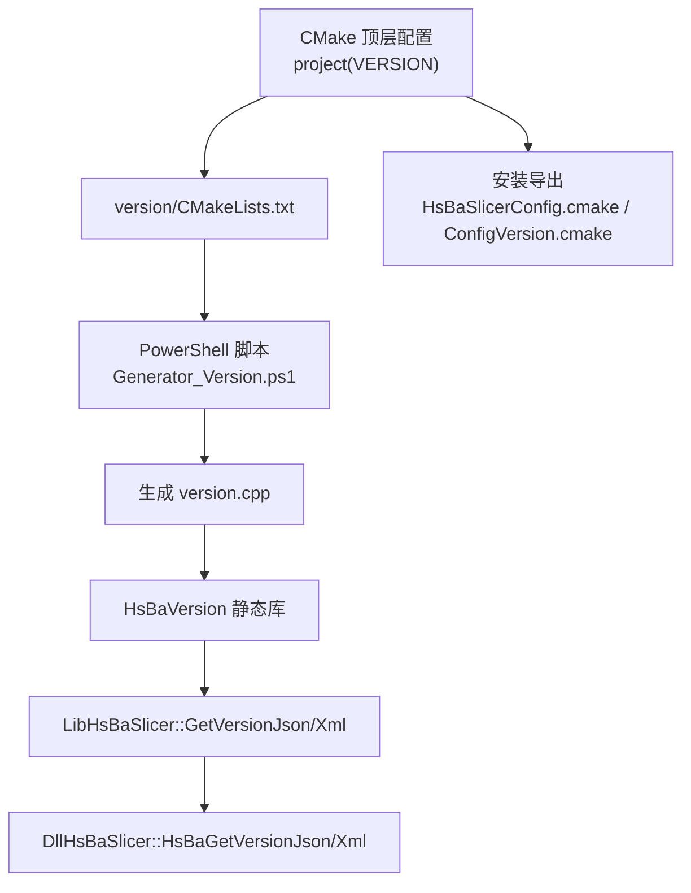
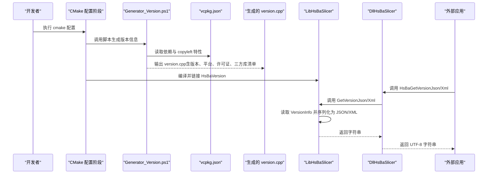
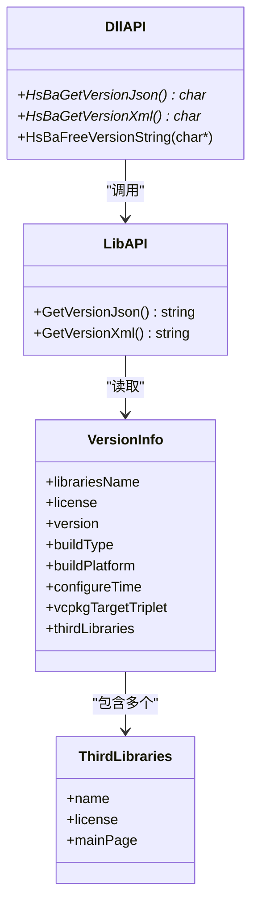
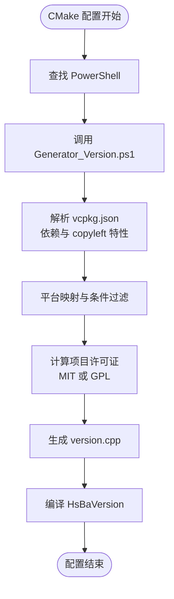
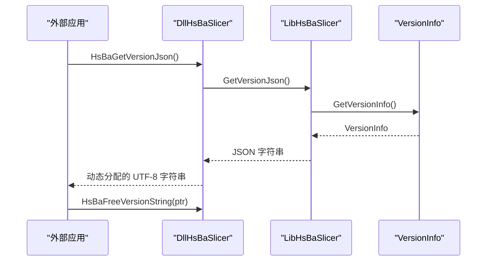
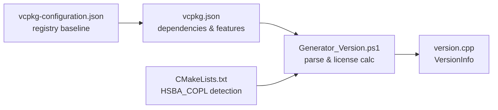
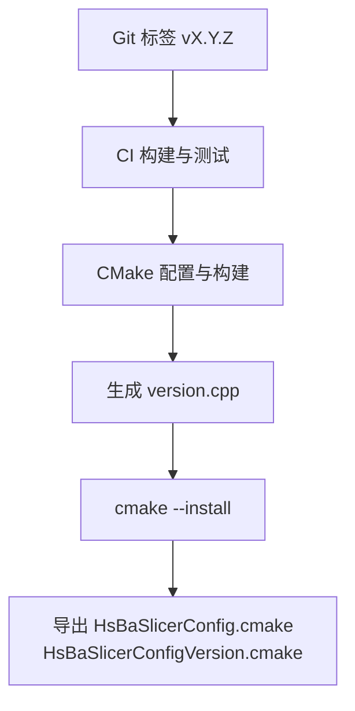
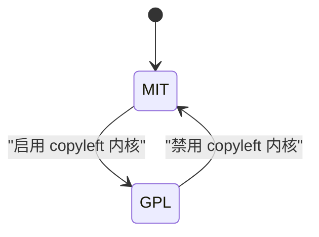
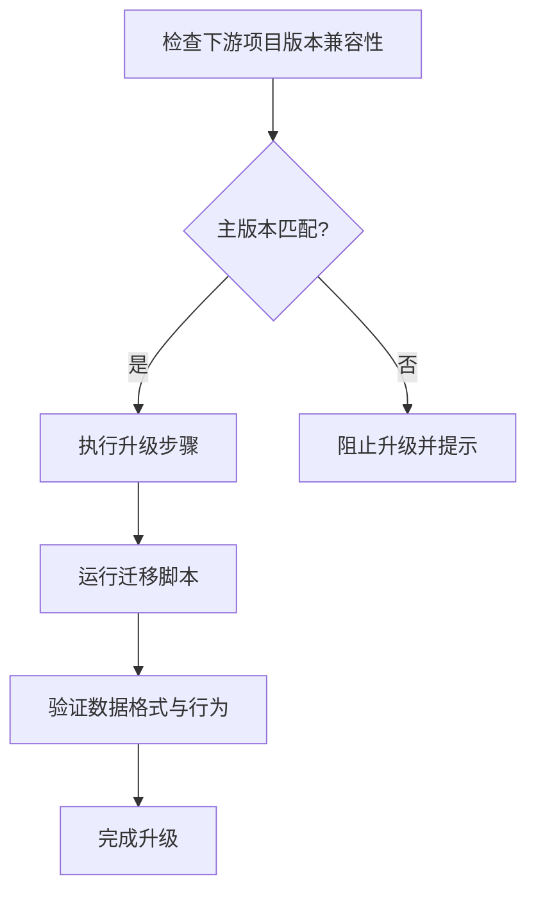
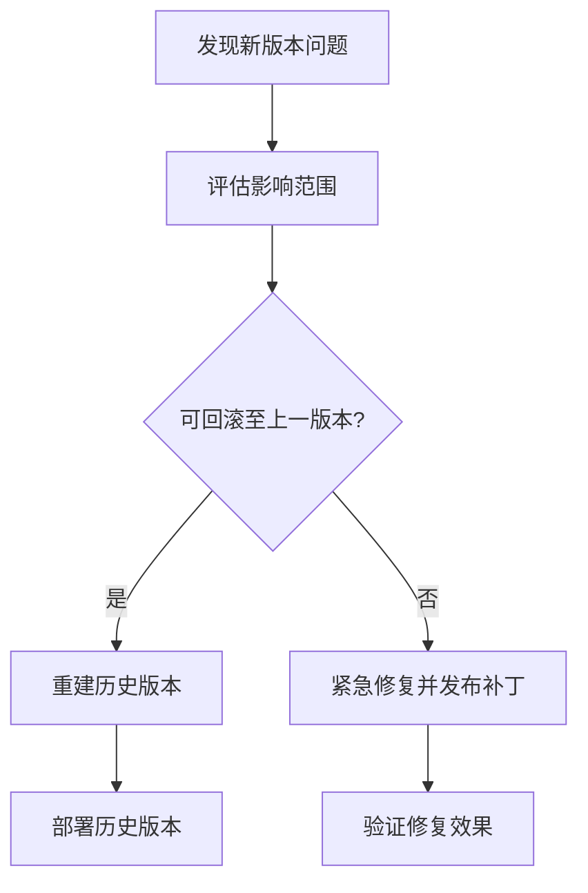

# 版本管理

<cite>
**本文引用的文件**   
- [CMakeLists.txt](file://CMakeLists.txt)
- [vcpkg.json](file://vcpkg.json)
- [vcpkg-configuration.json](file://vcpkg-configuration.json)
- [version/CMakeLists.txt](file://version/CMakeLists.txt)
- [version/Generator_Version.ps1](file://version/Generator_Version.ps1)
- [version/version.hpp](file://version/version.hpp)
- [version/version.cpp.in](file://version/version.cpp.in)
- [LibHsBaSlicer/version_info.hpp](file://LibHsBaSlicer/version_info.hpp)
- [LibHsBaSlicer/version_info.cpp](file://LibHsBaSlicer/version_info.cpp)
- [DllHsBaSlicer/version_info.h](file://DllHsBaSlicer/version_info.h)
- [DllHsBaSlicer/version_info.cpp](file://DllHsBaSlicer/version_info.cpp)
- [cmake/HsBaSlicerConfig.cmake.in](file://cmake/HsBaSlicerConfig.cmake.in)
- [README.md](file://README.md)
</cite>

## 目录
1. [引言](#引言)
2. [项目结构与版本相关组件](#项目结构与版本相关组件)
3. [核心组件](#核心组件)
4. [架构总览](#架构总览)
5. [详细组件分析](#详细组件分析)
6. [依赖与版本锁定策略](#依赖与版本锁定策略)
7. [版本生成与发布流程](#版本生成与发布流程)
8. [语义化版本控制与兼容性矩阵](#语义化版本控制与兼容性矩阵)
9. [升级路径与迁移指南](#升级路径与迁移指南)
10. [回滚与降级方案](#回滚与降级方案)
11. [性能与可观测性](#性能与可观测性)
12. [故障排查](#故障排查)
13. [结论](#结论)

## 引言
本指南面向 HsBaSlicer 的开发者和维护者，系统化说明项目的版本命名规范、语义化版本控制策略、版本生成与发布流程、依赖版本管理（vcpkg）、升级路径、迁移脚本和数据格式转换建议，以及回滚与降级策略。文档同时给出代码级架构图和流程图，帮助读者快速理解从 CMake 配置到运行时版本信息查询的完整链路。

## 项目结构与版本相关组件
HsBaSlicer 的版本信息在构建期由 CMake 调用 PowerShell 脚本生成，并在运行期通过 C++ API 与 C ABI 暴露给外部语言。关键位置如下：
- 顶层工程定义与安装导出：[CMakeLists.txt](file://CMakeLists.txt)
- vcpkg 依赖清单与特性开关：[vcpkg.json](file://vcpkg.json)、[vcpkg-configuration.json](file://vcpkg-configuration.json)
- 版本信息头文件与模板：[version/version.hpp](file://version/version.hpp)、[version/version.cpp.in](file://version/version.cpp.in)
- 版本生成脚本与子模块 CMake：[version/Generator_Version.ps1](file://version/Generator_Version.ps1)、[version/CMakeLists.txt](file://version/CMakeLists.txt)
- Lib 侧版本查询接口：[LibHsBaSlicer/version_info.hpp](file://LibHsBaSlicer/version_info.hpp)、[LibHsBaSlicer/version_info.cpp](file://LibHsBaSlicer/version_info.cpp)
- Dll 侧 C ABI 版本查询接口：[DllHsBaSlicer/version_info.h](file://DllHsBaSlicer/version_info.h)、[DllHsBaSlicer/version_info.cpp](file://DllHsBaSlicer/version_info.cpp)
- CMake 包配置与版本兼容：[cmake/HsBaSlicerConfig.cmake.in](file://cmake/HsBaSlicerConfig.cmake.in)

**图表来源**
- [CMakeLists.txt:44-44](file://CMakeLists.txt#L44-L44)
- [CMakeLists.txt:648-665](file://CMakeLists.txt#L648-L665)
- [version/CMakeLists.txt:1-57](file://version/CMakeLists.txt#L1-L57)
- [version/Generator_Version.ps1:1-250](file://version/Generator_Version.ps1#L1-L250)
- [LibHsBaSlicer/version_info.cpp:1-26](file://LibHsBaSlicer/version_info.cpp#L1-L26)
- [DllHsBaSlicer/version_info.cpp:1-43](file://DllHsBaSlicer/version_info.cpp#L1-L43)

**章节来源**
- [CMakeLists.txt:44-44](file://CMakeLists.txt#L44-L44)
- [CMakeLists.txt:648-665](file://CMakeLists.txt#L648-L665)
- [version/CMakeLists.txt:1-57](file://version/CMakeLists.txt#L1-L57)
- [version/Generator_Version.ps1:1-250](file://version/Generator_Version.ps1#L1-L250)
- [LibHsBaSlicer/version_info.cpp:1-26](file://LibHsBaSlicer/version_info.cpp#L1-L26)
- [DllHsBaSlicer/version_info.cpp:1-43](file://DllHsBaSlicer/version_info.cpp#L1-L43)

## 核心组件
- 版本数据结构与接口
  - 版本信息结构体与第三方库清单：[version/version.hpp](file://version/version.hpp)
  - 运行时 JSON/XML 查询接口（C++）：[LibHsBaSlicer/version_info.hpp](file://LibHsBaSlicer/version_info.hpp)、[LibHsBaSlicer/version_info.cpp](file://LibHsBaSlicer/version_info.cpp)
  - 运行时 JSON/XML 查询接口（C ABI）：[DllHsBaSlicer/version_info.h](file://DllHsBaSlicer/version_info.h)、[DllHsBaSlicer/version_info.cpp](file://DllHsBaSlicer/version_info.cpp)
- 构建期版本生成
  - CMake 子模块与脚本调用：[version/CMakeLists.txt](file://version/CMakeLists.txt)
  - PowerShell 生成器：[version/Generator_Version.ps1](file://version/Generator_Version.ps1)
  - 模板文件（备用）：[version/version.cpp.in](file://version/version.cpp.in)
- 依赖与许可证判定
  - vcpkg 依赖与 copyleft 特性：[vcpkg.json](file://vcpkg.json)
  - vcpkg 注册表与基线锁定：[vcpkg-configuration.json](file://vcpkg-configuration.json)
  - 许可证与主页映射、平台条件解析：[version/Generator_Version.ps1](file://version/Generator_Version.ps1)
- 安装与导出
  - CMake 包配置与版本兼容：[cmake/HsBaSlicerConfig.cmake.in](file://cmake/HsBaSlicerConfig.cmake.in)、[CMakeLists.txt](file://CMakeLists.txt)

**章节来源**
- [version/version.hpp:1-46](file://version/version.hpp#L1-L46)
- [LibHsBaSlicer/version_info.hpp:1-30](file://LibHsBaSlicer/version_info.hpp#L1-L30)
- [LibHsBaSlicer/version_info.cpp:1-26](file://LibHsBaSlicer/version_info.cpp#L1-L26)
- [DllHsBaSlicer/version_info.h:1-48](file://DllHsBaSlicer/version_info.h#L1-L48)
- [DllHsBaSlicer/version_info.cpp:1-43](file://DllHsBaSlicer/version_info.cpp#L1-L43)
- [version/CMakeLists.txt:1-57](file://version/CMakeLists.txt#L1-L57)
- [version/Generator_Version.ps1:1-250](file://version/Generator_Version.ps1#L1-L250)
- [version/version.cpp.in:1-30](file://version/version.cpp.in#L1-L30)
- [vcpkg.json:1-113](file://vcpkg.json#L1-L113)
- [vcpkg-configuration.json:1-21](file://vcpkg-configuration.json#L1-L21)
- [cmake/HsBaSlicerConfig.cmake.in:1-16](file://cmake/HsBaSlicerConfig.cmake.in#L1-L16)
- [CMakeLists.txt:648-665](file://CMakeLists.txt#L648-L665)

## 架构总览
下图展示了从 CMake 配置到运行期版本信息查询的端到端流程，包括 PowerShell 脚本对 vcpkg.json 的解析、许可证判定、JSON/XML 序列化与 C ABI 导出。

**图表来源**
- [CMakeLists.txt:44-44](file://CMakeLists.txt#L44-L44)
- [version/CMakeLists.txt:16-46](file://version/CMakeLists.txt#L16-L46)
- [version/Generator_Version.ps1:90-208](file://version/Generator_Version.ps1#L90-L208)
- [LibHsBaSlicer/version_info.cpp:13-23](file://LibHsBaSlicer/version_info.cpp#L13-L23)
- [DllHsBaSlicer/version_info.cpp:27-41](file://DllHsBaSlicer/version_info.cpp#L27-L41)

## 详细组件分析

### 版本数据模型与接口
- 版本信息结构体包含产品名、许可证、版本号、构建类型、构建平台、配置时间、vcpkg triplet 与第三方库清单。
- Lib 层提供 JSON/XML 查询函数；Dll 层提供 C ABI 封装，负责内存分配与释放。

**图表来源**
- [version/version.hpp:15-43](file://version/version.hpp#L15-L43)
- [LibHsBaSlicer/version_info.hpp:13-25](file://LibHsBaSlicer/version_info.hpp#L13-L25)
- [DllHsBaSlicer/version_info.h:16-41](file://DllHsBaSlicer/version_info.h#L16-L41)

**章节来源**
- [version/version.hpp:15-43](file://version/version.hpp#L15-L43)
- [LibHsBaSlicer/version_info.hpp:13-25](file://LibHsBaSlicer/version_info.hpp#L13-L25)
- [LibHsBaSlicer/version_info.cpp:13-23](file://LibHsBaSlicer/version_info.cpp#L13-L23)
- [DllHsBaSlicer/version_info.h:16-41](file://DllHsBaSlicer/version_info.h#L16-L41)
- [DllHsBaSlicer/version_info.cpp:27-41](file://DllHsBaSlicer/version_info.cpp#L27-L41)

### 版本生成流水线
- CMake 子模块在配置阶段检测 PowerShell，并调用 Generator_Version.ps1。
- 脚本根据 VCPKG_TARGET_TRIPLET 推断目标平台，解析 vcpkg.json 的依赖与 copyleft 特性，计算项目许可证（MIT 或 GPL），并生成 version.cpp。
- 生成的 version.cpp 被编译为 HsBaVersion 静态库，供上层使用。

**图表来源**
- [version/CMakeLists.txt:16-46](file://version/CMakeLists.txt#L16-L46)
- [version/Generator_Version.ps1:31-57](file://version/Generator_Version.ps1#L31-L57)
- [version/Generator_Version.ps1:90-208](file://version/Generator_Version.ps1#L90-L208)

**章节来源**
- [version/CMakeLists.txt:16-46](file://version/CMakeLists.txt#L16-L46)
- [version/Generator_Version.ps1:31-57](file://version/Generator_Version.ps1#L31-L57)
- [version/Generator_Version.ps1:90-208](file://version/Generator_Version.ps1#L90-L208)

### 运行时版本查询流程
- 外部应用通过 DllHsBaSlicer 的 C ABI 获取 JSON/XML。
- Dll 层调用 LibHsBaSlicer 的 C++ 接口，后者读取 VersionInfo 并序列化。

**图表来源**
- [DllHsBaSlicer/version_info.cpp:27-41](file://DllHsBaSlicer/version_info.cpp#L27-L41)
- [LibHsBaSlicer/version_info.cpp:13-23](file://LibHsBaSlicer/version_info.cpp#L13-L23)
- [version/version.hpp:42-43](file://version/version.hpp#L42-L43)

**章节来源**
- [DllHsBaSlicer/version_info.cpp:27-41](file://DllHsBaSlicer/version_info.cpp#L27-L41)
- [LibHsBaSlicer/version_info.cpp:13-23](file://LibHsBaSlicer/version_info.cpp#L13-L23)
- [version/version.hpp:42-43](file://version/version.hpp#L42-L43)

## 依赖与版本锁定策略
- vcpkg 清单与特性
  - 依赖声明与平台条件：[vcpkg.json](file://vcpkg.json)
  - copyleft 特性启用 CGAL、libigl[cgal]、OpenCascade，并影响项目许可证：[vcpkg.json](file://vcpkg.json)
- vcpkg 注册表与基线
  - 固定 vcpkg 仓库基线提交，确保依赖版本稳定：[vcpkg-configuration.json](file://vcpkg-configuration.json)
- 许可证与主页映射
  - 脚本内维护常见库的许可证与主页，用于运行时版本信息展示：[version/Generator_Version.ps1](file://version/Generator_Version.ps1)
- 平台与特性开关
  - 顶层 CMake 根据 VCPKG_TARGET_TRIPLET 与 HSBA_COPL 自动探测是否启用 copyleft 内核，并设置编译宏：[CMakeLists.txt](file://CMakeLists.txt)

**图表来源**
- [vcpkg-configuration.json:1-21](file://vcpkg-configuration.json#L1-L21)
- [vcpkg.json:1-113](file://vcpkg.json#L1-L113)
- [version/Generator_Version.ps1:90-208](file://version/Generator_Version.ps1#L90-L208)
- [CMakeLists.txt:170-204](file://CMakeLists.txt#L170-L204)

**章节来源**
- [vcpkg.json:1-113](file://vcpkg.json#L1-L113)
- [vcpkg-configuration.json:1-21](file://vcpkg-configuration.json#L1-L21)
- [version/Generator_Version.ps1:90-208](file://version/Generator_Version.ps1#L90-L208)
- [CMakeLists.txt:170-204](file://CMakeLists.txt#L170-L204)

## 版本生成与发布流程
- 版本命名规范
  - 顶层工程版本在 CMake 中定义，当前为 1.0.0：[CMakeLists.txt](file://CMakeLists.txt)
  - 运行时版本字符串由生成脚本写入 version.cpp，默认值位于模板文件中：[version/version.cpp.in](file://version/version.cpp.in)
- 自动版本号生成
  - CMake 子模块在配置阶段调用 PowerShell 脚本生成 version.cpp，包含构建类型、平台、triplet、配置时间与许可证：[version/CMakeLists.txt](file://version/CMakeLists.txt)、[version/Generator_Version.ps1](file://version/Generator_Version.ps1)
- 变更日志维护
  - 建议在 Git 标签与 Release 中维护变更日志；CI 工作流目前未包含自动生成变更日志的步骤，可在 GitHub Releases 中手动维护。
- 发布标签管理
  - 建议使用语义化标签 vX.Y.Z，并在 CI 中触发构建与测试；当前工作流主要覆盖多平台构建与测试，未包含发布步骤。
- 安装与导出
  - 安装后提供 CMake 包配置文件与版本兼容文件，下游可通过 find_package 引用：[CMakeLists.txt](file://CMakeLists.txt)、[cmake/HsBaSlicerConfig.cmake.in](file://cmake/HsBaSlicerConfig.cmake.in)

**图表来源**
- [CMakeLists.txt:44-44](file://CMakeLists.txt#L44-L44)
- [CMakeLists.txt:648-665](file://CMakeLists.txt#L648-L665)
- [version/CMakeLists.txt:16-46](file://version/CMakeLists.txt#L16-L46)
- [version/Generator_Version.ps1:209-249](file://version/Generator_Version.ps1#L209-L249)

**章节来源**
- [CMakeLists.txt:44-44](file://CMakeLists.txt#L44-L44)
- [CMakeLists.txt:648-665](file://CMakeLists.txt#L648-L665)
- [version/CMakeLists.txt:16-46](file://version/CMakeLists.txt#L16-L46)
- [version/Generator_Version.ps1:209-249](file://version/Generator_Version.ps1#L209-L249)
- [cmake/HsBaSlicerConfig.cmake.in:1-16](file://cmake/HsBaSlicerConfig.cmake.in#L1-L16)

## 语义化版本控制与兼容性矩阵
- 语义化版本控制
  - 采用 MAJOR.MINOR.PATCH 命名规则，主版本变更表示不兼容 API 或 ABI 变更，次版本新增功能但保持兼容，补丁版本修复问题。
  - 顶层工程版本与运行时版本字符串需保持一致，建议在发布前同步更新。
- 兼容性矩阵
  - CMake 包版本兼容设置为 SameMajorVersion，意味着同一主版本的下游项目可直接升级：[CMakeLists.txt](file://CMakeLists.txt)
  - 运行时版本信息包含 buildType、buildPlatform、vcpkgTargetTriplet，便于下游进行平台与构建环境匹配检查。
- 许可证与内核组合
  - copyleft 特性启用时，项目许可证切换为 GPL-3.0-or-later；否则为 MIT。该逻辑由顶层 CMake 与生成脚本共同决定：[CMakeLists.txt](file://CMakeLists.txt)、[version/Generator_Version.ps1](file://version/Generator_Version.ps1)

**图表来源**
- [CMakeLists.txt:170-204](file://CMakeLists.txt#L170-L204)
- [version/Generator_Version.ps1:206-208](file://version/Generator_Version.ps1#L206-L208)

**章节来源**
- [CMakeLists.txt:655-658](file://CMakeLists.txt#L655-L658)
- [CMakeLists.txt:170-204](file://CMakeLists.txt#L170-L204)
- [version/Generator_Version.ps1:206-208](file://version/Generator_Version.ps1#L206-L208)

## 升级路径与迁移指南
- 向后兼容性检查
  - 使用 CMake 包版本兼容 SameMajorVersion，确保主版本不变时可无缝升级：[CMakeLists.txt](file://CMakeLists.txt)
  - 运行时通过 GetVersionJson/Xml 获取版本信息，校验主版本与平台、构建类型是否匹配。
- 迁移脚本
  - 建议在 CI 中添加迁移脚本，检查下游项目对 HsBaSlicer 的引用方式与 ABI 兼容性。
  - 若涉及 API/ABI 变更，需提供迁移文档与示例代码。
- 数据格式转换
  - 若 Protobuf 消息或参数存储格式发生变化，需在升级包中提供转换工具或脚本，确保旧数据可平滑迁移至新格式。

**图表来源**
- [CMakeLists.txt:655-658](file://CMakeLists.txt#L655-L658)
- [LibHsBaSlicer/version_info.cpp:13-23](file://LibHsBaSlicer/version_info.cpp#L13-L23)

**章节来源**
- [CMakeLists.txt:655-658](file://CMakeLists.txt#L655-L658)
- [LibHsBaSlicer/version_info.cpp:13-23](file://LibHsBaSlicer/version_info.cpp#L13-L23)

## 回滚与降级方案
- 回滚策略
  - 保留历史版本的 Git 标签与构建产物，必要时通过 CI 重新构建指定标签版本。
  - 在部署环境中维护多版本共存，通过配置切换目标版本。
- 降级方案
  - 若新版本存在兼容性问题，优先尝试同主版本下的次版本降级。
  - 若必须跨主版本降级，需评估 ABI 变化并提供适配层或迁移工具。
- 运行时回滚
  - 通过版本信息查询确认当前运行版本，结合日志与监控指标判断是否需要回滚。

**图表来源**
- [LibHsBaSlicer/version_info.cpp:13-23](file://LibHsBaSlicer/version_info.cpp#L13-L23)

**章节来源**
- [LibHsBaSlicer/version_info.cpp:13-23](file://LibHsBaSlicer/version_info.cpp#L13-L23)

## 性能与可观测性
- 版本信息查询开销极低，主要为 JSON/XML 序列化与字符串复制。
- 建议在应用启动时缓存版本信息，避免重复查询。
- 通过日志记录版本信息与构建环境，便于问题定位。

**章节来源**
- [LibHsBaSlicer/version_info.cpp:13-23](file://LibHsBaSlicer/version_info.cpp#L13-L23)
- [DllHsBaSlicer/version_info.cpp:27-41](file://DllHsBaSlicer/version_info.cpp#L27-L41)

## 故障排查
- PowerShell 缺失
  - 若未安装 PowerShell，CMake 配置会失败。请安装 PowerShell 并确保 PATH 正确。
- vcpkg.json 解析失败
  - 脚本无法解析 vcpkg.json 时会输出警告并使用空第三方库清单。请检查文件格式与权限。
- 许可证判定异常
  - 若项目许可证未按预期切换，检查 copyleft 特性与依赖是否按平台条件安装。
- 版本字符串不一致
  - 确保顶层 CMake 版本与运行时版本字符串一致，必要时更新模板或脚本默认值。

**章节来源**
- [version/CMakeLists.txt:23-26](file://version/CMakeLists.txt#L23-L26)
- [version/Generator_Version.ps1:194-203](file://version/Generator_Version.ps1#L194-L203)
- [version/Generator_Version.ps1:206-208](file://version/Generator_Version.ps1#L206-L208)
- [version/version.cpp.in:14-14](file://version/version.cpp.in#L14-L14)

## 结论
HsBaSlicer 的版本管理以 CMake 与 PowerShell 脚本为核心，结合 vcpkg 依赖锁定与 copyleft 特性开关，实现了构建期版本信息生成与运行期版本信息查询的统一流程。通过语义化版本控制与 CMake 包版本兼容策略，项目在保持向后兼容的同时支持安全升级。建议在生产环境中配合 CI/CD 实现自动化构建、测试与发布，并通过变更日志与迁移脚本降低升级风险。