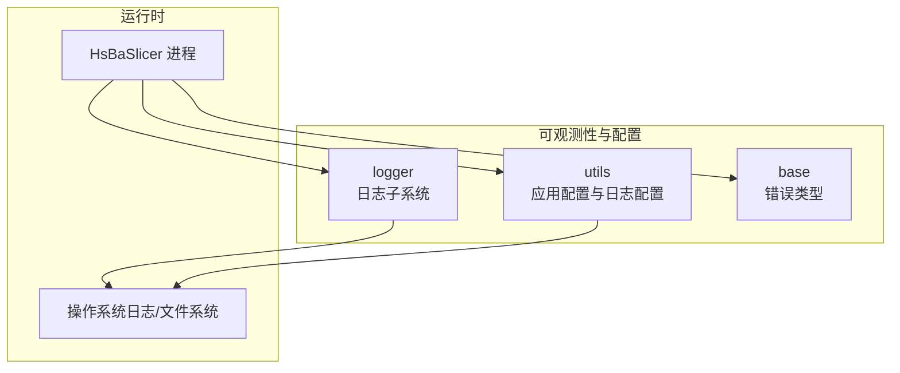
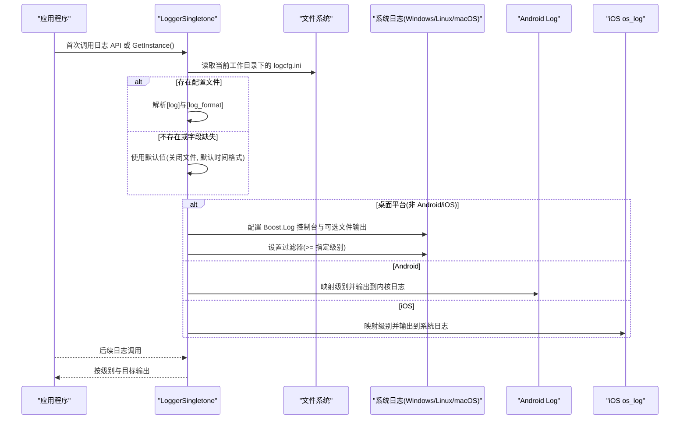
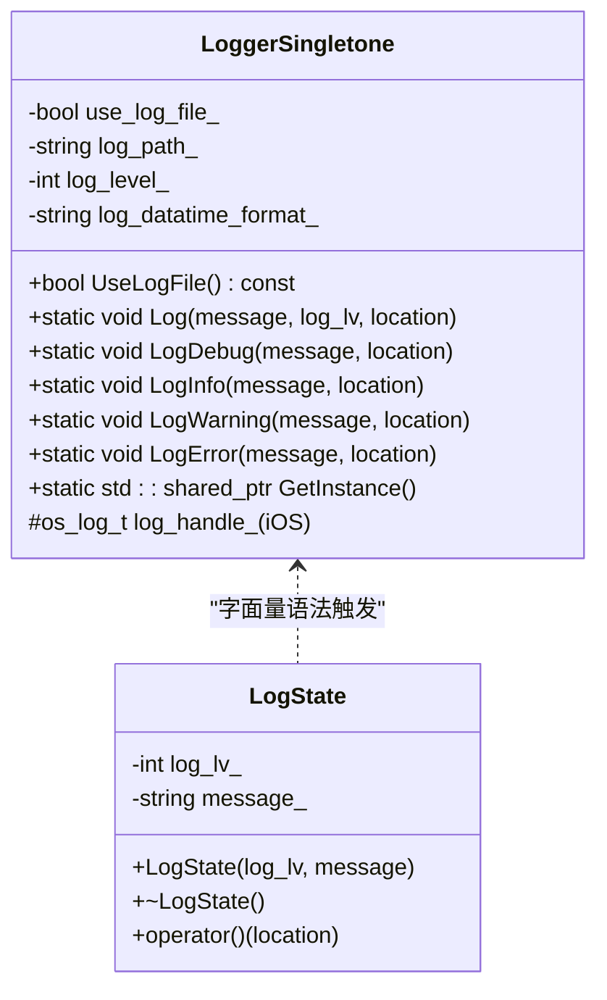
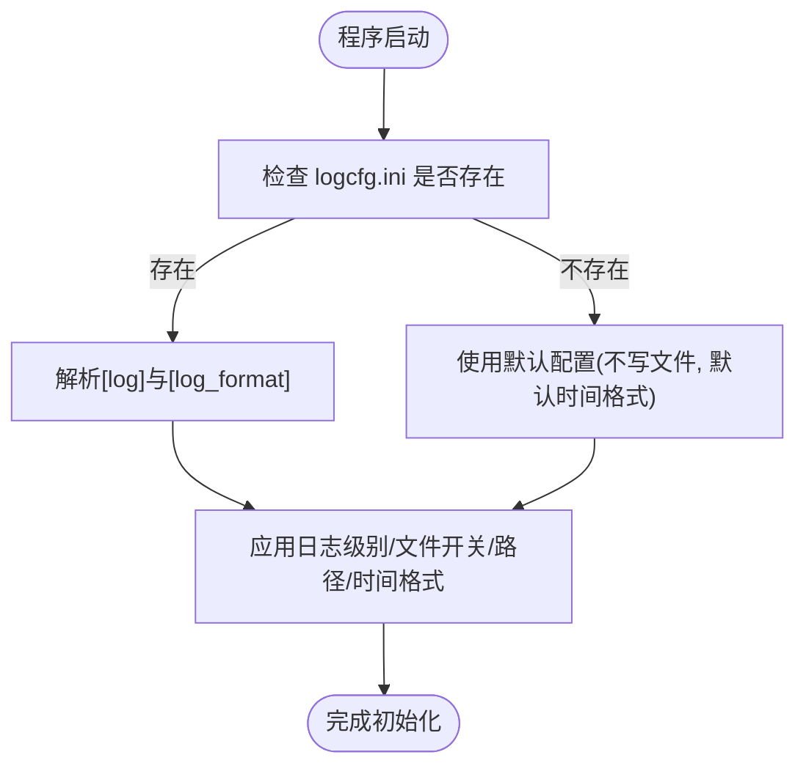
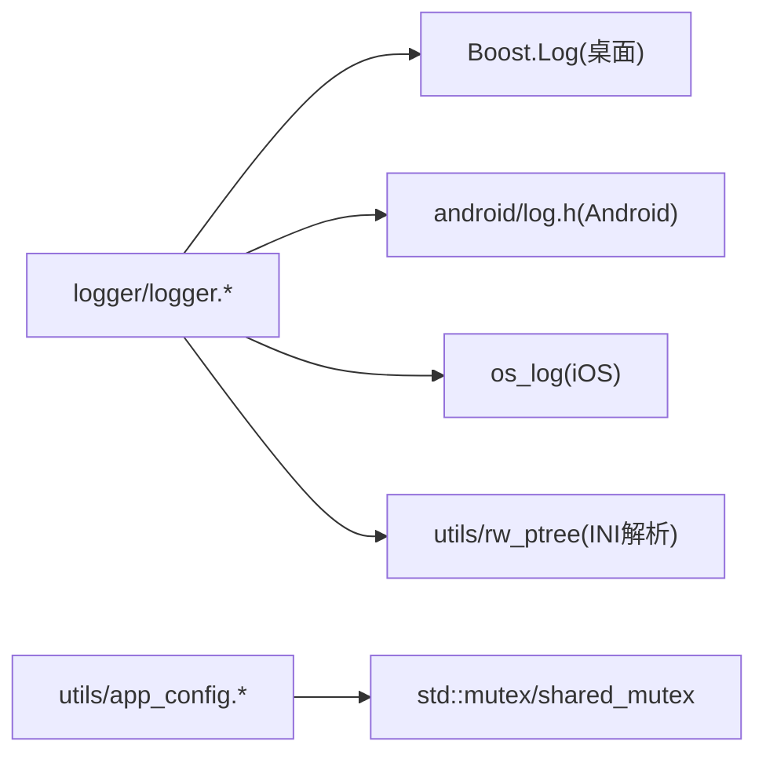

# 监控和维护

<cite>
**本文引用的文件**   
- [logger.hpp](file://logger/logger.hpp)
- [logger.cpp](file://logger/logger.cpp)
- [logcfg.ini](file://utils/logcfg.ini)
- [app_config.hpp](file://utils/app_config.hpp)
- [app_config.cpp](file://utils/app_config.cpp)
- [error.hpp](file://base/error.hpp)
- [README.md](file://README.md)
</cite>

## 目录
1. [简介](#简介)
2. [项目结构](#项目结构)
3. [核心组件](#核心组件)
4. [架构总览](#架构总览)
5. [详细组件分析](#详细组件分析)
6. [依赖关系分析](#依赖关系分析)
7. [性能与基准](#性能与基准)
8. [健康检查与告警](#健康检查与告警)
9. [维护任务清单](#维护任务清单)
10. [故障诊断与调试](#故障诊断与调试)
11. [结论](#结论)

## 简介
本指南面向运维团队，提供 HsBaSlicer 的系统监控与维护操作手册。内容覆盖日志系统配置与管理、性能监控方案、健康检查机制、定期维护任务以及故障诊断与调试技巧。HsBaSlicer 是一个高性能、模块化、跨平台的 3D 打印切片框架，其日志子系统基于 Boost.Log（桌面平台）或系统日志（Android/iOS），并提供 INI 配置文件驱动的可观测性能力。

## 项目结构
与监控和维护直接相关的代码主要位于以下模块：
- logger：线程安全的单例日志器，支持多级别输出、文件输出与平台适配。
- utils：应用配置单例与默认日志配置文件 logcfg.ini。
- base：通用错误类型定义，便于统一异常处理与可观测性。
- README：构建与安装说明，帮助定位运行环境与产物路径。

图表来源
- [logger.hpp:27-122](file://logger/logger.hpp#L27-L122)
- [logger.cpp:136-222](file://logger/logger.cpp#L136-L222)
- [app_config.hpp:14-46](file://utils/app_config.hpp#L14-L46)
- [app_config.cpp:14-43](file://utils/app_config.cpp#L14-L43)
- [error.hpp:15-46](file://base/error.hpp#L15-L46)

章节来源
- [README.md:25-39](file://README.md#L25-L39)

## 核心组件
- LoggerSingletone：线程安全的全局日志器，封装 Boost.Log（桌面）、Android Log、iOS os_log，提供多级日志 API 与用户自定义字面量语法。
- AppConfigSingletone：应用级配置单例，用于共享设置（如外部工具路径）。
- 日志配置文件 logcfg.ini：INI 格式，控制日志级别、是否写文件、日志路径与时间格式。
- 错误类型体系：统一的异常基类与派生类型，便于上层捕获与上报。

章节来源
- [logger.hpp:27-122](file://logger/logger.hpp#L27-L122)
- [logger.cpp:136-222](file://logger/logger.cpp#L136-L222)
- [app_config.hpp:14-46](file://utils/app_config.hpp#L14-L46)
- [app_config.cpp:14-43](file://utils/app_config.cpp#L14-L43)
- [error.hpp:15-46](file://base/error.hpp#L15-L46)

## 架构总览
下图展示日志子系统在启动时的初始化流程与输出目标选择逻辑。

图表来源
- [logger.cpp:147-222](file://logger/logger.cpp#L147-L222)
- [logger.cpp:242-343](file://logger/logger.cpp#L242-L343)

## 详细组件分析

### 日志子系统（LoggerSingletone）
- 功能要点
  - 单例模式，线程安全；首次访问时懒加载实例。
  - 从当前工作目录的 logcfg.ini 读取日志配置。
  - 桌面平台使用 Boost.Log，支持控制台与文件输出；文件输出启用大小轮转与每日轮转。
  - Android 使用 ANDROID_LOG_*，iOS 使用 os_log。
  - 提供 LogDebug/LogInfo/LogWarning/LogError 等便捷 API，以及 "_log_debug/_log_info/_log_warning/_log_error" 字面量语法。
- 关键实现位置
  - 类定义与接口：[logger.hpp:27-122](file://logger/logger.hpp#L27-L122)
  - 构造与初始化：[logger.cpp:136-222](file://logger/logger.cpp#L136-L222)
  - 日志分发与平台分支：[logger.cpp:242-343](file://logger/logger.cpp#L242-L343)

图表来源
- [logger.hpp:27-122](file://logger/logger.hpp#L27-L122)
- [logger.hpp:123-191](file://logger/logger.hpp#L123-L191)

章节来源
- [logger.hpp:27-122](file://logger/logger.hpp#L27-L122)
- [logger.cpp:136-222](file://logger/logger.cpp#L136-L222)
- [logger.cpp:242-343](file://logger/logger.cpp#L242-L343)

### 日志配置（logcfg.ini）
- 配置项说明
  - [log] 段
    - log_level：生产环境日志级别阈值（数值越高越详细）。
    - log_level_debug：调试构建下的日志级别阈值。
    - use_log_file：是否启用文件日志输出。
    - log_file：日志文件相对路径（拼接当前工作目录）。
  - [log_format] 段
    - log_datatime_format：时间戳格式（strftime）。
    - log_time_format：时间格式（strftime）。
- 默认行为
  - 若配置文件不存在或字段缺失，将回退为默认值：不写文件、默认时间格式。
- 示例默认配置
  - 见 [logcfg.ini:1-8](file://utils/logcfg.ini#L1-L8)

图表来源
- [logger.cpp:147-183](file://logger/logger.cpp#L147-L183)
- [logcfg.ini:1-8](file://utils/logcfg.ini#L1-L8)

章节来源
- [logger.cpp:147-183](file://logger/logger.cpp#L147-L183)
- [logcfg.ini:1-8](file://utils/logcfg.ini#L1-L8)

### 应用配置（AppConfigSingletone）
- 作用
  - 提供线程安全的单例访问入口，暴露共享的应用级设置（例如外部工具路径）。
- 关键点
  - 通过 GetInstance()/DeleteInstance() 管理生命周期。
  - 内部使用 shared_mutex 保证并发安全。
- 参考实现
  - 接口定义：[app_config.hpp:14-46](file://utils/app_config.hpp#L14-L46)
  - 实现细节：[app_config.cpp:14-43](file://utils/app_config.cpp#L14-L43)

章节来源
- [app_config.hpp:14-46](file://utils/app_config.hpp#L14-L46)
- [app_config.cpp:14-43](file://utils/app_config.cpp#L14-L43)

### 错误类型体系
- 设计
  - 以 std::runtime_error 为基类，提供 RuntimeError、OutOfRangeError、InvalidArgumentError 等具体类型。
- 用途
  - 统一异常模型，便于上层捕获、记录与上报，配合日志系统进行可观测性采集。
- 参考实现
  - [error.hpp:15-46](file://base/error.hpp#L15-L46)

章节来源
- [error.hpp:15-46](file://base/error.hpp#L15-L46)

## 依赖关系分析
- 日志子系统依赖
  - 桌面平台：Boost.Log（表达式、sink、属性、格式化）。
  - Android：android/log.h。
  - iOS：os_log。
  - 配置读取：utils/rw_ptree（INI 解析）。
- 配置子系统依赖
  - 标准库互斥锁与共享锁。
- 外部依赖
  - 构建与安装由 CMake 管理，详见根 README。

图表来源
- [logger.cpp:17-27](file://logger/logger.cpp#L17-L27)
- [logger.cpp:29-35](file://logger/logger.cpp#L29-L35)
- [logger.cpp:37-37](file://logger/logger.cpp#L37-L37)
- [app_config.cpp:9-9](file://utils/app_config.cpp#L9-L9)

章节来源
- [logger.cpp:17-35](file://logger/logger.cpp#L17-L35)
- [logger.cpp:37-37](file://logger/logger.cpp#L37-L37)
- [app_config.cpp:9-9](file://utils/app_config.cpp#L9-L9)

## 性能与基准
- 日志开销
  - 桌面平台通过 Boost.Log 进行过滤与格式化；建议在生产环境将日志级别设置为 warning 及以上，避免过多 trace/debug 日志影响吞吐。
  - 文件输出开启后，采用大小轮转（固定大小）与每日轮转（时间点），有助于控制磁盘占用。
- 资源使用
  - 日志写入会占用 I/O 带宽与 CPU；在高吞吐场景下，建议：
    - 降低日志级别。
    - 仅在关键路径输出必要信息。
    - 合理设置日志文件大小与轮转策略。
- 基准建议
  - 使用 CI 覆盖率与测试套件验证关键路径稳定性（参考根 README 的构建与测试说明）。
  - 对切片流水线的关键阶段添加结构化日志，结合外部指标采集工具（如 Prometheus 客户端）导出耗时、队列长度、失败率等指标。

章节来源
- [logger.cpp:196-208](file://logger/logger.cpp#L196-L208)
- [README.md:41-98](file://README.md#L41-L98)

## 健康检查与告警
- 服务状态检测
  - 通过日志级别与关键字（如 error/fatal）判断服务健康状态。
  - 在容器化部署中，可将日志输出重定向至标准输出，并由编排平台收集。
- 依赖服务监控
  - 若使用外部工具（如 7-Zip），可通过 AppConfigSingletone 获取路径并进行可用性探测。
- 告警配置
  - 基于日志关键字与频率设定告警规则（例如连续 N 条 error 触发告警）。
  - 结合外部监控系统（Prometheus/Grafana、ELK）进行可视化与告警。

章节来源
- [logger.cpp:242-343](file://logger/logger.cpp#L242-L343)
- [app_config.hpp:34-39](file://utils/app_config.hpp#L34-L39)
- [app_config.cpp:38-43](file://utils/app_config.cpp#L38-L43)

## 维护任务清单
- 定期清理
  - 清理过期日志文件（依据轮转策略与保留天数）。
  - 清理临时文件与中间产物（切片过程中的中间数据）。
- 备份策略
  - 备份配置文件（logcfg.ini、应用配置）。
  - 备份关键日志与指标数据。
- 容量规划
  - 根据日志增长速率评估磁盘容量需求。
  - 调整日志级别与轮转策略以平衡可观测性与存储成本。
- 版本与依赖更新
  - 关注第三方依赖（如 Boost.Log）的安全更新。
  - 遵循 README 中的构建与安装说明进行升级。

章节来源
- [logger.cpp:196-208](file://logger/logger.cpp#L196-L208)
- [README.md:100-185](file://README.md#L100-L185)

## 故障诊断与调试
- 常见问题
  - 日志未输出：检查 logcfg.ini 是否存在且路径可写；确认日志级别阈值。
  - 日志文件过大：调整轮转大小与时间策略；必要时增加压缩归档。
  - 移动端无本地文件日志：Android/iOS 默认使用系统日志，需查看系统日志通道。
- 调试技巧
  - 在开发环境提高日志级别（log_level_debug），定位问题。
  - 使用结构化日志关键字，便于检索与聚合。
  - 捕获并记录异常信息（基于 error.hpp 的错误类型），结合日志上下文快速定位。
- 诊断流程
  - 复现问题 -> 提升日志级别 -> 收集日志与指标 -> 分析错误堆栈 -> 修复并回归验证。

章节来源
- [logger.cpp:147-183](file://logger/logger.cpp#L147-L183)
- [logger.cpp:242-343](file://logger/logger.cpp#L242-L343)
- [error.hpp:15-46](file://base/error.hpp#L15-L46)

## 结论
HsBaSlicer 提供了跨平台的日志子系统与基础配置能力，适合在生产环境中进行可观测性建设。通过合理的日志级别、轮转策略与外部指标采集，可以实现稳定的系统监控与维护。结合健康检查与告警机制，运维团队能够及时发现并处理潜在问题，保障切片流水线的高可用与高性能。