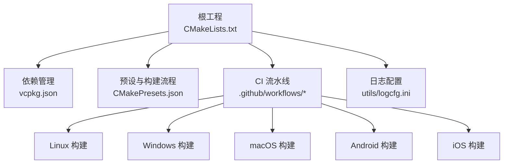
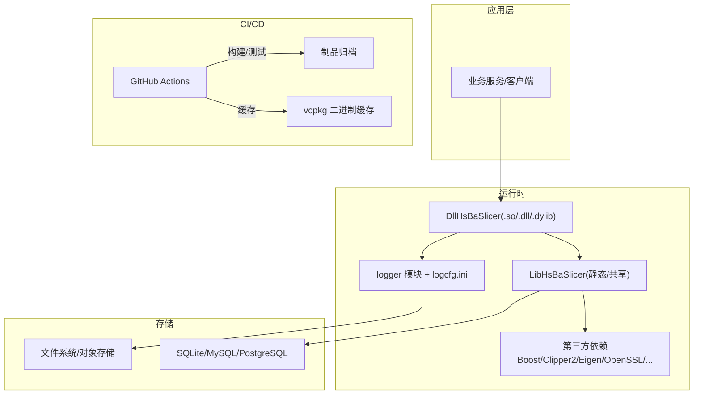
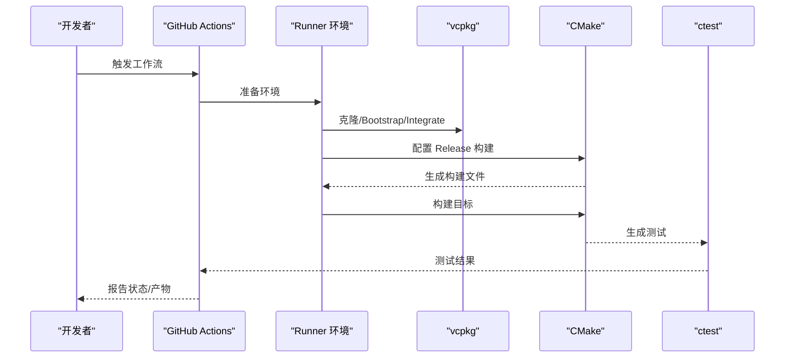
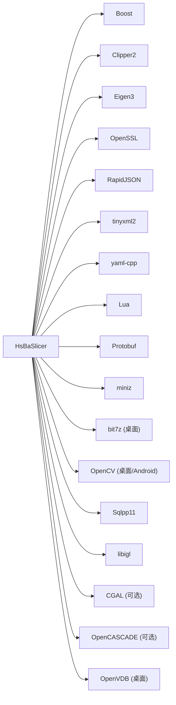

# 部署和维护

<cite>
**本文引用的文件**   
- [README.md](file://README.md)
- [CMakeLists.txt](file://CMakeLists.txt)
- [CMakePresets.json](file://CMakePresets.json)
- [vcpkg.json](file://vcpkg.json)
- [.github/workflows/build-linux.yml](file://.github/workflows/build-linux.yml)
- [.github/workflows/build-windows.yml](file://.github/workflows/build-windows.yml)
- [.github/workflows/build-macos.yml](file://.github/workflows/build-macos.yml)
- [.github/workflows/build-android.yml](file://.github/workflows/build-android.yml)
- [.github/workflows/build-ios.yml](file://.github/workflows/build-ios.yml)
- [utils/logcfg.ini](file://utils/logcfg.ini)
</cite>

## 目录
1. [简介](#简介)
2. [项目结构](#项目结构)
3. [核心组件](#核心组件)
4. [架构总览](#架构总览)
5. [详细组件分析](#详细组件分析)
6. [依赖分析](#依赖分析)
7. [性能与容量规划](#性能与容量规划)
8. [故障排除指南](#故障排除指南)
9. [结论](#结论)
10. [附录](#附录)

## 简介
本指南面向运维人员与项目维护者，提供 HsBaSlicer 在生产环境的完整部署、升级、备份恢复、监控与排障方案。HsBaSlicer 是一个高性能 C++ 切片框架，支持多平台构建与安装导出，并提供动态库（DllHsBaSlicer）与静态库（LibHsBaSlicer）两种集成方式。

## 项目结构
- 顶层 CMake 工程负责全局配置、依赖发现、目标安装与导出。
- 通过 vcpkg 管理第三方依赖，支持 Windows/Linux/macOS/Android/iOS 等目标。
- CI 使用 GitHub Actions 在多个平台上执行构建与测试。
- 日志系统由 logger 模块提供，运行时配置文件 logcfg.ini 随构建产物输出到 bin 目录。

**图示来源**
- [CMakeLists.txt:1-695](file://CMakeLists.txt#L1-L695)
- [vcpkg.json:1-113](file://vcpkg.json#L1-L113)
- [CMakePresets.json:1-236](file://CMakePresets.json#L1-L236)
- [.github/workflows/build-linux.yml:1-82](file://.github/workflows/build-linux.yml#L1-L82)
- [.github/workflows/build-windows.yml:1-49](file://.github/workflows/build-windows.yml#L1-L49)
- [.github/workflows/build-macos.yml:1-60](file://.github/workflows/build-macos.yml#L1-L60)
- [.github/workflows/build-android.yml:1-144](file://.github/workflows/build-android.yml#L1-L144)
- [.github/workflows/build-ios.yml:1-140](file://.github/workflows/build-ios.yml#L1-L140)

**章节来源**
- [README.md:1-211](file://README.md#L1-L211)
- [CMakeLists.txt:1-695](file://CMakeLists.txt#L1-L695)
- [CMakePresets.json:1-236](file://CMakePresets.json#L1-L236)
- [vcpkg.json:1-113](file://vcpkg.json#L1-L113)

## 核心组件
- 构建与安装
  - 顶层 CMake 定义所有库目标，并通过 install(EXPORT ...) 导出 CMake 包配置，下游可通过 find_package(HsBaSlicer) 引用。
  - 支持共享库与静态库模式，默认行为受 VCPKG_TARGET_TRIPLET 影响。
- 依赖管理
  - vcpkg.json 声明依赖与可选特性（如 copyleft），控制 CGAL/OpenCascade 等内核的启用与许可证切换。
- 运行期日志
  - 构建时将 utils/logcfg.ini 复制到输出目录，供 logger 模块读取。
- 多平台 CI
  - GitHub Actions 工作流覆盖 Linux/Windows/macOS/Android/iOS，统一使用 vcpkg 缓存加速构建。

**章节来源**
- [CMakeLists.txt:456-665](file://CMakeLists.txt#L456-L665)
- [CMakeLists.txt:355-365](file://CMakeLists.txt#L355-L365)
- [vcpkg.json:1-113](file://vcpkg.json#L1-L113)
- [README.md:100-185](file://README.md#L100-L185)

## 架构总览
下图展示生产环境中的典型部署形态：应用服务调用 HsBaSlicer 的动态库接口进行切片处理；日志写入本地或远端；CI 流水线持续产出制品并归档。

**图示来源**
- [CMakeLists.txt:456-665](file://CMakeLists.txt#L456-L665)
- [CMakeLists.txt:206-349](file://CMakeLists.txt#L206-L349)
- [.github/workflows/build-linux.yml:43-80](file://.github/workflows/build-linux.yml#L43-L80)

## 详细组件分析

### 容器化部署（Docker）
- 基础镜像建议
  - Linux: ubuntu:22.04 或 debian:bookworm-slim，预装 cmake、ninja、g++、git、python3、powershell（用于版本生成脚本）。
  - Windows: mcr.microsoft.com/windows/servercore 或 nanoserver，安装 Visual Studio Build Tools 与 PowerShell。
  - macOS/iOS: 使用 GitHub Actions macos-latest runner 构建，不直接打包镜像。
- 构建阶段
  - 克隆仓库与 vcpkg，bootstrap 并 integrate。
  - 设置 VCPKG_ROOT 与 VCPKG_BINARY_SOURCES 以启用 GHA 二进制缓存。
  - 使用 CMake 预设或命令行参数配置 Release 构建。
- 运行阶段
  - 将 bin 目录下的可执行文件与动态库拷贝至镜像 /app/bin。
  - 复制 utils/logcfg.ini 到 /app/config/logcfg.ini，并在启动时指定路径（若程序支持）。
  - 挂载数据卷用于输入模型与输出切片结果。
- 示例步骤（概念性说明）
  - 构建镜像：docker build --target builder ...
  - 运行容器：docker run -v /data:/data myimage /app/bin/HsBaSlicer --config /app/config/logcfg.ini --input /data/model.stl --output /data/out

[本节为概念性说明，未直接分析具体文件]

### 云服务集成
- 云构建
  - 使用 GitHub Actions 在 Linux/Windows/macOS 上构建，Android/iOS 分别使用专用工作流。
  - 开启 vcpkg 二进制缓存以减少下载时间。
- 制品发布
  - 将构建产物（.so/.dll/.a/.apk 等）上传为 GitHub Actions 工件，便于后续分发。
- 环境变量
  - ANDROID_HOME/ANDROID_SDK_ROOT/ANDROID_NDK 用于 Android 构建。
  - VCPKG_ROOT/VCPKG_BINARY_SOURCES 用于依赖缓存。

**章节来源**
- [.github/workflows/build-linux.yml:1-82](file://.github/workflows/build-linux.yml#L1-L82)
- [.github/workflows/build-windows.yml:1-49](file://.github/workflows/build-windows.yml#L1-L49)
- [.github/workflows/build-macos.yml:1-60](file://.github/workflows/build-macos.yml#L1-L60)
- [.github/workflows/build-android.yml:1-144](file://.github/workflows/build-android.yml#L1-L144)
- [.github/workflows/build-ios.yml:1-140](file://.github/workflows/build-ios.yml#L1-L140)

### CI/CD 流水线配置
- 触发策略
  - 当前工作流使用 workflow_dispatch 手动触发，可按需扩展为 push/PR 触发。
- 关键步骤
  - 安装平台依赖（apt/brew/choco 等）。
  - 克隆 vcpkg 并 bootstrap。
  - 配置 CMake（Release 构建）。
  - 构建并运行测试（Linux/macOS 包含 ctest）。
- 缓存优化
  - 使用 actions/cache 缓存 vcpkg/downloads，键基于 vcpkg.json 哈希。
  - 设置 VCPKG_BINARY_SOURCES=clear;x-gha,readwrite 启用 GHA 二进制缓存后端。

**图示来源**
- [.github/workflows/build-linux.yml:27-80](file://.github/workflows/build-linux.yml#L27-L80)
- [.github/workflows/build-windows.yml:13-48](file://.github/workflows/build-windows.yml#L13-L48)
- [.github/workflows/build-macos.yml:13-58](file://.github/workflows/build-macos.yml#L13-L58)

**章节来源**
- [.github/workflows/build-linux.yml:1-82](file://.github/workflows/build-linux.yml#L1-L82)
- [.github/workflows/build-windows.yml:1-49](file://.github/workflows/build-windows.yml#L1-L49)
- [.github/workflows/build-macos.yml:1-60](file://.github/workflows/build-macos.yml#L1-L60)

### 版本管理与升级指南
- 版本号来源
  - 顶层 CMake 定义 PROJECT VERSION，安装时生成 HsBaSlicerConfigVersion.cmake，兼容 SameMajorVersion。
- 依赖更新
  - 修改 vcpkg.json 中依赖版本后，在 CI 中重新构建以验证兼容性。
  - 注意 copyleft 特性开关对许可证的影响。
- 兼容性考虑
  - Debug 构建会禁用布尔运算以避免性能问题；生产建议使用 Release。
  - 不同平台对 CAD/点云/数据库驱动的支持不同（Android/iOS 受限）。
- 迁移路径
  - 从旧版本升级时，优先检查 CMake 导出头与库 ABI 是否变化。
  - 若启用 copyleft 内核，确保下游许可合规。

**章节来源**
- [CMakeLists.txt:44-44](file://CMakeLists.txt#L44-L44)
- [CMakeLists.txt:648-665](file://CMakeLists.txt#L648-L665)
- [CMakeLists.txt:294-298](file://CMakeLists.txt#L294-L298)
- [vcpkg.json:89-111](file://vcpkg.json#L89-L111)

### 维护任务操作流程

#### 日志管理
- 配置文件
  - 构建时将 utils/logcfg.ini 复制到输出目录 bin/$CONFIG。
- 运行期
  - 根据实际部署调整日志级别、输出路径与轮转策略。
- 采集与聚合
  - 在容器中挂载日志目录，配合日志采集工具（如 Fluent Bit/Vector）转发至集中式存储。

**章节来源**
- [CMakeLists.txt:355-365](file://CMakeLists.txt#L355-L365)
- [utils/logcfg.ini](file://utils/logcfg.ini)

#### 性能监控
- 指标建议
  - 切片耗时、内存峰值、线程池利用率、IO 吞吐。
- 实现建议
  - 在应用层埋点，结合系统级监控（Prometheus/Grafana）收集。
  - 针对 CGAL/IGL 等计算密集型模块，关注 CPU 与内存占用。

[本节为通用指导，未直接分析具体文件]

#### 问题排查
- 常见现象
  - 动态库加载失败：检查 PATH/DLL 搜索路径与依赖完整性。
  - 日志无输出：确认 logcfg.ini 存在且路径正确。
  - 构建失败：检查编译器 C++20 支持与 vcpkg 缓存。
- 诊断步骤
  - 查看 CI 日志与本地构建输出。
  - 使用 ldd/objdump 或 Dependency Walker 检查依赖。
  - 缩小复现范围，逐步关闭可选特性（如 copyleft）。

**章节来源**
- [CMakeLists.txt:17-38](file://CMakeLists.txt#L17-L38)
- [CMakeLists.txt:355-365](file://CMakeLists.txt#L355-L365)

### 备份恢复策略与数据迁移
- 备份范围
  - 用户模型与切片结果（文件系统/对象存储）。
  - 配置与日志（logcfg.ini 与日志目录）。
  - 数据库（SQLite/MySQL/PostgreSQL，视部署而定）。
- 恢复流程
  - 停止服务 -> 恢复数据 -> 校验一致性 -> 重启服务。
- 迁移方案
  - 小版本升级：通常无需迁移；仅当 ABI 或协议变更时需评估。
  - 大版本升级：先灰度发布，验证兼容后再全量切换。

[本节为通用指导，未直接分析具体文件]

### 社区支持与贡献流程
- 提交 Issue/PR
  - 遵循项目 README 中的贡献指引，涉及外部依赖与构建选项时参考 CMakeLists.txt 与 proto/CMakeLists.txt。
- 许可证
  - 条件双许可：不包含 GPL/LGPL 内核时为 MIT；包含时为 GPL-3.0-or-later。
- 文档与样例
  - 利用 samples 与 docs 目录了解 API 用法与最佳实践。

**章节来源**
- [README.md:192-211](file://README.md#L192-L211)

## 依赖分析
- 核心依赖
  - Boost（locale/log/dll/property-tree/date-time/uuid/pfr/graph）、Clipper2、Eigen3、OpenSSL、RapidJSON、tinyxml2、yaml-cpp、Lua、protobuf、miniz、bit7z（桌面）、OpenCV（桌面/Android）、Sqlpp11（SQLite3/MySQL/PostgreSQL 或仅 SQLite3 移动端）、libigl、CGAL（可选）、OpenCASCADE（可选）、OpenVDB（桌面）。
- 平台差异
  - Android/iOS 禁用部分功能（如 bit7z、OpenCV、CAD/点云、动态库加载器）。
  - copyleft 特性启用 CGAL/OpenCascade，影响许可证。

**图示来源**
- [CMakeLists.txt:206-349](file://CMakeLists.txt#L206-L349)
- [vcpkg.json:10-87](file://vcpkg.json#L10-L87)

**章节来源**
- [CMakeLists.txt:206-349](file://CMakeLists.txt#L206-L349)
- [vcpkg.json:1-113](file://vcpkg.json#L1-L113)

## 性能与容量规划
- 构建性能
  - 使用 Ninja 与并行编译；启用 vcpkg 二进制缓存。
  - 在 CI 中清理不必要组件以释放磁盘空间（参考 Linux 工作流）。
- 运行性能
  - 生产使用 Release 构建；避免 Debug 下布尔运算带来的高内存与慢速。
  - 合理设置线程池与对象池大小（由 CMake 宏控制）。
- 容量规划
  - 根据模型规模预估 IO 与内存峰值；为日志与中间文件预留足够空间。

**章节来源**
- [CMakeLists.txt:294-298](file://CMakeLists.txt#L294-L298)
- [.github/workflows/build-linux.yml:12-24](file://.github/workflows/build-linux.yml#L12-L24)

## 故障排除指南
- 构建失败
  - 检查编译器 C++20 支持与 CMake 版本要求。
  - 确认 vcpkg 已 bootstrap 且 VCPKG_ROOT 正确。
- 运行失败
  - 动态库缺失：确保依赖库与主程序在同一目录或 PATH 可找到。
  - 日志无输出：确认 logcfg.ini 存在且路径正确。
- 平台特定
  - Android/iOS：部分功能被禁用，需按平台限制调整功能开关。
  - Windows：注意 VS 工具链与 vcvarsall.bat 初始化。

**章节来源**
- [CMakeLists.txt:17-38](file://CMakeLists.txt#L17-L38)
- [CMakeLists.txt:355-365](file://CMakeLists.txt#L355-L365)
- [.github/workflows/build-windows.yml:34-48](file://.github/workflows/build-windows.yml#L34-L48)

## 结论
HsBaSlicer 提供了完善的跨平台构建、安装导出与 CI 能力。生产部署应重点关注依赖管理、日志配置、性能调优与平台差异。通过规范的版本管理与灰度升级策略，可保障服务的稳定性与可维护性。

## 附录
- 常用命令
  - 构建：cmake --preset <preset> && cmake --build out/build/<preset> --config Release
  - 安装：cmake --install out/build/<preset> --prefix <install_prefix> --config Release
  - 测试：cd out/build/<preset>/tests && ctest --build-config Release
- 预设参考
  - windows-base/x64-debug/x64-release/linux-debug/linux-release/android-release/macos-debug/macos-release/ios-release

**章节来源**
- [CMakePresets.json:1-236](file://CMakePresets.json#L1-L236)
- [README.md:181-185](file://README.md#L181-L185)