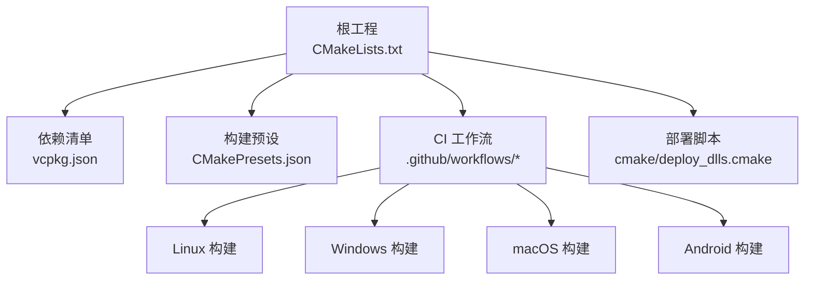
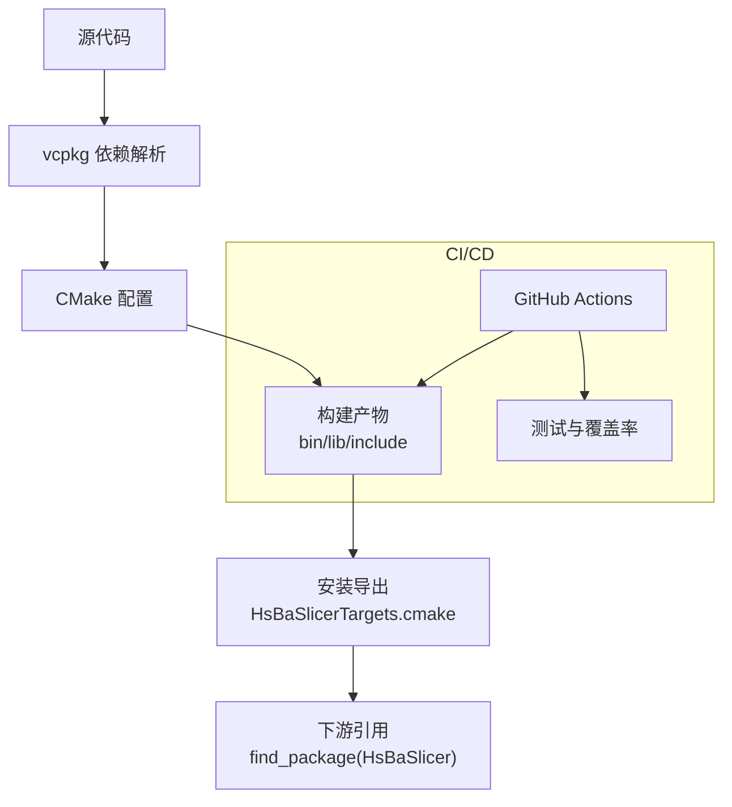
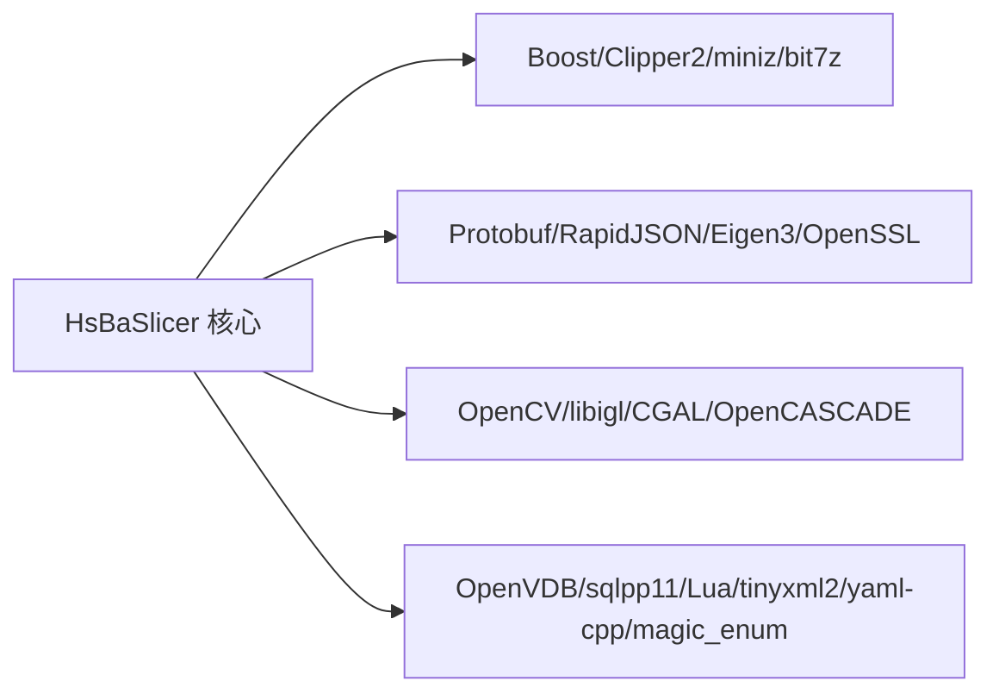

# 部署配置

<cite>
**本文引用的文件**   
- [README.md](file://README.md)
- [CMakeLists.txt](file://CMakeLists.txt)
- [CMakePresets.json](file://CMakePresets.json)
- [vcpkg.json](file://vcpkg.json)
- [cmake\deploy_dlls.cmake](file://cmake/deploy_dlls.cmake)
- [.github/workflows/build-linux.yml](file://.github/workflows/build-linux.yml)
- [.github/workflows/build-windows.yml](file://.github/workflows/build-windows.yml)
- [.github/workflows/build-macos.yml](file://.github/workflows/build-macos.yml)
- [.github/workflows/build-android.yml](file://.github/workflows/build-android.yml)
- [.github/workflows/cmake-multi-platform.yml](file://.github/workflows/cmake-multi-platform.yml)
- [.github/workflows/test-coverage.yml](file://.github/workflows/test-coverage.yml)
</cite>

## 目录
1. [简介](#简介)
2. [项目结构](#项目结构)
3. [核心组件](#核心组件)
4. [架构总览](#架构总览)
5. [详细组件分析](#详细组件分析)
6. [依赖分析](#依赖分析)
7. [性能考虑](#性能考虑)
8. [故障排查指南](#故障排查指南)
9. [结论](#结论)
10. [附录](#附录)

## 简介
本指南面向运维与平台工程团队，提供 HsBaSlicer 在生产环境的容器化部署、云服务集成、CI/CD 流水线与环境变量配置的完整操作手册。HsBaSlicer 是一个高性能 C++ 切片框架，支持多平台构建与安装导出，并通过 vcpkg 管理第三方依赖。仓库已包含跨平台 GitHub Actions 工作流与 CMake Presets，可作为生产部署的基线模板。

## 项目结构
- 顶层 CMake 工程负责全局特性检测、依赖发现、目标安装与导出（Config/CMake 包）。
- vcpkg 清单集中声明依赖与可选特性（如 copyleft 内核）。
- CMake Presets 提供 Windows/Linux/macOS/Android/iOS 的标准构建配置。
- .github/workflows 提供 Linux/Windows/macOS/Android 构建与测试流程，以及覆盖率门禁。
- cmake/deploy_dlls.cmake 用于调试符号部署辅助。

**图表来源** 
- [CMakeLists.txt:1-695](file://CMakeLists.txt#L1-L695)
- [vcpkg.json:1-113](file://vcpkg.json#L1-L113)
- [CMakePresets.json:1-236](file://CMakePresets.json#L1-L236)
- [.github/workflows/build-linux.yml:1-82](file://.github/workflows/build-linux.yml#L1-L82)
- [.github/workflows/build-windows.yml:1-49](file://.github/workflows/build-windows.yml#L1-L49)
- [.github/workflows/build-macos.yml:1-60](file://.github/workflows/build-macos.yml#L1-L60)
- [.github/workflows/build-android.yml:63-97](file://.github/workflows/build-android.yml#L63-L97)
- [cmake/deploy_dlls.cmake:1-27](file://cmake/deploy_dlls.cmake#L1-L27)

**章节来源**
- [README.md:41-100](file://README.md#L41-L100)
- [CMakeLists.txt:456-665](file://CMakeLists.txt#L456-L665)
- [CMakePresets.json:1-236](file://CMakePresets.json#L1-L236)
- [vcpkg.json:1-113](file://vcpkg.json#L1-L113)

## 核心组件
- 构建系统：CMake 3.28+，启用 C++20，统一输出目录，支持共享/静态库切换。
- 依赖管理：vcpkg 清单驱动，支持 copyleft 特性开关（CGAL/OpenCASCADE）。
- 安装导出：通过 install(EXPORT ...) 生成 HsBaSlicerTargets.cmake 与 Config 文件，供下游 find_package 引用。
- CI/CD：GitHub Actions 覆盖多平台构建、测试与覆盖率门禁；Android 使用 NDK 交叉编译。
- 运行时部署：Windows 下 PDB 符号复制脚本；vcpkg applocal 自动部署第三方 DLL。

关键要点
- 构建类型与工具链：Release 用于生产；Linux/macOS/Windows 分别有对应 Preset。
- Android 构建需 ANDROID_NDK_HOME 环境变量与 arm64-v8a ABI。
- 动态库加载器在非桌面平台默认关闭，避免运行时依赖问题。
- 日志配置文件 logcfg.ini 在构建期复制到 bin 目录。

**章节来源**
- [CMakeLists.txt:1-105](file://CMakeLists.txt#L1-L105)
- [CMakeLists.txt:228-240](file://CMakeLists.txt#L228-L240)
- [CMakeLists.txt:355-365](file://CMakeLists.txt#L355-L365)
- [CMakeLists.txt:456-665](file://CMakeLists.txt#L456-L665)
- [README.md:100-185](file://README.md#L100-L185)

## 架构总览
下图展示从代码到制品的端到端路径：源码经 CMake 配置与 vcpkg 依赖解析后构建出二进制与头文件，再通过 install 导出为可被下游引用的包；CI 在多平台上执行构建与测试，产出工件并归档。

**图表来源** 
- [CMakeLists.txt:456-665](file://CMakeLists.txt#L456-L665)
- [.github/workflows/build-linux.yml:64-80](file://.github/workflows/build-linux.yml#L64-L80)
- [.github/workflows/test-coverage.yml:120-135](file://.github/workflows/test-coverage.yml#L120-L135)

## 详细组件分析

### 容器化部署方案（Dockerfile 编写、镜像构建、编排）
说明
- 本项目未提供 Dockerfile 或 docker-compose 文件。建议基于官方基础镜像（如 Ubuntu/Alpine）安装 CMake、vcpkg、编译器与必要系统库，然后复用仓库中的 CMake Presets 与 GitHub Actions 步骤进行构建与安装。
- 推荐将 out/install/<preset>/ 作为最终镜像内容，便于下游 find_package 引用。

参考实现要点（不直接粘贴代码）
- 基础镜像选择：Ubuntu LTS 或 Alpine（注意依赖差异）。
- 安装构建依赖：cmake、ninja、g++/clang、git、python3、PowerShell（版本生成脚本需要）。
- 克隆并初始化 vcpkg，设置 VCPKG_ROOT。
- 使用 CMake Presets 或显式参数进行 Release 构建。
- 执行 cmake --install 将头文件、库与 CMake 包配置安装至 /opt/HsBaSlicer。
- 运行阶段仅保留必要的运行时依赖与日志配置文件。

编排建议
- 使用 Kubernetes Deployment + Service 暴露服务端口（若封装为 HTTP/gRPC 服务）。
- 使用 ConfigMap/Secret 注入环境变量与日志配置。
- 使用 PersistentVolume 挂载输入模型与输出切片结果。

[本节为概念性指导，不直接分析具体文件]

### 云服务集成配置（AWS/Azure/GCP）
说明
- 仓库未包含云厂商专用部署脚本。可复用 GitHub Actions 中各平台的构建步骤，结合云厂商的 CI/CD 或 IaC 工具（Terraform/ARM/Bicep/CloudFormation）完成部署。
- 通用模式：在云端 VM 或容器中执行相同的 vcpkg + CMake 构建流程，并将安装产物部署到标准路径。

参考实践
- AWS：EC2/ECS/EKS 上运行容器镜像；使用 CodeBuild 或 GitHub Actions 构建镜像并推送至 ECR。
- Azure：Azure Pipelines 或 GitHub Actions 构建镜像并推送到 ACR；使用 AKS 部署。
- GCP：Cloud Build 或 GitHub Actions 构建镜像并推送到 GCR；使用 GKE 部署。

[本节为概念性指导，不直接分析具体文件]

### CI/CD 流水线配置（GitHub Actions/Jenkins/GitLab CI）
GitHub Actions
- 已有工作流：build-linux.yml、build-windows.yml、build-macos.yml、build-android.yml、cmake-multi-platform.yml、test-coverage.yml。
- 关键步骤：
  - 克隆 vcpkg 并设置 VCPKG_ROOT。
  - 启用 GitHub Actions 缓存后端 VCPKG_BINARY_SOURCES=clear;x-gha,readwrite。
  - 缓存 vcpkg/downloads 加速下载。
  - 使用 cmake -B build -S . -G Ninja -DCMAKE_TOOLCHAIN_FILE=$VCPKG_ROOT/scripts/buildsystems/vcpkg.cmake 配置。
  - cmake --build build --config Release 构建。
  - ctest 运行测试（Linux/macOS），Windows 示例未执行测试。
  - test-coverage.yml 生成覆盖率报告并上传工件。

Jenkins/GitLab CI
- 可复用上述步骤：安装依赖、初始化 vcpkg、CMake 配置与构建、测试与覆盖率。
- 建议使用 Jenkins Pipeline 或 GitLab CI YAML 定义多阶段任务，并与 artifact 存储集成。

**章节来源**
- [.github/workflows/build-linux.yml:27-80](file://.github/workflows/build-linux.yml#L27-L80)
- [.github/workflows/build-windows.yml:13-48](file://.github/workflows/build-windows.yml#L13-L48)
- [.github/workflows/build-macos.yml:21-58](file://.github/workflows/build-macos.yml#L21-L58)
- [.github/workflows/build-android.yml:63-97](file://.github/workflows/build-android.yml#L63-L97)
- [.github/workflows/cmake-multi-platform.yml:107-142](file://.github/workflows/cmake-multi-platform.yml#L107-L142)
- [.github/workflows/test-coverage.yml:120-135](file://.github/workflows/test-coverage.yml#L120-L135)

### 环境变量配置
必需与常用环境变量
- VCPKG_ROOT：指向 vcpkg 根目录（CI 中由工作流设置）。
- ANDROID_NDK_HOME：Android NDK 路径（Android 构建必需）。
- VCPKG_TARGET_TRIPLET：目标三元组（如 arm64-android）。
- VCPKG_CHAINLOAD_TOOLCHAIN_FILE：NDK CMake toolchain 路径。
- ANDROID_ABI/ANDROID_PLATFORM：ABI 与 API 级别。
- VCPKG_BINARY_SOURCES：启用 GitHub Actions 二进制缓存后端。
- CMAKE_BUILD_TYPE：Debug/Release（生产使用 Release）。
- HSBA_COPL：控制是否链接 CGAL/OpenCascade（影响许可与功能）。
- HSBA_USE_DLL_LOADER：桌面平台默认开启，非桌面平台默认关闭。
- HSBA_SLICER_BUILD_SAMPLES/HSBA_SLICER_BUILD_DOCS：按需关闭以缩短构建时间。
- HSBA_PROTOBUF_OUT：控制 Protobuf 多语言导出文件的安装。

**章节来源**
- [.github/workflows/build-linux.yml:43-57](file://.github/workflows/build-linux.yml#L43-L57)
- [.github/workflows/build-android.yml:63-97](file://.github/workflows/build-android.yml#L63-L97)
- [CMakePresets.json:119-127](file://CMakePresets.json#L119-L127)
- [CMakeLists.txt:170-204](file://CMakeLists.txt#L170-L204)
- [CMakeLists.txt:228-240](file://CMakeLists.txt#L228-L240)
- [CMakeLists.txt:350-351](file://CMakeLists.txt#L350-L351)

### 依赖管理与动态库部署策略
依赖管理
- 通过 vcpkg.json 声明依赖与可选特性（copyleft）。
- CI 中启用 GitHub Actions 二进制缓存后端，显著减少重复构建时间。
- 桌面平台默认启用 bit7z 压缩能力；非桌面平台禁用。

动态库部署
- Windows 下 PDB 符号可通过 cmake/deploy_dlls.cmake 复制到 exe 所在目录（Release 可能无 PDB）。
- vcpkg 的 applocal.ps1 会自动部署第三方 DLL，无需手动复制。
- 非桌面平台禁用动态库加载器，降低运行时依赖风险。

**章节来源**
- [vcpkg.json:1-113](file://vcpkg.json#L1-L113)
- [.github/workflows/build-linux.yml:53-62](file://.github/workflows/build-linux.yml#L53-L62)
- [.github/workflows/build-windows.yml:23-32](file://.github/workflows/build-windows.yml#L23-L32)
- [cmake/deploy_dlls.cmake:1-27](file://cmake/deploy_dlls.cmake#L1-L27)
- [CMakeLists.txt:242-256](file://CMakeLists.txt#L242-L256)
- [CMakeLists.txt:228-240](file://CMakeLists.txt#L228-L240)

### 不同环境的部署模板与最佳实践
- 开发环境：使用 Debug 构建，启用样本与文档（HSBA_SLICER_BUILD_SAMPLES/DOCS ON）。
- 预发布环境：Release 构建，关闭样本与文档，启用覆盖率门禁（linux-coverage preset）。
- 生产环境：Release 构建，最小化依赖，仅安装必要头文件与库；使用 CMake Presets 标准化构建。
- Android 环境：确保 ANDROID_NDK_HOME 正确，arm64-v8a ABI，API 级别 android-28。
- iOS 环境：Xcode 生成器，arm64 架构，部署目标 26.5（见 Preset）。

最佳实践
- 固定依赖版本：锁定 vcpkg 快照或使用版本化 triplets。
- 缓存优化：缓存 vcpkg/downloads 与构建中间产物。
- 安全合规：根据 HSBA_COPL 控制 GPL/LGPL 组件的使用，满足许可要求。
- 可观测性：将 logcfg.ini 纳入配置管理，按环境区分日志级别与输出路径。

**章节来源**
- [CMakePresets.json:84-110](file://CMakePresets.json#L84-L110)
- [CMakePresets.json:182-205](file://CMakePresets.json#L182-L205)
- [CMakeLists.txt:170-204](file://CMakeLists.txt#L170-L204)
- [CMakeLists.txt:355-365](file://CMakeLists.txt#L355-L365)

## 依赖分析
- 顶层 CMake 工程发现并链接大量第三方库（Boost、Clipper2、miniz、bit7z、Protobuf、RapidJSON、Eigen3、OpenSSL、OpenCV、libigl、CGAL、OpenCASCADE、OpenVDB、sqlpp11、Lua、tinyxml2、yaml-cpp、magic_enum）。
- 通过 pkg_check_modules/find_package 查找依赖，部分依赖仅在桌面平台启用（如 OpenCV、OpenVDB、sqlpp11 全功能）。
- copyleft 特性（CGAL/OpenCASCADE）受 HSBA_COPL 控制，影响许可证与功能开关。

**图表来源** 
- [CMakeLists.txt:206-349](file://CMakeLists.txt#L206-L349)
- [vcpkg.json:10-87](file://vcpkg.json#L10-L87)

**章节来源**
- [CMakeLists.txt:206-349](file://CMakeLists.txt#L206-L349)
- [vcpkg.json:10-87](file://vcpkg.json#L10-L87)

## 性能考虑
- 生产构建使用 Release 类型，关闭样本与文档以减少构建体积与时间。
- 在 Linux 上使用 coverage preset 进行回归门禁，但生产镜像不应包含覆盖率数据。
- 合理裁剪依赖：若非桌面平台，禁用 OpenCV/OpenVDB/sqlpp11 全功能以降低体积与启动开销。
- 动态库加载器在非桌面平台默认关闭，避免不必要的运行时探测开销。

[本节为一般性指导，不直接分析具体文件]

## 故障排查指南
常见问题与建议
- 依赖缺失：确认 vcpkg 已 bootstrap 且 VCPKG_ROOT 正确；检查 VCPKG_BINARY_SOURCES 缓存后端是否启用。
- Android 构建失败：确认 ANDROID_NDK_HOME 存在且路径有效；ABI 与 API 级别匹配 Preset。
- Windows 构建失败：确保 Visual Studio 工具链可用；必要时关闭线程池协程选项（HSBA_ENABLE_THREAD_POOL_COROUTINE=OFF）。
- 运行时找不到动态库：Windows 下使用 vcpkg applocal 部署；PDB 符号可使用 deploy_dlls.cmake 复制。
- 许可证问题：如需 MIT 许可构建，请关闭 copyleft 特性（HSBA_COPL=OFF）。

**章节来源**
- [.github/workflows/build-windows.yml:34-48](file://.github/workflows/build-windows.yml#L34-L48)
- [.github/workflows/build-android.yml:79-97](file://.github/workflows/build-android.yml#L79-L97)
- [cmake/deploy_dlls.cmake:1-27](file://cmake/deploy_dlls.cmake#L1-L27)
- [CMakeLists.txt:170-204](file://CMakeLists.txt#L170-L204)

## 结论
HsBaSlicer 提供了完善的 CMake 构建系统与 vcpkg 依赖管理，配合 GitHub Actions 工作流可实现跨平台自动化构建与测试。生产部署建议采用容器化方式，复用现有工作流与 Presets，结合云平台 IaC 完成标准化交付。通过环境变量与特性开关，可在不同环境中灵活裁剪依赖与功能，满足性能与合规要求。

[本节为总结性内容，不直接分析具体文件]

## 附录
- 安装与导出：使用 cmake --install <build_dir> --prefix <install_prefix> --config Release 安装；下游通过 find_package(HsBaSlicer CONFIG REQUIRED) 引用。
- 头文件布局与 CMake 配置文件请参考 README 的安装导出章节。

**章节来源**
- [README.md:100-185](file://README.md#L100-L185)